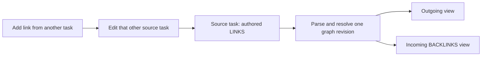

**Directed task relations for Bob: one authored edge, two useful views**

Independent research by **cdx**, 20 October 2026. This report was developed from the local bob-cli, bob-plugins, and bob-mac-capture sources, audited SASE memory, and official external documentation. No other report, transcript, or findings from this research swarm were consulted. This is a design recommendation, not an implementation or a benchmark.

**Recommendation in brief.** Build this feature. Store directed, optionally described relations under the source task's `LINKS` section. Show incoming relations automatically as a task-level `BACKLINKS` view derived from the same edges. Add both directions to the existing Task Card. In capture, let terminal `~` open the relation picker; use explicit `~>` and `~<` for accepted outgoing and incoming selections. Keep these relations independent of dependencies, task state, and Pomodoro planning. The highest-value work is dependable identity, editing, and recovery; a graph visualization can wait.

**Why this is a good idea—and where it could go wrong.**

Tasks often share context without being prerequisites. “Investigate slow startup” can inform “Rewrite launch sequence”; “Try a smaller proposal” can be an alternative to “Prepare full proposal.” A relationship gives that context a navigable home. Incoming discovery matters especially when the user remembers the target but has forgotten which task mentioned it.

The benefit depends on making a link cheap to create and useful to revisit. Requiring a relation type, description, two edits, or a separate relationship-management screen would turn a small act of remembering into bookkeeping. Descriptions should be optional and editable later. Most tasks should show no relationship UI until they have a relation or the user opens the Task Card.

There are three principal risks:

- **Semantic confusion:** Bob already uses “Task Link” for block links, especially links in the Pomodoro ledger, and already has dependency edges with substantial side effects. An informational link must not inherit those effects.
- **Duplicated truth:** storing editable outgoing and incoming lists requires conflict resolution between them. Automatic repair cannot know whether a disagreement represents an intended deletion, an incomplete edit, or stale sync.
- **Visual and grammar overload:** another mandatory child section and another ambiguous sigil would make the system harder to use. A compact relation view and explicit direction can avoid most of that cost.

Use “task relations” as the feature's name in APIs and documentation, while retaining the approachable `LINKS` and `BACKLINKS` labels in notes and views. A relation means “this task points to that task.” It does not mean “do this first,” “this task contains that task,” or “work on this today.”

**What the existing implementation tells us.**

The inspected repository revisions were:

| Repository | Revision |
| --- | --- |
| bob-cli | `8ba29959d4aab047bff060c2bc082bbb92213803` |
| bob-plugins | `ff369873dab5b34c853b4201c6816ef1f362d6b8` |
| bob-mac-capture | `3b944d877a7a0890b29c2d8d5d93d2c677d4b9d5` |

The dependency contract already establishes single-direction ownership: a dependent's `DEPENDS ON` line is authoritative; its prerequisite's `BLOCKS` line is generated. Both editing directions update the authoritative line. However, `BLOCKS` is deliberately a weaker consistency model than the requested backlinks: closed owners retain frozen history, and cross-note mirror writes can fail after the original edit succeeds. That is a useful architectural precedent, but copying its behavior would not satisfy continuously current task backlinks. See [the dependency contract, especially §§14–15](https://github.com/bobs-org/bob-cli/blob/8ba29959d4aab047bff060c2bc082bbb92213803/docs/task-dependencies.md) and [the cross-note follow-up writer](https://github.com/bobs-org/bob-plugins/blob/ff369873dab5b34c853b4201c6816ef1f362d6b8/plugins/bob-navigation-hotkeys/src/591-blocks-follow-ups.js).

The capture system already has a vault-wide candidate catalog carrying exact paths, block IDs, status, completed history, ambiguity information, and ID-assignment suggestions. Reuse the discovery and identity machinery, with a separate eligibility policy for informational relations. Reusing the dependency mutation path would be dangerous: that path also changes blocking, freshness, and sometimes ledger participation. See [candidate discovery](https://github.com/bobs-org/bob-cli/blob/8ba29959d4aab047bff060c2bc082bbb92213803/src/native/capture_dependency_tasks.rs) and [dependency writes](https://github.com/bobs-org/bob-cli/blob/8ba29959d4aab047bff060c2bc082bbb92213803/src/native/capture/dependencies.rs).

`Ctrl+Shift+P` already opens the Task Card; `b` opens Depends on and `Shift+B` opens Blocks. The card is therefore the natural home for Links and Backlinks. A new global keymap is unnecessary. The current card also documents that cross-note edits do not have ordinary one-step undo from the originating daily note; this feature should provide its own explicit relation undo rather than assume that problem is solved. See [Task Card controls and undo](https://github.com/bobs-org/bob-plugins/blob/ff369873dab5b34c853b4201c6816ef1f362d6b8/docs/task-card.md).

Bob Mac Capture already renders direction-aware dependency pickers and gets query, owner, replacement ranges, parse spans, and previews from bob. Preserve that boundary. Swift should render relations, never parse their grammar or read the vault. See [completion JSON](https://github.com/bobs-org/bob-cli/blob/8ba29959d4aab047bff060c2bc082bbb92213803/src/native/capture_complete/model.rs), [the Mac picker](https://github.com/bobs-org/bob-mac-capture/blob/3b944d877a7a0890b29c2d8d5d93d2c677d4b9d5/Sources/BobMacCapture/CapturePickerView.swift), and [Mac JSON models](https://github.com/bobs-org/bob-mac-capture/blob/3b944d877a7a0890b29c2d8d5d93d2c677d4b9d5/Sources/CaptureCore/CaptureModels.swift).

The storage guarantees need precise language. Capture stages edits and checks disk preimages, but the code explicitly says this is not cross-process locking or a fully serialized transaction. Its multi-file commit attempts rollback on ordinary failures. Task move likewise documents atomic replacement per file, not atomicity for the entire move. Neither mechanism justifies promising that every process or device always sees a globally consistent multi-file snapshot. See [capture commit](https://github.com/bobs-org/bob-cli/blob/8ba29959d4aab047bff060c2bc082bbb92213803/src/native/capture/commit.rs), [capture batch semantics](https://github.com/bobs-org/bob-cli/blob/8ba29959d4aab047bff060c2bc082bbb92213803/docs/capture.md), and [task move](https://github.com/bobs-org/bob-cli/blob/8ba29959d4aab047bff060c2bc082bbb92213803/docs/task-move.md).

**External evidence and its implications.**

Obsidian supports links to individual list-item blocks, custom display text, and automatic internal-link updates when files are renamed. Its block references are an Obsidian extension rather than standard Markdown. These facts favor ordinary block links as the durable representation; they do not establish that arbitrary task cut-and-paste moves are repaired. That remains Bob's responsibility. [Obsidian internal links](https://obsidian.md/help/links).

Obsidian's built-in Backlinks plugin describes incoming references to the active **note**. That is useful for general mentions but does not specify a labeled, task-owned relation model. My inference is that native backlinks can remain a companion view, while Bob must own attribution to individual tasks and distinguish relation edges from ordinary mentions. [Obsidian Backlinks](https://obsidian.md/help/plugins/backlinks).

Linear visibly separates related issues from blocking and blocked relationships, and supports a search-based relation picker. This supports the interaction pattern, not a requirement to copy its semantics: Linear also automatically relates mentions and converts resolved blocking relationships to related ones. Bob should not do either implicitly. [Linear issue properties: relations](https://linear.app/docs/issue-property#issue-relations).

Obsidian recommends `Vault.process()` for read-modify-write operations and checking the current content after asynchronous preparation. That is appropriate for closed-note plugin writes; it is not a transaction across files or a lock against all external processes. [Obsidian Vault API guidance](https://docs.obsidian.md/Plugins/Vault).

The W3C combobox pattern supplies a sound keyboard baseline: arrows navigate, Enter accepts, and Escape dismisses the popup without obliging a change to the existing value. Apply equivalent native accessibility behavior in Swift; do not transplant web ARIA attributes into a native view. [W3C combobox pattern](https://www.w3.org/WAI/ARIA/apg/patterns/combobox/).

**Explicit adjustments to the requested requirements.**

| Original suggestion | Recommended adjustment | Reason / cost |
| --- | --- | --- |
| `LINKS` sub-bullet | One owned `LINKS` section with one nested row per edge | Clear description boundaries and small diffs; costs more raw Markdown lines |
| Automatically maintained `BACKLINKS` field | Derived inline view and Task Card tab; no stored reverse list by default | Eliminates duplicate truth and mirror writes; requires Bob to display incoming task relations |
| Backlinks always correct | Exact inverse for each published local graph revision; explicit updating/error state during refresh | Honest guarantee under external edits, crashes, and offline devices |
| `~` for outgoing links | Terminal `~` opens the picker; accepted text uses `~>` | Preserves the quick trigger while making the direction visible |
| `~~` for incoming links | Use `~<` and a “Linked from” direction switch | Avoids the Markdown strikethrough family and makes reverse direction easier to read |
| Optional relation / description | One optional free-text, single-line phrase; no mandatory taxonomy | Quick capture; no automatic inverse grammar or machine interpretation |
| Other Obsidian tasks | Include completed and archived tasks in navigation/history; constrain writes to editable sources | Relationships remain useful after completion; frozen archives are respected |

The largest change is virtual backlinks. If incoming rows must also exist in raw Markdown with every plugin disabled, a generated export/cache is possible, but it is a distinct, weaker requirement: it can become stale between updates. I would not make that compromise the default.

**A small, explicit data model.**

Represent a relation as:

```text
source:      { vault_relative_path, block_id }
target:      { vault_relative_path, block_id }
description: optional plain text
```

For version one, permit at most one authored relation per ordered pair `(source, target)`. Adding it again is a no-op; editing its description is a deliberate update. Repeated adds never toggle or silently replace an existing description. Conflicting duplicates introduced by hand edits or sync are diagnostics, not a choice for the reconciler to make silently. Allow cycles and both `A → B` and `B → A`; they are informational. Reject self-links through supported writers.

The direction of the description is always **source → target**. If “Investigate startup” has a relation to “Rewrite launch” described as “informs,” its backlink must show “Investigate startup — informs → this task.” Do not guess that the inverse of an arbitrary phrase is “informed by.” A blank description displays no invented semantic type.

A word such as “blocks” typed as the description remains text. Dependencies stay in the existing Depends on / Blocks actions. Generic relations never add `[dependsOn::]`, mint dependency `[id::]` metadata, change checkboxes, consume or create ledger links, propagate project blocking, count as a review answer, or create successor offers. A relation-only edit should not stamp freshness. Explicitly combining a relation with a separate capture scheduling gesture may still perform that scheduling gesture; the preview must show both actions.

The new relation index considers only well-formed entries in the owned `LINKS` section. Arbitrary links in task titles, Work Logs, nested notes, dependency rows, or generated displays remain ordinary references. This narrow ownership rule prevents parent tasks from acquiring the links of their nested task children and prevents generated backlinks from manufacturing reciprocal edges.

**Recommended Markdown shape.**

```markdown
- [ ] #task Investigate slow startup ^startup-investigation
  - 🔗 **LINKS:**
    - [[projects/launch#^rewrite-launch]] — informs
    - [[areas/performance#^baseline]] — compare cold-start measurements
  - Measurements and other authored notes stay here.
```

Use normal, non-embedded block links. Store the target's vault-relative path without `.md`; writers should prefer explicit paths even for same-note relations. Readers may accept pathless links by resolving them against their owning note, but must not confuse a matching block ID in another note with the intended target. Do not store the task title as identity or continually rewrite titles as aliases; the renderer gets the current title from the target task.

Parse each direct child of the exact owned `🔗 **LINKS:**` marker as one initial block link followed by an optional ` — ` description. That first link is the sole endpoint. Descriptions are single-line plain text: UI writers escape Markdown metacharacters, and reader fixtures specify decoding. Do not interpret description content as additional relations or allow it to inject nested structure. Preserve prose outside the owned section, line endings, indentation, and final-newline state.

Recognize the exact marked header initially, rather than adopting every preexisting child named `LINKS`. Before rollout, inspect a read-only inventory for collisions with that marker. A malformed or duplicated owned section must be shown with a repair diagnostic and left untouched by automatic writers; it must not be silently emptied or merged. Ordinary `LINKS` prose stays ordinary prose until explicitly converted.

Keep source order and append new entries. Removing the final edge removes an otherwise empty owned section. Deleting a valid section by hand removes its edges; rebuilding the index must not resurrect them from a cache. An incomplete edit is different from a deliberate deletion: the UI should mark that task's relations as temporarily unavailable or show its last valid state explicitly as stale.

The existing dependency decision rejected one bullet per dependency because short prerequisite links became too bulky. I am deliberately recommending a different format for **described informational relations**, without changing dependencies: optional prose makes one-edge-per-row substantially easier to read, edit, merge, and validate than a flat line with a second escaping language around separators. Render the group compactly and fold it to control the visual cost.

Insert a new `LINKS` section after existing structural metadata (`CANCEL LOG`, `DEPENDS ON`, `BLOCKS`, and project sub-project structure), before ordinary child notes/logs where practical; do not reorder unrelated existing children. Add its recognizer to task-section enumeration so it cannot accidentally become an ordinary capture destination. The existing [task-section scanner](https://github.com/bobs-org/bob-cli/blob/8ba29959d4aab047bff060c2bc082bbb92213803/src/native/capture_task_sections.rs) already needs to distinguish managed children from user sections.

**Backlinks and the consistency guarantee.**

Let `E_r` be the parsed set of valid relations in graph revision `r`. Define:

```text
outgoing_r(A) = every edge e in E_r where e.source = A
incoming_r(B) = every edge e in E_r where e.target = B
```

Publish outgoing and incoming indexes together. There is no separately authored incoming set and no second repair algorithm. Therefore a published backlink cannot disagree with its published outgoing edge. Counts, descriptions, status previews, and navigation must all use the same graph revision.



Index source tasks even when they are Done, Cancelled, or archived; retain incoming relationships to closed targets. Completion changes styling, not the existence of a relation. This intentionally differs from the existing open-dependent `BLOCKS` projection and its frozen closed-owner lines.

In Obsidian, maintain an incremental per-note relation index driven by edits, saves, create/delete/rename events, and startup rebuild. Overlay the active editor's current text so an unsaved edit and its backlinks can agree locally. Handle two diverging buffers for one file as an explicit ambiguity rather than arbitrarily selecting one. Invalidate affected views immediately, then publish the new forward/reverse revision together. Batch and debounce work, but never present a known-stale count as current.

Outside Obsidian, bob needs a read-only graph/report API for capture previews and diagnostics. Start with a shared scanner and per-request graph; measure the real vault before adding a persistent database or daemon. A disposable disk index is acceptable only when invalidation, schema versions, file deletions, missed watcher events, and a complete rebuild are implemented. It must never be necessary to recover the authored links.

Treat unreadable or malformed sources as **incomplete knowledge**, not an empty relation set. Surface an “Updating links…” or “Some links unavailable” state and affected paths. An incremental event can say which files changed, but it does not make a whole-vault scan an atomic snapshot. Retry observed concurrent changes or return an incomplete revision. A supported writer should publish or invalidate its graph revision before announcing success to its own UI.

After git sync, rebuild affected source entries from the accepted Markdown. Files in `_conflicts/` are excluded, so preserved conflict copies cannot become extra sources. Offline devices show their local graph; updates become visible after synchronization. No design over independently editable files can truthfully promise instantaneous knowledge of remote offline edits. A graph that is exact for the available revision, with visible uncertainty, is the useful and testable interpretation of “always correct.”

Writing physical `BACKLINKS` links also has a subtle drawback: native note backlinks and graph views would see those reverse wikilinks as authored-looking reverse references. A virtual incoming view avoids that extra distortion. If a future export is needed, mark it generated, never parse it as input, and make its revision/freshness clear.

**Capture: quick selection with visible direction.**

The proposed spellings are:

| Draft fragment | Meaning |
| --- | --- |
| `Investigate startup ~` | Open the relation picker; outgoing direction initially selected |
| `Investigate startup ~>rewrite` | Search for an outgoing target |
| `Investigate startup ~>projects/launch:rewrite-launch` | New task → existing task |
| `Investigate startup ~<projects/launch:rewrite-launch` | Existing task → new task |
| `Investigate startup ~>projects/launch:rewrite-launch("informs")` | Outgoing relation with optional description |
| `Collect measurements ~<projects/launch:rewrite-launch("needs context from")` | Existing launch task → new measurements task, using the description in that direction |
| `Compare plans ~>"Project Notes":review("alternative to")` | A quoted note component |
| `^projects/launch:rewrite-launch ~>areas/performance:baseline` | Proposed relation-only edit of an explicitly selected existing owner |

These are proposed syntax, not commands currently supported by Bob. The accepted picker replacement should contain the explicit direction even when the user started with bare `~`. The optional `("...")` suffix is a quoted single-line string belonging to that one endpoint, with defined `\"` and `\\` escapes. The app can expose a small description field that asks bob to generate the replacement, so users do not have to memorize the suffix. A description may contain parentheses and sigils inside the quotes without starting a new modifier. An empty string means no description.

I prefer `~>` / `~<` to `~` / `~~`. `~~` already evokes strikethrough, and the extra character says “more” more readily than “reverse.” With explicit arrows, `~<B` reads as “this task receives a link from B.” This is a design judgment; verify it with a small usability exercise before freezing the contract.

Crucially, `~` is already used by Bob: `x~2` drops a link when closing a Pomodoro, and `=~2` starts without a queued link. Preserve all such spellings and their parser precedence. Do not interpret an attached tilde inside an existing session token as a relation. See [the existing capture grammar](https://github.com/bobs-org/bob-cli/blob/8ba29959d4aab047bff060c2bc082bbb92213803/docs/capture.md).

For version one, recognize relation directives only in the parent item's trailing modifier run, alongside its other complete modifiers. A terminal bare `~`, `~>`, or `~<` is incomplete and opens completion; unresolved selectors cannot be submitted as prose. Keep `~10`, `~/path`, `a~b`, `~~struck text~~`, fenced code, inline code, escaped `\~`, ordinary middle-of-sentence tildes, and authored child bullets literal. Scope each description and relation to its own capture item; blank-line bulk capture must not leak links between items. Reject a claimed malformed relation with a specific repair message.

The completion menu should have two explicit directions, **Links to** and **Linked from**, and a sentence preview with both task titles. Searching, selecting an ID-less candidate, and editing the description are draft operations. Stage any required IDs with the final capture where feasible; do not mutate a target merely because the cursor highlighted it. If the current explicit Add block ID flow is reused as a separate write, show that fact and do not claim canceling capture undoes it.

Use the existing exact-path and quoted-note resolver. Revalidate the selected task and owner at commit; a stale picker row is not authority. Rank open matching tasks first, with completed history available by a clear filter/section. Show task title, status, and note path so duplicate titles are distinguishable. Hidden tasks can be searched intentionally, but should not dominate default suggestions. Use deterministic tie-breaking and never select a “close enough” ambiguous endpoint automatically.

After selecting a task, show one editable chip with its arrow and title. Let the user add an optional description without a mandatory modal. Escape dismisses the picker while preserving the draft; Enter while the picker is open accepts the candidate and does not also submit capture. Preserve the app's established final-submit shortcut. A full sentence should explain reverse writes: **“Rewrite launch will link to Collect measurements.”** The live preview must name the existing source note that will be modified.

**Obsidian interaction and visual design.**

Add **Links** and **Backlinks** to the Task Card, with proposed within-card accelerators `l` and `Shift+L` after checking the complete runtime bindings. Keep the current global `Ctrl+Shift+P`. From a managed relation row, the card opens for the owning task with the relevant direction selected; clicking its task chip navigates to the endpoint. This avoids ambiguity between editing the relationship and editing the target's properties.

Links offers **Add link to…**. Backlinks offers **Add link from…**. Both open the same searchable task selector with a fixed, visible direction. Editing or deleting a backlink routes to the source's owned `LINKS` row. It does not create a reverse edge. Because the write may occur in another file, the action preview names that source task and note.

A possible compact rendering, with a closed history item dimmed, is:

```text
Investigate slow startup                              Ready

  ↗ LINKS  2
    ○ Rewrite launch       informs
      projects/launch
    ✓ Capture baseline     compare cold-start measurements
      areas/performance

  ↙ BACKLINKS  1
    ○ Check login timing   motivates → this task
      areas/performance
```

This is a layout sketch, not a screenshot of existing behavior. The `BACKLINKS` part is a rendered view, not extra Markdown in the note. Collapse longer lists to a stable “Show all 8” control, with counts always visible. Source mode keeps the authored Markdown legible; the Task Card provides incoming links when inline rendering is unavailable.

Reuse Bob's existing task chips, theme typography, status marks, and navigation behavior. Use one restrained relation accent; color must not carry direction by itself. Show arrows plus words, current task titles rather than raw IDs, paths as secondary text, and descriptions with slightly lower emphasis. Keep full descriptions available on expansion and to assistive technology. Avoid motion that shifts the draft or loses selection while results update.

Hover previews and modifier-click navigation are useful existing conventions. Removal should be available through a focused menu/button, not only hover. Do not make an informational relation chip's checkbox a new route for completing its target; navigation is the primary action. Add an explicit “Open task actions” affordance if needed. Existing Ctrl+Enter, transclusion, and tree-close recognizers must exclude owned relation rows from automatic cascading behavior.

A relation addition is not a morning-review answer and should not advance the walk. A reverse edit is also not permission to route an inbox task elsewhere. Reusing the Task Card requires explicitly bypassing property-edit side effects that belong to scheduling and review, while still using its target resolution and presentation.

**Identity, lifecycle, and failure behavior.**

| Situation | Required behavior |
| --- | --- |
| Endpoint has no block ID | Allocate a valid unique ID as part of a deliberate edit; completion and dry-run remain read-only |
| Two tasks share a title | Display path/status; resolve by path and block ID, never title |
| Duplicate block IDs in one note | Refuse ambiguous writes; preserve existing text and show repair guidance |
| Task title changes | Render the new title; do not rewrite every relation |
| File renamed through supported tooling | Rebase links and invalidate source/target indexes |
| Task moved or archived | Carry its outgoing section; repair incoming links and pathless links using the original context |
| Block ID collides during a move | Use Bob's reported final ID; repair endpoints to that ID before treating the operation as settled |
| Closed task | Retain all informational relations; display its status |
| Archived task used as target | Allow navigation and relations to an already identified task without changing archive content |
| Archived task selected as source of a new relation | Disable if archive policy prohibits edits; explain that reverse creation would write the archive |
| Target deleted or converted out of a task | Preserve the authored edge as unresolved/non-task, show the locator, and offer explicit repair/removal |
| Source deleted | Its outgoing edges disappear from the rebuilt graph; no backlink file needs editing |
| Raw cut-and-paste bypasses supported moves | Detect dangling references; never retarget by title or globally reused block ID |
| Hand edit or undo | Reparse source; republish both directions together |
| Conflicting descriptions after sync | Preserve evidence and report ambiguity; do not pick a description silently |
| Generic cycle | Allowed; no scheduling traversal or inherited state |

Path plus block ID fits existing Bob identity and move repair. It is not an immutable global identity. Do not add a second UUID to every task just for this feature, but do not promise that this pair survives arbitrary external moves or delete-and-recreate operations. If those become a requirement, a broader identity/move-ledger design should precede the guarantee. An unresolved link should not silently rebind to a new task that happens to reuse a deleted ID; this is a reason to avoid ID reuse and to flag observed delete/recreate transitions. Without durable history, an offline replacement with identical identity cannot always be distinguished.

For ordinary existing-endpoint edits, single-source storage often reduces the semantic write to one file. Adding a newly captured task with an incoming relation still requires at least the new task and another source note. Multiple relations and ID allocation can also span files. Do not pretend derived backlinks remove those cases.

Reuse capture's staged planning and preimage checks, and harden the multi-file path needed by this feature: serialize cooperating Bob writers, validate the read-set used for endpoint resolution, and preserve a transaction receipt/recovery journal for partial writes. Create a new referenced task before publishing an incoming source edge when possible. On interruption, recover only when current bytes match known preimages/postimages; preserve conflicting files and report the incomplete operation. The journal is recovery metadata, never a second relation store. A filesystem lock cannot control arbitrary editors or remote offline writers, so visible incomplete state remains part of the design.

Existing tasks should get idempotent set-style relation mutations keyed by endpoint pair. Capture retry also needs a stable submission identifier if a timed-out success must not create the new task twice; graph deduplication alone cannot deduplicate task creation. The app must not automatically replay an uncertain capture without checking its result/receipt. These are acceptance requirements for a reliable experience, not capabilities established by this research.

For plugin writes, edit an open source buffer in one editor transaction. Use preimage-checked `Vault.process()` for a closed source file. Provide an explicit relation-operation **Undo** receipt for cross-note actions, applying its inverse only if the affected edge still matches the committed result. A native Ctrl+Z in an unrelated note is not global undo. No undo entry is needed for a virtual backlink.

**Implementation boundaries and release criteria.**

Keep the first release within three existing repositories:

| Area | Recommended responsibility |
| --- | --- |
| bob-cli relation core | Parse/format owned sections, resolve endpoints, compute forward/reverse views, validate mutations, plan capture writes, report diagnostics |
| bob-cli capture language | Sigil boundaries, partial/error states, owner resolution, description quoting, completion replacements, semantic spans, preview |
| bob-cli move/archive paths | Rebase endpoints and preserve section ownership; verify existing generic link repair against the new format |
| bob-navigation-hotkeys | Task Card relation stages, safe source-buffer edits, reverse editing, undo receipts |
| bob-ledger-tools | Shared relation index/view model, compact inline views, status/title resolution, navigation |
| Other task plugins | Recognize owned relation sections so toggles, tree closes, and section capture do not misinterpret them |
| bob-mac-capture | Decode additive relation data, render picker/chips/description field/preview, retain draft on failure |

Share one written Markdown grammar and executable fixture corpus between Rust and JavaScript. Prefer generated or mechanically checked fixtures over manually synchronized examples. The app must not get a third grammar implementation. An Obsidian in-memory index can be a JavaScript implementation of the same relation contract; it must agree with Rust on malformed sections, identity resolution, and labels.

Extend existing `capture-parse`, `capture-complete`, and dry-run output additively with a dedicated relation context: direction, owner, exact endpoint reference, decoded query, label, source ranges, proposed write locations, and diagnostics. Keep UTF-8 byte ranges authoritative and test conversion to Swift's indexing, especially with emoji and non-ASCII paths. `schema_version: 1` by itself is not a capability signal: both old-client/new-bob and new-client/old-bob combinations need fixtures. Add an explicit advertised relation capability and make unsupported feature use visible before submit. An old backend that treats new syntax as plain prose must not silently capture it through the new UI.

CLI names require care: this project's CLI rules reserve `bob task <verb>` for mutations within that group's membership and keep read-only reports top-level; `bob capture` cannot gain nested commands. A top-level relation report/protocol endpoint is therefore a better starting point than casually inventing `bob task links list`. Final public names and short option aliases should be reviewed against those rules when implementation starts.

The first usable slice should include both directions, optional descriptions, source editing, derived incoming views, and safe capture together. Ship recognition and preservation before enabling writers, so an older sibling plugin does not treat relation rows as ordinary task links. Keep rollout incremental; no vault-wide migration of existing prose links is needed. Do not convert dependencies or arbitrary mentions into relations.

The meaningful acceptance suite should cover:

- **Graph invariants:** for every published revision, each outgoing edge appears once in its target's incoming list with the same description; deleting all cache state changes no authored data; rebuild and incremental update agree.
- **Format and ownership:** nested tasks, arbitrary authored notes, empty/deleted/malformed sections, duplicate sections, aliases, embedded links, CRLF, tabs, Unicode, escaped description text, and code fences.
- **Syntax regression:** `x~2`, `=~2`, `x1!2~3`, home paths, approximation text, strikethrough, literal escapes, unfinished selectors, quoted note names, quoted descriptions, multiple relations, and bulk-item boundaries.
- **No unintended effects:** relation-only actions leave status, freshness, dependencies, review position, priority, and today's ledger byte-identical except for necessary identity insertion.
- **Lifecycle:** same-note/cross-note links, move with destination ID collision, archive, rename, missing/reappearing endpoints, source deletion, undo, and sync conflict copies.
- **Failure injection:** stale picker, source buffer changed after preview, endpoint removed before commit, each multi-file interruption boundary, rollback/recovery conflict, and uncertain-submit retry.
- **Client compatibility and usability:** supported/unsupported bob versions, out-of-order completion responses, Unicode replacement offsets, keyboard-only selection, Escape, incoming-write clarity, accessible descriptions, light/dark themes, long titles, and many backlinks.

Measure a representative real-vault scan, warm picker latency, and burst-update behavior on the Mac before adding infrastructure. Suggested product goals are a warm interaction around 150 ms and explicit progress when a cold scan takes longer; these are targets, not measured results. Usability validation should ask Bryan to create one outgoing link, one incoming link, add a description, then remove the relation from the incoming side. If he cannot predict which task changes, revise the direction copy before optimizing rendering.

Compile and test changed Swift appropriately: the linked repository requires portable checks and macOS target verification, with macOS CI executing tests. This research changed no Swift or runtime code and ran no product test suite. Source inspection establishes integration points, not working end-to-end behavior or measured performance.

**Alternatives and when to revisit them.**

| Alternative | Assessment |
| --- | --- |
| Plain task mentions plus Obsidian's note backlinks | Lowest implementation cost, but weak task ownership and no reliable per-edge description/reverse editing |
| One flat `LINKS` line with multiple annotated links | Compact raw text; more complex delimiter/quoting rules and worse merge behavior when labels grow |
| Editable `LINKS` and editable `BACKLINKS` | Reject: two sources of truth and ambiguous deletions |
| Authored `LINKS`, generated physical `BACKLINKS` | Viable if raw-Markdown incoming visibility is essential; accept eventual repair, extra writes, and native backlink noise explicitly |
| Store the graph in JSON/SQLite as authority | Reject for this feature: breaks direct Markdown editing and makes separate database survival a correctness requirement |
| Fixed types with generated inverse labels | Revisit when repeated labels need real queries or behavior; premature for optional free-text context |
| Require a universal task UUID now | Revisit if arbitrary external moves must preserve identity; too broad a migration for navigational links alone |
| Separate relation plugin | Adds another lifecycle/version boundary; extend the existing Task Card and chip renderer first |
| Interactive force-directed graph | Potential later exploration tool; not the primary capture/editing interface |

**Recommended solution.**

Implement a small informational relation graph whose only durable authority is each source task's owned `LINKS` section. Use ordinary task block links and optional plain-text descriptions, with one readable row per edge. Derive `BACKLINKS` from that graph and publish both directions together, including completed-task history and visible diagnostics for incomplete knowledge. Add Links and Backlinks to `Ctrl+Shift+P`; reverse editing always edits the other task's source row. Let `~` open capture search, use `~>` / `~<` to make direction explicit, and keep all semantics in bob. Preserve dependency and Pomodoro behavior, require honest multi-file recovery and undo, and make the result beautiful through quiet typography, familiar task chips, clear direction, and progressive disclosure. This gives the requested usefulness without making the user maintain the same fact twice.
