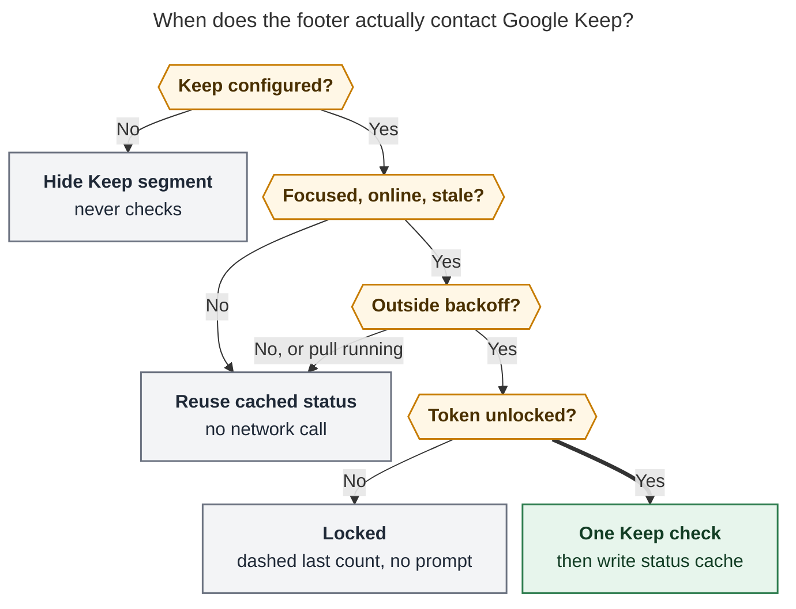

# Keep → Inbox Footer Indicator: Research, Critique, and Recommended Design

Researcher: `cld` · 2026-10-31 · Scope: bob-cli (`bob gkeep`), bob-plugins
(`bob-ledger-tools`, `bob-command-mode`), chezmoi (GPG/pinentry config), upstream
`gkeepapi` / `gpsoauth`.

## TL;DR

- **Yes, build it, with one structural change to the request.** The Obsidian plugin
  should not decide when to call Google Keep. **bob should own the Keep count, its
  cache, and its rate limit** through a new read-only, never-prompting
  `bob gkeep status` command. The footer is a thin client: it paints what bob reports
  and asks again only when someone is actually looking at Obsidian.
- **Use attention-driven checks, not polling.** Check Keep on startup, when the window
  regains focus, and on a timer *only while focused*. Never check more than once per
  `max-age` (default 15 min), never more than once a minute, and back off on failure.
  `bob gkeep pull` and `bob gkeep list` refresh the cache for free. Expect roughly
  20–30 Keep checks per day instead of the 1,440 a one-minute poll would make.
- **The inbox count needs no subprocess and no timer.** Compute it inside Obsidian from
  the metadata cache whenever `gkeep_inbox.md` changes. It updates within a frame, not
  "within seconds".
- **One safety requirement the request did not mention:** the background check must
  never trigger a GPG pinentry. The token comes from `pass`. A background `pass show` on
  a cold agent can steal a terminal or hang, which is exactly what happened on Apollo on
  2026-10-10.
- **Visual:** one status-bar item, two segments. A filled gold **💡 pill** shows notes
  still in Keep; a plain **📥 numeral** shows open tasks already in `gkeep_inbox.md`; a
  faint `›` between them shows the flow a pull performs. Each segment hides at zero, and
  a dashed outline means "last known, not current". The two counts differ by icon, fill,
  ink, and position, never by color alone.


*Figure 1 — Mockup rendered in headless Chromium using Obsidian's default light and dark
tokens and Lucide icons (`lightbulb`, `lightbulb-off`, `inbox`, `chevron-right`).
Bob's existing review footer sits on the left, unchanged.*

---

## 1. What exists today (facts this design builds on)

| Fact | Where | Why it matters |
| --- | --- | --- |
| Every Keep call spawns `uv run --script gkeep_adapter.py` (Python + `gkeepapi` 0.17.1 + `gpsoauth` 2.0.0) and pipes the master token over stdin | `src/native/gkeep/adapter.rs`, `scripts/gkeep_adapter.py` | A check costs a process tree, not just an HTTP call |
| Each adapter run calls `gpsoauth.perform_oauth` (master token → access token), then `notes/v1/changes` from a cached `keep_version`; the state cache is `~/.cache/bob-cli/gkeep/state.json`, saved **twice** per snapshot | `connect()` / `op_snapshot()` in the adapter; `gkeepapi` `APIAuth.refresh`, `_sync_notes` | Steady-state cost is one auth exchange plus one small incremental `changes` call; cache I/O grows with Keep history, and Keep's archive only grows because every pull archives |
| `read_token()` runs `token_command` (default `pass show gkeep/master_token`) with **stdin and stderr inherited "so `pass` can use pinentry"** | `src/native/gkeep/config.rs` | Safe at a terminal; unsafe in the background (see §5) |
| Mac GPG uses a terminal `pinentry` (`/opt/homebrew/bin/pinentry`, not `pinentry-mac`) with a 400-day cache. Every zsh startup runs `gpg-connect-agent updatestartuptty` | chezmoi `home/private_dot_gnupg/gpg-agent.conf.tmpl`, `home/dot_zshrc` | After a reboot the cache is cold; a background prompt would attach to whichever terminal last started |
| The adapter maps HTTP **403 → `auth`**; Keep's rate limit surfaces as **403 "Rate Limit Exceeded"** (gkeepapi #162); gkeepapi **retries 429 forever** (2 s → 60 s delay) | `classify_error()`; gkeepapi `API.send` | A poller would misread throttling as "signed out", and a 429 would hang until the 300 s adapter timeout |
| `bob gkeep list` classifies notes as new / pending / revised / empty / pinned / shared. Its footer's actionable set is `new + pending + revised`, and URL-only notes are `new` with a `create_ref` action | `src/native/gkeep/list.rs` `footer()`, `plan.rs` | This is the honest definition of "would be synced" (A1) |
| Classification scans every vault `.md` for legacy `%%gkeep:` markers, plus the import receipts and journal | `Ledger::scan`, `docs/gkeep.md` | Cheap: ~0.13 s for `bob gkeep list -s vault` on Apollo's 6,820-note vault copy |
| The vault table counts **top-level** tasks only (`indentation.is_empty()`), honors the Tasks global filter (`#task`), and treats every status except `x`/`X`/`-` as open. Keep checklist items land as nested `- [ ]` children | `ledger.rs` `read_target_tasks_with_imports`, `list.rs` `is_open_status`, `render.rs` | Defines the inbox count (A2) |
| `bob gcal` deliberately has **no periodic sync**: Ledger Tools runs it once when the daily note is created. `docs/gkeep.md` says "There is no scheduled runner" | `docs/gcal.md` "Where it runs", `docs/gkeep.md` "Known limits" | Bob's house style prefers event-triggered network work over timers |
| Ledger Tools already has the status-bar review footer, a shared `bobSpawnJson` process boundary, focus/visibility revalidation hooks, and theme-normalized OKLCH inks ("Text, never color alone, carries meaning") | `240-plugin-freshness-status.js`, `236-plugin-stats-data.js`, `170-plugin-lifecycle.js`, `styles.css` | Natural home; reuse, don't reinvent |
| Command Mode catalogs `gkeep-pull` (PreviewFirst with a dry run), `gkeep-list`, and `gkeep-doctor`. It exposes `api.commandMode.run(argv)` and fires `bob-command-mode:run-finished` with `entryId` | `src/native/catalog/table.rs`, bob-plugins `docs/bob-command-mode.md` | Click-to-pull and refresh-after-pull come almost free |
| The vault already has a daily `#gtd #pre` checklist row, **"Import inbox tasks from Google Keep"** | `gtd_daily.md` | The indicator answers that row's real question: is there anything to import? |
| Measured on Apollo: `uv run` start ≈ 0.2 s; importing `gkeepapi` + `gpsoauth` + `requests` ≈ 0.4–0.8 s, before token or network work | local timing, no Keep contact | A full check is likely 1.5–3 s wall and about 1 s CPU (unmeasured on the Mac; see §9) |

No command in this research contacted live Google Keep. The gkeep rollout docs reserve
live runs for Bryan.

---

## 2. Critique: is this a good idea?

**Mostly yes.** Keep captures are invisible from Obsidian until someone runs a pull, so
the GTD "collect → process" loop has a blind spot exactly where capture happens most:
on the phone. A glanceable count closes that loop. It also makes the daily PRE row
"Import inbox tasks from Google Keep" answerable at a glance. When Keep shows nothing,
Bryan can close the row without opening a terminal.

**Where the plan, as written, would go wrong:**

1. **"Sync less often" is the wrong knob. The right one is "check only when it can
   matter."** Any fixed period is wrong twice: too often while the Mac sits idle with
   Obsidian in the background, and too slow right after Bryan walks back to the desk.
   Attention-driven checks fix both.
2. **The plugin should not own the throttle.** A plugin-owned timer can't see a
   terminal `bob gkeep pull`, a second Obsidian window, or a future menu-bar consumer.
   Put the cache and the budget in bob, so every client shares one rate limit and pulls
   refresh it for free.
3. **"Only show if authenticated" hides failures.** If the Keep segment simply vanishes
   when the token is revoked, "signed out" looks identical to "Keep is empty", and notes
   pile up unseen. That is the failure this indicator exists to prevent. See A3.
4. **Background secret reads are a real hazard** (§5). The request did not mention it,
   but the indicator is the first unattended consumer of the Keep token.
5. **Attention cost.** A permanently non-zero number becomes wallpaper. Hide at zero,
   avoid alarm colors, and animate only while a check is actually running.
6. **Overlap with the review footer.** New inbox tasks also appear in the review walk's
   NEW tier. That is acceptable: the review footer is about the walk, while this item is
   about the intake pipeline. They should look like siblings, not duplicates.

**Would I take a different approach?** I considered four:

| Approach | Verdict |
| --- | --- |
| Plugin polls `bob gkeep list -f json` on a fixed interval | **Reject.** Full vault scan plus token read on every tick, wrong cadence twice, no shared budget, and `list` reads the token interactively |
| launchd or Hammerspoon job writes a status file every N minutes | **Reject for v1.** Works while nobody is looking (the opposite of the goal), adds an always-on moving part, and has the same pinentry hazard. The recommended design makes this a trivial add-on later |
| Fold "KEEP 3" into the review footer | **Reject as the only surface.** The review footer hides when no review is due and is about the `]s` walk. Optional extra: show it on the PRE "Import … Google Keep" row (§10, phase 3) |
| **Auto-pull instead of counting** | **The strongest alternative; defer, don't dismiss.** If Bryan always pulls as soon as the count goes non-zero, automate the pull and turn the Keep segment into a "pull failed or waiting" signal. Not yet: a pull writes and commits the vault, archives in Keep, and clips URL-only notes through a headless browser. That is the heavy, write-side work the request wants to avoid doing unattended. Revisit after a few weeks of real counts |

---

## 3. Requirement adjustments (explicitly called out)

| # | Original | Adjusted | Why |
| --- | --- | --- | --- |
| **A1** | "how many notes … would be synced" | **Keep count = every note `pull` would act on: new + revised + pending-archive (URL-only links included). Pinned, shared, and empty notes are excluded.** The tooltip breaks the number down, for example "2 new · 1 link → reading queue · 1 already imported (archive only) · 1 pinned stays in Keep" | Matches the CLI footer's `→ bob gkeep pull` set, so the footer and terminal never disagree. Pinned notes never sync, so they never count |
| **A2** | "non-closed tasks in gkeep_inbox.md" | **Top-level `#task` lines in the configured `gkeep.target`** (default `gkeep_inbox.md`) **whose status is not `x`, `X`, or `-`.** Nested checklist children don't count | Otherwise one 12-item Keep grocery list reads as 13. This is exactly `bob gkeep list -s vault`'s row set |
| **A3** | "only shown if Keep has been properly authenticated" | **A Keep number appears only after a Keep check has succeeded with the current config.** A last-known number may stay up to 24 h, dashed, while checks can't run for a transient reason (offline, locked GPG, rate limit, pull running). **New:** if auth was verified and later fails, show a quiet `Keep sign-in` marker instead of vanishing. Never-authenticated or unconfigured hosts show nothing. The marker is configurable off | Silent disappearance makes a broken pipeline indistinguishable from an empty one |
| **A4** | (unspecified) | **Zero hides.** Each segment hides at zero, and the whole item hides when both are zero | Inbox zero should look calm; this matches the review footer, which "hides when nothing is due" |
| **A5** | "careful not to sync too often" | **No fixed polling.** Attention-driven checks gated by a bob-owned `max-age` (default 15 min), a 60 s floor, a daily budget (96), and failure backoff | §4 |
| **A6** | (unspecified) | **The background path never prompts** for a GPG passphrase; it reports `locked` instead | §5 |
| **A7** | inbox count "synced much more often — seconds at most" | **Event-driven and instant:** recount when Obsidian's metadata cache changes for the target note. No timer, no subprocess | Cheaper and faster than any polling interval |
| **A8** | (not requested) | **Click the 💡 pill to pull** through Command Mode (dry-run preview first). **Click 📥** to open the inbox note. **Right-click** for Check now, Preview pull, and Keep doctor | A number you can't act on is a nag; reusing Command Mode keeps writes guarded |

---

## 4. The hard part: when to talk to Google Keep

### 4.1 What one check costs

| Step | Cost | Notes |
| --- | --- | --- |
| `token_command` (`pass` → `gpg` decrypt) | ~tens of ms when the agent cache is warm | **Can block or prompt when cold** (§5) |
| `uv run --script` + Python start | ≈ 0.2 s (measured) | |
| Import `gkeepapi`, `gpsoauth`, `requests` | ≈ 0.4–0.8 s (measured) | |
| `gpsoauth.perform_oauth` (Google auth endpoint) | 1 network round trip | **The call to economize.** It is the account-security-sensitive one; gkeepapi notes the access token it returns is valid "for several hours" |
| `notes/v1/changes` from the cached `keep_version` | 1 small round trip when nothing changed | Incremental because state is cached |
| State restore plus 2× `keep.dump()` JSON writes | Grows with total Keep history (archived notes included) | Measure on the Mac; skipping the redundant second save is free |
| Vault classification (marker scan, receipts, journal) | ≈ 0.1 s | Only needed after a network check |

At a guessed ~1 s CPU per check, 30 checks a day cost under a minute of CPU. CPU is not
the constraint; the API is. **The goal is to minimize auth exchanges while keeping the
number fresh whenever Bryan looks at it.**

### 4.2 The policy

**Triggers (plugin side; all of them only *ask* bob):**

1. **Startup:** paint immediately from `bob gkeep status --offline`, then ask for a
   real check 15 s after layout-ready so it doesn't compete with Obsidian's startup.
2. **Return of attention:** on `window` focus or `visibilitychange → visible`,
   reusing the hooks Ledger Tools already registers.
3. **While focused:** one `setTimeout` at bob's `next_check_at`, clamped to
   [60 s, 2 h]. When it fires, ask only if `document.hasFocus()` and
   `navigator.onLine`; otherwise wait for the next focus.
4. **Network back:** the `online` event.
5. **Explicit:** right-click **Check Keep now** sends `--max-age 0`.
6. **Free refreshes, no network:** Command Mode `run-finished` for
   `gkeep-pull`/`gkeep-list`/`gkeep-doctor`, and an `fs.watch` on the cache
   *directory* (atomic renames) to catch terminal pulls. Both re-read with `--offline`.

**Gates (bob side, so every client shares them):**



*Figure 2 — A trigger (startup, focus, focused timer, or click) reaches Google Keep only
when Keep is configured, the window is focused and online, the cached result is older
than `max-age`, no backoff, floor, or running pull applies, and the token can be read
without a prompt. `bob gkeep pull` and `list` also rewrite the cache, at no extra network
cost. Rendered at 826 × 958 px, 79% fit.*

**Gate details:**

- **Freshness:** reuse any result younger than `max-age`. Default 15 min, from a new
  `gkeep.check_interval` key (`off` disables Keep checks entirely).
- **Floor:** at most one network check per 60 s, whatever the caller.
- **Budget:** at most 96 automatic checks per local day. After that, only
  `--max-age 0` checks run.
- **Single flight:** a non-blocking `flock` on `status.lock`. A second caller gets the
  cache with `in_flight: true` instead of queueing.
- **Pull running:** if `pull.lock` is held, serve the cache. The pull rewrites it when
  it finishes, so status never races an archive.
- **Backoff,** persisted in the cache so Obsidian reloads can't reset it:

| Failure | `state` | Next automatic check | Footer |
| --- | --- | --- | --- |
| Network error or adapter timeout | `offline` | 5 → 10 → 20 → 40 → 80 min, capped at 2 h | Dashed last count (≤ 24 h) |
| HTTP 429, or 403 with a rate-limit reason | `rate_limited` | 6 h | Dashed last count |
| Token unreadable without a prompt | `locked` | Next focus after ≥ 30 min | Dashed last count; tooltip says how to unlock |
| No token, a sign-in cookie, 401, or `BadAuthentication` | `auth` | None until the config changes or `bob gkeep login` runs; one probe per 24 h | Hidden, or `Keep sign-in` if auth was verified before (A3) |
| Adapter crash or protocol error | `error` | 30 min → 2 h | Dashed; tooltip suggests `bob gkeep doctor` |

### 4.3 Expected volume

Assume Obsidian is focused about 6 h a day. With a 15 min `max-age`, that is at most
~24 timer checks. Focus-return checks pass through the same freshness gate, so the
realistic total is **~20–30 checks a day**, each one auth exchange plus one `changes`
call. A naive one-minute poll would make ~1,440 checks (~2,900 requests) a day, and
would keep making them overnight. The 96-check budget caps a pathological day at about
one check every 15 minutes, around the clock.

---

## 5. Token safety: never prompt from the background

On 2026-10-10 an orphaned `pass show` left a `pinentry-curses` process spinning on a
deleted terminal. It held the agent's pinentry lock and blocked every other secret
read on Apollo (`research:202610/apollo-pass-pinentry-hang.md`). The Mac setup has the
same shape: a terminal `pinentry`, a cold cache after reboot, and `updatestartuptty` on
every shell. A cold-cache `pass show` launched from Obsidian (no TTY) could therefore
take over the most recently opened terminal, or hang.

`bob gkeep status` must read the token **unattended**:

- `stdin` from `/dev/null`, `stderr` captured (never inherited), `GPG_TTY` removed.
- `PASSWORD_STORE_GPG_OPTS` gains `--pinentry-mode error` (`pass` appends it to its gpg
  options; the Apollo report used the same probe). gpg then fails fast instead of
  invoking pinentry. A warm cache is unaffected.
- A 10 s deadline that kills the whole process group.
- Failure reports `locked`, not `auth`. The tooltip reads: *"Keep check paused: your
  password store is locked. Run `bob gkeep` once in a terminal to unlock it."*

**Optional hardening on the Mac:** point `gkeep.token_command` at the login Keychain,
for example `security find-generic-password -s bob-gkeep -a <email> -w`. The Keychain
unlocks at login, so the indicator would never sit in `locked` after a reboot. This
mirrors `bob gcal`, which already keeps its token in the Keychain on the Mac. The cost is
a second secret store and a one-time "Always Allow" prompt. Recommend it; don't require
it.

---

## 6. Design: anatomy, states, interaction

### 6.1 Anatomy

```
⟳ Review 4 due · 2 commitments · ]s next      (💡 3) › 📥 5     312 words  …
└──────── existing review footer ────────┘    └─ new item ─┘
```

- **One status-bar item** in Ledger Tools, registered right after the review footer.
  Because that footer uses `margin-right: auto`, the new item becomes the first item of
  the right-hand cluster, so the two read as one sentence: *review on the left, intake
  on the right*.
- **Keep segment (remote, not yet in the vault):** a Lucide `lightbulb` (Keep's logo,
  and the 💡 that bob already puts on imported tasks) plus a tabular numeral, inside a
  **filled pill**. The pill tint is 17% of the Keep hue with a 30% inset ring. The ink
  uses the review footer's normalization:
  `oklch(from var(--color-yellow) L min(c, 0.16) h)` with L = 0.52 in light themes and
  0.80 in dark ones, which clears 4.5:1 on the status bar like the other review inks.
- **Connector:** `chevron-right` in `--text-faint`, shown only when both segments are
  visible. It encodes what `pull` does: things move from the left box into the right.
- **Inbox segment (local, awaiting triage):** a Lucide `inbox` in `--text-muted` plus a
  numeral in `--text-normal`, weight 600, **no fill**.

**Distinct beyond color:** different icons, filled pill versus plain text, left versus
right of the arrow, and different tooltip sections. In grayscale, the pill alone still
separates them.

### 6.2 States

| State | Keep segment | Inbox segment |
| --- | --- | --- |
| Count > 0 and fresh | Gold filled pill `💡 3` | `📥 5` |
| Check in flight | Same pill; the bulb becomes a thin 1.2 s spinner ring (a static dimmed bulb under `prefers-reduced-motion`) | unchanged |
| Count 0 and healthy | hidden | unchanged |
| Last known, not current (offline / locked / rate-limited / error, ≤ 24 h) | Transparent pill, **dashed** outline, muted ink. The dashed ring echoes Command Mode's "queued" indicator | unchanged |
| Older than 24 h with no success | hidden | unchanged |
| Auth lost after it once worked (A3) | `lightbulb-off` + `Keep sign-in` + a 6 px red dot, muted | unchanged |
| Unconfigured, or `bob` too old to have `gkeep status` | hidden; no checks | still shown (pure vault) |
| Both segments hidden | whole item `display: none` | |

### 6.3 Tooltip

Use Obsidian's tooltip. Every number is spelled out:

```
💡 Google Keep · 3 notes to pull
   2 new · 1 link → reading queue · 0 revised
   1 pinned stays in Keep
   Checked 4 min ago
📥 gkeep_inbox.md · 5 open tasks
   Oldest: 6 days
Click the bulb to pull (dry-run preview first) · click the tray to open the inbox
Right-click: Check now · Preview pull · Keep doctor
```

Failure states replace "Checked …" with the reason and its fix, for example *"Offline
since 14:02 · retrying in 20 min"* or *"Keep sign-in expired · run `bob gkeep login`"*.

### 6.4 Interaction

- **💡 click:** `api.commandMode.run(["gkeep", "pull"])`. Command Mode's PreviewFirst
  policy shows the dry run, asks for confirmation, then shows the status chip, toast,
  and pager. Without a TTY, URL-only notes without an `@route` default to the
  `gkeep_inbox` parent, which is already documented non-interactive behavior.
- **📥 click:** open the target note. **Alt-click** jumps to its oldest open task.
- **Right-click menu:** Check Keep now · Preview pull · Pull · Open inbox · Keep doctor ·
  Hide indicator.
- **Command palette:** "Bob: Check Google Keep now" and "Bob: Toggle Keep inbox
  indicator".
- **Keyboard and accessibility:** each segment is a `button` with a full-sentence
  `aria-label` (*"3 Google Keep notes to pull"*, *"5 open tasks in gkeep_inbox.md"*) and
  a focus ring matching `.bob-freshness-main:focus-visible`.
- **Desktop only:** hidden on mobile, like the review footer.

**One honest color caveat:** the review footer's PENDING (`WIP`) group also uses a
yellow ink. The pill shape, bulb icon, and right-hand position disambiguate it. If it
still reads as related in practice, tint only the bulb and pill and keep the numeral in
`--text-normal`.

---

## 7. Contracts (bob-cli)

### 7.1 `bob gkeep status` (new, read-only)

```
bob gkeep status [-b|--bob-dir DIR] [-f|--format human|json] [-m|--max-age DURATION] [-o|--offline]
```

- `-m, --max-age`: reuse a Keep result younger than this. Defaults to
  `gkeep.check_interval` (15 min). `0` checks now, bypassing backoff and the budget but
  never the 60 s floor.
- `-o, --offline`: never read the token or contact Keep; report the cache plus the live
  inbox count.
- **Never prompts** (§5). Bare `bob gkeep` stays `list`. Options are alphabetical with
  short aliases, per the CLI rules.
- **Exit codes:** 0 whenever a status document prints, because states are data. 2 for
  usage errors or invalid config YAML.

**Human output:**

```
💡 Keep    3 to pull · 2 new · 1 link → reading queue · 1 pinned stays   checked 4m ago
📥 Inbox   5 open in gkeep_inbox.md · oldest 6d
→ bob gkeep pull
```

**JSON** (`schema_version: 1`, additive-only):

```json
{
  "schema_version": 1, "ok": true,
  "keep": {
    "state": "ok",
    "source": "cache",
    "in_flight": false,
    "account": "you@example.com",
    "auth_verified": true,
    "fetched_at": "2026-10-31T14:03:11Z",
    "checked_at": "2026-10-31T14:03:11Z",
    "next_check_at": "2026-10-31T14:18:11Z",
    "pull": {"total": 3, "new": 2, "revised": 0, "pending": 1, "links": 1},
    "stays": {"pinned": 1, "shared": 0, "empty": 0},
    "error": null
  },
  "inbox": {"path": "gkeep_inbox.md", "exists": true, "open": 5, "oldest_created": "2026-10-25"},
  "cache_path": "~/.cache/bob-cli/gkeep/status.json"
}
```

`state` is one of `unconfigured`, `ok`, `locked`, `auth`, `offline`, `rate_limited`,
`busy`, or `error`. `next_check_at` is the key to thin clients: bob says when asking
again could be useful, so no client re-implements the backoff.

### 7.2 Status cache

Path: `~/.cache/bob-cli/gkeep/status.json`, mode `0600`, atomic rename. It is local and
never stored in the vault, so it creates no git-sync churn and nothing is shared between
hosts.

- **Contents:** the JSON above, plus `failures`, `budget {date, checks}`, and a
  `config_key` = first 12 hex characters of `sha256(email | device_id | token_command)`.
  Changing the config invalidates the cache. Tokens are never stored.
- **Writers:** `status`; `list` (it already has the plan); `pull` (post-archive
  remainder, no extra call); `login` (clears `auth` and the backoff); `doctor` (its
  `keep` row).

### 7.3 Adapter fixes (worth doing regardless)

1. **Classify 403 "Rate Limit Exceeded" / `rateLimitExceeded` as `rate_limit`, not
   `auth`.** This bug affects `pull` today.
2. **Bound gkeepapi's infinite 429 loop.** Give `status` a short adapter deadline (about
   45 s instead of 300 s) and map the timeout to `offline`.
3. **Skip the second `save_state` when `keep_version` did not change.** That is a free
   halving of cache writes on idle checks.

---

## 8. Plugin implementation sketch (bob-ledger-tools)

New fragments (each ≤ 1000 lines, per the fragment rule):

- `292-plugin-keep-inbox-model.js`: a pure view model. It takes the status JSON, the
  inbox count, and `now`, and returns segments, tone, aria text, and tooltip lines.
  Unit-testable, no DOM.
- `293-plugin-keep-inbox-render.js`: DOM and paint, with a paint key that skips
  unchanged frames (the same trick as the review footer), plus `setIcon`, the tooltip,
  and the menu.
- `294-plugin-keep-inbox-lifecycle.js`: triggers (§4.2), a single-flight
  `bobSpawnJson(["gkeep","status","-f","json"])`, `fs.watch` on the cache directory,
  the Command Mode `run-finished` listener, commands, and the `onunload` cleanup.
- **Inbox count:** read `metadataCache.getFileCache(file).listItems` for the target
  path (from `inbox.path`, falling back to `gkeep_inbox.md`). Count items with
  `task` ∉ {`x`, `X`, `-`}, `parent < 0` (top-level), and a line containing the Tasks
  global filter. Recount on `metadataCache` `changed`, `rename`, and `delete` for that
  path, debounced 100 ms. Pin the rule with a **golden fixture shared with bob's
  `read_target_tasks_with_imports` test** so the footer and `bob gkeep list -s vault`
  can never drift.
- **Version skew:** bob ships on the daily release train. If `bob gkeep status` exits 2
  with "unknown subcommand", mark Keep `unsupported`, hide that segment, keep the inbox
  segment, and retry after a plugin reload.
- **CSS:** about 80 lines under `.bob-keep-inbox`, reusing the review footer's ink
  variables. A `prefers-reduced-motion` block disables the spinner.

**Testing:** bob-cli tests use the existing `BOB_GKEEP_ADAPTER` fake adapter (for the
token-locked, 403 rate-limit, 429-hang, and auth-lost cases) plus a fake
`token_command` that exits non-zero under `--pinentry-mode error`. Plugin tests cover
the view-model table in §6.2. Bryan runs the live smoke test.

---

## 9. Risks and open questions

| Risk or question | Mitigation or how to settle it |
| --- | --- |
| Google flags frequent master-token exchanges (unofficial API) | ~20–30 a day is in the range of a normal Android client. Phase 3 access-token reuse cuts it to ≤ 1 per hour |
| State cache size on the Mac (Keep archive grows with every pull) | Measure `~/.cache/bob-cli/gkeep/state.json` size and `time bob gkeep status -m 0` once phase 1 ships. If it is large, the skip-second-save fix matters more |
| GPG locked after reboot means `locked` until a terminal unlock | By design it never prompts. Keychain `token_command` removes it entirely (§5) |
| The Keep count disagrees with `bob gkeep list` | Same plan code and the same cache; `list` rewrites the cache |
| Yellow pill confused with the WIP group | Shape, icon, and position; fallback tint rule (§6.4) |
| Should "pending archive" count? | Yes (A1): a pull acts on them. The tooltip names them separately |
| Multiple hosts | The cache is per host; each host checks only if configured. Obsidian desktop is effectively Mac-only today |

---

## 10. Recommended solution

**Architecture:** *bob owns the truth and the budget; the footer is a thin, beautiful
client.*

**Phase 1 — bob-cli (one PR):**

1. Add `bob gkeep status [-b] [-f human|json] [-m DURATION] [-o]`: read-only,
   unattended token read (`--pinentry-mode error`, `/dev/null` stdin, 10 s deadline),
   gated by freshness, the 60 s floor, a 96/day budget, a persisted backoff ladder, and
   single-flight and pull-lock checks.
2. Add the status cache `~/.cache/bob-cli/gkeep/status.json`, written by `status`,
   `list`, `pull` (the remainder after archive), `login` (reset), and `doctor`.
3. Add the `gkeep.check_interval` config key (default `15m`, `off` allowed).
4. Fix the adapter: rate-limit classification, a short status deadline, and skipping
   the redundant state save.
5. Update docs: a `docs/gkeep.md` "Status" section plus JSON, the command catalog
   (`gkeep-status`, read, `network: true`), and help text per the CLI rules. Mark it
   additive (`feat:`) for the release train.

**Phase 2 — bob-plugins (one PR, after phase 1 releases):**

1. Add the Ledger Tools "Keep inbox" status-bar item: a 💡 pill › 📥 numeral, the
   states in §6.2, the tooltip, click, right-click, commands, and accessibility.
2. Add attention-driven triggers that only ask bob (startup, focus, focused timer at
   `next_check_at`, online), plus free refreshes from Command Mode `run-finished` and a
   watch on the cache directory.
3. Add the native, event-driven inbox count with a golden fixture shared with bob.
4. Update docs: the bob-ledger-tools page section, and a glossary term ("Keep Inbox
   Indicator") via the memory-write flow.

**Phase 3 — optional, only once real usage justifies it:**

- Access-token reuse in the adapter: cache `perform_oauth`'s token as `0600` for
  ≤ 50 min. This cuts auth exchanges and GPG reads to ≤ 1 per hour.
- A Keychain `token_command` on the Mac.
- Show "Keep 0 · nothing to import" when the `]s` walk lands on the PRE row "Import
  inbox tasks from Google Keep".
- A Hammerspoon or tmux consumer of `bob gkeep status --offline`.
- **Re-evaluate auto-pull** once the counts show how Bryan actually responds to a
  non-zero Keep number.

**Requirement changes I'm asking you to accept:** A1 (count = pull's actionable set),
A2 (top-level `#task` lines only), A3 (show a "Keep sign-in" marker when verified auth
is lost; dashed last-known counts up to 24 h), A4 (hide at zero), A5 (no fixed polling;
bob-owned 15 min freshness, 60 s floor, backoff, budget), A6 (never prompt), A7
(event-driven inbox count), and A8 (click-to-pull through Command Mode).

---

## Sources

- bob-cli: `docs/gkeep.md`, `docs/gcal.md`; `src/native/gkeep/{adapter,config,list,plan,ledger,render,doctor}.rs`;
  `scripts/gkeep_adapter.py`; `src/native/catalog/table.rs`.
- bob-plugins: `plugins/bob-ledger-tools/src/{240-plugin-freshness-status,120-freshness-footer,236-plugin-stats-data,170-plugin-lifecycle,291-plugin-gcal-events}.js`,
  `plugins/bob-ledger-tools/styles.css`, `plugins/bob-command-mode/src/130-adapters.js`,
  `docs/bob-command-mode.md`.
- chezmoi: `home/private_dot_gnupg/gpg-agent.conf.tmpl`, `home/dot_zshrc`,
  `home/dot_config/bob/config.yml`.
- Prior research: `research:202610/apollo-pass-pinentry-hang.md`.
- Upstream: kiwiz/gkeepapi (`src/gkeepapi/__init__.py` `APIAuth.refresh`, `API.send`,
  `Keep._sync_notes`, `dump`), simon-weber/gpsoauth (`perform_oauth`).
- [gkeepapi issue #162: 403 "Rate Limit Exceeded" during sync](https://github.com/kiwiz/gkeepapi/issues/162)
- [pass, the standard Unix password manager](https://www.passwordstore.org/)
- [GnuPG manual: Common Problems (pinentry and TTY)](https://www.gnupg.org/documentation/manuals/gnupg/Common-Problems.html)
