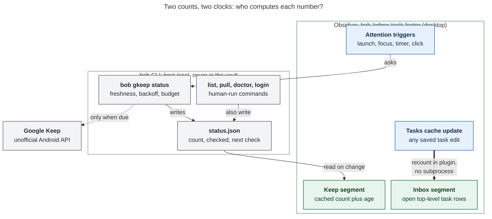
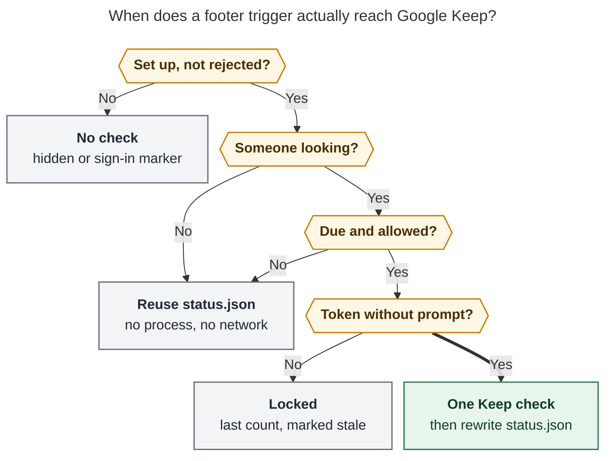
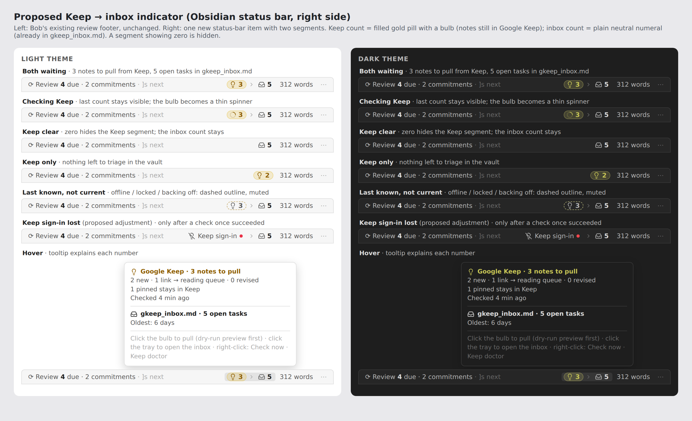

# Keep → Inbox Footer Indicator: Consolidated Research and Recommendation

> **Research query:** What is the best way to add an Obsidian footer indicator showing how many
> Google Keep notes `bob gkeep pull` would sync — shown only when Keep is properly authenticated,
> and checked rarely enough not to overwhelm the API or the MacBook — alongside a visually
> distinct, much more frequently updated count of non-closed tasks (any status but `[x]` or `[-]`)
> in `~/bob/gkeep_inbox.md`? Is this plan a good idea, would you take a different approach or
> adjust the requirements, and what intuitive, reliable, and beautiful solution do you recommend?


## Bottom line

**[Build it](#recommended-solution), with one structural change.** The plugin should not decide
when to call Google Keep. **bob should own the Keep count, its cache, and its rate limit** through
a new read-only, never-prompting [`bob gkeep status`](#status-command-contract-for-bob-cli)
command. The footer is a thin client: it paints what bob reports, and it asks for a fresh check
only while someone is actually using Obsidian.

- **[Two counts, two clocks](#architecture-with-two-clocks), one status-bar item.**
  - A gold lightbulb pill shows **notes a default `bob gkeep pull` would act on**.
  - A plain inbox-tray numeral shows **open top-level tasks in `gkeep_inbox.md`**.
  - A faint `›` between them shows the direction a pull moves work.
- **The inbox count needs no subprocess and no timer.** It is recomputed inside Obsidian from the
  Tasks cache on every task change. Updates take milliseconds, not seconds.
- **Keep checks are [attention-gated, not polled](#refresh-policy).** A check happens on launch,
  on return to Obsidian, on a timer that fires only while you are using Obsidian, and on click.
  Each one must also pass a bob-owned 30-minute freshness gate, a floor, a daily budget, and
  persisted backoff. Expect roughly 10–16 Keep checks per working day, versus 1,440 for a
  one-minute poll. `bob gkeep pull`, `list`, `doctor`, and `login` refresh the count for free.
- **Three prerequisites the request didn't mention:**
  1. The background check must [never trigger a GPG passphrase prompt](#background-token-safety).
  2. Four [adapter defects](#adapter-fixes) need fixing first.
  3. Command Mode needs a [small API addition](#interaction) before a footer click can start a
     previewed pull.

  [What the code establishes](#what-the-code-establishes) shows the evidence for each.
- **Today's numbers:** the inbox segment would read **1**: one `[?]` (Blocked) task, plus 7 closed
  ones. The Keep number is unknown until a live check runs.

## Is this a good idea

**Mostly yes.** Phone captures are invisible from Obsidian until someone runs a pull, so the GTD
collect → process loop has a blind spot exactly where most capture happens. A glanceable count
closes it. It also lets Bryan close the daily "Import inbox tasks from Google Keep" row without
opening a terminal. Two separate numbers also teach the pipeline: *what is still stuck in the
phone* versus *what is here waiting for triage*.

**Where the plan as written would go wrong:**

1. **"Sync less often" is the wrong control. The right rule is "check only when the answer can
   matter."** Any fixed period is wrong twice: too often overnight or while Obsidian sits behind
   other windows, and too slow when you sit back down. Attention-gated checks fix both.
2. **The plugin should not own the throttle.** A plugin timer can't see a terminal
   `bob gkeep pull`, survive a plugin reload with its backoff intact, or share a budget with a
   future consumer such as tmux or the menu bar.
3. **"Pull would actually work" can't be tested live without doing the expensive thing.**
   `bob gkeep doctor`'s Keep check *is* a full snapshot. Visibility has to be
   *last-known-good*, not a live ping.
4. **Strict "only show when authenticated" hides failures.** If the Keep segment silently
   vanishes when the token is revoked, a broken pipeline looks identical to an unconfigured one.
   Notes then pile up unseen, which is the failure this feature exists to catch.
5. **The background token read is a real hazard** ([What the code
   establishes](#what-the-code-establishes)). This indicator would be the token's first
   unattended consumer.
6. **Wallpaper risk.** A number that is always non-zero becomes invisible. Keep the item calm:
   no red, no badges, no motion for background checks.
7. **Partial overlap with the review footer.** New inbox tasks also count in the walk's NEW
   group. That is acceptable: NEW is vault-wide and walk-scoped and hides when nothing is due,
   while this count is pipeline-specific and always present. They should look like siblings, not
   duplicates.

### Alternatives considered

Each approach is followed by its verdict.

- **Plugin polls `bob gkeep list -f json` on a timer (gem's scheduler):** **Reject.** It reads the
  token interactively, takes a full snapshot plus a whole-vault scan, uses a 60–300 s budget, has
  no shared throttle, and returns per-note JSON with titles a badge doesn't need
- **Plugin talks to Google directly, or parses gkeepapi's `state.json`:** **Reject.** It
  duplicates the private API, scatters secrets, and drifts from pull's rules. The dump contains
  note bodies and doesn't prove auth
- **A LaunchAgent, Hammerspoon job, or Keep daemon writes a status file:** **Reject for v1.** It
  works while nobody is looking, adds an always-on moving part, and has the same pinentry hazard.
  The recommended cache makes this a trivial add-on later
- **Official Google Keep API:** **Not available.** It is a Workspace-admin (CASB) API, not for
  personal accounts
- **Fold "Keep 3" into the review footer:** **Reject.** Different question and cadence, the review
  footer hides when nothing is due, and it is already short of space
- **One combined number:** **Reject.** It would hide whether the next gesture is *pull* or
  *triage*, and the two numbers have different freshness
- **Morning-review-only hint on the PRE row:** **Good, but as an extra.** It is lower noise but
  misses mid-day captures. Ship it as phase 3
- **Auto-pull on a schedule:** **The strongest alternative: defer, don't dismiss.** If Bryan always
  pulls as soon as the count turns non-zero, automating the pull is the better product. Not yet: a
  pull writes and commits the vault, archives in Keep, and clips URL-only notes through a browser.
  It also contradicts the documented "no scheduled runner". Revisit after a few weeks of real
  counts

## What the code establishes

Every item below was verified: each was checked directly in the pinned revisions listed under
[Scope and method](#scope-and-method). Where a report's claim turned out wrong, the item says so.

- **After the four skip checks (archived → empty → pinned → shared), _every remaining note is
  actionable_ (`new`, `pending`, or `revised`). Import history decides _which_ action, never
  _whether_**
  - *Where:* `plan.rs` `classify_one_with_imports`; `NoteState::is_actionable`
  - *Why it matters:* The headline Keep count needs no ledger, receipt, or journal scan. Only the
    breakdown does (cdx's insight, confirmed)
- **`list`'s footer counts the actionable set as `new + pending + revised`. When that is zero it
  prints `✓ Keep inbox is clear · N pinned stays in Keep`**
  - *Where:* `list.rs` `footer()`
  - *Why it matters:* The footer and the terminal should use the same definition
- **`list -s vault` still runs `Ledger::scan` over every vault `.md`, plus the import store and
  the journal. _Measured 0.09–0.12 s_ on Apollo's 6,822-note vault**
  - *Where:* `list.rs` `read_vault`
  - *Why it matters:* Cheap, but wrong for a per-edit recount. gem's "~12 ms" is wrong; cld's
    0.13 s is right
- **Target tasks are _top-level only_ (`indentation.is_empty()`). The parser honors the Tasks
  global filter `#task` and skips frontmatter and fenced code**
  - *Where:* `ledger.rs` `read_target_tasks_with_imports`; `note_tasks.rs` `scan`
  - *Why it matters:* Defines the inbox count
- **Imported Keep checklist items render as _untagged_ nested `- [ ]` children under one `#task`
  parent**
  - *Where:* `render.rs` tests
  - *Why it matters:* A 12-item grocery list is 1 inbox task, not 13. gem's any-checkbox regex
    would count 13
- **The vault's statuses are `' '`, `x`, `/` (In Progress), `*` (Next), `?` (Blocked), and `-`
  (Cancelled). `list` treats every symbol except `x`, `X`, and `-` as open**
  - *Where:* Tasks `data.json`; `list.rs` `is_open_status`
  - *Why it matters:* The raw-symbol rule and the status-type rule agree on every configured
    symbol
- **Every adapter run does `gpsoauth.perform_oauth` (a master-token → access-token exchange), then
  an incremental `notes/v1/changes` call**
  - *Where:* gkeepapi `authenticate → APIAuth.load → refresh`; `_sync_notes`
  - *Why it matters:* Each check costs one auth exchange plus a Python process tree, not one HTTP
    call
- **gkeepapi's `send()` _retries HTTP 429 forever_ (2 s → 60 s sleeps)**
  - *Where:* gkeepapi `API.send`
  - *Why it matters:* The adapter's `rate_limit` branch never sees a 429. A throttled check hangs
    until the **300 s** adapter timeout
- **The adapter maps _every 401/403 to `auth`_. cld cites gkeepapi issue #162: Keep's rate limit
  can arrive as a 403 "Rate Limit Exceeded" (I did not re-check that thread)**
  - *Where:* `gkeep_adapter.py` `classify_error`
  - *Why it matters:* A poller could read throttling as "signed out"
- **`connect()` drops the cached state and _retries a full sync after any non-auth error_**
  - *Where:* `gkeep_adapter.py` `connect`
  - *Why it matters:* A network blip turns into a full download
- **The state cache is written _twice_ per snapshot**
  - *Where:* `connect()` and `op_snapshot()` both call `save_state`
  - *Why it matters:* Free to halve
- **`read_token` runs `token_command` (default `pass show gkeep/master_token`) with _stdin and
  stderr inherited_ "so `pass` can use pinentry"**
  - *Where:* `config.rs` `read_token`
  - *Why it matters:* Unsafe in the background
- **On the Mac, the pinentry is the terminal `/opt/homebrew/bin/pinentry` with a 400-day agent
  cache. Every zsh runs `gpg-connect-agent updatestartuptty`**
  - *Where:* chezmoi `gpg-agent.conf.tmpl`, `dot_zshrc`
  - *Why it matters:* A cold-cache background `pass show` could take over the last terminal or
    hang. Apollo hit this on 2026-10-10 (`research:202610/apollo-pass-pinentry-hang.md`)
- **`pass` prepends `$PASSWORD_STORE_GPG_OPTS` to every `gpg` call**
  - *Where:* `pass` script, line 9
  - *Why it matters:* `--pinentry-mode error` can be injected without changing the user's command
- **_`api.commandMode.run(["gkeep","pull"])` is refused_ with "Run the preview first, then
  apply." The preview → apply flow exists only inside the sheet, and API v1 has no way to open
  the sheet on a row**
  - *Where:* bob-command-mode `060-runner.js`, `080-api.js`, `170-sheet.js`,
    `docs/bob-command-mode.md`
  - *Why it matters:* **New finding.** cld and grk said click-to-pull "comes almost free". It
    needs a small additive API
- **Ledger Tools already provides: the review footer (`margin-right: auto`, desktop only),
  `window` `focus` and `visibilitychange` hooks, the `obsidian-tasks-plugin:cache-update`
  fan-out, `planBlockTasks(app)`, and `bobSpawnJson` (20 s default timeout)**
  - *Where:* `240-plugin-freshness-status.js`, `170-plugin-lifecycle.js`, `340-…plan-block.js`,
    `236-plugin-stats-data.js`
  - *Why it matters:* Every hook the feature needs already exists
- **Docs say "There is no scheduled runner: draining the inbox is a manual `bob gkeep pull`".
  `bob gcal` syncs once when the daily note is created, and keeps its token in the Mac Keychain**
  - *Where:* `docs/gkeep.md`, `docs/gcal.md`
  - *Why it matters:* House style is event-triggered network work. A Keychain token is
    precedented
- **The vault has a daily `#gtd #pre` row, _"Import inbox tasks from Google Keep"_**
  - *Where:* `gtd_daily.md`
  - *Why it matters:* Today's habit is one pull per day. The indicator answers that row's
    question at a glance
- **`gkeep_inbox.md` is an inbox file. Its new tasks carry no `fresh` stamp, so they also appear
  in the review walk's NEW tier**
  - *Where:* glossary *Inbox File*
  - *Why it matters:* The inbox count partly overlaps the review footer's NEW group (see
    [Is this a good idea](#is-this-a-good-idea))

## Requirement adjustments

Each adjustment is explicitly called out below, with the original requirement, the adjusted one,
and why.

- **A1**
  - *Original:* "How many notes … would be synced if `bob gkeep pull` were run"
  - *Adjusted:* **Keep count = the default pull's actionable set:
    `new + revised + pending-archive`**, including URL-only notes a pull would clip into the
    reading queue. It excludes pinned, shared, empty, and archived notes. The tooltip breaks the
    number down
  - *Why:* It matches `list`'s footer, so `Keep 0` ⇔ `✓ Keep inbox is clear`. Pending notes are
    rare (already imported, not yet archived) but a pull still acts on them
- **A2**
  - *Original:* Non-closed tasks in `~/bob/gkeep_inbox.md`
  - *Adjusted:* **Top-level `#task` lines in the configured `gkeep.target`** (default
    `gkeep_inbox.md`, vault-relative) **whose status symbol is not `x`, `X`, or `-`**. Blocked
    `[?]`, Next `[*]`, and In-Progress `[/]` all count
  - *Why:* This is the same row set as `bob gkeep list -s vault`. Untagged checklist children
    never count. Adds uppercase `X`
- **A3**
  - *Original:* Show only if Keep is properly authenticated
  - *Adjusted:* **The Keep number appears only after a Keep check succeeded on this host with the
    current config, and with no credential rejection since.** Transient failures (offline, locked
    GPG, rate limit, pull running) keep the last count, marked stale, for up to 24 h. **New:** if
    Google rejects credentials after they once worked, show a numberless `lightbulb-off`
    "sign-in" marker and fire one Notice instead of vanishing. Never-configured hosts show
    nothing
  - *Why:* Silent disappearance makes a broken pipeline look like an unconfigured one. "Will the
    next pull succeed" can't be promised anyway: URL clips, Git, or concurrent edits can still
    fail it
- **A4**
  - *Original:* —
  - *Adjusted:* **The inbox segment does not depend on Keep auth.** The whole item exists when
    `gkeep` is configured on this host. Inside it, only the Keep segment follows A3
  - *Why:* The local count stays useful during Keep outages
- **A5**
  - *Original:* "Careful not to sync too often"
  - *Adjusted:* **No fixed polling.** Checks are attention-gated, with a bob-owned 30-minute
    freshness gate, a 60 s floor, a daily budget of 48, and persisted backoff
    ([Refresh policy](#refresh-policy))
  - *Why:* Spends network and CPU only when someone can see the answer
- **A6**
  - *Original:* —
  - *Adjusted:* **The background path never prompts** for a GPG passphrase. It reports `locked`
    instead
  - *Why:* Prevents the pinentry hijack or hang seen on Apollo
- **A7**
  - *Original:* Inbox count "within seconds"
  - *Adjusted:* **Event-driven and sub-second:** recount on each Tasks cache update. No timer, no
    subprocess
  - *Why:* Faster and cheaper than any interval
- **A8**
  - *Original:* Visually distinct counts
  - *Adjusted:* **Distinct by icon, fill, position, and staleness treatment, not by color
    alone.** Authenticated zeros stay visible but faint
  - *Why:* Hidden zeros would make "clear" ambiguous with "not set up"
    ([Where the five reports disagreed](#where-the-five-reports-disagreed))
- **A9**
  - *Original:* — (not requested)
  - *Adjusted:* **Click the bulb to open a *previewed* pull. Click the tray to open the inbox.**
    The footer never writes on a single click
  - *Why:* A number you can't act on is a nag. Keeping pull preview-first keeps writes deliberate

## Recommended design

### Architecture with two clocks

**Reader question:** Which part of the system computes each number, and which part is allowed to
talk to Google?



*Figure 1. The inbox count never leaves Obsidian. The Keep count comes only from bob's host-local
cache. `bob gkeep status` is the only thing the footer can cause to contact Google (dotted =
conditional), and Bryan's own `list`, `pull`, `doctor`, and `login` runs refresh the cache for
free. Rendered 842 × 1062 px, fit 77.5% (Mermaid CLI 12.0.0).*

### Count definitions

- **Keep** = live Home notes that pass Bob's archived → empty → pinned → shared skip checks under
  default options (no `-i`, `-S`, `--all`, or `--limit`). Equivalently, `new + revised + pending`.
  - Extract the four skip checks from `plan.rs` into one shared helper used by both the classifier
    and `status`. Test that its total equals the full planner's actionable count on fixtures:
    ordinary, revised, pending, URL-only, image-only, blank, pinned, shared, archived, and
    overlapping skips.
  - Never re-implement the checks in JavaScript.
- **Breakdown** (tooltip only): `new · revised · pending archive · links → reading queue`, plus
  `N pinned / shared stays in Keep`. This needs the ledger scan (~0.1 s), which is fine after a
  network check.
- **Inbox** = top-level Tasks-plugin tasks in the target file with
  `status.symbol ∉ {x, X, -}`.
  - Source: `planBlockTasks(app)`, filtered by exact path.
  - Unknown (Tasks not ready) shows `–`, never 0. A missing target file shows `–`, with
    "`gkeep_inbox.md` not found" in the tooltip.
  - Never create the file from the indicator.
  - Pin the predicate with a golden fixture shared with bob's `read_target_tasks_with_imports`
    test. Cover mixed statuses, uppercase `X`, untagged children, hand-nested `#task` children,
    and code fences.

### Refresh policy

This is the "think hard" part of the request.

**Reader question:** When does a footer trigger actually cost a Keep check?



*Figure 2. A trigger reaches Google only after passing four gates:*

- *Keep is configured, with no recorded rejection.*
- *Someone is using Obsidian: window focused and visible, with input in the last 10 minutes. The
  plugin checks this.*
- *bob says a check is due and allowed: past the freshness gate, outside backoff, past the floor,
  under budget, and no pull running.*
- *The token can be read without a prompt.*

*Check now skips the "someone looking" gate and the freshness gate, but never the floor,
rate-limit backoff, or single flight. Rendered 838 × 958 px, fit 77.9%.*

**Triggers.** The plugin only *asks* bob; bob decides. Each trigger is followed by its action.

- **Layout ready + 15 s:** Paint from cache (`bob gkeep status -f json`), then ask `-r`
- **Window `focus` / `visibilitychange → visible` / `online`:** Re-read the cache, then ask `-r`
- **One `setTimeout` at bob's `next_check_at` (clamped to 60 s–2 h):** Ask `-r` only if the
  attention gate still holds; otherwise wait for the next focus
- **Command Mode `run-finished` for `gkeep-*`, or focus after a terminal pull:** Re-read the cache
  only. The pull already rewrote it
- **Bulb click at 0, stale, or unknown, or _Bob: Check Google Keep now_:** `-r -m 0` (forced)
- **Phase 3: the `]s` walk lands on the "Import inbox tasks from Google Keep" PRE row:**
  `-r -m 2m`. This is the moment the count matters most
- **A local task edit:** Never touches Keep

**Gates, enforced by bob and persisted in `status.json`, so reloads and extra windows can't reset
them:**

- **Freshness:** reuse any result younger than `gkeep.check_interval`. The default is `30m`; `off`
  disables automatic checks, so the count updates only from human-run commands and Check now.
- **Floor:** at most one Keep contact per 60 s from `status`, forced checks included.
- **Single flight:** a non-blocking lock. A second caller gets the cache with `in_flight: true`.
- **Pull running:** if `pull.lock` is held, serve the cache with `busy`. Never race an archive.
- **Budget:** at most 48 automatic checks per local day. This is a backstop, not an expectation.
- **Backoff:**
  - **Network error or deadline (30 s)**
    - *`state`:* `offline`
    - *Next automatic check:* 5 → 10 → 20 → 40 min, capped at 2 h, with jitter
    - *Footer:* Stale count (≤ 24 h)
  - **429 after bounded retries, or a 403 with a rate-limit reason**
    - *`state`:* `rate_limited`
    - *Next automatic check:* 1 h, doubling to 6 h. **Check now can't bypass it**
    - *Footer:* Stale count, "Google asked Bob to slow down"
  - **Token needs a prompt**
    - *`state`:* `locked`
    - *Next automatic check:* Next focus after ≥ 30 min, or after any successful human-run gkeep
      command
    - *Footer:* Stale count, "Unlock: run `bob gkeep` in a terminal once"
  - **401/403 auth, `BadAuthentication`, or a sign-in cookie stored instead of a master token**
    - *`state`:* `auth`
    - *Next automatic check:* None until the config changes or a `login`, `list`, or `pull`
      succeeds
    - *Footer:* `lightbulb-off` marker if previously verified, otherwise hidden
  - **Adapter crash or protocol error**
    - *`state`:* `error`
    - *Next automatic check:* 30 min, doubling to 2 h
    - *Footer:* Stale count, "run `bob gkeep doctor`"

**Expected volume.** Eight attended hours at a 30-minute freshness is ≤ 16 checks a day. Focus
returns pass through the same gate, so they add nothing. Overnight and while Bryan works in other
apps: zero. Each check costs one master-token exchange, one or more `changes` calls, and a Python
process (about 1 s CPU, per cld's Apollo timing: `uv` start ≈ 0.2 s, imports 0.4–0.8 s). A
one-minute poll would make about 1,440 checks a day, around the clock.

### Background token safety

This is a prerequisite, not polish. `bob gkeep status -r` reads the token in a
**background-safe mode**:

- stdin from `/dev/null` and stderr captured and scrubbed (never inherited), with `GPG_TTY` unset.
- `PASSWORD_STORE_GPG_OPTS` gains `--pinentry-mode error`, so a cold agent fails fast instead of
  launching pinentry. A warm agent is unaffected.
- A 10 s deadline that kills the whole process group.
- Failure reports **`locked`, not `auth`**.
- Never cache the master token in `status.json`, plugin data, logs, or process arguments.

This doesn't make an *arbitrary* `token_command` safe. The default `pass` path is covered; any
other command is bounded by the deadline and must not prompt.

**Recommended hardening on the Mac:** set `gkeep.token_command` to a login-Keychain lookup
(`security find-generic-password -s bob-gkeep -a <email> -w`). The Keychain unlocks at login, so
the indicator never sits in `locked` after a reboot. This mirrors `bob gcal`. The cost is a second
secret store and one "Always Allow" prompt.

### Visibility states

- **`gkeep` unconfigured on this host**
  - *Keep segment:* Whole item hidden; no checks
  - *Inbox segment:* (hidden with the item)
- **Configured, never verified on this host**
  - *Keep segment:* Hidden. The first success from `login`, `list`, `doctor`, `pull`, or Check now
    reveals it
  - *Inbox segment:* Live
- **Verified, fresh, count > 0**
  - *Keep segment:* Filled gold pill `💡 3`
  - *Inbox segment:* `📥 1`
- **Verified, fresh, count 0**
  - *Keep segment:* Unfilled outline pill with a faint `0`
  - *Inbox segment:* Faint `0` when zero
- **Last known, not current (offline, locked, rate-limited, error, busy; ≤ 24 h)**
  - *Keep segment:* Transparent pill, **dashed** outline, muted ink, same number
  - *Inbox segment:* Live
- **No success for over 24 h, not rejected**
  - *Keep segment:* Dashed bulb with `–`
  - *Inbox segment:* Live
- **Rejected after once working**
  - *Keep segment:* `lightbulb-off`, muted, no number. One Notice on the transition
  - *Inbox segment:* Live
- **bob too old to have `gkeep status`**
  - *Keep segment:* Hidden (version skew on the daily release train)
  - *Inbox segment:* Live (default target)

### Visual design



*Figure 3. cld's mockup (headless Chromium, Obsidian default tokens, Lucide icons), with Bob's
review footer unchanged on the left. This report adopts its pill, connector, tooltip, stale
outline, and sign-in marker, with **one change: authenticated zeros stay visible as a faint,
unfilled `0` instead of hiding** ([Where the five reports
disagreed](#where-the-five-reports-disagreed)). grk's alternative mock (amber pill, teal chip) is
in `obsidian_gkeep_status_bar_inbox_counts__grk_assets/status_bar_mock.jpg`.*

**Anatomy:**

```text
⟳ Review 4 due · 2 commitments · ]s next        (💡 3) › 📥 1     312 words  …
└──────── existing review footer ────────┘      └── new item ──┘
```

- **Placement:** one status-bar item (`bob-keep-inbox`), registered right after the review footer.
  Because that footer has `margin-right: auto`, the new item becomes the first item of the
  right-hand cluster: review on the left, intake on the right. It never flexes (`flex: 0 0 auto`).
- **Keep segment** (remote, not yet in the vault):
  - Lucide `lightbulb` (Keep's logo, and the 💡 Bob already puts on imported tasks) plus a tabular
    numeral, inside a filled pill.
  - Pill tint is about 17% of the Keep yellow, with a 30% inset ring.
  - Ink uses the review footer's normalization,
    `oklch(from var(--color-yellow) L min(c, 0.16) h)`, with L ≈ 0.52 light / 0.80 dark, for
    4.5:1 contrast.
- **Connector:** Lucide `chevron-right` in `--text-faint`. It encodes what a pull does: things
  move from the left box into the right.
- **Inbox segment** (local, awaiting triage): Lucide `inbox` in `--text-muted`, plus a numeral in
  `--text-normal`, weight 600, **no fill**.
- **Distinct beyond color:** different icons, filled pill versus plain numeral, left versus right
  of the arrow, and stale styling only on the remote side. In grayscale the pill alone still
  separates them.
- **No words on the bar.** Words go in the tooltip and in `aria-label`s:
  - "3 Google Keep notes to pull, checked 4 minutes ago"
  - "1 open task in gkeep_inbox.md"
- **Calm motion:** background checks are invisible. Only a check you asked for animates: a gentle
  opacity pulse on the bulb, static under `prefers-reduced-motion`.
- **Calm colors:** no red anywhere; numbers are work, not errors. Never collapse the two numbers
  into an ambiguous `3/1`. At the narrowest width, drop the connector first.
- **Color caveat:** the review footer's WIP group also uses yellow ink. Shape, icon, and position
  disambiguate. If it still reads as related, tint only the bulb and pill, and keep the numeral
  in `--text-normal`.
- **Platform:** desktop only. Check light and dark themes, high contrast, 200% zoom, and popout
  windows.

**Tooltip** (Obsidian's tooltip, shown on hover *and* keyboard focus):

```text
💡 Google Keep · 3 notes to pull
   2 new · 1 link → reading queue · 0 revised · 0 archive-only
   1 pinned stays in Keep
   Checked 4 min ago
📥 gkeep_inbox.md · 1 open task
Click 💡 to preview a pull · click 📥 to open the inbox · right-click for more
```

Failure states replace "Checked …" with the reason, its age, and its fix. Example: *"Offline since
14:02 · retrying in 20 min"* or *"Keep sign-in expired · run `bob gkeep login`"*. Compute the
relative ages when the tooltip opens; don't run a per-second clock.

### Interaction

- **💡 click, count > 0:** open Command Mode on the `gkeep-pull` row in its **preview stage**. The
  dry run shows, and Ctrl+Enter applies. **This needs an additive Command Mode API**, for example
  `api.commandMode.preview(argv)`, that opens the sheet and calls its existing `runPreview(row,
  argv)`. Today's `api.commandMode.run(["gkeep","pull"])` is refused for preview-first rows, and
  bypassing the guard with `skipGuards` would defeat the preview.
- **💡 click at 0, stale, or unknown:** Check now.
- **📥 click:** open the target note at its first open top-level task.
- **Right-click:** Check Keep now · Preview pull · Open gkeep_inbox.md · Keep doctor · Hide
  indicator.
- **Command palette:** **Bob: Check Google Keep now** and **Bob: Toggle Keep inbox indicator**.
- **Accessibility:** each segment is a `<button>` with a full-sentence `aria-label` and the review
  footer's `:focus-visible` ring. No live-region announcement on routine refreshes.

### Status command contract for bob-cli

The `bob gkeep status` contract:

```text
bob gkeep status [-b|--bob-dir DIR] [-f|--format human|json] [-m|--max-age DURATION] [-r|--refresh]
```

- **Default: cache only.** No token, no network. Prints the cached Keep observation and a live
  inbox count. The inbox count reads only the target file via `note_tasks::scan`, with no ledger
  scan.
- **`-r, --refresh`:** run one background-safe Keep check if the gates in
  [Refresh policy](#refresh-policy) allow it. The adapter deadline is 30 s, independent of
  `gkeep.timeout_secs` (300 s).
- **`-m, --max-age`:** override the freshness gate for this call. `-r -m 0` forces a check, still
  subject to the floor, rate-limit backoff, and single flight.
- **Exit codes:** 0 whenever a status document prints, because states are data. 2 for usage or
  config-YAML errors.
- **Shape:** options are alphabetical, and every long option has a short alias (CLI rules). It is
  a member of the existing `gkeep` noun; bare `bob gkeep` stays `list`.
- **Human output:**

  ```text
  💡 Keep    3 to pull · 2 new · 1 link → reading queue · 1 pinned stays   checked 4m ago
  📥 Inbox   1 open in gkeep_inbox.md
  → bob gkeep pull
  ```

- **JSON (`schema_version: 1`, additive only).** An unknown count is `null`, never `0`. No titles,
  bodies, or secrets.

```json
{
  "schema_version": 1,
  "ok": true,
  "configured": true,
  "keep": {
    "state": "ok",
    "auth_verified": true,
    "in_flight": false,
    "checked_at": "2026-10-31T14:03:11Z",
    "next_check_at": "2026-10-31T14:33:11Z",
    "pull": {"total": 3, "new": 2, "revised": 0, "pending": 1, "links": 1},
    "stays": {"pinned": 1, "shared": 0, "empty": 0},
    "error": null
  },
  "inbox": {"path": "gkeep_inbox.md", "exists": true, "open": 1}
}
```

`state` is one of `unconfigured`, `unverified`, `ok`, `offline`, `locked`, `rate_limited`,
`auth`, `busy`, or `error`. `next_check_at` is what keeps clients thin: bob says when asking again
could be useful, so no client re-implements the backoff.

**Cache file:** `$XDG_CACHE_HOME/bob-cli/gkeep/status.json` (next to `state.json`).

- Mode `0600`, atomically renamed. Host-local; never in the vault, so no Git churn and no
  cross-host flapping.
- Holds the document above plus failure counters, the daily budget, and a `config_key`: a hash of
  email, `device_id`, `token_command`, and target. A config change invalidates it.
- **Writers:**
  - `status` and `list`.
  - `doctor`'s successful Keep check.
  - `login`, which clears `auth` and the backoff.
  - `pull`. After a fully known outcome it writes the post-archive remainder. After a partial,
    interrupted, or changed-during-pull outcome it marks the count stale, never an optimistic 0.
    `--no-archive` legitimately leaves the count unchanged.

**Catalog and docs:**

- Add a `gkeep-status` catalog row (reads, report, `network: true`).
- Add a "Status" section to `docs/gkeep.md` and the JSON to `docs/reference/json-outputs.md`.
- It ships as an additive `feat:` on the daily release train.
- The "no scheduled runner" rule stays true: status *observes* and never pulls.

### Adapter fixes

These are worth doing regardless, since some affect `pull` today.

1. **Bound the 429 loop.** Wrap gkeepapi's `send` with a retry cap (for example 3 tries) and
   raise `rate_limit`, so throttling surfaces in seconds instead of hanging for 300 s.
2. **Classify a 403 with a rate-limit reason** (`rateLimitExceeded` / "Rate Limit Exceeded") as
   `rate_limit`, not `auth`.
3. **Narrow `connect()`'s stateless retry** to `ResyncRequiredException` or a corrupt state file,
   so a network blip doesn't trigger a full resync.
4. **Skip the second `save_state`** when `keep_version` didn't change.

### Plugin implementation sketch for bob-ledger-tools

- **New fragments** next to `291-plugin-gcal-events.js`, each ≤ 1000 lines:
  - **Model:** a pure view model (status JSON + inbox count + `now` → segments, tone, aria text,
    tooltip lines). Unit-tested against the [visibility states](#visibility-states).
  - **Render:** DOM with a paint key that skips unchanged frames (the review footer's trick),
    plus `setIcon`, the tooltip, and the menu.
  - **Lifecycle:**
    - The triggers in [Refresh policy](#refresh-policy).
    - A last-input timestamp from passive `keydown` / `pointerdown` listeners, for the attention
      gate.
    - Single-flight `bobSpawnJson(["gkeep","status","-r","-f","json"], …, {timeout: 45000})`.
    - The inbox recount, hooked into the existing `cache-update` fan-out.
    - Cleanup in `onunload`.
- **CSS:** about 80 lines under `.bob-keep-inbox`, reusing the review footer's ink variables.
- **Build and deploy:** `npm run build`, `npm test`, then `bob plugins sync`.
- **Command Mode:** add the `preview(argv)` API method and document it in
  `docs/bob-command-mode.md`.

## Where the five reports disagreed

Each question below lists the reports' positions, then how I resolved it.

- **Is pending-archive in the headline?**
  - *Positions:* Yes: cdx, cld, grk, gem. No (new + revised only): mus
  - *Resolution:* **Yes (A1).** `Keep 0` should mean "nothing for pull to do". The tooltip labels
    pending as "archive only" so it doesn't read as new thoughts
- **Which inbox rows count?**
  - *Positions:* Top-level `#task` (cld, grk). `#task` at any indentation (cdx). Tasks status type
    `is_open` (mus). Any checkbox at any indentation (gem)
  - *Resolution:* **Top-level `#task`, raw symbol ∉ {x, X, -} (A2).** In this vault the
    status-type rule agrees on every configured symbol. "Any indentation" differs only for
    hand-nested `#task` subtasks, and those move with their parent during triage. gem's regex
    counts checklist children and is wrong. All rules except gem's give **1** today
- **Hide at zero?**
  - *Positions:* Hide (cld, mus). Dim zero (cdx, grk). Dim or ✓ (gem)
  - *Resolution:* **Dim zeros.** With hiding, "hidden" would mean both "clear" and "not set up".
    VS Code's always-present `⊗ 0 ⚠ 0` is the familiar precedent
- **What happens after auth is lost?**
  - *Positions:* Hide (grk). Hide plus one notice (cdx). `Keep sign-in` marker (cld). ⚠️ warning
    (gem)
  - *Resolution:* **A numberless `lightbulb-off` marker plus one Notice on the verified → rejected
    transition**, with automatic checks paused. No red, no repeated toasts
- **Refresh cadence**
  - *Positions:* 15 min (cld, grk, mus). 30 min with a backlog / 60 min empty (cdx). 45 min (gem)
  - *Resolution:* **One bob-owned freshness of 30 min, attention-gated.** The habit is one pull a
    day, so a 30-minute-old count is enough for a nudge, and halving token exchanges on an
    unofficial API matters more. cdx's adaptive rule is backwards: the 0 → 1 transition is the
    *most* informative, so checking *less* when empty delays the signal you most want. 15 min
    remains a config value
- **Who owns the throttle?**
  - *Positions:* bob (cdx, cld, grk, mus). Plugin timer (gem)
  - *Resolution:* **bob.** Every client then shares one budget and one backoff, and they survive
    reloads
- **Where does the inbox count come from?**
  - *Positions:* In-plugin `cachedRead` or regex (cld, grk, gem). Tasks cache (cdx). `bob`
    subprocess per edit (mus)
  - *Resolution:* **The Tasks cache through the existing `cache-update` fan-out.** It already
    applies the global filter and skips code blocks, and it is what the review footer uses. A
    parity fixture pins it to bob's predicate
- **What proves auth?**
  - *Positions:* Cheap local token read (mus, gem) vs last-known-good check (cdx, cld, grk)
  - *Resolution:* **Last-known-good.** A readable token proves nothing about whether Google
    accepts it
- **What does a Keep click do?**
  - *Positions:* Previewed pull via Command Mode (cld, grk). Popover menu (cdx). `list` preview
    (mus). Direct background pull (gem)
  - *Resolution:* **Previewed pull, which needs a Command Mode API addition**
    ([Interaction](#interaction)). gem's unpreviewed background pull is rejected
- **`status` default behavior**
  - *Positions:* Cache-only by default plus `--refresh` (cdx, grk, mus) vs check-if-stale by
    default plus `--offline` (cld)
  - *Resolution:* **Cache-only by default.** A human typing it gets zero surprise network or
    token work
- **Mobile**
  - *Positions:* Desktop only (all except mus)
  - *Resolution:* **Desktop only.** Mobile has no `child_process`, and the review footer sets the
    precedent

## Risks and open questions

Each risk or question is followed by its mitigation, or how to settle it.

- **Google flags frequent master-token exchanges on the unofficial API:** ≤ 16 a day is modest.
  Phase 3 can reuse the access token: gkeepapi has no setter, but `send()` already refreshes on
  401, so a cached token in a `0600` file cuts exchanges to about one per hour
- **`state.json` grows with Keep's archive (every pull archives), so each check reads and writes
  more:** Measure its size and `time bob gkeep status -r -m 0` on the Mac before enabling
  automatic checks. [Fix 4](#adapter-fixes) halves the writes
- **GPG locked after a reboot means `locked` until a terminal unlock:** By design: never prompt.
  The Keychain `token_command` removes the problem
- **A gkeepapi version bump re-materializes the `uv` environment, which takes minutes:** `status`
  times out to `offline` and backs off. The next human `pull` materializes it
- **The Keep count disagrees with `bob gkeep list`:** Shared eligibility helper, same cache, and
  `list` rewrites it
- **_For Bryan:_ is the 30-minute default right, or would you prefer 15 minutes or hourly?** It's
  a config value. Start at 30 and tune after a week
- **_For Bryan:_ does pending-archive belong in the headline?** Recommended yes (A1)
- **_For Bryan:_ dim zeros, or hide at zero?** Recommended dim (A8)
- **_For Bryan:_ move the Keep token to the Keychain on the Mac?** Recommended

## Recommended solution

**Architecture: bob owns the truth and the budget; the footer is a thin, calm client with two
clocks.**

**Phase 1: bob-cli (one PR, `feat:`)**

1. [Adapter fixes 1–4](#adapter-fixes).
2. [The background-safe token read](#background-token-safety).
3. Extract the shared default-pull eligibility helper, with equivalence tests.
4. `bob gkeep status [-b] [-f] [-m] [-r]`, with the gates, persisted backoff, budget, single
   flight, and pull-lock check ([Refresh policy](#refresh-policy),
   [Status command contract](#status-command-contract-for-bob-cli)).
5. The `status.json` cache, written by `status`, `list`, `pull`, `doctor`, and `login`.
6. The `gkeep.check_interval` config key (default `30m`, `off` allowed).
7. Docs, the JSON reference, and the `gkeep-status` catalog row.

**Phase 2a: bob-plugins (one PR, after Phase 1 releases)**

1. The `bob-keep-inbox` status-bar item: a live inbox segment from the Tasks cache, and a Keep
   segment painted from the cache.
2. The free refreshes: `run-finished` and focus re-reads.
3. Check now, the click behavior, the context menu, and the commands.
4. The Command Mode `preview(argv)` API.
5. The light/dark styling, accessibility, and states from [Visibility
   states](#visibility-states), [Visual design](#visual-design), and [Interaction](#interaction).

**Measure on the Mac for a few days:** check latency, CPU, `state.json` size, and how often the
count is non-zero when Bryan glances at it.

**Phase 2b:** enable the attention-gated automatic checks (the triggers in
[Refresh policy](#refresh-policy)).

**Phase 3 (optional, only once usage justifies it):**

- Access-token reuse.
- A Keychain `token_command` on the Mac.
- A "Keep 0 · nothing to import" hint when the `]s` walk lands on the Keep PRE row.
- A tmux or menu-bar consumer of `bob gkeep status`.
- **Re-evaluate auto-pull** once the counts show how Bryan actually responds to a non-zero Keep
  number.

**[Requirement changes](#requirement-adjustments) I'm asking Bryan to accept:**

- A1: the count is pull's actionable set.
- A2: only top-level `#task` lines count; `X` is closed.
- A3: last-known-good auth, a stale window, and the sign-in marker.
- A4: the inbox count is independent of Keep auth.
- A5: attention-gated, bob-owned checks.
- A6: never prompt.
- A7: event-driven inbox count.
- A8: distinct by shape as well as color; dim zeros.
- A9: previewed click-to-pull.

## Scope and method

- **Lead researcher:** consolidated from five independent reports (`__cdx`, `__cld`, `__grk`,
  `__mus`, `__gem`, in this directory) plus my own verification. Date: 2026-10-31.
- **Code inspected:** bob-cli `061824f8`, bob-plugins `2ebd58c`, chezmoi (current), upstream
  `kiwiz/gkeepapi` `1a94b25` (0.17.1, the version Bob pins).
- **What I did not do:** contact Google Keep, read a credential, or write to the vault. The rollout
  docs reserve live Keep runs for Bryan.

## Sources

- **bob-cli:** `docs/gkeep.md`, `docs/gcal.md`;
  `src/native/gkeep/{plan,list,ledger,render,config,adapter,pull,doctor}.rs`;
  `src/native/note_tasks.rs`; `src/native/task_status_hooks/model.rs` (`TaskStatusType::is_open`);
  `scripts/gkeep_adapter.py`; `src/native/catalog/table.rs`.
- **bob-plugins:** `plugins/bob-ledger-tools/src/{240-plugin-freshness-status,170-plugin-lifecycle,236-plugin-stats-data,340-dashboard-views-and-plan-block,291-plugin-gcal-events}.js`,
  `plugins/bob-ledger-tools/styles.css`;
  `plugins/bob-command-mode/src/{060-runner,080-api,170-sheet}.js`; `docs/bob-command-mode.md`.
- **chezmoi:** `home/private_dot_gnupg/gpg-agent.conf.tmpl`, `home/dot_zshrc`,
  `home/dot_config/bob/config.yml`.
- **Upstream:** `kiwiz/gkeepapi` `src/gkeepapi/__init__.py` (`APIAuth.refresh`, `API.send`,
  `Keep.authenticate`, `_sync_notes`); the `pass` script (`PASSWORD_STORE_GPG_OPTS`).
- **Vault (read-only):** `gkeep_inbox.md` (1 open top-level task, `[?]`, plus 7 closed),
  `gtd_daily.md` (the daily Keep PRE row), the Tasks plugin `data.json` (statuses, `#task` global
  filter).
- **Measurement:** `bob gkeep list -s vault -f json`, 0.09–0.12 s wall on Apollo (6,822 notes).
- **Memory:** glossary *Inbox File*, *Morning GTD Review Footer*, *Command Mode*;
  `sase/memory/cli_rules.md`.
- **Prior research:** `research:202610/apollo-pass-pinentry-hang.md` (cited by cld, grk, and gem).
- **External:** [gkeepapi issue #162](https://github.com/kiwiz/gkeepapi/issues/162) (403 rate
  limit, cited by cld), [Google Keep API overview](https://developers.google.com/workspace/keep)
  (enterprise only), [GnuPG `--pinentry-mode`](https://www.gnupg.org/documentation/manuals/gnupg26/gpg.1.html).
- **Swarm reports:** `gkeep_inbox_footer_indicator__{cdx,cld,grk,mus,gem}.md` in this directory.
