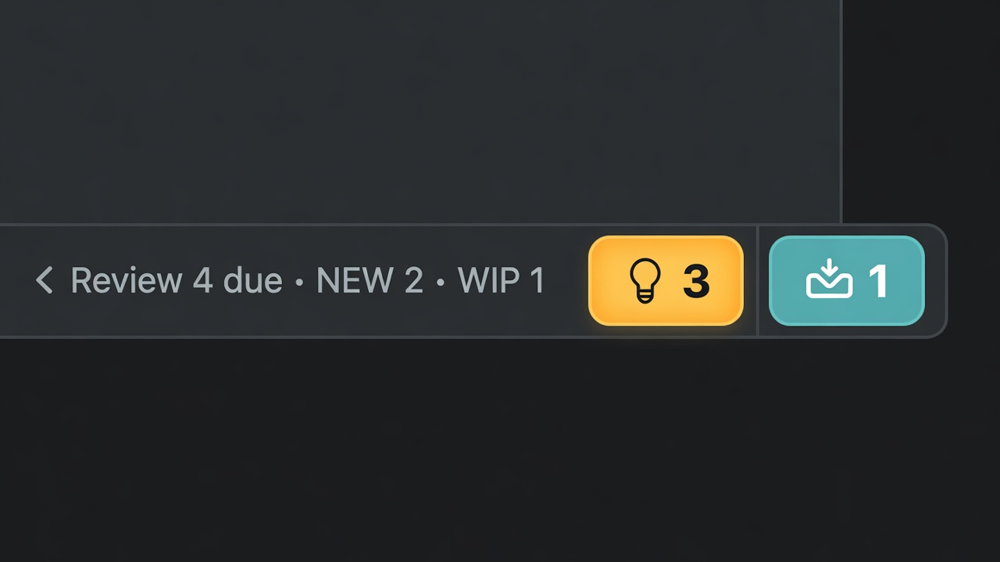
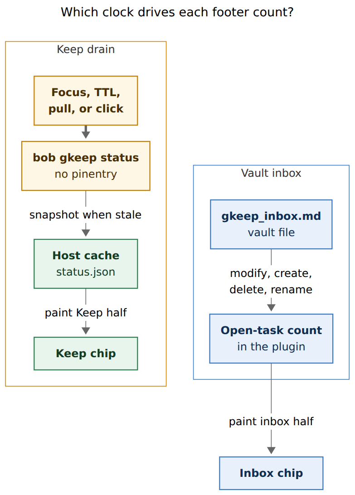
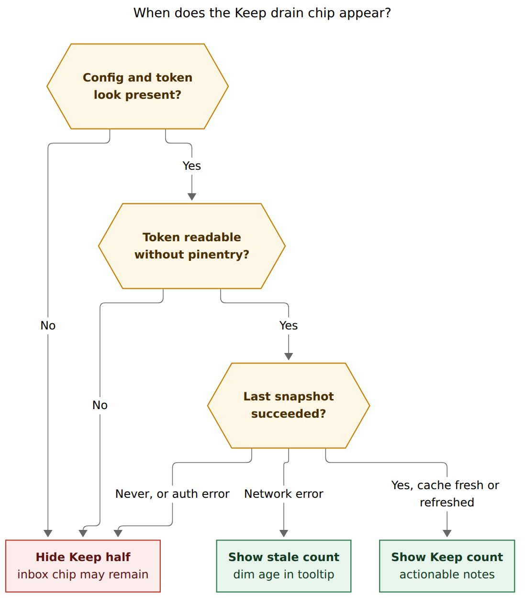
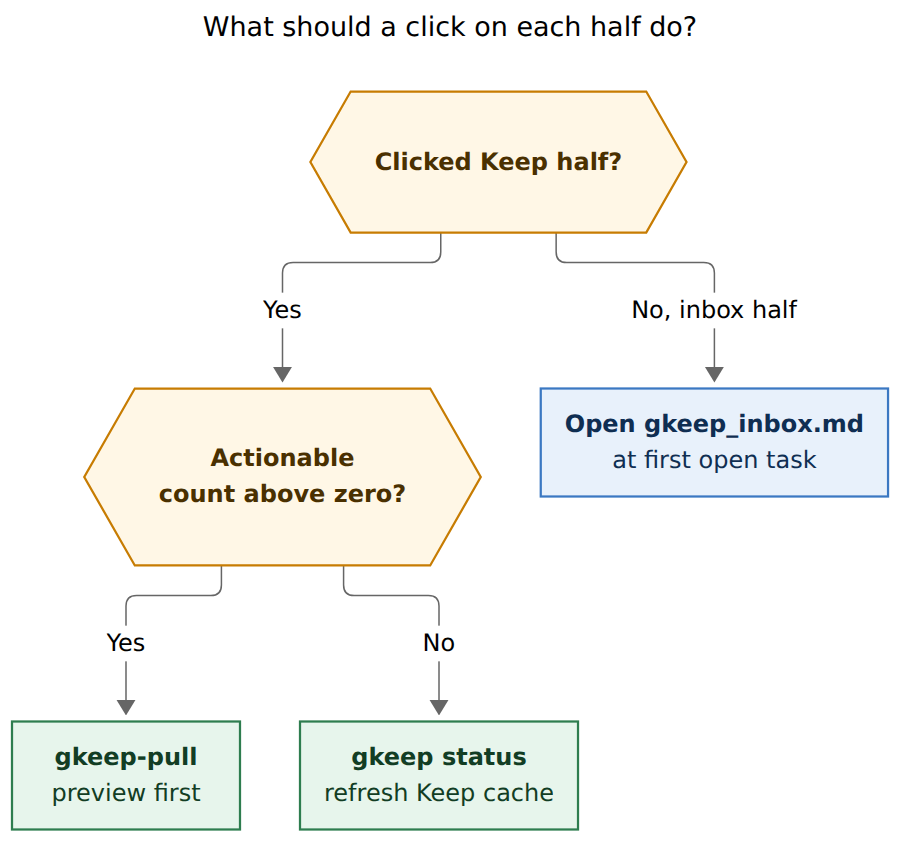

# Should Obsidian's status bar show Keep drain and gkeep_inbox counts?

- **Researcher:** grk
- **Date:** 2026-10-31
- **Question:** How should Obsidian's footer show (1) how many Google Keep notes a `bob gkeep pull` would drain, only when Keep is authenticated, and (2) how many non-closed tasks sit in `gkeep_inbox.md`, without hammering Keep's unofficial API or the MacBook?
- **Verdict:** Build it. Treat the two numbers as *different clocks on one dual chip*, not one poller. Keep's count is a stale-tolerant drain badge backed by a compact `bob gkeep status` cache. The vault count is an in-plugin read of `gkeep_inbox.md`. Hide the Keep half unless a no-prompt snapshot has already proved auth. Never pop pinentry from the footer, never fold this into the review footer, and never auto-pull.

---

## 1. In one breath

The want is real: phone captures land in Google Keep and sit there until a manual `bob gkeep pull`, then wait again in `gkeep_inbox.md` until triage. The morning review footer already teaches "glance at the status bar to see what is due." A Keep/inbox chip next to it would close the *capture leak* the review footer does not cover.

The original sketch — a footer indicator that knows how many Keep notes a pull would sync, gated on authentication, plus a faster count of open `gkeep_inbox.md` tasks — is the right *goal*. The naive implementation (poll `bob gkeep list` on a timer) is a bad cut. `list` already talks to Keep through an unofficial Android-client API, decrypts a master token via `pass` with inherited pinentry, and times out at five minutes. Doing that from Obsidian while you type would be worse than no chip.

The design that survives those constraints is a **dual chip with two clocks**:

1. **Keep drain half** — the count of *actionable* Home notes (`new` + `pending` + `revised`, including URL-only notes a pull would clip). Refreshed on Obsidian focus when the cache is older than 15 minutes, after a successful pull, and on click. Hidden until a no-prompt snapshot has succeeded.
2. **Vault inbox half** — top-level `#task` rows in `gkeep_inbox.md` whose checkbox is anything except `[x]` / `[X]` / `[-]`. Counted in the plugin from vault events, in milliseconds.

```text
bob gkeep status            # compact JSON for the chip; default is cache + vault
bob gkeep status --refresh  # one Keep snapshot, no pinentry, 12s budget
```

Click the amber Keep pill to drain (command-mode `gkeep-pull`, already preview-first). Click the teal inbox pill to open `gkeep_inbox.md`.



*Mock, not a screenshot. The production chip should be flatter (native status-bar ink, no glow), but the split is the point: Keep is a warm filled pill, inbox is a cool outlined chip, a hairline between them, tabular numbers, no extra words on the bar.*

---

## 2. Critique of the plan

The plan as stated: add an Obsidian footer indicator for Keep notes a `bob gkeep pull` would sync; show it only when Keep is authenticated; poll carefully; also show non-closed tasks in `~/bob/gkeep_inbox.md` on a faster clock; make the two counts visually distinct; lead the design.

### What is right

- **The leak is real and the surface is right.** Keep is the phone inbox. `gkeep_inbox.md` is the vault inbox. The status bar is already Bob's ambient GTD surface (the review footer in bob-ledger-tools). Putting drain/triage counts there matches how Bryan already looks.
- **Two numbers, two meanings.** "Notes waiting in Keep" and "tasks waiting in `gkeep_inbox.md`" are different queues. A pull *moves* work from the first into the second (or into the reading queue). Collapsing them into one integer would hide whether the next gesture is `bob gkeep pull` or opening the inbox note.
- **Auth-gating the Keep half is required.** An unauthenticated Keep chip that sits at `—` or errors forever is noise. `bob gkeep doctor` already treats config, token, adapter, and Keep reachability as separate checks.
- **Keep must not be polled like a file.** `docs/gkeep.md` is explicit: there is no scheduled runner; draining is a manual `bob gkeep pull`, not a `bob nightly` step. The unofficial client (`gkeepapi` 0.17.1, pinned in `scripts/gkeep_adapter.py`) speaks `https://www.googleapis.com/notes/v1/` as an Android device. Google's official Keep API is an enterprise CASB product on `keep.googleapis.com`, not available for a personal Gmail inbox.
- **`list -s vault` was already aimed at widgets.** `src/native/gkeep/list.rs` says `-s vault` "reads no config and makes no adapter call, so it stays fast enough for widgets." The vault half of this feature is the widget that comment predicted.
- **Command mode already knows the drain verb.** Catalog row `gkeep-pull` is `writes`, `preview-first`, 300s, adapter `gkeep-pull`. A click that drains should reuse that, not invent a second pull UI.

### What is wrong

1. **"Would `bob gkeep pull` actually work?" as a live predicate is itself a Keep snapshot.** `doctor`'s `keep` check calls `client.snapshot(...)`. Using that to decide visibility would do the expensive thing in order to decide whether to do the expensive thing. Visibility has to be *last-known-good*, not a live ping.
2. **Polling `bob gkeep list` is the wrong command.** `list` snapshots Keep, classifies every note, scans the whole vault for legacy `%%gkeep:` markers, reads the import store, and emits per-note JSON (titles, fingerprints, URLs). A chip needs four integers and an auth enum. The default adapter timeout is **300 seconds**. Command-mode budgets `gkeep-list` at 60s. Either is a freeze if the footer spawns it on a timer.
3. **"Seconds at most" for the vault count is an upper bound, not a target.** Reading one Markdown file is milliseconds. Spawning `bob gkeep list -s vault` still runs `Ledger::scan` over every `.md` file, including `done/`. That is the wrong cost model for a status-bar paint.
4. **Background `pass show` will pop pinentry.** `GkeepConfig::read_token` runs `token_command` (default `pass show gkeep/master_token`) with stdin/stderr inherited so `pass` can use pinentry. A footer poller that hits an expired GPG cache opens a passphrase prompt, and a dead prompt can jam every other `pass` read on the machine (see `research:202610/apollo-pass-pinentry-hang.md`). The chip must refuse to prompt.
5. **Folding this into the review footer would steal the wrong budget.** The review footer already flexes (`flex: 1 1 auto`), drops walk groups with `…`, and hides when nothing is due. Keep drain is a different question, a different refresh rate, and a different click. It needs `flex: 0 0 auto` on the right, next to command-mode's run chip.
6. **"How many notes I currently have in Google Keep" is ambiguous.** A default pull skips pinned, shared, empty, and archived notes. The number that matches the user's intent is the *actionable* count `list` already footers: `N new · M pending archive · K revised`. Pinned/shared belong in the tooltip (`2 pinned stay in Keep`), not the badge.
7. **Auto-hiding at zero would make the chip look broken.** The review footer hides when the walk is empty because the walk is *done for the day*. A Keep `0` is a standing "inbox is clear" signal. When authenticated, show a dim `0`. Hide the Keep half only when auth is unproven.

The plan's *goal* (see the leak, drain it, triage it, from the bar you already watch) is good. The working example (one indicator that syncs with Keep often enough to feel live) is a bad cut. Treat this as a **cached drain badge plus a live file count**.

---

## 3. Justified requirement adjustments

These change the user's wording. They are deliberate.

| Original implication | Adjustment | Why |
| --- | --- | --- |
| One indicator that talks to Keep | **Dual chip, two clocks.** Keep half from a host cache. Vault half from `gkeep_inbox.md` events. | Keep's API is unofficial and token retrieval can prompt. The vault file is local and already watched by ledger-tools. |
| Show Keep count only if `pull` would work, checked live | Show Keep half only after a **no-prompt snapshot has succeeded**. Config-without-token, pinentry-needed, and auth errors hide it. | A live "would pull work" check *is* a snapshot. Last-known-good is the honest gate. |
| Sync with Keep "not too often" | **Focus + 15 minute TTL + post-pull + click.** No interval timer while typing. No poll while unfocused. | Phone captures matter when you sit down. Four snapshots an hour of focused Obsidian is the ceiling. Overnight idle is zero. |
| Vault count "seconds at most" via some sync | Count **in-plugin in milliseconds**. Top-level `#task` rows, closed = `x`/`X`/`-`. Debounce 150ms on vault events for that path only. | `list -s vault` still scans the marker ledger. A spawn per keystroke is the MacBook cost we were asked to avoid. |
| "Notes in Google Keep that would be synced" | Badge = **actionable** (`new` + `pending` + `revised`), including URL-only notes a pull would clip. Tooltip names the split and any pinned/shared left behind. | That is exactly `Plan::summary` plus `NoteState::is_actionable`. Default pull skips pinned/shared/empty. |
| Hide when empty, like the review footer | When authenticated, **show dim zeros**. Hide Keep half only when unauthenticated. Vault half hides only if the target note is missing. | Zero is information: you are caught up. Missing is a setup problem. |
| Footer, unspecified host plugin | **bob-ledger-tools**, desktop only, a sibling of the review footer. | It already owns status-bar paint, `bobSpawnJson`, and vault event wiring. Command-mode owns *running* pull. |
| Reuse `bob gkeep list` JSON | Add **`bob gkeep status`**: compact JSON, 12s timeout, `--refresh` / `--stale-ok`, no pinentry. Piggyback the same cache from `list`/`pull`/`doctor`. | Widget contract stays small. Existing `list` JSON is a report, not a badge. |
| Count every non-closed checkbox in the file | Count **top-level tasks only** (`indentation.is_empty()`), same as `read_target_tasks_with_imports`. | Nested Keep-list items are children, not inbox tasks. Live `gkeep_inbox.md` has one open top-level `[?]` task. |
| Click unspecified | Keep half with count > 0 → **command-mode `gkeep-pull` (preview-first)**. Keep half at 0 → refresh. Inbox half → open `gkeep_inbox.md` at the first open task. | Drain stays explicit. Preview-first is already the catalog policy. |

---

## 4. What already exists

### Keep drain pipeline

`bob gkeep` is a Keep → vault *drain*, not a two-way sync (`docs/gkeep.md`). Bare `bob gkeep` is `list`. `pull` writes, verifies, commits, then archives. Notes are archived only after the current content is in the vault. URL-only notes clip into the reading queue during pull.

Classification (`src/native/gkeep/plan.rs`) is the badge's definition of "would be synced":

| State | Default pull |
| --- | --- |
| `new` | Write (or clip), then archive |
| `pending` | Archive only (already in the vault) |
| `revised` | Write revision, then archive |
| `empty` / `pinned` / `shared` / `archived` | Skip (unless `-i` / `--include-pinned` / `--include-shared`) |

`NoteState::is_actionable` is `new | pending | revised`. The human list footer already prints `N new · M pending archive · K revised → bob gkeep pull`, or `✓ Keep inbox is clear`.

JSON `list -f json` already carries `summary.{new,pending,revised,skipped}` and `vault.tasks[]` with `status`. The chip should not parse that document; it is too large and too slow to produce.

### Adapter cost

Every Keep snapshot:

1. Runs `token_command` (`pass show gkeep/master_token` by default) with inherited stdio.
2. Spawns `uv run --quiet --script` on the pinned adapter (`gkeepapi==0.17.1`).
3. Calls `keep.authenticate(..., sync=True)`, which hits `KeepAPI.changes()` as Android client `https://www.googleapis.com/notes/v1/`.
4. Loads/saves `~/.cache/bob-cli/gkeep/state.json` (`0600`). Incremental sync uses `target_version` from that dump, so the *second* snapshot is cheaper than the first, but it is still a Python process plus a network round-trip.
5. On HTTP 429, gkeepapi sleeps with exponential backoff from 2s up to 60s (`src/gkeepapi/__init__.py` in `gh:kiwiz/gkeepapi`). A widget that inherits the 300s pull timeout can wedge on rate limit. Classify 429 as `rate_limit` in the adapter (`scripts/gkeep_adapter.py`) and give the widget a **12s** hard timeout.

`connect()` always authenticates with `sync=True`. There is no "count only" op today. `status --refresh` can reuse `snapshot`; it does not need a new adapter protocol in v1.

### Vault inbox

`gkeep_inbox.md` is an inbox file (glossary: area child of `inbox.md`). `list` counts open vault tasks with:

```rust
fn is_open_status(symbol: char) -> bool {
    !matches!(symbol, 'x' | 'X' | '-')
}
```

and keeps only top-level tasks. That matches the user's `[x]` / `[-]` rule, plus `[X]`. Live vault (2026-10-31, `bob query`): **1 open** top-level task, status `[?]`, plus 7 closed. The open row already carries the generated Keep 💡 link. The vault half of the chip would read `1` today.

### Status-bar neighbors

| Item | Plugin | Role |
| --- | --- | --- |
| Review footer | bob-ledger-tools | Walk counts, `flex: 1 1 auto`, hides when empty |
| Command-mode chip | bob-command-mode | In-flight `bob` runs, toasts on settle |
| Article look | bob-articles | Current heading, hides off article notes |
| **Proposed dual chip** | **bob-ledger-tools** | Keep drain + inbox triage, `flex: 0 0 auto` |

The review footer is the visual language to steal: tabular nums, `--font-ui-smaller`, hairline dividers, theme-native ink, paint keyed so unchanged models do not touch the DOM, desktop-only (`Platform.isDesktopApp`). Do not steal its flex.

`bobSpawnJson` in ledger-tools already resolves `bob`, sets `BOB_DIR` and `NO_COLOR`, and defaults to a 20s timeout. Keep status should pass `timeout: 12000` explicitly.

Command-mode catalog already has `gkeep-list` (reads, report, 60s, `network: true`) and `gkeep-pull` (writes, preview-first, 300s). Add `gkeep-status` as reads, report, 15s, `network: true`.

---

## 5. The danger, in one page

Three failure modes dominate. They are why the Keep clock is slow and the vault clock is fast.

**Unofficial API.** gkeepapi is "not supported nor endorsed by Google." It mints an Android `device_id` (Bob derives one from the email). Chatty clients look like a rogue phone. Official `keep.googleapis.com` is for Workspace admins managing *other people's* notes (CASB). Bryan's personal inbox cannot move there. The only safe Keep cadence is "when a human is looking, and not more than every 15 minutes."

**Pinentry.** `read_token` is designed for a human at a TTY. Footer refresh is not a TTY. `status --refresh` must run the token command with GPG in non-interactive mode (`PASSWORD_STORE_GPG_OPTS=--batch --pinentry-mode error`, plus a 2s cap on the token command itself). If the agent is locked, the Keep half stays hidden or stale. It never opens a passphrase window. Apollo already demonstrated that an orphaned pinentry can block every subsequent `pass show` on the host.

**MacBook work.** Cold `uv run --script` plus a Keep sync is a noticeable spike. Doing it on every vault change, every keystroke, or every 60s while Obsidian is in the background is the "more work than is useful" the prompt warned about. Incremental `state.json` helps the *network* side after the first sync; it does not help process spawn. Cap Keep refreshes, reuse the cache, and piggyback on `list`/`pull` the human already ran.

---

## 6. Recommended architecture

### Two clocks

**Reader question:** Which clock drives each footer count?

**Caption:** The vault inbox count follows `gkeep_inbox.md` events inside the plugin. The Keep drain count follows a host cache that refreshes only on focus (if stale), after a pull, or on click, and never prompts for a passphrase.



Rendered size: 521.4 × 729 px; fit scale: 100%. Mermaid CLI `@mermaid-js/mermaid-cli@12.0.0`.

The Keep cache lives at `$XDG_CACHE_HOME/bob-cli/gkeep/status.json` (same parent as `state.json`), mode `0600`, host-local. It does not Git-sync. Obsidian on the Mac is the only chip that matters; apollo/athena do not paint this footer.

Piggyback: `bob gkeep list`, `pull`, and `doctor`'s successful Keep check write the same `status.json`. A pull Bryan already ran is a free, accurate `0` on the Keep half.

### Auth and visibility

**Reader question:** When does the Keep drain chip appear?

**Caption:** The Keep half shows only after a successful no-prompt snapshot. A locked GPG agent or an auth error hides it. A network error keeps the last good count and dims the age in the tooltip.



Rendered size: 730.8 × 832 px; fit scale: 89.3%.

`auth` in the JSON contract:

| Value | Keep half |
| --- | --- |
| `ok` | Show count (dim if `actionable == 0`) |
| `unconfigured` / `no_token` / `prompt_required` / `rejected` | Hide |
| `unreachable` / `rate_limited` / `timeout` | Show stale count if one exists; else hide |

First Obsidian launch with no cache: one `--refresh` attempt. If it needs a prompt, stop. The human runs `bob gkeep login` / `doctor` in a real terminal, which writes the cache as a side effect.

### CLI: `bob gkeep status`

New read-only member under the existing `gkeep` noun. Bare `gkeep` stays `list`. Options (each long option gets a short alias, alphabetized):

```text
bob gkeep status [-b|--bob-dir DIR] [-f|--format human|json] [-r|--refresh] [-s|--stale-ok]
```

Default for a TTY: human one-liner, e.g. `Keep 3 · inbox 1 · fetched 12m ago`. Default for the plugin: `-f json`. `--stale-ok` (the plugin's usual call) prints the cache plus a fresh vault count and does **not** touch Keep. `--refresh` does one snapshot with no pinentry and a 12s adapter timeout, independent of `gkeep.timeout_secs`.

JSON shape (`schema_version: 1`):

```json
{
  "schema_version": 1,
  "ok": true,
  "auth": "ok",
  "keep": {
    "fetched_at": "2026-10-31T20:14:03Z",
    "stale": false,
    "actionable": 3,
    "new": 2,
    "pending": 1,
    "revised": 0,
    "pinned": 2,
    "shared": 0,
    "clips": 1
  },
  "vault": {
    "path": "gkeep_inbox.md",
    "open": 1,
    "missing": false
  }
}
```

`keep` may be `null` when hidden. `vault.open` is always computed from the target file (no ledger scan, no import-store walk). That is the cheap path `list -s vault` should have been for widgets; leave `list` as the full report.

Catalog: `gkeep-status`, `reads`, `report`, 15s, `network: true`. Invalidates nothing (it does not write the vault). After `gkeep-pull` settles, the plugin refreshes from cache (pull already wrote it).

### Plugin: dual chip in bob-ledger-tools

New mixin next to `240-plugin-freshness-status.js`, desktop only, `addStatusBarItem()`, class `bob-gkeep`. Paint is idempotent and keyed. The review footer keeps `margin-right: auto`; this item does not flex.

**Vault half.** On layout-ready, and on `vault` `modify`/`create`/`delete`/`rename` when `file.path` is the configured target (default `gkeep_inbox.md`), debounce 150ms, `cachedRead`, count top-level task lines. Predicate, kept in one comment-linked helper:

- line matches `^[-*+] \[.\]` at column 0 (no indent)
- body contains the Tasks global filter (`#task` in this vault)
- status char is not `x`, `X`, or `-`

Do not spawn `bob` for this. Do not walk descendants. Missing file → hide the inbox half.

**Keep half.** Read `status.json` if present. Spawn `bob gkeep status --stale-ok -f json` only when the plugin needs a vault path confirmation at startup, or skip even that and trust the file read plus in-plugin vault count. Spawn `bob gkeep status --refresh -f json` when:

- the window is focused, and `fetched_at` is older than 15 minutes
- command-mode reports a completed `gkeep-pull`
- the user clicked the Keep half at count 0
- the user clicked with a modifier (Shift) to force refresh

Single-flight the spawn (stats-cache pattern). If a refresh is in flight, keep the last number and pulse glyph opacity. Never blank the chip. Timeout 12s: keep stale, set `auth` to `timeout`.

**Clicks.**

**Reader question:** What should a click on each half do?

**Caption:** The Keep half drains with command-mode preview-first pull when notes are waiting, and otherwise refreshes the cache. The inbox half opens `gkeep_inbox.md` at the first open task.



Rendered size: 600.0 × 562 px; fit scale: 100%.

If command-mode is disabled, Keep-half click runs `gkeep-pull -d` in a notice, or simply opens the command-mode sheet on `gkeep-pull`. Do not pull silently.

### Visual design

Steal the review footer's discipline (theme tokens, 4.5:1 ink, text as well as color, `font-variant-numeric: tabular-nums`) and then *break* from it so the two products cannot be confused.

| | Keep half | Inbox half |
| --- | --- | --- |
| Glyph | Lightbulb (same 💡 family as the generated Keep source link) | Inbox tray |
| Fill | Warm Keep yellow wash `--color-yellow` / `#F4B400` | Cool teal outline, `--color-cyan` family used by `#task` marks |
| Shape | Pill (`border-radius: 999px`) | Squared chip (`border-radius: var(--radius-s)`) |
| Weight | Count `font-weight: 700` | Count `font-weight: 700` |
| Zero | Dim glyph + `0`, no fill | Dim outline + `0` |
| Stale | Glyph at 60% opacity; age only in tooltip | Always live |
| Divider | Hairline `border-inline-end` between halves | |
| Width | `flex: 0 0 auto`; never steal review-footer space | |

Bar text is **glyph + number only**. No `Keep`, no `inbox`, no `new`. The tooltip is the beautiful part:

```text
Google Keep · 2 new · 1 pending archive · 1 would clip as a ref
2 pinned stay in Keep
fetched 12m ago · click to drain · Shift-click to refresh

gkeep_inbox.md · 1 open · click to open
```

When both authenticated zeros: tooltip `Keep inbox is clear · gkeep_inbox.md is clear`. That is the all-clear the list footer already speaks.

Motion: opacity pulse on Keep refresh (200ms, honor `prefers-reduced-motion`). No spinner on this chip — command-mode already owns in-flight chrome.

ARIA: one `role="status"` group, `aria-label` equal to the tooltip's first two lines. Each half is a `<button>`.

---

## 7. Alternatives considered

| Alternative | Why it loses |
| --- | --- |
| Poll `bob gkeep list -f json` every N minutes | Full snapshot + ledger scan + pinentry + 60–300s budget. The comment that `-s vault` is "fast enough for widgets" is about the *vault* half, not this. |
| Plugin reads `state.json` (gkeepapi dump) with no network | Unofficial dump format, includes note bodies, still needs classification against import history, does not prove auth. Bob's cache is the contract. |
| Scheduled LaunchAgent `bob gkeep pull` plus a chip that reads the last result | Contradicts the documented "no scheduled runner." Auto-archive of phone notes is a data-loss footgun (content-guard exists, but the *decision* to drain stays human). |
| Official Keep API | Enterprise/CASB only. Not Bryan's account. |
| One number | Hides whether the next gesture is drain or triage. A pull that clips URL-only notes can zero Keep while leaving vault count unchanged, or raise vault count without a clip. |
| Fold into the review footer | Different question, different clock, already space-starved. |
| New Obsidian plugin | Sixth custom plugin for two numbers. ledger-tools is the status-bar owner. |
| Mac menu-bar extra | The prompt asked for the Obsidian footer. Mac Capture is a thin client of `bob capture` and does not own Keep. |
| Keep daemon holding an authenticated Python session | Avoids spawn cost, adds a long-lived unofficial client — the opposite of "do not overwhelm the API." |
| Dataview `TASK FROM "gkeep_inbox"` in the plugin | Dataview counts descendants and treats `completed` unlike `[?]`/`[*]`/`[/]`. Live query already disagreed with "top-level open" until filtered. Bob's `is_open_status` is the rule. |

---

## 8. Risks, non-goals, and honest staleness

- **Keep count can be up to ~15 minutes behind a phone capture.** That is the product. The chip is a sit-down reminder, not a push notification. Shift-click refreshes.
- **Pending archive counts as actionable.** Those notes are already in the vault; pull will only archive them. The tooltip says `pending archive` so the badge does not look like "3 new thoughts."
- **URL clips never hit `gkeep_inbox.md`.** Keep half includes them (`clips` in JSON); vault half does not. After a clips-only pull, Keep goes to 0 and inbox stays put. That is correct.
- **Do not auto-pull.** Content-guarded archive is still a mutation. Preview-first stays.
- **Do not add this to `bob nightly`.** Nightly is Git maintenance.
- **Mobile Obsidian:** hide, same as the review footer. No `child_process` there anyway.
- **Tests:** FakeAdapter already covers snapshots. Status JSON tests stay offline. Plugin tests cover the count predicate, paint keys, TTL, and hide-on-auth. No live Keep in CI.

---

## 9. Recommended solution

Ship a **desktop dual chip in bob-ledger-tools**, fed by a new compact **`bob gkeep status`** on the Keep side and an in-plugin file count on the vault side.

**Phase A — CLI cache (bob-cli).** `bob gkeep status` as specified. `list` / `pull` / `doctor` write `status.json` on a successful Keep contact. `--refresh` uses a 12s timeout and a non-interactive token read. Vault open-count reads only the target file.

**Phase B — Vault half (bob-plugins).** Inbox chip only, live, millisecond, click opens the note. Useful on its own even before Keep is wired.

**Phase C — Keep half.** Read cache, focus+TTL refresh, hide-until-proven-auth, amber pill, tooltip breakdown, Shift-click refresh.

**Phase D — Drain click.** Keep half with `actionable > 0` runs catalog `gkeep-pull` (preview-first). On completed pull, reread cache (should be zeros) and recount the inbox file (should have jumped).

**Phase E — Polish.** Stale opacity, 429 → one-hour backoff, dim zeros, reduced-motion, catalog `gkeep-status`, docs in `docs/gkeep.md` plus a sentence on the ledger-tools plugin page. No new decision record unless we later change the "no scheduled Keep runner" rule.

Do this. It is a small, beautiful GTD tell: amber means drain Keep, teal means triage the note, quiet zeros mean you are clear. The review footer keeps asking "what is due in the vault"; this chip asks "what is still stuck in the phone." Those are the two inboxes Bob actually has.

---

## Sources

In-repo (bob-cli workspace unless noted):

- `docs/gkeep.md` — drain pipeline, list footer, JSON, doctor checks, "no scheduled runner", token/pinentry, 300s timeout
- `docs/guides/drain-google-keep.md` — human rollout
- `src/native/gkeep/list.rs` — widget comment on `-s vault`; `is_open_status`; summary footer
- `src/native/gkeep/plan.rs` — `NoteState::is_actionable`
- `src/native/gkeep/adapter.rs` / `scripts/gkeep_adapter.py` — snapshot, `sync=True`, `state.json`, 429 → `rate_limit`
- `src/native/gkeep/config.rs` — `read_token` inherits stdio; default `pass show gkeep/master_token`
- `src/native/gkeep/doctor.rs` — Keep check is a full snapshot
- `src/native/gkeep/ledger.rs` — top-level tasks only; full-vault marker scan
- `src/native/env.rs` — `bob_cli_cache_dir()` → `$XDG_CACHE_HOME/bob-cli`
- `src/native/catalog/table.rs` — `gkeep-list` / `gkeep-pull` / `gkeep-doctor` catalog rows
- bob-plugins `plugins/bob-ledger-tools/src/240-plugin-freshness-status.js`, `120-freshness-footer.js`, `styles.css` — status-bar paint language
- bob-plugins `plugins/bob-ledger-tools/src/236-plugin-stats-data.js` — `bobSpawnJson`, 20s default
- bob-plugins `plugins/bob-command-mode/src/130-adapters.js` — `gkeep-pull` outcome adapter
- `sase/memory/glossary/inbox-file.md`, `morning-gtd-review-footer.md`
- `sase/memory/cli_rules.md` — nest under a noun; every long option gets a short alias
- Live vault, 2026-10-31: `bob query` on `gkeep_inbox` → 1 open top-level `[?]` task, 7 closed

External (opened via `sase repo open` / docs):

- `gh:kiwiz/gkeepapi` `src/gkeepapi/__init__.py` — Android Keep API, `changes(target_version)`, 429 backoff 2s…60s, `Keep.sync`
- [Google Keep API overview](https://developers.google.com/workspace/keep/api/guides) — enterprise CASB API on `keep.googleapis.com`, not personal inboxes
- `research:202610/apollo-pass-pinentry-hang.md` — unattended `pass show` + pinentry lock
