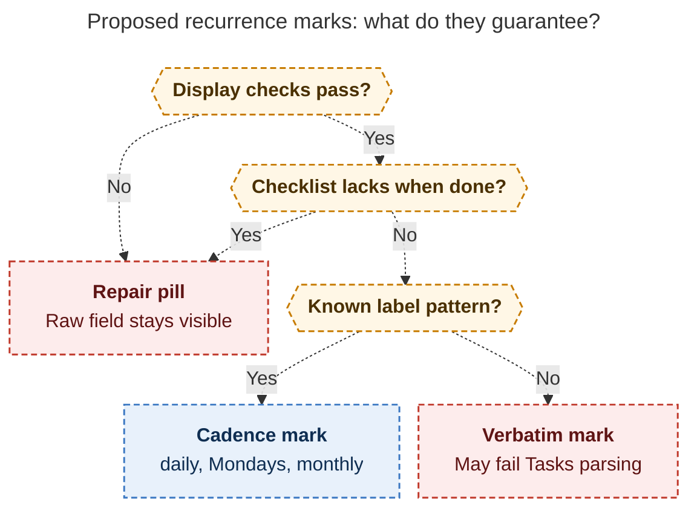

# Diagram proposals: PRE/POST checklist glyphs and compact `repeat` marks

Proposals for the swarm linker, not a report. Each diagram restates only what the source
report says.

```yaml
source: research:202610/gtd_checklist_glyphs_and_recurrence_marks/gtd_checklist_glyphs_and_recurrence_marks__final.md
producer: research.28.image
check: "mmdc 12.0.0 with the PDF-mirroring config and Puppeteer --no-sandbox rendered 1 of 1 Mermaid diagrams"
```

## recurrence-display-confidence

```yaml
anchor: |-
  the charset check is a necessary condition for a valid rule, not a sufficient one.
question: |-
  Does a recurrence mark prove that Tasks can parse the rule?
illustrates: |-
  The occurrence and canonical-form gates, Tasks charset check, and checklist guard retain repair pills, while the label grammar can produce verbatim marks that Tasks rejects.
caption: Outside code, display checks and the morning checklist guard preserve repair pills; even a readable mark can still fail Tasks parsing.
review: "636.588x760 px, fit 100%; question, source-trace and visual checks passed; 0 revisions; batch rendered 1 of 1; malformed probe rejected"
```


