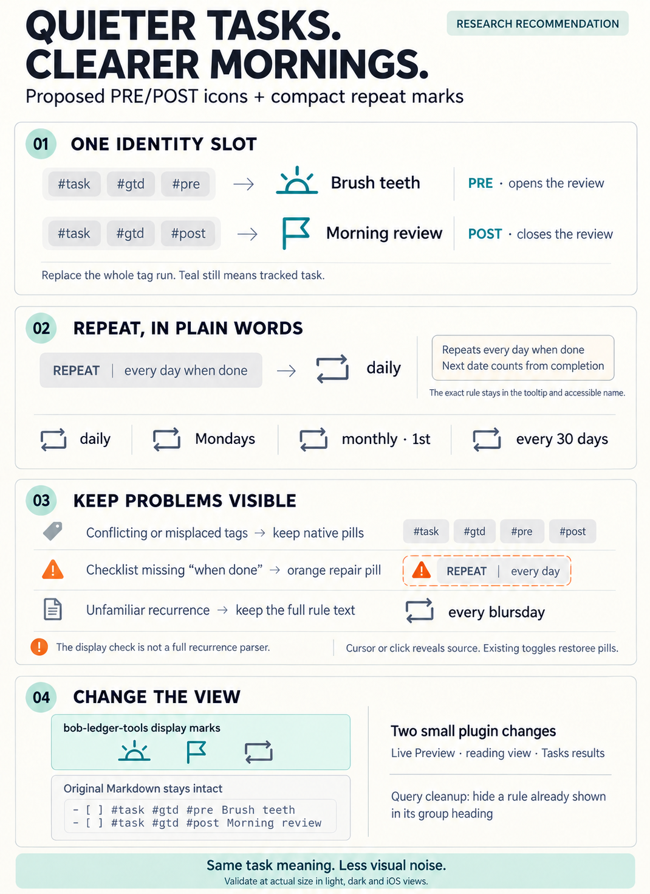
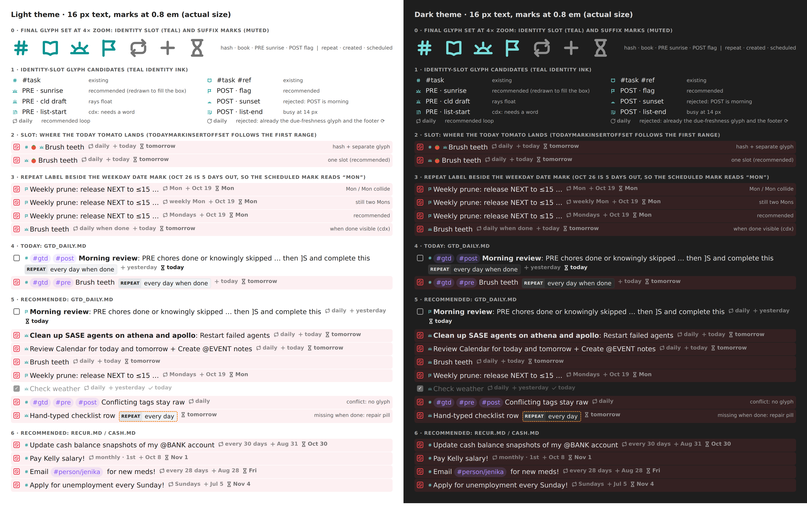
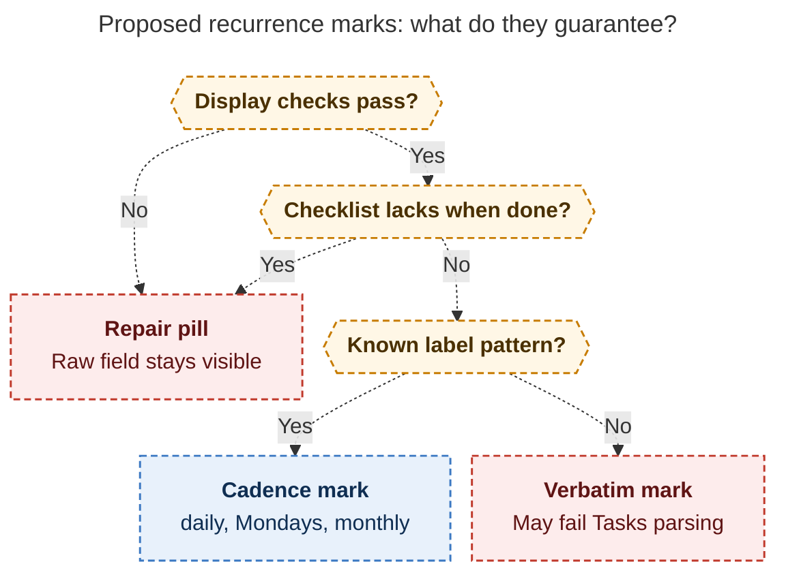

# PRE/POST checklist glyphs and compact `repeat` marks

> **Research query:** What is the best way to render nice, appropriate icons in place of the
> `#gtd #pre` and `#gtd #post` tags that put Obsidian tasks in the PRE and POST groups of the
> morning GTD review, and should anything be done to make the `repeat` task property look nicer and
> take up less space? Critique the plan, clearly call out any justified requirement adjustments, and
> end with a recommended solution that is intuitive, reliable, and beautiful.



## Bottom line

1. **Build both. [This is a good idea](#critique-of-the-plan), and it is cheap and low-risk.** It
   only changes how things look. Bob already has a tested family of "marks": the teal `#task`
   hash, the `#task #ref` open book, date, priority, and Today marks. Both requests fit that family
   as new sections of two existing display contracts. Nothing changes in storage, Rust, the
   evaluator, Tasks, or Dataview. All five researchers agree on this layer.
2. **PRE/POST: [one teal glyph](#design-a-for-pre-and-post-identity-glyphs) replaces the whole
   `#task #gtd #pre|#post` run.** This is a change to the requirements
   ([A1](#requirement-adjustments)).
   - **PRE** is a **sunrise**: the morning chores that open the review.
   - **POST** is a **flag**: the finish line that closes it.

   This follows the 📖 precedent exactly: one identity slot, where the shape says the kind and the
   teal ink says "tracked task".
3. **`repeat`: yes. Show a [quiet loop glyph plus a cadence](#design-b-for-recurrence-marks) written
   the way a person would say it.** Examples: `daily`, `Mondays`, `monthly · 1st`, `every 30 days`.
   - The exact rule and its `when done` meaning go in the tooltip.
   - On a PRE/POST row, a rule without `when done` keeps its pill with the orange repair flag, so
     the label never hides a problem the lints care about.
4. **Reliability rule:** a glyph appears only when the display is certain. Anything conflicting,
   non-canonical, or unparseable stays a native pill, and that pill becomes the visible "fix me"
   signal. The cursor or a click reveals the raw text, the two existing toggles restore the pills,
   and without the plugin the vault looks exactly as it does today.

## The Figure 1 mockup



*Figure 1. Mockup rendered in headless Chromium with the plugin's real mask paths and metrics
(16 px text, marks at 0.8 em).*

- **Section 0:** the final glyph set at 4× zoom.
- **Sections 1–3:** the open design questions, shown side by side.
- **Sections 4–6:** today's rows and the recommended rows.

The source is `…__final_assets/mockup.html`, a self-contained file that also holds the copyable
glyph paths. cld's earlier mockup (`gtd_pre_post_glyphs_and_repeat_marks__cld_mockup.png`) shows
more glyph alternatives.

## What exists today

**Baselines:**

- bob-cli `c1301621`
- bob-plugins `ee16031` (bob-ledger-tools 1.60.3)
- the installed Tasks 8.4.0 (`taskFormat: dataview`, `globalFilter: #task`, `removeGlobalFilter: false`)
- the live vault on 2026-10-21

Nothing was implemented or deployed.

Verified facts, cited elsewhere in this report as V1–V12:

- **V1. Open checklist rows**
  - *Fact:* There are 10 (8 PRE, 2 POST: *Morning review* daily and *Weekly prune* on Mondays),
    all in `gtd_daily.md`. All use `#task #gtd #pre`/`#post`, adjacent and leading. The file has no
    PRE/POST headings (`## Tasks`, `### Blocked`, `### Done & Canceled`), so today the tags are the
    only on-line cue for the phase.
  - *Evidence:* vault grep; matches cdx, cld, grk. mus's "about twelve PRE habits" is wrong.
- **V2. `repeat` census**
  - *Fact:* There are 973 fields across the vault, all in `[repeat:: …]` form, and none use `🔁`.
    `every day when done` accounts for 954 (98%). The other five rules are
    `every month on the 1st` ×5, `every week on Monday when done` ×4, `every 30 days when done` ×4,
    `every 28 days` ×4, and `every week on Sunday` ×2. **Open:** 14 rows: 9 daily, plus one of each
    other rule, in `gtd_daily.md`, `recur.md`, and `cash.md`.
  - *Evidence:* vault grep. gem's "17 active daily" is wrong.
- **V3. Membership rule**
  - *Fact:* Membership needs exact whole-token tags, case-insensitive. `#gtd` + `#pre` means PRE.
    `#gtd` + `#post` without `#pre` means POST. PRE wins a conflict, with lint
    `checklist_tag_conflict`. There is also a `checklist_repeat_not_when_done` lint. Nested
    `#gtd/pre` is an explicitly rejected alternative.
  - *Evidence:* `decisions:review-walk-is-tiered`; `docs/freshness.md` lints
- **V4. The 📖 precedent**
  - *Fact:* `#task #ref` renders as **one** teal open-book glyph: "One identity slot… Shape says the
    kind; ink still says 'tracked task'." Reading view annotates the `#task` anchor and hides `#ref`
    in place. Tasks rows use CSS only.
  - *Evidence:* `docs/task-tag-marks.md` § Reference reading tasks
- **V5. Today 🍅 placement**
  - *Fact:* `todayMarkInsertOffset` places 🍅 after the *first* `taskTagMarkRanges` range when that
    range starts at the body start. With a hash followed by a separate PRE range, 🍅 would land
    **between** the hash and the sunrise (Figure 1, section 2). With one range over the run, it
    lands after the sunrise and no code change is needed.
  - *Evidence:* `src/143-today-marks.js:116–140`
- **V6. Circular-arrow glyphs are taken**
  - *Fact:* The review footer shows `⟳ Review`, and the due-freshness mark draws a circular
    `refresh` arrow.
  - *Evidence:* `src/120-freshness-footer.js:774`, `src/130-freshness-marks.js:881`
- **V7. Date marks use short weekday labels for the next six days**
  - *Fact:* *Weekly prune* (scheduled Oct 26) renders `⧗ Mon` today. Date marks also rejected an
    "age voice" (`5w`) as a second grammar.
  - *Evidence:* `docs/date-marks.md` § Label grammar, § Rejected
- **V8. Ink table**
  - *Fact:* Teal means tracked-task identity. Violet is the tag accent, and it was rejected for
    identity glyphs because "the mark reads as one more tag pill". Orange means attention and
    repair. Yellow means In Progress, green Next, blue Ready, and grey date and priority marks.
  - *Evidence:* `docs/task-tag-marks.md` § Ink
- **V9. How Tasks reads `repeat`**
  - *Fact:* In Dataview format, Tasks parses `repeat:: *([a-zA-Z0-9, !]+)`, and rules must start
    with `every`. In query results it renders `span.task-recurring` with ` 🔁 <rule>` in full mode
    and the emoji alone in short mode, with **no** data attribute for the rule.
  - *Evidence:* installed `main.js`; cdx (Tasks source), cld
- **V10. Which queries show recurring rows, and in what mode**
  - *Fact:* `dash.md` *TODAY* is **full mode**, and recurring rows appear there when linked to
    Today (the Morning review text says "recurring: … Ctrl+Shift+Enter today"). `blocked.md`
    *RECURRING* is **full mode** with `group by recurrence`, so every row repeats its own heading.
    `rotten.md` and `crowded.md` are short mode.
  - *Evidence:* vault query blocks. grk's "dash is short mode" is wrong.
- **V11. Fragment budgets** (hard cap of 1,000 lines per fragment)
  - *Fact:* `138` 811, `264` 729, `136` 640, **`266` 985**, `267` 485, `143` 598, **`276` 994**.
  - *Evidence:* `wc -l`; bob-plugins `AGENTS.md`
- **V12. Walk landings put the cursor at column 0**
  - *Fact:* `]s` and advance use `setEditorCursor({ch: 0})`, so the glyph stays visible on the row
    you land on.
  - *Evidence:* nav `536-…advance.js:714`, `535-…checklist-walk.js:298`

## Critique of the plan

Is this a good idea? **Yes.** The reasons are concrete:

- **These are the most-walked rows in the vault.** PRE and POST are the first and last stops of
  every morning `]s` walk. Today each row carries two violet pills before the title, and a
  30-character `REPEAT│every day when done` pill (the widest element on the line) after it.
- **The visible information is mostly redundant.**
  - `#gtd` adds nothing next to `#pre`/`#post`, because membership needs both.
  - `every day when done` is identical on 9 of the 10 rows.
  - The tokens must stay in storage for Tasks, the evaluator, and grep. A display-only mark is the
    standard solution for exactly that situation.
- **The machinery is already built and proven.** The family already provides:
  - reveal on cursor touch;
  - reading-view annotation that survives Dataview's `innerHTML` re-scan;
  - CSS masks that print to PDF;
  - resting tones for closed tasks;
  - session toggles;
  - conformance vectors.

  The work is roughly the size of the 📖 change.

**Risks, and how the design handles each:**

1. **A private icon language.** No icon universally means "opening tier of Bryan's morning
   review" (cdx's central caution). The mitigation:
   - only two new identity shapes, each with an everyday meaning (morning, finish line);
   - a tooltip and accessible name that use the walk's own words (PRE, opening checklist);
   - a ready fallback to a small-caps `PRE`/`POST` chip if the shapes fail the first week.
2. **Hiding mistakes.** A typo (`#prep`, a missing `#gtd`) or a conflict (`#pre #post`) must not
   disappear behind a tidy glyph. Non-canonical input keeps its pills. The same rule applies to
   `repeat` ([V3](#what-exists-today)).
3. **Lossy compression of `repeat`.** `when done` is behavior, not decoration (cdx). The label
   drops it only where it cannot mislead (see the `when done` rules in
   [Design B](#design-b-for-recurrence-marks)), and the tooltip always states it.
4. **Surface sprawl.** Obsidian has Live Preview, reading view, embeds, Dataview, and Tasks results
   in full and short mode. The design reuses each existing adapter: no new subsystem, no new
   toggle, no new API namespace.

**Would I take a different approach?** Not in the layer. I would change the shape of the request in
the ways [listed below](#requirement-adjustments).

## Requirement adjustments

Explicit changes to the request, cited elsewhere as A1–A7:

- **A1**
  - *You asked for:* An icon in place of `#gtd #pre` / `#gtd #post`
  - *I recommend:* Replace the **whole identity run** `#task #gtd #pre` / `#task #gtd #post` with
    one glyph in the slot where the teal hash sits
  - *Why:* It follows the 📖 precedent ([V4](#what-exists-today)). It avoids `⌗ 🌅` side by side,
    keeps 🍅 next to the identity glyph with zero Today changes (V5), and the teal ink still says
    "tracked".
- **A2**
  - *You asked for:* Icons for the tags
  - *I recommend:* **One glyph per pair**, never one per tag
  - *Why:* Membership is the AND of two tags. Separate icons would mislead on a stray `#pre`, and
    they would leave the `#gtd` pill or add a third icon. (All five reports agree.)
- **A3**
  - *You asked for:* The icon whenever the tags appear
  - *I recommend:* The glyph appears **only on a valid, canonical, conflict-free run**. Everything
    else keeps its pills, including `#gtd` on its own, which is still a live topic tag elsewhere.
  - *Why:* Truthful-or-neutral: a leftover pill is a useful repair signal. All 10 open rows and the
    archive already qualify (V1).
- **A4**
  - *You asked for:* "Maybe do something about `repeat`"
  - *I recommend:* **Do it:** a quiet loop glyph plus a cadence label. `when done` goes in the
    tooltip and the accessible name. Unknown rules show verbatim and are never truncated.
  - *Why:* `repeat` is the widest element on these rows, and cadence is real information on 5 of 14
    open rows (V2).
- **A5**
  - *You asked for:* Obsidian rendering (unspecified surfaces)
  - *I recommend:* Cover Live Preview, reading view, embeds, Dataview, and **Tasks results**:
    CSS-only for the PRE/POST pills, a narrow frame pass for full-mode `task-recurring`, CSS in
    short mode. Add one vault line, `hide recurrence rule`, to `blocked.md` *RECURRING*.
  - *Why:* The same rows appear in `dash.md` *TODAY* and `blocked.md` *RECURRING* in full mode
    (V10).
- **A6**
  - *You asked for:* —
  - *I recommend:* **Out of scope for v1:** the footer, `]s` notices, the CLI/TUI, `bob query`, Bob
    Mac Capture, and Highlights chips. Picker and Task Card prefixes (`🌅`/`🏁`, like `📖`) come
    later, if wanted.
  - *Why:* The words PRE/POST are the walk vocabulary there. Mac Capture is a thin client (decision
    `mac-capture-is-a-thin-client`).
- **A7**
  - *You asked for:* —
  - *I recommend:* **No storage, tag, or settings change.** No `#gtd/pre`, no `🔁` migration, no
    `removeGlobalFilter`.
  - *Why:* These would break the decision-recorded membership rule, the Tasks Dataview format, and
    the bob-cli parsers, and rewrite about 1,000 archived lines.

## Where the five reports split and how I resolved each

- **Glyph replaces the hash, or sits after it?**
  - *Positions:* Replace: cld. After: cdx, grk, mus, gem.
  - *Verdict:* **Replace (A1)**
  - *Deciding evidence:* The 📖 contract's "one identity slot" (V4). Today 🍅 placement (V5): the
    "after" design puts 🍅 between two glyphs unless 143 changes. grk's objection ("two facts, two
    marks") is answered by the ink: teal still says tracked, exactly as on the book.
- **PRE glyph**
  - *Positions:* Sunrise: cld, grk, mus, gem. `list-start`: cdx.
  - *Verdict:* **Sunrise**, redrawn to fill the box
  - *Deciding evidence:* PRE rows are literally morning chores. At actual size,
    `list-start`/`list-end` read as busy line art, close to the already-rejected `list-todo`
    (Figure 1, section 1). cld's draft sunrise sat low with floating rays, so the final path below
    enlarges the sun and moves the rays onto one band.
- **POST glyph**
  - *Positions:* Flag: cld, gem. Sunset: grk, mus. `list-end`: cdx.
  - *Verdict:* **Flag** (notched pennant)
  - *Deciding evidence:* POST is the *morning* closeout: "the closing tier after ROTTEN that `]S`
    reaches". A sunset says evening, which is false. A flag is the most distinct shape from the
    sunrise at 14 px, which matters because the file has no PRE/POST headings (V1). The
    flag-means-priority convention (Todoist, Reminders) does not collide inside Bob, where priority
    is bars or a rounded `!`.
- **Visible `PRE`/`POST` words beside the glyph?**
  - *Positions:* Yes: cdx. No: the other four.
  - *Verdict:* **No**; keep the words as the fallback
  - *Deciding evidence:* The footer and `]s` notices already say PRE/POST. A chip re-adds the pill
    being removed. The tooltip and `aria-label` carry the words.
- **Ink**
  - *Positions:* Teal: cld, cdx. Muted teal: grk. Violet: mus. Amber/violet per kind: gem.
  - *Verdict:* **Teal identity ink, the same variable as the hash and book**
  - *Deciding evidence:* The contract rejected the tag accent for identity glyphs, and orange means
    attention (V8). Shape carries the kind; ink carries "tracked".
- **Partner order and conflicts**
  - *Positions:* Either order: cld, cdx, gem. `#gtd` first only: grk. Conflict means PRE wins: grk,
    mus. Conflict means no glyph: cld, cdx.
  - *Verdict:* **Either order** of the two partners right after `#task`. **On a conflict, no
    glyph.**
  - *Deciding evidence:* Membership is order-free (V3), so accepting both orders costs nothing.
    Drawing a sunrise on `#pre #post` would hide a lint-worthy conflict.
- **`repeat` presentation**
  - *Positions:* Icon only: mus. Icon + label: the other four.
  - *Verdict:* **Icon + cadence label**
  - *Deciding evidence:* Icon-only loses cadence on 5 of 14 open rows (`Mondays`, `Sundays`,
    `monthly · 1st`, `every 30 days`, `every 28 days`).
- **`repeat` glyph**
  - *Positions:* Rectangular loop: cdx, cld, mus, gem. `refresh-cw` circle: grk.
  - *Verdict:* **Rectangular two-arrow loop** (cld's lengthened legs)
  - *Deciding evidence:* Circular arrows already mean "Review" (footer) and "due freshness" (V6).
- **Weekly label**
  - *Positions:* `Mon`: gem. `weekly Mon`: cdx, grk. `Mondays`: cld.
  - *Verdict:* **`Mondays`**
  - *Deciding evidence:* `⧗ Mon` already appears on the same row (V7, Figure 1, section 3). The
    plural reads as a cadence, not a date.
- **Interval label**
  - *Positions:* `30d`: grk, gem. `30 days`: cld. `every 30 days`: cdx.
  - *Verdict:* **`every 30 days`**
  - *Deciding evidence:* Date marks rejected an age voice like `5w` (V7). `30 days` alone reads like
    a duration. These rules are rare, so clarity beats 6 characters.
- **`when done`**
  - *Positions:* Visible: cdx. Tooltip: cld, grk, gem. Nowhere: mus.
  - *Verdict:* **Tooltip and accessible name, plus a repair pill on checklist rows that lack it**
  - *Deciding evidence:* `daily when done` doubles the mark on 9 of 10 rows for a fact that is the
    same on all of them (Figure 1, section 3). The one place the distinction is *required*,
    checklist rows, gets a visible signal (grk ADJ-9).
- **Unknown rule fallback**
  - *Positions:* Native pill: cdx. Verbatim label: cld. Glyph only: grk. First three words: gem.
  - *Verdict:* **Verbatim rule as the label** (minus `when done`) for Tasks-charset rules. **Repair
    pill** for anything Tasks cannot read.
  - *Deciding evidence:* Truncation is lossy and can mislead. Glyph-only hides the rule. A pill
    would make "pill = broken" untrue.
- **Toggles**
  - *Positions:* Reuse the existing two: cld, grk. A new repeat toggle: cdx. New toggles for both:
    gem.
  - *Verdict:* **Reuse `toggle-task-tag-marks` and `toggle-date-marks`**
  - *Deciding evidence:* Avoids toggle fatigue. Each mark joins its family switch.

## Design A for PRE and POST identity glyphs

### What you see

```text
before: - [?] ⌗ #gtd #pre Brush teeth  REPEAT│every day when done  + today  ⧗ tomorrow
after:  - [?] ☀ Brush teeth  ⟲ daily  + today  ⧗ tomorrow                (☀ teal sunrise, ⟲ muted loop)
        - [ ] ⚑ Morning review: PRE chores done … then ]S and complete this  ⟲ daily  + yesterday  ⧗ today
        - [?] ⚑ Weekly prune: release NEXT to ≤15 …  ⟲ Mondays  + Oct 19  ⧗ Mon
        - [x] ☀ Check weather  ⟲ daily  + yesterday  ✓ today              (closed rows rest faint)
Today-linked: - [ ] ☀ 🍅 Brush teeth …                                    (🍅 follows the slot, as on 📖 rows)
```

### Glyph geometry

All glyphs use the hash and book stroke language: `viewBox 0 0 16 16`, `fill none`, stroke 1.8,
round caps and joins, used as a CSS mask. They can be tuned by ±0.3 units after live
verification.

```text
--bob-pre-task-glyph   (sunrise): M1.4 12.2h13.2  M3.8 12.2a4.2 4.2 0 0 1 8.4 0
                                  M8 3.9v2.4  M2.13 6.33l1.7 1.7  M13.87 6.33l-1.7 1.7
--bob-post-task-glyph  (flag):    M3.6 14.2V2.3  M3.6 2.9h8.6l-2.1 3.2 2.1 3.2H3.6
```

The sunrise spans y 3.9–12.2, so it sits optically centered in the slot like the hash (y 3–13). Its
three rays share one radius band, so at 0.8 em they read as rays and not specks. Figure 1, section 0
shows the set at 4×.

### Ink, tones, tooltip

- **Ink:** `--bob-task-tag-ink`, the same teal as the hash and book, with the theme hook
  `--bob-task-tag-color`.
- **Tones:** closed rows (`x X -`) rest at the existing 40% mix toward `--text-faint`, 0.75 opacity.
  Hover shows the family capsule.
- **Tooltips** (lines joined by `\n`, never containing `::`, because Dataview re-scans `innerHTML`):

  - **Sunrise**
    - *Line 1:* `#task #gtd #pre · PRE opening checklist`
    - *Line 2:* `First in the ]s walk · Ctrl+Enter when done`
  - **Flag**
    - *Line 1:* `#task #gtd #post · POST closing checklist`
    - *Line 2:* `Last in the ]s walk (]S)`

  The words match `docs/concepts/freshness-and-the-review-walk.md` ("Opening/Closing `#gtd #…`
  checklist rows").
- **Accessible labels:** "PRE checklist task" and "POST closeout task".
- **No status meaning.** The glyph says "belongs to this group", never "due now". It does not
  change when a row is blocked, future-scheduled, or done.

### Eligibility (Live Preview core)

Extend `taskTagMarkRanges(lineText)` to return `kind ∈ {task, ref, pre, post}`. After an eligible
exact `#task` token at the body start, apply these steps in order:

1. **Ref pair.** If the `#task #ref` pair matches, emit `ref`. Any checklist tags after it stay
   pills.
2. **Checklist run.** Otherwise look for one whitespace run, then two tag tokens separated by one
   whitespace run. Each token must end at a tag boundary (`[\p{L}\p{N}_/-]`, as for `#task`). The
   two tokens, compared case-insensitively, must be exactly `{#gtd, #pre}` or `{#gtd, #post}`, in
   either order.
3. **Conflict gate.** If whole-token `#pre` **and** `#post` both occur anywhere on the line, emit
   plain `task`. The pills stay, so the conflict stays visible.
4. **Slot gate.** The run must directly follow the leading `#task`. A later `#gtd #pre` keeps its
   pills. Membership is unaffected; the row just doesn't get the glyph.
5. **Code exclusion.** This stays in the decoration builder (`freshnessMarkPosInCode`).

### Surfaces and interaction

- **Live Preview.** One `Decoration.replace` covers the run. The widget key is constant per kind, so
  it never flickers.
  - Any inclusive selection touch reveals all three tags. Mousedown places the cursor at the run
    start and never writes.
  - `]s` landings (column 0) never reveal (V12).
  - Vim `j`/`k` reveals only when the column lands inside the run. This is the same jitter the
    `#task #ref` pair already accepted.
- **Reading view, embeds, hover previews, Dataview task lists.**
  - The `#task` anchor becomes the glyph host, with its class, label, and tooltip.
  - The adjacent `#gtd` and partner anchors are hidden in place, so they stay in the DOM for copy,
    Dataview round trips, and toggle restore.
  - Generalize `bob-ref-task-hidden` into a shared identity-hidden class, keeping the old name as an
    alias. The Today reading-view check in `276` (994 lines) then needs no new lines.
  - Generalize `refTaskPairAnchor` into a sibling walk that skips whitespace-only text nodes.
- **Tasks query results (CSS-only, like `#task` and `#ref`).** Inside
  `.plugin-tasks-list-item .task-description`:
  - the `#pre`/`#post` pill draws the glyph when the description also has a `#gtd` tag;
  - the `#gtd` pill hides when it has a `#pre`/`#post` partner;
  - both rules are scoped out of descriptions that contain both `#pre` and `#post`, using
    `:has()` (supported by Obsidian's Chromium).

  Two consequences: `hide tags` keeps working, and no JS touches Tasks' DOM.

  **Known limit:** CSS sibling combinators ignore text nodes, so CSS cannot enforce the slot gate.
  This is harmless, because every row in the vault is canonical.
- **Toggle.** "Toggle task tag marks" strips and re-annotates the new kinds document-wide. There is
  no new command.

### Conformance vectors (add to `docs/task-tag-marks.md`)

- **CK1**
  - *Input:* `- [ ] #task #gtd #pre Brush teeth`
  - *Expected `taskTagMarkRanges`:* `[{[6,21), pre}]`
- **CK2**
  - *Input:* `- [?] #task #gtd #post Morning review`
  - *Expected `taskTagMarkRanges`:* `[{[6,22), post}]`
- **CK3**
  - *Input:* `- [x] #task #gtd #pre Check weather [completion:: 2026-10-21]`
  - *Expected `taskTagMarkRanges`:* `[{[6,21), pre}]` (resting tone is CSS)
- **CK4**
  - *Input:* `- [ ] #task #pre #gtd Swapped`
  - *Expected `taskTagMarkRanges`:* `[{[6,21), pre}]`
- **CK5**
  - *Input:* `- [ ] #task #GTD #Pre Loud`
  - *Expected `taskTagMarkRanges`:* `[{[6,21), pre}]`
- **CK6**
  - *Input:* `- [ ] #task  #gtd   #post Extra spaces`
  - *Expected `taskTagMarkRanges`:* `[{[6,25), post}]`
- **CK7**
  - *Input:* `- [ ] #task #gtd #pre #post Conflict` / `- [ ] #task #gtd #pre Brush #post`
  - *Expected `taskTagMarkRanges`:* `[{[6,11), task}]`; pills stay
- **CK8**
  - *Input:* `- [ ] #task #gtd Topic only` / `- [ ] #task #pre Missing gtd`
  - *Expected `taskTagMarkRanges`:* `[{[6,11), task}]`
- **CK9**
  - *Input:* `- [ ] #task #gtd #prep Typo` / `- [ ] #task #gtd/pre Nested`
  - *Expected `taskTagMarkRanges`:* `[{[6,11), task}]`
- **CK10**
  - *Input:* `- [ ] #task Brush teeth #gtd #pre`
  - *Expected `taskTagMarkRanges`:* `[{[6,11), task}]` (not in the slot)
- **CK11**
  - *Input:* `- [ ] #task #ref #gtd #pre Odd`
  - *Expected `taskTagMarkRanges`:* `[{[6,16), ref}]`
- **CK12**
  - *Input:* `- #task #gtd #pre Not a task` / ``- [ ] Note `#task #gtd #pre` ``
  - *Expected `taskTagMarkRanges`:* none
- **CK13**
  - *Input:* `- [ ] #task #gtd #pre Brush teeth ^teeth`, Today-linked
  - *Expected `taskTagMarkRanges`:* 🍅 widget at offset 22
- **CR1**
  - *Input:* Reading view, adjacent `#task #gtd #pre` anchors
  - *Expected `taskTagMarkRanges`:* `#task` drawn as the sunrise; `#gtd` and `#pre` hidden in place
- **CR2**
  - *Input:* Tasks row with `#gtd` + `#post` pills / with `#pre` + `#post`
  - *Expected `taskTagMarkRanges`:* flag drawn, `#gtd` hidden / all pills native
- **CR3**
  - *Input:* Toggle off, then on
  - *Expected `taskTagMarkRanges`:* annotations and hidden classes stripped document-wide, then
    restored

TT3 (`#task #gtd #context/home`) stays valid unchanged, because `#gtd` there has no partner.

## Design B for recurrence marks

### Anatomy

Recurrence becomes a fifth member of the date-mark family: `span.bob-date-mark[data-field="repeat"]`
with a glyph and a label. It reuses everything except the date logic:

- **Reused unchanged:** the metrics, the double-space fold (Tasks writes the field with two leading
  spaces), reveal on touch, the reading-view text split at sort order 50, the repair-flag selector,
  and `toggle-date-marks`.
- **Different:**
  - It carries `data-rule` and `data-when-done` instead of `data-date` and `data-when`.
  - Midnight rollover skips it.
  - It always uses the **quiet** tone (muted ink at 0.7, like `created`), and rests faint on closed
    rows. It has no emphasis state and no hue.

In the contract it gets its own section, "Recurrence (not a date)", so implementers don't push ISO
parsing onto a rule string.

### Glyph

A rectangular loop with two arrowheads: a refined monochrome 🔁, the same way the date glyphs refine
`➕ ⏳ ✅ ❌`. The legs are lengthened so it doesn't read as ⇄ "swap".

```text
--bob-date-glyph-repeat: M2.6 9.4V6.6A2.6 2.6 0 0 1 5.2 4h8.2  M11 1.6 13.4 4 11 6.4
                         M13.4 6.6v2.8A2.6 2.6 0 0 1 10.8 12H2.6  M5 9.6 2.6 12 5 14.4   (stroke 1.8)
```

### Label grammar: "say it the way a person would"

First normalize: trim, collapse whitespace, and strip a trailing `when done` (case-insensitive) into a
flag. Use the one-word English form where one exists, and otherwise keep `every N units`. Labels are
lowercase except weekday and month names, and they are never truncated.

- **`every day` / `every weekday`**
  - *Label:* `daily` / `weekdays`
  - *Open rows in the vault:* 9
- **`every week` / `every month` / `every year`**
  - *Label:* `weekly` / `monthly` / `yearly`
  - *Open rows in the vault:* —
- **`every week on Monday`, `every Monday`**
  - *Label:* `Mondays`
  - *Open rows in the vault:* 1 (`Mondays`), 1 (`Sundays`)
- **`every week on Tuesday, Friday`**
  - *Label:* `weekly · Tue, Fri`
  - *Open rows in the vault:* —
- **`every N days` / `weeks` / `months` / `years` (N > 1)**
  - *Label:* `every N days` (etc.); `every 1 week` → `weekly`
  - *Open rows in the vault:* 2 (`every 30 days`, `every 28 days`)
- **`every N weeks on Friday`**
  - *Label:* `every N weeks · Fri`
  - *Open rows in the vault:* —
- **`every month on the 1st` / `last` / `last Friday` / `2nd Wednesday`**
  - *Label:* `monthly · 1st` / `monthly · last` / `monthly · last Fri` / `monthly · 2nd Wed`
  - *Open rows in the vault:* 1
- **`every January on the 15th`**
  - *Label:* `yearly · Jan 15`
  - *Open rows in the vault:* —
- **any other canonical rule**
  - *Label:* the rule as written, minus `when done`
  - *Open rows in the vault:* —

The grammar covers all 973 stored fields today.

### Tooltip, accessibility, and `when done`

- **Tooltip:**
  - Line 1: `Repeats ` followed by the rule exactly as written, for example
    `Repeats every day when done`.
  - Line 2: `Next date counts from completion` if the rule has `when done`, otherwise
    `Next date follows the schedule`.
  - It never contains `::`.
- **Accessible name:** `Repeats every day when done` (the full rule).
- **Checklist guard.** On a row with a canonical PRE/POST run, a rule **without** `when done` gets
  no mark. Its pill stays and wears the dashed orange repair flag, which makes
  `checklist_repeat_not_when_done` visible. The principle: the display must not hide information a
  lint depends on. That is also why conflicts keep their pills.
- **Dissent (cdx).** cdx would show `daily when done` on the line. If one week of use shows the
  distinction is missed, adding it is a one-line label change. Figure 1, section 3 shows the cost.

### Eligibility and the repair flag

The occurrence and canonical-form gates are the same as for date marks:

- **Occurrence gate:** exactly one `(^|[^A-Za-z0-9_-])repeat\s*::` on the line.
- **Canonical form:** `[repeat:: …]` or `(repeat:: …)`, with matching brackets and a lowercase key
  touching `::`.
- **Value:** must match Tasks' own charset `^[a-zA-Z0-9, !]+$` and start with `every` (V9).
- **Code:** positions in code are excluded.

Anything else stays a Dataview pill with the repair flag. Examples: `[repeat:: weekly]`,
`[Repeat:: …]`, a duplicate, or a `;` in the value. To enable this, add `repeat` to the
leftover-pill selector.

The flag does not duplicate `recurring_undated`: a missing date is already visible as a missing
`⧗` mark.

**Known limit:** the charset check is a necessary condition for a valid rule, not a sufficient one.
A rule like `every blursday` gets a verbatim label even though Tasks' rrule parse would reject it.
The label is still truthful text, and the evaluator lints remain the authority.
[The recurrence-mark gate diagram](#figure-recurrence-display-confidence) traces which proposed
checks keep a repair pill, and why a verbatim mark that passes them can still fail Tasks parsing.

<div id="figure-recurrence-display-confidence">



_Outside code, display checks and the morning checklist guard preserve repair pills; even a readable mark can still fail Tasks parsing._

</div>

### Tasks query results

- **Full mode** (`dash.md` *TODAY*). Extend the date-mark frame pass `decorateTasksResultDates` in
  `267` (485 lines, so it has room) to `span.task-recurring`:
  - Parse the rule from the inner text ` 🔁 <rule>`. Tasks provides no data attribute (cdx).
  - Append the same mark inside the span, then hide the native child.
  - Keep Tasks' listeners.
  - If the row never completes, the pass degrades to Tasks' emoji text.
- **Short mode.** CSS draws the loop mask in place of 🔁, like the short-mode date glyphs.
- **`hide recurrence rule`** is respected automatically, because nothing is rendered.
- **Vault (one line):** add `hide recurrence rule` to `blocked.md` *RECURRING*. Its
  `group by recurrence` heading already states the rule (V10).

### Conformance vectors (add to `docs/date-marks.md`)

- **RM1**
  - *Input:* `- [?] #task #gtd #pre Brush teeth  [repeat:: every day when done]  [created:: 2026-10-21]`
  - *Expected:* `daily`, fold 2, quiet; tooltip
    `Repeats every day when done⏎Next date counts from completion`; created mark unaffected
- **RM2**
  - *Input:* `- [ ] #task Water plants [repeat:: every day]`
  - *Expected:* `daily`; tooltip `…⏎Next date follows the schedule`
- **RM3**
  - *Input:* `every week on Monday when done` / `every week on Sunday`
  - *Expected:* `Mondays` / `Sundays`
- **RM4**
  - *Input:* `every month on the 1st`
  - *Expected:* `monthly · 1st`
- **RM5**
  - *Input:* `every 30 days when done` / `every 28 days`
  - *Expected:* `every 30 days` / `every 28 days`
- **RM6**
  - *Input:* `every 1 week` / `every 3 weeks on Friday` / `every January on the 15th`
  - *Expected:* `weekly` / `every 3 weeks · Fri` / `yearly · Jan 15`
- **RM7**
  - *Input:* `every April and December on the 1st and 24th`
  - *Expected:* verbatim rule
- **RM8**
  - *Input:* `(repeat:: every week)`
  - *Expected:* `weekly`
- **RM9**
  - *Input:* Cursor in the field / in the folded run
  - *Expected:* reveals that field only / unfolds to fold 0
- **RN1**
  - *Input:* `[repeat:: weekly]`, `[Repeat:: every day]`, `[repeat :: every day]`,
    `[repeat:: every day; when done]`, two `repeat::` fields
  - *Expected:* no mark; repair pill
- **RN2**
  - *Input:* `- [?] #task #gtd #pre Brush [repeat:: every day]`
  - *Expected:* no mark; repair pill (checklist guard)
- **RN3**
  - *Input:* ``- [ ] `[repeat:: every day]` ``
  - *Expected:* untouched (code)
- **RT1**
  - *Input:* Tasks full-mode `span.task-recurring > span` with text `" 🔁 every day when done"`
  - *Expected:* `daily` mark appended; listeners kept; idempotent
- **RT2**
  - *Input:* Tasks short-mode recurring span
  - *Expected:* loop glyph via CSS

## Implementation plan

The work is two bob-plugins PRs (bob-ledger-tools minor bumps), the matching bob-cli contract
sections, and one vault line.

**PR 1: checklist identity glyphs** (the core of the request)

1. **New core fragment, for example `147-checklist-task-marks.js`**, because `138` is at 811
   lines. No fragment uses a letter suffix today, and `fragments.json` is an explicit ordered list.
   It holds:
   - the run matcher and conflict gate;
   - the label and tooltip constants;
   - `ChecklistTaskMarkWidget`.

   `taskTagMarkRanges` calls it after the ref-pair check.
2. **`264`:** emit the widget for the new kinds, generalize the pair walk and the hidden class, and
   extend toggle strip and restore. If it nears the cap, split it into a sibling fragment.
3. **`styles.css`:**
   - add `--bob-pre-task-glyph` and `--bob-post-task-glyph`;
   - add the kind and resting rules;
   - add the Tasks-row `:has()` rules.
4. **Tests:** add the CK/CR vectors to `scripts/test-ledger-tools-task-tag-marks.cjs`.
5. **bob-cli `docs/task-tag-marks.md`:** add a "GTD checklist tasks" section beside "Reference
   reading tasks", the vectors, and live-verification lines.
6. **`docs/today-marks.md`:** add one sentence saying the slot now also covers the checklist run.

**PR 2: recurrence marks**

1. **New core fragment, for example `148-recurrence-marks.js`**, for the gate, grammar, tooltip,
   and model. Merge its sources into the date-mark source lists.
2. **The widget branch goes in a new plugin fragment listed after `266`**, for example
   `279-plugin-recurrence-marks.js`, because `266` is at 985 lines. Rollover skips
   `data-field="repeat"`.
3. **`267`:** add the `task-recurring` frame pass.
4. **`styles.css`:** add `--bob-date-glyph-repeat`, the short-mode rule, and the repair-selector
   key.
5. **Tests:** RM/RN vectors in `scripts/test-ledger-tools-date-marks.cjs`, and RT vectors in the
   date-marks-tasks suite.
6. **bob-cli `docs/date-marks.md`:**
   - add a `repeat` row to "Fields and glyphs";
   - add a "Recurrence (not a date)" section;
   - remove `repeat` from the implicit non-goals.
7. **Vault:** add `hide recurrence rule` to the `blocked.md` *RECURRING* query.

**For both PRs:**

- Run `npm run build`, `npm run build:check`, `npm test`, and `npm run docs:check`.
- Commit the bob-cli docs as `docs(...)`, without `!`, because no CLI or JSON contract changes.
  Never edit the Cargo version; the release train owns it.
- Deploy with `bob plugins sync`.

No decision record is needed. Both changes are display-only, and the existing display contracts
govern them.

**Live verification (Bryan, in Obsidian):**

- [ ] The sunrise and flag are distinguishable at a glance on red Blocked `[?]` rows in light and
      dark themes, and on iOS. The sunrise rays are the finest detail.
- [ ] `⟲ daily` reads as secondary beside `+` and `⧗` without going faint. `⟲ Mondays` and `⧗ Mon`
      don't read as a pair.
- [ ] Walk `]s` through PRE: the glyph stays on landing, and 🍅 sits after it on Today-linked rows.
- [ ] Cursor and click reveal all three tags. Typing stays raw. `j`/`k` through the list is
      acceptable.
- [ ] Reading view, embeds, and `dash.md` *TODAY* / `blocked.md` *RECURRING* rows look right. PDF
      export works.
- [ ] Both toggles restore the native pills. Completing a `when done` and a calendar recurrence with
      marks on and off writes identical Markdown, and rendering writes zero bytes.
- [ ] A hand-typed `#task #gtd #pre … [repeat:: every day]` shows the orange repair pill.

**Later (optional):**

- Picker, Task Card, and inbox-route `🌅 `/`🏁 ` prefixes in nav and block-id-prompt, mirroring
  `📖 `.
- Highlights snapshot chips (`repeats daily`) with Rust/JS parity vectors.

## Rejected alternatives

- **One icon per tag, or hiding `#gtd` everywhere.** Separate icons mislead on incomplete tags, and
  `#gtd` is a live topic tag elsewhere.
- **CSS snippets or third-party icon plugins** (Supercharged Links, Iconize, `a.tag[href="#pre"]`
  rules). They can't express the pair AND, can't reveal on cursor touch without the jittery
  `.cm-active` approach the contract rejected, and can't shorten `repeat`.
- **Storage changes** (`#gtd/pre`, emoji tags, `🔁` storage, shortened rules, dropping
  `when done`). These break the decision-recorded membership rule and Tasks semantics, and rewrite
  about 1,000 lines.
- **Sunset for POST** (it says evening). **Play/stop** (media chrome, or "start a timer" in a
  Pomodoro vault). **Check icons** (they read as done). **`list-start`/`list-end`** (busy at 14 px,
  and abstract).
- **Per-kind or warm inks** (amber sunrise, indigo flag). Orange, yellow, green, and blue already
  mean states.
- **A circular repeat arrow.** It collides with `⟳ Review` and the freshness refresh glyph.
- **`30d` or `Mon` labels.** The first is an age voice date marks rejected; the second collides with
  `⧗ Mon`.
- **Truncated fallbacks** (first three words). They are lossy and can mislead.
- **Icons in the footer or notices.** The words are the vocabulary there.
- **New toggles or an API namespace.** There is no consumer for them.

## Open questions for Bryan

1. **Sunrise and flag.** Look at [Figure 1](#the-figure-1-mockup) at actual size. If the sunrise
   feels too fine on the iPhone, the fallback is a small-caps teal `PRE`/`POST` chip, which is a
   one-variable swap. Do you prefer that from day one?
2. **`when done` visibility.** Is the tooltip plus the checklist repair pill enough, or do you want
   `daily when done` on the line (cdx's position)?
3. **Picker prefixes.** Do you ever pick PRE/POST rows in task pickers? If not, skip the phase-2
   prefixes.

## Recommended solution

Ship **two display-only extensions of bob-ledger-tools**, documented as new sections of the existing
display contracts.

1. **Checklist identity glyphs** (`docs/task-tag-marks.md`).
   - A canonical, conflict-free `#task #gtd #pre` run at the start of a task line renders as
     **one teal sunrise**, and `#task #gtd #post` as **one teal flag**, in the identity slot where
     the hash sits.
   - They follow the 📖 recipe exactly:
     - Live Preview replacement with reveal on touch;
     - reading-view annotation that hides the partner tags in place;
     - CSS-only Tasks rows;
     - resting tones on closed rows;
     - the existing toggle.
   - 🍅 lands after the glyph with no Today changes. Everything non-canonical keeps its honest
     pills, including `#gtd` on its own.
2. **Recurrence marks** (`docs/date-marks.md`).
   - `[repeat:: …]` becomes a quiet fifth date-family mark: a rectangular loop glyph plus a spoken
     cadence (`daily`, `Mondays`, `monthly · 1st`, `every 30 days`, or the verbatim rule).
   - The tooltip gives the exact rule and whether the next date counts from completion.
   - Rules Tasks cannot read, and checklist rows missing `when done`, keep the pill with the repair
     flag.
   - Tasks results get the same mark through the existing full-mode frame pass and short-mode CSS.
3. **One vault line:** add `hide recurrence rule` to `blocked.md` *RECURRING*.

The result: a morning checklist that reads `☀ Brush teeth  ⟲ daily  + today  ⧗ tomorrow`, and a
closeout row marked with a finish flag. About 100 px of tag chrome and 170 px of `repeat` pill
disappear from every PRE/POST row (cld's measurement at 16 px). Nothing in storage, Tasks, Dataview,
the evaluator, or the walk changes, so the risk is confined to rendering. The effort is about two
📖-sized PRs.

## About this report

Consolidated report from the lead researcher, 2026-10-21. It merges five independent reports
(`__cdx`, `__cld`, `__grk`, `__mus`, `__gem` in this folder) with my own checks of the source and the vault.

> **Request.** Show suitable icons in place of `#gtd #pre` and `#gtd #post`, the tags that put a
> task in the PRE and POST groups of the morning GTD review. Do something about the `repeat`
> property so it looks nicer and takes less space, if that is worth doing. Lead the design so it
> is intuitive, reliable, and beautiful. Critique the plan, call out requirement changes, and end
> with a recommended solution.

### Provenance

- **Researcher reports** (this folder):
  - `__cdx`: semantics, accessibility, and the Tasks DOM;
  - `__cld`: the slot precedent, measured savings, and the first mockup;
  - `__grk`: the census and the checklist repair guard;
  - `__mus`: the icon-only argument;
  - `__gem`: an early CSS sketch.

  Where a report's facts were wrong (gem's open-row counts, mus's PRE count, grk's dash short mode),
  this report uses the [verified values above](#what-exists-today).
- **My own checks:**
  - `docs/task-tag-marks.md`, `docs/date-marks.md`, `docs/today-marks.md`, `docs/freshness.md`, and
    `docs/concepts/freshness-and-the-review-walk.md`;
  - bob-ledger-tools `src/143-today-marks.js`, `src/130-freshness-marks.js`,
    `src/120-freshness-footer.js`, `styles.css`, and fragment line counts;
  - nav `535`/`536` cursor placement;
  - the vault: `gtd_daily.md`, `dash.md`, `blocked.md`, `rotten.md`, `crowded.md`, and the Tasks
    `data.json` and `main.js`;
  - memory: `decisions:review-walk-is-tiered` and `glossary:Morning GTD Review Footer`;
  - Figure 1, rendered from the plugin's real mask paths.
