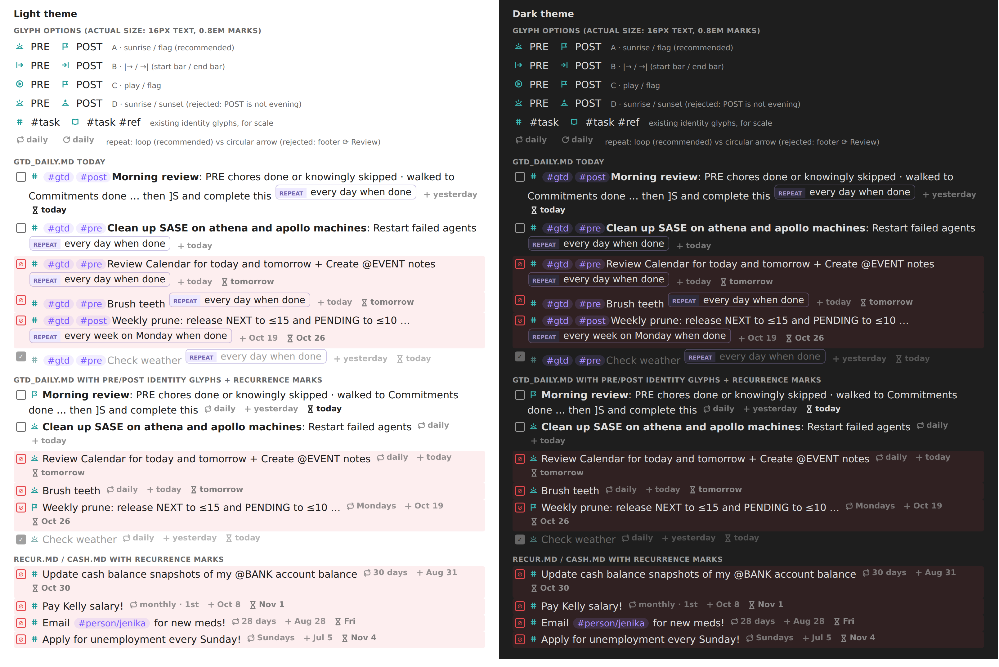

# PRE/POST checklist glyphs and compact `repeat` marks

> **Request (paraphrased):** Show suitable icons in place of `#gtd #pre` and `#gtd #post`, the
> tags that put a task in the PRE and POST groups of the morning GTD review. Separately, make the
> `repeat` task property look nicer and take less space, if that is worth doing at all. Lead the
> design so it is intuitive, reliable, and beautiful. Critique the plan, call out any requirement
> changes, and end with a recommended solution.

Researcher **cld**, 2026-10-21. Sources:

- bob-plugins `ee16031` (bob-ledger-tools 1.60.3)
- bob-cli `c1301621` (`docs/task-tag-marks.md`, `docs/date-marks.md`, `docs/today-marks.md`,
  `docs/freshness.md`)
- the live vault: `gtd_daily.md`, `done/gtd_daily_done.md`, `recur.md`, `cash.md`, `blocked.md`,
  `dash.md`, `.obsidian/` config
- the installed Tasks 8.4.0 bundle
- the Tasks documentation site
- a mockup I rendered in headless Chromium, using the plugin's own mask technique and metrics

The source task is `bob.md` `^pre-post-repeat`: "Make `#pre`, `#post`, and `repeat::` beautiful!"



*Mockup, light and dark themes: glyph options at actual size, `gtd_daily.md` today, the
proposed rendering, and `recur.md`/`cash.md` with recurrence marks. The glyphs are the real
16×16 mask paths proposed below. Pills and chrome approximate the vault's
`dataview-properties.css`.*

---

## Bottom line

1. **Build both. This is a good, cheap, low-risk change.** It only changes how things look:
   no storage, Rust, evaluator, Tasks, or Dataview semantics change. Bob already has a mature
   "mark" family (hash, open book, date, priority, progress, and Today marks). Both requests fit
   two existing display contracts as new sections, and need no new subsystem.
2. **PRE/POST: one glyph replaces the whole identity run** (requirement change **R1**):
   - `#task #gtd #pre` renders as a **sunrise**.
   - `#task #gtd #post` renders as a **flag** (the finish line).

   This follows the shipped `#task #ref` → 📖 precedent: one identity slot, where *shape says
   the kind and the teal ink still says "tracked task"*. Replacing only `#gtd #pre` would leave
   `⌗ 🌅` (plus 🍅 when linked to Today) side by side.
3. **`repeat`: yes, do something.** Render `[repeat:: every day when done]` as a quiet mark in
   the date-mark family: a **loop glyph plus a short cadence label**, such as `🔁 daily`,
   `🔁 Mondays`, `🔁 monthly · 1st`, or `🔁 30 days`. The exact rule and its `when done`
   meaning go in the tooltip. Do not hide the rule, and do not change how it is stored.
4. **Measured savings.** Each `gtd_daily.md` row is about **266 px narrower** at 16 px text:
   - The identity run shrinks from 115 px to 17 px (−98).
   - The repeat pill shrinks from 227 px to 59 px (−168, **−74%**). The weekly rule shrinks
     from 327 px to 88 px.

   That is about 38% of a 700 px readable line. Honest caveat: the gain is mostly **less noise
   and faster scanning**. Most rows wrap to the same number of visual lines as before; in the
   mockup at 700 px, only Morning review drops a line (3 → 2).
5. **Cost.** About the size of the 📖 change: `a0a417a` touched 18 files, +1,684/−142,
   including the generated `main.js` and tests. That means one bob-plugins PR (ledger-tools
   only for phase 1), two new contract sections in bob-cli docs, and a one-line vault query
   edit.

---

## What exists today (verified)

| # | Fact | Evidence |
| --- | --- | --- |
| F1 | **Where checklist rows live.** Every `#gtd #pre/#post` row is in `gtd_daily.md`: 10 open (8 PRE, 2 POST: Morning review and Weekly prune) plus 6 done today. Another 118 are in `done/gtd_daily_done.md`. **All 136 use the canonical `#task #gtd #pre`/`#post` order, adjacent and leading.** | vault grep |
| F2 | **`#gtd` alone is a live legacy tag.** It is the zorg-era topic tag on hundreds of non-checklist lines (`now_gtd.md`, `soon_gtd.md`, `prj.md`, generated query pages). **`#pre`/`#post` appear only on checklist rows.** So `#gtd` must keep its pill everywhere except inside a checklist run. | vault grep |
| F3 | **Membership rule** (decision `review-walk-is-tiered`). Membership uses exact whole-token tags, case-insensitive. `#gtd` + `#pre` means PRE. `#gtd` + `#post` without `#pre` means POST. PRE wins when both are present, with lint `checklist_tag_conflict`. | `sase memory read decisions:review-walk-is-tiered`; `docs/freshness.md` lints |
| F4 | **What a row looks like today:** `☐ ⌗ #gtd #pre Brush teeth  REPEAT│every day when done  + today  ⧗ tomorrow`. `#task` is already the teal hash, and the dates are already marks. Two violet tag pills and one wide Dataview pill remain. | `docs/task-tag-marks.md`, `docs/date-marks.md`, `.obsidian/snippets/dataview-properties.css` |
| F5 | **The identity-slot precedent.** `#task #ref` renders as one teal open-book glyph. Reading view keeps the `#task` anchor, annotated, and hides `#ref` in place. Tasks results draw the book with CSS only. Pickers print `📖 Title`. The cursor or a click reveals the raw tags. A session toggle and resting tones for closed tasks are included. | `docs/task-tag-marks.md` "Reference reading tasks"; `src/138-task-tag-marks.js`, `src/264-plugin-task-tag-marks.js` |
| F6 | **The Today 🍅 follows the identity slot through `taskTagMarkRanges`.** `todayMarkInsertOffset` puts 🍅 after the end of the first range. A PRE/POST range spanning the run therefore moves 🍅 correctly in Live Preview with no change. Reading view needs one hidden-anchor check (`276-…reading.js` already skips `bob-ref-task-hidden`). | `src/143-today-marks.js:116`, `src/276-plugin-today-marks-reading.js:295` |
| F7 | **`repeat` values in the vault** (about 970 fields, 15 on open lines): `every day when done` ×952, `every month on the 1st` ×5, `every week on Monday when done` ×4, `every 30 days when done` ×4, `every 28 days` ×4, `every week on Sunday` ×2. | vault grep |
| F8 | **How Tasks writes and parses `repeat`.** Tasks writes Dataview fields with **two leading spaces** (`  [repeat:: …]`). Its Dataview recurrence regex is `repeat:: *([a-zA-Z0-9, !]+)`. Every rule must start with `every`, and a recurring task needs a due, scheduled, or start date. `when done` bases the next date on the completion date. | installed `obsidian-tasks-plugin/main.js`; Tasks "Recurring Tasks" docs |
| F9 | **`repeat` in Tasks query results.** `blocked.md` → *RECURRING Tasks* uses `group by recurrence`, so every row repeats its own group heading. `dash.md` → *TODAY Tasks* can show a recurring row once it is linked to Today, as the Morning review text tells you to do. Tasks supports `hide recurrence rule`. In short mode it shows only the emoji. | `blocked.md`, `dash.md`; Tasks "Layout" docs |
| F10 | **Pickers already drop inline fields.** Nav's `cleanTaskDisplayText` strips `[key:: …]`, so `repeat` never shows in pickers. It does still show `#gtd #pre` as text. | nav `src/020-config-load-and-tasks.js` |
| F11 | **Walk landings put the cursor at column 0.** `]s`, Ctrl+Enter → next, and moves call `setEditorCursor({ch: 0})`, which never touches a run starting at column 6. **The glyph stays visible on the row you just landed on.** | nav `536-…advance.js:714`, `535-…checklist-walk.js:298` |
| F12 | **Glyphs already in use** (so the new ones must not collide): `⌗` task, 📖 ref, priority bars, `+ ⧗ ✓ ⊘` dates, `◐` progress, 🍅 Today, and **`⟳` as the review footer's "Review" glyph**. Flag, sunrise, and loop are unused. | `styles.css` glyph variables; glossary *Morning GTD Review Footer* |
| F13 | **Fragment headroom** (hard cap 1,000 lines per hand-edited fragment): `138-task-tag-marks.js` 811, `264-…task-tag-marks.js` 729, `136-date-marks.js` 640, **`266-plugin-date-marks.js` 985**, `267-…date-marks-tasks.js` 485. New code goes into new fragments. | `wc -l` |
| F14 | **Highlights note snapshots** render `repeat` as a `repeats every day when done` chip, in Rust. | `src/native/highlights_ref/note_snapshot/bob.rs:435` |

---

## Critique: is this a good idea?

**Yes.** The reasons are concrete.

- **The rows are walked every day.** PRE and POST are the first and last stops of every
  morning `]s` walk: about 8 landings a day on lines that currently carry two violet pills and
  the widest pill in the vault. Every walk lands the eye there, so noise on these rows has a
  cost.
- **The information is redundant in its current form.**
  - `#gtd` adds nothing beside `#pre`/`#post`: membership requires both.
  - `REPEAT│every day when done` spends about 230 px restating that a habit is a habit.
  - The tags and the rule still have to stay in storage, because Tasks, the evaluator, and
    grep depend on them. That is exactly the problem a display-only mark solves.
- **The framework already exists and has been tested hard.** Truthful-or-neutral eligibility,
  cursor reveal, reading-view annotation that survives Dataview's `innerHTML` round trip, CSS
  masks that print to PDF, resting tones, session toggles, and conformance vectors are all
  shipped and live-verified. This is the cheapest kind of beauty work Bob can do.

**Risks, and how the design handles each:**

1. **Hidden mechanics.** When tags render as an icon, a typo (`#prep`, a missing `#gtd`) could
   go unnoticed. The design keeps raw pills for anything that is not a valid canonical run, so a
   pill on a `gtd_daily.md` row becomes the visible signal that something is wrong. This is the
   date marks' "leftover pill = problem" rule.
2. **Saying something untrue.** A glyph must never claim POST when the evaluator says PRE. The
   rule is to defer to the evaluator's membership and to refuse to draw a glyph on conflicts
   (CK7 below).
3. **Learnability.** Two new icons on about 10 rows in one file is a small learning load. The
   hover tooltips teach them, and the plain-text emoji (🌅/🏁) match the masks. If live
   verification shows the sunrise is unreadable on iOS, fall back to a small-caps `PRE`/`POST`
   chip in the same teal (see Open questions).
4. **Contract sprawl.** Every mark adds Live Preview, reading-view, Tasks-results, toggle, and
   vector work. The design adds **no new toggles and no new api namespace**. Checklist glyphs
   ride `toggle-task-tag-marks`, and recurrence marks ride `toggle-date-marks`.
5. **Jitter.** The revealed run is 15–16 characters, against 5 for `#task`. Vim `j`/`k` only
   shifts the title when the cursor column falls inside the run. Walk landings (column 0, F11)
   and Today links never trigger it. The `#task #ref` pair already accepted this.
6. **Repetition.** Seven `🔁 daily` marks stack in a column in `gtd_daily.md`. It is quiet
   (muted ink at 0.7 opacity), and it is not zero information: Weekly prune reads `🔁 Mondays`,
   and the `recur.md` rows all differ. The design keeps it.

**Would I take a different approach?** Not fundamentally. The differences are scope and
placement, called out as requirement changes below. The main one is that the icon replaces the
whole identity run, not just `#gtd #pre`. I also reject CSS-only snippets and third-party icon
plugins (see Rejected alternatives).

---

## Requirement adjustments (explicit)

| # | You asked for | I recommend | Why |
| --- | --- | --- | --- |
| **R1** | An icon in place of `#gtd #pre` / `#gtd #post` | The icon replaces the **whole identity run** `#task #gtd #pre` / `#task #gtd #post`: one glyph in the slot where the teal hash sits today | It is the `#task #ref` → 📖 precedent (F5). It avoids two glyphs side by side, and 🍅 placement follows for free (F6). |
| **R2** | (implicit) The icon whenever the tags appear | The icon appears **only on valid, canonical runs**: `#task`, then `#gtd` and exactly one of `#pre`/`#post` in either order, leading the body, with no conflicting `#pre`+`#post` anywhere on the line. Everything else keeps its pills, including `#gtd` alone (F2). | It stays truthful: a leftover pill is a useful repair signal. All 136 existing rows already qualify (F1). |
| **R3** | "Do something about `repeat`, maybe" | **Do it.** Add a quiet recurrence mark (loop glyph + cadence label). The tooltip carries the verbatim rule and the `when done` semantics. It never hides the rule and never rewrites storage. | `repeat` is the single widest element on these rows. A cadence like "weekly vs daily" is real information, and an icon-only mark would lose it. |
| **R4** | Obsidian rendering | Also cover **Tasks query results**: CSS-only for the PRE/POST pills, and the existing date-mark frame pass for `task-recurring` spans. Add `hide recurrence rule` to `blocked.md`'s RECURRING query. | The same rows appear in `blocked.md` and `dash.md` TODAY (F9). A query grouped by recurrence should not repeat the rule on every row. |
| **R5** | (implicit) Icons everywhere | **Do not** put the icons into the footer, the `]s` notices, or the CLI. The words `PRE`/`POST` are the walk vocabulary there. Plain-text pickers get `🌅 `/`🏁 ` prefixes only in phase 2, next to the existing `📖 ` prefix. | The footer is space-limited and already labelled. Notices say `PRE 2/7 · …`, and an icon would only repeat the word. |
| **R6** | — | **Out of scope:** Bob Mac Capture, the Rust CLI, `bob query`, and Highlights snapshot chips (F14). Optionally, later, Highlights could print `repeats daily` with the same grammar, but only with Rust/JS parity vectors. | Keeps phase 1 to one plugin plus docs. The Mac Capture thin-client decision is unaffected. |

---

## Design A: PRE/POST identity glyphs

### What you see

```text
before: - [?] ⌗ #gtd #pre Brush teeth  REPEAT│every day when done  + today  ⧗ tomorrow
after:  - [?] 🌅 Brush teeth  🔁 daily  + today  ⧗ tomorrow          (🌅 ≈ teal sunrise mask, 🔁 ≈ muted loop)
        - [ ] 🏁 Morning review: PRE chores done … then ]S and complete this  🔁 daily  + yesterday  ⧗ today
        - [?] 🏁 Weekly prune: release NEXT to ≤15 …  🔁 Mondays  + Oct 19  ⧗ Oct 26
        - [x] 🌅 Check weather  🔁 daily  + yesterday  ⧗ today      (resting: faint ghost of the teal)
linked to Today:  - [ ] 🌅 🍅 Brush teeth …                          (🍅 follows the slot, as on 📖 rows)
```

Hover the sunrise to see `#task #gtd #pre · PRE checklist`, with
`First in the ]s walk · Ctrl+Enter when done` on a second line. Hover the flag to see
`#task #gtd #post · POST closeout`, with `Last in the ]s walk (]S) · Ctrl+Enter closes the
review` on a second line. The tooltips contain no `::`. The accessible labels are "PRE checklist
task" and "POST closeout task". Moving the cursor into the glyph, or clicking it, reveals all
three raw tags.

### Glyph choice

PRE means "before the walk": the morning chores that get you clear (weather, teeth, pills,
calendar, email, Keep import). POST means "the closeout": the checkbox that certifies the review
is done, plus the Monday prune. Candidates I drew and rendered at actual size (see the mockup):

| Pair | Verdict |
| --- | --- |
| **Sunrise / flag** | **Recommended.** Each reads on its own: sunrise means "first thing in the morning", the flag means "finish line". Neither shape exists in Bob yet (F12). Both survive 0.8 em, and the flag is the crispest glyph on the sheet. The sunrise needs no up-arrow to disambiguate it, because Bob has no sunset. Plain-text twins: 🌅 and 🏁. |
| `\|→` / `→\|` (start bar, end bar) | A coherent mirror pair, but abstract, and `→\|` is the Tab-key symbol (⇥). Keep it as the fallback if the morning metaphor ever stops fitting. |
| Play ▷ / flag | ▷ reads as media playback and suggests "start a timer" in a Pomodoro vault. |
| Sunrise / sunset | **Rejected.** POST happens in the morning, so a sunset is false. |
| Media skip-back / skip-forward | It nicely matches `[S`/`]S`, but "skip" is exactly what you must not do to checklist rows. |
| Text chip `PRE` / `POST` | Zero learning, but it is one more pill, which is the noise being removed. Keep it as the live-verification fallback. |
| A line band or tint for the whole group | It collides with the status line tints (red Blocked rows are most of these, F1) and is redundant in a one-file checklist. |

**Geometry** uses the hash and book stroke language: a `0 0 16 16` viewBox, stroke `1.8`,
round caps and joins, no fill, used as a CSS mask, and tunable by ±0.3 units:

```text
--bob-pre-task-glyph   (sunrise): M1.9 12.4h12.2  M4.2 12.4a3.8 3.8 0 0 1 7.6 0
                                  M8 3v2.2  M3.4 5.6l1.5 1.5  M12.6 5.6l-1.5 1.5
--bob-post-task-glyph  (flag):    M3.6 14.2V2.3  M3.6 2.9h8.6l-2.1 3.2 2.1 3.2H3.6
```

**Ink** is the same constant teal identity hue as the hash and the book
(`--bob-task-tag-hue`, with the theme hook `--bob-task-tag-color`). PRE and POST share one
ink: color never encodes kind or state here, and shape does that job. Teal stays legible on the
red Blocked tint, where most of these rows sit overnight. A warm sunrise color is tempting but
breaks the ink table: orange means attention and yellow means In Progress. Resting on closed
rows (`x`, `X`, `-`) uses the existing 40% mix toward `--text-faint` at 0.75 opacity. Hover
shows the same 14% capsule.

### Eligibility (Live Preview core)

Extend `taskTagMarkRanges(lineText)` to return `kind ∈ {"task", "ref", "pre", "post"}`. The
`#task` token rules stay unchanged: exact, case-sensitive, boundary-checked. After an eligible
`#task` token ending at `to`:

1. If `refTaskPairEnd` matches, emit `ref`. The existing rule wins, and any checklist tags
   after it stay pills.
2. Otherwise, try the **checklist run**: one whitespace run, then two tag tokens separated by one
   whitespace run, each ending at a tag boundary (`/[\p{L}\p{N}_/-]/u`, as for `#task`). Both
   tokens are compared case-insensitively, as membership is (F3). The set must be exactly
   `{#gtd, #pre}` or `{#gtd, #post}`, in either order.
3. **Conflict gate.** If the line contains whole-token `#pre` **and** `#post` anywhere, emit
   plain `task`. The evaluator calls such a line PRE and lints it. Drawing a sunrise would hide
   the conflict, and drawing a flag would be false.
4. **Slot gate.** The run must start at the body start (the leading `#task`). A
   `#task … #gtd #pre` placed later on the line keeps the hash and the pills. Membership is
   unaffected, the line just doesn't get the beauty treatment. Since F1 says every existing row
   is canonical, this only affects future hand edits.
5. Code exclusion stays in the decoration builder (`freshnessMarkPosInCode`), unchanged.

### Surfaces

- **Live Preview.** The same `Prec.highest` ViewPlugin emits one `Decoration.replace` over the
  run. A `ChecklistTaskMarkWidget` uses a constant per-kind key, so it never flickers. It
  reveals while any selection touches the run inclusively, and mousedown places the cursor at
  the run start. There is no whitespace folding. 🍅 placement follows automatically (F6).
- **Rendered views** (reading view, embeds, hover previews, canvas, Dataview task lists):
  1. The `#task` `a.tag` gains `bob-task-tag-mark` plus `bob-pre-task-mark` or
     `bob-post-task-mark`, with the label and title.
  2. The adjacent `#gtd` and `#pre`/`#post` anchors gain a generalized hidden class (rename
     `bob-ref-task-hidden` → `bob-identity-tag-hidden`, keeping the old class as an alias for
     one release). They stay in the DOM for copy, Dataview round trips, and toggle restore.
  3. Generalize `refTaskPairAnchor` into a sibling walk that skips whitespace-only text nodes.
  4. The Today reading-view check skips the generalized class.
- **Tasks query results** use CSS only, inside `.plugin-tasks-list-item .task-description`.
  `#task` is already hidden there.
  - The `#pre`/`#post` pill is drawn as the glyph when a `#gtd` sibling is present
    (`a.tag[data-tag-name="#gtd" i] ~ a.tag[data-tag-name="#pre" i]`, plus the reverse order
    via `:has()`).
  - The `#gtd` pill hides when it has a `#pre`/`#post` sibling.
  - Both rules are scoped out of descriptions that contain both `#pre` and `#post`
    (`:not(:has(…#pre):has(…#post))`).
  - Obsidian's Chromium supports `:has()`. The JS post-processor never touches Tasks rows, as
    today.
- **Pickers, Task Card, inbox-route subtitles (phase 2).** Display text drops the `#gtd #pre`
  run after `#task` and prefixes `🌅 ` / `🏁 `, mirroring `REF_TASK_DISPLAY_PREFIX` in nav and
  block-id-prompt. Inline fields are already stripped (F10).
- **Toggle.** "Toggle task tag marks" covers the new variants: strip and re-annotate run
  document-wide. No new command.

### Conformance vectors (proposed additions to `docs/task-tag-marks.md`)

| # | Input | Expected `taskTagMarkRanges` |
| --- | --- | --- |
| CK1 | `- [ ] #task #gtd #pre Brush teeth` | `[{[6,21), pre}]` |
| CK2 | `- [?] #task #gtd #post Morning review` | `[{[6,22), post}]` |
| CK3 | `- [x] #task #gtd #pre Check weather [completion:: 2026-10-21]` | `[{[6,21), pre}]` (resting tone is CSS) |
| CK4 | `- [ ] #task #pre #gtd Swapped` | `[{[6,21), pre}]` (either order) |
| CK5 | `- [ ] #task #GTD #Pre Loud` | `[{[6,21), pre}]` (case-insensitive partners) |
| CK6 | `- [ ] #task  #gtd   #post Extra spaces` | `[{[6,25), post}]` |
| CK7 | `- [ ] #task #gtd #pre #post Conflict` | `[{[6,11), task}]` (no checklist glyph, pills stay) |
| CK8 | `- [ ] #task #gtd Topic only` | `[{[6,11), task}]` (`#gtd` keeps its pill) |
| CK9 | `- [ ] #task #pre Missing gtd` | `[{[6,11), task}]` (not a member) |
| CK10 | `- [ ] #task #gtd #prep Typo` | `[{[6,11), task}]` (boundary) |
| CK11 | `- [ ] #task Brush teeth #gtd #pre` | `[{[6,11), task}]` (run not at the slot) |
| CK12 | `- [ ] #task #ref #gtd #pre Odd` | `[{[6,16), ref}]` (the ref pair wins; checklist pills stay) |
| CK13 | `- #task #gtd #pre Not a task` | none |
| CK14 | ``- [ ] Note `#task #gtd #pre` here`` | none in Live Preview (code) |
| CK15 | `- [ ] #task #gtd #pre Brush teeth ^teeth`, Today-linked | 🍅 widget at offset 22, after the sunrise |
| CR1 | reading view: task li with adjacent `#task`, `#gtd`, `#pre` anchors | `#task` annotated as sunrise; `#gtd` and `#pre` hidden in place |
| CR2 | reading view: `#task #gtd #pre #post` | hash only; all pills visible |
| CR3 | Tasks row with `#gtd` + `#post` pills | `#gtd` hidden, `#post` drawn as the flag (CSS) |
| CR4 | toggle off, then on | annotations and hidden classes stripped document-wide, then restored |

---

## Design B: recurrence marks for `repeat`

### Options considered

| Option | Verdict |
| --- | --- |
| Do nothing | The pill stays the widest element on every recurring row (F4, F7). |
| CSS-only restyle of the Dataview pill (shrink it, hide the key) | CSS cannot read or shorten the value, so `every day when done` stays. The date-mark contract rejected this for the same reason. |
| Icon only (🔁) with the rule in the tooltip | The most compact, and common in task apps, but it loses cadence at a glance: daily vs `Mondays` in `gtd_daily.md`, and all four `recur.md`/`cash.md` rows differ. |
| **Icon + short cadence label** | **Recommended.** About 74% narrower, keeps the cadence visible, and reads as English. |
| Merge into the scheduled mark (`⧗ tomorrow ↻`) | Loses per-field reveal and folding; rejected for date marks for the same reason. |
| Shorten storage (`every day`, drop `when done`) | Changes Tasks behavior: a fixed schedule makes the next date count from the scheduled date. Rejected. |

### Anatomy and tones

The mark joins the **date-mark family as a fifth field**, `repeat`. It reuses the same span
anatomy (`span.bob-date-mark[data-field="repeat"]` containing a glyph and a label), the same
metrics, the same whitespace fold (Tasks writes the field double-spaced, F8), the same
reveal-on-touch, the same reading-view text-node split at sort order 50, the same repair-flag
selector, and the same toggle (`toggle-date-marks`). It differs in three ways:

- It carries `data-rule` and `data-when-done` instead of `data-date`/`data-when`.
- Its label is a **cadence, not a date**, so rollover relabelling skips it.
- It always uses the **quiet** tone: muted ink at 0.7, the same as `created`, because it is
  background information. It rests faint on closed tasks. It has no emphasis state and no hue.

**Glyph:** a closed rectangular loop with two arrowheads, a refined monochrome 🔁. This
mirrors how the date glyphs refine Tasks' own emoji (`➕ ⏳ ✅ ❌`). It is deliberately **not** a
circular arrow, because `⟳` is the review footer's "Review" glyph (F12). The first draft (a
straight Lucide `repeat`) read as ⇄ "swap" at text size, so the vertical legs are lengthened:

```text
--bob-date-glyph-repeat: M2.6 9.4V6.6A2.6 2.6 0 0 1 5.2 4h8.2  M11 1.6 13.4 4 11 6.4
                         M13.4 6.6v2.8A2.6 2.6 0 0 1 10.8 12H2.6  M5 9.6 2.6 12 5 14.4
                         (stroke 1.7–1.9, round caps/joins; verify the weight beside ⧗ and +)
```

### Label grammar

First normalize the value: trim it, collapse whitespace, then strip a trailing `when done`
(case-insensitive) into a flag. Labels are lowercase words, with weekday and month names
capitalized, matching the date marks. A label is never truncated.

| Rule (after `every`) | Label | Vault example |
| --- | --- | --- |
| `day` | `daily` | `every day when done` → `daily` (×952) |
| `N days` | `N days` | `every 30 days when done` → `30 days`; `every 28 days` → `28 days` |
| `weekday` | `weekdays` | — |
| `week` | `weekly` | — |
| `N weeks` | `N weeks` | — |
| `week on Monday` / bare `Monday` | `Mondays` | `every week on Monday when done` → `Mondays`; `every week on Sunday` → `Sundays` |
| `week on Tuesday, Friday` | `Tue, Fri` | — |
| `N weeks on Friday` | `N weeks · Fri` | — |
| `month` / `N months` | `monthly` / `N months` | — |
| `month on the 1st` / `last` / `last Friday` / `2nd Wednesday` | `monthly · 1st` / `monthly · last` / `monthly · last Fri` / `monthly · 2nd Wed` | `every month on the 1st` → `monthly · 1st` |
| `N months on the …` | `N months · …` | — |
| `year` / `N years` | `yearly` / `N years` | — |
| `January on the 15th` | `yearly · Jan 15` | — |
| anything else that starts with `every` | **the rule as written, minus `when done`** | `every April and December on the 1st and 24th` |

When N is 1, use the singular word (`every 1 week` → `weekly`). The verbatim fallback is the
truthful edge: the mark never claims to understand a rule outside the grammar. It only drops the
`REPEAT│` chrome.

### Tooltip and accessibility

- Line 1: `Repeats ` + the rule exactly as written. Example: `Repeats every day when done`.
- Line 2: `Next date counts from completion` (with `when done`) or
  `Next date follows the schedule` (without). This is the only place the `when done`
  distinction appears, which is correct for a distinction that matters only on a late
  completion.

The text never contains `::`. The accessible label is `Repeats daily` (and so on).

### Eligibility and repair flag

- **Occurrence gate:** exactly one `(^|[^A-Za-z0-9_-])repeat\s*::` on the line, same as the
  date marks.
- **Canonical form:** `[repeat:: …]` or `(repeat:: …)` with matching brackets, a lowercase key
  touching `::`, and a value that matches **Tasks' own charset** `^[a-zA-Z0-9, !]+$` (F8) and
  starts with `every`.
- **Repair flag:** anything else leaves the Dataview pill with the existing dashed orange repair
  flag, because Tasks cannot read it. Examples: `[repeat:: weekly]`, `[Repeat:: …]`, a
  duplicate, a `;` in the value.
- **Not flagged:** a recurring task with no date. That already has the evaluator lint
  `recurring_undated`, so the display does not duplicate it.

### Tasks query results

- `blocked.md` → *RECURRING Tasks*: add **`hide recurrence rule`** to the query. It groups by
  recurrence, so the heading already says the rule (F9). This is a vault edit with zero code.
- Full mode elsewhere (for example `dash.md` *TODAY* when a recurring chore is linked): extend
  the date-mark Tasks frame pass, `decorateTasksResultDates` in fragment 267, which has room.
  `span.task-recurring` spans whose inner text is ` 🔁 <rule>` get the same mark, appended
  inside, with Tasks' click and context menu preserved. If Tasks never finishes the row, the
  pass degrades to Tasks' emoji text.
- Short mode is not needed today: `rotten.md` excludes recurring tasks.

### Conformance vectors (proposed additions to `docs/date-marks.md`)

| # | Input | Expected |
| --- | --- | --- |
| RM1 | `- [?] #task #gtd #pre Brush teeth  [repeat:: every day when done]  [created:: 2026-10-21]` | repeat `daily`, fold 2, quiet; tooltip `Repeats every day when done⏎Next date counts from completion`; created mark unaffected |
| RM2 | `[repeat:: every day]` | `daily`; `…⏎Next date follows the schedule` |
| RM3 | `[repeat:: every week on Monday when done]` | `Mondays` |
| RM4 | `[repeat:: every month on the 1st]` | `monthly · 1st` |
| RM5 | `[repeat:: every 30 days when done]` / `[repeat:: every 28 days]` | `30 days` / `28 days` |
| RM6 | `[repeat:: every week on Tuesday, Friday]` | `Tue, Fri` |
| RM7 | `[repeat:: every 3 weeks on Friday]` | `3 weeks · Fri` |
| RM8 | `[repeat:: every January on the 15th]` | `yearly · Jan 15` |
| RM9 | `[repeat:: every April and December on the 1st and 24th]` | the rule verbatim (fallback) |
| RM10 | `- [x] … [repeat:: every day when done] … [completion:: …]` | `daily`, resting (CSS) |
| RM11 | `(repeat:: every week)` | `weekly` |
| RM12 | cursor anywhere in the field / in the folded run | reveals that field only / unfolds to fold 0 (as DM24) |
| RN1 | `[repeat:: weekly]` | no mark; repair pill |
| RN2 | two `repeat::` fields | no mark on either; repair pills |
| RN3 | `[Repeat:: every day]` / `[repeat :: every day]` | no mark; repair pill |
| RN4 | `[repeat:: every day; when done]` | no mark (outside Tasks' charset); repair pill |
| RN5 | ``- [ ] `[repeat:: every day]` `` | untouched (code) |
| RT1 | Tasks row `span.task-recurring > span` text `" 🔁 every day when done"` | `daily` mark appended; span flagged `data-bob-date-mark` |

---

## Implementation plan

**Phase 1** is one bob-plugins PR (bob-ledger-tools minor bump), the bob-cli contract docs, and
one vault line.

1. **New fragment `138-checklist-task-marks.js`** (138 is at 811 lines, F13). It holds
   - the run matcher (`checklistRunEnd(text, taskTo)` → `{ end, kind }`) and the conflict gate,
   - the constants (labels, tooltips, classes), and
   - a `ChecklistTaskMarkWidget` with a per-kind key.

   Then make `taskTagMarkRanges` in 138 call it after `refTaskPairEnd`.
2. **`264-plugin-task-tag-marks.js`**: emit the new widget kind; generalize the reading-view
   pair walk and the hidden class; extend toggle strip and restore. If it nears 1,000 lines,
   split it into a `264b`-style sibling fragment.
3. **New fragment `136-recurrence-marks.js`**: the canonical-field gate with Tasks' charset, the
   cadence grammar, the tooltip, and the model.
   - Merge its source into `dateMarkSources` and `dateMarkSourcesInText`. The fold and
     selection helpers are reused as-is.
   - **Put the widget branch in a new `266b`-style fragment**, because 266 is at 985 lines
     (F13).
   - Make rollover skip `data-field="repeat"`.
4. **`267-plugin-date-marks-tasks.js`**: let the frame pass mark `task-recurring` spans.
5. **`styles.css`**: add `--bob-pre-task-glyph`, `--bob-post-task-glyph`, and
   `--bob-date-glyph-repeat`; the variant, resting, and hidden rules; the Tasks-results CSS for
   checklist pills; and repair-flag coverage for leftover `repeat` pills.
6. **Tests**: add the CK/CR vectors to `scripts/test-ledger-tools-task-tag-marks.cjs`, the RM/RN
   vectors to `scripts/test-ledger-tools-date-marks.cjs`, and RT1 to
   `scripts/test-ledger-tools-date-marks-tasks.cjs`. Then run `npm run build`, `npm test`,
   `npm run docs:check`, and `bob plugins sync`.
7. **bob-cli docs**: in `docs/task-tag-marks.md`, add a "GTD checklist tasks" section, the
   CK/CR vectors, and the live-verification lines. In `docs/date-marks.md`, add a `repeat` row
   to "Fields and glyphs", a "Recurrence" section with the grammar and the RM/RN/RT vectors,
   and remove `repeat` from the implicit non-goals. In `docs/today-marks.md`, add one sentence
   to "Placement" saying the slot now also covers the checklist run. Commit with `feat(docs)`,
   no `!`: no CLI or JSON contract changes.
8. **Vault**: add `hide recurrence rule` to the `blocked.md` RECURRING query.
9. **Live verification** (Bryan, in Obsidian):
   - Check the sunrise and flag on red Blocked rows in light and dark themes.
   - Check `🔁 daily` beside `+`/`⧗`.
   - Walk `]s` through PRE: the glyph stays, and 🍅 sits after it when the row is linked.
   - Check reading view and the `dash.md`/`blocked.md` rows.
   - Check iOS legibility and PDF export.
   - Check that both toggles restore the pills.

**Phase 2** (optional, only if wanted):

- picker, Task Card, and inbox-route `🌅 `/`🏁 ` prefixes in nav and block-id-prompt;
- Highlights snapshot chips using the same cadence grammar, in Rust with parity vectors.

**No decision record is needed.** This is display-only and governed by the two display
contracts. It changes nothing in `review-walk-is-tiered`. No memory edits are needed either:
the glossary has no mark terms.

---

## Rejected alternatives

- **An icon for `#gtd #pre` only, keeping the hash.** That puts two glyphs side by side (three
  with 🍅). The 📖 precedent already chose one identity slot.
- **Hiding `#gtd` everywhere.** `#gtd` is a live legacy topic tag on hundreds of lines (F2).
- **A CSS-only snippet** (Obsidian's `.cm-tag-pre` classes, `a.tag[href="#pre"]`). It cannot
  gate on task lines, pairing, or conflicts. It cannot reveal on cursor touch without the
  jittery `.cm-active` reveal that the `#task` contract rejected. And it cannot shorten
  `repeat` at all.
- **Third-party icon or tag-styling plugins.** They sit outside the bob-plugins truthfulness
  rules, toggles, tests, and PDF and Dataview round-trip guarantees, and they cannot compact
  `repeat`.
- **Changing storage** (new tags, an emoji tag, a shorter `repeat` text, the Tasks emoji
  format). That breaks the decision-recorded membership rule, Tasks' Dataview format, and the
  bob-cli parsers, and it rewrites hundreds of archived lines for no semantic gain.
- **Per-kind inks** (amber sunrise, green flag). Orange, yellow, and green already mean
  attention, In Progress, and Next.
- **A circular-arrow repeat glyph.** It collides with the footer's `⟳ Review`.
- **Showing `when done` on the line.** 98% of rules carry it, so it would be constant noise.
  The tooltip and the evaluator lint cover the exceptions.
- **Icons in the footer or notices.** The words are the vocabulary there (R5).

## Open questions for Bryan

1. **Sunrise and flag, or the mirror pair `|→`/`→|`?** I recommend sunrise and flag. Look at
   the mockup at actual size. Check the iPhone in particular, where the sunrise rays are the
   finest detail.
2. **Interval wording:** `30 days`, or the more compact `30d`? I chose words to match the date
   marks' "no invented abbreviations" voice. `30d` saves 3–4 characters on 8 rows.
3. **Phase 2 picker prefixes:** do you ever pick PRE/POST rows in task pickers? If not, skip
   them.

---

## Recommended solution

Ship **one display-only change in bob-ledger-tools**, documented as two new sections of
existing bob-cli display contracts:

1. **Checklist identity glyphs.**
   - A canonical, conflict-free `#task #gtd #pre` run at the start of a task line renders as
     **one teal sunrise**, and `#task #gtd #post` as **one teal flag**.
   - They follow the `#task #ref` → 📖 recipe exactly: Live Preview replace with reveal on
     touch, reading-view annotation that hides the partners in place, CSS-only Tasks rows,
     resting tones, and the existing toggle.
   - Everything non-canonical keeps its honest pills, including `#gtd` on its own.
2. **Recurrence marks.**
   - `[repeat:: …]` becomes a quiet fifth member of the date-mark family: a 🔁-style loop glyph
     plus a cadence label (`daily`, `Mondays`, `monthly · 1st`, `30 days`, or the verbatim rule
     as a fallback).
   - The tooltip gives the exact rule and whether the next date counts from completion.
   - Rules outside Tasks' grammar keep the pill with the repair flag.
   - The same fold, reveal, toggle, and Tasks-results frame pass as the dates apply.
3. **One vault line:** `hide recurrence rule` in `blocked.md`'s RECURRING query.

The result: about 266 px less chrome on every PRE and POST row, a morning checklist that reads
`🌅 Brush teeth  🔁 daily  + today  ⧗ tomorrow`, and a closeout row marked with a finish flag.
Nothing in storage, Tasks, Dataview, the evaluator, or the walk changes, so the risk is limited
to rendering. The effort is about one 📖-sized PR.

## Sources

- Tasks docs: [Recurring Tasks](https://publish.obsidian.md/tasks/Getting+Started/Recurring+Tasks)
  (rules must start with `every`; the `when done` semantics; a date is required) and
  [Layout](https://publish.obsidian.md/tasks/Queries/Layout) (`hide recurrence rule`; short
  mode shows only the emoji).
- Lucide [sunrise](https://lucide.dev/icons/sunrise) and
  [repeat](https://composables.com/icons/icon-libraries/lucide/repeat), used as shape references.
  The final paths are redrawn for the 16-unit, 1.8-stroke mask language.
- Repo and vault evidence as cited inline: bob-plugins `ee16031` and `a0a417a`; bob-cli
  `c1301621` docs; the installed Tasks 8.4.0 bundle; live vault files.
