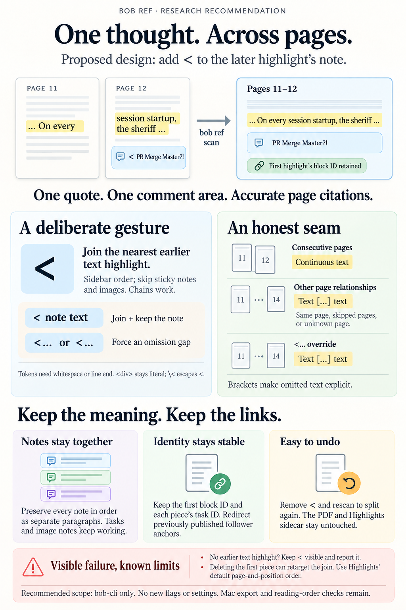

# Continuation highlights in `bob ref`: the `<` marker

> **Research query:** The Highlights app cannot make a single highlight, or a single
> note on a highlight, span pages or separate points in a paragraph. What is the best way
> to have `bob ref` automatically merge a highlight (and its notes) into the previous one
> in the ref note iff the highlight's note starts with `<` (optionally followed by a space
> and note text), designed to be intuitive, reliable, and beautiful? Critique the plan (is
> it a good idea, would a different approach be better), call out any justified
> requirement adjustments, and end with a recommended solution.



## Bottom line

**Build it.** Your `<` gesture is the right idea, it belongs in `bob ref`, and your
first use case is already in the vault. All five researchers reached this verdict
independently. Ship it as a **render-time fold**. The fold reads the Highlights sidecar
and writes one combined callout in the ref note. It never writes to the PDF or the
sidecar, and deleting the `<` splits the pieces again on the next scan.

Your spec needs nine adjustments. They are listed in
[Requirement adjustments](#requirement-adjustments). These five matter most:

1. **`<` is a token, not a first character.** It counts only when whitespace or the end
   of the line follows it. `\<` writes a literal `<`.
   ([Gesture and grammar](#gesture-and-grammar))
2. **Your two use cases get different seams.** Pieces on consecutive pages join into one
   sentence. Pieces on the same page are joined with ` […] `, which marks omitted text.
   Typing `<…` forces the gap. ([Join or gap at the seam](#join-or-gap-at-the-seam))
3. **"Previous" means the nearest earlier text highlight.** The search skips sticky
   notes and figure captures, so capturing a figure never blocks a join.
   ([What counts as previous](#what-counts-as-previous))
4. **Identity is preserved.** The merged block keeps the first piece's `^h-` ID.
   Absorbed pieces are never reported as "removed". Annotation tasks keep their identity
   per piece, and an anchor that was already published still resolves.
   ([Identity and published anchors](#identity-and-published-anchors))
5. **The heading states the span.** A cross-page group renders under
   `### Pages 11–12`, so `bob ref show` and the Mac Refs copy card cite it correctly.
   ([Headings and placement](#headings-and-placement))

The change touches only bob-cli. It adds no CLI flag, no config key, and no
region-parser change. The full specification is under
[Recommended solution](#recommended-solution).

## The problem, verified

The screenshot (`~/tmp/screenshots/20261019_063505.png`) and the sidecar
(`~/bob/lib/blogs/gas_town_emergency_user_manual.md`, lines 204–232) show the same split:

- **Page 11 (bottom):** "One last Crew tip: … PR Sheriff Standing Orders. On every". No
  note.
- **Page 12 (top):** "session startup, the sheriff checks open PRs … merging and
  cleanup". Note: `< PR Merge Master?!`.

The continuation is at the **top of page 12**. mus's report places it at the bottom of
page 11, which is wrong.

The 06:45 Mac scan already rendered these as two blocks under two headings. The `<`
leaked into the comment (`ref/blogs/gas_town_emergency_user_manual.md:122–135`):

```md
### Page 11

> [!quote] One last Crew tip: … PR Sheriff Standing Orders. On every

^h-06d27eae3c84


### Page 12

> [!quote] session startup, the sheriff checks open PRs and divides them … merging and cleanup
>
> > [!note] Comment < PR Merge Master?!

^h-434a5e5a2bc4
```

That is half a sentence under each of two headings, and a thought about the whole
passage attached to only one half. The IDs above are the real ones. gem's report shows
invented IDs and text that was cleaned up after the fact.

**Why no PDF tool can fix this at the source.** A PDF highlight annotation's
`QuadPoints` live on a single page. Zotero's moderator puts it plainly: a PDF annotation
spanning multiple pages "isn't possible", and Zotero's merge requests have stayed open
since 2021. Highlights advertises "Smart Merge Annotations" without saying what it does.
Neither my searches nor any researcher's turned up a description. Whatever it is, it
cannot produce one annotation across pages 11 and 12. A two-minute hands-on check is
still worthwhile, but it will not change this design.

**How common is it?** cld scanned the vault read-only and found:

- 77 sidecars and 338 annotations.
- About 3–4 real page-turn splits, so roughly 1% of annotations.
- An improvised workaround already in use: a p. 16 note in `agent_catalog_pane` reads
  "…see above note".

I re-checked the trigger itself. Across the 170 Markdown files under `~/bob/lib`,
exactly **one** comment begins with `<`, and it is this one. The only other `<`-led line
is a hard-wrapped quote line (`<reason>"`) in `docs/sase_AGENTS_v3.md`. Shipping the
feature therefore changes no existing note except the Gas Town one.

## Is this a good idea

**Yes.** Three properties make it right:

1. **The right layer.** `bob ref` already owns a one-way projection: it regenerates the
   region between `<!-- highlights:begin/end -->` on every scan and never writes the
   sidecar (`docs/highlights-ref-sync.md`, Generated Body Contract). A fold at render
   time fits that model exactly. It is stateless, deterministic, and reversible, and
   agents see the merged result through `bob ref show` with no extra work.
2. **The right moment.** You mark the follower while you are looking at the overflow.
   There is no need to go back and tag the first piece. In the Highlights sidebar,
   `< PR Merge Master?!` still reads naturally as "continues the item above; here is my
   thought."
3. **The right character.**
   - `<` points backward.
   - It survives the Markdown export unescaped; the sidecar shows this.
   - It cannot be mistaken for a blockquote, unlike `>`.
   - It does not collide with your habit of opening notes with "…", unlike an
     ellipsis-only marker.
   - It needs no counter, unlike Readwise's `.c1`/`.c2` concatenation tags.

   Readwise's sync-time concatenation tags are direct prior art: an explicit marker,
   merged on import.

**What would make it a bad idea** is any of the following:

- A loose trigger that eats `<div>`, `<-`, or `<https://…>`.
- A join that presents non-contiguous text as one sentence.
- Re-hashing the merged text, which tombstones good blocks and re-creates tasks.
- A silent failure where the `<` disappears but nothing merges.

The design below closes each of these.

### Alternatives considered

Each item gives an alternative, then its verdict.

- **Auto-merge page-split pairs (no marker):** Rejected. cld measured about 50%
  precision on your vault, and this same note has nested short-plus-long highlights on
  pp. 4–7 that would be wrongly joined. Explicit intent is required.
- **Readwise-style `.c1`/`.c2` tags:** Rejected. You must edit both pieces and keep a
  counter. Sidecar order already gives `<` the same information.
- **A forward marker (`>`) on the first piece:** Rejected. It collides with blockquote
  export, and you only discover the overflow after making the first highlight.
- **A dedicated "continuation" color:** Rejected. It spends a color category, leaves no
  room for a comment, and colors are not reliably present in the sidecar.
- **Rewriting the sidecar or the PDF annotations:** Rejected. Highlights overwrites the
  sidecar on autosave. A cross-page annotation is impossible anyway, and this would break
  bob's read-only contract.
- **Hand-editing the ref note:** Rejected. The managed region is regenerated on every
  scan.
- **Fusing the pieces at parse time (gem's design):** Rejected; see
  [Where the five reports disagreed](#where-the-five-reports-disagreed-and-how-i-resolved-it).
- **Re-extracting quotes from the PDF text layer using quads:** The right long-term
  direction, because it also fixes `bob-cli-85` text damage and enables geometric
  contiguity checks. It is far larger than this feature and should not block it.

## Requirement adjustments

These change or sharpen your wording on purpose. Each item opens with what you asked
for, then gives what it is adjusted to and why.

- **A1. The note "starts with `<` (optionally followed by a space and note text)".**
  - *Adjusted to:* Check the first non-blank line of the note, after any
    `Comment:`/`Note:` label and one list marker (`- `). It must be `<` followed by
    whitespace or the end of the line. `\<` writes a literal `<`.
  - *Why:* This keeps `<`, `< text`, and `- < text` working. It rejects `<div>`, `<-`,
    `<=`, `<3`, `<https://…>`, and the `<~/tmp/x.png>` image-note wrapper. This sharpens
    your parenthetical rather than changing it.
- **A2. "Merge with the previous one."**
  - *Adjusted to:* The nearest earlier **text highlight** in sidecar order, which is the
    Highlights sidebar order. The search skips the marker mirror, sticky notes, and image
    selections. Chains work: A, `<`B, `<`C becomes one group. If no text highlight
    precedes it, the marker stays visible and a warning is reported.
  - *Why:* Predictable, and figure captures never block a join.
- **A3. (Implicit) a continuous join.**
  - *Adjusted to:* **Next page joins; same page or skipped pages get ` […] `; `<…` forces
    a gap.**
  - *Why:* Your "different points in a paragraph" case has omitted text by definition.
    Joining it seamlessly would misquote the author.
- **A4. "and its notes"**
  - *Adjusted to:* All pieces' notes are kept in order, as paragraphs of one Comment
    callout. The marker is stripped. `#task` bullets and screenshot image notes from any
    piece keep working.
  - *Why:* No thought is lost, and the comment applies to the whole passage.
- **A5. (Unstated) identity**
  - *Adjusted to:* The group keeps the **first piece's** `^h-` ID. Absorbed IDs are never
    tombstoned. An anchor that was already published gets a redirect stub. Task `[h::]`
    stays keyed to its own piece, and 🔖 links to the group.
  - *Why:* No link churn, no duplicate tasks, no false "Removed highlight" entries.
- **A6. (Unstated) heading**
  - *Adjusted to:* Cross-page groups render under `### Pages 11–12`. Same-page groups
    keep `### Page N`.
  - *Why:* Accurate citations in `bob ref show` and the Refs copy card.
- **A7. (Unstated) failure behavior**
  - *Adjusted to:* A marker that cannot merge renders exactly as written and is counted
    in the scan report. **The `<` disappears only if the merge happened.**
  - *Why:* Silent text loss would be the worst failure.
- **A8. (Scope)**
  - *Adjusted to:* Only text highlights can be followers in v1. A `<` on a sticky note or
    image caption is literal text.
  - *Why:* A sticky note continuing a highlight needs its own rendering rules; it is v2
    at most.
- **A9. (Scope)**
  - *Adjusted to:* No forward marker, no auto-merge, no config flag, no new CLI surface,
    no PDF or sidecar writes.
  - *Why:* The negative scope is stated so the implementer does not invent any of these.

## The design

### Gesture and grammar

Type the marker on the **later** piece, at the moment you highlight the overflow. The
first piece is never touched.

Each item gives the note typed in Highlights, then the result in the ref note.

- **`<`:** Joins the previous highlight; no extra comment.
- **`< PR Merge Master?!`:** Joins; the comment becomes `PR Merge Master?!` (or is added
  as a paragraph).
- **`- < keep going` or `Comment: < keep going`:** Joins; comment `keep going`.
- **`<` followed by a newline and `- #task Check the sheriff`:** Joins; the task is
  imported normally.
- **`<` followed by a newline and `~/tmp/screenshots/x.png`:** Joins; the image embeds
  under the merged quote.
- **`<… why skip this?` or `<... why skip this?`:** Joins with a **forced** ` […] ` gap;
  comment `why skip this?`.
- **`\< 5 ms is the target`:** No merge; renders `< 5 ms is the target`.
- **`<div>`, `<-`, `<= 5`, `<3`, `<https://x.org>`, `<~/x.png>`:** Ordinary note; `<`
  kept.
- **`…see above` (your usual style):** Ordinary note.

How the matcher works:

- **Where it looks:** the first non-blank line of the comment source, after
  `strip_comment_label_only` and at most one unordered-list marker.
- **Join token:** `<`.
- **Gap token:** `<…` or `<...`. macOS and iOS smart punctuation turns `...` into `…`,
  so both spellings must match.
- **Token boundary:** each token must be followed by whitespace or the end of the line.
- **Stripping:** remove the token and its following whitespace from **both** `comment`
  and `task_source`; otherwise `- < #task x` would create a task whose text starts with
  `<`. Drop the line if it is then empty. Leave the remaining lines untouched.
- **Character set:** ASCII `<` only.

### What counts as previous

The head is the nearest earlier text highlight, in sidecar order, among the annotations
that would render. `is_sidecar_marker_mirror` items, sticky notes, and image selections
are skipped and keep their own blocks.

- **Placement:** the group renders where the head is. A skipped item renders after the
  group; in document terms it is still "after the first piece".
- **Chains:** if the item above is itself a follower, the new piece joins the same
  group.
- **No distance limit.** The rule is "the highlight above it in the sidebar". A wide
  page jump is still visible, through the gap and the heading.
- **Sidecar order is Highlights' default page-and-position sort.** cld found evidence
  that the sort ignores dates: on p. 9, a 10-19 annotation sits above 10-16 and 10-18
  ones. Exporting sorted by color would break "previous"; document that as unsupported.
- **Dangling marker:** if no earlier text highlight exists, the note renders verbatim
  with the `<` visible and the scan counts it.

The cost of stateless "previous": if you **delete the first piece** in Highlights, the
follower joins whatever highlight comes before it. The result is visible in the ref note
and you fix it in Highlights. That is acceptable for a deliberate edit (see the
Relationship state item under
[Where the five reports disagreed](#where-the-five-reports-disagreed-and-how-i-resolved-it)).

### Join or gap at the seam

The rule rests on one physical fact. **Highlights can already select contiguous text
within a page, so a split on the same page almost always means you skipped words.
Across a page break, the split was forced on you, so the text almost always continues.**

```text
seam(prev, next) =
  Gap   if next used the gap token (<… / <...)
  Join  if page_index(next) == page_index(prev) + 1
  Gap   otherwise  (same page, skipped pages, or unknown page)
```

- **Join:** concatenate the raw texts with `\n` and run the existing
  `beautify_annotation_text` once. That function already reflows lines and heals
  hyphens: `imple-` + `mentation` → `implementation`, while `Marie-` + `Curie` stays
  hyphenated. For Gas Town this produces "… Standing Orders. On every session startup,
  the sheriff …".
- **Gap:** join the beautified pieces with ` […] `. Square brackets mark the omission as
  editorial, so it is never confused with an author's own "…" (web-clip prose uses
  plenty). Skip the marker if one side already ends or starts with `[…]`.
- **`page_index`:** take it from the linked heading's `highlights://…#page=N` when
  present. Today `sidecar_page_heading_details` keeps only the label and a boolean, so
  this needs a small parser addition. Otherwise use the trailing integer of `Page N` or
  `p. N`. Store it on `SidecarAnnotation`, but keep it **out of** `annotation_block_id`.
- **Why not cld's sentence heuristic** (join only if the previous piece ends
  mid-sentence or the next starts lowercase)? It wrongly adds a gap to a contiguous page
  turn that happens to fall on a sentence boundary. The explicit `<…` already covers the
  rare case of text skipped across a page turn.
- **Known miss:** a same-page continuation that really is contiguous gets a harmless
  ` […] `. Examples are a sentence interrupted by an inline figure or a column break
  Highlights could not select across. A cheap v2 override (for example `<+`) can be
  added if this ever shows up. Do not ship it now.

The two seam errors do not cost the same. A false gap claims an omission that did not
happen, and the PDF is one click away. A false join fabricates a sentence. The rule
errs toward the gap.

### Notes, tasks, and image notes

- **Comment:** one `[!note] Comment` callout. It contains the head's note, then each
  follower's remaining text, as separate paragraphs.
  - Strip labels and list markers **per piece before joining**. `strip_comment_list_markers`
    is all-or-nothing per text, so joining first would change how the head's comment
    renders.
  - A bare `<` adds nothing.
  - Never deduplicate or rewrite the notes.
- **Image notes:** screenshot paths from any piece embed under the merged quote, in
  piece order. The asset path depends only on the ref note and the image (`image_notes.rs`),
  so merging causes no asset churn.
- **Tasks:** `#task` bullets from any piece import as usual. Identity is covered in
  [Identity and published anchors](#identity-and-published-anchors).

### Headings and placement

Each item gives a group, then its heading.

- **All pieces on page 9:** `### Page 9` (unchanged)
- **Pages 11 and 12:** `### Pages 11–12`
- **Pages 11, 12, and 13:** `### Pages 11–13`
- **Pages 11 and 14 (a gap):** `### Pages 11, 14` (non-consecutive pages are not shown
  as a range)
- **Non-numeric labels:** The head's label

The renderer already emits a heading whenever the label changes. A page whose only
content was absorbed therefore gets **no empty heading**. A later, unmerged page-12
highlight still opens `### Page 12`.

Why a range heading rather than keeping `### Page 11`:

- The region parser takes `page_label` from the nearest `###` heading other than
  `Removed highlights` (`region.rs:68–117`). `bob ref show` reports that label.
- The Mac Refs copy card builds its citation from it (`RefsCopy.swift:698–713`).
- "Pages 11–12" is therefore the only way the true span reaches citations without a
  format change.

The price is gem's clutter objection. Page 11 can end up with
`### Page 11` → `### Pages 11–12` → `### Page 12`. That outline is accurate, and I
accept it.

Optional one-line Mac polish: `shortPageLabel` could map `Pages X` to `pp. X`. Today it
passes `Pages 11–12` through unchanged. That is fine, just less consistent with `p. 11`.

### Identity and published anchors

This covers identity, tombstones, and published anchors. Each item gives an ID, then
its rule.

- **Group `^h-`:** The **head's own** `annotation_block_id`, computed from raw sidecar
  data before the fold. Adding, removing, or editing a follower never changes it.
- **Follower `^h-`:** Computed the same way (raw ordinals and raw text), so it is
  identical whether or not the piece is merged. It is **absorbed**: not rendered as a
  block, not counted in `current_ids`, and excluded from `removed_ids`.
- **Follower anchor that was already published:** If the follower's ID already appears
  in the existing region (`generated_block_ids`), emit a **redirect stub** under
  `### Removed highlights` instead of dropping it silently.
- **Task `[h::]` (`processed_id`):** Hashed from the **piece's own** ID, so toggling `<`
  before or after a task exists never re-creates it. Do not bump
  `HIGHLIGHT_TASK_ID_VERSION`.
- **Task 🔖 link:** Points at the **group** ID, through `block_ids_by_annotation_order`,
  which maps every member's order to the head.

The redirect stub looks like this:

```md
> [!info] Merged highlight Now part of the [[#^h-06d27eae3c84|Pages 11–12]] highlight.

^h-434a5e5a2bc4
```

**Why the stub.** `docs/highlights-ref-sync.md` already promises that a task created
earlier "keeps its original link, which then targets the tombstoned block … still a
valid, resolvable jump". Anchors also leave the note: `bob ref show` emits
`[[stem#^h-…]]` for every annotation, and the Mac Refs copy card copies those links into
other notes. Dropping a published follower silently, as grk and mus propose, would break
that promise.

How the stub behaves:

- **Stable:** the region parser collects every `^h-` under Removed as removed, whatever
  the callout says, so no parser change is needed.
- **Idempotent:** the stub ID stays in `existing_ids`, so it re-renders on every scan
  while the merge holds.
- **Reversible:** unmerging renders the follower under its original ID again, and the
  stub disappears.
- **Normal deletion:** deleting the follower from Highlights turns the stub into an
  ordinary tombstone.
- **Rare in practice:** you normally type the `<` before the next Mac scan, so no stub
  is ever created. It appears only after a retroactive merge, a scan that ran between
  the highlight and the note, or this rollout's Gas Town note.

Code changes this requires:

- In `annotation_tasks.rs`, split `AnnotationTaskCandidate.source_block_id` into an
  identity ID (the piece's own) and a link ID (the group's).
- Today the highlight branch recomputes `annotation_block_id` and ignores the render
  map, which only the image branch reads. Both branches should take the link ID from the
  render map.
- Task dedup also matches task identity text across the vault, which protects unedited
  tasks. Edited, routed, or completed-then-edited tasks rely on `[h::]`, which is why it
  must stay keyed per piece.

What this feature does **not** fix: block IDs hash `ordinal_on_page`, so adding a
highlight above others on a page re-mints and tombstones every later ID on that page.
cld filed this as `bob-cli-9o`, and the Gas Town history shows it. Because the fold
computes IDs from raw ordinals before folding, it adds no new churn; it simply inherits
the existing fragility.

### Visibility

- **Rule you learn:** if you still see a `<` in the ref note, it did not merge.
- **Counters:** the scan report and scan JSON gain `continuations: N` (pieces absorbed)
  and `continuations_dangling: N`, next to the existing `image_notes` and
  `image_notes_unresolved` fields. The new fields are additive.
- **Dry run:** `bob ref sync <pdf> --dry-run -v` prints, per PDF, a line such as
  `continuations: 1 merged · 0 dangling`, so you can check joins before they are written.
- **Counts:** `highlights_count` / `rendered.count` count rendered blocks, so a group
  counts once. It already equals `current_ids.len()`, so excluding absorbed IDs makes
  this automatic. Gas Town drops by one.
- **Doctor (optional):** a `dangling_continuation` warning. Compute it from the sidecar
  plan, not by grepping the region for `< `, because an escaped `\<` legitimately
  renders as `< …`.

### Gas Town after the first scan

```md
### Pages 11–12

> [!quote] One last Crew tip: I have a new ad-hoc role that I’ve been using for the past week, called the “PR Sheriff.One of my B eads crew has a permanent hook: b d-4f43s: PR Sheriff Standing Orders. On every session startup, the sheriff checks open PRs and divides them into easy wins and those needing human review, then slings the easy wins to other crew for merging and cleanup
>
> > [!note] Comment PR Merge Master?!

^h-06d27eae3c84

…

### Removed highlights

> [!info] Merged highlight Now part of the [[#^h-06d27eae3c84|Pages 11–12]] highlight.

^h-434a5e5a2bc4

> [!warning] Removed highlight This annotation is no longer present in the Highlights sidecar.

^h-028f34fba39e
…
```

What changes:

- One sentence instead of two halves.
- The comment applies to the whole passage, without the `<`.
- The head ID `^h-06d27eae3c84` is unchanged.
- The old p. 12 anchor still resolves.

"Sheriff.One", "B eads", and "b d-4f43s" are damage from Highlights' own text
extraction of bob web-clip PDFs (`bob-cli-85`); the merge neither causes nor fixes it.
`pdftotext` reads these pages cleanly.

An illustrative same-page example, for your "different points in a paragraph" case:

```md
### Page 10

> [!quote] Do this until every crew member is spinning, working on some task you gave them […] hook it so they will continue working on it after a crash
```

## Where the five reports disagreed and how I resolved it

Each item names the question, then gives the researchers' positions and the resolution.

- **Pipeline stage**
  - *Positions:* cld, grk, mus, cdx: fold at render time over the parsed annotations,
    keeping each piece's own ID. gem: merge into one `SidecarAnnotation` at parse time,
    then re-index ordinals.
  - *Resolution:* **Render time.** gem's design is wrong on three counts. It hashes the
    merged text, so both old IDs tombstone. Re-indexing ordinals churns every later ID on
    the page (`annotation_block_id` hashes `ordinal_on_page`; see
    `sidecar_render.rs:169–187`). Re-keying tasks duplicates any task you have edited.
    gem's claim of "zero disruption to block ID hashing" contradicts its own §4.2.
- **Trigger grammar**
  - *Positions:* gem: `^<\s*(.*)` (so `<div>` would merge). grk: `<` plus whitespace,
    but rejects a remainder that starts with a digit or `=<>`. cld, mus, cdx: `<`
    followed by whitespace or end of line, plus a `\<` escape.
  - *Resolution:* **Whitespace or end of line, with a `\<` escape.** grk's digit rule
    would silently refuse `< 3 reasons…`. The escape is simpler and explicit. A false
    merge is visible in the note and easy to fix.
- **Seam between pieces**
  - *Positions:* grk, mus: always seamless. cld: seamless only for a mid-sentence turn
    onto the next page, otherwise ` … `. cdx, gem: `<` is seamless and `<...` adds an
    explicit ` […] `.
  - *Resolution:* **Decide by page: next page joins, same page gaps, and `<…` forces a
    gap** ([Join or gap at the seam](#join-or-gap-at-the-seam)). This keeps cld's
    honesty, uses cdx and gem's explicit override, and drops cld's sentence-punctuation
    heuristic.
- **What counts as "previous"**
  - *Positions:* cdx, grk, mus: only the item immediately above; an image or sticky note
    in between blocks the join. cld, gem: the nearest earlier text highlight, skipping
    non-text items.
  - *Resolution:* **Nearest earlier text highlight**
    ([What counts as previous](#what-counts-as-previous)). Under the strict rule,
    capturing a figure at the top of page 12 would stop the page-11 sentence from
    joining. Only a text highlight can be a target, so skipping non-text items adds no
    ambiguity.
- **Comment join**
  - *Positions:* mus: join with a space. The others: separate paragraphs.
  - *Resolution:* **Separate paragraphs.** They are separate thoughts.
- **Task identity**
  - *Positions:* cld, grk, cdx: `[h::]` stays keyed to each piece's own ID. mus, gem:
    tasks follow the merged unit.
  - *Resolution:* **Keyed per piece, with 🔖 linking to the merged block.** Otherwise
    toggling `<` re-keys `[h::]`. Text dedup (`sync.rs:1460–1474`) only saves unedited
    tasks.
- **The follower's old `^h-` anchor**
  - *Positions:* grk, mus: drop it silently. cld: add a redirect stub, only if tasks
    reference it. cdx: always add an inline forwarding paragraph.
  - *Resolution:* **Redirect stub under `### Removed highlights`, only if the anchor was
    already published**
    ([Identity and published anchors](#identity-and-published-anchors)). cdx's inline
    `… ^h-child` line is not a standalone `^h-` line. `region_block_id` would not
    recognize it, so it would be absorbed into the next block's text and turn that block
    into unparsed content.
- **Heading**
  - *Positions:* cld, gem: the first piece's page heading. grk: `### Page 11–12`. mus:
    `### Pages 11–12`. cdx: `### Page 11` with a "Pages 11–12" callout title.
  - *Resolution:* **`### Pages 11–12` for cross-page groups**
    ([Headings and placement](#headings-and-placement)). The heading is the only
    provenance channel that `bob ref show` and the Mac Refs copy card read. cdx's title
    would be parsed as the first line of the quote.
- **Relationship state**
  - *Positions:* cdx: record each successful join in the region and block writes if a
    join changes unexpectedly. The others: stateless.
  - *Resolution:* **Stateless for v1.** A changed join stays visible and is fixed in
    Highlights. cdx's guard adds hidden state, per-PDF write refusals, and a two-sync
    reset ritual, all to protect against a rare event: deleting the first piece.

## Implementation sketch

Everything lives in `src/native/highlights_ref/`. Only three code paths read
`sidecar.annotations`, and I verified this: `render_sidecar_highlights`,
`annotation_task_candidates`, and `resolve_sidecar_image_assets`. That gives the fold one
clean seam to plug into.

1. **`model.rs` and `sidecar.rs`:**
   - Add `page_index: Option<u32>` to `SidecarAnnotation`, parsed from the linked
     heading's `#page=N` or from the label.
   - Keep everything else in parsing unchanged. Raw text, comments, ordinals, and IDs
     stay exactly as they are today.
2. **New `continuation.rs`:**
   - A pure `plan_continuations(&[SidecarAnnotation]) -> ContinuationPlan` returns the
     groups (head order, member orders, the seam before each member), the effective
     comment and task source for each member with the token stripped, and the dangling
     orders.
   - It contains the matcher table ([Gesture and grammar](#gesture-and-grammar)), the
     "previous" walk ([What counts as previous](#what-counts-as-previous)), and the seam
     rule ([Join or gap at the seam](#join-or-gap-at-the-seam)).
   - Unit-test it in isolation.
3. **`sidecar_render.rs`:**
   - Iterate the plan's groups instead of raw annotations.
   - Build the merged quote and the merged comment (per-piece label and list stripping,
     then join) and the range heading.
   - Put absorbed IDs in an `absorbed` set that `removed_ids` filters out, and emit
     redirect stubs for `absorbed ∩ existing_ids`.
   - Map every member's order to the head in `block_ids_by_annotation_order`.
   - Record the counters on `RenderedHighlights`.
4. **`annotation_tasks.rs`:**
   - Read each member's effective `task_source` from the plan.
   - Use the identity ID (own) for `processed_id` and the link ID (from the render map)
     for 🔖.
5. **`report.rs` and `scan_json.rs`:** add the `continuations` and
   `continuations_dangling` fields.
6. **Docs:** add a "Continuation highlights (`<`)" section to
   `docs/highlights-ref-sync.md` after "Image notes". Include the grammar, the seam rule,
   three before/after examples, and a line in the Generated Body Contract about absorbed
   IDs and redirect stubs.
7. **After you accept the design:** record a `decisions` strand ("Continuation
   highlights fold at render time") and optionally a glossary term, both through
   `/sase_memory_write`.

`region.rs`, `ref_library/show.rs`, bob-plugins, and Bob Mac Capture need no changes,
apart from the optional `pp.` polish. The work is about one medium task.

## Tests that prove it

Put fixtures in `src/native/highlights_ref/tests/`, using the linked-page sidecar shape,
which is what Highlights writes for this library.

1. **Golden Gas Town fixture**, using the real p. 11–12 sidecar text:
   - one callout under `### Pages 11–12` with comment `PR Merge Master?!`;
   - the head ID is unchanged;
   - when the old p. 12 block exists in the prior region, a redirect stub appears and no
     "Removed highlight" tombstone does.
2. **Matcher table:** bare `<`, `< x`, `- < x`, `Comment: < x`, `<…`, `<...`, `\<`,
   `<div>`, `<-`, `<=`, `<3`, `<https://…>`, `<~/x.png>`, a `<` on a later line, and
   CRLF line endings.
3. **Seams:**
   - next page joins, including hyphen healing;
   - the same page gets ` […] `;
   - skipped pages get ` […] `;
   - `<…` forces a gap across a page turn;
   - an unknown page gets ` […] `;
   - an existing `[…]` is not doubled;
   - return-link glyphs are stripped per piece before joining.
4. **Grouping:**
   - chains of three pieces;
   - a marker mirror, an image, or a sticky note between pieces is skipped and renders
     after the group;
   - `<` on the first highlight, or with only images above it, dangles and renders
     verbatim;
   - `<` on a sticky note or image caption is literal.
5. **Identity:**
   - the head ID is the same with and without followers;
   - the follower ID is the same merged and unmerged;
   - merge, rescan, unmerge, rescan produces byte-identical output when the input is
     unchanged;
   - no new tombstones appear;
   - the redirect stub appears only when the follower was previously published.
6. **Tasks:**
   - a follower `#task` keeps its `[h::]` across a `<` toggle, and its 🔖 points at the
     group;
   - an edited follower task is not duplicated;
   - `- < #task x` does not keep the `<`.
7. **Image notes:** screenshot paths on either piece embed under the group.
8. **Reports:** `continuations` and `continuations_dangling` appear in the dry-run and
   JSON output, and `highlights_count` counts the group once.
9. **Round trip:** `parse_managed_region` and `bob ref show` report one annotation with
   label `Pages 11–12`, the joined quote, and the merged comment, with no unparsed
   content.

## Limits and validation on the Mac (unverified here)

- **Export template:** confirm that `<`, `<…`, and `\<` survive the TextBundle
  `text.md` export as they do in `.md`.
- **List-item comments:** confirm that a template which exports comments as list items
  (`- < …`) still matches.
- **Two-column papers:** confirm that Highlights' position sort follows reading order.
  If it sorts purely by y-coordinate, "previous" can surprise you. The rule stays the
  same; document it.
- **iPad:** check that typing `<` and `...` on the iPad survives autocorrect. Smart
  punctuation producing `…` is already handled.
- **Obsidian rendering:** check reading view and Live Preview of a multi-paragraph
  comment, the `[…]` seam, and the redirect stub's wikilink inside a callout title.
- **Smart Merge:** a brief hands-on check of Highlights' "Smart Merge Annotations", for
  completeness.

## Open questions for Bryan

1. **Gap glyph:** ` […] ` (editorial, unambiguous, my choice) or the lighter ` … `
   (Readwise's choice)?
2. **Published-anchor handling:** redirect stub (my choice, and it keeps the docs'
   resolvable-link promise) or silent drop (no new Removed entries, but old links open
   at the top of the note)?
3. **Heading:** `### Pages 11–12` (accurate citations; my choice) or keep `### Page 11`
   (tidier outline; the span is lost in `bob ref show`)?
4. **Same-page join:** does a same-page `<` always mean "I skipped words" for you? If
   not, a `<+` force-join is a small v2.

## Recommended solution

Ship a **render-time continuation fold** in `bob ref`:

- **Trigger:** a text highlight whose note's first line is `<` followed by whitespace or
  the end of the line, or the gap token `<…`/`<...`. List markers and `Comment:` labels
  are allowed before it, and `\<` escapes. The highlight joins the nearest earlier text
  highlight in sidecar order, and chains are allowed.
- **Seam:** pieces on consecutive pages join seamlessly through the existing
  beautify/hyphen healer. Everything else, and anything marked `<…`, is joined with
  ` […] `.
- **Rendering:** one `[!quote]` callout at the head's position, under `### Pages A–B`
  when it spans pages. All pieces' notes become paragraphs of one Comment callout, and
  image notes and `#task`s keep working.
- **Identity:** the head's `^h-` ID is kept. Follower IDs are absorbed, never
  tombstoned, and get a redirect stub only if they were already published. Task `[h::]`
  stays per piece and 🔖 points at the group.
- **Failure:** a marker that cannot merge stays visible and is counted in the scan and
  dry-run reports.
- **Scope:** bob-cli only. No flags, config, PDF or sidecar writes, or region-format
  change.

After the next Mac scan, the Gas Town passage reads as one sentence on pages 11–12,
with "PR Merge Master?!" beneath it and its block link unchanged.

## About this report

- **Lead researcher:** consolidated from five independent reports (`cdx`, `cld`, `grk`,
  `mus`, `gem`) plus lead verification
- **Date:** 2026-10-19
- **Code baseline:** bob-cli `9217a475`
- **Question:** Highlights cannot make one highlight (or one note) span a page break or
  two separate points in a paragraph. Should `bob ref` merge a highlight, and its notes,
  into the previous one when the highlight's note starts with `<`? How should it work so
  that it is intuitive, reliable, and beautiful?

## Sources

- **bob-cli `9217a475`:**
  - `src/native/highlights_ref/sidecar_render.rs` (render loop, `annotation_block_id`,
    tombstones and silent drops, comment stripping)
  - `sidecar.rs` (parse and comment extraction)
  - `annotation_tasks.rs` (task candidates, `processed_id`, 🔖 link)
  - `sync.rs:1216–1237, 1440–1530` (task dedup)
  - `region.rs:60–117, 270–400` (region grammar)
  - `note.rs:645` (`generated_block_ids`)
  - `text.rs` (beautify and hyphen healing)
  - `image_notes.rs`
  - `ref_library/show.rs:268` (annotation links)
  - `docs/highlights-ref-sync.md` (Generated Body Contract; block IDs and tombstones,
    around line 1370; Scheduled Scan)
- **bob-mac-capture:** `Sources/RefsCore/RefsInspector.swift` (`displayPageLabel`) and
  `RefsCopy.swift` (`shortPageLabel`, provenance line). bob-plugins does not parse
  highlight blocks (grepped by cld).
- **Vault (read-only):**
  - `~/bob/lib/blogs/gas_town_emergency_user_manual.md` (sidecar)
  - `~/bob/ref/blogs/gas_town_emergency_user_manual.md` (current render, real IDs)
  - a scan for `<`-led comments across `~/bob/lib`
  - the screenshot `~/tmp/screenshots/20261019_063505.png`
- **Beads:** `bob-cli-9o` (ordinal-hash churn, filed by cld) and `bob-cli-85`
  (Highlights extraction damage).
- **Web:**
  - [Zotero forums: Merge annotations](https://forums.zotero.org/discussion/comment/412898)
  - [Zotero forums: Overlapping/contiguous annotations](https://forums.zotero.org/discussion/95140/overlapping-contiguous-annotations-in-pdfs)
  - [Highlights features](https://highlightsapp.net/features/)
  - [Highlights sidecar files](https://highlightsapp.net/how-to/mac/sidecar-files/)
  - [Readwise action tags](https://docs.readwise.io/readwise/guides/action-tags)
  - [Obsidian internal links](https://help.obsidian.md/links)
  - [Highlights App Store listing](https://apps.apple.com/app/id1498912833)
- **Researcher reports:** `highlight_continuation_marker__{cdx,cld,grk,mus,gem}.md` in
  this directory.
