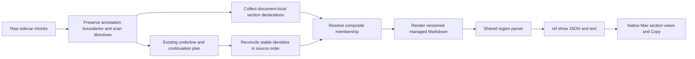

# Named annotation sections: a design for Highlights, Obsidian, and Bob Refs

Independent research by **cdx**, 2026-10-24. This report was developed from project source, project memory, and official product documentation. No other researcher's report, transcript, or findings were consulted. This is a design recommendation, not an implementation or a record of a completed Mac acceptance test.

**Recommendation:** build this as a small, explicit annotation organization feature. A standalone annotation declares a section with `# Name`; another annotation joins it with a dedicated `@Name` line. Store the result as ordinary headings around the existing independently linked annotation blocks. Bob owns parsing and membership; the Mac app receives section metadata through `ref show` and renders native section headers. Avoid wrapping all members in one giant callout.

The idea is good: it lets the reader turn scattered evidence into a readable argument while still working in the PDF. The important adjustment is to treat membership as a deliberate directive, rather than interpreting every occurrence of `@name` in prose.

## What the current system makes possible—and what it constrains

The real pipeline is PDF annotations → Highlights-exported Markdown/TextBundle sidecar → Bob's managed ref-note region → Bob's region parser → `ref show` JSON → native Mac UI. Bob does not currently read every annotation's text directly from the PDF. The generated region already supports quote callouts, comments, images, standalone notes, persistent `^h-…` links, removed-annotation stubs, and annotation-generated tasks. Source and commentary are kept separate. The new feature should extend that pipeline, not establish a second source of truth. [Code evidence C1–C5 below.]

Highlights documents that comments and sticky-note contents appear as ordinary text in its extracted notes; underlines become bold quotes. Its default annotation ordering follows positions in the document. These affordances suit textual section declarations, but they do not establish how every literal Markdown character survives a particular export configuration. That still needs a small real-app experiment. [Highlights extraction rules](https://highlightsapp.net/how-to/mac/extract-pdf-annotations/), [annotation ordering](https://highlightsapp.net/how-to/mac/sort-pdf-annotations-using-color-categories/).

Five implementation findings materially affect the design:

1. **The importer currently throws away heading lines.** `parse_sidecar_chunk` discards all-heading chunks and filters headings out of comments and standalone notes. A note containing only `# Evidence` can therefore disappear at import; a description can survive while its title disappears. Recognize declarations before this filtering. Preserve the boundary between exporter headings and annotation text. [C1]
2. **`@name` already has a consequential meaning.** A trailing strict `@name` on an annotation task routes the created task into an existing root-level vault note. For example, `- #task Send the quote @alice` is a task for `alice.md`. Generic mention removal could change destinations, alter task deduplication, or make task intake fail. [C4]
3. **Every generated H3 is currently interpreted as a page heading.** Simply inserting `### Evidence` would make `ref show` report “Evidence” as a page. `### Removed highlights` has special tombstone semantics. This requires a versioned region grammar, not just a new render template. [C2]
4. **The Mac panel is not a general Markdown viewer.** It decodes annotation records and renders a native feed with page labels, images, note cards, continuation pieces, counts, pagination, and Copy projections. Markdown headings alone cannot make it group correctly. [C5–C7]
5. **An exported annotation is not always an independent displayed block.** An underline may be absorbed into a highlight; `<` continuations are already grouped into a single block with separately represented pieces. Section membership must compose with those rules. [C3]

These findings make the change moderate in scope. It is substantially more than adding a CSS callout, but it does not require a database, a new annotation application, or a rewrite of PDF extraction.

## Critique of the proposal

The strongest use is thematic synthesis: “Evidence,” “Objections,” “Practical consequences,” or a question being investigated across distant pages. A section description gives the collected evidence a purpose. This is more expressive than assigning a highlight color and less disruptive than moving material into separate notes during reading.

There are also real costs:

- Grouping sacrifices a single global page order. Keep page provenance visible and preserve source order inside each section.
- Names are easy to mistype and expensive to rename across many annotations. Highlights' documented interface does not provide Bob-aware name completion; its FAQ also says it is not scriptable. Do not promise an autocomplete experience or automatic source repair that has not been built. [Highlights FAQ](https://highlightsapp.net/faq/).
- A note can discuss several themes while a hierarchy gives it one home. Make the one-home limitation explicit. Do not duplicate live annotation blocks to simulate tags.
- Markdown-looking prose already exists in comments. Activation needs narrow boundaries and an escape, or old annotations can unexpectedly change meaning.
- A beautiful result depends on restraint: section headings, breathing room, and readable page captions will age better than a stack of colored nested containers.

I would therefore keep the author's idea but narrow its syntax and initial scope. I would not build a general tagging system, an arbitrary annotation tree, or bidirectional editing of generated ref notes as part of this work.

## Explicit adjustments to the requested requirements

| Proposed adjustment | Why it is justified |
| --- | --- |
| Initially, only a **standalone note** can declare `# Name`. | A section is an organizational annotation; interpreting a source highlight or underline as a section risks confusing the author's text with the reader's structure. A dedicated sticky note makes intent clear. |
| Membership must occupy its **own unindented line**, outside tasks, lists, quotes, and code. | “Contains `@name` anywhere” conflicts with task routing, email addresses, citations, and ordinary prose. This is the most important change. |
| Support `@Name` for a simple name and `@"Working memory"` for names with spaces. | The requested `<name>` is not necessarily one word. An explicit quoted form avoids longest-match guesses and gives beautiful titles without slug-only authoring. |
| Resolve names across the entire reference, including forward references. | The declaration's physical PDF position should not determine whether a member works. “Then” should describe the authoring workflow, not a one-pass parser restriction. |
| One parent section per existing displayed annotation block; one section level. | Preserves block links and avoids ambiguous copying, duplicate counts, and recursive layouts. |
| Existing underline/continuation composites stay indivisible. | Reparenting their individual pieces would change the already established identity and task-link contract. Conflicting memberships need a visible diagnostic. |
| Section rename is an explicit source edit, not automatic PDF rewriting. | Name-based references cannot safely infer that a deleted name and a new name represent the same intent. |

Image annotation comments should be eligible for membership too: the same comment grammar applies, and image cards already participate in the feed. This is a small, useful extension beyond the named highlight/underline/standalone types; it does not change image extraction.

## Authoring contract

Create a dedicated sticky note:

```text
# Working memory

Evidence about the limits of holding and manipulating information.
```

On a highlight, underline, standalone note, or image comment:

```text
@"Working memory"

This explains why the second condition failed.
```

For a short name:

```text
@Evidence
```

A comment with a task can use both features without changing the route:

```text
@Evidence

- #task Compare the replication results @alice
```

The first line groups the annotation; the bullet creates the same routed task it creates today. A token inside that bullet is never a section directive. If a continuation marker is present, retain its existing first-line grammar, for example `<` on the first line and `@Evidence` on a later line. A shared directive scan should record spans before continuation, image-note, and task handling; it should not scatter independent regular expressions throughout those consumers.

Recommended exact rules:

- A declaration is the first nonempty line of a standalone note, with exactly one `#` followed by a space and a nonempty plain-text title. Additional content requires a blank separator. `## Name` does not create a nested section.
- The declaration is scoped to one reference. Do not resolve it through the vault's note names, tags, or other PDFs.
- Normalize names with Unicode NFC, surrounding/internal whitespace normalization, and locale-independent case folding. Preserve the declaration's original typography for display. Thus `@Evidence` and `@evidence` agree; `Working-memory` is not an inferred alias for `Working memory`.
- Bare names contain letters/numbers, `_`, or `-`; quoted names follow an explicitly documented string-escape grammar. Titles containing punctuation can always use the quoted form. Do not add fuzzy matching.
- `\@Evidence` and `\# Evidence` are literal text. Code spans, fenced code, email addresses, links, list items, and quoted source text do not create memberships. A line such as `Compare @Evidence later` remains prose.
- Collect declarations first, then resolve member directives. Repeating the same membership is harmless; requesting two distinct parents is not silently reduced to the first.
- Remove a valid directive from displayed commentary only after successful resolution. Keep the PDF and Highlights sidecar untouched. Keep unresolved or malformed directives visible in the rendered note.
- If removing directives would leave a standalone member with no content, retain it as an ordinary note and report that it has no body. A highlight with only a membership comment is fine: its quote is the content.
- Section descriptions may contain ordinary Markdown paragraphs, lists, and links. They do not declare subgroups. Existing explicit `#task` bullets in the description retain normal task-import behavior and link to the section's source annotation anchor.

These are proposed rules, not facts about the current implementation. Before committing to this exact syntax, verify literal `#`, `@`, quotes, backslashes, and blank lines against real Highlights sidecars with supported export settings.

## Persistence: readable hierarchy, one authority

Keep author intent in the PDF annotations and their Highlights-owned export. Keep the rendered ref note as the durable, inspectable projection. Compute the JSON view from that projection. Do not introduce an authoritative membership table in a separate JSON file, frontmatter array, or Mac preference store.

The managed Markdown should have:

- H3 section titles under the existing H2 Highlights heading.
- H4 page headings within each section, retaining exact page labels.
- Existing quote/note/image callouts as siblings, each with its own existing block ID.
- A final **Other annotations** section for unmatched ordinary content, omitted when empty.
- Existing removed/redirect entries in a distinct system area outside all user sections.
- Small, versioned HTML comment markers to distinguish section structure from page headings and user content. These markers are generated bookkeeping, not another user-editable source of truth.

The following is a **format sketch**, not a finalized wire grammar. IDs are illustrative. The metadata records declaration provenance; per-entry source order prevents display regrouping from becoming the identity match order.

```markdown
## Highlights

<!-- highlights:begin -->
<!-- bob:sections:v1 -->

<!-- bob:section {"key":"working memory","source_page":"Page 2","source_order":1} -->
### Working memory ^h-a10c42d88e31

Evidence about the limits of holding and manipulating information.

<!-- bob:section-content -->
#### Page 12

<!-- bob:annotation {"source_order":7} -->
> [!quote] The second condition imposed an additional memory demand.
>
> > [!note] Comment
> > This explains why the second condition failed.

^h-892b7d11aa02

#### Page 19

<!-- bob:annotation {"source_order":11} -->
> [!note] Compare this result with the replication study.

^h-019e5c41cb62

<!-- bob:ungrouped -->
### Other annotations

#### Page 4

<!-- bob:annotation {"source_order":3} -->
> [!quote] The baseline condition used familiar stimuli.

^h-e012b7aa5510

<!-- highlights:end -->
```

A marker before the heading identifies a section even if its title happens to be “Page 12” or “Removed highlights.” An explicit description boundary means a multi-paragraph description is not guessed from the first child's appearance. Exact spelling, escaping, and recognition of these markers should be settled by round-trip fixtures. Parser logic must recognize generated markers only at structural boundaries, never inside a quoted annotation or fenced code.

The section source anchor is placed on its heading, so following the declaration's existing block link lands at the section. The region parser reconstructs a note-shaped compatibility record for that source annotation. Its description should not be duplicated as a second visible note card. Verify heading anchors and source-note transclusion in actual Obsidian before freezing the format.

**Do not wrap all children in one callout.** Obsidian supports nested and foldable callouts, but its documentation says it does not support links to specific parts of quotations, callouts, and tables. That is a serious conflict with independent annotation IDs. The current continuation feature deliberately groups pieces under one identity; a thematic section should not accidentally do the same to all its members. [Obsidian callouts](https://help.obsidian.md/callouts), [block references](https://help.obsidian.md/links).

Ordinary headings also provide native outline/folding affordances and remain readable in other Markdown tools. Headings do not guarantee identical folding behavior in every viewer; presentation can differ while order and membership agree. [Obsidian folding](https://help.obsidian.md/folding).

If a document has no valid section declarations, retain today's generated format. No mass rewrite of unrelated notes is needed.

## Identity, ordering, and failure behavior

**Regrouping must not replace annotations.** Preserve every member's existing `^h-…`, task-source link, processed task identity, image reference, continuation identity, and genuine tombstone. Membership and displayed section order are presentation metadata, not inputs to the content identity key.

This requires explicit work for standalone notes. Their current identity uses their text; removing or changing `@Evidence` would otherwise change that identity. Match old raw keys and new directive-free keys during migration, retain published IDs, and separate source order from presentation order. Duplicate-text matching must still use source provenance rather than whichever identical block happens to appear first after grouping. If a one-to-one migration cannot be determined, hold the affected ref-note update and explain the ambiguity. Do not mint replacement IDs while claiming stability. [C3]

Do not overpromise rename stability: the current sidecar model does not expose a durable PDF annotation UUID. Arbitrary edits to a standalone section declaration cannot always be matched to its previous version. Member IDs can and should remain stable; a declaration title change can change its own identity unless migration has unambiguous evidence. A later “rename section” operation could preserve identities explicitly, but that would require a separate, coordinated PDF-edit design.

| Situation | Recommended behavior |
| --- | --- |
| Member appears before its declaration | Resolve normally after collecting all declarations. |
| Two declarations normalize to the same name | Neither wins. Render both as ordinary notes, keep affected membership lines visible, report both source locations. |
| Unknown or deleted section | Keep the annotation visible under Other annotations with its literal directive; emit an unresolved-name diagnostic. |
| Several distinct directives on one displayed block | Keep the block ungrouped and show the conflict. Do not duplicate it. |
| Empty declared section | Show its title/description once; native UI may add “No annotations yet.” It remains a valid place to collect future evidence. |
| Membership exists only on an absorbed underline | Assign its whole host block to that section if no other constituent requests a different section. |
| Continuation head/followers request different sections | Preserve the existing composite ungrouped and retain the conflicting directives; report constituent pages. |
| No section directive on a constituent | It does not conflict with an explicit directive on another constituent. |
| Section description contains a membership directive | Keep it literal and diagnose unsupported nesting. |
| Section title changes but member names do not | Show unresolved memberships; never silently guess a rename. |
| No sidecar is available | Keep existing managed content, matching today's behavior. |
| Structurally corrupt new region or ambiguous ID migration | Refuse that note's rewrite; preserve prior content and surface a precise error. |

Order sections by declaration source order, and members by their existing source order. Put Other annotations last. Use the export's order, not lexicographic sorting of page labels; Roman numerals, front matter, and custom labels must survive. Highlights can also export in color-category order, so do not describe sidecar order as guaranteed numerical page order. Preserve `source_order` explicitly in the managed projection and JSON if consumers need to reconstruct the original sequence.

The intended invariant is: every existing displayed content block appears exactly once in a section or in Other annotations; every valid declaration appears once as a header/description; every original source and task identity remains accounted for. The old underline/continuation folding rules still determine what a displayed content block is.

Diagnostics should reach dry-run output, scan JSON/receipts, and `ref show`, with codes such as `unknown_section`, `duplicate_section`, and `conflicting_sections`, plus source page and block ID when available. A typo should not erase content or abort unrelated PDFs. Identity ambiguity is more serious and justifies holding that one note.

## Presentation: quiet structure around existing evidence

The visual direction should resemble a thoughtfully typeset reading notebook.

**Obsidian:** use real H3 titles, generous spacing before sections, restrained H4 page captions, and the existing quote/comment styles. Keep descriptions as normal reading text. Do not add a new colored background around every section; comments already use a distinct visual treatment and underlines already have gold emphasis. Scope optional section styling to generated ref content rather than changing every H3 in the vault. The existing `ref-highlights` styling is documented in the CLI repository; it is not a dedicated Highlights-rendering plugin discovered in the plugin monorepo. [C8]

**Mac Refs panel:** keep the familiar quote rule, yellow note cards, inline images, and tucked continuation seams. Introduce native section headers with a semibold title, quiet content count, and description below. A narrow panel should use wrapping text rather than shrinking typography or adding another indentation level.

```text
HIGHLIGHTS                         12 annotations · 3 sections

Working memory                                  4
Evidence about holding and manipulating information.

PAGE 12
│ The second condition imposed an additional memory demand.
  ┌ Your note ───────────────────────────────────────────┐
  │ This explains why the second condition failed.      │
  └─────────────────────────────────────────────────────┘

PAGE 19
  Compare this result with the replication study.

Objections                                      3
Alternative explanations and limits of the evidence.
…

Other annotations                               5
…
```

This is a structural wireframe, not a pixel-tested mockup. Section counts mean contained displayed blocks, not PDF pages or reading progress. A continuation composite counts once, consistent with the current feed unit; its note-card count can remain separate. Section declarations do not count against the new UI's content-item budget.

Preserve the existing reveal-more interaction initially: reveal N content blocks, include the section headers needed to understand those blocks, and report hidden sections in the disclosure summary. Reset repeated page-label suppression at section boundaries. Avoid combining a new accordion system with pagination in the first release. Empty sections need a header even though they consume no content quota. For many sections, a compact section navigator can follow after the basic interaction is validated.

Keep titles expanded by default. A long description can have its own “Show more” control; it must not force a fixed-height clipped header. Preserve scroll position on panel reopen and use block/section identity for view state, rather than array indices that change on regrouping. VoiceOver should announce section headings and counts, then each member's page and annotation type. Test both themes, narrow/wide layouts, large text, keyboard use, and reduced motion. Color must not be the only indication of membership.

**Copy and other viewers:** Copy all should include section titles and descriptions once, with members in the same grouping. Copy one annotation should retain its normal provenance and may add a readable section breadcrumb, without exposing `@` directives or hidden metadata. The H picker should use nonselectable section headings around its existing selectable entries. Terminal/Markdown `ref show` and note-snapshot PDF output need equivalent structure. Generic Markdown viewers may show existing Obsidian callout syntax literally, but the heading hierarchy should still read clearly.

## API and implementation design

Add section information to `ref show` without replacing the current annotation array or changing existing `kind` values:

```json
{
  "annotation_sections": [
    {
      "id": "h-a10c42d88e31",
      "title": "Working memory",
      "description": "Evidence about the limits of holding information.",
      "source_block_id": "h-a10c42d88e31",
      "member_block_ids": ["h-892b7d11aa02", "h-019e5c41cb62"]
    }
  ],
  "annotations": [
    {"kind": "note", "role": "section", "block_id": "h-a10c42d88e31", "comment": "# Working memory\n\nEvidence about the limits of holding information."},
    {"kind": "highlight", "block_id": "h-892b7d11aa02", "section_id": "h-a10c42d88e31", "page_label": "Page 12", "quote": "The second condition imposed an additional memory demand."}
  ]
}
```

This is a partial response sketch; existing fields remain. The section ID can reuse the declaration's source block identity, subject to the rename limitation above. Unknown new fields are ignored by current Swift decoding. An older app still sees familiar note/highlight records and all text, though it cannot display full section styling. A new app receiving an older Bob response falls back to the current flat feed. Preserve old count definitions and add explicit content/section counts if needed; do not silently redefine existing fields. Section descriptions in both the section index and compatibility note are generated views of one parsed record, not independently mutable data. [C5–C6]

Keep one semantic implementation in Rust. The app consumes order and membership; it does not parse `@` syntax or reopen the sidecar. This follows the project's accepted thin-client decision.

A useful internal flow is:



The shared result should carry raw content, display content, directive spans, effective memberships, source provenance, and diagnostics. Task intake must use the same interpretation. One declaration scan and indexed lookup can be linear in total comment text plus annotation count; avoid checking every comment against every possible section title.

Implementation should concentrate on the following seams:

| Area | Required work |
| --- | --- |
| Sidecar parsing | Preserve declaration headings and source boundaries before generic heading removal; distinguish exporter page headers from titles such as `# Page 12`. |
| Section planner | Normalize/resolve names; validate one-parent semantics; combine membership requests across underline and continuation constituents. |
| ID reconciliation | Exclude recognized membership metadata from semantic identity; migrate old raw keys; preserve source matching order and task processed identities. |
| Renderer and region parser | Add an explicitly versioned section grammar, H4 page handling, declaration records, metadata round trips, and separate tombstone handling. |
| Tasks, scans, library counts | Preserve route precedence and deduplication; expose diagnostics; distinguish descriptors from counted content where needed. |
| `ref show` and clients | Add optional section data, keep compatibility records, render headings and coherent Copy output. |
| Note snapshot/export | Confirm headings, links, descriptions, callouts, and hidden generated metadata project correctly into PDF and other views. |

Source authority remains one-way. Editing the generated section heading in Obsidian is not a section rename in Highlights. Make that clear in documentation and reuse the existing managed-region write protection. This feature needs no new PDF mutation path; any future source-renaming tool must honor the accepted coordinated-PDF-write policy.

## Alternatives considered

| Approach | Merits | Why I would or would not choose it |
| --- | --- | --- |
| Ordinary headings plus current independently anchored blocks | Portable, legible, outline-friendly, relatively shallow layout | **Choose.** Requires explicit grammar/metadata and a native app update. |
| One foldable callout per section | Attractive immediately in Obsidian; native disclosure behavior there | Too much nesting around existing comment/continuation callouts; independent block links become risky. |
| Global or per-annotation tags with filtered views | Naturally supports many-to-many membership | Weak persistent reading order and section descriptions; turns the feature into a tagging/query system. |
| Separate note per section with transclusions | Supports reusable synthesis across references | Creates extra files, links, and lifecycle work for what starts as one document-local reading gesture. Better as a later extraction action. |
| Highlights color categories | Already available in Highlights | Useful for a few broad categories, but not arbitrary named sections with descriptions. Colors are a constrained authoring vocabulary. |
| UI-only grouping over untouched Markdown | Minimizes generated-note changes | Obsidian, Copy, terminal, and snapshot output would disagree; Mac would risk becoming a second semantic authority. |
| Separate authoritative JSON membership store | Easy for a rich app to consume | Introduces synchronization, conflict, and rebuild questions that the existing PDF/sidecar/managed-note pipeline already answers. |

Highlights' official color-category workflow can name and reorder categories, so it is a credible simpler alternative if the real need is only a few fixed buckets. It is less suitable for a different outline in every reference. [Highlights color categories](https://highlightsapp.net/how-to/mac/sort-pdf-annotations-using-color-categories/).

## Validation and rollout

Start with a small real-Highlights export experiment before a broad implementation. Create standalone declarations with/without descriptions, a multiword title, a title resembling a page header, a highlight comment, an underline comment, and a routed task. Export with the supported Markdown/TextBundle settings and inspect the actual bytes. Include literal escapes, blank lines, and annotation spacers. Confirm that the first-page Bob metadata marker is never mistaken for a section. Highlights allows configuration of page headers and annotation spacers, so fixture assumptions must match supported settings. [Highlights note formatting](https://highlightsapp.net/how-to/mac/format-pdf-notes/).

If a supported export genuinely loses the distinction between a page header and a section annotation, do not guess. Either constrain/document that setting or revisit the section declaration spelling. Direct PDF extraction is a larger fallback, not a dependency to introduce preemptively.

Then prove these invariants with focused fixtures and cross-client checks:

1. Ungrouped legacy notes remain compatible; valid grouped notes parse/render/parse without losing title, description, page labels, member IDs, or source order.
2. Adding, removing, or changing membership preserves child IDs, processed task identities, image assets, return links, and real tombstones. Repeat with identical quote text in different sections and insertion above existing annotations.
3. Directive-bearing standalone notes migrate without ID churn; ambiguous identical-note cases hold safely.
4. `- #task … @alice` retains its route and creates no duplicate task when a separate membership directive changes.
5. Underline absorption, `<` continuations, image notes, and section membership compose; conflicting parents remain visible and diagnosed.
6. Unknown names, duplicate normalized names, Unicode, quoted names, escaped tokens, emails, code, heading-like titles, and forged-looking marker text do not silently group or delete content.
7. Every existing member block is independently navigable and transcludable in Obsidian, including after grouping changes. Section-source links land meaningfully.
8. Old-app/new-Bob and new-app/old-Bob JSON combinations retain all text. Copy all, Copy one, note counts, hidden counts, image placeholders, and paging remain coherent.
9. Screenshots and manual interaction cover small/large sections, empty sections, long titles/descriptions, multiple page runs, light/dark themes, and narrow/wide Mac panels. Compile and run the relevant Swift checks; portable tests alone do not verify the macOS views.
10. Existing note-snapshot projection preserves headings, images, descriptions, and links while omitting internal metadata.

Deploy readers before enabling the new generated format on the shared vault. Additive JSON is only half the compatibility problem: **old Bob binaries also read managed Markdown**, and their current parser interprets H3s as pages. Update every host that reads or writes these notes before turning on section generation. Future readers should refuse unsupported format versions rather than rewriting them. Ship through the existing daily release process; avoid a vault-wide migration until the focused checks pass.

This research changed no application code and ran no Swift, Rust, or real-Highlights acceptance tests. The source findings are verified by inspection; the proposed authoring grammar, exact managed markers, and visual layouts remain designs to validate.

## Local evidence and boundaries

Inspected source revisions:

- `bob-cli`: `30f10f154afb119a51a5ebf27264538342973c88`
- `bob-mac-capture`: `22598dc09f6b4b937259e716eab29a8c263e0ca7`
- `bob-plugins`: `e6b2ec2dba4c4a6b865faccbc2e3cad59fef4f10`

Paths below are relative to the named repository at those revisions, so the evidence does not depend on an ephemeral checkout path.

| Evidence | Location and relevance |
| --- | --- |
| C1 | `bob-cli/src/native/highlights_ref/sidecar.rs:203,295`: page/spacer chunking, heading-only rejection, heading filtering, note/comment extraction. `sidecar_render.rs:2050`: permissive page-heading recognizer. |
| C2 | `bob-cli/src/native/highlights_ref/region.rs:81`: managed-region parser, H3 page labels, preamble exclusion, removed region. `note.rs:64,175`: managed-body generation and replacement. |
| C3 | `bob-cli/src/native/highlights_ref/sidecar_render.rs:788,874,1054,1226`: continuation blocks, stable keys, identity reconciliation, standalone text identity. `underline.rs:76,176`, `continuation.rs`: absorption and composite planning. `tests/highlight_identity.rs`: existing identity regression coverage. |
| C4 | `bob-cli/src/native/highlights_ref/annotation_tasks.rs:1,198`: task sources, standalone/effective link identities, final-token route parsing. `docs/highlights-ref-sync.md` under Generated Body Contract: route and deduplication behavior. |
| C5 | `bob-cli/src/native/ref_library/show.rs:34,102,244`: annotation kinds, fields, region parsing, excluded blocks, unparsed fallback. `scan_json.rs:59`: existing additive per-note diagnostics pattern. |
| C6 | `bob-mac-capture/Sources/RefsCore/RefsInspector.swift:40,212,522`: optional/lossy decoding, flat annotation models, page grouping and counts. `Sources/BobMacCapture/Refs/RefsInspectorView.swift:914`: pagination and native feed rendering. |
| C7 | `bob-mac-capture/Sources/RefsCore/RefsCopy.swift:637,698,717`: per-annotation and aggregate Copy formatting. |
| C8 | `bob-cli/docs/highlights-ref-sync.md:1513`: existing underline/continuation styling and `ref-highlights` snippet. `bob-plugins/docs/highlights.md`: PDF-opening behavior, not a general ref-note renderer. |
| C9 | `bob-cli/src/native/highlights_ref/note_snapshot/obsidian.rs:564,1016,1240`: hidden comments, heading parsing, callout projection. Snapshot support still requires fixtures for the proposed format. |

Audited project memory consulted: `obsidian.md`, `sase_artifacts.md`, `glossary:reference-note`, `decisions:mac-capture-is-a-thin-client`, and `decisions:open-pdf-writes-are-coordinated`. No prior research artifacts or peer outputs were used. Official external sources are linked beside the claims they support.

## Recommended solution

Implement **document-local named sections as a one-level organization layer over existing annotation blocks**. Declare a section in a standalone note using `# Name`, optionally followed by a blank line and description. Join it with a separate `@Name` or `@"Multiword name"` line. Resolve the whole document, preserve every child link and task identity, keep unresolved intent visible, and leave current underline/continuation composites intact.

Persist the result as ordinary H3 section headings, H4 page captions, and the current independently anchored callouts, with minimal versioned structural metadata inside the existing managed region. Extend Bob's shared parser and additive JSON contract, then render matching native section headers and coherent Copy output in the Mac app. Use typography and space for beauty; avoid a large containing callout and a separate membership database.

This is worth building, provided the first milestone proves real Highlights exports and stable identity migration. The essential requirement change is deliberate membership syntax: replacing “any text containing `@name`” with a dedicated directive makes the feature understandable, compatible with task routing, and much harder to trigger accidentally.
