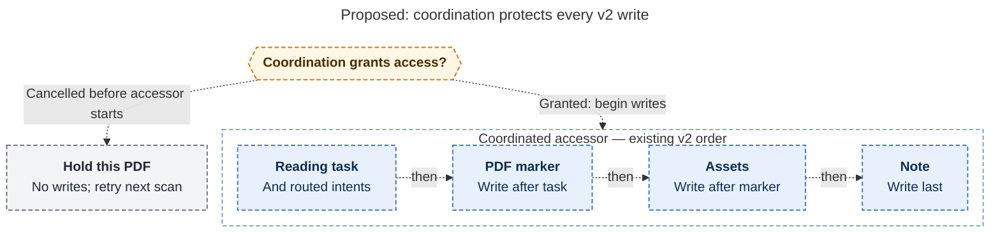

# Diagram proposals: `bob ref scan` vs. PDFs open in Highlights: save first, reload in place

Proposals for the swarm linker, not a report. Each diagram restates only what the source
report says.

```yaml
source: research:202610/highlights_open_pdf_coordinated_marker_writes/highlights_open_pdf_coordinated_marker_writes__final.md
producer: research.56.image
check: "mmdc 12.0.0 with the PDF-mirroring config rendered 1 of 1 Mermaid diagrams"
```

## coordinated-v2-scope

```yaml
anchor: |-
  The accessor wraps that PDF's existing write sequence.
question: |-
  How can a hold leave the reading task untouched when v2 writes it before the marker?
illustrates: |-
  Entering coordination before the first per-PDF write encloses v2's reading task and routed intents, marker, assets, and note in the accessor, so a pre-accessor cancellation writes nothing for that PDF.
caption: For PDFs needing marker updates, coordination protects the whole v2 sync sequence; cancellation before access leaves even the reading task untouched.
review: "633.688×895 px, fit 99.8%; question, source, and visual checks passed; 1 revision"
```


