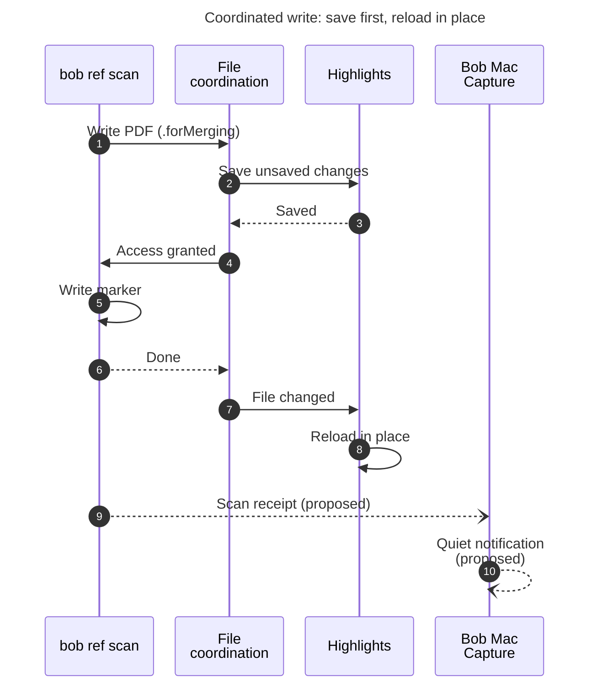
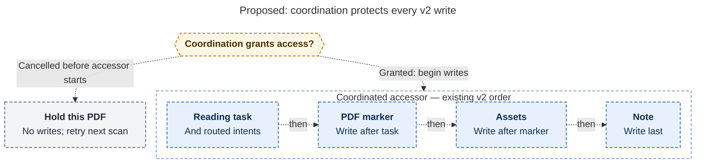
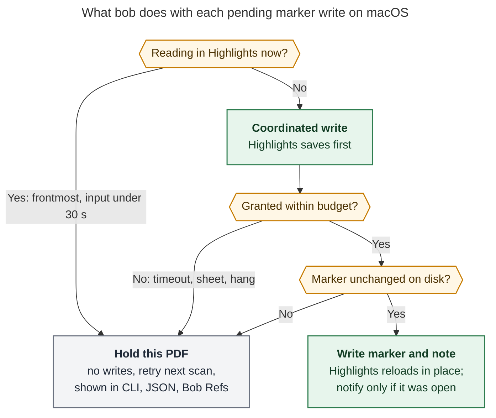

# `bob ref scan` vs. PDFs open in Highlights: save first, reload in place

> **Research query:** When `bob ref scan` on the Mac updates the `status:` field of a ref PDF's
> marker while that PDF is open in Highlights, the next annotation triggers a save conflict.
> Should scan save unsaved annotations first (for example with ⌘S), close and reopen the PDF's
> Highlights tab, and tell the user with a Mac notification, and is that a good idea? Critique
> the plan, call out any justified requirement adjustments, and recommend an intuitive,
> reliable and beautiful solution.


## Bottom line

1. **The problem is real and systematic.**
   - bob replaces the PDF behind Highlights' back.
   - That leaves Highlights holding a stale copy, even when it had no unsaved changes.
   - Its next save then fails with *"The file has been changed by another application"*.
   - Two researchers reproduced this, and so did the lead.
   - It happens [about twice a day](#who-runs-it-and-how-often), mostly at the moments you are
     reading.
2. **Your goals are right; your mechanism is not.**
   - The goals: save your annotations first, refresh the document, and tell you. All three
     survive into the recommendation.
   - The mechanism is the problem: [driving ⌘S, tab close and reopen from a cron‑launched
     CLI](#critique-of-the-proposed-plan). It needs an Accessibility grant that every bob
     release invalidates. It steals focus, can't reliably target background tabs, and loses
     your page.
3. **macOS already has a protocol that does exactly "save, write, reload", and Highlights
   already speaks it.**
   - The protocol is `NSFileCoordinator`.
   - The lead [tested it on your Mac](#which-write-mode-keeps-your-annotations). A coordinated
     write with the **`.forMerging`** option made an open document with unsaved edits do three
     things: save them, let the writer update the file *with the edits in it*, then reload in
     place, clean.
   - The next save went through with no dialog. There was no tab change, no keystroke and no
     permission.
   - It also worked across sessions: the document ran in the GUI session and the writer in an
     SSH session, the way cron runs. A stuck document was released cleanly by a timeout.
4. **The most important new finding:** [two of the five reports](#where-the-reports-disagreed)
   recommended `.forReplacing` (or a plain coordinated write). Both **silently delete your
   unsaved annotations from the open document**; they survive only as a hidden macOS Versions
   snapshot. That is worse than today's dialog. Use `.forMerging`, never `.forReplacing`.
5. **Recommendation** (see [the recommended solution](#recommended-solution)):
   1. Run a ~45‑minute [acceptance test](#acceptance-test) against real Highlights with a
      scratch PDF.
   2. Route every macOS marker write through a bounded `.forMerging` coordinated write, and
      re‑check the marker inside it.
   3. Hold writes while you are actively in Highlights.
   4. Report holds in CLI and JSON. Have Bob Mac Capture post [one quiet
      notification](#telling-you-quietly-through-bob-mac-capture), only when an open PDF was
      actually refreshed or Highlights needs you.

## What is happening today

### The writer

bob-cli at `5eed7df9`, confirmed by the lead.

- The marker is the first standalone `/Text` annotation on page 1. Its `/Contents` holds
  `- key: value` lines, including `status`.
- `write_pdf_marker` loads the whole PDF with lopdf, sets `/Contents`, and calls
  `atomic_save_pdf`. That re‑serializes the entire PDF to a sibling temp file, fsyncs it, and
  `rename(2)`s it over the original (`src/native/highlights_ref/marker.rs:152–214`).
- There is **no file coordination anywhere in bob-cli**.
- A marker write is planned when the note side changed a synced field (usually `status` from
  the `^ref` reading task) and the rendered marker differs (`sync.rs:357`, `sync.rs:673–700`).
- Without `-w`, a needed write is a hard per‑PDF `needs_write_pdfs` error, which stops that
  PDF's whole sync (`sync.rs:362`, `sync.rs:679–684`). That is why the Mac cron passes `-w`.
- The existing guard compares a whole‑file SHA‑256 from planning (`ensure_pdf_unchanged_for_write`,
  `sync.rs:2009`). It catches changes on disk. It cannot see unsaved changes inside Highlights.
- Two paths write markers: the full scan (human and JSON) and `bob ref sync --write-pdf`.
  - In v1, the marker is written before the note.
  - In v2, the order is: reading task and routed intents first, then the marker, then assets,
    then the note (`sync.rs:1597–1660`).

### Who runs it and how often

- **Live Mac crontab** (lead, 2026‑10‑23):
  `*/15 * * * * ~/bin/maybe_bob_highlights_sync -w >> /var/tmp/maybe_bob_highlights_sync.log`.
  - The log file is empty, so there is no record of marker writes.
  - Bob Refs ⌘S runs the same `bob ref scan -w -f json`.
- **Vault history, last 30 days.**
  - 131 commits modified a library PDF and its ref note without touching the Highlights
    sidecar. That pattern is the scan writing the marker.
  - 62 of them touched exactly one PDF (the lead's count; cld counted 68 with a slightly
    different window).
  - cld's breakdown of the single‑PDF writes: `next→wip` 17, `…→read` 24, `ready→next` 8.
    These are the moments you start or finish reading, when the PDF is most likely open.
- Every write re‑serializes the whole PDF. For example, a 19.6 MB PDF produced a new 19.6 MB
  Git blob for one status flip (cld).

### Highlights

Read‑only inspection on the Mac by cdx, cld and the lead. Each fact is followed by its
consequence:

- **AppKit `NSDocument` app (`NSDocumentClass = Highlights.Document`), version 2026.1.2 (602), macOS 26.5:**
  It takes part in file coordination automatically
- **`autosavesInPlace` returns YES. Its `saveToURL:` override calls `super`, then writes the sidecar through its *own* `NSFileCoordinator` (cld, disassembly):**
  Saves requested by the OS go through the normal path
- **It does *not* override `savePresentedItemChanges`, `relinquishPresentedItemToWriter:`, `presentedItemDidChange` or `revertToContentsOfURL:` (cld):**
  AppKit's default behaviour applies, so the stand‑in experiment is representative
- **Sandboxed (`com.apple.security.app-sandbox`, user‑selected read‑write); team `ZEKKV8ZD36` (lead):**
  Coordination with sandboxed document apps is normal, but the acceptance test must confirm it
- **Not scriptable (no `.sdef`, `-1728`); open PDFs hold *0 file descriptors*; Accessibility shows background tabs *by file name only* (cdx, grk, gem, prior tab‑switcher research):**
  `lsof` and AppleScript can't tell bob what is open. Only Bob Mac Capture's Accessibility
  grant can, and only roughly

### Root cause

- An uncoordinated replace only tells the open document "something changed". AppKit reloads
  for **coordinated** writers only.
- So Highlights keeps showing the old bytes. Its next save or autosave sees the newer file and
  stops with **Save Anyway / Revert / Save As…**.
- Neither main answer is good:
  - **Revert** throws away the annotations made since the last save. You have to redo them,
    which is what you do today.
  - **Save Anyway** keeps your annotations but writes the *old* `status:` line back.
    - The next scan sees a marker‑side change: the field‑level three‑way merge in
      `projection.rs:76–90` and `projection.rs:193–203` takes the marker's value.
    - That then collides with the reading task. The "PDF task conflicts" rows of
      `docs/highlights-ref-sync.md` fail that PDF until the status is fixed by hand.

> **Until this ships** (inferred from code and docs, not tested): **Save Anyway** is usually the
> cheaper choice. It keeps your annotations. Afterwards, set the page‑1 note's `status:` back to
> the current value in Highlights (or follow the scan's conflict message) instead of re‑annotating.

## Which write mode keeps your annotations

The reports disagreed on the one detail that decides safety:

- cdx said `.forMerging`;
- cld said a coordinated read followed by a `.forReplacing` write;
- grk and gem said a single `.forReplacing` write.

cld had tested `.forReplacing` and read‑then‑write, but not `.forMerging`, the no‑option write,
a timeout, or a cron‑like context. The lead ran the full matrix on the Mac.

**Setup.**

- A windowless `NSDocument` stand‑in with `autosavesInPlace = YES`, run in `/tmp` and deleted
  afterwards.
- A second process plays bob: it reads the file, appends `+bob`, writes a temp file, and
  `rename`s it over the original.
- After each write, the document makes one more edit and saves. That reproduces your actual
  symptom: a conflict on the *next* annotation.

The results, case by case:

- **Case A**
  - *Document:* clean
  - *bob's write:* uncoordinated (today)
  - *What happened:* change notice only; no reload; stale
  - *Next save:* ✗ "changed by another application"
- **Case D**
  - *Document:* unsaved edit
  - *bob's write:* uncoordinated (today)
  - *What happened:* stale
  - *Next save:* ✗ same dialog: **your bug**
- **Case B**
  - *Document:* unsaved edit
  - *bob's write:* coordinated `.forReplacing`
  - *What happened:* writer read the file *without* the edit, then the doc reverted. The edit
    survives only as an `NSFileVersion`
  - *Next save:* ✓ saves, but **the edit is gone**: silent loss
- **Case W**
  - *Document:* unsaved edit
  - *bob's write:* coordinated, no options
  - *What happened:* same as B
  - *Next save:* ✓ saves, **edit gone**
- **Cases C / N**
  - *Document:* clean
  - *bob's write:* `.forReplacing` / `.forMerging`
  - *What happened:* reloaded in place
  - *Next save:* ✓
- **Case M**
  - *Document:* unsaved edit
  - *bob's write:* **coordinated `.forMerging`**
  - *What happened:* `savePresentedItemChanges` → **edit saved** → writer saw `v0+user` and
    wrote `v0+user+bob` → doc reloaded, clean
  - *Next save:* **✓ no dialog, nothing lost**
- **Case G**
  - *Document:* unsaved edit
  - *bob's write:* coordinated read, then a separate write
  - *What happened:* same result as M, but two calls leave a gap between them
  - *Next save:* ✓
- **Case S**
  - *Document:* unsaved edit, document's main thread blocked 8 s (stands in for a sheet or
    hang)
  - *bob's write:* `.forMerging`, 3 s watchdog `cancel()`
  - *What happened:* returned `NSCocoaErrorDomain 3072` (user cancelled) at 3.2 s; **accessor
    never ran; no write**; the edit saved normally once unblocked
  - *Next save:* ✓ safe hold
- **Case X**
  - *Document:* unsaved edit; document launched in the **GUI session** via LaunchServices
  - *bob's write:* `.forMerging` from an **SSH** shell (non‑GUI, like cron)
  - *What happened:* identical to M
  - *Next save:* ✓

**What this settles.**

- **`.forMerging` is the primitive.**
  - One call does what you asked for: save first, then write, then reload.
  - The writer gets access about 30 ms after the request. The reload finishes about 0.5 s later.
  - Apple documents `.forMerging` as asking presenters to save before the write. cdx also notes
    that Apple's header calls temp‑file‑plus‑rename a content update, not a replacement.
- **Never use `.forReplacing` or an option‑less write.** Both silently drop an unsaved
  annotation from the live document. That would trade a visible conflict for invisible loss.
- **A timeout plus `cancel()` is a clean "hold".** Nothing is written, and Highlights finishes
  its own save normally.
- **cron can coordinate with the GUI app.**
  - `com.apple.FileCoordination` is a system LaunchDaemon.
  - Case X crossed the session boundary.

**Still unproven** (needs real Highlights; see [the acceptance test](#acceptance-test)). The
stand‑in was an unsandboxed plain‑text document, not Highlights' PDFKit document. Open
questions:

- whether a half‑typed note popover is committed before the save;
- whether page, scroll and zoom survive the reload;
- whether Highlights renumbers PDF objects when it saves;
- when its sidecar is written relative to the PDF save.

The lead did not open anything in your running Highlights, because that would have touched
your live reading session.



*Figure 1. Steps 1–8 are the order observed on the Mac in case M with a stand‑in document.
macOS asks Highlights to save before bob writes, then tells it to reload afterwards. Steps 9–10
are the proposed notification path (see
[Telling you quietly through Bob Mac Capture](#telling-you-quietly-through-bob-mac-capture)).*

## Critique of the proposed plan

**What is right.**

- Saving before writing is the critical ordering, and you saw it. Without it, any refresh loses
  annotations (cases B and W).
- Refreshing the open document is what ends the conflict.
- Anything that changes a document under your eyes should say so.

**What is wrong with "scan closes and reopens the tab and presses ⌘S".**

1. **Wrong process for the permission.**
   - Keystrokes and Accessibility presses need a grant for the process that sends them.
   - For a cron job, that means cron itself, which is far too broad, or the `bob` binary.
   - `bob` is ad‑hoc signed and replaced by the daily release train. macOS ties such grants to
     the binary hash, so every release would silently revoke it (cld, grk). Bob Mac Capture
     already had to solve this with stable signing.
2. **Focus and races.**
   - ⌘S and ⌘W go to the frontmost window. Scan would have to activate Highlights and select
     the tab, interrupting whatever you are doing, every 15 minutes during reading sessions.
   - A synthetic keystroke can land in another app or race your typing.
3. **Tab identity is weak.**
   - Background tabs expose only a file name, and the library already has a basename collision
     (grk).
   - "Not found" from Accessibility or `lsof` never means "safe to overwrite".
4. **Ordering traps.**
   - If the document is already stale, ⌘S itself raises the conflict dialog.
   - Closing a document with unsaved changes raises "Do you want to save?".
   - Automation must never click either one.
5. **Disruption.**
   - Close and reopen resets page, scroll, zoom, selection, tab order and undo history.
   - Closing the last tab quits Highlights, and relaunching may restore every window (grk).
6. **Half‑failures strand you.** If scan dies after the close, the tab is gone. If it dies
   after the write but before the reopen, the tab is gone too, with nothing to say why.
7. **It re‑implements an OS protocol** that Highlights already supports (see
   [the experiment](#which-write-mode-keeps-your-annotations)).

**Verdict.** It is worth fixing, but keep the three goals and replace the mechanism. The ⌘S idea
in particular has a better answer: `.forMerging` asks `NSDocument` for the same save that ⌘S
triggers, with no keystroke, permission or focus change.

## Explicit requirement adjustments

- **R1**
  - *As asked:* Close the Highlights tab, then reopen it
  - *Adjusted:* **Reload in place through file coordination.** bob never closes, opens,
    selects or reorders tabs
  - *Why:* Same effect with no permission, focus change, lost page or tab churn
    ([experiment](#which-write-mode-keeps-your-annotations), cases M and N)
- **R2**
  - *As asked:* Save unsaved annotations first, perhaps with ⌘S
  - *Adjusted:* **Ask Highlights to save through `.forMerging`.** If the save fails or times
    out, **bob writes nothing**
  - *Why:* Case M saves through the OS. Case S shows that "no write" is the safe failure
- **R3**
  - *As asked:* Send a Mac notification when this happens
  - *Adjusted:* **Yes, from Bob Mac Capture**: quiet, grouped, actionable. Sent only when an
    open PDF was refreshed or a dialog is blocking. CLI and JSON always report
  - *Why:* A `bob` notification from cron would be attributed to Script Editor, can't know
    what is open, and can't dedupe
- **R4** *(new)*
  - *As asked:* —
  - *Adjusted:* **Never refresh while you are mid‑gesture.** If Highlights is frontmost and
    your last input was under 30 s ago, hold that scan's marker writes
  - *Why:* Protects a half‑typed note until [the acceptance test](#acceptance-test) proves the
    reload is harmless
- **R5** *(new)*
  - *As asked:* —
  - *Adjusted:* **Bounded and honest.** About 10 s per PDF, a scan‑level cap, `cancel()` on
    expiry. Never fall back to today's uncoordinated write
  - *Why:* A stuck dialog must not hang the scan or degrade to the old behaviour
- **R6** *(new)*
  - *As asked:* —
  - *Adjusted:* **An acceptance test with real Highlights gates enabling it**
  - *Why:* The stand‑in experiment is strong evidence, not proof
- **R7** *(scope)*
  - *As asked:* `bob ref scan`
  - *Adjusted:* **Every marker write through the shared executor**: scan (human and JSON),
    cron, Bob Refs ⌘S, and `ref sync --write-pdf`. Later, rename and `create --force`
  - *Why:* One primitive, one policy. Lets the rename card drop "Close the PDF in Highlights
    first"
- **R8** *(accept)*
  - *As asked:* —
  - *Adjusted:* **Accept marker lag of up to one scan while held.** `status_sync: pending`
    already models it
  - *Why:* A late status line is far better than a lost annotation

## Recommended design

### One coordinated-write primitive in bob-cli

This primitive is macOS only.

- **Module.** Add `native::file_coordination`.
  - On macOS it uses `objc2`, `objc2-foundation` (the `NSFileCoordinator`, `NSURL` and `NSError`
    features) and `block2`, all under the existing
    `[target.'cfg(target_os = "macos")'.dependencies]` block.
  - Elsewhere it just calls the closure.
  - Swift and Objective‑C are not needed.
- **Call.** `coordinate(writingItemAt: pdf, options: .forMerging)`, with a watchdog thread that
  calls `cancel()` after the budget expires.
  - Before the accessor starts, a cancel maps to a **hold**.
  - Once the accessor is running, the write completes and is reported truthfully.
- **Where to call it.** In `execute_pdf_sync` (both v1 and v2), **before the first per‑PDF
  write**, when `plan.marker_write_needed` is true.
  - The accessor wraps that PDF's existing write sequence.
  - So a hold means *nothing* for that PDF was written, and v2's ordering is preserved (cdx's
    point).
  - Those writes take milliseconds, so Highlights is held off only briefly.
- **Inside the accessor**, replace the whole‑file hash check for the marker step with a marker
  check:
  - The digest equals the plan's: proceed exactly as today.
  - The digest differs because Highlights just saved: run `read_pdf_marker` on the fresh bytes.
    - The marker's contents equal the plan's current marker: write to the **freshly located**
      annotation.
    - Otherwise you edited the marker in Highlights: hold with `marker_changed`. The next scan's
      three‑way merge handles it.
  - Record the post‑write digest, as today.
- **Dirty‑target guard.**
  - `ensure_safe_to_write` still runs before execution, unchanged.
  - The only new dirt is the bytes Highlights saved *at bob's request inside bob's own
    accessor*. bob loads and keeps those bytes, and vault‑sync commits them together with the
    marker.
  - This is a deliberate, narrow exception. cdx would defer instead, so make deferral the
    conservative setting if [the acceptance test](#acceptance-test) finds any lopdf
    round‑trip problem with Highlights‑saved PDFs.
- **Activity hold.** Once per scan, read the frontmost app (`lsappinfo front`) and the HID idle
  time (`ioreg -c IOHIDSystem`, `HIDIdleTime`).
  - Both work without permissions from SSH or cron (cld).
  - If Highlights is frontmost and idle time is under 30 s, hold all of this scan's marker‑write
    PDFs.
  - A terminal `bob ref sync` or Bob Refs ⌘S has its own window frontmost, so it is naturally
    exempt.
- **Holds are not failures.**
  - Exit code 0, so the cron stays silent.
  - Human summary gains `· 1 held (reading in Highlights)`.
  - With `-v`: `pdf_marker_action: held (…; retrying next scan)` or
    `updated (coordinated; Highlights saved first)`.
- **JSON** (additive; `schema_version` stays 1; the app decodes with `decodeIfPresent`):
  - per note: `marker_write: {"mode": "coordinated", "editor_saved_first": true}`;
  - top level: `held: [{"pdf", "note", "reason": "editor_active" | "coordination_timeout" | "marker_changed"}]`.
- **Escape hatch.** A config key, `highlights.coordinate_pdf_writes: false`, restores today's
  behaviour explicitly. Nothing falls back to it silently.
- **Dry runs** never coordinate: even a coordinated *read* can trigger a save.

[The v2 coordination-scope diagram](#figure-coordinated-v2-scope) traces how the proposed
accessor encloses v2's whole write order, reading task to note, so a pre-access cancellation
writes nothing for that PDF.

<div id="figure-coordinated-v2-scope">



_For PDFs needing marker updates, coordination protects the whole v2 sync sequence; cancellation before access leaves even the reading task untouched._

</div>



*Figure 2. The proposed per‑PDF policy. Every uncertain branch ends in a hold, meaning no PDF
bytes are written and the next scan retries. Only a granted, validated, coordinated write
touches the PDF.*

### What you experience

1. You link a paper to today, and its reading task moves to Next.
2. You open it in Highlights and make three highlights.
3. The 10:15 scan runs while you are scrolling, so bob **holds** that PDF. Nothing blinks.
4. At 10:30 you are in Obsidian.
   - bob's coordinated write makes Highlights save your three highlights.
   - bob updates `status: next`.
   - Highlights reloads that tab in place: same tab, no dialog.
5. Back in Highlights, your highlights are there, the page‑1 note says `next`, and the next
   annotation saves normally.
6. The only visible costs:
   - ⌘Z history for that document starts fresh;
   - the reading position after a reload is to be confirmed in
     [the acceptance test](#acceptance-test).

### Telling you quietly through Bob Mac Capture

**Channel** (shared with open bead `bob-cli-6h`, which needs the same bob → app path).

- After each writing scan or sync on macOS, bob atomically writes the same JSON envelope as
  `bob ref scan -f json` to a host‑local receipt (for example `last-scan.json` under bob's state
  directory).
- Then it calls libSystem's `notify_post("org.bobs.bob.ref.scan-finished")`.
- Bob Mac Capture listens with `notify_register_dispatch` and decodes the receipt with its
  existing `RefsScanOutcome` and the new optional fields.
- The receipt also fixes today's blind spot, the empty cron log.
- If the app is not running, nothing is shown, and the write is still safe.

**When to notify** (anything else is noise), by event:

- **A PDF *open in Highlights* was refreshed. "Open" means `editor_saved_first`, or its file name matches an open tab via the app's existing read‑only Accessibility reader**
  - *Refs panel visible:* Footer line
  - *Refs panel hidden:* **Notification**
- **A hold because coordination timed out (a dialog or hang in Highlights)**
  - *Refs panel visible:* Banner with a "Scan Again" action
  - *Refs panel hidden:* **Notification**, at most once per PDF and reason
- **Routine holds (you are reading, or you edited the marker) and refreshes of PDFs that were not open**
  - *Refs panel visible:* Footer clause: `1 PDF waiting while you read`
  - *Refs panel hidden:* Nothing

**Copy and behaviour**, using the Refs vocabulary (Ready, Next, Reading, Read, Dropped):

```text
┌──────────────────────────────────────────────────────┐
│ ◆ Bob Mac Capture                               now  │
│ Updated in Highlights                                │
│ Attention Is All You Need                            │
│ Next → Reading · your unsaved highlights were saved  │
│ first                                                │
│                                 [ Show in Bob Refs ] │
└──────────────────────────────────────────────────────┘
```

- **Several PDFs in one scan.** Title "Updated 2 PDFs in Highlights", with the titles in the
  body.
- **"Saved first" clause.** Add it only when bob observed the flush. Never claim a save that
  was not observed (cdx).
- **Timeout case.** Title "Highlights needs you". Body: "*Title* has a dialog open. Bob will
  update its status line once it closes."
- **Delivery.**
  - `interruptionLevel = .passive`, no sound.
  - A `threadIdentifier` groups the banners.
  - Reuse the `refs-scan` category, so a click opens Bob Refs with the row selected.
- **Setting.** Settings › References gets "Tell me when Bob updates an open PDF" (on by
  default).

## Acceptance test

Before enabling; about 45 minutes on the Mac, with you.

**Setup.**

- Use scratch PDFs with a marker note **outside the vault**.
- The writer is a small tool: a `.forMerging` coordinated write whose accessor changes the
  page‑1 `/Text` contents, writes a temp file, and renames it over the original. The shipped
  binary can also serve as the writer, behind the config key.

**Steps.**

1. **Control.** An uncoordinated replace over an open, clean PDF must show the conflict on the
   next annotation.
2. **Main case.** Make two unsaved highlights with Highlights in the background, then write.
   - Pass if there is no dialog, both highlights survive on disk and on screen, the marker
     changed, the document is clean, the tab didn't move, and the next annotation saves.
   - Record whether page, scroll and zoom held.
3. Repeat with Highlights **frontmost**, and again with the PDF in a **background tab**.
4. Repeat with a **note popover half‑typed**, both with Highlights frontmost and after switching
   away. This sets or removes the activity hold.
5. Repeat with a **modal sheet** open (for example ⌘P). The writer must return within its budget
   and write nothing.
6. Run the writer from **cron or SSH**.
7. Run against a **large PDF** (around 20 MB) and measure flush time to set the budget.
8. Confirm the **sidecar** Markdown/TextBundle updates and that the next scan imports the new
   highlights.
9. Confirm a Highlights‑saved PDF re‑finds the marker after any object renumbering.

**Decision.**

- Steps 2, 3, 5 and 6 pass: build [the recommended design](#recommended-design).
- Only the page jumps: still build [the recommended design](#recommended-design). Add a page
  restore in Bob Mac Capture: read "Page N of M" from the tab's `AXTitle`, then
  `open -g highlights://<stem>#page=N` (cld).
- Annotations are lost or a dialog appears: [Plan B](#plan-b).

## Plan B

Only if Highlights fails [the acceptance test](#acceptance-test).

- On macOS, bob holds marker writes for any PDF while Highlights is running, and lists them in
  the receipt.
- Bob Mac Capture, which already holds the Accessibility grant, a close ladder that detects
  sheets, and a reopen path, offers **[Apply now]**. Applying:
  1. selects the tab;
  2. presses File › Save through Accessibility and verifies the document is clean;
  3. closes it, stopping on any sheet;
  4. runs `bob ref sync --write-pdf <pdf>`;
  5. reopens at the captured page;
  6. restores the previously selected tab.
- It refuses to close the last tab and never clicks a destructive dialog choice.
- Alternatively it applies the update when you close the tab yourself.
- This is your choreography, run by the process that can do it safely, and only on an explicit
  click.

## Where the reports disagreed

Each question lists the reports' positions and the lead's resolution:

- **Which coordination call?**
  - *Positions:* cdx `.forMerging`; cld read‑then‑`.forReplacing`; grk and gem `.forReplacing`
    alone
  - *Resolution:* **`.forMerging`, one call** ([experiment](#which-write-mode-keeps-your-annotations),
    cases M, B, W). grk's and gem's version would cause silent loss
- **Coordinate, or defer open PDFs?**
  - *Positions:* cdx, cld, grk: coordinate. mus, gem: defer while open
  - *Resolution:* **Coordinate.** The CLI cannot reliably know what is open: `lsof` shows 0
    fds (mus's proposed sensor fails), and gem's Accessibility probe from `bob` needs a grant
    that churns. A hold is the *fallback outcome*, not the detector
- **Drop `-w` from cron?**
  - *Positions:* mus: yes, "scheduled scans stay note‑only"
  - *Resolution:* **No.** Without `-w`, a pending status fails that PDF's whole sync
    (`needs_write_pdfs`). The docs line mus cites allows `-w` "if intentionally wanted", and
    the cron passes it deliberately
- **Highlights' save changed the bytes. Then what?**
  - *Positions:* cdx: defer with `source_changed_after_save`; replan next scan. cld: re‑find
    the marker in the fresh bytes and write if the marker itself is unchanged
  - *Resolution:* **cld's rule.** Under cdx's rule, a PDF you keep annotating never converges.
    Re‑finding the marker (not reusing the planned object id) is required either way, because
    a PDFKit save may renumber objects
- **Notifications**
  - *Positions:* gem: silent on cron. mus: osascript banner per deferral. grk: Bob Refs for
    ⌘S, cron optional. cld: Bob Mac Capture via a receipt, only when an open PDF was refreshed
  - *Resolution:* **Bob Mac Capture owns presentation** (`decisions:mac-capture-is-a-thin-client`).
    Notify on a refresh of an open PDF, or when Highlights needs you. Routine holds stay quiet
    (see [Telling you quietly through Bob Mac Capture](#telling-you-quietly-through-bob-mac-capture))
- **Activity hold**
  - *Positions:* cld only
  - *Resolution:* **Keep** it as cheap insurance until the acceptance test shows a reload is
    harmless mid‑edit
- **Stop mirroring `status` into the PDF**
  - *Positions:* All five: a separate decision
  - *Resolution:* **Agree.** A follow‑up decision (see
    [Follow-ups and residual risks](#follow-ups-and-residual-risks)), not this fix

## Follow-ups and residual risks

- **Other uncoordinated PDF writers.**
  - The `bob ref rename` and id stamp should become a coordinated *move*, which lets the
    rename card drop its "close the PDF first" hint.
  - `create --force` should use the same primitive.
  - A Git checkout during vault‑sync can still replace an open PDF changed on another host.
    That is rare and out of scope.
- **Hold granularity.**
  - v1 holds the whole PDF, so its annotation import also waits up to one scan.
  - A later refinement could write the note now while keeping `highlights_marker_base` and its
    hash at the last agreed state, so the next scan writes only the marker. This needs careful
    three‑way‑merge tests (cdx, cld).
- **Should lifecycle `status` live in the PDF at all?** Each flip rewrites the whole PDF and adds
  a full Git blob. The vault's `^ref` task is now authoritative. Make this a separate decision.
  Coordination is still needed for `parent`, `id` and the other fields.
- **Scan‑wide dirty refusal** (found while verifying).
  - `ensure_safe_to_write` runs over all plans together (`sync.rs:154`, `scan_json.rs:555`).
  - So one dirty PDF that needs a marker write (for example, Highlights autosaved it after the
    last vault‑sync commit) refuses the **entire** scan with `dirty_targets`.
  - This is a pre‑existing behaviour worth its own look.
- **Documentation drift.**
  - The live crontab runs all three Bob jobs at `*/15`, and the highlights job has no `2>&1`.
  - `docs/vault-git-sync.md:177` shows a staggered `0,15,30,45 … 2>&1` schedule.
  - The cron wrapper also discards success output. It should log a one‑line summary.
- **Platform drift.** A 2026‑09 Apple forum report describes a SwiftUI `DocumentGroup` app
  hanging when another process changes its file through coordination (cld). Highlights is
  classic AppKit, and the budget bounds a hang, but retest after macOS upgrades.
- **Small costs.**
  - A reload resets that document's undo history.
  - Each dirty‑document refresh adds an entry to macOS's Versions store.
- **Decision record.** Once [the acceptance test](#acceptance-test) passes, record through
  `/sase_memory_write`: *"bob writes Highlights PDFs through `.forMerging` file coordination and
  never UI‑automates Highlights."* Rejected alternatives: scripted ⌘S/close/reopen;
  `.forReplacing`; defer‑while‑open as the primary strategy; dropping `-w`.

## Recommended solution

**Make bob a polite co‑writer instead of a puppeteer.** On macOS, bob updates a PDF marker only
inside a bounded `NSFileCoordinator` write with `.forMerging`. macOS has Highlights save your
unsaved annotations, bob re‑checks the marker in the fresh bytes and writes, and Highlights
reloads the tab in place. Anything uncertain becomes a hold that the next scan retries:

- you are actively in Highlights;
- coordination timed out;
- you edited the marker.

There are no keystrokes, no tab changes, no permissions for `bob`, and no focus changes.

1. **Phase 0, the acceptance test** (see [Acceptance test](#acceptance-test)). Choose this plan
   or [Plan B](#plan-b), and tune the activity hold and the budget.
2. **Phase 1, bob-cli.**
   - `native::file_coordination` (`.forMerging`, watchdog `cancel()`, pass‑through elsewhere).
   - Coordination entered before each PDF's writes, with marker re‑validation inside.
   - The activity hold.
   - `held` and `marker_write` report fields; exit 0 on holds.
   - The config escape hatch.
   - A macOS CI test that compiles a small presenter fixture and asserts cases A, M and S.
   - Docs: replace "keep Highlights idle while testing PDF writes" with the coordination
     contract.
   - The decision record.
3. **Phase 2, bob-cli and Bob Mac Capture.**
   - bob: the scan receipt and `notify_post`.
   - Bob Mac Capture: the observer, the read‑only open‑tab check, the passive grouped
     notification and footer copy (see
     [Telling you quietly through Bob Mac Capture](#telling-you-quietly-through-bob-mac-capture)),
     and the Settings toggle. The same channel then serves `bob-cli-6h`.
4. **Phase 3, later.**
   - Coordinated rename/move and `create --force`.
   - The pending‑marker refinement.
   - The decision on whether `status` belongs in the marker.

**Changes to your requirements** (detailed in
[Explicit requirement adjustments](#explicit-requirement-adjustments)):

- close and reopen becomes an in‑place reload;
- ⌘S becomes the OS's save request, and a failed save means no write;
- the notification comes from Bob Mac Capture, quietly, and only when an open PDF was refreshed
  or Highlights needs you;
- added: never refresh mid‑gesture;
- added: bounded waits with no silent fallback;
- added: a real‑Highlights acceptance test before enabling.

## About this report

- **Date:** 2026-10-23
- **Type:** Lead synthesis of five independent reports (`__cdx`, `__cld`, `__grk`, `__mus`,
  `__gem` in this directory), plus the lead's own code reading and a new experiment on the Mac
  (see [Which write mode keeps your annotations](#which-write-mode-keeps-your-annotations)).
- **Question:** On the Mac, `bob ref scan` sometimes rewrites the `status:` line in a PDF's
  page‑1 marker. If that PDF is open in Highlights, the next annotation hits a save conflict.
  Should scan save Highlights' unsaved work (⌘S), close the tab, write, reopen the tab, and
  send a notification? Is that a good idea, what should change, and what should we build?

## Sources

**Reports in this directory:**

- `research:202610/highlights_open_pdf_coordinated_marker_writes/highlights_open_pdf_coordinated_marker_writes__cdx.md`
  (`.forMerging`, plan invalidation, guard placement, cancellation, quiet UX);
- `…__cld.md` (Highlights binary inspection, the first NSDocument experiment, vault statistics,
  the receipt channel, the activity hold);
- `…__grk.md` (deferrable‑marker contract, Bob Refs presentation, tab facts);
- `…__mus.md` (defer‑open design, notification scoping);
- `…__gem.md` (UX hazard matrix, decoupling note sync from marker writes).

**Lead verification:**

- **bob-cli `5eed7df9`:**
  - `marker.rs:152–214`;
  - `sync.rs:154, 357–367, 673–700, 1597–1660, 2009`;
  - `guard.rs:99–148, 196, 253–293`;
  - `projection.rs:73–110, 186–203`;
  - `scan_json.rs:555`;
  - `ref_library/status.rs:90–140`;
  - `docs/highlights-ref-sync.md:370, 668, 1931, 2109–2111`;
  - `docs/vault-git-sync.md:177`.
- **bob-mac-capture:** `NotificationService.swift:44, 139` (`notifyRefsScan`, `refs-scan`
  category) and `AXHighlightsTabsReader.swift:473–525` (only the selected tab carries a path).
- **Mac, read‑only probes:**
  - `crontab -l`;
  - the empty `/var/tmp/maybe_bob_highlights_sync.log`;
  - Highlights version, code signature and sandbox entitlements;
  - `launchctl print system/com.apple.FileCoordination` (a system LaunchDaemon).
- **Experiment.** The matrix in
  [Which write mode keeps your annotations](#which-write-mode-keeps-your-annotations): Swift
  stand‑in presenter and writer, built with Command Line Tools `swiftc` on macOS 26.5, run in
  `/tmp/lead-coord-spike`, and deleted afterwards.
- **Vault history.** `git log --since='30 days ago' --name-status` over `lib/` and `ref/` in
  `~/bob`.
- **Bead.** `bob-cli-6h`: notify where new reading tasks landed after the Mac scan.

**External:**

- Apple,
  [`NSFileCoordinator.WritingOptions.forMerging`](https://developer.apple.com/documentation/foundation/nsfilecoordinator/writingoptions/formerging)
  and
  [`forReplacing`](https://developer.apple.com/documentation/foundation/nsfilecoordinator/writingoptions/forreplacing);
- Apple,
  [`NSFilePresenter.savePresentedItemChanges`](https://developer.apple.com/documentation/foundation/nsfilepresenter/savepresenteditemchanges%28completionhandler%3A%29);
- Apple,
  [File Coordinators and Presenters](https://developer.apple.com/library/archive/documentation/FileManagement/Conceptual/FileSystemProgrammingGuide/FileCoordinators/FileCoordinators.html);
- Apple, [Automating the User Interface](https://developer.apple.com/library/archive/documentation/LanguagesUtilities/Conceptual/MacAutomationScriptingGuide/AutomatetheUserInterface.html)
  (UI scripting needs Accessibility);
- [Highlights FAQ](https://highlightsapp.net/faq/) ("Is Highlights scriptable? No, not yet.");
- [Highlights sidecar files](https://highlightsapp.net/how-to/mac/sidecar-files/);
- Apple Developer Forums [845923](https://developer.apple.com/forums/thread/845923) (SwiftUI
  document hang on macOS 27);
- [`objc2-foundation` `NSFileCoordinator`](https://docs.rs/objc2-foundation/0.3.2/objc2_foundation/struct.NSFileCoordinator.html).
