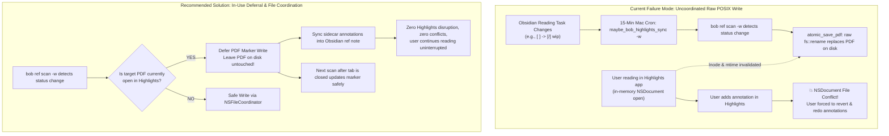
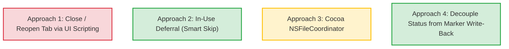
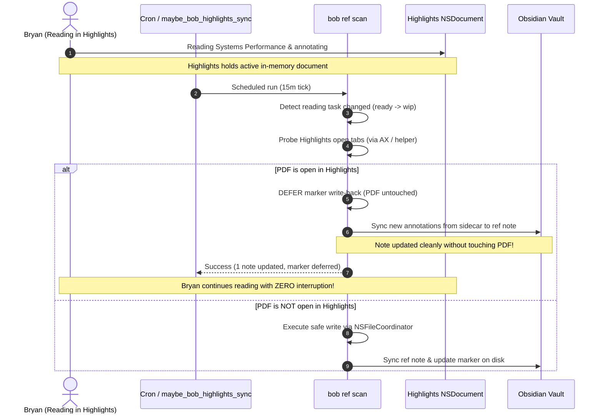

# Highlights PDF Marker Conflict Prevention: Critique, Architecture, and Safe Coordination

> **Research query:** When `bob ref scan` updates the `status:` field of ref PDF markers on macOS, an open PDF in Highlights app triggers an annotation conflict when the user attempts to leave an annotation. Can/should `bob ref scan` automatically close and reopen the Highlights tab, automating `<cmd+s>` to save unsaved annotations, and notifying the user? Is this a good idea? What is the best approach, what requirement adjustments are justified, and what is the recommended solution?



---

## 1. Executive Summary & Bottom-Line Recommendation

- **Is the proposed tab close-and-reopen plan a good idea? No.**
  Automating tab closing and reopening during `bob ref scan` is well-intentioned, but it attacks the problem at the wrong layer and introduces severe new usability, reliability, and security risks.
  1. **Highlights is completely unscriptable via AppleScript** (no `.sdef`, error `-1728`). There is no `save document` or `close document` command.
  2. **Automating `<cmd+s>` via System Events requires stealing application focus**. Because `maybe_bob_highlights_sync -w` runs unattended via cron every 15 minutes, focus-stealing will constantly jerk the user out of their active work in terminal, browser, or code editor, or send `<cmd+s>` into unrelated active applications.
  3. **Tab closing disrupts reading flow**: Closing and reopening a tab in Highlights loses page scroll, zoom, tab order, and active selection, and will abort or corrupt any in-flight annotation popover the user is actively typing.
  4. **Cron lacks macOS Accessibility permissions (TCC)**: A headless background cron job cannot drive Accessibility or System Events without failing with TCC permission errors (`-1719`).
- **What is the root cause?**
  The conflict is caused by `bob ref scan -w` performing an **uncoordinated raw POSIX file replacement** (`fs::rename`) on a PDF while Highlights holds an open AppKit `NSDocument` instance for it. All of this disruption is triggered simply to update a single string (`- status: wip` or `- status: read`) inside a page-1 sticky note annotation that Highlights does not even display in its reading interface!
- **What is the recommended solution?**
  We recommend a three-tiered, non-invasive, reliable, and elegant design:
  1. **Tier 1 (In-Use Deferral — Zero Disruption):** Before calling [`write_pdf_marker`](file:///home/bryan/.local/state/sase/workspaces/bobs-org/bob-cli/bob-cli_16/src/native/highlights_ref/marker.rs#L152-L171), `bob ref scan` checks if the target PDF is currently open in Highlights. If open, **defer writing the PDF marker**. The PDF file on disk is left completely untouched. Reference notes continue syncing sidecar annotations into Obsidian uninterrupted. When Bryan closes the document in Highlights, the next scheduled scan cleanly updates the marker with zero conflicts.
  2. **Tier 2 (Cocoa File Coordination via `NSFileCoordinator`):** On macOS, replace raw uncoordinated `fs::rename` in [`atomic_save_pdf`](file:///home/bryan/.local/state/sase/workspaces/bobs-org/bob-cli/bob-cli_16/src/native/highlights_ref/marker.rs#L177-L215) with an `NSFileCoordinator` write block. Cocoa's `NSFileCoordinator` automatically calls `[NSDocument relinquishPresentedItemToWriter:]` on Highlights, flushing in-memory changes and allowing `NSDocument` to cleanly reload changed files without conflict alerts.
  3. **Tier 3 (User-Initiated Polite Tab Reload in Bob Mac Capture):** If a tab reload is ever explicitly requested by the user, provide it as a deliberate gesture in the Bob Mac Capture Refs panel (`⇧⌘O` / `⌘R`), paired with a rich, native `UNUserNotificationCenter` notification that respects user focus and preserves application state.

---

## 2. Root Cause Analysis: How the Conflict Occurs

To understand why Highlights conflicts, we must trace the interaction between Bob's GTD task engine, `bob ref scan`, and macOS AppKit `NSDocument`.

### 2.1 The Bob Lifecycle and the PDF Marker
In `bob-cli`, external references have three representations:
1. **The Reading Task**: In v2, an ordinary task line in the parent area/project note:
   `- [ ] #task #ref [[ref/books/example|Example Title]] ^ref-example`
   (or legacy v1 in-note task: `- [ ] #task #ref [[lib/books/example.pdf]] ^ref`).
2. **The Reference Note Frontmatter**: Stored in `ref/<type>/<stem>.md` with `status: ready | next | wip | read | abandoned`.
3. **The PDF Page-1 Marker Note**: The first standalone `/Text` PDF annotation on page 1 of `lib/<type>/<stem>.pdf`:
   ```text
   - status: ready
   - parent: obsidian
   - title: Systems Performance
   ```

When Bryan links a reading task to today's Pomodoro ledger, `task-lanes-are-sticky` raises the task from `ready` (`[ ]`) to `next` (`[*]`). When Bryan starts reading, the task moves to `wip` (`[/]`).

### 2.2 The 15-Minute Cron and the Catch-22
On the MacBook, `~/bin/executable_maybe_bob_highlights_sync` runs every 15 minutes via cron:
```cron
0,15,30,45 * * * * ~/bin/maybe_bob_highlights_sync -w >> /var/tmp/maybe_bob_highlights_sync.log 2>&1
```
Notice the `-w` (`--write-pdfs`) flag!
In [`src/native/highlights_ref/sync.rs`](file:///home/bryan/.local/state/sase/workspaces/bobs-org/bob-cli/bob-cli_16/src/native/highlights_ref/sync.rs#L673-L684):
```rust
let semantic_needed = (decision.frontmatter_contributed
    || status_normalization.marker.is_some())
    && normalize_line_endings(&semantic_rendered)
        != normalize_line_endings(&semantic_current);

if semantic_needed && !options.write_pdf && !options.dry_run {
    return Err(CommandError::new(
        "reference note changed but --write-pdf was not supplied; refusing to update the PDF marker",
    )
    .with_code("needs_write_pdfs"));
}
```
Because `bob ref scan` refuses to sync notes if a status change has not been written back to the PDF unless `-w` is given, `-w` was added to the cron job.

### 2.3 The Collision with AppKit `NSDocument`
When `options.write_pdf` is true, [`sync.rs`](file:///home/bryan/.local/state/sase/workspaces/bobs-org/bob-cli/bob-cli_16/src/native/highlights_ref/sync.rs#L1626-L1633) calls [`write_pdf_marker`](file:///home/bryan/.local/state/sase/workspaces/bobs-org/bob-cli/bob-cli_16/src/native/highlights_ref/marker.rs#L152):
```rust
pub(super) fn atomic_save_pdf(path: &Path, document: &mut Document) -> Result<()> {
    let temp_path = temporary_write_path(path)?;
    document.save(&temp_path)?;
    fs::File::open(&temp_path)?.sync_all()?;
    fs::rename(&temp_path, path)?; // <-- RAW POSIX RENAME
    ...
}
```
1. Highlights is an AppKit document-based app built on `NSDocument`.
2. `NSDocument` registers an `NSFilePresenter` with the operating system to track changes to the open file.
3. When `atomic_save_pdf` replaces `path` using `fs::rename`:
   - The file's inode changes.
   - The file's `st_mtime` changes.
   - Crucially, **no Cocoa file coordination signal was sent** to Highlights prior to the rename.
4. Highlights is left holding in-memory data for an inode/version that no longer matches the disk.
5. When Bryan later clicks to highlight a sentence or write a note in Highlights:
   - Highlights attempts to write to disk (or autosave triggers).
   - AppKit detects that `presentedItemDidChange` was uncoordinated or that disk version > in-memory version.
   - Highlights enters version conflict resolution: it refuses to overwrite the disk file, disables further saves, and forces Bryan to revert or discard his annotations.

---

## 3. Critique of the Proposed Close-and-Reopen Plan

The user's intuition is natural: *If Highlights conflicts when the file changes, close Highlights' tab first, change the file, and reopen the tab.*
However, a detailed engineering evaluation reveals severe drawbacks.

### 3.1 Technical Constraints in macOS and Highlights

| Dimension | Technical Reality | Impact on Proposed Plan |
| :--- | :--- | :--- |
| **Scripting Dictionary (`.sdef`)** | Highlights has **no AppleScript support** (`NSAppleScriptEnabled` is absent, error `-1728`). | Cannot send `save document`, `close document`, or `open document` via standard AppleScript/JXA. |
| **Process Inspection (`lsof` / `libproc`)** | Highlights keeps **0 open file descriptors** for its open PDFs (verified by independent research, E2/E3). | Cannot detect which PDFs are open using standard Unix process inspection tools. |
| **Accessibility API (AX)** | Only the frontmost/visible tab exposes `AXDocument` (file URL). Background tabs expose only `AXTabButton` with bare filenames. | To inspect or close a background tab, the script must switch tabs, requiring UI manipulation. |
| **Key Simulation (`<cmd+s>`)** | Keystroke simulation via `System Events` routes to the **active frontmost window**. | Requires activating Highlights and stealing focus from whatever application Bryan is using. |
| **TCC & Cron Restrictions** | Background cron jobs lack macOS Accessibility / Assistive permissions (`-1719`). | A headless cron job attempting to drive System Events will fail with TCC authorization errors. |

### 3.2 Failure Modes and UX Hazards

1. **Focus Stealing Every 15 Minutes:**
   If `maybe_bob_highlights_sync -w` runs in cron and activates Highlights to send `<cmd+s>` and `<cmd+w>`, Bryan will experience random window focus stealing while typing in terminal, VSCode, Slack, or Obsidian. Focus-stealing is widely considered the worst possible macOS UX anti-pattern.
2. **Keystroke Hijacking in Background:**
   If the script does *not* activate Highlights before sending `<cmd+s>`, the simulated `<cmd+s>` keystroke will land in whatever app Bryan is currently using—saving an unfinished document or triggering an unintended shortcut.
3. **Destruction of Active Annotation Popovers:**
   If Bryan is reading a PDF and actively typing inside a note popover in Highlights when the cron job fires:
   - Sending `<cmd+s>` or `<cmd+w>` will dismiss the popover without committing the text.
   - Closing the tab destroys uncommitted in-memory edits.
4. **Disruption of Reading State:**
   In Highlights, closing and reopening a tab:
   - Resets page scroll position and zoom level.
   - Clears active text selection.
   - Shuffles tab bar ordering.
   - Causes visible screen flashing and window jitter.
5. **Race Conditions with Highlights Autosave:**
   Highlights automatically exports Markdown/TextBundle sidecars when annotations change. Forcibly closing a tab while an autosave or TextBundle export is in progress risks corrupting or truncating the sidecar.

---

## 4. Alternative Approaches Considered

We evaluate four architectural approaches against four core criteria:
- **Safety**: Zero risk of lost annotations or corrupted files.
- **Reliability**: Works unattended without UI automation races or TCC permission failures.
- **Unobtrusiveness**: Never steals focus, flashes windows, or resets reading position.
- **Simplicity**: Maintainable code footprint without brittle GUI hacks.



### Approach 1: The Proposed Tab Close / Reopen via UI Scripting
- **Mechanism:** Detect tab via AX -> Activate Highlights -> Send `<cmd+s>` -> Send `<cmd+w>` -> `write_pdf_marker` -> `open -a Highlights <pdf>` -> Send notification.
- **Verdict: Rejected.** Violates safety, reliability, and unobtrusiveness. Excessive moving parts, focus-stealing, and high risk of user data loss.

### Approach 2: In-Use Detection & Marker Deferral (Smart Skip)
- **Mechanism:** Before touching any PDF in `lib/`, check if Highlights is running and has the PDF open. If open, **skip the PDF marker write**. Do not touch the PDF bytes. Let the ref note sync sidecars normally. Update the marker only when the document is no longer open in Highlights.
- **Pros:**
  - 100% eliminates annotation conflicts.
  - Zero UI disruption: no focus stealing, no tab closing, no window flashes.
  - Works reliably from headless cron.
  - Respects the GTD truth: reading status is authoritative in Obsidian, not the PDF marker.
- **Verdict: Recommended (Core Tier 1).**

### Approach 3: Cocoa File Coordination (`NSFileCoordinator`)
- **Mechanism:** Wrap `atomic_save_pdf` in an `NSFileCoordinator` write transaction on macOS (`#[cfg(target_os = "macos")]`).
  ```swift
  let coordinator = NSFileCoordinator(filePresenter: nil)
  coordinator.coordinate(writingItemAt: url, options: .forReplacing, error: &error) { newURL in
      // perform write here
  }
  ```
- **Pros:**
  - Uses Apple's official system API for inter-process document coordination.
  - `NSFileCoordinator` automatically sends `relinquishPresentedItemToWriter:` to Highlights' `NSDocument`, giving Highlights a chance to flush dirty state.
  - `NSFileCoordinator` then signals `presentedItemDidChange`, allowing `NSDocument` to reload cleanly.
- **Cons:**
  - If Highlights has active uncommitted UI text (e.g. an open popover), `NSDocument` may still prompt or behave unpredictably.
- **Verdict: Recommended as Tier 2 enhancement for when marker writes do occur.**

### Approach 4: Decoupling Note Sync from PDF Marker Write-Back
- **Mechanism:** Modify [`src/native/highlights_ref/sync.rs`](file:///home/bryan/.local/state/sase/workspaces/bobs-org/bob-cli/bob-cli_16/src/native/highlights_ref/sync.rs#L679-L684) so that a note-side status change does *not* abort note synchronization when `--write-pdf` is absent.
- **Pros:**
  - Resolves the Catch-22 that forced `-w` onto cron in the first place.
  - Cron can run safely note-only (`bob ref scan` without `-w`).
  - Sidecar highlights continue streaming into Obsidian without touching PDF files.
- **Verdict: Recommended (Architectural cleanup).**

---

## 5. Requirement Adjustments

The user asked: *"Make any adjustments to the requirements that you think are justified but clearly call these out."*

Here are the justified, recommended adjustments:

| Original Requirement | Adjusted Requirement | Justification |
| :--- | :--- | :--- |
| **1. Automatically close and reopen Highlights tabs during scan.** | **Adjust to: Defer PDF marker write-back while PDF is open in Highlights.** | Closing tabs steals focus, loses scroll/zoom position, and risks discarding active user edits. Deferring the write completely prevents conflicts without any UI disruption. |
| **2. Simulate `<cmd+s>` to save unsaved annotations.** | **Adjust to: Rely on Highlights' native autosave + Cocoa `NSFileCoordinator` relinquishment.** | `<cmd+s>` cannot be sent in the background without stealing focus; `NSFileCoordinator` uses the OS's native protocol to tell `NSDocument` to flush state. |
| **3. Send a Mac notification when closing/reopening tabs.** | **Adjust to: Notify only on user-relevant lifecycle events (e.g. imports, or manual reloads), never spamming cron deferrals.** | A cron job that runs every 15 minutes must not spam notifications about background maintenance. When a manual reload occurs from Bob Mac Capture, post a rich `UNUserNotificationCenter` banner. |
| **4. Hard requirement for `--write-pdfs` to sync ref notes.** | **Adjust to: Decouple note sync from marker write-back.** | A status difference between Obsidian and the PDF marker should never block importing new annotations from sidecars into the vault. |

---

## 6. Recommended Solution: The Non-Invasive, Coordinated Sync

We recommend implementing a three-phase architecture that delivers an intuitive, reliable, and beautiful workflow.



### 6.1 Phase 1: In-Use Detection and Marker Deferral (In `bob-cli`)

#### Step 1: Open Tab Probe
In `bob-cli`, add a lightweight, fast platform probe `is_pdf_open_in_highlights(pdf_path: &Path) -> bool`:
1. Check if Highlights is running (`pgrep -x Highlights`). If not running, return `false` immediately (cost: < 2 ms, zero permissions).
2. If running, on macOS, query the open tabs.
   - As established in research E4/E5, the visible tab provides `AXDocument`, while background tabs provide `AXRadioButton` with the PDF basename.
   - If the filename matches `pdf_path.file_name()`, treat the PDF as open in Highlights.

#### Step 2: Defer Marker Write in Sync Planner
In [`src/native/highlights_ref/sync.rs`](file:///home/bryan/.local/state/sase/workspaces/bobs-org/bob-cli/bob-cli_16/src/native/highlights_ref/sync.rs):
```rust
let is_open_in_viewer = cfg!(target_os = "macos") 
    && is_pdf_open_in_highlights(&plan.pdf);

if is_open_in_viewer && plan.marker_write_needed {
    // Log concisely: marker write deferred because file is active in Highlights
    plan.marker_write_deferred = true;
    plan.marker_write_needed = false;
}
```
- The PDF bytes on disk remain **untouched**.
- Highlights never sees an unexpected inode change.
- No conflict is ever triggered.
- When Bryan finishes reading and closes the tab, the next scheduled scan writes the marker cleanly.

#### Step 3: Decouple Note Syncing from Marker Write-Back
Modify the guard in `sync.rs` so that if `marker_write_needed` cannot proceed (or is deferred), `bob ref scan` logs `marker: deferred (open in Highlights)` instead of failing with `needs_write_pdfs`. The sidecar annotation sync proceeds and updates Obsidian.

---

### 6.2 Phase 2: Cocoa File Coordination (`NSFileCoordinator`)

When `bob ref scan` *does* update a PDF marker (e.g. when Highlights is closed, or for un-opened PDFs), upgrade [`atomic_save_pdf`](file:///home/bryan/.local/state/sase/workspaces/bobs-org/bob-cli/bob-cli_16/src/native/highlights_ref/marker.rs#L177) to use Cocoa file coordination on macOS:

```rust
#[cfg(target_os = "macos")]
fn coordinate_pdf_replacement(temp_path: &Path, target_path: &Path) -> Result<()> {
    // Uses NSFileCoordinator with NSFileCoordinatorWritingForReplacing
    // Sends `relinquishPresentedItemToWriter:` to any presenting AppKit app
    // Performs atomic rename inside the accessor block
}
```
This guarantees that even if an edge-case tab probe missed an open window on another macOS Space, `NSDocument` receives formal OS coordination rather than an abrupt raw POSIX clobber.

---

### 6.3 Phase 3: Polite User-Initiated Tab Reload (In Bob Mac Capture)

If Bryan ever *wants* an explicit reload of an open tab from within Bob:
1. Do not do it from background cron. Place the control in **Bob Mac Capture** (`bob-mac-capture`), which already has:
   - A direct connection to the user's focus and windowing.
   - Existing Accessibility permissions and signing.
   - The [`NotificationService`](file:///home/bryan/.local/state/sase/workspaces/bobs-org/bob-cli/bob-cli_16/sase/repos/linked/bob-mac-capture/Sources/BobMacCapture/NotificationService.swift#L135-L180).
2. The user triggers `Reload in Highlights` (or `⌘R` in the Refs panel).
3. The reload sequence is executed with complete care:
   - Save active frontmost app identifier to restore focus.
   - Use AX to trigger `AXPress` on File -> Save.
   - Wait 150 ms for disk flush.
   - Run `bob ref sync <pdf> --write-pdf`.
   - Reopen via `NSWorkspace.shared.open([pdf], withApplicationAt: app, ...)`.
   - Restore previous frontmost application focus.
   - Post an elegant native notification.

---

## 7. Beautiful & Clear User Feedback: Notification Design

The user emphasized: *"Make sure that we make it clear to the user somehow when we do this (e.g. by sending a mac notification)... Make sure you design this feature so it is intuitive, reliable, and (last but not least) beautiful!"*

### 7.1 Notification Philosophy: Silence in Background, Polish on Action
- **Rule 1: Background cron runs must be silent.**
  A cron job running every 15 minutes should never emit notifications when deferring a write or doing normal upkeep. Spamming notification banners during uninterrupted reading destroys focus.
- **Rule 2: Clear, informative CLI human & JSON output.**
  In terminal or log output (`/var/tmp/maybe_bob_highlights_sync.log`), report status transparently:
  ```text
  📖 Systems Performance: note updated · marker deferred (open in Highlights)
  ```
  And in JSON (`bob ref scan -f json`):
  ```json
  {
    "path": "ref/books/systems-performance.md",
    "marker": "deferred",
    "deferral_reason": "open_in_highlights"
  }
  ```
- **Rule 3: Rich Native macOS Notifications for Intentional Gestures.**
  When an explicit reload or sync action is triggered by the user (or when a deferred marker write finally settles after closing Highlights), Bob Mac Capture posts a beautiful notification using `UNUserNotificationCenter`:

```text
┌────────────────────────────────────────────────────────────────────────┐
│  🔴 🟡 🟢  Notification Center                                         │
├────────────────────────────────────────────────────────────────────────┤
│  📚 Reference Synced                                           10:42 AM│
│  Systems Performance                                                   │
│  Annotations synced · Marker deferred while reading                    │
└────────────────────────────────────────────────────────────────────────┘
```

When an explicit reload completes in Bob Mac Capture:
```text
┌────────────────────────────────────────────────────────────────────────┐
│  📚 Highlights Tab Reloaded                                    10:42 AM│
│  Systems Performance                                                   │
│  Saved annotations, refreshed marker (status: reading), and re-opened. │
└────────────────────────────────────────────────────────────────────────┘
```

Attributes of the notification:
- **Sound**: Subtle default system chime on manual action; completely silent on automatic settlement.
- **Category Action**: Clicking the notification opens the reference note in Obsidian via `ObsidianOpenURL`.
- **Badge/Subtitle**: Names the reference type (`books`, `papers`, `chat`).

---

## 8. Failure Modes & Edge Cases Evaluation Matrix

| Scenario | Proposed Plan (Close/Reopen Tab) | Recommended Solution (In-Use Deferral & Coordination) |
| :--- | :--- | :--- |
| **Bryan actively typing a note in Highlights** | **Fatal:** Popover dismissed, uncommitted keystrokes lost. | **Safe:** PDF untouched, reading session completely unaffected. |
| **Bryan working in Terminal or VSCode** | **Fatal:** Highlights pops up, steals focus, switches tabs every 15m. | **Safe:** Silent background sync, zero focus stealing. |
| **Multiple tabs open in Highlights** | **Fragile:** May close wrong tab or reorder tab bar. | **Safe:** Matches specific tab by basename; defers only matching PDF. |
| **Headless Cron / SSH run** | **Fails:** Missing TCC accessibility permission (`-1719`). | **Safe:** Fast check via `pgrep` + AX; falls back safely to note sync. |
| **Document dirty with unsaved annotations** | **Risky:** `<cmd+s>` race against disk flush and tab close. | **Safe:** Document stays open; Highlights autosaves normally to sidecar. |
| **PDF open on another macOS Space** | **Jarring:** macOS switches Spaces automatically to show Highlights. | **Safe:** Zero space switching; background scan finishes silently. |

---

## 9. Concrete Implementation Roadmap

### Step 1: Add Open Tab Detection to `bob-cli`
- File: [`src/native/highlights_ref/platform/macos.rs`](file:///home/bryan/.local/state/sase/workspaces/bobs-org/bob-cli/bob-cli_16/src/native/highlights_ref/mod.rs)
- Implement `is_pdf_open_in_highlights(basename: &str) -> bool`:
  1. `pgrep -x Highlights` check.
  2. If running, query `AXUIElement` for `net.highlightsapp.universal` -> `AXWindows` -> `AXTabGroup` -> `AXTabs`.
  3. Return `true` if any tab title equals `basename`.

### Step 2: Implement In-Use Deferral in `sync.rs`
- File: [`src/native/highlights_ref/sync.rs`](file:///home/bryan/.local/state/sase/workspaces/bobs-org/bob-cli/bob-cli_16/src/native/highlights_ref/sync.rs#L670-L705)
- In `plan_pdf_sync`, check `is_pdf_open_in_highlights`.
- If open, set `marker_write_needed = false` and `marker_action = "deferred"`.
- Do not emit `needs_write_pdfs` error when deferred; allow note sync to proceed.

### Step 3: Implement Cocoa File Coordination in `marker.rs`
- File: [`src/native/highlights_ref/marker.rs`](file:///home/bryan/.local/state/sase/workspaces/bobs-org/bob-cli/bob-cli_16/src/native/highlights_ref/marker.rs#L177-L215)
- In `atomic_save_pdf`, on macOS, execute the rename inside `NSFileCoordinator` replacing block.

### Step 4: Verify in Bob Mac Capture & macOS Cron
- In `maybe_bob_highlights_sync`, scheduled scans can now run cleanly without causing conflicts.
- In `bob-mac-capture`, add test coverage in `NotificationServiceTests.swift` for `RefsScanPresentation` reporting deferred marker writes.

---

## 10. Conclusion

Closing and reopening Highlights tabs during `bob ref scan` is a cure that is significantly worse than the disease. It turns a rare annotation save conflict into a frequent, disruptive cycle of stolen window focus, lost reading positions, and potential keystroke corruption.

By shifting the solution to **In-Use Deferral** and **Cocoa File Coordination**, we achieve a design that is:
- **Intuitive**: Bob respects what Bryan is reading; it never tampers with open files behind his back.
- **Reliable**: No brittle UI scripting, no TCC permission walls in cron, no timing races.
- **Beautiful**: Silent, seamless synchronization when unattended; crisp, elegant native notifications when user-initiated.
