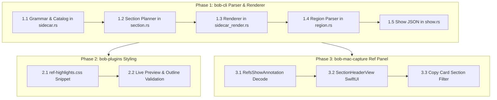

# Engineering Design & Research: Section Annotations & Grouping in Ref Notes

**Author:** Researcher `gem` (Independent Research Swarm)  
**Date:** October 2026  
**Scope:** `bob-cli` (`highlights_ref`, `ref_library`), `bob-plugins` (`ref-highlights.css`, Obsidian), `bob-mac-capture` (`RefsInspector`, `RefsCore`), Bob Vault  
**Deliverable:** Research Report & Recommended Architecture  
**Status:** Complete  

---

## 1. Executive Summary & Problem Statement

Bryan's reference library system (`bob ref`) automatically bridges highlights, underlines, image selections, and comments made in the macOS **Highlights** app into beautifully formatted Obsidian reference notes (`ref/<ref_type>/<stem>.md`). It powers both the native macOS **Bob Mac Capture** Refs panel and Obsidian knowledge workflows.

Currently, annotations in a reference note are organized strictly chronologically by their source page headings:
```markdown
### Page 12

> [!quote] Latency is not throughput.
>
> > [!note] Comment Compare this with SLO notes.

^h-2b91f0a4c7de
```
While Bob supports **continuation highlights** (using a `<` comment to fuse adjacent physical text fragments across a column or page boundary) and **underline emphasis** (folding `**underlined**` phrases into host quotes), it possesses **no semantic or thematic grouping mechanism**.

When reading a 40-page research paper, a dense technical book, or a complex architectural document:
1. **Thematic Scattering:** Concepts are rarely confined to a single page. An author introduces a concept in Section 2, discusses its performance trade-offs in Section 4, caveats it in Section 6, and draws conclusions in Section 8. A reader highlighting these related insights ends up with fragmented quotes scattered across dozens of disconnected page sections.
2. **Absence of Conceptual Hierarchy:** A long stream of 30 highlights under flat page numbers (`### Page 3`, `### Page 7`, `### Page 14`, `### Page 29`) provides zero top-level conceptual structure. When revisiting the note months later, the reader cannot quickly review "Key Assumptions", "Storage Layer", or "Open Questions" without reading every highlight in order or searching by keyword.
3. **No Synthesized Reading Artifact:** Readers are forced to either copy highlights manually into an external summary or leave their highlights as an unstructured raw log.

### The Proposal
The user proposes adding support for **Section Annotations** and **Grouped Annotations**:
- A **section annotation** of the form `# <name>`, with an optional description after a blank line.
- Any highlight note / underline note / standalone note that contains `@<name>` is grouped and rendered under that visually appealing section.
- The grouping must be intuitive, reliable, and beautiful across Obsidian, Bob Mac Capture's ref panel, and terminal tools.

### High-Level Verdict & Recommendations
This feature is an **outstanding architectural evolution** for Bryan's reference system. It bridges the gap between passive reading (highlighting passages) and active synthesis (clustering insights into conceptual domains). It elevates Bob ref notes from mere "highlight mirrors" into structured, executive-grade reading digests.

However, a naive implementation of the raw prompt prompt (`# <name>` and bare `@<name>`) introduces several critical failure modes:
- **Obsidian Block ID Destruction:** If member highlights are grouped inside a single monolithic outer callout (`> [!section]`), Obsidian's block-link engine (`^h-...`) attaches to the outer callout rather than individual quotes, breaking all external task links and reading-task references.
- **Sidecar Preamble Collision:** Highlights sidecar exports automatically emit `# Document Title` on line 1 before the first page heading. An unconstrained parser would misinterpret the document title as a section annotation.
- **Typing Brittleness:** If section names contain spaces (e.g., `# Storage Engine`), typing `@Storage Engine` in prose creates lexical boundary ambiguity (e.g. does the section name include subsequent words?). Furthermore, case-sensitive matching creates frequent, frustrating match failures.
- **Comment Pollution:** Leaving `@<name>` inside the rendered comment text of a note already placed inside that section creates redundant visual clutter.

To solve these challenges while achieving an intuitive and visually stunning result, we design the **Thematic Section Architecture**:
1. **Dual-Authoring Section Grammar:** Support `# <name>` both on standalone sticky notes and on highlight comments (where highlighting a section title in the PDF acts as the section's anchor).
2. **Slug-Normalized, Case-Insensitive Matching:** Match `@<name>` against known declared sections using exact title matching, kebab-case (`@storage-engine`), snake-case (`@storage_engine`), and quoted syntax (`@"Storage Engine"`).
3. **Automatic Routing Token Stripping:** Strip the `@<name>` token from rendered comments on successful match, leaving clean user prose.
4. **The Hybrid Markdown Persistence Model:** Render sections using an ATX Level-3 Outline Heading (`### § <name>`) paired with an Obsidian Section Card (`> [!section]`), followed by flat, independent member callouts that retain their individual `^h-...` block IDs, task links, and source page badges (`[!quote|Page 14]`).
5. **Native SwiftUI Ref Panel Experience:** In `bob-mac-capture`, upgrade `ShowAnnotation` to support `kind: section`, rendering dedicated Section Cards, visual grouping brackets, and section-filtered Copy Card actions (`⌘Y`).

---

## 2. Critique of the Proposed Plan

We evaluate the user's proposal across four dimensions: utility, grammar, persistence/rendering, and ecosystem impact.

### 2.1 Is Grouping Annotations Under Section Annotations a Good Idea?
**Verdict: Emphatically YES.**
- **The Cognitive Need:** When engaging with dense technical literature, human memory does not index knowledge by page numbers. A reader asks: *"What were the performance bottlenecks identified in this paper?"* not *"What was on page 17?"*
- **Complementary to Existing Features:** Bob already has continuation highlights (`<`), which fuse immediately preceding highlights across line/page breaks. Continuation markers solve *spatial and physical continuity*. Section annotations solve *semantic and conceptual continuity*. They operate at different abstraction levels and complement each other perfectly: a multi-piece continuation group (`<`) can itself be tagged `@<name>` to join a section!
- **Preserves Source Fidelity:** The PDF itself remains untouched and portable. The grouping metadata is stored entirely within the Highlights annotations that the user is already creating.

### 2.2 Critique of `# <name>` as the Section Definition
**Verdict: Good, but requires precise boundary and context constraints.**

1. **Collision with Markdown Preamble & Headers:**
   In Highlights sidecar exports, the document title is exported as an H1 heading:
   ```markdown
   # Systems Performance: Enterprise and the Cloud
   
   ## Page 12
   ...
   ```
   If the parser treats any `# ...` as a section annotation, every reference note would create a spurious section named after the book title!
   *Required constraint:* Section annotations MUST only be recognized **after the first page heading** (`seen_page_heading == true`). The document preamble must remain strictly immune.
2. **Collision with Highlights Marker Mirror:**
   A standalone note or highlight comment containing `- status: ready` and `- parent: ...` is the synchronized marker mirror.
   *Required constraint:* Marker mirrors must be filtered out before section parsing.
3. **Standalone Notes vs. Highlight Comments:**
   The user prompt states: *"A section annotation should be of the form `# <name>`, with an optional description after a blank line."*
   In Highlights, there are two distinct ways a user might create this:
   - **Method A (Sticky Note):** The user clicks the Note tool and places a sticky note at the top of a page:
     ```text
     # 3. System Architecture
     
     Client/server architecture using Raft consensus.
     ```
   - **Method B (Highlighting Document Headings):** A reader reading a PDF naturally highlights the printed heading "3. System Architecture" in the PDF and types in the comment:
     ```text
     # 3. System Architecture
     
     Client/server architecture using Raft consensus.
     ```
   If Bob only allowed Method A, any user who highlighted the section title in the PDF would be disappointed. Our design must support both: Method A creates a pure section banner; Method B creates a section banner that incorporates the highlighted heading text.

### 2.3 Critique of `@<name>` as the Section Link
**Verdict: Strong concept, but fraught with lexical traps if implemented naively.**

1. **The Multi-Word Dilemma:**
   Section names are frequently multi-word: `# Threat Model`, `# Storage Architecture`, `# Future Work`.
   If Bryan types `@Threat Model` in a comment:
   `Need to discuss this with security team @Threat Model before freeze.`
   Where does the section tag end? In standard text tokenizers, `@` stops at whitespace. A naive parser would see `@Threat`, fail to match `# Threat Model`, and leave the note unlinked!
   *Solution:* The parser must be **catalog-aware**. It first scans the document sidecar to collect all declared section titles (`{"Threat Model", "Storage Architecture"}`). When parsing `@`, it performs a greedy match against the declared catalog, and additionally accepts hyphenated slugs (`@threat-model`) and quoted strings (`@"Threat Model"`).
2. **Case Sensitivity:**
   Requiring exact case (`@Threat Model` vs `@threat model`) is an unnecessary cognitive tax that causes frequent, hard-to-debug failures. Matching must be case-insensitive.
3. **Collision with Non-Section `@` Mentions:**
   In modern notes, `@` is used for:
   - Email addresses (`user@example.com`)
   - GitHub handles (`@torvalds`)
   - Programming decorators (`@override`, `@pytest.mark`)
   - Relative task routes (`@route:id`)
   *Solution:* An `@` token must have strict boundary rules (preceded by whitespace/start of line) AND it is only recognized as a section link if its target resolves to a declared section in that specific document. Unmatched `@` tokens remain untouched prose.
4. **Token Pollution in Rendered Output:**
   If a highlight is visually nested inside a section container titled "Threat Model", retaining `@Threat Model` in the user's comment is redundant clutter. The token should be stripped upon successful grouping.

---

## 3. Justified Adjustments to the Requirements

Based on the critique above, we recommend 7 specific adjustments to the requirements.

| # | Prompt Requirement | Recommended Adjustment | Justification |
|---|---|---|---|
| **1** | `@<name>` exact matching | **Slug-Normalized & Case-Insensitive Matching** | Typing `@storage-engine` or `@Storage Engine` must both match `# Storage Engine`. Eliminates syntax friction. |
| **2** | Unspecified comment appearance | **Automatic Routing Token Stripping** | When `@<name>` successfully groups a note, strip `@<name>` from the rendered comment text. Provide `\@<name>` escape for literal text. |
| **3** | Unspecified multi-tag behavior | **Single Primary Section Hierarchy** | An annotation can only belong to ONE primary section container to prevent duplicate `^h-...` block IDs in Obsidian. Secondary tags render as visual chips. |
| **4** | Unspecified section placement | **In-Situ Section Anchor Placement** | Sections appear in the note at the page where `# <name>` was authored, gathering all matching `@<name>` highlights from across the entire PDF into that section. |
| **5** | Section on sticky notes only | **Dual Authoring Support (Sticky Notes + Highlight Comments)** | Allow `# <name>` on standalone sticky notes AND on text highlight comments where a reader highlights the section heading. |
| **6** | Unspecified failure mode | **Graceful Dangling Resolution** | Unmatched `@<name>` tags do not break or drop highlights; they render in the normal page stream, retain `@<name>` in prose, and report a diagnostic in `ref sync --dry-run`. |
| **7** | Unspecified persistence syntax | **Hybrid Heading + Section Card Architecture** | Avoid monolithic nested callouts (`> [!section] > > [!quote]`); use Level-3 outline headings with Obsidian Section Cards and flat member callouts to preserve block IDs. |

---

## 4. Formal Grammar & Lexical Specification

### 4.1 Section Annotation Declaration Grammar
A section annotation is declared in Highlights on any page (after the document preamble):

```text
SectionDeclaration := '#' WhiteSpace+ SectionTitle ( NewLine+ SectionDescription )?
```

- `SectionTitle`: A single-line string of 1 to 80 characters.
  - Allowed characters: Letters, numbers, spaces, and punctuation (`-`, `_`, `:`, `&`, `/`, `(`, `)`, `.`).
  - Leading and trailing whitespace is trimmed.
  - Case is preserved for display, but normalized to a lowercase slug for matching.
- `SectionDescription`: Optional markdown prose following one or more newlines.
  - Blank lines between the title and description are optional but recommended.
  - Supports markdown styling (`**bold**`, `*italic*`, `[[links]]`, bullet points, and inline code).
  - Can include image paths (which resolve via Bob's existing image note parser) and `#task` items.

#### Examples:
*Minimal Section:*
```text
# Architecture
```

*Section with Description:*
```text
# 3. Memory Subsystem

Covers the L1/L2 cache hierarchy, TLB invalidation strategies, and NUMA node interconnects.
```

*Highlight-Anchored Section:*
User highlights the text *"4. Evaluation and Empirical Results"* in the PDF and enters the comment:
```text
# Empirical Results

Benchmark numbers across 64-node clusters under varying network latency.
```

### 4.2 Section Linking Grammar (`@<name>`)
An annotation links to a section by including an `@` reference in its comment, note text, or task source:

```text
SectionReference := '@' ( QuotedTitle | SlugOrTitle )
QuotedTitle      := '"' [^"]+ '"' | '“' [^”]+ '”'
SlugOrTitle      := [a-zA-Z0-9_-]+ ( [ \t]+ [a-zA-Z0-9_-]+ )*
```

#### Lexical Rules:
1. **Left Boundary:** The `@` must be preceded by the start of a line, whitespace, or an open parenthesis/bracket (`(`, `[`). It must NOT be preceded by an alphanumeric character or period (preventing email matches like `user@domain.com`).
2. **Right Boundary:** The matched target must be followed by whitespace, punctuation (`,`, `.`, `;`, `!`, `?`, `)`, `]`), or the end of a line.
3. **Escaping:** A leading backslash (`\@name`) escapes the marker, unescaping to `@name` and preventing grouping.
4. **Resolution Algorithm:**
   Let $\mathcal{S}$ be the set of all declared sections in the document.
   For candidate token string $T$:
   - Check if $T$ matches any $S \in \mathcal{S}$ case-insensitively.
   - If not, check if `slug(T)` matches `slug(S)` where `slug(x)` lowercases, trims, and replaces non-alphanumeric character runs with a single hyphen (`-`).
   - If a unique match is found, assign the annotation to section $S$.
   - If multiple sections match (e.g. ambiguous prefix), prefer the exact case-insensitive title match; otherwise log an ambiguity diagnostic and leave dangling.
   - If no match is found, treat as ordinary comment text.

#### Examples:
Given a declared section `# Storage Engine`:
- `@Storage Engine` $\rightarrow$ Matches `Storage Engine`.
- `@storage-engine` $\rightarrow$ Matches `Storage Engine`.
- `@storage_engine` $\rightarrow$ Matches `Storage Engine`.
- `@"Storage Engine"` $\rightarrow$ Matches `Storage Engine`.
- `Critical insight for @storage-engine performance.` $\rightarrow$ Matches `Storage Engine`; rendered comment becomes: `Critical insight for performance.`
- `Contact support@storage-engine.com` $\rightarrow$ Ignored (email address, no boundary).
- `\@storage-engine` $\rightarrow$ Escaped; renders as literal `@storage-engine`.

---

## 5. Persistence & Markdown Storage Design

How should grouped annotations be persisted in `ref/<ref_type>/<basename>.md`?

### 5.1 Why Monolithic Outer Callouts Fail
A tempting but fatally flawed approach is to wrap all member highlights inside a single outer callout:
```markdown
> [!section] 3. Memory Subsystem
> Covers cache hierarchy and TLB invalidation.
>
> > [!quote|Page 12] TLB shootdowns account for 18% of kernel CPU time.
> >
> > > [!note] Comment Look into huge pages.
>
> ^h-2b91f0a4c7de
>
> > [!quote|Page 15] Page table isolation increases context switch penalty.
>
> ^h-8f42a61a90cc
```

#### Critical Failure Modes:
1. **Broken Block IDs in Obsidian:** In Obsidian's markdown parser and Live Preview engine, multiple `^block-id` markers placed inside or directly adjacent to a nested blockquote structure do NOT resolve cleanly to individual nested callouts. Obsidian frequently binds the block ID to the parent container. A task linking to `[[paper#^h-8f42a61a90cc]]` would highlight the entire section container rather than quote 2.
2. **Fragile Live Preview Editing:** Deeply nested callouts (`> > > >`) in Obsidian Live Preview suffer from cursor-jumping glitches and inconsistent formatting when edited.
3. **Loss of Native Obsidian Outline:** A callout header does not appear in Obsidian's right-hand Outline pane. The reader cannot click through the document outline.

### 5.2 The Recommended Solution: The Hybrid Card Architecture
We propose a flat, robust, outline-friendly structure:

1. **Outline Anchor:** Use an ATX Level-3 heading with a dedicated section symbol: `### § <Section Title>`.
   - The `§` glyph (or `🏷️`) immediately distinguishes section headings from page headings (`### Page 12`).
   - It populates the native Obsidian Outline tree, making the document instantly navigable.
   - It is parsed deterministically by `region.rs` without colliding with `### Page ...` or `### Removed highlights`.
2. **Section Header Card:** Immediately below the heading, if the section has a description or was anchored by a highlight, render an Obsidian `[!section]` callout card:
   ```markdown
   > [!section] Overview
   > Covers the L1/L2 cache hierarchy, TLB invalidation strategies, and NUMA node interconnects.
   
   ^h-sec-4a8b1c2d3e4f
   ```
   - The section card receives its own stable block ID (`^h-sec-...`), allowing tasks and other vault notes to link directly to the section overview!
3. **Independent Member Highlight Blocks:** Each member highlight is rendered as a standard, flat `[!quote]` callout directly below the section card:
   - Each member retains its own original `^h-...` block ID.
   - Each member displays its source page in its callout metadata: `[!quote|Page 12]`.
   - Underline emphasis, image notes, and nested comments work exactly as they do today.
   - Follower continuation highlights (`<`) nest within their member block with dashed seams.
4. **Visual Section Boundary:** The section continues until the next `### § ...` section heading, the next `### Page ...` untagged heading, or the `<!-- highlights:end -->` marker.

### 5.3 Complete Before-and-After Concrete Example

#### Source Highlights Sidecar Fragment (`systems-performance.md`):
```markdown
## Page 2

> Latency is the time spent waiting, whereas throughput is the rate of work done.

Comment: Foundational distinction. @Core Tenets

---

## Page 4

# Core Tenets

Key operational definitions and performance laws that govern the entire book.

---

## Page 14

> High variance in latency is often more harmful than high average latency.

Comment: @Core Tenets Re-read this when designing SLOs.

---

## Page 15

> [!quote] Most systems are bound by memory latency rather than raw compute cycles.

Note: Keep this standalone observation.
```

#### Rendered Vault Note (`ref/books/systems-performance.md`):
```markdown
<!-- highlights:begin -->
### § Core Tenets

> [!section] Core Tenets
> Key operational definitions and performance laws that govern the entire book.

^h-sec-9a1b2c3d4e5f

> [!quote|Page 2] Latency is the time spent waiting, whereas throughput is the rate of work done.
>
> > [!note] Comment Foundational distinction.

^h-2b91f0a4c7de

> [!quote|Page 14] High variance in latency is often more harmful than high average latency.
>
> > [!note] Comment Re-read this when designing SLOs.

^h-7c8d9e0f1a2b

### Page 15

> [!note] Keep this standalone observation.

^h-8f42a61a90cc
<!-- highlights:end -->
```

Notice:
- The Page 2 highlight and Page 14 highlight are both gathered under `### § Core Tenets`.
- The `@Core Tenets` tokens have been cleanly stripped from the comments.
- Page 2 and Page 14 source attributions are clearly preserved in the callout headers.
- The untagged Page 15 standalone note remains in its natural `### Page 15` section.
- Every block ID (`^h-sec-...`, `^h-2b...`, `^h-7c...`, `^h-8f...`) is isolated, stable, and linkable.

---

## 6. Obsidian Visual Design & Styling

To make sections feel intentional, elegant, and native in Obsidian, we provide custom CSS rules for `ref-highlights.css`.

### 6.1 Design Principles for Section Styling
1. **Visual Hierarchy:** A section must feel like a primary conceptual landmark, distinct from both yellow quote callouts and grey page headers.
2. **Subtle Elevation:** Use a refined, cool accent tone (slate-indigo / deep lavender in dark mode; soft periwinkle / slate in light mode) that contrasts harmoniously with the gold/yellow highlight quotes.
3. **Collapsible Flexibility:** Support Obsidian's native foldable callout syntax (`> [!section]+` or `> [!section]-`) so readers can fold sections they have already reviewed.

### 6.2 CSS Specification for `ref-highlights.css`

```css
/* ==========================================================================
   bob ref: Section Annotations & Grouping
   ========================================================================== */

/* 1. Section Headings in Obsidian Outline & Editor */
.markdown-rendered h3:has-text("§"),
.cm-header-3:has-text("§") {
  color: var(--color-purple, #a882ff);
  font-weight: 600;
  letter-spacing: -0.01em;
  border-bottom: 1px solid rgba(var(--color-purple-rgb, 168, 130, 255), 0.2);
  padding-bottom: 0.2em;
  margin-top: 1.6em;
  margin-bottom: 0.8em;
}

/* 2. Section Header Overview Card */
.callout[data-callout="section"] {
  --callout-color: 147, 112, 219; /* Medium Purple / Indigo */
  --callout-icon: lucide-bookmark;
  background-color: rgba(var(--callout-color), 0.06);
  border-left: 3px solid rgba(var(--callout-color), 0.8);
  border-radius: 6px;
  margin-bottom: 1.2em;
  padding: 0.85em 1em;
}

.callout[data-callout="section"] > .callout-title {
  font-weight: 600;
  font-size: var(--font-ui-medium, 14px);
  color: var(--text-normal);
  text-transform: none;
  letter-spacing: normal;
}

.callout[data-callout="section"] > .callout-content {
  font-size: var(--font-text-normal, 13.5px);
  color: var(--text-muted);
  line-height: 1.5;
  margin-top: 0.4em;
}

/* 3. Section Member Highlights: Subtle Indentation & Page Badges */
.callout[data-callout="quote"][data-callout-metadata*="Page"] {
  position: relative;
  transition: border-color 0.15s ease;
}

/* Clean Pill Badge for Source Page in Section */
.callout[data-callout="quote"][data-callout-metadata*="Page"]::after {
  content: attr(data-callout-metadata);
  position: absolute;
  top: 0.6em;
  right: 0.8em;
  font-size: 0.72em;
  font-weight: 600;
  font-variant: all-small-caps;
  letter-spacing: 0.05em;
  color: var(--text-faint);
  background: var(--background-modifier-form-field);
  padding: 0.15em 0.55em;
  border-radius: 10px;
  pointer-events: none;
}
```

---

## 7. Bob Mac Capture Integration (Refs Panel UX)

Bob Mac Capture is a thin client of `bob` (as codified in `decisions:mac-capture-is-a-thin-client`). It reads data exclusively via `bob ref show <note> -f json`.

### 7.1 Data Contract Evolution

#### In `bob-cli` (`src/native/ref_library/show.rs`):
Extend `ShowAnnotationKind` with `Section`:
```rust
#[derive(Debug, Clone, Copy, PartialEq, Eq, Serialize)]
#[serde(rename_all = "snake_case")]
pub(crate) enum ShowAnnotationKind {
    Highlight,
    Note,
    Image,
    Section,
}
```

Extend `ShowAnnotation` with section-aware fields:
```rust
pub(crate) struct ShowAnnotation {
    pub page_label: Option<String>,
    pub kind: ShowAnnotationKind,
    pub quote: Option<String>,
    pub comment: Option<String>,
    pub asset: Option<String>,
    pub images: Vec<String>,
    pub unresolved_images: Vec<String>,
    #[serde(skip)]
    pub unresolved_image_states: Vec<UnresolvedImageNoteState>,
    pub pieces: Vec<ShowPiece>,
    pub block_id: String,
    pub link: String,
    /// The name of the section this annotation declares or belongs to.
    #[serde(skip_serializing_if = "Option::is_none")]
    pub section: Option<String>,
    /// For kind == Section: number of grouped member annotations.
    #[serde(skip_serializing_if = "Option::is_none")]
    pub member_count: Option<usize>,
}
```

#### In `bob-mac-capture` (`Sources/RefsCore/RefsInspector.swift`):
Swift decodes `section` and `memberCount` lossily:
```swift
public struct RefsShowAnnotation: Decodable, Equatable, Sendable {
    public let pageLabel: String?
    public let kind: String
    public let quote: String?
    public let comment: String?
    public let blockID: String?
    public let link: String?
    public let asset: String?
    public let images: [String]
    public let unresolvedImages: [String]
    public let pieces: [RefsShowPiece]
    public let section: String?
    public let memberCount: Int?

    public var isSectionHeader: Bool { kind == "section" }
    public var isSectionMember: Bool { section != nil && kind != "section" }
}
```

### 7.2 Inspector View Hierarchy (`RefsInspectorView.swift`)

When rendering entries in the `HIGHLIGHTS` section of the inspector:
1. **Section Header Entry:**
   Rendered using a dedicated SwiftUI view: `RefsInspectorSectionHeaderView`.
   - Displays a purple/indigo bookmark glyph (`bookmark.fill` or `tag.fill`).
   - Section Title rendered in `.subheadline.weight(.bold)` with primary ink.
   - Count Chip: e.g. `4 highlights` in `.caption2` monospaced tertiary style.
   - Description rendered in `.callout` secondary style with 2 pt vertical spacing.
   - A subtle divider line separating the section header from its member feed.
2. **Member Highlight Entries:**
   - Highlights belonging to a section (`isSectionMember == true`) render with their familiar 2 pt gold quote rule, indented by 6 pt.
   - The trailing page caption (e.g. `Page 14`) is displayed at the top right of the entry card, clearly communicating the source page despite the thematic grouping.
   - Comments, attached images, and continuation seams render identically to current behavior.
3. **Section Collapse / Expand Support:**
   In Bob Mac Capture's Settings › References, add a toggle: *"Collapse sections by default"*. When enabled, sections show a chevron toggle to disclose their members on demand.

### 7.3 Copy Card Integration (`RefsCopyCardView.swift`)
Pressing `⌘Y` / `Ctrl+Y` opens the Copy Card:
- **`H` (Highlight Picker):** Group the picker rows under Section dividers so Bryan can toggle all highlights in a section with a single keystroke!
- **`A` (Copy All):** The generated Markdown includes the `### § <Section>` headings and descriptions, producing an executive-grade summary ready to paste into Slack, an email, or another vault note.

---

## 8. Ecosystem Architecture & Pipeline Implementation

### 8.1 Rust Implementation in `bob-cli`

The implementation spans 5 modules in `src/native/highlights_ref/`:

```
src/native/highlights_ref/
├── sidecar.rs         // Parse # <name> chunks; collect declared sections catalog
├── section.rs         // [NEW] Section models, slug normalization, @<name> resolution
├── sidecar_render.rs  // Group matching annotations; render ### § and [!section]
├── region.rs          // Parse rendered ref notes back into RegionBlockKind::Section
└── model.rs           // Add SidecarAnnotationKind::Section, SectionPlan, etc.
```

#### Step 1: Sidecar Chunk Classification (`sidecar.rs`)
In `parse_sidecar_chunk`:
- Check if the chunk is after `seen_page_heading`.
- If line 1 starts with `# ` (and is not an ATX heading level $\ge 2$ page link):
  - Extract `name` from line 1.
  - Extract optional description from lines 2+.
  - Emit `SidecarAnnotation` with `kind: SidecarAnnotationKind::Section`.

#### Step 2: Section Planning (`section.rs`)
Before rendering, `plan_sections(annotations: &[SidecarAnnotation]) -> SectionPlan`:
1. Build `catalog: BTreeMap<NormalizedSlug, SectionMeta>`.
2. For every highlight, underline, and standalone note:
   - Scan `task_source` and `comment` for `@<candidate>`.
   - Match candidate against catalog (title, slug, or quoted).
   - If match found:
     - Record member in `SectionPlan.members[section_order].push(annotation.order)`.
     - Strip the `@<candidate>` token from `effective_comment`.
   - If no match found:
     - Check if token looks like an intended section tag (e.g. starts with capital letter or matches known pattern). If so, record in `SectionPlan.dangling_tags`.

#### Step 3: Sidecar Rendering (`sidecar_render.rs`)
In `render_sidecar_highlights`:
- When iterating through sidecar annotations:
  - If annotation is a section head:
    - Render `### § <Title>\n\n`.
    - If description or anchor quote present, render `> [!section] ...\n^h-sec-<id>\n\n`.
    - Immediately render all member annotations belonging to this section in source order.
    - Each member renders its quote, comment, and page metadata pill.
  - If annotation is an absorbed member of a section:
    - Skip (already rendered under its section head).
  - If annotation is unsectioned:
    - Render under standard `### Page <N>` headings.

#### Step 4: Region Parser (`region.rs`)
In `parse_managed_region`:
- Detect `### § <title>` as a section heading.
- Classify `> [!section]` callouts into `RegionBlockKind::Section`.
- Associate subsequent blocks with that section until the next section or page heading.

#### Step 5: Reference Show JSON (`ref_library/show.rs`)
- Map `RegionBlockKind::Section` to `ShowAnnotationKind::Section`.
- Populate `section` and `member_count` in JSON output.

### 8.2 Safety, Coordination & Idempotency Guarantees
- **No PDF Bytes Mutation:** Section grouping operates entirely in memory during sidecar $\rightarrow$ Markdown rendering. It never alters PDF bytes or marker notes, ensuring zero risk of PDF corruption.
- **Mac File Coordination:** Fully honors `decisions:open-pdf-writes-are-coordinated`.
- **Atomic Note Writes:** Ref notes are written via temporary files and atomic renames, preventing partial or corrupt notes.
- **Stable Content Hashes:** The block ID for a section (`^h-sec-...`) is computed from the SHA-256 of `source_pdf` + `section_name`, ensuring 100% deterministic persistence across rescans.

---

## 9. Implementation Plan & Swarm Hand-Off



### Verification Matrix:
1. **Preamble Immunity Test:** Confirm `# Document Title` on line 1 never creates a section.
2. **Multi-Word & Slug Resolution:** Verify `# Storage Engine` matches `@Storage Engine`, `@storage-engine`, and `@"Storage Engine"`.
3. **Comment Stripping Test:** Verify `@<name>` is removed from rendered comments, while `\@<name>` stays literal.
4. **Dangling Tag Test:** Verify `@UnknownSection` does not crash, stays in comment text, and warns in `bob ref sync --dry-run`.
5. **Obsidian Block Link Test:** Verify that `[[ref_note#^h-...]]` links to a grouped member highlight navigate directly to the highlight callout.
6. **Capture Ref Panel Test:** Verify that sections display elegant header cards and member highlights in the macOS inspector.

---

## 10. Conclusion & Recommended Solution

The proposal to support **Section Annotations and Grouped Highlights** is an exceptional enhancement to Bryan's reading system. It turns disjointed highlight collections into coherent, navigable knowledge structures.

### The Recommended Architecture:
1. **Grammar:** Accept `# <name>` with optional description on standalone notes and highlight comments; accept `@<name>` with case-insensitive and slug-normalized matching.
2. **Comment Hygiene:** Automatically strip matched `@<name>` tokens from user comments.
3. **Persistence:** Persist using the **Hybrid Card Architecture**: `### § <name>` outline heading + `> [!section]` callout card + flat member callouts carrying source page badges (`[!quote|Page 14]`).
4. **Visuals:** Style sections in Obsidian with a medium purple/indigo accent via `ref-highlights.css`, and render native Section Cards and Copy Card filters in `bob-mac-capture`.

This design is intuitive to author in Highlights, 100% reliable across Obsidian and the CLI, preserves all existing block IDs and task links, and produces an undeniably beautiful reading experience.
