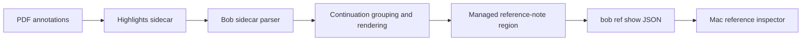

# Inline emphasis from Highlights underlines: design and implementation research

Researcher: **cdx**  
Date: **2026-10-19**  
Scope: Bob reference notes, annotation synchronization, and the Bob Mac Capture reference inspector.

## Judgment

**Yes: this is a good feature.** Your reading gesture has two levels—select this passage, then emphasize this phrase—but the export flattens those levels into separate entries. Reconstructing that relationship can make the notes more faithful to your intent and substantially easier to scan.

I recommend **one quote with inline bold emphasis**, produced by bob-cli and consumed by both interfaces. Preserve the underlying annotations, their comments, tasks, and existing links. Treat uncertain matches as ordinary separate entries.

The significant design choice is how confidently Bob can establish that an underline belongs to a particular highlight. A short bold quote occurring inside a longer quote is useful evidence, but it is not proof. I would make verified source containment the automatic behavior, and use sidecar-only matching as a measured prototype rather than silently treating it as certain. The typography work is small; reliable source association and migration are the substantial work.

This report is independent. I did not consult another swarm researcher's report, transcript, or findings. No product code, vault content, PDF, or Highlights sidecar was modified.

## 1. What the investigation established

### The bold text originates upstream

Highlights explicitly recorded converting extracted underlines to bold in its version 1.2.3 release notes. This is a deliberate export convention, not evidence that Bob misread the requested font style. [Highlights Mac changelog](https://highlightsapp.net/changelog/mac/)

Highlights stores standard embedded PDF annotations. It also uses underlines for optional tagging and citation-related workflows, so “generally for emphasis” should not become “every underline must disappear into another highlight.” [Highlights FAQ](https://highlightsapp.net/faq/), [Power Tools documentation](https://highlightsapp.net/how-to/mac/power-tools/)

Highlights advertises “Smart Merge Annotations,” but the official pages reviewed did not establish that it composes an underline into the Markdown of an enclosing highlight. Its documented note-format options cover colors, page/annotation headers, and spacers. I would test this setting in the installed app during the initial experiment, but would not assume an upstream switch solves the problem. [Features](https://highlightsapp.net/features/), [Note formatting](https://highlightsapp.net/how-to/mac/format-pdf-notes/)

### Bob currently loses the distinction between a highlight and an underline

The inspected pipeline is:



The parser records text, comment/task source, page label/index, order, and page ordinal. Its kinds are `Highlight`, `Image`, and `StandaloneNote`; there is no underline subtype, source annotation identifier, or geometry. A blockquote containing `**phrase**` becomes an ordinary `Highlight` whose text includes the Markdown markers. The parser also ignores annotation metadata headings. This is a concrete limitation of today's representation, not a general limitation of PDFs. [C1, C2]

The reference inspector reads the generated note through `bob ref show`; it does not independently extract annotation content from the PDF. `show` parses the managed region and excludes removed/redirect blocks. Therefore composition belongs before note rendering. Combining entries only in Swift would leave the note, clipboard paths, and other CLI consumers inconsistent. [C5, C6]

### Useful infrastructure already exists

Bob's explicit `<` continuation feature already provides several essential mechanisms:

- A group retains its head annotation's block ID.
- Source annotations remain available for comment and task handling.
- A previously published follower gets a redirect block instead of a false removal warning.
- Rendering records a source-order-to-displayed-block mapping.
- New tasks can keep their source identity while linking to the displayed group.

Reuse those mechanisms, but distinguish **continuation** (append more passage text) from **emphasis** (decorate a span already present). Feeding an underline through the existing concatenation function would merely reproduce the duplicate phrase. [C3, C4]

### There is a separate typography trap

`push_callout_block` puts the first line of the quote directly after `[!quote]`. That is the callout **title**, not its body. Obsidian treats text in that position as a custom title. Title styling can make the whole passage appear heavy, masking the difference between ordinary and emphasized words. Bryan's installed theme was not inspected, so the actual visual weight remains a verification item. [C3; Obsidian callout documentation](https://help.obsidian.md/Editing+and+formatting/Callouts)

The Mac inspector already splits `**...**` into strong runs and renders them with `AttributedString`. Its uncommented quote uses normal body weight with a yellow left rule; commented quotes are secondary and italicized. Inline bold therefore has an existing presentation path. Its parser is deliberately narrow, however: it pairs double asterisks rather than implementing general Markdown. [C6, C7]

## 2. Adjustments I recommend to the requirements

These are deliberate additions or qualifications to the original request:

| Adjustment | Reason |
|---|---|
| Define “merge” as a reversible display composition. | The original PDF annotations remain independent and editable in Highlights. |
| Prefer correct non-merges to incorrect merges. | Duplicate text is annoying; attaching emphasis to the wrong occurrence misrepresents reading intent. |
| Use inline bold as the default representation. | It is already the export convention and has a rendering path in both consumers. |
| Preserve standalone underlines and underline-specific notes. | Your stated practice is general, not absolute. |
| Preserve block links and imported task identities. | A tidier note must not break previous references or duplicate work items. |
| Include quote typography in the feature. | Correctly inserted bold is ineffective when the entire passage is already a bold title. |
| Support fully contained spans first. | Partial overlap, multiple candidate parents, and arbitrary OCR matching are separate complexity. |
| Keep uncertain cases quiet and visible. | They should stay separate, with diagnostic reasons available during a scan preview rather than warning badges throughout the reading UI. |
| Do not claim source-derived bold and reader-added bold are distinguishable without retained provenance. | Once both are serialized as `**...**`, Markdown alone cannot identify their origin. |

I would not require new gestures for the everyday case, a visual merge editor, an LLM matcher, or a general annotation-management system.

## 3. The intended reading experience

Imagine that the highlighted passage is:

> A reliable system makes its failure modes visible and gives the operator time to recover.

The underlined phrase is:

> **gives the operator time to recover**

Today those become two entries. The desired result is one:

> A reliable system makes its failure modes visible and **gives the operator time to recover**.

The outer quote provides context; the weight change supplies the second level of attention. No additional colored background, underline, pill, or “merged” badge is necessary.

For multiple emphasized phrases:

> A **reliable system** makes its failure modes visible and **gives the operator time to recover**.

For an underline with its own comment:

> A reliable system makes its failure modes visible and **gives the operator time to recover**.
>
> On “gives the operator time to recover”: This is the part our retry design is missing.

That last example is a design illustration, not a proposed replacement of Bob's nested comment-callout contract. Keep the nested comment container and label the child comment with its phrase so it does not accidentally appear to refer to the entire passage. Do not add that repeated phrase when the underline has no comment.

### Reference-note layout

For composed text quotes, put the passage in the callout body:

```markdown
### Page 12

> [!quote]
> A reliable system makes its failure modes visible and **gives the operator time to recover**.
>
> > [!note] Comment
> > On “gives the operator time to recover”: This is the part our retry design is missing.

^h-existing-parent-id
```

Use the empty custom-title form rather than adding a new literal title such as `Passage`: the current region parser includes header text in the quote. The parser already combines header and body text and trims empty ends, so this layout is a plausible compatible route, subject to regression tests. [C5]

Obsidian will ordinarily display its default “Quote” title. That is an acceptable functional baseline. For the polished version, suppress or reduce that redundant title only in the generated reference-quote presentation, retaining a quiet border and generous text spacing. This is a narrowly scoped styling decision, not a global change to every callout. Obsidian documents title hiding through CSS. [Obsidian callout documentation](https://help.obsidian.md/Editing+and+formatting/Callouts)

An alternative with fewer serialized changes is normal-weight title text plus bold nested spans, scoped to reference quotes. I prefer body text because a multi-line source passage is content, and its appearance then depends less on title styling. Avoid changing unrelated note and image callouts through a global helper modification.

### Mac inspector layout

Keep the existing left rule, page labels, spacing, and keyboard navigation. Render the composed passage once, with ordinary text at normal weight and emphasized runs visibly stronger. If the group acquires a comment, it should appear once in the existing commented-highlights flow, not in both sections.

Test the commented quote's current italic/secondary treatment carefully. A muted italic passage with bold italics may be harder to scan than ordinary body text plus strong emphasis. I favor normal roman text in that passage, using the rule, indentation, and comment separation to establish hierarchy. This is a presentation recommendation that needs an actual Mac preview before adoption.

Respect the preview's height limit, but provide an accessible full-passage view using the existing interaction pattern. A merged quote can be longer than the former short underline row, so important emphasis may otherwise disappear below truncation. Prefer a concise expand affordance over automatically jumping the viewport to a phrase.

Copying should produce one complete passage with inline Markdown emphasis through the existing Markdown-oriented path. Plain-text accessibility labels should read the passage once without delimiter characters. No extra announcement of every bold span is required. Tooltips should use readable text rather than leaking the raw `**` source.

## 4. Why “same page + unique substring” is insufficient

A tempting implementation is:

1. Find an annotation whose whole text is bold.
2. Remove its outer markers.
3. Find one longer highlight containing that text on the same page.
4. Bold the matching span and suppress the short annotation.

This is useful for discovering candidates, and may cover much of Bryan's usage. But it has irreducible counterexamples:

| Input situation | Failure of the simple rule |
|---|---|
| The phrase occurs in a highlighted paragraph and separately in an unhighlighted caption on the same page; only the caption is underlined. | The sidecar can show just one candidate parent even though the underline is physically elsewhere. |
| A fully bold source sentence is itself highlighted. | Its exported typography may resemble an underline; the actual export behavior must be sampled. |
| “Do not retry” appears twice inside one highlight. | Replacing the first or every occurrence invents intent. |
| Two nested highlights both contain the phrase. | “Choose the shortest” is an arbitrary policy, not proof of the intended parent. |
| The export is sorted by color or date. | Adjacency and creation order do not establish containment. |
| The phrase occurs across a line break or ligature. | Raw byte matching misses a legitimate match; aggressive normalization can create a false one. |
| An underline crosses the highlight's boundary. | Hiding it would lose the selected text outside the parent. |

The first example is decisive: two PDFs with different physical annotation locations can yield the same relevant text-only inputs. No better string algorithm can recover information absent from those inputs.

**Recommendation:** use text matching to locate an exact span after establishing the source relationship, not as a substitute for that relationship. Do not solve uncertain matches with fuzzy matching, embedding similarity, or an LLM.

## 5. Source evidence and a bounded feasibility experiment

PDF text-markup annotations carry a subtype distinguishing `Highlight` from `Underline`, and `QuadPoints` describe the marked text regions. An annotation's overall bounding rectangle can cover gaps between lines or columns, so it is insufficient for the containment test. The popup `Contents` field is not a guaranteed copy of selected passage text. [PDF Reference 1.7, text markup annotations, table 8.30](https://opensource.adobe.com/dc-acrobat-sdk-docs/pdfstandards/pdfreference1.7old.pdf), [PDF Reference 1.3, table 7.19](https://opensource.adobe.com/dc-acrobat-sdk-docs/pdfstandards/pdfreference1.3.pdf)

Bob already depends on `lopdf` 0.40 and parses PDF bytes for its marker, but its current annotation path is not a geometry-to-text extractor. Reading annotation dictionaries is a modest extension; accurately associating each dictionary with a sidecar row may not be. `lopdf`'s documented `extract_text` returns text, not a ready-made character-to-quad map. [C8; lopdf 0.40 API](https://docs.rs/lopdf/0.40.0/lopdf/struct.Document.html)

Before committing to the matching implementation, run a small real-export experiment:

1. Create a disposable PDF with a long highlight, an underline inside it, a repeated phrase elsewhere, a child comment, and a normal standalone underline. Save through the installed Highlights version with Bryan's usual settings.
2. Collect its PDF annotation dictionaries and actual `.md`/TextBundle export. Include highlight-first and underline-first creation orders, multiline text, and one two-column example.
3. Determine whether exported annotation headers or any stable source metadata can identify rows unambiguously. The current parser discards headers; a better parser could retain information if it is actually present.
4. If no usable identity exists, test associating sidecar text with text selected by annotation quads. Verify repeated phrases and comments rather than assuming `/Contents` contains selected words.
5. Measure how many intended pairs are verified, ambiguous, or unsupported on a small representative set of Bryan's real exports. Report counts and examples; do not manufacture a percentage before examining them.
6. Test Highlights' own Smart Merge once. If it already produces the desired sidecar under the installed settings, prefer that supported upstream behavior plus Bob typography improvements.

Apple PDFKit exposes annotation quadrilaterals, character bounds, page text, and text selections. This makes a Mac-only extraction experiment practical, but does not justify moving matching into the app. If needed, a read-only extractor invoked by Bob's Mac annotation-sync path can return source facts; the Rust planner remains the semantic authority. Packaging and maintenance of such a helper are explicit costs. [PDFAnnotation quadrilateralPoints](https://developer.apple.com/documentation/pdfkit/pdfannotation/quadrilateralpoints), [PDFPage](https://developer.apple.com/documentation/PDFKit/PDFPage)

Be precise about coordinate conventions. Apple's current quad accessor documents a Z ordering and annotation-origin relationship; older PDF descriptions use a different point ordering. Normalize the actual representation produced by the chosen reader, including page rotation and crop origin, and verify it against the sample. Do not mix raw PDF coordinates with API-relative coordinates. [PDFAnnotation quadrilateralPoints](https://developer.apple.com/documentation/pdfkit/pdfannotation/quadrilateralpoints)

The first release should not require solving arbitrary rotated text, scanned-page OCR, or every PDF engine. Unsupported evidence should preserve the existing independent entries. If verified matching has poor coverage or demands a disproportionate new PDF stack, pause automatic suppression: a sidecar-based prototype can still be evaluated explicitly, but should not be described as equivalent reliability.

## 6. Composition model and matching rules

Add a composition plan between parsed source annotations and rendered blocks. Keep the original parsed rows immutable.

Conceptually:

```text
SourceAnnotation
  existing identity inputs, original text, comment/task source
  optional verified source subtype, source key, page and quads

EmphasisAttachment
  underline source -> parent source
  exact display-text span(s)
  evidence used to establish relationship

DisplayGroup
  parent or existing continuation group
  text with strong spans
  ordered comments with their source associations
  source identity -> display block mapping
```

These are proposed responsibilities, not required type names or a request to introduce a new public schema immediately.

Automatic absorption in the initial version requires all of the following:

1. Both source rows belong to the same reference and a known physical page. Prefer physical page identity over printed labels such as `iv` or `1`.
2. The child is positively identified as an underline, and the parent as a highlight.
3. The underline's actual marked regions are fully contained in the parent's marked regions, using a small fixture-calibrated tolerance. Reject unsupported geometry rather than falling back to whole-rectangle containment.
4. There is exactly one eligible parent. Do not silently attach to all candidates or pick the nearest one.
5. The selected text maps to an exact, unambiguous range in the parent's display text. In v1, repeated occurrences remain separate even if a future character-position map might disambiguate them.
6. There is no explicit continuation instruction or source-association conflict that this composition would reinterpret.
7. The entire selected text survives. Partial overlaps stay separate.

An underline may precede or follow its parent in export order. Match within the page's candidate set, not just with the immediately previous row. Allow different colors; color alone should neither establish nor veto containment. Special Power Tools output must still pass the source/text eligibility checks.

For a first implementation, require a proper subspan. A coextensive underline and highlight can later become one fully bold passage, but it is less central to this request and harder to distinguish from a duplicate selection when provenance is incomplete.

### Text normalization

Maintain separate original text, display text, and matching text. Retain a mapping between their ranges.

The existing display cleanup handles PDF ligatures, whitespace, soft hyphens, and line reflow. Reuse its intended display behavior, but do not change identity normalization or globally erase punctuation/case to improve match rates. A display cleanup is not automatically a sound equivalence relation for matching. [C8]

Initially support exact text and a narrow, mapped set of extraction equivalences: whitespace wrapping and known ligature expansion. Handle word-boundary checks so an underline of `cat` does not emphasize the middle of `concatenate`. Reject uncertain dehyphenation and unsupported grapheme mappings. Preserve actual punctuation and capitalization in output.

Compute spans against the final display text or carry offsets through cleanup. Inserting asterisks before the existing line-joining/hyphen-healing operations can change their behavior. Keep offsets internal to Rust or specify their unit explicitly if ever exported; a Rust UTF-8 byte offset is not a Swift character index.

Multiple verified underlines in the same parent produce a union of strong ranges. Overlapping ranges should not create nested delimiters or duplicated text. Do not extend a range across unselected intervening words. Existing strong text should remain strong; avoid `****...****` constructions.

### Markdown and the Mac contract

For ordinary words and phrases, generated `**...**` is sufficient and already supported by the Mac inspector. Avoid raw `<u>`/`<span>` HTML as the shared format. General Markdown has delimiter and escaping rules; the Mac parser currently has a much narrower pairing rule. [C6; CommonMark strong-emphasis specification](https://spec.commonmark.org/0.31.2/#emphasis-and-strong-emphasis)

Use shared golden examples covering literal asterisks, backticks, links, punctuation, multiple strong spans, and Unicode. If the required cases cannot be represented consistently with the current contract, add an optional Bob-generated `quote_runs` field containing plain/strong text runs. Keep the current `quote` field for older clients; decode the new field with `decodeIfPresent`. Compute any runs in Bob from the persisted note representation, so an inspector reload does not depend on live PDF access.

Do not attach an `origin: underline` claim to runs reconstructed solely from Markdown. That would require separately persisted composition provenance. A broad public annotation schema should be added only if the experiment demonstrates a need.

## 7. Identity, migration, and lifecycle

This is where a superficially small visual feature can cause lasting damage.

### Preserve existing source identities

Today `annotation_block_id` hashes the PDF identity, annotation kind, page label, page ordinal, and normalized original text. Compute that identity **before** inserting emphasis, removing a child from display, or changing any internal classification. Do not change the hashed legacy kind merely because a new source subtype was learned. [C3]

The existing ordinal participates in the hash. Consequently, insertion or export reordering can already alter IDs. The grouping feature must not introduce additional ID churn by filtering/reindexing rows, and it must not promise stability across arbitrary export reorderings. Test insertion of an underline both before and after a published parent. If the real export shifts parent IDs, a persisted identity association or narrow migration is needed before release; matching decorated text alone is not an adequate repair.

Retain the parent's existing display anchor. A previously published absorbed underline needs the equivalent of the existing continuation redirect, not a “Removed highlight” tombstone and not silent deletion. Keep that redirect across subsequent scans while the underlying association remains valid. Do not rewrite the whole vault's backlinks.

### Preserve comments, images, and tasks

Process every original annotation's task source once, even when its display row is absorbed. Maintain source task identity while selecting the parent/group block as the destination for new links. Previously imported tasks keep their old source links, which continue through the redirect. Preserve task edits, completion state, routing, and image-note assets. [C4]

Group comments in deterministic source order. Give underline comments their phrase context; leave parent comments as parent comments. If either extraction or attribution cannot be preserved, leave that candidate separate in the first release.

### Define removal and reversal

| Change in Highlights | Required resulting behavior |
|---|---|
| Add a contained underline | The existing passage gains emphasis; no duplicate live entry. |
| Remove that underline | Remove only its contributed emphasis; retain source-native emphasis and other underline contributions. Preserve normal source-removal/link behavior. |
| Remove the parent but keep the underline | The underline becomes a visible standalone entry again. |
| Change the underline's extent or text | Recompute from the fresh source snapshot; do not accumulate old formatting. |
| Association becomes ambiguous | Restore separate entries rather than choosing a different parent silently. |
| Disable composition or roll back | Original source rows render independently again; preserve published anchors and comments. |
| Source PDF and sidecar are temporarily inconsistent | Do not publish a misleading partial composition. Keep the last valid managed result or publish the normal independent rows under the existing sync policy, with a diagnostic reason. |

Highlights writes sidecars when saving and can overwrite external edits. Never store Bob's composition decisions by modifying that generated sidecar. Work from a consistent read of the PDF/sidecar pair and use Bob's existing scan locks and managed-region writer. [Sidecar documentation](https://highlightsapp.net/how-to/mac/sidecar-files/)

### Continuations need explicit integration

Build the existing explicit continuation relationships before silently changing what counts as the “previous” annotation. A candidate underline that is itself a continuation member or anchors a continuation must stay outside automatic absorption in v1 unless that case has an explicitly designed migration. For ordinary candidates, decorate the original parent piece, then let existing continuation assembly join the pieces.

This avoids changing `<` semantics as a side effect. A later extension can carry emphasis ranges through page-spanning groups and gap seams, but must never infer emphasis across an omitted `[…]` segment. [C3, C4]

### Counts and refresh

A composed parent is one live displayed highlight. Keep source annotation counts and emphasis-span counts distinct in diagnostics; do not silently redefine a PDF annotation count. Redirects must remain outside the normal inspector feed, as today. Verify that a completed scan invalidates the Mac inspector's cached `ref show` result, whose current cache key incorporates the reference path and library snapshot time. [C5, C7]

## 8. Alternatives and their tradeoffs

| Approach | Benefit | Limitation | Verdict |
|---|---|---|---|
| Keep separate rows but style underlines differently | Very small change; no inferred relationships | Still repeats text and forces the reader to reconstruct context | Good fallback |
| Compose only in the Mac app | Fast local prototype | Notes, CLI, copying, and other clients disagree; duplicates semantic logic | Reject as the implementation boundary |
| Unique same-page bold substring | Simple and likely useful on ordinary examples | Cannot prove subtype or location; false matches remain possible even with unique candidates | Prototype/candidate discovery only |
| Verified source association plus exact text ranges | Best preservation of intent; deterministic fallback | Source-to-sidecar mapping is the main engineering cost | Recommended automatic behavior |
| Fuzzy or model-based matching | More apparent coverage | Invented matches, weaker reproducibility, harder debugging | Reject |
| Ask for a marker on every underline | Explicit intent | Adds work to a gesture that already expresses intent | Avoid for the common case |
| Rewrite the PDF or delete underline annotations | Removes source duplication | Changes the user's reading document and makes reversal harder | Reject |
| Use upstream Smart Merge, if verified | Lowest Bob maintenance | Relevant behavior has not been established | Check during the initial experiment |

I would also avoid inventing a new hierarchy of nested emphasis cards. One readable passage is the desired product; the source graph belongs in the implementation and diagnostics.

## 9. Implementation boundaries and validation

This is a research recommendation, not a claim that an implementation was built or verified.

### Suggested delivery sequence

1. **Evidence and rendering experiment.** Capture real exports; determine source association feasibility; verify the intended body typography in Obsidian and the Mac inspector. The experiment is complete when it can explain at least one safe merge and the repeated-caption rejection from actual source data.
2. **Bob composition engine.** Add immutable source metadata and a pure attachment planner, reuse existing grouping/link/task mechanisms, and apply strong spans after display normalization. Leave unsupported cases unchanged.
3. **Round-trip and presentation work.** Ensure rendered Markdown parses back through `ref show` without losing text or comments; adjust quote layout; extend Mac rendering only where compatibility fixtures require it.
4. **Migration rehearsal.** Run the existing `bob ref scan --dry-run` on a small representative set, inspect diffs and match reasons, then exercise the existing scan workflow. A second unchanged scan must be byte-stable.
5. **Broaden coverage only from evidence.** Add repeated-text geometry, partial overlaps, or a manual exception affordance only if observed cases justify the cost.

No new CLI command is required for the initial behavior. Existing dry-run/report surfaces can carry composition counts and rejection reasons. A single reversible configuration switch during rollout is reasonable; a menu of matching thresholds is not.

### Essential test matrix

| Category | Cases and required checks |
|---|---|
| Happy path | One underline, several disjoint underlines, multiline parent, child before parent, different colors. One passage; correct spans. |
| Negative matching | Same text in another column/caption; repeated text within parent; two eligible parents; missing page; ordinary bold; underline outside parent; partial overlap. Preserve separate rows. |
| Text fidelity | Ligatures, NBSP, soft hyphens, hard-wrapped lines, composed/decomposed Unicode, emoji, literal Markdown symbols. No lost characters or malformed markup. |
| Comments and tasks | Parent and child comments; image notes; multiple child tasks; edited/completed imported tasks. No dropped attribution or duplicate task import. |
| Identity | Existing parent ID; existing child backlink/embed; repeated scans; added earlier annotation; changed source ordering; remove/re-add parent/child. Explicitly inspect redirect behavior. |
| Continuations | Parent is a continuation piece; child has `<`; child is a continuation anchor; gaps and page ranges. No accidental concatenation or changed marker interpretation. |
| Round trip | Source → managed Markdown → `ref show` JSON → Mac runs and copied Markdown. Matching text and count at each stage. |
| Visual | Obsidian Reading View and Live Preview; Mac commented/uncommented quotes; narrow panel, long quote, light/dark appearance, accessibility reading. Emphasis remains legible. |
| Sync | Stale sidecar, no sidecar, unsupported PDF, repeated scans, cache refresh. No disappearing source information or repeated migrations. |

For Mac changes, follow the linked repository's actual instructions: `just portable-check`, plus compilation of changed macOS targets in a scratch copy on the Mac and `just typecheck-tests`; CI runs tests where XCTest is available. Do not treat a text-only design review as a substitute for compiling Swift.

### Acceptance criteria

- Every automatically absorbed underline has a documented source association and an exact mapped span.
- All ambiguous examples remain visible as separate entries.
- The combined quote preserves the parent's words and applies emphasis only to selected ranges.
- Published links resolve, tasks retain their source identity, and comments remain correctly attributed.
- Obsidian and the Mac inspector display one passage with the same emphasis.
- A second unchanged scan produces no diff; enabling composition does not rewrite source PDFs/sidecars.
- Disabling/reversing composition restores independent presentation without losing the underlying annotations.

## 10. Evidence ledger and limitations

Code observations refer to these inspected revisions:

- **bob-cli:** `1b158e662364485fbc591aa8def3cceeb8951ea7`
- **bob-mac-capture:** `5fd928b9ba50f46d57736ba3ccd35a4ca92573bb`
- **bob-plugins:** `ee9d7e6b4a7eecd744f47a0269bdcb443efbf161` — inspected its instructions and searched plugin CSS for relevant quote-title styling; no dedicated matching rule was found in that search. This does not establish what the vault's theme/snippets do.

| Citation | Repository-local evidence |
|---|---|
| C1 | bob-cli `src/native/highlights_ref/model.rs:333` — source annotation fields and kinds. |
| C2 | bob-cli `src/native/highlights_ref/sidecar.rs:202` — page/chunk parser and blockquote classification. |
| C3 | bob-cli `src/native/highlights_ref/sidecar_render.rs:4`, `:209`, `:399`, `:420`, `:554` — grouping, redirects, quote layout, identity hashing, first-line title placement. |
| C4 | bob-cli `src/native/highlights_ref/continuation.rs:103`; `src/native/highlights_ref/annotation_tasks.rs:5`; `docs/highlights-ref-sync.md` continuation contract — explicit grouping and per-source task identity. |
| C5 | bob-cli `src/native/highlights_ref/region.rs:68`, `:294`; `src/native/ref_library/show.rs:206` — note parsing, exclusion of removed blocks, JSON projection. |
| C6 | bob-mac-capture `Sources/RefsCore/RefsInspector.swift:139`, `:522` — annotation model and double-asterisk run parser. |
| C7 | bob-mac-capture `Sources/BobMacCapture/Refs/RefsInspectorView.swift:748`, `:778`, `:805`; `RefsInspectorLoader.swift` — quote rendering, accessibility, note/highlight partition, cache and refresh. |
| C8 | bob-cli `Cargo.toml:31`; `src/native/highlights_ref/marker.rs:4`; `src/native/highlights_ref/text.rs:11`, `:73`, `:182` — existing PDF dependency/parse, display cleanup, identity normalization. |
| C9 | bob-cli `tests/fixtures/highlights_ref/README.md`, `sample_sidecar.md`, `linked_sidecar.md`; `tests/cli/highlights/continuations.rs` — fixture provenance and existing integration-test seams. |

Audited project-memory context: `obsidian.md`, `sase_artifacts.md`, `glossary:reference-note`, `decisions:mac-capture-is-a-thin-client`, and `decisions:references-are-ingested-at-birth`. The recommendation keeps Bob as semantic authority and annotation synchronization on its existing Mac path.

The repository's documented sidecar fixtures are synthetic and do not establish actual underline/PDF correspondence. I did not inspect Bryan's real PDFs or exports, run Highlights, render the installed Obsidian theme, or compile a prototype. Consequently, merge coverage, coordinate tolerances, end-to-end latency, and exact extractor choice remain unmeasured. The cited vendor/API documentation supports feasibility, not a claim that this integration is already solved.

## 11. Recommended solution

**Build this as conservative annotation composition in bob-cli: one body-weight quote, bold only the underlined phrases, and one shared result for reference notes and the Mac inspector.** Preserve original source rows, child comments and task identity, and existing block links through the established redirect mechanism. Keep unsupported or ambiguous cases separate.

Start with the real-export/source-association experiment, because that determines whether reliable matching is a small metadata extension or requires a read-only extraction helper. Require verified containment plus an exact text range for automatic suppression; do not present a same-page substring heuristic as certain. Improve the callout-body typography alongside the composition so the result is visibly better in both interfaces.

This preserves the useful meaning of the reading gesture while keeping the experience quiet: the user sees the passage once, with the important words carrying exactly the extra weight they intended.
