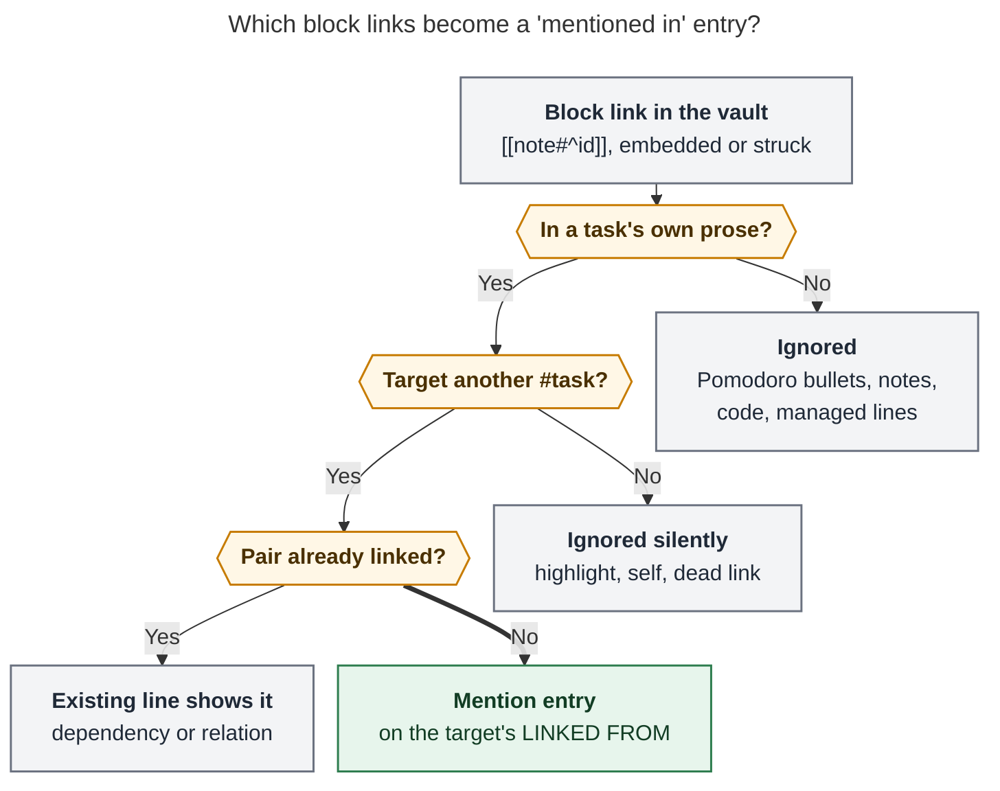

# Inline task mentions as `💬` LINKED FROM entries

> **Researcher:** cld · **Date:** 2026-10-29 · **Repos read:** bob-cli (`docs/task-relations.md`,
> `src/native/task_relations/`, `src/native/task_status_hooks/relations.rs`), bob-plugins
> (`bob-ledger-tools` relation index, chip model, and CSS; `bob-navigation-hotkeys` relation
> hand-edit mirror), and the live vault `~/bob` (read-only survey). Prior research consulted:
> `research:202610/task_relation_links/task_relation_links__final.md` and
> `research:202610/undirected_task_relations/undirected_task_relations__final.md`.

## TL;DR

- **Yes, build it.** Task-level "what points at this task?" is a real gap. Obsidian's backlinks
  pane works per note and is dominated by Pomodoro ledger links. Bryan already writes prose
  back-references by hand ("Merged into [[…]]", "OBSOLETE: See [[…]]", "Duplicate of [[…]]").
  The relations stack already has every hard part: a generated mirror, reconcile as the
  authority, a live index, and chips.
- **One thing makes this a new decision.** The relation synthesis three weeks ago explicitly
  rejected "auto-relating from mentions (Linear-style)". `docs/task-relations.md` §14 says
  hand-written idioms "are not adopted". That rejection was about *behavioral* inference,
  like the old embed-implies-dependency rule. A display-only mirror that never feeds any
  behavior does not repeat that failure. It still needs a new decision record.
- **Store mentions on the existing `🪢 LINKED FROM` line, not on a new bullet type.** Mark them
  with one reserved label slot: `[[S]] (💬 mentions)`. Every engine already guards LINKED FROM
  lines against Task Link, tree-close, and strike behavior. Old parsers also accept the `(…)`
  label slot, so no line becomes malformed during rollout.
- **Visually,** a mention shows as `💬 mentioned in (○ S)` (or `💬 embedded in` for `![[…]]`),
  grouped after explicit relations. Hovering opens a **quote card** with S's sentence and the
  mention highlighted ("OBSOLETE: See ⟦this task⟧!"). Clicking
  opens S *at the mention*. That is how the row explains why it is there.
- **No LINKS entry on the source** (your requirement, kept). I go one step further: the inline
  link on S already is the forward view, so the plugin can render it as a status-aware mention
  pill instead of Obsidian's `cash > ^call-real-id` (optional, phase 4).
- **Small blast radius today:** 64 mirror entries on 61 targets, fan-in at most 3, and 9 silent
  `^id` mints on active sources.

---

## 1. What exists today

| Piece | Where | Relevance |
| --- | --- | --- |
| Authored `🪢 **LINKS:**` line on the source S | `docs/task-relations.md` §3–§5 | The only edge source today. There are 56 LINKS lines in the vault. |
| Generated `🪢 **LINKED FROM:**` line on the target T | §6–§7, `reconcile_relation_lines` in `src/native/task_status_hooks/relations.rs` | Reconcile owns it, and nothing reads it back. There are 48 today. Entry grammar: `<link>[' (' <label> ')']`. |
| Live relation index `api.relationIndex` v1 | `bob-ledger-tools/src/171-relation-index-lifecycle.js`, `145-relation-index-model.js` | Builds forward and reverse maps from raw text and overlays unsaved editor text. Chips render from it, never from the stored mirror (LC8). |
| Chip model and CSS | `146-relation-chip-model.js`, `282-plugin-relation-render.js`, `styles.css` (`.bob-dep-chip`, `.bob-relation-pill`) | Status-coloured chips, muted small-caps label pills, a display-only inverse table (`merged into` → `merged from`), and dashed stale and broken chips. |
| Nav hand-edit mirror | `bob-navigation-hotkeys/src/594a-relation-hand-edit.js`, `595-relation-follow-ups.js` | When the cursor leaves an edited LINKS line, it diffs the before and after edge sets and writes T's mirror as a follow-up. This is the machinery to reuse for mentions. |
| Reconcile cadence | `docs/vault-git-sync.md` (Mac crontab `10,25,40,55 * * * *`) | The stored mirror converges within about 15 minutes. Live chips are instant, but only on a row that already exists. |
| §14 "Adopting old idioms" | `docs/task-relations.md:527` | "Hand-written `Merged into [[…]]`, `See [[…]]`, and `**RELATED:**` bullets are not adopted; adopting them is an opt-in follow-up." **This feature supersedes that line.** |
| Prior synthesis | `task_relation_links__final.md` rejected-alternatives table | "Auto-relating from mentions (Linear-style): Implicit edges are exactly the inference the Depends-On redesign removed. Offer an opt-in, dry-run adoption instead." |

The decision record `decisions:task-deps-are-depends-on-links` explains the earlier inference
failure. Dependencies were inferred from a sole transcluded child, so "`#^ref` reading embeds
promoted tasks they merely quoted, closing an embedded ledger link recursively closed its
prerequisites". The harm came from inferred edges *doing things*. A mention mirror does nothing
except render.

## 2. Evidence from the vault

I surveyed the vault read-only: 6,793 notes, 4,188 `#task` lines, and 2,061 tasks with a
`^block-id`. `_conflicts/` and `.obsidian/` were excluded, and links to non-task blocks are
counted separately. A "source" is a `#task` whose own text contains `[[note#^id]]`: the task line
plus its non-task, non-managed descendant bullets.

| Measure | Count | Note |
| --- | ---: | --- |
| Distinct (S, T) mention pairs where T is a `#task` | **119** | 18 come from the task line and 101 from note bullets under the task. |
| … whose target is writable (not `done/`) | 84 | Mirrors are never written into `done/` (§6). |
| … listable today (S has an id, or S is active and mintable) | **64** | Mirror entries the feature would write on day one. |
| … lost because S is in `done/` without a `^id` | 20 | Mostly the 2026-10-19 "Merged into [[…]]" cancels in `done/sase_done.md`. |
| Active sources needing a silent `^id` mint | 9 | The same cost LINKS sources already pay (§5). |
| Distinct targets gaining entries | **61** | Fan-in: 59 targets × 1, 1 × 2, 1 × 3 (`sase_memory_webs#^prj`). |
| Targets that are `^ref` reading tasks in `ref/` notes | 38 of 61 | Legacy research-reading bullets such as `- ~~[[ref/chat/x#^ref]]~~`. |
| Listable entries from sole-link bullets (`- [[…]]`, `- ![[…]]`, `- ~~[[…]]~~`) | 39 of 64 | The other 25 are prose: 9 on task lines and 16 in note bullets. |
| Pairs that are also a dependency (either direction) | 2 | One per direction. In the `cash` case, T (`^call-real-id`) depends on the S that mentions it, so T already shows S on its own Depends-On line. Precedence rule needed (§5.3). |
| Pairs that are also on S's LINKS line | 0 | The rule is still needed: cancel labels write both a LINKS entry and a `🪢 duplicate of [[T]]` Cancel Log reason (§17 CL4). |
| Block links in task prose to **non-task** blocks | ~163 | `[[#^h-…\|🔖]]` highlight anchors, zorg `^z-…` ids, and headings. They must be ignored silently. |

Representative real sources:

```markdown
- [?] #task Find number you need to call to get [[cash#^call-real-id]] going! … ^find-real-id-number
- [x] #task Finish and FREEZE [[sase_blog_blockers#^prj]]! … ^write-blog-blockers
- [-] #task Always [[sase_better_plans#^grill]] epics! … [cancelled:: 2026-10-19]
	- Merged into [[sase_better_plans#^grill]]
- [-] #task Add support for hidden, superseded memory strands! … ^old-supersede
	- OBSOLETE: See [[#^supersede]]!
- [x] #task Read [[sase_sites_platform]]! … ^read-research
	- ~~[[ref/chat/sase_sites_platform#^ref]]~~
```

Takeaways:

1. **The feature is mostly about note bullets, not task lines.** If you count only the task line
   ("inline" read literally), day one has 9 entries. The high-value back-references ("Merged
   into", "OBSOLETE: See", "Duplicate of") live in note bullets under the task. See R1.
2. **Fan-in is tiny,** so noise is not a day-one problem. Collapse rules still matter for
   `^prj` lines that many tasks may later mention.
3. **The "Merged into" cancels are the clearest win,** but 20 of them already sit in `done/`
   without ids. Going forward, this does not recur: reconcile mints the id while S is still
   active, long before the nightly `bob task archive`.

## 3. Is this a good idea?

### 3.1 Why yes

- **It answers a question nothing else answers.** "What else talks about this task?" Obsidian's
  backlinks pane is note-level. For task notes, the prior research counted about 2,222 Pomodoro
  Task Links drowning it.
- **It rewards a habit Bryan already has.** The prose back-references in the survey were all
  typed by hand, and the inverse ("Merged from") was typed as plain text because the other end
  was archived. A mention mirror gives him the inverse for free.
- **Zero authoring cost and zero new grammar to learn.** Type a link and the other task
  knows about it.
- **It is the industry-standard pairing.** GitHub records a *cross-referenced* timeline event on
  an issue when another issue or PR mentions it, separately from explicit links. Obsidian splits
  "Linked mentions" from "Unlinked mentions" and shows each with a context excerpt. Logseq
  shows "Linked References" with block context. All three show *implicit mentions with
  context*, kept apart from deliberate relationships. That is the shape I recommend.
- **Most of the machinery already exists:** the projection, reconcile authority, the live index
  with editor overlay, chips, the stale-entry treatment, and the hand-edit mirror diff.

### 3.2 What could go wrong

| Risk | Why it matters | Answer |
| --- | --- | --- |
| **Semantic creep**: mentions start *doing* things | This is exactly the history behind `task-deps-are-depends-on-links`. | Mentions inherit relation inertness verbatim (§2 of the contract): no status, lane, stamp, walk, Task Link, cancel, or complete effects. The reserved label can never be a closing label. |
| **Feedback loop**: the mirror line itself contains links | T's LINKED FROM names S, so if T's own lines counted as mentions, S would gain "mentioned in T". | Managed lines (Depends-On, BLOCKS, Sub-projects, LINKS, LINKED FROM) are never mention sources. Vector MN4. |
| **Noise** | Every `[[x#^y]]` typed anywhere could sprout rows. | Only `#task` sources, and only a task's own text. Pomodoro bullets and plain notes are excluded. Fan-in is ≤ 3 today, with collapse at ≥ 3 closed. |
| **Meaning loss**: a mention has no label | "Merged into [[T]]" and "see [[T]]" render alike. | The hover quote card shows the sentence, and the sentence carries the meaning. "Promote to relation…" adds a real label when Bryan wants one. |
| **Churn and multi-host conflicts** | Prose edits now rewrite another note's mirror. | Canonical, deterministic output; the 2 s quiet interval; reconcile heals conflicts (LR3). Real churn is low (fan-in 1). |
| **Version skew** | An old reconcile strips mention entries. An old plugin renders them as **dashed stale** chips, because its index does not know the edge. | Ship order: plugin, then bob dark, then flip config (§8). |
| **Silent id mints on S** | Typing a link into S appends `^find-real-id-number` to S's line. | This is the established relation cost (§5). Nine today. Called out in R7. |
| **`ref/` note writes** | 38 of 61 targets are `^ref` lines inside `ref/` notes that `bob ref` also writes. | LINKS mirrors can already land there. Still, add a regression test that `bob ref rename` / highlights sync keep a LINKED FROM child under `^ref`. |

### 3.3 Verdict

It is a good idea. It changes a recorded position, so it needs a decision record before code.
The rejected alternative ("auto-relate from mentions") was rejected for *writing authored
relations* and *implying behavior*. This design does neither: it never touches S's LINKS line,
and it never changes any state.

## 4. Requirement adjustments

Each row is marked **[KEPT]**, **[ADJUSTED]**, or **[ADDED]**.

| # | Your requirement | My version | Why |
| --- | --- | --- | --- |
| R1 **[ADJUSTED]** | Tasks "referenced … by other tasks" | **A mention is a block link in a `#task`'s own prose: its task line plus its non-task, non-managed descendant bullets.** That includes Cancel Log, Work Log, and Rotten Log entries. A nested `#task` owns its own subtree. | 55 of 64 day-one entries live in note bullets, including every "Merged into" and "OBSOLETE: See". The task line alone gives 9. |
| R2 **[ADDED]** | (implicit) which links | Accept `[[#^id]]`, `[[note#^id]]`, `[[dir/note#^id]]`, aliased, embedded `![[…]]`, and struck `~~[[…]]~~`, using the shared `block_link_spans` scanner. **Ignore** links in fenced or inline code, `%%comments%%`, inline Dataview fields (`[k:: …]`, `(k:: …)`), heading links, bare note links, and markdown-style `[](…#^id)` links. Ignore targets that are not a `#task`, are self-links, or are unresolved, all **silently**. | About 163 non-task block links already sit in task prose. Warnings would be pure noise, and Obsidian already flags dead links. |
| R3 **[ADDED]** | (implicit) scope of sources | **Only `#task` sources.** Pomodoro bullets, plain note prose, headings, and `ref/` highlight sections never produce mentions. | This keeps the ledger noise out, the same reason LINKED FROM excluded it originally. |
| R4 **[ADJUSTED]** | Auto-add "linked from" **bullets** | Add **entries** to the one existing `🪢 **LINKED FROM:**` line, marked `(💬 mentions)`. **Do not add a new bullet type.** | One line per task, one slot, and one reconcile pass. Every engine's guards already cover it, and old parsers accept the label slot (§5.2). |
| R5 **[KEPT, extended]** | No "linked to" bullet on the source | Kept: S's text is the single source of truth, and nothing is written to S except a silent `^id` mint. Extended (optional): **render** S's inline link as a live mention pill, so the forward view is beautiful too. | The inline link *is* the forward relation; it just renders poorly today. |
| R6 **[ADDED]** | (implicit) duplicates | **One entry per (S, T).** Precedence: dependency (either direction) > explicit relation > mention. A mention never adds a second entry, and an explicit label always wins. | Cancel labels already write both a LINKS entry and a Cancel Log link to T. |
| R7 **[ADDED]** | (implicit) source identity | An active id-less source is minted silently, exactly like LINKS sources. A `done/` or previous-daily source without an id is skipped. | The established §5 rule. The cost is 9 mints today. |
| R8 **[ADJUSTED]** | "make it very clear why … shown" | Three layers: (a) the `💬` glyph plus a `mentioned in` / `embedded in` pill; (b) a hover **quote card** with the sentence, the mention highlighted, and its location; (c) click opens S **at the mention**. The `(💬 mentions)` text also reads correctly with no plugin. | Provenance has to survive vim, agents, and mobile, and the excerpt carries the meaning a label would have. |
| R9 **[ADDED]** | (implicit) reliability | Reconcile is the authority; LR11 single-source holds with mentions; never prune on uncertainty; there is a kill switch `relations.linked_from_mentions`; the live view never waits for reconcile. | This matches the contract's existing guarantees. |
| R10 **[ADDED]** | (implicit) governance | A new decision record, plus a §19 "Inline mentions" contract section with shared vectors. §14's "not adopted" line is updated. | Policy changes get records. Memory edits go through `/sase_memory_write`; I made none. |

## 5. Design

### 5.1 What counts as a mention



*Figure 1. A link becomes a mention entry only when it sits in a task's own prose (the task line
or its note bullets), points at a different `#task`, and the pair is not already shown as a
dependency (either direction) or a labelled relation.*

Rules, in order:

1. **Owner.** Walk up from the link's line to the nearest `#task` ancestor. A link in a nested
   subtask's subtree belongs to that subtask. A link with no `#task` ancestor is not a mention.
2. **Excluded lines.** The owner's managed children (`❌ CANCEL LOG` header, `⛓️ DEPENDS ON`,
   `🧱 BLOCKS`, `🧩 Sub-projects`, `🪢 LINKS`, `🪢 LINKED FROM`, `🗓️ SCHEDULE LOG`) are never
   mention lines. Their *entries* under the Cancel, Work, and Rotten Log headers are Bryan's
   prose and **do** count. Each managed line already has its own rule.
3. **Excluded spans.** Fenced code, inline code, `%%…%%`, and inline Dataview field values.
   Reuse the inline-code ranges `relationWikilinkSpans` already computes.
4. **Target.** The link must resolve to a `#task` line with that `^id`, and that task must not
   be the owner. Use the relation pass's existing resolver (`resolve_target_path` plus
   `lookup_task`).
5. **Kind** (display only): `embed` when the link is `![[…]]`, otherwise `mention`. Struck
   links count, because a strike is how closed Task Links are retired. They are history, like
   relations.

### 5.2 Storage: a reserved label on the existing LINKED FROM line

Plain Markdown, which is what vim, `rg`, git, agents, and plugin-less Obsidian see:

```markdown
- [-] #task Add support for hidden, superseded memory strands!  [created:: 2026-08-30]  [cancelled:: 2026-08-30] ^old-supersede
	- OBSOLETE: See [[#^supersede]]!
- [x] #task Launch ~~epic~~ tale to make superseding better!  [created:: 2026-08-30]  [completion:: 2026-09-02] ^supersede
	- 🪢 **LINKED FROM:** [[#^old-supersede]] (💬 mentions)
```

This is a real pair from `sase_memory_webs.md`. The survivor learns what it superseded,
and the cancelled task's text is untouched. With an explicit relation on the same target, the
line groups the relation first (illustrative):

```markdown
	- 🪢 **LINKED FROM:** [[bob#^capture-star]] (follow-up of) • [[#^old-supersede]] (💬 mentions)
```

- **Mirror entry grammar is unchanged.** `<link> (💬 mentions)` already parses as a labelled
  entry under LK16. `💬` (U+1F4AC, one code point, no VS16) is not a forbidden label character.
  Old Rust and JS parsers therefore read it as a normal label, and nothing becomes malformed
  during rollout.
- **Reserved spelling.** A label whose first code point is `💬` is reserved. Every *authored*
  writer refuses it with "💬 is reserved for inline mentions": capture `|`/`||`, the Links and
  Linked-from stages, the relation field, `bob relations rename`/`hide`, and
  `relations.cancel_labels`/`complete_labels`. Readers keep tolerating it, so a hand-typed one
  never makes a line malformed. The label catalog and `labelSuggestions` exclude it.
- **Order.** Group the stored line: explicit relations first, then mentions, each in the
  existing canonical (BK21) order. The sort key becomes `(provenance rank, folded linktext,
  raw)`. In vim, "everything from the first `💬` on is a mention". Both engines change one
  comparator and share vectors.
- **Phrasing.** LINKED FROM labels are phrased from the source's side
  (`[[S]] (follow-up of)` = "S is a follow-up of this"), so the mention reads
  `[[S]] (💬 mentions)` = "S mentions this". The chip shows the inverse, `💬 mentioned in`,
  through the existing display-only inverse table.

**Why not a separate `💬 **MENTIONED IN:**` line?** It would make provenance obvious at the line
level. But it is a *new line type* that Rust, nav, ledger-tools, the cycler, and block-id-prompt
must each learn to ignore as a Task Link, a tree-close target, a strike target, an R8 legacy
child, and a section title. The prior research named that "recogniser sprawl … where the bugs
would actually come from". It would also add a third generated child (BLOCKS, LINKED FROM,
MENTIONED IN) under busy tasks. The reserved label gets the same clarity with none of that.

### 5.3 Identity and precedence

- **Edge identity stays (S, T),** resolved by vault path plus block id. Several mentions of T
  inside S produce one entry. The quote card says "mentioned 2× in this task".
- **A dependency in either direction suppresses the mention.** If S depends on T, T's
  `🧱 BLOCKS` line already shows S while T is open, and S's Depends-On line shows T forever.
  If T depends on S, T's own `⛓️ DEPENDS ON` line already names S. The vault has exactly this
  case: `cash#^find-real-id-number` says "Find number you need to call to get
  [[cash#^call-real-id]] going!", and `^call-real-id` depends on it. A `💬` entry there would
  only repeat what the line above it says.
- **S has a LINKS entry to T:** the relation entry wins and its label is kept. The quote card
  on that chip adds "also mentioned in its text".
- **A → B by mention and B → A by mention:** two independent edges, as LR19.

### 5.4 Projection and reconcile changes (bob-cli)

Extend `reconcile_relation_lines` rather than adding a pass. The projection becomes:

```text
edges(T)    = relation_edges(T) ∪ { (S, T, MENTION) : S mentions T ∧ (S,T) ∉ dep_pairs ∧ (S,T) ∉ relation_pairs }
mirror(T)   = group_then_sort(edges(T))
```

- **Collect.** `collect_file_edges` today early-returns unless a note contains `LINKS`.
  Mention collection needs a second prefilter: the note contains `#^` and `#task`. For each
  task, scan the owner's prose lines with `block_link_spans` (`src/native/task_dependencies/mod.rs`).
  A `MentionSource { path, loc, kind }` joins `by_target` with `label = Some("💬 mentions")`
  and a provenance flag.
- **Archives.** `load_relation_archives` loads `done/` notes containing `LINKS`. Add `#^`. All
  of `done/` is 30 files and about 545 KB, so cost is negligible. Sources without ids in `done/`
  are skipped, as today.
- **Mints.** These use the existing `mint_needed` path, the existing quiet-deferral rule (LR5),
  and the `minted_relation_source_block_ids` rows. Add an additive `reason: "mention"` field.
- **Never prune on uncertainty.** If S's note has duplicate ids, or S's prose cannot be parsed
  because it is inside an unclosed fence, keep existing entries naming S (the LR13/LR23 rules).
- **Kill switch.** `relations.linked_from_mentions: true|false`. With `false`, reconcile
  removes only `(💬 mentions)` entries and leaves relation entries, so it is lossless.
  `linked_from_lines: false` still removes everything.
- **JSON** (additive, `schema_version` unchanged): `linked_from_line_updates[]` rows gain
  `mentions_added`/`mentions_removed`, and a top-level `mention_edges` count is added. No new
  warning kinds, because prose is never warned about.

### 5.5 Keeping the live view instant (bob-plugins)

The stored line converges within about 15 minutes, while the user expects to see the result
immediately. Three layers:

1. **Index (bob-ledger-tools).** The relation index also collects mention edges per file.
   Use Obsidian's metadata cache instead of re-reading text: `listItems` (with `task` and
   `parent`), `links`/`embeds` (with `position.start.line`), and `tags` (with positions) let
   you map every block link to its nearest `#task` ancestor without a text read. Read the line
   only to build the excerpt. The existing unsaved-editor overlay keeps the view instant while
   typing. Published `incoming()` rows gain additive fields:
   `{ kind: "relation"|"mention"|"embed", excerpt, line, column, count }`. Consumers
   feature-detect on `kind`.
2. **Virtual row.** Today, chips only decorate a *stored* LINKED FROM row. When the index has
   incoming edges and T has no stored row, render a **ghost row**: the same widget with a faint
   "not yet saved · reconcile will write it" tooltip. Without it, a new mention is invisible
   until cron runs.
3. **Courtesy write (bob-navigation-hotkeys).** Generalise `mirrorRelationHandEdit`. When the
   cursor leaves an edited task line or note bullet whose mention set changed, diff the before
   and after `(T)` sets and run the existing follow-up writer (`595-relation-follow-ups.js`) on
   each touched T. That covers same-note one-transaction undo and cross-note best effort, with
   `· 🪢 LINKED FROM not updated` on failure. Reconcile remains the authority.

### 5.6 Visual design

**Row anatomy** (Live Preview and Reading view, plugin present):

```text
- [x] Launch epic tale to make superseding better!
      🪢 LINKED FROM   followed up by (○ Fix flaky capture retries  ↗ bob)
                        ┄┄┄┄┄┄┄┄┄┄┄┄┄┄┄┄┄┄┄┄┄┄┄┄┄┄┄┄┄┄┄┄┄┄┄┄┄┄┄┄┄┄┄┄┄┄┄┄┄┄
                        💬 mentioned in  (✕ Add support for hidden, superseded mem…)
                        💬 embedded in   (✓ Read sase_sites_platform!  ↗ sase_sites)
```

(The first and last rows are illustrative; the middle row is the real `sase_memory_webs` pair.)

- **Pill.** A `💬` glyph plus `mentioned in` / `embedded in` in the existing muted small-caps
  pill (`.bob-relation-pill`), with one modifier `.is-mention` that sets `font-style: italic`.
  Italic is the typographic convention for quoted or reported speech, and it adds no new
  colour. **Colour still carries status, never provenance or direction** (the existing rule).
- **Grouping.** Relations first, then a hairline divider (`border-top: 1px dotted
  var(--background-modifier-border)` on the first mention entry), then mentions. Each mention
  has its own visual row, like labelled entries today. Line height is unchanged (LC10).
- **Chip.** The existing `bob-dep-chip`: mini status checkbox, about 40 characters of S's
  description, `↗ note` for cross-note sources, `#hide` muted, closed sources dimmed, never
  struck.
- **Collapse.** Three or more closed mention chips collapse to `💬 ✓×N`, which expands on click,
  matching LC9. More than 5 open mentions show 5 and `+N more`.
- **Quote card** (hover, and focus for keyboard users). This is what answers "why is this here?":

```text
╭──────────────────────────────────────────────────────────╮
│ 💬 Mentioned in another task's text · not a relation      │
│                                                          │
│ ✕ Add support for hidden, superseded memory strands!     │
│   “OBSOLETE: See ⟦Launch epic tale to make supers…⟧!”    │
│                                                          │
│ sase_memory_webs · note under the task · line 46         │
│ ↵ Open at the mention    ⇧↵ Make it a relation…          │
╰──────────────────────────────────────────────────────────╯
```

  - The excerpt runs ±60 characters around the link, cut at word boundaries. The link is
    replaced by T's short title in a highlighted `⟦…⟧` token (`background:
    var(--text-highlight-bg)`).
  - The location line says *where* in S: "task line", "note under the task", "Cancel Log",
    or "Work Log". For embeds: "embedded as a sub-task under ‹S›".
  - `aria-label` on the chip: "Mentioned in ‹S›'s text. Press Enter to open the mention."
- **Click** opens S's note at the mention's line and column and briefly flashes the link
  (Obsidian `openLinkText` with an `eState` line). Mod-click opens a new pane. This is the
  intuitive way to remove a mention: you land on the text that causes it.
- **No ×.** A mention chip has no remove control, because deleting someone else's prose from
  T's row would be surprising. Ctrl+D and the stage's remove refuse with
  `💬 This comes from a link in ‹S›'s text · edit it there (↵ opens it)`.
- **Row tooltip** changes from "Tasks linking here · live from the relation index" to
  "Tasks linking here · relations and 💬 inline mentions · live".
- **Without the plugin,** the line still reads as English: `LINKED FROM: ^old-supersede (💬 mentions)`.

**Source side (optional, phase 4).** Render S's inline block link to a task as a mention pill:
the target's status checkbox plus a title truncated to about 32 characters, keeping the alias
text when the link has one. Example: `Finish and FREEZE ⟨✕ List of features to add before code
fr…⟩!` instead of `sase_blog_blockers > ^prj`. GitHub renders issue references with a status icon and title the same way.
It also makes R5 ("no linked-to bullet on the source") feel complete rather than missing.

### 5.7 Task Card and stages

- **Task Card `Linked from…` row:** `5 · 2 relations · 3 💬 mentions`.
- **Linked-from stage CURRENT:** mention rows carry the `💬` pill and the excerpt as the row
  subtitle. `↵` opens the mention. `⇧↵` is **Promote to relation…**: it opens the label field,
  pre-filled when the prose prefix matches a known label ("Merged into [[T]]" suggests
  `merged into`), and writes S's LINKS entry. The pair becomes an explicit relation and the
  mention entry folds into it. This is the only path by which a mention leads to a LINKS
  write, and it is always explicit.
- **Generated-line notice** (hand edit of a mention entry) gains
  `💬 entries come from links in other tasks' text`.

### 5.8 Rollout ordering (avoid version-skew artefacts)

1. **bob-plugins first.** The mention-aware index and chips. Old stored lines have no mention
   entries, so nothing changes visually except ghost rows for live mentions.
2. **bob-cli next, dark.** The release train ships the writer with
   `relations.linked_from_mentions` defaulting to **false**. Readers and guards (reserved label
   refusals, catalog exclusion) are on.
3. **Flip once.** After athena, apollo, and the Mac all run the new `bob` and plugins, set
   `relations.linked_from_mentions: true` in the chezmoi-managed config. Change the default to
   `true` in a later release.

If you skip this ordering, an old reconcile strips mention entries that a new one re-adds, and
an old plugin renders them dashed as "No longer links here".

### 5.9 Contract changes

- `docs/task-relations.md`: a new **§19 Inline mentions** with rules MN-R1…R6 and vector
  family **MN** (below). Update §1 vocabulary ("mention", "mention entry"), §2 (mentions
  are inert), §6 (projection formula), §10 (pill, quote card, grouping), §12 (config and JSON),
  and §13 (LR11 now covers mentions). Replace §14's "Adopting old idioms" line with a pointer
  to §19.
- Glossary: extend **Task Relation** (LINKED FROM now also lists inline mentions) and add a
  **Task Mention** term. Glossary edits are memory writes; route them through
  `/sase_memory_write`.
- Decision record: something like **"Inline task mentions mirror onto LINKED FROM"**, which
  partly supersedes the prior synthesis's rejected alternative and §14.

## 6. Alternatives considered

| Option | For | Against | Verdict |
| --- | --- | --- | --- |
| **A. Reserved `(💬 mentions)` entries on LINKED FROM** | No new line type; every engine's guards apply; graceful on old parsers; matches "linked from bullets" | A reserved label needs refusals in authored writers and exclusion from the catalog | **Recommended** |
| B. A separate generated `💬 **MENTIONED IN:**` line | Provenance obvious per line; trivially separate kill switch | Recogniser sprawl across 5 engines; a third generated child; another slot rule | Rejected |
| C. Render-only (live index, nothing stored) | Zero writes, mints, or churn | Invisible to vim, `rg`, agents, and mobile; contradicts "auto-add bullets"; the prior decision rejected render-only mirrors | Kept only as the live layer of A |
| D. Auto-write LINKS entries on S ("adopt" mentions) | Reuses everything | You ruled it out; two sources of truth (prose and LINKS) drift when prose changes | Rejected |
| E. Opt-in dry-run adoption command (prior P7 plan) | Explicit, labelled | Needs a gesture per mention; still writes LINKS on S | Superseded; survives as *Promote to relation…* |
| F. Infer labels from prose ("Merged into" → `merged into`) | Richer inverse ("merged from") | Fragile inference; risks closing-label semantics; hard to explain | Rejected; used only to *pre-fill* Promote |
| G. Task-line-only mentions | Simplest; most literal reading of "inline" | Loses 55 of 64 day-one entries, including every "Merged into" | Rejected (R1) |

## 7. Acceptance vectors (MN family)

| # | Situation | Outcome |
| --- | --- | --- |
| MN1 | S's task line contains `[[#^t]]`; T is a `#task` in the same note | T gains `🪢 **LINKED FROM:** [[#^s]] (💬 mentions)` |
| MN2 | S's note bullet `Merged into [[n#^t]]` | Same, cross-note link form |
| MN3 | Link inside a nested `#task` under S | The nested task is the source, not S |
| MN4 | Link on S's Depends-On, BLOCKS, Sub-projects, LINKS, or LINKED FROM line | No mention (those lines keep their own rules); no feedback loop |
| MN5 | Link in a Pomodoro sub-bullet, a heading, or plain note prose | No mention |
| MN6 | Link in fenced code, inline code, `%%…%%`, or `[k:: …]` | No mention |
| MN7 | Target is `^h-…`, a heading, unresolved, or S itself | No mention; no warning |
| MN8 | S also has `🪢 LINKS: duplicate of [[T]]` and a Cancel Log `🪢 duplicate of [[T]]` | One entry `(duplicate of)`; no mention entry |
| MN9 | S depends on T, or T depends on S (the real `cash` pair), and S mentions T | No mention entry; the dependency lines already show the pair |
| MN10 | S mentions T twice | One entry; quote card count 2 |
| MN11 | S is active and id-less | S minted (`reason: mention`); listed |
| MN12 | S is in `done/` and id-less | Not listed; no write to `done/` |
| MN13 | `relations.linked_from_mentions: false`, then `true` | Mention entries removed and relation entries kept, then rebuilt byte-identically |
| MN14 | The inline link is deleted from S | Entry removed at the next reconcile, or on cursor-leave in Obsidian |
| MN15 | Delete every LINKED FROM line and reconcile twice (LR11) | Identical bytes; second run makes zero changes |
| MN16 | Authored label `💬 x` via capture, the Links stage, rename, or the closing-label config | Refused with the reserved-label teaching message |
| MN17 | `(💬 mentions)` read by a pre-feature parser | Accepted as a labelled entry (not malformed) |
| MN18 | Any mention add or remove | Every status, lane, field, Pomodoro section, Depends-On, and BLOCKS line byte-identical apart from a minted `^id` |
| MN19 | `- ![[n#^t]]` under S | Entry stored as mention; chip pill `💬 embedded in` |
| MN20 | `- ~~[[n#^t]]~~` under S | Entry stored as mention; chip pill `💬 mentioned in` |
| MN21 | Relations and mentions on one T | Stored order: relations, then mentions, each canonical |
| MN22 | Typed mention, no stored row yet, plugin present | Ghost row renders immediately; stored row after cursor-leave or reconcile |
| MN23 | Mention chip: click / Ctrl+D | Opens S at the mention line / refused with the `💬` notice |

## 8. Implementation plan

| Phase | Repo | Scope | Size |
| --- | --- | --- | --- |
| P0 Decision | bob-cli docs and memory | Decision record; contract §19 with MN vectors; §14 updated; glossary via `/sase_memory_write` | S |
| P1 Live view | bob-plugins | Index collects mention edges from the metadata cache; `incoming()` rows gain `kind`/`excerpt`/`line`; chip pill, grouping, quote card, click-to-mention, ghost row, collapse; stage and Task Card rows; Ctrl+D refusal; reserved-label refusals in nav writers | M–L |
| P2 Stored mirror | bob-cli | Mention scanner over owner prose (shared vectors); projection merge with precedence; grouped sort; reserved-label guards in capture, `bob relations`, and closing-label config; additive JSON; `relations.linked_from_mentions` defaulting to false | M |
| P3 Flip | chezmoi | `relations.linked_from_mentions: true` once all three hosts run P1 and P2; watch one day of reconcile output | XS |
| P4 Polish (optional) | both | Nav cursor-leave courtesy writes for mention edits; capture courtesy mirror for drafts containing `[[n#^id]]`; source-side mention pills; Promote-to-relation prefill; optional one-shot backfill of ids for the 20 archived "Merged into" sources (an explicit command, like `bob relations rename`'s `done/` exception) | M |

P1 and P2 can be built in parallel, but they must *ship* in the order in §5.8.

## 9. Open questions for Bryan

1. **Sole-link bullets.** 39 of the 64 day-one entries come from bullets like
   `- ~~[[ref/chat/x#^ref]]~~`, mostly targeting `^ref` reading tasks in `ref/` notes. I
   recommend including them, since "which task commissioned this research?" is useful
   provenance. Do you want `ref/` reading tasks to carry LINKED FROM rows?
2. **The glyph.** I recommend `💬` (speech balloon; it reads as "said in") over `@` (overloaded
   by capture routes) and `❝` (weak at small sizes). Any preference?
3. **The 20 archived "Merged into" sources without ids.** Accept the loss, or approve a one-shot
   id backfill into `done/` (an explicit, previewed command)?
4. **Source-side mention pills (P4).** In scope, or a separate feature?

## 10. Recommended solution

Build **inline task mentions as reserved entries on the existing `🪢 LINKED FROM` line**, with
these properties:

1. **Single source of truth is S's prose.** A mention is any block link to another `#task`
   inside a task's own text: its task line plus its non-managed note bullets, including log
   entries. Nothing is written on S except a silent `^id` mint when S has none. There is never
   a LINKS ("linked to") entry.
2. **Stored as `[[S]] (💬 mentions)`** on T's LINKED FROM line, grouped after explicit
   relations. The format is backward-compatible with every current parser, reserved against
   authored use, excluded from the label catalog, and never a closing label.
3. **One entry per pair,** with precedence dependency > relation > mention. Mentions are fully
   inert, like relations.
4. **Reconcile is the authority.** Projection, minting, never-prune-on-uncertainty, and LR11
   all carry over. The kill switch `relations.linked_from_mentions` is lossless.
5. **The live view is instant and explains itself.** The plugin index picks up mentions from the
   metadata cache and the unsaved editor. A ghost row appears before the first reconcile.
   Chips show `💬 mentioned in` / `💬 embedded in` in italic small caps on the existing chip
   family, with colour still meaning status. A hover quote card shows the exact sentence with
   the mention highlighted and where it lives. Click jumps to the mention. Remove controls are
   replaced with a teaching notice that points at the text. **Promote to relation…** is the
   explicit bridge to a labelled relation.
6. **Ship plugin first, bob dark second, flip config third,** then optionally add cursor-leave
   courtesy writes and source-side mention pills.
7. **Record the decision first,** because it partly supersedes the prior "don't auto-relate
   from mentions" rejection and §14. It is safe because mentions create no behavior, only a
   generated view.

On today's vault this writes 64 entries on 61 tasks and mints 9 ids. It turns Bryan's existing
"Merged into", "OBSOLETE: See", and research-reading bullets into navigable, self-explaining
back-references without a single new gesture.

---

## Sources

- bob-cli: `docs/task-relations.md` (§1–§15, §17 CL4), `docs/task-dependencies.md` (tree close,
  MC10–MC14), `docs/task-status-hooks.md`, `docs/vault-git-sync.md` (reconcile crontab),
  `src/native/task_relations/{mod,parse}.rs`, `src/native/task_status_hooks/relations.rs`,
  `src/native/task_dependencies/mod.rs` (`block_link_spans`).
- bob-plugins: `plugins/bob-ledger-tools/src/{145,146,171,278,282}-*.js`,
  `plugins/bob-ledger-tools/styles.css` (`.bob-dep-chip`, `.bob-relation-*`),
  `plugins/bob-navigation-hotkeys/src/{594a,595}-*.js`.
- SASE memory: `decisions:task-deps-are-depends-on-links`; glossary `task-relation`, `task-link`,
  `task-dependency-link`.
- Prior research: `research:202610/task_relation_links/task_relation_links__final.md`
  (rejected "auto-relating from mentions"; prose-idiom counts),
  `research:202610/undirected_task_relations/undirected_task_relations__final.md`.
- Vault survey: read-only Python scan of `~/bob` on 2026-10-29 (scripts kept outside the vault).
- [Obsidian Help — Backlinks](https://obsidian.md/help/plugins/backlinks) ("Linked mentions" vs
  "Unlinked mentions", context excerpts).
- [GitHub Docs — Issue event types](https://docs.github.com/en/enterprise-server@3.12/rest/using-the-rest-api/issue-event-types)
  and [GitLab issue 354238](https://gitlab.com/gitlab-org/gitlab/-/issues/354238) (GitHub's
  `cross-referenced` event when an issue is mentioned from another issue or PR).
- [Logseq forum — linked and unlinked references](https://discuss.logseq.com/t/show-both-linked-reference-and-unlinked-reference-of-block-when-zoom-in/8503)
  and [block references discussion](https://discuss.logseq.com/t/block-references-issues-and-ideas-for-improvements/15784).
- [Linear changelog — mentions (2023-08-30)](https://linear.app/changelog/2023-08-30-mentions)
  (issues can be @-mentioned in descriptions; I could not confirm how Linear displays the
  reverse side, so this report does not rely on it).
