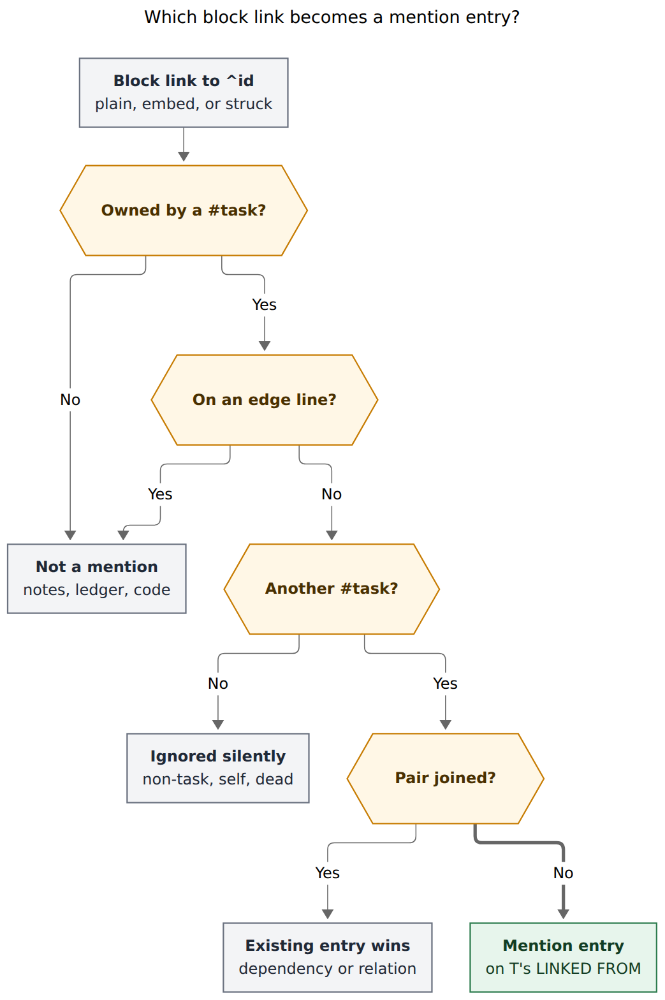
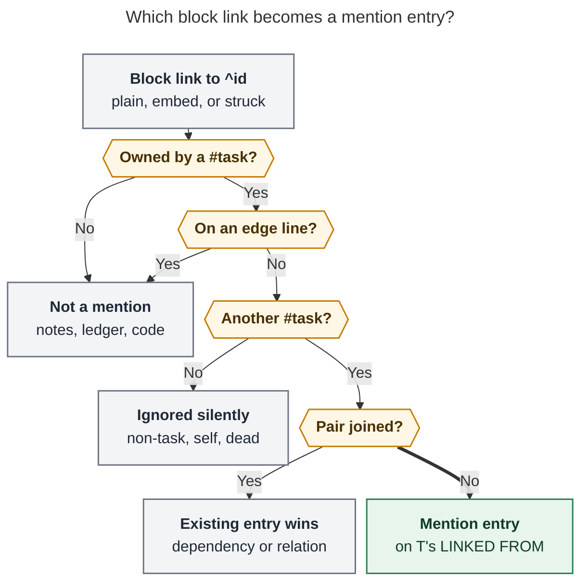

# Inline task mentions on `🪢 LINKED FROM`: consolidated design

> **Lead researcher:** consolidated report, 2026-10-29.
> **Inputs:** five independent reports in this directory (`__cdx`, `__cld`, `__grk`, `__mus`,
> `__gem`), plus my own checks. I checked code in bob-cli `48253b7f` and bob-plugins `68db3fb`.
> I ran a read-only survey of `~/bob` (6,508 notes; script kept outside the vault). I also
> probed the shipped ledger-tools relation parser.
> **Scope:** research only. No code, config, vault, or memory file was changed.

## Bottom line

**Build it, but as a *mention*, not as an authored relation.** Store each mention on the
target's existing `🪢 **LINKED FROM:**` line as `[[S]] (💬 mentions)`. Never write anything on
the referencing task except a silent `^id` mint. In the plugin, render each mention with an
always-visible `💬 mentioned in` (or `💬 embedded in`) pill. Where the surrounding sentence adds
meaning, add a one-line quote of it with the link highlighted. Clicking jumps to the mention.
There is no × that could edit someone else's prose.

The request is right about the hole and right about the asymmetry. It needs eight explicit
adjustments (§4). The most important are:

- What counts is a task's whole own text (its title plus non-edge child bullets), not just the
  title line.
- **Struck and embedded links count.** Four of the five reports would have excluded struck
  links, which would make entries disappear whenever their target closes.
- A dependency or labelled relation on the same pair wins, so the pair gets one entry.
- The feature needs a decision record before code, because it reverses
  `docs/task-relations.md` §14 ("hand-written `Merged into` / `See` bullets are not adopted").
  It also reverses the earlier relation research, which listed "auto-relating from mentions" as
  a rejected alternative.

On today's vault this writes **64 entries on 61 tasks and mints 9 ids**. The highest fan-in is
3. A full scan only has to read 217 notes (0.9 MB).

---

## 1. Is this a good idea?

**Yes, with conditions.**

**Why it is worth doing**

- **The gap is real.** Obsidian's Backlinks pane works per note, and for task notes it is
  flooded by Pomodoro ledger links. Nothing answers "which *tasks* talk about this task?"
  ([Obsidian Backlinks](https://obsidian.md/help/plugins/backlinks)).
- **Bryan already writes these links by hand.** Examples include "Merged into [[…]]",
  "OBSOLETE: See [[…]]", embedded reading tasks under project tasks, and task titles that name
  other tasks. Today none of them is visible from the target.
- **Mature tools pair the two.** GitHub records a cross-reference when another issue mentions
  this one. Logseq and Obsidian show linked mentions with their context. Both keep these
  separate from deliberate links (cld, grk).
- **Most of the machinery exists.** Bob already has the generated mirror, reconcile as
  authority, a live index with an unsaved-editor overlay, chips, and a hand-edit mirror.

**What would make it a bad idea**

| Trap | Consequence | Guard (§5) |
| --- | --- | --- |
| Mentions start *doing* things | Repeats the embed-implies-dependency failure behind `decisions:task-deps-are-depends-on-links` | Mentions are inert. A mention is never a closing label and never feeds a lane, the walk, a Task Link, cancel, or complete. |
| Counting every block link | The vault has ~26k block links; ~25k are outside task trees and 849 are Pomodoro Task Links (grk) | Only links owned by a `#task` count, outside edge lines. The ledger is excluded by construction. |
| Looking like a relation Bryan authored | Defeats "make it clear why it is shown" | A text pill that is always visible, plus the source sentence. Colour stays status-only. |
| A remove control on a derived row | × would have to edit S's prose or silently fail | No ×. Clicking jumps to the text, which is the only place to change it. |
| Entries flicker with lifecycle | Violates "relations are history" (§2 of the contract) | Count struck links (§3, finding F1). Precedence is independent of task status. |

**Verdict.** Ship it as a mention: inert, derived, explained, and filtered to task prose. The
earlier rejection of auto-relating from mentions was about inferring edges that *do* something
and about writing authored LINKS. This design does neither. It is still a policy change, so it
needs its own decision record.

## 2. Facts that shape the design

These facts were verified in code or data. Items marked **new** were not established by any
single report.

| # | Fact | Evidence | Consequence |
| --- | --- | --- | --- |
| F1 **new** | When a task closes, the status cycler rewrites `![[…#^t]]` embeds anywhere under a `#task` ancestor into `~~[[…#^t]]~~`. Reopening restores the embed. | `task-status-cycler/src/080-dependencies.js` `retireClosedTaskReferencesInText` / `restoreReopenedTaskReferencesInText`; `070-block-links.js` `buildRetiredBlockLinkEdit` | A struck sole link under a task is usually a *closed embedded sub-task*, not withdrawn text. Excluding struck links would drop the entry when T closes and restore it when T reopens. |
| F2 | 23 of the 64 day-one entries are struck-only sole-link bullets, and 21 more are live embeds | My scan, matching cld's totals exactly | 44 of 64 entries come from the embed lifecycle. |
| F3 | A Bob relation label may contain `💬`; only ``[ ] ( ) " \ | • * ~`` and control characters are forbidden | `src/native/task_relations/label.rs` `FORBIDDEN_CHARS`; JS probe | `(💬 mentions)` parses as a valid label in today's Rust and JS. |
| F4 | JS probe: `[[#^x]] (💬 mentions)` → accepted. `[[#^x]] [in task text]` → **malformed**. `💬 **MENTIONED IN:** …` → not a line. | `parseTaskRelationLine` from the shipped ledger-tools `main.js` | cdx's bracket suffix would make old engines freeze the whole mirror row (malformed rows are left untouched). A new line type is invisible to every existing guard. |
| F5 | The Rust label catalog counts only accepted **LINKS** entries | `src/native/relation_labels/scan.rs` | A reserved label on LINKED FROM cannot leak into suggestions, counts, or the hide list. That concern from grk and mus is much smaller than they claimed. |
| F6 | Chips decorate only an **existing** stored row. Live Preview replaces the text of an existing relation line; Reading view decorates an existing `li`. | `bob-ledger-tools/src/278-plugin-relation-model.js`, `282-plugin-relation-render.js` | A first mention on a target with no row is invisible until something writes the row (§5.6). |
| F7 | LINKED FROM × calls `removeLink(S, T)` against S's LINKS line | `278-plugin-relation-model.js` `relationRemoveLink` | Mention entries need different controls. |
| F8 | Rust discovery is gated on `contents.contains("LINKS")` in both `collect_file_edges` and the archive loader | `src/native/task_status_hooks/relations.rs` lines 59, 131, 288, 290 | The prefilters must widen. Only 217 notes contain both `#task` and `#^` (0.9 MB). `done/` is 30 files, 546 KB, and 17 of those notes are candidates. Scan cost is not a reason to drop archives (contra gem). |
| F9 | Managed child lines form a closed registry. Every engine's Task Link, tree-close, and strike/restore parser must reject every other row. | `docs/task-dependencies.md` §2.4 | A new `MENTIONED IN` line needs a new row plus guards in all five engines. The existing LINKED FROM line is already covered. |
| F10 | `duplicate of` and `superseded by` are configured **cancel** labels; `merged into` is commented out | `docs/task-relations.md` CL2 and the chezmoi config | A "make it a relation" shortcut must never prefill a closing label from prose like "Duplicate of [[…]]". |

**Vault survey** (task targets, `_conflicts/`, `.obsidian/`, and templates excluded):

| Measure | Count |
| --- | ---: |
| Distinct (S, T) pairs where a `#task`'s own text links another `#task` | 119 |
| … with a writable target (not `done/`) | 84 |
| … listable day one (S has an id, or S is active and mintable) | **64**, on 61 targets |
| Active sources needing a silent mint | 9 |
| Lost: source in `done/` without an id | 20 (mostly the 2026-10-19 "Merged into" cancels) |
| Listable by site: sole-link child / prose child / task title | 39 / 16 / 9 |
| Listable by form: struck-only / embed / plain | 23 / 21 / 20 |
| Listable targets that are `^ref` reading tasks | 38 |
| Listable pairs that are also a dependency (either direction) / also on LINKS | 2 / 0 |
| Fan-in | 59 × 1, 1 × 2, 1 × 3 |
| Candidate links whose owner sits under `## Pomodoros` | 0 |

grk counted 95 edges because it dropped struck links. cld's numbers and mine agree.

## 3. Where the researchers disagreed and how I resolved it

| Question | Positions | Resolution | Deciding evidence |
| --- | --- | --- | --- |
| **Which line holds mentions** | Same LINKED FROM line: cdx (new `[in task text]` suffix), cld (`(💬 mentions)` label), gem (`(mentioned in)` label). New line: grk (`🪢 MENTIONED IN`), mus (`💬 MENTIONED IN`). | **Same line, reserved label `(💬 mentions)`.** | It is what Bryan asked for. Every engine already guards LINKED FROM (F9). Old parsers read it as English and don't mark it malformed (F3, F4). It does not pollute the catalog (F5). grk's claim that it "wrecks LR11" is wrong: the projection stays a pure function of source text, so deleting every mirror and reconciling still rebuilds identical bytes. |
| Label wording | gem `(mentioned in)` | **`(💬 mentions)`** | LINKED FROM labels are phrased from the source's side (`[[S]] (follow-up of)` means "S is a follow-up of this"). So `[[S]] (mentioned in)` would read "S is mentioned in this", which is backwards. |
| Source scope | cdx: title line only. Others: title plus child bullets. | **Title plus non-edge descendants, owned by the nearest `#task`** | Title-only keeps 9 of 64 entries and loses every "Merged into" / "OBSOLETE: See" / embedded sub-task. |
| Struck links | cld counts them; cdx, grk, mus, gem drop them | **Count them** | F1 and F2. |
| Embeds | cdx drops; grk drops whole-title embeds but keeps child embeds; cld and mus keep | **Keep. Skip only a task whose whole description is one embed (a proxy row).** | Child embeds are sub-task inclusions; tree close already propagates through them. Proxy rows (8 pairs, all in `sase_blog_blockers.md`) *are* the other task, shown in a second place. |
| Log entries (Cancel, Work, Schedule, Rotten) | cld counts; grk, mus, gem exclude | **Count them; they are Bryan's prose** | They hold prompted reasons and copied work notes. Today they hold 3 task links and no day-one entry of their own. Reopen if fan-in from logs appears. |
| Dedup with relations | cdx: merge with an "also in task text" badge. cld, grk, gem: the relation wins. | **The relation wins in storage; the chip shows a subtle "also mentioned" marker** | This gives cdx's UX without cdx's grammar. Removing the relation makes the mention entry reappear on its own. |
| Dedup with dependencies | cld, grk, gem: suppress either direction | **Suppress either direction, whatever the status** | Stable under close and reopen. 2 pairs today. |
| Minting source ids | mus: never mint. Others: guarded mint. | **Guarded silent mint, same as LINKS** | Never minting makes visibility depend on an accident ("why does this one show?") and drops 9 entries. It is the same cost Bryan already accepts for LINKS and BLOCKS. |
| `done/` sources | gem excludes for performance; others include read-only | **Include read-only** | F8: the cost is negligible. |
| Warnings for prose | grk adds warning kinds; cld and mus stay silent | **Silent** | About 163 non-task block links already sit in task prose (cld). Obsidian already flags dead links. |
| Getting a first row on screen | cdx and cld: virtual "ghost" row. cld P4: cursor-leave courtesy write. grk and mus: reconcile only. | **Cursor-leave courtesy write in v1; ghost row deferred** | F6. The courtesy write reuses the existing LINKS hand-edit mirror (`594a`/`595`) and keeps one render path. A ghost row needs a new CodeMirror state field for block widgets plus a Reading-view insertion path ([Obsidian decorations](https://docs.obsidian.md/Plugins/Editor/Decorations)). |
| Quote visibility | grk: always visible. cld: hover card. cdx: a click popover with an accessible equivalent. | **Always-visible one-line quote when it adds information, plus a hover/focus/click card** | The pill answers *what kind* without interaction. The quote answers *why* for prose mentions. The card stays reachable by keyboard and touch ([WCAG 1.4.13](https://www.w3.org/WAI/WCAG22/Understanding/content-on-hover-or-focus.html)). |
| Badge colour | gem: accent or violet badge with an accent left border | **No new colour** | Contract §10: "Colour carries status, never direction." Text, italics, and the 💬 glyph carry provenance ([WCAG 1.4.1](https://www.w3.org/WAI/WCAG22/Understanding/use-of-color.html)). |
| Ship order | gem: CLI first. Others: readers or plugins first. | **Plugins first, CLI writer dark, then flip the config** | An old plugin draws unknown stored entries as dashed "No longer links here". |

## 4. Requirement adjustments

| # | Requirement | Adjusted to | Why |
| --- | --- | --- | --- |
| R1 **[KEPT]** | No "linked to" bullet on the referencing task | Nothing is written on S except a silent `^id` mint | The inline link already is the forward edge. A LINKS entry would create a second source of truth. |
| R2 **[ADJUSTED]** | Auto-add "linked from" **bullets** | Add **entries** to the one existing `🪢 LINKED FROM` line | One line per task, and the existing slot rule. One bullet per source was already rejected for relations, because bare-link rows are what the Task Link and strike recognisers claim. |
| R3 **[ADJUSTED]** | An inline "linked from task **relation**" | A **task mention**: a new glossary term, shown on LINKED FROM, that is not a relation (no label, no gestures, inert) | Otherwise it inherits machinery it must not inherit: closing labels, × semantics, the label catalog. |
| R4 **[ADJUSTED]** | Links "by other tasks" | Block links in a `#task`'s own text: its title plus non-edge descendants, owned by the nearest `#task` | Where Bryan actually writes these (§2). |
| R5 **[ADDED]** | Which links count | Plain, aliased, **embedded, and struck** links count. Code, comments, Dataview fields, headings, note links, and non-task blocks are ignored silently. | F1 and F2: lifecycle stability. Silence for prose. |
| R6 **[ADDED]** | Duplicates | One entry per (S, T). Dependency (either direction) beats relation, which beats mention. | No redundant chip for a pair already joined. |
| R7 **[ADJUSTED]** | Make the reason very clear | Three layers: an always-visible pill; a quote where the sentence adds meaning; a context card with location and a jump. The stored text also reads as English. | Has to survive vim, agents, touch, and keyboard. |
| R8 **[ADDED]** | Governance and reliability | Decision record first. Contract §19 with shared vectors. Kill switch `relations.linked_from_mentions`. Reconcile stays the authority. Never prune on uncertainty. | It reverses §14 and the earlier rejection. |

## 5. Design

### 5.1 What counts as a mention



*Figure 1. A block link becomes a mention entry only if all of these hold:*

- *Its nearest `#task` ancestor is a task other than the target.*
- *It does not sit on an edge line (Depends-On, BLOCKS, Sub-projects, LINKS, LINKED FROM) or in
  code.*
- *The pair is not already joined by a dependency or a labelled relation.*

*Notes, the Pomodoro ledger, and non-task targets never produce one. Rendered 695 × 1046 px;
fit 85.4% (Mermaid CLI 12.0.0, PDF-mirroring config). Source: `mention-eligibility__final.mmd`.*

**Rules**, which both engines must agree on through shared vectors:

1. **Owner.** Walk up from the link's line to the nearest `#task` list item; the title line
   counts as its own owner. A nested `#task` owns its own subtree. If there is no `#task`
   ancestor, the link is not a mention. That excludes note prose, headings, and the Pomodoro
   ledger, because Pomodoros are not `#task` lines. Still pin a ledger vector.
2. **Edge lines.** Depends-On, BLOCKS, Sub-projects, LINKS, and LINKED FROM, and their
   subtrees, are never sources; each already has its own rule. This also prevents feedback
   loops: T's mirror naming S must not count as T mentioning S. Entries under the Cancel,
   Schedule, Work, and Rotten Log headers **do** count.
3. **Spans.** Ignore fenced and inline code, `%%…%%` comments, inline Dataview field values,
   and blockquoted lines. Reuse the shared `block_link_spans` scanner and its JS twin.
4. **Target.** The link must resolve, through the existing relation resolver, to a `#task`
   line carrying that unique `^id`. Unresolved links, duplicate ids, non-task blocks
   (`^h-…` highlights), heading links, and self-links are ignored with **no warning**.
5. **Forms.** Plain, aliased, `![[…]]`, and `~~[[…]]~~` all count. The live index records a
   display kind:
   - `embed`: a `![[…]]` link, or an exact-struck sole link under a task, which is the same
     rule the cycler uses to restore an embed.
   - `mention`: everything else.
6. **Proxy rows.** Skip a task whose description, after the checkbox, `#task`, fields, and
   `^id`, is exactly one embed (`- [x] #task ![[other#^id]]`).

### 5.2 Storage

```markdown
- [-] #task Add support for hidden, superseded memory strands! [cancelled:: 2026-08-30] ^old-supersede
	- OBSOLETE: See [[#^supersede]]!
- [x] #task Launch ~~epic~~ tale to make superseding better! [completion:: 2026-09-02] ^supersede
	- 🪢 **LINKED FROM:** [[bob#^capture-star]] (follow-up of) • [[#^old-supersede]] (💬 mentions)
```

(The second pair is real, from `sase_memory_webs.md`; the `follow-up of` entry is
illustrative.)

- **Grammar unchanged.** A mention is `<link> (💬 mentions)` in the existing
  `<link>[' (' <label> ')']` mirror slot. It reads "S mentions this".
- **Reserved, not authored.**
  - On LINKS, a label whose first code point is `💬` breaks the character rules. It is
    malformed, left untouched, and warned about.
  - Every authored writer refuses it with "💬 is reserved for text mentions": capture `|`/`||`,
    the Links and Linked-from stages, `bob relations rename/hide/reverse`, and
    `cancel_labels`/`complete_labels` validation.
  - In memory, provenance is a typed `kind` field. The label spelling is only how it is
    serialised, so the live index never exposes `💬 mentions` as a label (F5 covers the Rust
    side).
- **Order.** Keep the existing canonical BK21 sort; don't group in storage. Grouping happens
  only in the chips. That avoids changing a comparator both engines and every delta planner
  share, and each entry is still self-describing in plain text.
- **No stored excerpts.** Quotes are live only. Copying prose across notes would churn, go
  stale, and conflict on merge (cdx, mus).

### 5.3 Identity, precedence, minting, lifecycle

- **Identity is (S, T)** by vault path plus block id. Several mentions of T in S collapse to
  one entry; the card says "mentioned 2× in this task". A → B and B → A are independent.
- **Precedence.** If a dependency joins the pair in either direction, store nothing; T's
  Depends-On or BLOCKS line already names S. If S has a LINKS entry to T, store the relation
  entry with its label. Otherwise store the mention.
- **Minting.** An active id-less source gets a silent mint (`mint_block_id`) in the reconcile
  pass or courtesy write that first needs it, under the existing quiet-deferral rule (LR5).
  Sources in `done/` or the previous daily note are never minted; if they have no id they are
  not listed. Dry runs and rendering mint nothing. `linked_from_lines: false` or
  `linked_from_mentions: false` mints nothing for mentions.
- **Lifecycle.** Closing, cancelling, reopening, or archiving either end changes nothing; the
  embed↔strike retirement is the same mention (F1). Deleting the link removes the entry. Moves
  and renames rely on generic link rebasing. Never prune on uncertainty: an unparseable source
  tree, an unclosed fence, duplicate ids, or a cold cache keeps existing entries naming S and
  adds none.
- **Inertness.** Every guarantee in contract §2 and LR18 carries over word for word. A mention
  can never be a closing label and never feeds status, lanes, `[fresh::]`, the `]s` walk, the
  plan budget, successor offers, or Task Link logic.

### 5.4 Visual design

**Row anatomy** in Live Preview and Reading view, plugin present:

```text
☑ Launch epic tale to make superseding better!
  🪢 LINKED FROM  followed up by (○ Fix flaky capture retries   ↗ bob)
                  ┈┈┈┈┈┈┈┈┈┈┈┈┈┈┈┈┈┈┈┈┈┈┈┈┈┈┈┈┈┈┈┈┈┈┈┈┈┈┈┈┈┈┈┈┈
                  💬 mentioned in (⊘ Add support for hidden, superseded mem…)
                     ▏“OBSOLETE: See ⟦this task⟧!”
                  💬 embedded in  (☑ Read sase_sites_platform!   ↗ sase_sites)
```

| Element | Treatment | Why |
| --- | --- | --- |
| **Grouping** | Relations first, then a hairline dotted divider (`var(--background-modifier-border)`), then mentions. One mention per visual row, like labelled relation rows today. | You can see "deliberate" vs "derived" at a glance. |
| **Pill** | `💬 mentioned in` or `💬 embedded in` in the existing muted small-caps `.bob-relation-pill`, plus `.is-mention` for italics | Text carries provenance. Italic is the convention for reported speech. No new colour. |
| **Chip** | The unchanged `bob-dep-chip`: status mini-checkbox, ~40-character title, `↗ note` when cross-note, `#hide` muted, closed dimmed and never struck | One chip family across dependencies, relations, and mentions. Colour = status. |
| **Quote line** | Shown only when the link sits in a child bullet or log entry with text beyond the link (16 of 64 entries today). One muted line with a 2 px left rule. The link becomes its alias, or else **this task**, highlighted with `--text-highlight-bg`. Middle ellipsis keeps the token visible. | Shows the *why* at a glance where it matters. Sole-link and title mentions get no quote, because the chip already says it all. |
| **Context card** | Opens on hover, keyboard focus, or a click on the pill. Header "💬 Mentioned in another task's text · not a relation". Shows S, the full excerpt (±60 characters) with the token highlighted, the location (*task title*, *note under the task*, *Cancel Log*, *Work Log*, *embedded as a sub-task*), the count, and **↵ Open at the mention**. Escape dismisses it and returns focus. | Hover-only explanations fail touch and keyboard (WCAG 1.4.13). |
| **Click** | Opens S at the mention's line and column with a brief flash; Mod-click opens a new pane | The fix for a mention lives in that text, so that is where the click lands. |
| **Controls** | **No ×** on a mention chip. Ctrl+D and stage remove are refused with `💬 This comes from a link in ‹S›'s text · edit it there (↵ opens it)`. | Never edit another task's prose from a derived row. |
| **Mixed pair** | The relation chip keeps its label and ×, plus a small muted trailing `💬` ("also mentioned in its text"). × removes only the relation, with the notice `Unlinked ‹S› · it still mentions this task in its text`. The entry then becomes a mention. | Honest about what remains. |
| **Density** | The existing LC9 collapse (three or more closed → `✓×N`) applies per group. More than five open mentions show five plus "+N more". | Max fan-in is 3 today; this only guards growth on popular `^prj` or `^ref` tasks. |
| **Stale** | A stored mention no longer live gets the existing dashed style: `No longer mentioned here · refreshes on the next reconcile` | Same honesty rule as relations. |
| **Embed echo (new)** | When a LINKED FROM row renders inside a transclusion hosted by the entry's own source S, hide that entry, and hide the row if nothing else is left | 21 day-one entries are live embeds. A list-item embed normally renders its children, so the parent would show "💬 embedded in ‹the task you are reading›" inside its own embed. This needs checking in real Obsidian. |
| **Without the plugin** | `🪢 LINKED FROM: ^old-supersede (💬 mentions)` | It is still English. |

The row tooltip becomes "Tasks linking here · relations and 💬 text mentions · live". The
hand-edit notice becomes "🪢 LINKED FROM is generated from LINKS lines and links in other
tasks' text".

### 5.5 Task Card and stages

- **Count.** The `Linked from…` row reads `3 · 1 relation · 2 💬`. It counts unique source
  tasks.
- **Linked-from stage, CURRENT rows.**
  - Mention rows carry the 💬 pill, with the excerpt as subtitle. ↵ opens the mention. Toggling
    is refused with the notice above.
  - The footer hints follow the selected row's kind.
- **Later, "Make it a relation…".**
  - ⇧↵ opens S's Links stage prefilled with T. After commit, the pair becomes a relation (§5.3
    precedence) and the prose stays.
  - The label is prefilled only from non-closing labels. "Duplicate of [[…]]" must never prefill
    `duplicate of`, because committing a configured cancel label cancels S (F10).

### 5.6 Getting it on screen quickly

| Path | Trigger | Latency | Writes |
| --- | --- | --- | --- |
| **Live index** (ledger-tools) | Any edit, including unsaved editor text | Instant | None. Updates chips on an **existing** row (F6). |
| **Courtesy write** (nav; generalises `594a-relation-hand-edit.js` and `595-relation-follow-ups.js`) | The cursor leaves the owning task's subtree and its mention set changed; undo re-arms it as today | Seconds | The new mention set for that task is diffed against the last one, and each change is written to its target's LINKED FROM line. Same note: one transaction and one undo. Cross-note: best-effort follow-up, reporting `· 🪢 LINKED FROM not updated` on failure. Mints S if needed. |
| **Capture** | A captured item whose text contains `[[n#^id]]` to a task | At commit | T's mirror joins the staged batch, as `~` already does. Mac Capture stays a thin client. |
| **Reconcile** (bob-cli, Mac cron every 15 min) | Vim, agent, and sync edits; any failed courtesy write | ≤ 15 min | The authority: projects, mints, repairs, and removes. |

This writes only when the *set* of task links in a task's text changes, not on every
keystroke. Today that is rare: 119 pairs built up over months. The live index never waits for
a write. A ghost row stays as a fallback, used only if courtesy writes turn out unreliable in
practice.

### 5.7 bob-cli changes

- **Scanner.** `task_relations/mentions.rs` walks owner subtrees and applies the §5.1 rules
  with `block_link_spans`.
- **Prefilters.** Widen to `#task` ∧ `#^` in `collect_file_edges` and `load_relation_archives`
  (F8).
- **Projection.** `mirror(T) = sort_canonical(relation_edges(T) ∪ {(S, 💬 mentions) : S
  mentions T, no dependency joins (S,T), and no relation (S→T)})`.
  `reconcile_relation_lines` is unchanged in structure; owners gain mention targets.
- **Guarded output.** Reuse the existing guards: 2 s quiet interval, preimages, recovery
  snapshots, and dependency-ordered writes, so no mirror ever names an id that failed to
  land.
- **Config.** `relations.linked_from_mentions: true|false`. `false` removes only `(💬 mentions)`
  entries and mints nothing for mentions, so it is lossless. `linked_from_lines: false` still
  removes everything.
- **JSON** (additive; `schema_version` unchanged). `linked_from_line_updates[]` rows gain
  `mentions_added` and `mentions_removed`. Minted-id rows gain `reason: "mention"`. Add a
  top-level `mention_edges` count. There are no new warning kinds for prose.
- **Reserved-label guards** in capture, `bob relations`, and config validation.

### 5.8 bob-plugins changes

- **ledger-tools index.**
  - Collect mention edges per file using the same prefilter, with
    `{kind: "mention"|"embed", excerpt, line, ch, site, count}`.
  - Keep `api.relationIndex` v1 `incoming()` and `outgoing()` returning **relations only**, so
    no old consumer offers a remove it cannot perform (cdx).
  - Add a v2 method returning typed incoming rows under the same generation, and exclude
    mentions from `labelSuggestions`.
- **Chip model, widget, Reading renderer, and CSS.** The pill, the grouping divider, the quote
  line, the context card, embed-echo suppression, and the mixed-pair marker.
- **nav.**
  - The courtesy-write generalisation, the Linked-from stage CURRENT rows, the Ctrl+D refusal,
    and the Task Card count.
  - Refuse the reserved label in label fields, and update the generated-line notice.
- **Cycler and block-id-prompt.** No change: LINKED FROM is already in their guard sets. This
  is the main payoff of reusing the line.

### 5.9 Documentation and governance

- A **decision record**, for example *"Inline task links mirror onto LINKED FROM as inert
  mentions"*. It partly supersedes contract §14's "not adopted" line and the earlier research's
  rejected alternative. Write it through `/sase_memory_write`.
- **Contract.** Add `docs/task-relations.md` §19 "Text mentions" with an MN vector family.
  Amend §1 (vocabulary), §6 (projection), §10 (chips), §11 (index v2), §12 (config and JSON),
  and §14. Copy the vectors into the Rust and JS tests.
- **Glossary.** Add a **Task Mention** term, and update **Task Relation** and **Task Link**.
  These are memory edits and go through `/sase_memory_write`.
- **Guide.** A short "See which tasks mention a task" page next to
  `docs/guides/link-related-tasks.md`.

## 6. Alternatives rejected

| Option | Why not |
| --- | --- |
| Auto-write LINKS on S ("adopt" mentions) | Bryan ruled it out. It creates two sources of truth that drift whenever the prose changes, and it is a stronger claim than the prose makes. |
| Separate `MENTIONED IN` line (grk, mus) | A closed-registry addition plus guards in five engines (F9). A third generated child under busy tasks. It departs from the request. It is the clearest fallback if a usability check shows the merged row confuses Bryan. |
| New suffix grammar `[in task text]` (cdx) | Old engines read it as malformed (F4) and then freeze the whole mirror row for that target. |
| `(mentioned in)` label (gem) | Reads backwards (§3). Its proposed accent colour breaks the status-only colour rule. |
| Render-only, nothing stored | Invisible to vim, `rg`, agents, and mobile. The earlier decision already rejected render-only mirrors. It survives as the live layer. |
| Title line only (cdx v1) | Loses 55 of 64 entries. |
| Excluding struck links | Entries would flicker with the target's status (F1). |
| Inferring labels from prose ("Merged into" → `merged into`) | Fragile, and could fire closing labels (F10). Use it at most to prefill "Make it a relation…" with non-closing labels. |
| Per-keystroke courtesy writes | Cross-note churn and undo surprises. The live overlay already covers the time before the cursor leaves. |
| Including Pomodoro Task Links or note-level links | That is "linked from today" or Obsidian Backlinks: the noise this line was designed to exclude. |

## 7. Acceptance vectors (MN family, condensed)

| # | Situation | Outcome |
| --- | --- | --- |
| MN1 | S's title contains `[[#^t]]`; T is a `#task` | T gains `[[#^s]] (💬 mentions)`; S gains nothing except a possible `^id` |
| MN2 | S's child `Merged into [[n#^t]]` | Same, in cross-note form |
| MN3 | The link sits under a nested `#task` beneath S | The nested task is the source |
| MN4 | The link is on an edge line of S, or on T's own LINKED FROM line | No mention, and no feedback loop |
| MN5 | The link is in a Pomodoro child, a heading, plain note prose, code, `%%…%%`, or `[k:: …]` | No mention |
| MN6 | The target is `^h-…`, a heading, unresolved, a duplicate id, or S itself | No mention and no warning |
| MN7 | `- ![[n#^t]]` under S; T closes, so the cycler writes `~~[[n#^t]]~~`; T reopens | One entry throughout, with chip kind `embed`; zero mirror bytes change |
| MN8 | S has `🪢 LINKS: duplicate of [[T]]` and a Cancel Log `🪢 duplicate of [[T]]` | One `(duplicate of)` entry |
| MN9 | S depends on T, or T depends on S, and S mentions T (the real `cash` pair) | No mention entry |
| MN10 | S mentions T twice | One entry; the card says 2× |
| MN11 / MN12 | The source is active and id-less / in `done/` and id-less | Minted and listed / not listed, with no write to `done/` |
| MN13 | `linked_from_mentions: false`, then `true` | Only mention entries are removed, then rebuilt byte-identically |
| MN14 | Delete every LINKED FROM line and reconcile twice | Identical bytes; the second run changes nothing (LR11 still holds) |
| MN15 | A `💬…` label through capture, the stages, rename, or the closing-label config | Refused with the reserved-label message |
| MN16 | A pre-feature parser reads `(💬 mentions)` | Accepted as a labelled entry |
| MN17 | Any mention add or remove | Every status, lane, field, Pomodoro section, Depends-On, and BLOCKS line is byte-identical except a minted `^id` |
| MN18 | A mention is typed and the cursor leaves the task's subtree | T's row exists within seconds; the live chip showed before that, if the row already existed |
| MN19 | Click on, and Ctrl+D on, a mention chip | Opens S at the mention / refused with the notice |
| MN20 | T is embedded under S, and S's note is open | The embedded T shows no "embedded in S" echo |
| MN21 | A proxy row `- [x] #task ![[n#^t]]` | No mention |
| MN22 | Rust and JS on every vector, with Unicode text before the link | Agreement, including highlight offsets (UTF-16 in JS vs bytes in Rust, cdx) |

## 8. Rollout

| Phase | Repo | Scope |
| --- | --- | --- |
| P0 Decision | bob-cli docs and memory | Decision record, §19 and MN vectors, glossary |
| P1 Live view | bob-plugins | Mention index (v2 API), chips, quote, card, embed echo, Task Card and stage rows, refusals, courtesy write |
| P2 Stored mirror | bob-cli | Scanner, projection and precedence, widened prefilters, reserved-label guards, JSON, `linked_from_mentions` **defaulting to false** |
| P3 Flip | chezmoi | Set `relations.linked_from_mentions: true` once every host has P1 synced and the Mac runs P2. Watch one day of reconcile output, then flip the default in a later release train. |
| P4 Polish | both | "Make it a relation…", source-side mention pills (render S's inline task link as a status pill), and an optional previewed one-shot id backfill for the 20 archived sources |

P1 and P2 can be built in parallel but must ship in this order. Otherwise an old reconcile
strips entries a new one adds, and an old plugin draws them dashed. Releases follow the daily
train; agents never edit the version or the changelog.

## 9. Risks and reopen triggers

- **Noise growth.** If one target collects more than 10 open mentions, or log entries start
  driving fan-in, revisit the scope (logs first) before changing the model.
- **Unexpected mints.** If Bryan sees `^id`s appear on tasks he didn't expect, consider minting
  only on reconcile (not on cursor-leave), or the mus position (never mint).
- **Merged-row confusion.** Run a short usability check: show inline-only, explicit-only, and
  mixed examples; ask why each exists; then remove just the relation from the mixed one (cdx).
  If he can't tell, move mentions to a separate `MENTIONED IN` line. Because mentions are a
  typed kind in memory and carry a reserved spelling on disk, that migration is mechanical.
- **Courtesy-write flakiness.** If rows regularly lag, add the ghost-row layer.
- **Embed rendering.** Confirm in Obsidian that list-item embeds render child rows (MN20)
  before treating echo suppression as required.

## 10. Open questions for Bryan

1. **Glyph:** `💬` (recommended; reads as "said in"), or `✎`, or a plain-text pill?
2. **`ref/` reading tasks:** 38 of 61 day-one targets are `^ref` tasks embedded under project
   tasks. Should they carry `💬 embedded in` rows? I recommend yes: "which task commissioned
   this reading?" is useful.
3. **Archived sources without ids** (20, mostly the "Merged into" cancels): accept the loss, or
   approve a previewed one-shot backfill into `done/`?
4. **Source-side pills (P4):** in this epic, or a separate feature?

## Recommended solution

Ship **inline task mentions as reserved, inert entries on the existing `🪢 LINKED FROM` line**.

1. **The source's own text is the only authority.** A mention is a block link to another
   `#task` anywhere in a task's own text: its title, child bullets, and log entries, but never
   its edge lines. Plain, aliased, embedded, and struck forms all count; proxy rows do not.
   Nothing is written on the source except a guarded silent `^id` mint. There is never a LINKS
   entry.
2. **Stored as `[[S]] (💬 mentions)`.** It reads as English, parses in every current engine,
   and inherits every existing guard. The label is reserved against authored use and kept as a
   typed kind in memory. Canonical order is unchanged.
3. **One entry per pair.** A dependency beats a relation, which beats a mention. Mentions are
   fully inert and never closing labels.
4. **Reconcile is the authority.** The live index updates instantly. A cursor-leave courtesy
   write puts the row on disk within seconds. Mentions get their own lossless kill switch.
   Nothing is pruned on uncertainty.
5. **The row explains itself and stays beautiful.**
   - Relations, then a hairline divider, then mentions. Each mention has an always-visible
     italic `💬 mentioned in` / `💬 embedded in` pill on the unchanged status chip.
   - Prose mentions get a one-line quote with "⟦this task⟧" highlighted.
   - An accessible context card shows where the mention lives, and clicking jumps to it.
   - There is no ×. Colour still means status only, and no embedded task echoes its own host.
6. **Order of work:** decision record first; plugins live; bob writer dark; flip the config;
   polish later.

This turns Bryan's existing "Merged into", "OBSOLETE: See", embedded reading tasks, and task
titles that name other tasks into navigable back-references. He doesn't learn a new gesture,
and nothing written on one task silently changes what another task does.

---

## Sources

- **Researcher reports** (this directory):
  - `inline_task_mention_backlinks__cdx.md`: provenance model, accessibility, and API opt-in.
  - `__cld.md`: vault survey, reserved label, and phased rollout.
  - `__grk.md`: ~26k-link noise breakdown, quote treatment, and suppression; figures
    `eligibility__grk.*` and `edge-kinds__grk.*`.
  - `__mus.md`: inertness, write amplification, and the case for a separate kind.
  - `__gem.md`: Pomodoro, dependency, and × risks.
- **bob-cli `48253b7f`:**
  - `docs/task-relations.md` §§1–14, 17 (CL2).
  - `docs/task-dependencies.md` §2.4.
  - `docs/vault-git-sync.md` (Mac reconcile cron).
  - `src/native/task_relations/label.rs`.
  - `src/native/relation_labels/scan.rs`.
  - `src/native/task_status_hooks/relations.rs`.
- **bob-plugins `68db3fb`:**
  - task-status-cycler `src/070-block-links.js` and `src/080-dependencies.js` (retire and
    restore).
  - bob-ledger-tools `src/171-relation-index-lifecycle.js`, `278-plugin-relation-model.js`,
    `282-plugin-relation-render.js`, and the built `main.js` (parser probe).
  - bob-navigation-hotkeys `src/594a-relation-hand-edit.js` and `595-relation-follow-ups.js`.
- **Prior research:** `research:202610/task_relation_links/task_relation_links__final.md`
  (rejected "auto-relating from mentions"; recogniser sprawl; one bullet per link rejected).
- **SASE memory (read through `sase memory read`):** glossary `task-relation`, `task-link`,
  `task-dependency-link`, `work-log`, `rotten-log`, `schedule-log`; `sase/memory/obsidian.md`.
- **Vault:** a read-only Python scan of `~/bob` on 2026-10-29, with scripts and output kept
  outside the vault.
- **External:**
  - [Obsidian Backlinks](https://obsidian.md/help/plugins/backlinks)
  - [Obsidian internal links](https://obsidian.md/help/links)
  - [Obsidian editor decorations](https://docs.obsidian.md/Plugins/Editor/Decorations)
  - [WCAG 2.2 1.4.13 Content on Hover or Focus](https://www.w3.org/WAI/WCAG22/Understanding/content-on-hover-or-focus.html)
  - [WCAG 2.2 1.4.1 Use of Color](https://www.w3.org/WAI/WCAG22/Understanding/use-of-color.html)
  - [GitHub issue event types](https://docs.github.com/en/rest/using-the-rest-api/issue-event-types)
    (cross-referenced)

### Figure source


