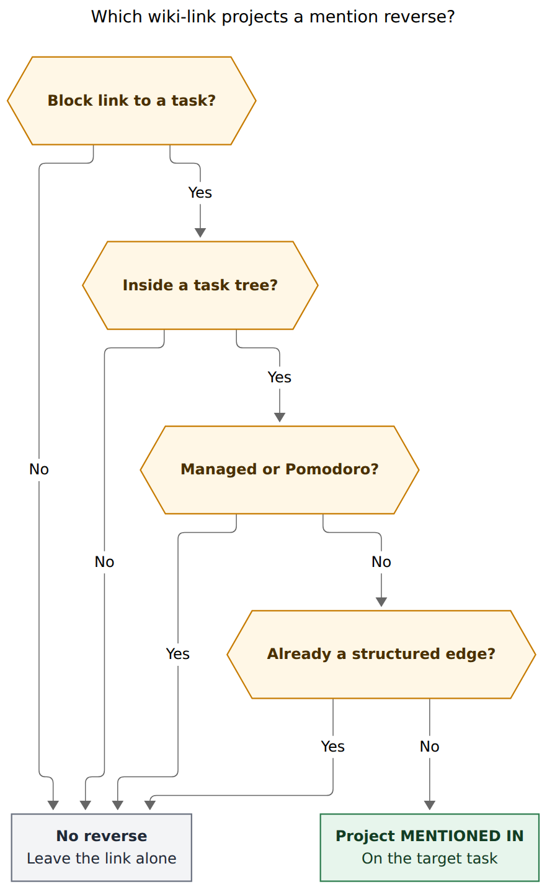
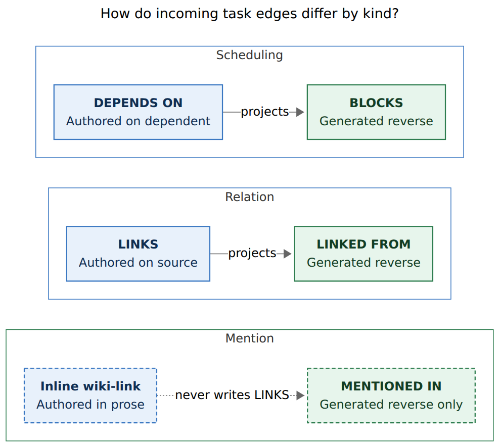
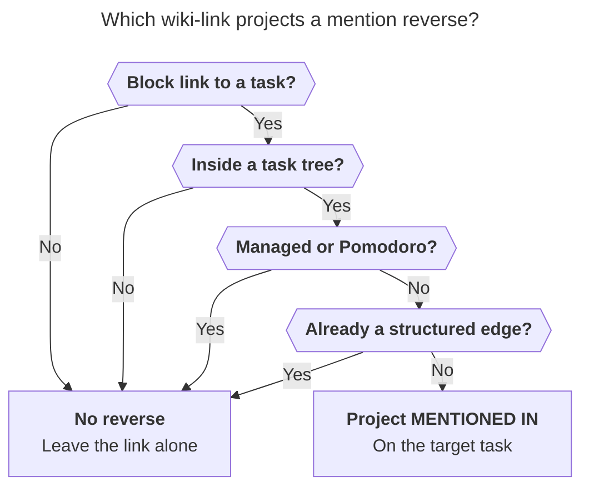
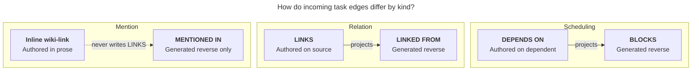

# Mention-derived reverse links for inline task wiki-links

> **Research query.** How should Bob auto-add a "linked from" bullet on a task that other tasks reference with an Obsidian block link such as `[[foo#^bar]]`, make the reason that bullet exists visually obvious, and skip a matching "linked to" bullet on the referencing task because the inline wiki-link is already the forward edge? Critique the plan, lead the design, call out justified requirement adjustments, and recommend a solution that is intuitive, reliable, and beautiful.

**Researcher.** `grk` (independent swarm report).
**Date.** 2026-10-29.
**Scope.** Research only. No code, vault, config, or memory files were changed. Vault measurements are read-only scans of `/home/bryan/bob` (6,518 Markdown notes, 4,255 `#task` lines).

---

## Bottom line

**Build it, as a third inert edge kind: a mention reverse.** The request is right about the hole and right about storage direction: the inline `[[note#^id]]` is already the authored forward edge, so the referencing task must not gain a `🪢 **LINKS:**` entry. The request is wrong about dropping that reverse onto today's unlabeled `🪢 **LINKED FROM:**` row.

Today a LINKED FROM chip means "someone used `~` / `~~` / the Task Card." A mention is a citation in prose. Mixing them makes the reverse look like a relation Bryan never authored, which is the opposite of "make it very clear why this is shown."

Recommended shape:

```markdown
- [x] #task Make sure you still have a task to find a hospital! ^find-hospital
  - See [[body#^ct-scan]]

- [?] #task Make appt w/ Rahway Hospital for CT scan! ^ct-scan
  - 🪢 **MENTIONED IN:** [[body#^find-hospital]]
```

Live Preview replaces the generated line with a chip plus a quote:

```text
🪢 mentioned in
  ‹in a note›  (✓ Make sure you still have a task to find a hospital!)
     “See [[ct-scan]]”
```

The quote is the why. The pill names the site. Clicking the quote opens the mentioning line. There is no × that rewrites the other task's prose.

This copies the BLOCKS / LINKED FROM projection pattern Bob already proved (`docs/task-relations.md` §§6–7, `docs/task-dependencies.md` §14), with one extra rule the relation system does not need: **the forward edge stays in prose.**



**Caption.** A wiki-link projects a `MENTIONED IN` reverse only when it is a task-to-task block link in prose, outside managed lines and Pomodoro Task Links, and the pair is not already joined by a relation or dependency. Rendered 587 × 954 px; fit 93.6%.

---

## Is this a good idea

**Yes.** Task-level reverse of prose mentions is a real gap, the existing projection machinery is the right home, and the vault is small enough that a stored reverse is cheap.

### The hole is real

Obsidian's Backlinks pane is per *note*. For a project note it is dominated by Pomodoro ledger links, reference embeds, and other-note citations. It cannot answer "which tasks talk about this task?" The original relations research already named this (`research:202610/task_relation_links/task_relation_links.md`): a wiki-link in a headline is one-way, mixes into the title, and has no inverse.

Bob already filled the *intentional* version of that hole with `🪢 **LINKS:**` / `🪢 **LINKED FROM:**`. Capture `~` / `~~` and Task Card `l` / `⇧L` author a directed, optionally labelled, inert edge. Reconcile projects the reverse. Chips render from a live index (`docs/task-relations.md` §§10–11). That product is for "I am relating these two tasks." It is the wrong gesture for "I named that task in this sentence."

A read-only scan of the live vault found **95 unique task-to-task prose mention edges** (92 source tasks, 78 targets) and **zero overlap** with existing LINKS edges (60). Fan-in is almost always one (66 of 78 targets; max 4). The feature would light up dozens of tasks, not thousands.

Those 95 split into three shapes that want slightly different pictures:

| Site | Count (task targets) | Typical bytes | Why the reverse exists |
| --- | ---: | --- | --- |
| Task description (plain wiki-link) | 10 | `Review [[#^epic]]!` | The title names another task |
| Task description (whole-task embed) | 8 | `- [x] #task ![[other#^id]]` | Transclusion *is* the task; skip in v1 |
| Non-managed child prose | 52 | `See [[body#^ct-scan]]`, `Merged into [[…]]`, `Use [[#^wait-for-load]] instead?!` | A note under this task cites that task |
| Dedicated child embed / link | 25 | `![[ref/…#^ref]]` | This project includes that reading task |

Forty-three of the 52 child-prose hits are the pre-relations idioms (`See`, `RELATED`, `Merged into`, `DUPLICATE`, `OBSOLETE`). The relations swarm declined to auto-adopt those as LINKS. Treating them as *citations* keeps the prose, keeps the history, and still gives the target an inverse.

### What would go wrong if the feature were naive

A second scan of the same vault found **26,409 block wiki-links**. Most are not task-to-task prose:

| Class | Count | If projected as LINKED FROM |
| --- | ---: | --- |
| Block links outside any `#task` tree | ~24,900 | Note-level backlinks; Obsidian already shows these |
| Dedicated Pomodoro Task Links | 849 (847 to tasks) | Every worked task sprouts daily-note reverse chips |
| `⛓️ DEPENDS ON` / `🧱 BLOCKS` | 138 / 98 | Duplicate of the scheduling graph |
| `🪢 LINKS` / `LINKED FROM` | 117 | Duplicate of the relation graph |
| Highlight-like `#^h-…` | 26 | Non-task block ids |
| Struck `~~[[…]]~~` | 1,031 | Historical, usually a completed Pomodoro link |

The original relations research rejected calling the reverse `BACKLINKS` for exactly this reason: for a task, "everything that points here" is mostly Pomodoro noise. Mention reverse has to be a *filtered* projection, or the feature is worse than doing nothing.

### Mature tools already split "related" from "mentioned"

| System | Intentional relation | Mention reverse | How "why" is shown |
| --- | --- | --- | --- |
| GitHub Issues | Blocking / tracked-by | Timeline "mentioned this" from `#123` in another issue or comment | Issue title only; users ask for a link to the *comment* |
| Jira | `relates to`, `blocks` | Issue-key autolink | Web link; weak context |
| Linear | Related / blocked / duplicate | None from description prose | Type label on a stored edge |
| Logseq / Roam | Page and block refs | Linked references of the block | The mentioning *block* is the UI |
| Obsidian core Backlinks | Note wiki-links | Linked mentions + unlinked mentions | Excerpt of the paragraph; "Show more context" |
| Bob today | `🪢 LINKS` / `LINKED FROM` | None | Inverse-phrase pill on a chip |

GitHub is the cautionary tale: a reverse that names the *who* without the *where* is how "mentioned this" becomes noise. Logseq, Roam, and Obsidian backlinks are the beauty target: **show the quoting sentence.** Bob already has chips for *who*; the missing piece is the quote for *why*.

### Verdict

The idea is good when it stays a **citation projection**: inert, reverse-only, quote-visible, Pomodoro-excluded, and distinct from authored relations. It is a bad idea if it silently writes LINKS, if it dumps mention chips onto LINKED FROM, or if every `[[note#^id]]` in a daily note counts.

---

## Critique of the plan as stated

### What to keep

- **Reverse-only.** The inline wiki-link is the forward edge. Do not add a `LINKS` bullet on the referencing task. That matches how BLOCKS never writes a DEPENDS ON on the prerequisite, and how LINKED FROM never writes a LINKS on the target.
- **Task-granularity.** `[[foo#^bar]]` is a block link to a task, not a note link. Note-level reverse is Obsidian's job.
- **Visible on the target without opening the other note.** That is the whole point of a stored or live reverse.
- **Beauty as a first-class requirement.** A reverse chip with no explanation will be misread as a relation Bryan forgot he created.

### Where the sketch fights the architecture Bob just shipped

**1. LINKED FROM already has a single source of truth.**
`docs/task-relations.md` §6 defines `mirror(T)` from accepted LINKS entries only. Guarantee LR11 is "delete every LINKED FROM line, reconcile once, get identical bytes." Folding mention-derived entries into that line gives the projection two sources. Reconcile then has to decide whether a leftover `(mentions)` entry is a stale citation or a hand-typed label. Chip × on LINKED FROM currently calls `removeLink(S, T)`, which edits S's LINKS line (`docs/task-relations.md` §10). Mentions have no LINKS line to edit. Cancel labels and complete labels (`§17`, `§18`) would also sit on the same row as accidental citations.

**2. "Linked from" currently means an authored relation.**
The Task Card's Linked-from stage writes *other* tasks' LINKS lines so they point here. The live tooltip is "Tasks linking here · live from the relation index." A mention is the opposite gesture: someone typed a wiki-link while writing. Reusing the same row teaches the wrong model.

**3. The why cannot live in the LINKED FROM grammar.**
A LINKED FROM entry is `<link>[' (' <label> ')']`. Labels are 1–40 characters and forbidden from containing `[]()`. A quote of `Find number you need to call to get [[cash#^call-real-id]] going!` does not fit. Stuffing `mentions` into the label catalog also pollutes `bob relations list`, hide, and rename.

**4. Immediate courtesy writes on every keystroke would churn git.**
Relation courtesy writes happen on an explicit `~` commit or a Task Card apply. A mention appears the moment someone types `]]`. The live index already overlays unsaved editor text for relations (`docs/task-relations.md` §11). Mentions should use that path for *view* and let reconcile write the stored line on the next hooks pass.

**5. Some "mentions" are already structured edges.**
Live example, `cash.md`:

```markdown
- [?] #task Find number you need to call to get [[cash#^call-real-id]] going! ^find-real-id-number
  - 🧱 **BLOCKS:** [[#^call-real-id]]
```

`call-real-id` already sees Find-number as a blocker. A second "mentioned in" chip of the same task, whose title *is* the quote, is duplicate furniture. Suppress the mention reverse when a DEPENDS ON / BLOCKS / LINKS edge already joins the pair.

### Would I take a different approach

**I would keep the product and change the storage and the picture.**

- Keep: reverse-only, task-granularity, auto-maintained, visually explained.
- Change: a sibling generated line `🪢 **MENTIONED IN:**`, live chips with site pills and quotes, Pomodoro and managed-line exclusions, structured-edge suppression, jump-to-mention instead of delete.
- Decline: auto-promoting `See [[…]]` / `Merged into` children into LINKS (the relations swarm already parked that as an opt-in follow-up, and the prose is the historical record).
- Decline: live-only with no stored line as the long-term design. Bob's rule for generated inverses is "without the plugin, the line still reads as English" (`docs/task-relations.md` §10). Mentions should obey it. Live-only is an acceptable *first slice* if the stored writer slips, not the destination.

A fully different approach — "just tell people to use `~`" — fails the vault evidence. People already write `[[foo#^bar]]` in titles and `See [[…]]` children. Asking them to duplicate that as a relation is busywork, and a labelled relation is a stronger claim than a citation.

---

## Requirement adjustments

Each row is a change I would make to the request. The original ask is in *As requested*.

- **A1 [ADJUSTED]**
  - *As requested:* Auto-add a "linked from" task relation bullet.
  - *Adjusted to:* Auto-add a generated **`🪢 **MENTIONED IN:**`** direct child on the target. It is a citation reverse, not a task relation.
  - *Why:* LINKED FROM is the projection of authored LINKS. Mentions have a different source of truth, different remove gesture, and different why. The 🪢 glyph keeps the family; the label names the kind. Readers may accept a hand-typed `CITED IN` / `REFERENCED BY` and canonicalise it.

- **A2**
  - *As requested:* Do not show a "linked to" bullet on the referencing task.
  - *Adjusted to:* **Adopted.** The inline wiki-link is the forward edge. Capture, reconcile, and nav never write a LINKS entry for a mention. Optional later: a Task Card action "Promote to relation" that *does* write LINKS, explicitly.

- **A3 [ADJUSTED]**
  - *As requested:* Make it very clear why the reverse is shown, in a visually appealing way.
  - *Adjusted to:* **A site pill plus a quote snippet in the live chip, and a line name that still reads as English in vim.** Site is `in the title` / `in a note` / `includes this`. The quote is live-only (it cannot fit the stored grammar). Clicking the quote opens the mentioning line.
  - *Why:* GitHub's "mentioned this" names the who and hides the where. Logseq/Roam/Obsidian backlinks show the quoting block. Bob already has who-chips; the quote is the missing why.

- **A4 [ADDED]**
  - *As requested:* (unstated) which wiki-links count.
  - *Adjusted to:* **A `#^` block link that resolves to a `#task`, appearing in a `#task` tree, outside managed subtrees and outside dedicated Pomodoro Task Links, excluding self, struck, fenced, and inline-code spans.** Heading links, note links without `#^`, and non-task block ids (highlights, zorg `^z-…`) never count.
  - *Why:* 849 Pomodoro Task Links and ~24,900 out-of-tree block links would drown the reverse. This is the same isolation the MC managed-child registry exists for (`docs/task-dependencies.md` §11.8).

- **A5 [ADDED]**
  - *As requested:* (unstated) overlap with existing graphs.
  - *Adjusted to:* **Suppress a mention reverse when the same pair already has a LINKS or DEPENDS ON edge in either direction.** The structured chip already names the other task; when the mention is in the title, that chip *is* the quote.
  - *Why:* The cash.md Find-number / call-real-id pair is already a blocker/dependent. A second incoming row of the same task is clutter.

- **A6 [ADDED]**
  - *As requested:* (unstated) whole-task embeds.
  - *Adjusted to:* **Skip when the task description, after stripping checkbox, `#task`, fields, and `^id`, is only `![[…]]`.** Direct-child `![[ref/…#^ref]]` embeds *do* count, with pill `‹includes this›`.
  - *Why:* `- [x] #task ![[other#^id]]` is a transclusion of the other task, not a sentence about it. A project-note child embed of a `^ref` reading task is a real "this work includes that reading."

- **A7 [ADDED]**
  - *As requested:* (unstated) editing the reverse.
  - *Adjusted to:* **The reverse is generated. Hand edits restore. There is no hover × that deletes the wiki-link in the other task.** Click / Mod-click opens the source task; click on the quote (or a ↗ control) jumps to the mentioning line. The Linked-from stage does not grow a ＋ that "adds a mention."
  - *Why:* Deleting prose in another note from a chip is the GitHub "mentioned this, and editing the comment does not remove the timeline event" failure, only worse. Mentions are created by typing; they are removed by editing that sentence.

- **A8 [ADDED]**
  - *As requested:* (unstated) when the reverse is written.
  - *Adjusted to:* **Live chips from an overlay index immediately; stored `MENTIONED IN` line from reconcile (and from a capture batch that already contains the wiki-link).** No per-keystroke courtesy write.
  - *Why:* Same honesty as LINKED FROM: the view is always live; the stored line converges by the next Bob write or hooks pass.

- **A9 [ADDED]**
  - *As requested:* (unstated) semantics.
  - *Adjusted to:* **Inert, like relations.** A mention reverse never blocks, promotes, consumes, schedules, stamps, cancels, or completes. Cancel labels and complete labels do not apply.
  - *Why:* A citation in a sentence is not a Done gesture.

- **A10 [ADDED]**
  - *As requested:* (unstated) identity of id-less sources.
  - *Adjusted to:* **Live chips key a source by vault path plus line (and block id when present). Reconcile mints a source `^id` only when writing the stored reverse on a writable note, using the same silent mint as LINKED FROM (`docs/task-relations.md` §5). Archives and the previous daily note are never minted.**
  - *Why:* 49 of the 95 mention sources currently lack a block id. Many live in `done/`. Chips should not wait on a mint; the stored grammar still needs `[[note#^id]]`.

- **A11 [ADDED]**
  - *As requested:* (unstated) kill switch.
  - *Adjusted to:* **`relations.mentioned_in_lines` (default `true`), independent of `relations.linked_from_lines`.** `false` removes every MENTIONED IN line on writable tasks, mints nothing, and leaves wiki-links and LINKS alone.
  - *Why:* Mention scan is heavier than a 🪢 prefilter. Operators who want relation mirrors without citation mirrors should have that knob.

---

## Visual design

This is the part the request asked to lead.

### One incoming family, three rows

A task with all three kinds of inbound edge should read, top to bottom, as scheduling, then authored relations, then citations:

```text
- [ ] #task Make appt w/ Rahway Hospital for CT scan! ^ct-scan
  - ⛓️ **DEPENDS ON:** [[#^rahway]]
  - 🪢 **LINKED FROM:** [[sase#^follow-up]] (follow-up of)
  - 🪢 **MENTIONED IN:** [[body#^find-hospital]]
```

Live Preview, same indent, same `bob-dep-chip` family, colour still carrying status only (`docs/task-relations.md` §10):

```text
⛓️ waiting on   (○ Make appt w/ Rahway Hospital!)          ↗ body

🪢 linked from  ‹followed up by› (○ Split the hospital note) ↗ sase

🪢 mentioned in
  ‹in a note›  (✓ Make sure you still have a task to find a hospital!)
     “See [[ct-scan]]”
```

The mention row is the only one that grows a second line. That extra line *is* the why, so it earns the height. Relation and dependency rows stay one line tall, as they do today.

### Site pills (display only, never stored as relation labels)

| Site | Pill | Quote |
| --- | --- | --- |
| Wiki-link in the source task's description | `‹in the title›` | Omitted: the chip text *is* the sentence |
| Wiki-link in a non-managed child | `‹in a note›` | The child line, ~80 characters, wiki-link in accent colour |
| Dedicated child `![[…]]` embed | `‹includes this›` | Omitted: the transclusion has no extra prose |

Pills use the existing `.bob-relation-pill` small-caps treatment (`plugins/bob-ledger-tools/styles.css`). They are not inverse phrases of a stored label, so they never enter `bob relations list`.

### Quote treatment

- Muted text, one line, ellipsis in the middle if needed so the wiki-link token stays visible.
- A 2 px left rule in `--text-muted` (blockquote, not a grey dump).
- The wiki-link inside the quote uses `--text-accent`, matching Obsidian internal links.
- Tooltip: full sentence, vault-relative path, 1-based line, "Open mention."
- `prefers-reduced-motion` already disables chip hover translate; keep that.
- Three or more closed mention chips collapse to `✓×N`, same as relations (LC9). Expanding shows quotes.

### Controls

| Control | Mention row | Why |
| --- | --- | --- |
| Click chip | Open source task | Same as relation chips |
| Click quote / ↗ | Open source note with the cursor on the wiki-link | This is the GitHub-comment-link users asked for |
| Hover preview | Existing dependency hover of the source task | Reuse `dependencyHoverTarget` |
| Hover × | Absent | Mentions are removed by editing the sentence |
| Trailing ＋ | Absent | You mention by typing `[[` |
| `Ctrl+Shift+P` on the line | Read-only "Mentioned in" current-list (no RESULTS add) | Matches "generated line" elsewhere |
| Hand edit | Notice once per burst: `🪢 MENTIONED IN is generated from wiki-links in other tasks · edit the mentioning sentence` | Parallel to the LINKED FROM notice |

Without the plugin, `🪢 **MENTIONED IN:** [[body#^find-hospital]]` is already English. The pill and quote are Progressive Enhancement; the line name carries the why for vim, git, and agents.

### Why this is more beautiful than stuffing LINKED FROM

A LINKED FROM chip with a reserved label `mentions` would look like:

```text
🪢 linked from
  ‹mentioned in› (✓ Make sure you still have a task to find a hospital!)
```

That answers *who* and a generic *kind*, and it still looks like a relation Bryan filed. It does not show *See [[ct-scan]]*. The sibling row plus quote is the smallest picture that cannot be mistaken for `~~`.



**Caption.** Dependencies, relations, and mentions each have one authored source and one generated reverse. Mentions are reverse-only: the inline wiki-link is the forward edge, and nothing writes a LINKS entry. Rendered 659 × 591 px; fit 99.1%.

---

## Recommended solution

### Model

A **task mention** is a directed, unlabelled, inert citation from source task S to target task T, authored as a plain or embedded `#^` block link in S's prose. Identity is `(S, T)`. Multiple mentions of T inside S collapse to one reverse entry; the live quote prefers the first non-struck span in document order. Self-mentions are dropped. Cycles with relations or dependencies are allowed only after A5 suppression removes the mention reverse for a pair that already has a structured edge.

This is a new glossary term, sibling to Task Relation, not a subtype of it. Task Relation stays "authored on LINKS, mirrored on LINKED FROM, optional label, `~` / `~~`." The undirected-relations work (plain link has no direction until labelled) does not apply: a mention is not an undirected relation. It is a citation whose direction is "this sentence names that task."

### Grammar (writer form)

```text
<indent>- 🪢 **MENTIONED IN:** <link> • <link> • …
<link> := [[#^id]] | [[basename#^id]] | [[dir/note#^id]]
```

- Same glyph, bold uppercase label, ` • ` join, canonical sort as LINKED FROM (BK21).
- No per-entry labels on disk. Site and quote are live-only.
- Empty list deletes the line; no placeholder.
- Slot: after the LINKED FROM subtree when one exists, otherwise in the LINKED FROM slot (so inbound rows stay together).
- Reader tolerance: missing glyph or `🔗`; label `CITED IN` / `REFERENCED BY` / `MENTIONS`; separators `·` / `,` / whitespace.
- Malformed: trailing prose, half-typed link, heading link, separators only. Leave the line, warn `malformed_mentioned_in_line`, never insert a second line beside it.
- Cross-parse: Depends-On, BLOCKS, LINKS, LINKED FROM, and MENTIONED IN each return not-a-line for the others (extend LK19 / MC15).

### Scan (what counts)

Walk each `#task` tree. Collect `block_link_spans` (already shared: aliases, `!`, `~~`, inline code ignored — `src/native/task_dependencies/mod.rs`) from:

1. The task line itself, after the list marker and checkbox.
2. Every descendant line that is not inside a managed subtree: Cancel Log, Depends-On, BLOCKS, Sub-projects, LINKS, LINKED FROM, MENTIONED IN, Schedule Log, Work Log, Rotten Log.
3. Never from dedicated Pomodoro Task Links (the plan.md P-vector shape: the list-item body is exactly one block link, optionally 🍅 / `#` / embed / strike, under `## Pomodoros`).

Then:

- Resolve the link with the same `canonical_link` / `getFirstLinkpathDest` rules as relations.
- Keep only targets that are `#task` lines.
- Drop struck spans, self, non-tasks, unresolved, duplicate block ids on the source note.
- Drop whole-task-description-only embeds (A6).
- Drop the pair if a LINKS or DEPENDS ON edge already joins S and T either way (A5).
- Record `{source path, source block id or line, target, site: description|child|embed, quote, span}`.

`done/` and the previous daily note are read-only sources, same as LINKS. `_conflicts/` and `_templates/` are skipped.

### Live index

bob-ledger-tools grows `api.relationIndex` additively (keep v1 `incoming` / `outgoing` byte-identical):

- `mentionsIncoming(path, blockId) → [{source, site, quote, line}]`
- `mentionsOutgoing(path, blockId|line)` for debugging and capture preview
- Same `generation` and `onChange` so a count and its rows never disagree

Startup scan: skip files whose metadata cache has no `#^` **or** no `#task`. That is a different prefilter from today's 🪢 / `**LINKS` prefilter, and it will touch daily notes. Daily notes must still run the Pomodoro Task Link exclusion; they must not be skipped entirely, because a daily `#task` (the `^gtd` row, a stray inbox task) can mention another task in prose.

Overlay the active editor's unsaved text, same as relations, so a just-typed `[[cash#^call-real-id]]` appears on the target before save.

Chips for the MENTIONED IN row render from this index, never from the stored line (LC8 analogue). A live mention missing from the text is appended; a stored entry that is no longer live is dashed with `No longer mentioned here · refreshes on the next reconcile`.

### Stored projection

New pass `reconcile_mention_lines` in `task_status_hooks`, immediately after `reconcile_relation_lines`.

```text
sources   = #task trees in active notes ∪ previous daily note ∪ done/
mentions  = { (S, T, site) : a counted span in S resolves to #task T ∧ T ≠ S
              ∧ no LINKS/DEPENDS ON edge joins (S, T) }
mirror(T) = sort_canonical({ S : (S, T, _) ∈ mentions ∧ S has a block id after mint })
T owns a MENTIONED IN line ⇔ mirror(T) ≠ ∅ ∧ T is writable
```

Never prune on uncertainty (malformed source tree, duplicate ids): keep existing entries naming that source, do not add new ones. Never write `done/` or the previous daily note. Mint missing *writable* source ids silently, once, in the same pass. `relations.mentioned_in_lines: false` removes every MENTIONED IN line on writable tasks and mints nothing.

Guarantee analogue of LR11: delete every MENTIONED IN line, reconcile once, get identical bytes; a second run changes nothing.

### Capture

No new sigil. A new task whose description or authored children contain `[[note#^id]]` already has the forward edge. The capture batch may include the target's MENTIONED IN courtesy write, the way `~` includes LINKED FROM, reported as `mentioned_in_line_updates[]`. Dry-run preview can show `will appear in T's mentioned-in`. Mac Capture stays a thin client (`decisions:mac-capture-is-a-thin-client`).

Do not invent `~~~` or a mention picker. The way to mention a task is to type a wiki-link.

### Obsidian gestures

- `Ctrl+Shift+P` on a MENTIONED IN line opens a read-only current-list of sources with quotes. No RESULTS add, no ＋, no Ctrl+D.
- `!` / Ctrl+Shift+Enter on the line refused with the generated-line notice (mentions are never Pomodoro Task Links).
- Ctrl+Enter / Alt+] on a link in the stored line acts on the linked source task, root-only, as on dependency and relation lines.
- Recognisers in nav, cycler, block-id-prompt, and ledger-tools reject the new line as a Task Link, section title, tree-close target, and strike target. New MC vectors pin this *before* the writer exists — the BLOCKS research's "where the bugs would actually come from."

### Config, JSON, docs

```yaml
relations:
  linked_from_lines: true
  mentioned_in_lines: true   # write 🪢 MENTIONED IN reverses
```

`bob task reconcile` JSON gains `mentioned_in_line_updates`, `minted_mention_source_block_ids`, and warning kinds `malformed_mentioned_in_line`, `unresolved_mention_link`, `mention_target_not_task`, `self_mention`. Human output gets a `🪢 mentioned in` group.

Contract file: a new section of `docs/task-relations.md` (or a sibling `docs/task-mentions.md` if the relations file is already too large), with MN / MR / MC / LC vector tables copied into Rust and JS tests. Guide: a short "See who mentions a task" page next to `docs/guides/link-related-tasks.md`.

A decision record belongs here: **Inline task wiki-links project a mention reverse, and never a LINKS entry.** It cites this research, the relations contract's single-source guarantee, and the vault measurements.

---

## Implementation sketch

Three repos, in this order. Mac Capture is preview-only.

1. **Guards and vectors (bob-cli + bob-plugins).** MC isolation for `🪢 **MENTIONED IN:**` in every engine that already rejects LINKS / LINKED FROM. No writer yet.
2. **Scanner + live index (bob-cli tests of the pure scan, bob-ledger-tools index + chips).** Chips can render from the index even when the stored line is missing (live-append, LC7 analogue). This is the slice that makes the feature *felt*.
3. **Reconcile writer (bob-cli `reconcile_mention_lines`) + courtesy capture writes + kill switch.** Stored English for vim and agents.
4. **Read-only nav stage + generated-line notice + jump-to-mention.**
5. **Docs, CLI help, decision record.** Mark any JSON addition additive (`schema_version` stays 1 where relations already did).

Engine twins: Rust scanner and JS `relationWikilinkSpans` must agree on every MN vector, including struck, embed, alias, fence, and Pomodoro exclusion. The relation work already paid for that discipline.

Cost estimate against today's vault: 95 reverse entries, 78 writable-or-archive targets, a handful of source mints on writable id-less tasks. Git noise is small. Scan cost is the real engineering risk: daily notes contain `#task` and `#^`. The Pomodoro exclusion has to be cheap (list-item body is exactly one block link) and pinned by vectors, or 847 ledger links leak onto every worked task.

---

## Alternatives rejected

- **Reuse LINKED FROM with a reserved `mentions` label.** Smallest patch, wrecks LR11, chip ×, the label catalog, and the "why." Inverse phrase `mentioned in` is tempting and still looks like a relation.
- **One bullet per mentioning task.** The Depends-On decision already rejected one-bullet-per-edge. Fan-in of 4 is fine on one ` • `-joined line; quotes wrap per entry in the chip row.
- **Live-only chips, no stored line.** Fast, zero minting, vim-invisible. Acceptable as slice 2, not as the destination. Bob's generated inverses are readable without plugins.
- **Courtesy-write the reverse on every editor change.** Instant stored consistency, constant cross-note writes, undo nightmares, git churn. The live overlay exists so we do not have to do this.
- **Include Pomodoro Task Links.** That *is* "linked from today," which the ledger and Today already mean (`decisions:today-is-read-from-the-ledger`). It is the BACKLINKS noise the relations swarm designed out.
- **Include every note-level `[[task#^id]]`.** That is Obsidian backlinks. Reference notes already embed `![[note#^ref]]` of their own reading task; projecting those onto the ref task would say "the article mentions its reading task," which is tautological.
- **Auto-upgrade `See [[…]]` / `Merged into` children into LINKS.** Stronger claim than the author made, destroys the prose, and was already an opt-in follow-up of the relations swarm. Mention reverse preserves the sentence.
- **Chip × deletes the wiki-link in S.** Edits another note's prose from a generated row. Jump instead.
- **A new capture sigil for mentions.** Mentions are created by typing `[[`. A sigil would duplicate `~` and fight strikethrough / session `~` the way relations already had to.
- **Whole-task `![[other]]` description as a mention.** The task *is* the other task's body. Skip.

---

## Risks and reopen triggers

- **Pomodoro leak.** If the dedicated-Task-Link recogniser disagrees with plan.md's P-vectors, mention reverse becomes a worse Backlinks pane. Reopen if any daily-note Task Link lands on a MENTIONED IN line in the first two weeks of R-warnings.
- **Scan cost on daily notes.** Reopen if the mention index misses its generation budget the way an unprefiltered 🪢 scan would. First mitigation: skip files with no `#task`; second: parse `## Pomodoros` with the existing Task Link scanner and ignore those spans.
- **Self-mentions and merged-from notes.** `sase.md` has `Use [[#^wait-for-load]] instead?!` nested under wait-for-load's own "Merged from" child. Self drop handles it; a future "quote my own history" feature would be a different product.
- **Undirected-relations work in flight.** If unlabelled LINKS become undirected, mention reverse must stay a third kind. Folding citations into "plain links" would write LINKS on the source, which this request forbids.
- **Id-less sources in active notes.** Silent minting changes task lines. Same cost as LINKED FROM; same kill switch. Reopen if mention mints show up on tasks Bryan did not expect to identify.
- **Cancel / complete labels.** A future "mention is done" idea would violate A9. Reopen only with an explicit new decision.
- **Fan-in growth.** Max 4 today. If a popular `^prj` or `^ref` acquires dozens of `‹includes this›` chips, add collapse-by-site before changing the model.

---

## Phasing

**Slice 1 — Guards.** MC vectors in every engine. No user-visible change.

**Slice 2 — Live why.** Scanner, mention index, chips with site pills and quotes, jump-to-mention. This is the beautiful part and can ship with no stored line (live-append onto a virtual row, or onto a missing MENTIONED IN child). Kill switch hides the chips.

**Slice 3 — Stored English.** `reconcile_mention_lines`, capture courtesy writes, minting, LR11 analogue, docs, decision record.

Ship 1+2 together; 3 in the same epic unless minting proves contentious. Do not ship 3 without 2: a stored line with no quote chips fails the "make why visually obvious" requirement.

---

## Appendix: figure sources

Mermaid CLI `@mermaid-js/mermaid-cli@12.0.0` with the Highlights PDF-mirroring config (neutral theme, DejaVu Sans, `useMaxWidth: false`, Puppeteer `--no-sandbox`). Sidecar sources: `eligibility__grk.mmd`, `edge-kinds__grk.mmd`.

### Eligibility

Reader question: Which wiki-link projects a mention reverse?



### Edge kinds

Reader question: How do incoming task edges differ by kind?


