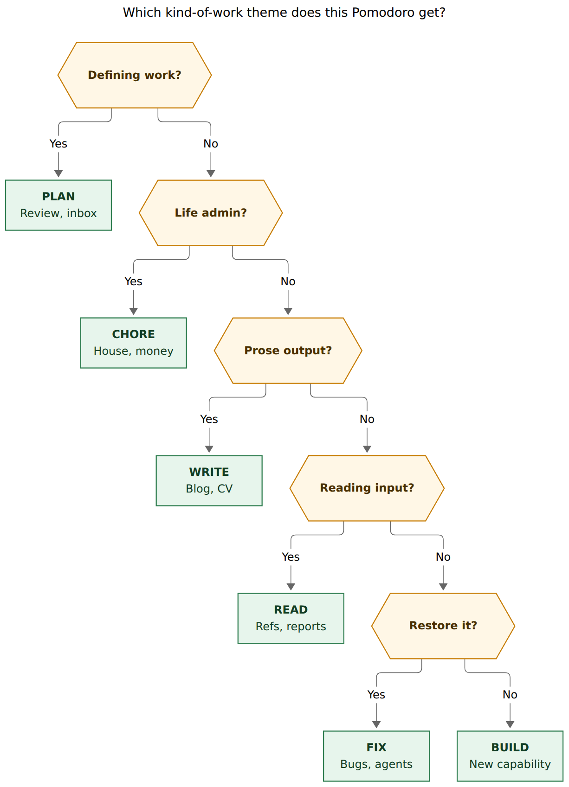
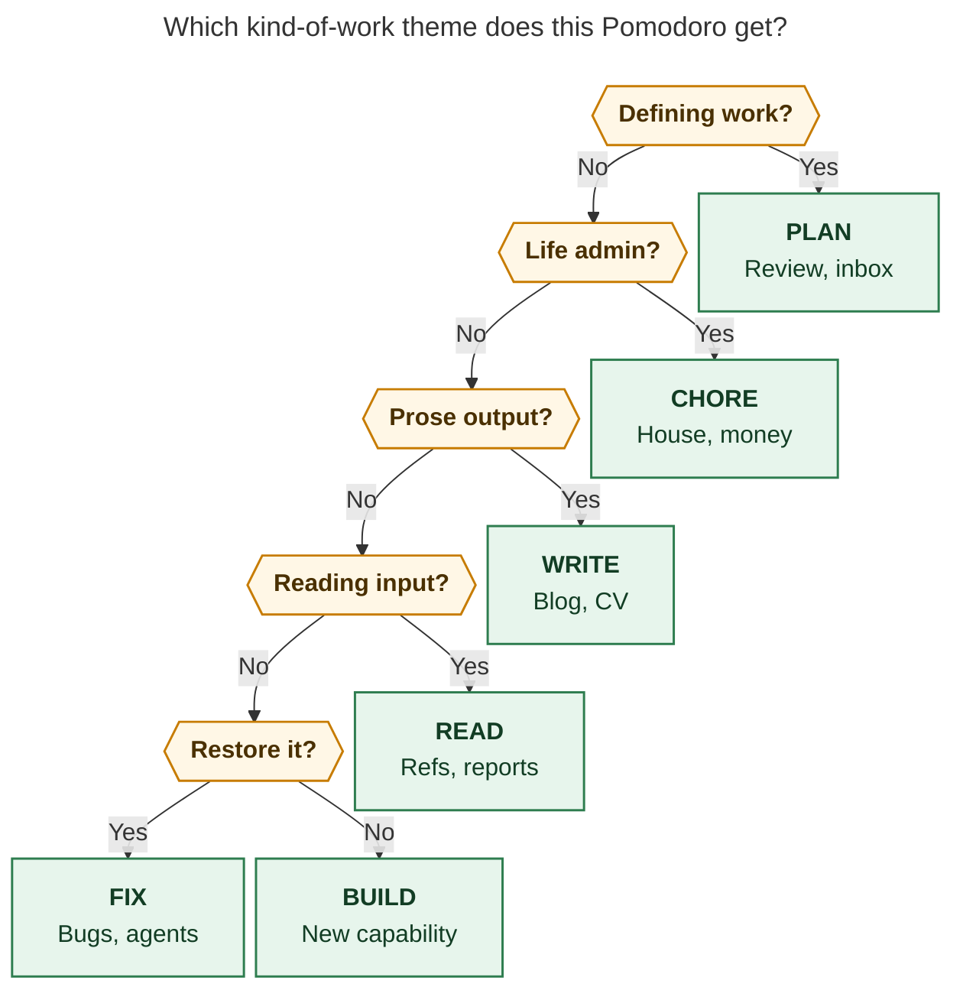

# Kind-of-work Pomodoro themes from six months of actual work

> **Research query:** Audit the work Bryan has done over the last six months and
> recommend a Pomodoro theme set that names *what kind of work a block contains*
> (reading, building, fixing) rather than what the work is for. Consider renaming
> GTD → PLAN and HOME → CHORE, and say which other themes the ledger should
> support from now on.

**Researcher:** `research.2q.grk` · **Date:** 2026-10-27 · **Window:** 2026-04-27 through 2026-10-26 (today excluded from totals)

## Bottom line

Use six standing names, with PLAN exempt from the theme cap:

| Theme | Role | Keep it because |
| --- | --- | --- |
| **PLAN** | Exempt. Review, inbox, weekly prune, clarifying | 181h (27%) of six-month minutes already sit in the GTD review bucket |
| **BUILD** | New capability, including the agent dispatch that produces it | SASE + bob are 61% of attributed time; `feat` is 37% of bob-cli commits |
| **FIX** | Restore broken behavior, unstick agents and hosts, operational toil | Real and currently under-named; git `fix` is 10%, named FIX/FIXES/ops cluster ~30h |
| **READ** | Input: references, agent reports, papers, listen | 255 done `#ref` tasks; 279 dated agent-report notes; October READ is already a daily mode |
| **WRITE** | Prose for a human reader: blog, CV, applications, launch post | ~14h blog + ~8h job/CV in the window; you already reached for WRITE before folding it into JOB |
| **CHORE** | Timed personal/household admin batch | HOME has never been a worked block; the name collision with Bob "homes" is real; the kind is rare and still distinct |

Retire **JOB** from the standing set. Career purpose already has an area hue and root-parent lane (`job`, `job_2026`, `sase_blog`). **SHOW** (from `bob#^plan-and-show-themes`) is still a purpose name. Leave it.

Typical day: PLAN (exempt, morning) + BUILD + READ, with FIX created when something is actually broken, and WRITE or CHORE only when that batch is timed.

## What six months of work actually was

Recorded closed-Pomodoro time: **679h 15m** across **152** days with a `## Pomodoros` section, median **4h 28m** per day, **1,178** closed sessions. April 27–30 has no section. May is 14h 45m of partial, unlinked ranges. Reliable tracking begins in June, when bob-cli's own git history also starts (`First Commit` on 2026-06-01).

### By destination (what the work was *for*)

`bob stats show worked -r 2026-04-27..2026-10-26` parts:

| Root parent | Hours | Share | Kind-of-work reading |
| --- | ---: | ---: | --- |
| sase | 322h 41m | 48% | Building and fixing the agent factory |
| GTD review | 181h 02m | 27% | Defining work (morning walk, inbox, prune) |
| bob | 85h 44m | 13% | Building and fixing the vault CLI / plugins |
| unlinked | 49h 35m | 7% | Unknown; mostly May–June |
| sase_blog | 13h 44m | 2% | Prose |
| job_2026 + job + CV | 12h 36m | 2% | Applications, CV, career reading |
| dev + plex patch | 8h 10m | 1% | Host repair, stocks, UPS |
| cash + love + body | 2h 01m | <1% | Personal admin and care |
| unfiled | 3h 15m | <1% | |

Area split is even blunter: **dev 63%**, **gtd 27%**, **job 2%**, personal crumbs. Done-task counts (1,686 in-window) agree: 84% live under `dev`, 59% under the sase root parent, 15% are `#ref` / `^ref-*` reading tasks.

Project minutes are a long tail of SASE epics (`sase_memory`, `sase_remote`, `sase_art`, `sase_pypi_releases`, `sase_monitor`, …) plus bob capture/stats/ref work. The destination facet is already covered by homes, the Day strip's root-parent bar, and area hues. A theme that restates "this is sase" or "this is the job hunt" duplicates that facet.

### By month

| Month | Worked | Review time | Dominant homes |
| --- | ---: | ---: | --- |
| May (partial) | 14h 45m | 0 | unlinked |
| June | 128h 25m | 17h 10m | sase 62h, bob 26h, GTD 17h |
| July | 118h 25m | 37h 35m | sase 72h, GTD 38h |
| August | 159h 00m | 61h 15m | sase 76h, GTD 61h, bob 14h |
| September | 146h 40m | 27h 19m | sase 90h, GTD 27h, bob 16h |
| October 1–26 | 112h 00m | 37h 43m | GTD 38h, bob 24h, sase 24h, blog 9h, job cluster 12h |

Review time is a durable quarter of the ledger, with weekly spikes from 7% (week of Sep 21) to 49% (week of Jul 6). Software-making is the other durable majority. Career and blog work is an October phenomenon, not a six-month one.

### By how the code changed

bob-cli `git log --since=2026-04-27 --until=2026-10-27`: **1,690** commits, Conventional Commit types:

| Type | Count | Share | Maps to |
| --- | ---: | ---: | --- |
| `feat` | 625 | 37% | BUILD |
| `chore` | 551 | 33% | mostly release-train / repo maintenance → BUILD or FIX |
| `docs` | 279 | 17% | product docs-as-code → BUILD; human-facing essays → WRITE |
| `fix` | 167 | 10% | FIX |
| `refactor` / `test` / other | 68 | 4% | BUILD (refactor, test) or FIX (ci) |

Scopes cluster on `capture`, `highlights`, `ref`, `freshness`, `stats`, `projects`, `memory`. That is feature work on one product, with a real bug-fix stream and a large docs/release stream. Git `chore` is *not* the personal CHORE theme below.

### By reading

`bob ref list` against `ref/` (1,144 indexed notes):

- **258** notes finished with a date in the last 6 months (435 finished notes have no usable date and were excluded).
- Of the 50 most recent finished rows, **46 are agent-report `chat` notes** (bob, sase, sase_pypi_releases, sase_blog).
- **28** external notes finished with dates (10 blogs, 9 docs, 8 papers). CV PDFs and Anthropic engineering posts sit here.
- **279** agent-report notes match the 6-month filter (plus 210 undated). The research sidecar itself holds 7 / 58 / 500 markdown files across 202608 / 202609 / 202610.

Reading, in this vault, is mostly *consuming agent research about the current project*, plus a smaller external stream used for the launch post, PyPI design, and the CV. That is a kind (input), and it is large enough to deserve its own name. It is not the same as "JOB" or "sase".

### Named-theme era is only the last two months

`bob themes list -a` knows **76** names, **70** hidden, **6** visible. The earliest `first_used` is 2026-08-26 (PAGER, RELEASE). Of 679h, **404h (59%) are unnamed** and **276h (41%) are named**. October 26's hide/rename pass rewrote history: BOB and VIBE → BUILD, PYPI → READ, BLOG then WRITE → JOB, HACK → HOME. Minutes under those names were chosen under a different vocabulary.

A six-month *kind* recommendation therefore has to lean on homes, git types, done-task kinds, and the reference library for June–August, and on the named ledger only as a recent, noisy labeler.

## What the current six names are doing

Visible catalog (2026-10-27), plus named closed minutes from a canonical-daily-note scan of `## Pomodoros` (Apr 27–Oct 26):

| Theme | Named hours | Days used | What the children actually are |
| --- | ---: | ---: | --- |
| GTD | 66.7h | 54 | Review row, plus leaked agent restarts and "fix this" bursts |
| BUILD | 32.7h | 30 | `done/bob_done` (119 links), agent launches (`0ex`, `bob-cli-1n`, athena swarms) |
| JOB | 21.9h | 19 | `job_2026_apply_29` (27), `sase_blog` (21), `job` (11), CV (5), plus some bob |
| SASE (hidden) | 13.8h | 14 | Project noun; agent relaunch and lint/test firefighting |
| SHIT (hidden) | 13.7h | 13 | Derailed / untracked time ("a bunch of shit") |
| READ | 13.5h | 16 | `sase_pypi_releases` refs, agent reports, some overnight research |
| REMOTE / TOOL / MEMORY* | ~27h | — | Project nouns later absorbed into BUILD |
| FIX + FIXES + BUGS + VERIFY + restarts / pager / sudo / athena | ~30h | — | Restore and toil, currently split across many hidden names |
| HOME | 0.4h | 11 | One renamed HACK session; nine untimed placeholders (stocks, UPS) |
| LISTEN / RESEARCH | ~4.9h | few | Input; fold into READ |

Today's ledger already behaves like a kind-of-work day: closed GTD, BUILD, FIX, READ; open placeholders for READ, BUILD, FIX, HOME. JOB is absent. The remaining confusion is the two purpose names (GTD as a methodology, HOME as a place) and the parked HOME row that never starts.

A mechanical recode of every named component into kind buckets (PLAN = GTD/GOALS/CAPTURE/…, BUILD = SASE/MEMORY/REMOTE/TOOL/…, FIX = FIXES/BUGS/ATHENA/PAGER/…, and so on) yields, of 276 named hours:

- PLAN 79h (29%)
- BUILD 105h (38%)
- FIX 30h (11%)
- JOB 22h (8%) — mixed write/apply/bob
- READ 18h (7%)
- DRIFT (SHIT) 14h (5%)
- inventory / leftover 6h
- CHORE 0.8h
- WRITE 0.2h (WRITE itself was renamed away)

The kind signal is already in the names you reached for (BUILD, FIX, READ, WRITE, RESEARCH, LISTEN, BUGS, VERIFY). The purpose signal (JOB, HOME, SASE, BOB, GTD-as-brand) is what you are trying to leave.

## GTD → PLAN

**Do this.** Add `PLAN` to `plan.exempt` in chezmoi first, then `bob themes rename GTD PLAN`. Remove `GTD` from `exempt` after the rename. `docs/pomodoro-themes.md` PT10 will refuse the rename while GTD is a config reference and PLAN is not.

PLAN is the right kind-word for the 181h review bucket: morning walk, inbox, Keep import, calendar, weekly prune, capture processing, GOALS-style "what are we doing." Allen's threefold model calls this *defining work*, as distinct from doing predefined work and doing work as it shows up. Cirillo's system likewise separates planning the To Do Today sheet from executing one activity.

Tighten the codebook, because named GTD already leaks operations:

- 715 of 3,999 GTD minutes have agent-language children ("Running Claude instance to try to fix this", "An agent is waiting on Apollo").
- The daily `#gtd #pre` row **Clean up SASE agents on athena and apollo** is restore-work sitting next to teeth and pills. Run that burst under FIX. Leave the checklist row where it is; change only the Pomodoro name that holds the time.

PLAN stays **exempt and muted**. It is daily overhead, like Cirillo's planning, and should not fight BUILD/READ/FIX for the cap. `review_time` already paints this bucket orange on the root-parent bar; muting the theme pill keeps that meaning.

`bob plan` the command will share a syllable with PLAN the theme. That is a mild collision and still better than GTD, which names a methodology rather than a kind. If the command collision bothers you in a week, REVIEW is the accurate fallback (it matches `review_time` and the Morning review checklist). I would start with PLAN, as you proposed.

PRE habits (weather, teeth, pills, stretches) stay on the checklist. They are not a Pomodoro theme.

## HOME → CHORE

**Do this**, and only start a CHORE entry when the batch is timed.

HOME in this window: 11 rows, 25 closed minutes (the Oct 17 HACK session, renamed), nine untimed `()` placeholders rolling `^sell-stocks-now` and the UPS battery. Cash/love/body/plex together are about four hours in six months. The kind exists; it has almost never been a worked block.

CHORE is the right kind-word: a scheduled personal/household admin batch (money, house tech, care, errands). It is distinct from:

- PLAN (defining work)
- daily PRE habits (teeth, pills)
- Bob's **home** (the root-parent attribution of a session)

Git `chore:` means repo maintenance. Pomodoro CHORE is ALL-CAPS and personal. The collision is visible to you and still cheaper than keeping HOME, which collides with a Bob domain word you see on every Day strip.

Do not park an all-day `() — CHORE`. Untimed HOME already burns a cap slot and keeps unfinished life-admin in view. Schedule it or leave it off the ledger (NEXT / tickler).

LIFE is an acceptable alternate if CHORE feels too small or too git-like. I would still pick CHORE: it is a kind, not a place.

## JOB, SHOW, and WRITE

`bob#^plan-and-show-themes` currently says `s/GTD/PLAN/` and `s/JOB/SHOW/`, and asks what to rename HOME to. SHOW is still "what this is for" (public, career, display). Under a kind-of-work facet it does not earn a slot.

JOB's 22 named hours in October mix three kinds:

- Blog / launch-post prose (`sase_blog`, 21 task-link hits; 13h 44m of six-month root-parent time)
- Applications and CV (`job_2026_apply_29`, `job_update_cv`; "Applied to Ramp, Clay, and LangChain")
- Occasional bob/dev tasks that happened to sit under a JOB row

You already invented WRITE on Oct 26, then folded it into JOB the same evening so the career *purpose* would stay visible. The purpose is visible without the theme: area `job` (aqua), root parents `sase_blog` / `job_2026` / `job_update_cv`. The kind that disappeared is prose.

**Revive WRITE.** Use it for blog drafts, the launch post, CV bullets, application essays, and any other block whose output is sentences for a human. Product docs that ship with a `docs:` commit next to a feature stay BUILD. A research report you are *reading* is READ; a research report you are *authoring as the deliverable* is WRITE.

Leave historical JOB minutes in place. Merging JOB → WRITE would mis-file the application logistics and the stray bob tasks. Hide JOB from Recent after WRITE is in use.

## The recommended standing set

Five non-exempt names plus one exempt name. That matches today's `plan.max_themes: 5` if every extra is open at once, and it matches the Morning review "≤3 themes" rule if PLAN is exempt and WRITE/CHORE are scheduled rather than parked.

### Codebook

Decide the kind before starting the block. Do not relabel mid-session because a BUILD burst hit a bug.

1. **PLAN** (exempt) — Defining work: daily walk, inbox, Keep, calendar, weekly prune, capture processing, "what are we doing." Done when the next commitments are clear.
2. **CHORE** — A timed personal/household batch. Done when the planned items finish. Create it when you start; do not leave it open "just in case."
3. **WRITE** — Output is prose for a reader (blog, CV, application, essay, launch post). Done when a bounded section exists.
4. **READ** — Input: `^ref-*` tasks, agent reports, papers, docs, listen/audio. Done when you understand enough to decide or to stop.
5. **FIX** — Restore broken behavior; unstick agents/hosts; repetitive operational toil (restarts, pager, sudo, failed-epic relaunch). Done when the system is working again or the toil burst is finished.
6. **BUILD** — Produce new capability (code, config, memory, capture, a feature agent). Short dispatch sessions count. Done when the capability exists or the agent's job is launched.

### Routing

**Reader question:** Which kind-of-work theme does this Pomodoro get?

**Caption:** Ask about the block's activity in this order: defining work, personal admin, prose, input, restore, then new capability. Career and project purpose stay on homes.



Rendered size: 816.7 × 1132 px; fit scale: 78.9% (Mermaid CLI 12.0.0, PDF-mirroring config).



### Why these six, from the work

Toggl's own categorization guide puts **project** on the folder and **tags** on the activity type that cuts across folders. Bob already has the folder (area / root parent / project). The theme slot is the tag. Cirillo wants one activity per Pomodoro; a kind name is the activity. Conventional Commits, which you already type 1,690 times in this window, split software along feat / fix / docs / chore — BUILD / FIX / WRITE-or-BUILD / CHORE-the-git-kind. Google SRE asks that operational toil stay visible and capped; folding restarts into unnamed GTD hides them. The six names are the smallest set that covers those facets *and* the actual minutes.

## Names to support only on demand

Mint only if the kind will appear on three different days. Otherwise use one of the six.

| Candidate | Verdict |
| --- | --- |
| **RESEARCH** | Fold into READ. Agent reports already dominate finished reading. Split later only if you need "books vs swarms" as a Stats question. |
| **LISTEN** | Fold into READ. Two days, 2.2h. |
| **OPS** / **TOIL** | Fold into FIX. Revisit if FIX (including agent cleanup and host repair) stays above ~25% of non-PLAN time for a month. |
| **SHOW** / **JOB** | Purpose. Use homes. |
| **DRIFT** / **SHIT** | Outcome, not a kind. 13.7h in September, then gone. Leave it hidden; do not put it in Recent. |
| **TALK** / **MEET** | No evidence in the ledger. |
| **LEARN** | Overlaps READ. |
| **APPLY** | Application *writing* is WRITE; logistics can live under the job notes. |
| **SASE** / **BOB** / **ATHENA** / **REMOTE** | Project or machine nouns. Homes already say this. |
| **LATER** / **MISC** / **NEW FEATURES** | Keep as `plan.inventory_labels` (storage), not as kinds. |

## How this sits on Bob's machinery

- **Facet split.** Homes answer *for which project/area*. Themes answer *what kind of activity*. That matches Toggl's project-vs-tag split and the `pomodoro-theme-is-one-component` decision (ledger tails stay the source of truth; nothing is inferred from task text at read time).
- **Cap.** Morning review already says ≤3 themes. `plan.max_themes` is 5, so the cap cannot fire on the current five non-exempt names. Set **`max_themes: 3`**, keep `strict: false`, keep PLAN exempt. WRITE and CHORE then have to be intentional.
- **`^theme-on-task`.** A project-level default is a good *capture-time suggestion* for single-kind notes (`sase_pypi_releases` → READ, `sase_blog` → WRITE, `gtd_daily` → PLAN). It is a bad mandatory inherit on `sase.md` / `bob.md`, which split across BUILD, FIX, and READ in the same week. Do not infer themes at read time.
- **`^delete-themes`.** Hiding already removes names from Recent. Deleting catalog history is optional and lossy; the 70 hidden names are the six-month vocabulary you are compressing. I would hide JOB and leave the rest hidden rather than build a deleter first.
- **Pins before merges.** The six-theme review already showed that `bob themes rename FIXES FIX --merge` would move hidden state onto FIX and hide the visible name. Pin BUILD, FIX, READ, WRITE, CHORE before any historical merge. I would not bother merging the legacy tail unless you care about 90-day theme charts before January; unnamed+legacy already ages out of a 4-week view.
- **Composites.** `PLAN + BUILD` is legal and rare (10 composite sessions in the scan). Prefer one kind. An even split halves both series and counts both toward the cap.
- **Weekly prune.** Add `bob themes list -a` and a look at `renamed_reappeared`. Rename strays into the six, or hide them.

## Suggested cutover

None of this was executed. Dry-run every rename.

1. Chezmoi: `plan.exempt: [GTD, PLAN]` (or `[PLAN]` after the rename lands), `max_themes: 3`.
2. `bob themes rename GTD PLAN` (online, after exempt includes PLAN).
3. `bob themes rename HOME CHORE`.
4. Start WRITE on the next blog/CV/application block; hide JOB from Recent.
5. Pin colors on BUILD, FIX, READ, WRITE, CHORE so a later merge cannot hide them.
6. Move the morning agent-cleanup *time* into FIX; leave the PRE checklist row in place.
7. Open CHORE only when the batch starts.

## Limits

- Named-theme history begins 2026-08-26 and was rewritten on 2026-10-26. Kind recodes of those names are an interpretation.
- Homes follow today's note tree; re-running later can move attribution.
- Unlinked May–June minutes (50h) have no kind.
- Recorded time is not all of life. CHORE's absence from the timer is not evidence that life-admin did not happen.
- Composite sessions split minutes evenly.
- This report did not read the other swarm members' `__cdx` / `__cld` / `__mus` / `__gem` drafts for this query. It did read the requested `pomodoro_six_theme_review.md` as shared prior context.

## Reproducibility

Read-only commands used (2026-10-27, bob 0.3.x, vault `~/bob`):

```sh
bob themes list -a -f json
bob stats show worked review_time sessions -r 2026-04-27..2026-10-26 -g month -f json
bob stats show worked -r 2026-04-27..2026-10-26 -g week -f json
bob stats show done created dropped -r 2026-04-27..2026-10-26 -g month -f json
bob capture-pomodoros -a -f json
bob ref list -R finished -S 6m -f json -n 50
bob ref list -o agent-report -S 6m -f json -n 50
bob ref list -o external -R finished -S 6m -f json -n 50
```

Plus a read-only scan of canonical `2026/YYYYMMDD.md` `## Pomodoros` sections (column-0 entries, `[t:: Nm]` or `HHMM-HHMM` ranges, em-dash names, even split on `+`), bob-cli `git log --since=2026-04-27 --until=2026-10-27 --pretty=%s`, `gtd_daily.md` PRE/POST rows, and `bob.md` (`^decide-stable-themes`, `^plan-and-show-themes`, `^theme-on-task`, `^delete-themes`). Config: `~/.config/bob/config.yml` `plan.max_themes: 5`, `plan.exempt: [GTD]`, `plan.inventory_labels: [LATER, MISC, NEW FEATURES]`.

## Sources

**Vault and product (2026-10-27):**

- `bob themes list -a`; `bob stats` worked / review_time / sessions / done / created / dropped for 2026-04-27..2026-10-26
- Canonical daily notes `2026/20260427.md`–`2026/20261026.md`; today `bob capture-pomodoros -a`
- `gtd_daily.md`; `bob.md` (`^decide-stable-themes`, `^plan-and-show-themes`, `^theme-on-task`, `^delete-themes`)
- `docs/pomodoro-themes.md`, `docs/plan.md`, `docs/stats.md`
- Decisions: `pomodoro-theme-is-one-component`, `theme-hide-is-recent-only`, `theme-hue-is-pin-exempt-area-hash`, `theme-prefs-live-in-per-host-journal`
- Shared context: `research:202610/pomodoro_six_theme_review/pomodoro_six_theme_review.md`
- bob-cli git history 2026-06-01..2026-10-27
- `bob ref list` finished / agent-report / external, last 6 months
- Research sidecar file counts under `202608/`, `202609/`, `202610/`

**External:**

- Francesco Cirillo, [Pomodoro Technique](https://www.pomodorotechnique.com/) — one activity per Pomodoro; plan, then focus, then record
- David Allen, [The Threefold Nature of Work](https://gettingthingsdone.com/wp-content/uploads/2021/09/Threefold-Nature-of-Work.pdf) — defining work vs predefined work vs work as it shows up
- Toggl, [Track categorization guide](https://support.toggl.com/en-us/article/toggl-track-categorization-guide-jr6htu/) and [Toggl 2.0 data structure](https://docs.toggl.com/data-structure-and-categorization-guide-in-toggl-2.0) — projects hold deliverables; tags carry activity type
- [Conventional Commits 1.0.0](https://www.conventionalcommits.org/en/v1.0.0/) — feat / fix / docs / chore as a kind vocabulary you already use (in library, finished, legacy `ref/zorg/dev_ref/conventional_commits`)
- Google SRE book, [Eliminating Toil](https://sre.google/sre-book/eliminating-toil/) — keep operational work visible; cap it so engineering work remains

Library check: 1 of 8 cited candidates already in your library (1 finished).
