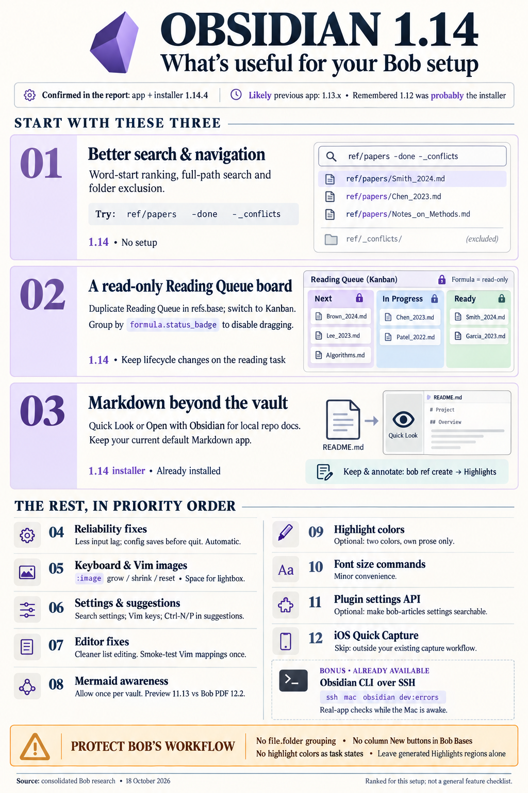

# Obsidian 1.12 → 1.14 on the MacBook: what is worth your attention

> **Research query:** Review the recent changes in the Obsidian
> [changelog](https://obsidian.md/changelog/) that I just got by upgrading Obsidian on my
> MacBook (I think from v1.12 to v1.14). Which of them would I actually find useful given
> my setup, ending with a ranked list of the new features I should be aware of or
> consider adopting?



## Bottom line

- **You are on Obsidian 1.14.4, with the 1.14.4 installer, on macOS 26.5.** cld and grk
  both confirmed this live on the Mac today. The Mac was offline when I re-checked.
- **You were most likely already running 1.13.x before this upgrade. The "1.12" you
  remember is probably the old installer version.** The vault's git history shows
  plugin updates that need Obsidian 1.13.0 or newer:
  - Sep 8: Templater 2.25.0
  - Sep 17: Linter 1.33.0 and Jump to Link 0.6.1

  Obsidian won't install a plugin release whose `minAppVersion` is newer than the
  running app. Separately, the CLI symlink dates from May 28, which means you had at
  least the 1.12.7 installer by then. Settings → General would have read something like
  "v1.13.x (installer v1.12.7)".
- **What that means in practice:**
  - **Everything in 1.14 is definitely new to you.**
  - **1.13 has probably been available since about August.** Most of it is easy to have
    missed, so it is still covered [below](#analysis-by-theme), marked **1.13**.
  - **Reinstalling is what unlocked the installer-only features:** Quick Look,
    Open-with and default-app support, the new document icons, and Electron 43.
- **The [three things worth using](#ranked-list-of-new-features-to-know-about-or-adopt)**
  are:
  1. [Better search and navigation](#search-and-navigation).
  2. A **read-only** [Reading Queue kanban](#bases-kanban-and-groups) built from a
     formula `refs.base` already has.
  3. [Opening repository Markdown](#open-markdown-from-outside-the-vault) in Obsidian, or
     previewing it with Quick Look, without importing it.

  Almost everything else is a fix you get without doing anything.
- **Nothing in the jump breaks your setup.** You run the default theme. No snippet sets
  `--callout-color`. No bob plugin registers a Bases view. cld's `obsidian dev:errors`
  snapshot was clean with all 16 community plugins enabled.
- **Things to avoid:**
  - Dragging kanban cards whose property bob owns.
  - Grouping any Bob Base by `file.folder`.
  - Using highlight colors as a second task or status system.
  - Treating iOS Quick Capture as a Bob capture path.

## Release timeline

Each item is a public desktop release, with its date and the headline for you.

- **1.12.7**
  - *Date:* Mar 23
  - *Headline for you:* Bundled fast `obsidian-cli` binary (installer Electron 39.8.3).
    Probably your old installer.
- **1.13 (1.13.4)**
  - *Date:* Jul 30
  - *Headline for you:* Searchable Settings window with Vim keys; image lightbox and
    keyboard/Vim image editing; Ctrl-N/P in all suggestion lists; Mermaid opt-in banner;
    URI confirmation dialog; `--callout-color` CSS break; installer Electron 43.1.1
- **1.13.6 / 1.13.7**
  - *Date:* Aug 10 / 12
  - *Headline for you:* URI dialog **removed**; config files finish saving before quit;
    installer Electron 43.3.0; macOS special-character filename fix
- **1.14 (1.14.4)**
  - *Date:* Oct 5
  - *Headline for you:* Open Markdown from outside the vault, Quick Look, Open with; Bases
    kanban, Group menu, collapsible groups; highlight colors; fix for large-vault input
    lag; word-start fuzzy ranking; MathJax 4.1.3; installer Electron 43.7.5

Nothing newer than Oct 5 is on the changelog index. The individual 1.14.x early-access
entries record a few details that the public 1.14 page leaves out:

- The 10,000-file fuzzy-search threshold.
- The `appearance.json` font-size move.
- `file.folder` card moves in kanban.
- A metadata-cache leak fix for files opened from outside the vault.

## How your setup filters the changelog

Each item gives a part of your setup (verified), then what it means for this upgrade.

- **Tasks are checkbox rows inside area and project notes, with sticky Next/Pending
  lanes, derived Blocked, the `]s` walk, and the Pomodoro ledger:** A Bases card is a
  whole **file**. Kanban cannot model your task lanes.
- **Project `status:`: `bob projects sync` owns `done`/`canceled` and reopens to `wip`
  from `^prj`. In practice, 44 projects are `wip` and *0* are `waiting`. Blocking lives
  on the `^prj` line (`decisions:projects-block-from-prj-line`):** A project board
  grouped by status would have a single column.
- **Ref `status:` (34 ready, 8 next, 1 wip, 401 read, 24 abandoned) is synced three ways:
  reading task, PDF marker, and frontmatter. `docs/highlights-ref-sync.md` reports a
  frontmatter-only change that disagrees with the task as a *conflict*:** A Reading Queue
  board is useful to look at. A drag would cause a sync conflict.
- **6,397 Markdown notes. `bob-project-tasks`, ref sync, and the status hooks keep
  rewriting frontmatter in the background. Vim mode is on, with vimrc-support,
  bob-vim-surround, relative line numbers, and Jump to Link:** The performance, search,
  and Vim fixes apply to you directly.
- **`.obsidian/*.json` and snippets are git-synced. Obsidian Sync is retired. No theme is
  installed. Snippets: `task-statuses`, `dataview-properties`, `inline-code`:** The CSS
  breaking change and the Sync UI work don't affect you. Saving config before quit
  matters a little more for you than for most users.
- **Bob Mac Capture and Google Keep (into `gkeep_inbox.md`) are your capture paths. No
  iOS device has a vault:** iOS Quick Capture would be a third inbox with a weaker
  contract.
- **SASE research reports and agent workspaces live on *apollo*. Reading you want to keep
  goes through `bob ref create` → PDF in Highlights → ref note:** Opening outside-vault
  files on the Mac works only for files the Mac actually has. It is a quick look, not
  the reading pipeline.
- **bob-cli shipped Mermaid figure rendering in `bob ref create` this week (Oct 17), using
  vendored Mermaid 12.2.0. The vault has 0 Mermaid fences today:** The 1.13 Mermaid
  opt-in banner, and Obsidian's older Mermaid 11.13.0, are about to matter. (See
  [Mermaid is now opt-in per vault](#mermaid-is-now-opt-in-per-vault-and-is-about-to-matter).)

## Analysis by theme

### Bases kanban and groups

*Covers kanban, the Group menu, and collapsible groups. Version: 1.14.*

**What shipped.** These details are confirmed in the help source (`Bases/Layouts/Kanban
view.md`):

- **Kanban layout.** Columns come from the grouping property. Files without a value go
  in a "None" column.
- **Dragging a card writes the grouped property** to that note. When grouped by
  `file.folder`, a drag **moves the file** instead.
- **The column "+"/New buttons** create a note that has only that column's value set.
- **Grouping by a formula, or by any file property other than `file.folder`, turns off
  card moves, column moves, and note creation.** The Group menu still controls order
  and visibility.
- **The new Group menu** reorders, hides, and adds groups in every layout. Groups now
  collapse in table, cards, and list views too.

**The safe way to adopt it is to group by a formula.** That makes a board read-only by
design, so you don't have to remember not to drag. `refs.base` already has a suitable
formula, `formula.status_badge`, which yields ⭐ Next / 🛠️ In Progress / 📥 Ready. To
build the board:

1. Duplicate the 🔖 Reading Queue view.
2. Switch its layout to Kanban.
3. Group → Group by **Status (formula)**.
4. Set Manual order: Next, In Progress, Ready.

Obsidian writes something like this:

```yaml
  - type: kanban
    name: 🗂️ Reading Board
    filters:
      or:
        - status == "next"
        - status == "wip"
        - status == "ready"
    groupBy:
      property: formula.status_badge   # formula grouping → no card drags
      direction: ASC
    order:
      - formula.title_link             # first property = card title
      - formula.category
      - formula.source
```

Build it from the Group menu rather than hand-writing `groupOrder`. Lifecycle changes
still go through the `^ref` reading task, as they do today. A board grouped by
`formula.category` (AI, Paper, Blog, Docs, Chat) is cdx's read-only alternative for
browsing by kind. Keep `bob ref list` as the authority on what is left to read. The board
reflects frontmatter as of the last sync.

**Where the researchers differed, and the resolution** (summarized again under
[Where the researchers disagreed](#where-the-researchers-disagreed-and-how-it-resolves)):

- **cld's `wip`/`waiting` Project Board.** Correct about ownership: `wip` ↔ `waiting` is
  hand-authored, and sync owns the terminal states. But with 0 `waiting` projects, it
  would be a single column. Real project blocking is now derived from the `^prj` line,
  not from frontmatter. If you want a project board at all, make it read-only, grouped
  by `formula.priority_badge` and filtered to `wip`. Otherwise just collapse groups in
  the existing tables.
- **gem's "group by `file.folder` to move files."** This is actively harmful here. A
  drag would break the `ref/<type>/` ↔ `lib/<type>/` mirroring that `bob ref` relies on.
  For area and project notes, it would change task residence.
- **grk: try drag-enabled kanban first on `podcasts.base` or `eat.base`.** Agreed, as the
  low-stakes place to learn it. Their `status` values (subscribed/unsubscribed, and so
  on) are yours alone, and nothing in bob-cli touches them.
- **Never use the column "+"/New buttons in Bob Bases.** The notes they create lack the
  required `parent` (and usually `type`) frontmatter.

Smaller Bases items:

- Embedded kanban boards no longer have a fixed height.
- Dates render better in group headers.
- A `groupOrder` that isn't a list no longer breaks loading.
- The "+" button now writes correct frontmatter for unresolved links.

### Open Markdown from outside the vault

*Also covers Quick Look and Open with. Version: 1.14, needs the new installer.*

**What shipped:**

- The **Open file from outside the vault…** command opens a `.md` file in the current
  window. The file stays where it is.
- Image embeds and relative links resolve against the file's own folder.
- Outline and Outgoing links work on these files.
- Obsidian shows up in Finder's **Open with** menu and can be made the default app for
  `.md`.
- **Quick Look** (Space in Finder, or `qlmanage -p`) renders Markdown even when Obsidian
  is closed.
- 1.14.4 fixed a metadata-cache leak that followed opening and editing these files.
- Your reinstalled installer already includes this, so nothing else is required.

**Where it fits:** repository READMEs, `docs/`, plan files, and chezmoi Markdown, read
with rendered tables and callouts instead of raw text. It does not replace your reading
pipeline:

- **SASE research reports live on apollo.** The Mac sees them only if you keep a
  checkout or synced copy there. I couldn't check that, because the Mac was offline.
- **Reading you want to annotate and keep** should still go through `bob ref create`.
  It turns a research report into a PDF and a ref note with its `Research report:`
  metadata, and Highlights annotations flow back into Bob.
- **Use Quick Look to skim, and Open file for a quick read.**

Guardrails, combined from grk and cdx:

- **Don't make Obsidian the default `.md` app.** It would take over double-clicks you
  want in nvim and in agent tooling. Use Open with instead.
- **Treat external tabs as read-mostly.** Make any edits through the owning repo's
  workflow.
- **Bob's hooks don't apply.** `obsidian://bob-goto-task` refuses paths outside the
  vault, and Dataview, Bob tasks, and vault-wide links won't see these files.

### Search and navigation

*Version: 1.14.*

These need no setup and help every day:

- **Word-start fuzzy ranking** in the quick switcher and `[[` suggestions, plus faster
  matching. This helps a vault full of similar names: dated dailies, `ref/papers/…`, and
  `<route>_<id>` project notes.
- **Full-path matching** in File Explorer, Bookmarks, Outline, and Tags search. A
  match keeps its contents visible, and empty groups are hidden.
- **`-term` exclusion** hides a matching folder and everything inside it. Your tree is
  organized by path, so try `ref/papers`, `-done`, `-_conflicts`, and `-lib`.
- **Fuzzy matching above 10,000 files** (1.14.2). This doesn't affect you: there are
  about 6.4k Markdown notes and about 7.8k files in total.
- **Heading search (`[[##`) no longer freezes large vaults.**
- **Bookmarks** got its own search in 1.13.

These are view filters only. They don't touch Bob queries or the review walk.

### Keyboard and Vim

*Covers keyboard, Vim, images, and settings. Version: mostly 1.13.*

- **Ctrl-N / Ctrl-P move through every built-in suggestion list on all platforms.** That
  covers the quick switcher, command palette, `[[`, and property suggestions, so they now
  behave like your bob pickers. I checked `hotkeys.json` and the plugins' default
  hotkeys: **there are no bare Ctrl+N or Ctrl+P bindings.** grk's worry about
  create-project-note was wrong, because that command is **Ctrl+Shift+N**. One small
  inconsistency, per cld: the successor-picker modal (`206-successor-picker-modal.js`)
  appears to handle only the arrow keys.
- **Images in Live Preview:**
  - Images can be selected from the keyboard.
  - `+` / `-` resize, `0` resets, Enter edits, and Tab edits the size.
  - Backspace deletes the embed, and Cmd-C / Cmd-X copy or cut it.
  - Vim Ex commands: `:image grow`, `:image shrink`, `:image reset`, with counts
    (`:5image grow`).
  - A **lightbox**: click in Reading view, or press Space on a selected image. Arrow keys
    step through every image in the note, and drag pans.

  This is useful for figure-heavy ref notes. **Don't resize images inside
  `<!-- highlights:begin/end -->`**, because the next scan rewrites that region.
- **Settings:**
  - Search by name or description.
  - Arrow and Vim navigation, Cmd-F to return to search, Escape to close, and Alt-↑/↓ to
    reorder lists.
  - Settings open in a new window by default. You can turn that off under Settings →
    Interface → Open settings in new window.
  - **You can now leave Restricted Mode without turning every plugin back on.** That is
    the right way to bisect a suspected bob-plugin regression.
- **Editor fixes that match your habits:**
  - Pasting a list or task item onto a line that already has a marker no longer
    duplicates the marker.
  - Vim `dd`/`p` on numbered lists no longer adds empty items.
  - "Toggle bold" behaves properly inside bold text and across partial selections.
  - Cursor placement around `**__x__**` is fixed.
  - Option-Shift-↑/↓ works in long paragraphs.
  - The Vim "ghost character" over widgets is gone.
  - Property suggestions no longer take an old query on Enter.
  - Watch for one change: in Source mode, ↑ on the first line now moves into the inline
    title. Vim `k` should be unaffected, but nobody has verified that.
- **CodeMirror was upgraded twice, and Electron went from 39 to 43.** This is where
  plugin risk would show up: CM6 decorations in ledger-tools and project marks, and the
  `CodeMirrorAdapter.Vim` mappings in bob-ledger-tools and bob-vim-surround.
  `dev:errors` shows nothing. Still, smoke-test `\p`, `\P`, `\o`, `\O`, and
  `ys`/`cs`/`ds` once by hand.

### Performance and reliability fixes for a vault edited outside Obsidian

*Version: 1.13–1.14.*

Bob writes to your vault behind Obsidian's back all day: capture, status hooks, projects
sync, ref scan, and vault-sync pulls. These fixes target exactly that pattern:

- **1.14:** fixed periodic **input lag in large vaults caused by properties being
  recomputed in the background**.
- **1.13.4:** fixed a rare race that could leave a file stuck unsaved until restart.
- **1.13.5/1.13.6:** the app now **waits for config files to finish saving on quit**.
  Your `.obsidian/*.json` is git-synced, so a half-written file could otherwise be
  committed.
- **1.13.6:** fixed a Live Preview memory leak caused by reordering table rows or
  columns.
- **1.13.7:** fixed macOS files with special characters sometimes not appearing. You have
  no such filenames today.

There is nothing to turn on. If you ever worked around "Obsidian didn't notice bob's
write", for example by reopening a note after `bob capture`, try dropping the
workaround.

### Mermaid is now opt-in per vault and is about to matter

*Version: 1.13; my addition.*

None of the reports linked these two facts:

- **Obsidian 1.13 turned Mermaid rendering off until you accept a one-time banner per
  vault.** Since 1.13.1, diagrams render immediately after you allow them. 1.13 also
  upgraded Obsidian's Mermaid to **11.13.0**.
- **Since Oct 17, `bob ref create` renders tagged Mermaid fences in Markdown imports and
  vault-note snapshots,** using a vendored **Mermaid 12.2.0**
  (`docs/highlights-create.md` § Mermaid diagrams).

So if you start writing ```` ```mermaid ```` fences in vault notes to get vector figures
in snapshot PDFs:

- Accept the banner once in the Bob vault.
- Expect occasional **version skew**: a diagram that renders in the PDF (Mermaid 12) can
  fail in Obsidian's preview (11.13), or the other way round.
- Bob's own advice applies: use a `text` fence when you want the source to stay visible.

### Highlight colors

*Version: 1.14.*

The syntax is a color emoji **immediately after** the opening `==`, with no space:
`==🔴…==`, `==🟠…==`, `==🟡…==`, `==🟢…==`, `==🔵…==`, `==🟣…==`. Typing `==` offers the
colors, and Live Preview shows a swatch you can click. It stays plain Markdown, so git,
nvim, and bob's parsers see the literal emoji.

The fit for you is small. You use `==` almost nowhere, and imported Highlights
annotations are `> [!quote]` callouts inside a generated region, which the next scan
overwrites. The Highlights sidecars also carry no annotation color to map from. If you
try it, follow cdx's advice: use **two colors at most** (say 🟣 question and 🟢
conclusion), only in your own prose, outside generated regions.

**Reject gem's "🟣 Action Item / GTD Follow-up" color.** Tasks are checkbox lines, and a
color-coded follow-up would be a second, unreviewed task system.

### Small items and things to skip

- **Font size (1.14).**
  - The new **Increase/Decrease font size** commands are bindable.
  - The move of base font size out of `appearance.json` changes **nothing** for you: that
    file has never stored a font size since the vault entered git.
- **Declarative Settings API (1.13, plugin developers).** Only `bob-articles` has a
  settings tab, with 5 settings. Migrating it (about 30 lines, and raising
  `minAppVersion` to 1.13.0) would make those settings show up in Settings search. It's
  optional maintenance. `ConfirmationModal` (also 1.13) isn't worth replacing tested
  modals for.
- **URI confirmation dialog.** Added in 1.13.0 and removed in 1.13.6, so the
  `obsidian://bob-goto-task` and `bob-open-notes` URIs fire quietly again.
- **1.13.5 window-focus fix for vault-open URIs.** It might help Bob Mac Capture's
  landing. But Mac Capture builds `path=`-based plugin URIs, so this is unverified.
- **Skip:**
  - **iOS Quick Capture and Share Sheet Locations.** You have no vault on iOS, Sync is
    retired, and Keep → `gkeep_inbox.md` is already your phone intake.
  - **The Sync sidebar changes, RTL, localized links, and the Slides and Web viewer
    fixes.**
  - **Settings Search plugin deprecation.** You don't have that plugin.
  - **MathJax 4.1.3.** You have 4 notes with `$$`. The temporary 1.14.0 switch to Temml
    was reversed in 1.14.1.

## The Obsidian CLI over SSH

**Not new, but the most valuable item.** The CLI shipped in 1.12, and you have had it
enabled since May. cld confirmed today that **it works over SSH from apollo** against the
running app:

- `ssh mac obsidian version` printed `1.14.4 (installer 1.14.4)`.
- `plugins:enabled` and `dev:errors` both worked.

That makes possible:

- **A real-app check loop for `bob-plugins` agents.** After `bob plugins sync` reaches
  the Mac, an agent can run `plugin:reload id=<id>` or `reload`, then `dev:errors`. With
  `dev:debug on` it can also read `dev:console`, and `eval` or `dev:dom` work too. This
  catches CM6 and Vim breakage that the Node harnesses can't.
- **Replacing the osascript quit-and-relaunch in `scripts/install_all`** with
  `obsidian reload` or `restart`. Prefer a full `reload` for plugins that register
  global Vim mappings. Whether `plugin:reload` cleanly replaces those mappings is
  untested.
- **Recovering a file from scripts** with `history`, `history:read`, and
  `history:restore`, which complements the `_conflicts/` runbook.

Limits:

- It works only while the Mac is awake with the lid open.
- It runs against your live vault, so keep agents to read-only and `dev:` commands.

## Ranked list of new features to know about or adopt

Ranked by value for your Bob setup on the MacBook. **1.14** means definitely new.
**1.13** means probably available since August but likely unnoticed.

1. **[Search and navigation upgrades](#search-and-navigation) (1.14). Use them now.**
   Word-start fuzzy ranking in the quick switcher and `[[`; full-path search plus
   `-folder` exclusion in File Explorer, Bookmarks, and Outline (`-done`, `-_conflicts`,
   `ref/papers`); no more `[[##` freeze. No setup.
2. **[Read-only Bases kanban, Group menu, collapsible groups](#bases-kanban-and-groups)
   (1.14). Adopt in `refs.base`.** Build a Reading Board grouped by
   `formula.status_badge`; formula grouping makes it drag-proof. Collapse stale groups in
   the existing tables. Never group by `file.folder`, never use the column New buttons,
   and leave lifecycle changes on the `^ref` task. Try drag-enabled boards only on
   `podcasts.base` or `eat.base`.
3. **[Open Markdown from outside the vault, plus Quick
   Look](#open-markdown-from-outside-the-vault) (1.14, installer). Adopt casually.**
   Rendered repo READMEs, docs, and plans without importing them. Keep your current
   default `.md` app. Deliberate reading stays on `bob ref create` → Highlights.
4. **[Fixes for a vault bob writes
   to](#performance-and-reliability-fixes-for-a-vault-edited-outside-obsidian)
   (1.13–1.14). Be aware.** Property-recompute input lag, the stuck-unsaved race, config
   saved before quit for your git-synced `.obsidian`, and the table memory leak. Try
   dropping any "Obsidian missed bob's write" workarounds.
5. **[Keyboard and Vim image handling](#keyboard-and-vim), plus the lightbox (1.13). Use
   it on figure-heavy ref notes.** `:image grow|shrink|reset`, `+`/`-`/`0`, Space for the
   lightbox. Don't resize inside generated Highlights regions.
6. **Keyboard reach: Settings search with Vim navigation, Ctrl-N/P in every suggestion
   list, Restricted Mode with selective plugin re-enable (1.13). Use it.** No hotkey
   conflicts. Use Restricted Mode to bisect bob-plugin regressions.
7. **Editor fixes for list and task editing (1.13–1.14). Passive.** No duplicated list
   markers on paste, Vim numbered-list `dd`/`p`, Toggle bold, Option-Shift arrows, the
   stale property suggestions fix. Smoke-test your Vim mappings once after the
   CodeMirror upgrade.
8. **[Mermaid opt-in
   banner](#mermaid-is-now-opt-in-per-vault-and-is-about-to-matter), with Obsidian on
   Mermaid 11.13 (1.13). Be aware, newly relevant.** Accept the banner once if you start
   writing Mermaid in vault notes for this week's `bob ref create` figures. Watch for
   skew against bob's Mermaid 12.2.
9. **[Highlight colors](#highlight-colors) `==🟣…==` (1.14). Optional, light use.** At
   most two colors, in your own prose, outside generated regions. Never as task or
   status markers.
10. **[Increase/Decrease font size commands](#small-items-and-things-to-skip) (1.14).
    Minor.** Bind them if you change size while reading. The per-device storage change
    doesn't affect you.
11. **Declarative Settings API (1.13, developers). Optional maintenance.** Migrating
    `bob-articles`' 5 settings would make them searchable.
12. **iOS Quick Capture (1.14 mobile). Skip.** No iOS vault, and it would be a third
    inbox outside Bob's capture grammar.

**Not a new feature, but more valuable than most of the list:** use `ssh mac obsidian …`
(`reload`, `plugin:reload`, `dev:errors`, `dev:console`) as a real-app check loop for
bob-plugins work (see [The Obsidian CLI over SSH](#the-obsidian-cli-over-ssh)).

## A 15-minute check on the Mac

1. In Finder, press Space on a repo `README.md`, then use Open with → Obsidian on
   another. Leave the default app unchanged.
2. File Explorer search: try `ref/papers`, then `-done`.
3. In `refs.base`, duplicate Reading Queue, switch it to Kanban, and group by the
   **Status formula**. Confirm cards can't be dragged.
4. In a note with an image, select the image, run `:image grow`, then press Space for the
   lightbox.
5. Open Settings and type `vim`. Check that Escape closes it.
6. Smoke-test `\p`, `\o`, and `ys`/`cs`/`ds`, and Ctrl-N/P in the quick switcher.

## Where the researchers disagreed and how it resolves

Each item names the point, what the reports said, and the resolution.

- **What version you came from**
  - *Reports:* gem assumed 1.12; cdx and grk hedged; cld treated 1.13.0 and later as new
  - *Resolution:* Installer ≥1.12.7, but the app was very likely on 1.13.x by Sep 8
    (plugin `minAppVersion` evidence, see [Bottom line](#bottom-line))
- **"Download the installer"**
  - *Reports:* gem made it the top action; cdx said to check it
  - *Resolution:* Already done: installer 1.14.4 (cld and grk, live)
- **Best kanban use**
  - *Reports:* cld: wip/waiting project board ranked #1; grk: eat/podcasts first, refs as
    a view; cdx: read-only ref browser via formula grouping; gem: `file.folder` pipelines
  - *Resolution:* Read-only Reading Queue board via `formula.status_badge`. The project
    board has one column (0 `waiting`). Never use `file.folder`. (See
    [Bases kanban and groups](#bases-kanban-and-groups).)
- **Ctrl+N conflict**
  - *Reports:* grk: conflicts with create-project-note; cld: no conflict
  - *Resolution:* No conflict. That command is Ctrl+Shift+N.
- **Highlight colors for reading or GTD**
  - *Reports:* gem: a 4-color taxonomy including action items; others: prose only
  - *Resolution:* Prose only, at most two colors, outside generated regions. No task
    semantics.
- **Plugin regressions**
  - *Reports:* gem: "zero regression, tested"
  - *Resolution:* Not tested. The only evidence is cld's `dev:errors` snapshot, which
    covers the current app session. A one-time manual Vim smoke test is still worth
    doing.
- **Per-device font size**
  - *Reports:* cdx and grk: a real cross-device benefit
  - *Resolution:* No-op. `appearance.json` never stored font size.
- **10,000-file fuzzy threshold**
  - *Reports:* gem: a scalability win
  - *Resolution:* Doesn't apply at about 6.4k notes. The word-start ranking still does.

## Open questions

These are not verified:

- Whether the Mac has a local copy of the research repo and bob-cli docs to open with
  Quick Look. The Mac was offline during my check.
- Whether `obsidian plugin:reload` leaves stale or duplicate global Vim mappings.
- Whether Vim `k` on the first line in Source mode is affected by the new ↑-to-title
  behavior.
- The exact Mermaid syntax differences between 11.13 and 12.2 that would affect your
  diagrams.

## About this report

- **Report:** Consolidated report, 2026-10-18.
- **Inputs:** Merges researchers cdx, cld, grk, and gem, plus lead verification.
- **Snapshots:** bob-cli @ `b2a73b6`, bob-plugins @ `13b9e0f`, bob-mac-capture @
  `902f0be`, vault @ `73dbbfa` (apollo git copy), obsidian-help @ `08ef563f`.
- **Changelog coverage:** Changelog pages re-read for 1.13.0–1.13.7 and 1.14.0–1.14.4.

## Sources

- **Changelog:**
  - [Index](https://obsidian.md/changelog/) and [page 2](https://obsidian.md/changelog/page/2/)
  - [1.14 Desktop](https://obsidian.md/changelog/2026-10-05-desktop-v1.14.4/) and
    [1.14 Mobile](https://obsidian.md/changelog/2026-10-05-mobile-v1.14.4/)
  - [1.13 Desktop](https://obsidian.md/changelog/2026-07-30-desktop-v1.13.4/),
    [1.13.5](https://obsidian.md/changelog/2026-08-05-desktop-v1.13.5/),
    [1.13.6](https://obsidian.md/changelog/2026-08-10-desktop-v1.13.6/), and
    [1.13.7](https://obsidian.md/changelog/2026-08-12-desktop-v1.13.7/)
  - [1.12.7](https://obsidian.md/changelog/2026-03-23-desktop-v1.12.7/)
- **Help source** (external repo `gh:obsidianmd/obsidian-help` @ `08ef563f`):
  `en/Bases/Layouts/Kanban view.md`, `en/Editing and formatting/Basic formatting
  syntax.md` (Highlight colors), `en/Editing and formatting/Advanced formatting
  syntax.md` (Mermaid), `en/Files and folders/Manage notes.md` (outside-vault files,
  Quick Look).
- **Lead verification, read-only, against the apollo vault copy and linked repos:**
  - Vault git history of `.obsidian/plugins/*/manifest.json`, giving the `minAppVersion`
    timeline (Templater 2.25.0 on Sep 8; Linter 1.33.0 and Jump to Link 0.6.1 on Sep 17).
  - `.obsidian/appearance.json` history: no theme, never a font size.
  - `.obsidian/hotkeys.json`, plus bob-plugins `490-plugin-lifecycle.js`: no bare
    Ctrl+N or Ctrl+P bindings.
  - `projects.base`, plus project `status:` counts (44 `wip`, 0 `waiting`).
  - `refs.base` formulas, plus ref status counts.
  - `podcasts.base`, which no bob code touches.
  - bob-cli `docs/projects.md` (sync rules), `docs/highlights-ref-sync.md` (conflict
    policy), `docs/highlights-create.md` (Mermaid, Oct 17 commits `54670b45`…`fd3f400b`),
    and `docs/ref.md` (research-report metadata).
  - bob-mac-capture `Sources/CaptureCore/ObsidianOpenURL.swift`.
  - SASE memory: `obsidian.md`, `tailnet.md`.
- **Researcher reports in this directory:** `__cdx`, `__cld` (live `ssh mac` probes:
  version, plugins, `dev:errors`, vault info), `__grk` (live app-bundle and vault
  inspection), and `__gem`.
