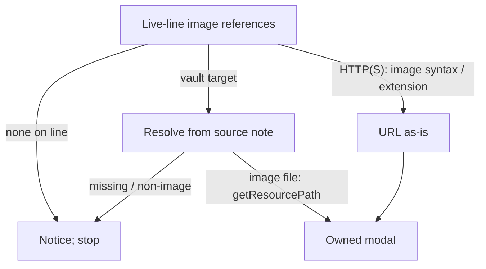

# Diagram proposals: `Z` to zoom an image in Obsidian: keep the key, own a small viewer, leave native clicks alone

Proposals for the swarm linker, not a report. Each diagram restates only what the source
report says.

```yaml
source: research:202610/obsidian_z_image_inspection/obsidian_z_image_inspection__final.md
producer: research.26.image
check: "mmdc 12.0.0 rendered 1 of 1 Mermaid diagrams"
```

## source-aware-image-resolution

```yaml
anchor: |-
  Use the live buffer, not the `metadataCache` links, which can lag a
illustrates: |-
  The proposed command finds image references in the live buffer, resolves vault targets against the source note, and opens an eligible image or produces a notice.
caption: "Proposed resolution: use the source note for vault images; accept only eligible HTTP(S) targets."
```

The figure focuses on resolution after line-scoped targeting. An HTTP(S) target is
eligible in explicit Markdown image syntax or when its URL path has an image extension.


