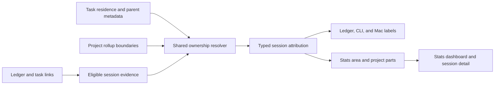

# Pomodoro attribution: automatic scope labels and honest project statistics

Independent research by **cdx** · 2026-10-18

## Design judgment

**This is a good idea if Bob derives where work belongs without pretending to know how time was divided.** Task residence and project ancestry are better organizational evidence than manually maintained theme strings. They can eliminate repeated categorization and make the dashboard answer useful questions: “Which responsibilities received attention?” and “Which projects did I work on?”

I recommend adding a shared, deterministic attribution model in bob-cli, using it for automatic labels and area/project breakdowns, and keeping the existing session name as an optional authored intention. Configure `sase.md` as a reporting boundary that absorbs all descendant projects. For a session spanning several independent owners, display every owner but put its duration in an explicit **Mixed projects** bucket; do not silently divide time by task count. Different projects can still have one unambiguous area.

This is a recommendation for implementation, not an implementation or a live-vault migration. I inspected bob-cli, the linked plugin source, the Mac capture source, and read-only vault query results. I did not consult other researchers' reports, chats, or findings.

## What the existing system actually does

The following are observed contracts, not proposed behavior.

| Existing behavior | Design consequence |
| --- | --- |
| A Pomodoro is a top-level checkbox under the daily note's `## Pomodoros`. The optional `— NAME` suffix is an authored, normally uppercase name. | The visible name is not already a project identity. |
| `worked` sums closed `[x]`/`[X]` sessions; recorded `[t:: …]` wins over a time-range estimate. Open sessions are plans. | Project attribution must preserve the existing duration and inclusion rules. |
| Stats splits a composite theme such as `GTD + SASE` equally in minutes, giving the remainder to the first component. Session counts go to the first matching component. | Generating a composite **name** would quietly introduce arbitrary time allocation and order-dependent counts. |
| `PomodoroSession` in the Stats index currently stores the name, durations, and line, but no child-link evidence. | The engine needs richer indexed facts, not a substitution in the chart legend. |
| The stats index already resolves parent chains, guards against cycles, and maps archived tasks back to their source residence. | Reuse these capabilities; avoid a second ancestry implementation. |
| The `bob-stats` block on `dash_stats.md` draws bob-cli's JSON report. The plugin's Pomodoro panel explicitly reads `parts_summary.theme`. | Extend the shared report, then its renderer. Do not add an independent Dataview calculation to the note. |
| Names drive selectors such as `#bugs`, the theme budget, duplicate-name lints, and GTD exemption. | Names are control inputs as well as labels. Automatic renaming could change command targets and planning behavior. |
| Capture close distinguishes worked, parked, deferred, dropped, completed/embedded, struck, and mentioned links. The numbered close lineup can include dedicated links at any depth. | One generic “find every wikilink” pass is insufficient. |
| Today uses a narrower, direct-child, open-task interpretation; agenda items omit struck links. | Neither Today nor the current agenda item list is a complete historical-work extractor. |
| Mac Capture renders data returned by bob and must remain a thin client. | Ownership and label generation belong in Rust, not Swift. |

Sources: [R1–R7] below, plus audited glossary and decision reads.

### Live-vault evidence

The live hierarchy query confirmed:

```text
Dev [area]
└── SASE [project]
    ├── sase_blog [project]
    ├── sase_memory [project]
    └── many other project notes

GTD [area]
└── Bob [project]

Job [area]
└── job_2026 [project]
```

There were **60 direct project children of `sase.md`** in the query result. That makes a parent-owned reporting boundary substantially more useful than maintaining a list of suppressed children. It also exposes a semantic trap: the **GTD area is not the GTD review activity**. Bob work can belong to that area without being morning-review time.

I sampled the complete fourteen-day interval **2026-10-04 through 2026-10-17** using `bob query`, not a filesystem scan of the vault:

| Exploratory observation | Result |
| --- | ---: |
| Closed top-level Pomodoros | 157 |
| Recorded duration across those sessions | 3,885 minutes / 64h 45m |
| Recognized dedicated direct-child block-link occurrences | 260 |
| Such occurrences pointing into `done/` | 148 |
| Such occurrences with strikethrough | 147 |
| Sessions with exactly one resolvable owner before folding SASE | 106 |
| Sessions with several resolvable owners before folding SASE | 24 |
| Sessions with exactly one resolvable owner after folding SASE descendants | 112 |
| Sessions with several resolvable owners after folding SASE descendants | 18 |
| Sessions with no resolvable owner in this probe | 27 |
| Sessions with one resolvable area | 117 |
| Sessions with several resolvable areas | 13 |

The 27 sessions without a resolvable owner comprised 24 named GTD and one each named READ, SHIT, and BLOG. After folding SASE, the sessions with several resolvable owners accounted for 540 minutes, about 14% of sampled duration. Those are meaningful mixed sessions, not an imaginary edge case. Examples included JOB sessions with Bob or SASE tasks and GTD sessions containing SASE work.

**Limits of this probe:** it examined direct children only, normalized archive filenames with the existing archive convention, and resolved note ownership from current area/project metadata. It did not validate every target block, inspect nested-link semantics, or establish measured task time. There were 38 unmatched link occurrences: 37 targeted daily notes and one targeted another note absent from the restricted metadata query. Sessions counted as “one resolvable owner” can still contain unmatched evidence. These numbers establish feasibility and failure modes; they are not a production attribution-accuracy score.

The most important result is that **discarding struck or archived links would discard a large portion of the actual ledger evidence**. Current task status must not determine whether past work counts.

Reproduction inputs:

```dataview
TASK FROM "2026"
WHERE file.name >= "20261004" AND file.name <= "20261017"
  AND !contains(text, "#task")
```

Retain top-level rows in the Pomodoros section with `status` x/X, including their children and `t` fields. The metadata query was:

```dataview
TABLE WITHOUT ID file.path, type, parent, title
WHERE type = [[area]] OR type = [[project]]
  OR startswith(file.path, "done/")
```

The probe used the returned paths and resolved parent links, not filename prefixes, to identify SASE descendants. Query diagnostics included unrelated ambiguous link targets; no ambiguous target was deliberately chosen as an owner.

## Adjustments I recommend to the requirements

1. **Automatic labels should be derived presentation, not automatic overwrites of `— NAME`.** Preserve existing names, capture selectors, and legacy theme filters. This deliberately means a plain Markdown source editor without Bob's rendering still shows the authored name or unnamed row; the automatic label appears in Bob's rendered ledger, agenda, CLI, and Stats surfaces.
2. **“Exclude subprojects” should mean “report their work under this parent,” not “discard their work.”** Use one shared rollup rule for labels and statistics. Independent switches for naming and aggregation would make the label and the dashboard disagree.
3. **Do not infer time fractions from task links.** Several owners produce a mixed bucket unless the user explicitly attributes the whole session. This is a substantive change from extending today's equal theme split to projects.
4. **Keep themes as an optional activity/intention dimension during rollout.** GTD, READING, WRITING, and ADMIN need not be projects. Do not automatically map a name to a note simply because their text matches.
5. **Scope grouping to metrics whose evidence supports it.** Worked time, sessions, and task Created/Done/Dropped can have area/project parts. Arbitrary daily fields, habits ratios, and formulas should not acquire fabricated project breakdowns.
6. **Use the current organization of the vault for the first release.** An ancestry change can restate past attribution. Say so in the dashboard. Frozen historical ownership would require additional event-time evidence and should be a separate, deliberate requirement.
7. **Do not change the planning budget in this release.** Existing authored themes retain their current cap and exemption behavior. Expose automatic scopes alongside them; decide separately whether the three-theme rule should eventually become a project-based focus budget.

These adjustments reduce ongoing interaction and avoid turning a useful personal reflection tool into a timesheet-maintenance system.

## The attribution model

### Keep four concepts separate

| Concept | Meaning | Authority |
| --- | --- | --- |
| Session identity | Which ledger row an operation targets | Existing stale-safe Pomodoro ref; not its display label |
| Authored name/theme | The user's intention or activity, such as BUGS or GTD | Existing `— NAME` |
| Work scope | The area or reporting project associated with its eligible task evidence | Shared attribution resolver, or explicit override |
| Duration | Recorded time for the session | Existing Stats duration rules |

An automatic scope label is a view of the third concept. It must never be parsed back into project identities, theme components, or selector slugs. In particular, an entity name containing `+`, Unicode, or punctuation must not become two categories.

### Resolve a task to its organizational home

For each eligible task link:

1. Resolve the note and block using Bob's canonical, ambiguity-aware resolution. Resolve aliases and relative links before deduplication. Use a canonical vault-relative path plus block ID for task identity.
2. For a task archived by Bob, recover its source residence using the existing archive helpers. Do not use the `done/` directory as an organizational owner.
3. A resident task in a project starts with that project; a task directly in an area starts with that area. Do not infer owners from `sase_` filename prefixes, tags, dependencies, prose mentions, or backlink counts.
4. For a reference task in a reference note, follow its configured parent to the first area/project owner. A reading task already resident in an area/project uses residence. If ownership is missing or ambiguous, retain an unresolved reason.
5. Apply project rollup boundaries as described below.
6. Derive the nearest actual area ancestor of the effective owner. Exclude the taxonomy note `area.md` itself. Nested areas remain distinct immediate owners; a higher-level area view can later roll them up explicitly.
7. Keep both raw residence and effective reporting owner in the result, with the ancestry path that explains the mapping.

A closed project remains a valid historical owner. No open-project filter is appropriate here. A missing `^prj` on an archived/closed project is not a reason to erase its time.

Malformed parent values, multiple parents, duplicate blocks, unresolved paths, and cycles must produce typed diagnostics. Never choose whichever candidate happens to be visited first. Where the project owner is independently known but its area is not, preserve the project result and mark only the area unresolved. If a broken ancestry chain prevents determining whether a reporting boundary applies, treat the reporting owner as uncertain rather than silently stopping early.

### Which links are evidence?

**Open session:** derive a provisional label from its planned Task Links. This is a forecast of scope, never worked time. Recompute after linking, unlinking, moving, or changing tasks and relevant parent metadata.

**Closed session:** derive from the task evidence retained in that closed ledger block after close selection and carry/defer operations have completed. Include parked work and completed work. Exclude links deferred or dropped out of that session. A task later completed, archived, or reopened does not retroactively disappear from its session's evidence.

Use an explicit shared evidence extractor with these rules:

- Recognize dedicated task-link bullets, including aliases, supported embeds, and completed/struck forms. At any eligible list depth, require that the link is the bullet's task content, not a mention in explanatory prose.
- Exclude fenced examples, code, managed dependency lines, managed log subtrees, and ordinary links mentioned inside work notes. A useful narrative can contain links to projects that received no work.
- Retain struck dedicated links as **recorded association**, with provenance. Do not require a tomato marker: embedded completion and some completion gestures leave other forms.
- Do not treat `🍅` as a stopwatch. Existing marker normalization can mark plain links in prose, and marker absence does not prove absence of work.
- Deduplicate resolved `(path, block_id)` pairs within a session. Five links to the same task or five tasks in the same reporting project do not make five allocations.
- Keep unresolved eligible links visible in the result. Resolving one link successfully does not justify silently ignoring a broken second one.

This extractor should be tested against the actual close and completion writers. The user-facing claim is **“attributed from recorded task links”**, not “we observed continuous focus on these tasks.” Older hand-edited ledgers cannot support a stronger claim without new evidence.

### A compact internal result

A useful conceptual result is:

```text
SessionAttribution
  basis: current_hierarchy
  source: linked_tasks | explicit_override | none
  owners: distinct typed owner identities, labels, and links
  raw_residences: original task homes
  project: single | direct_area | mixed | unassigned | unresolved
  area: single | mixed | unassigned | unresolved
  evidence: task key, ledger location, role, resolution, ancestry, boundary
  diagnostics: typed reasons
```

Typed identities such as `project:sase.md` and `area:dev.md` keep identical display names distinct. Synthetic buckets use their own namespace. Human-readable titles are presentation data; a title rename must not split a category.

## One project-owned rollup boundary

Recommended new frontmatter on `sase.md`:

```yaml
pomodoro_rollup: subtree
```

The absent/default value is `self`. Suggested meanings:

| Value | Meaning |
| --- | --- |
| `self` | This project is a reporting owner for its own tasks. Descendant projects retain their owners unless an ancestor boundary absorbs them. |
| `subtree` | This project and all descendant projects report as this project for Pomodoro scope labels and relevant Stats dimensions. |

Validate this field on project notes. `self` inside an absorbed subtree is **not** an opt-out. That would make the parent's guarantee unreliable.

### Precedence must be explicit

Walk the complete validated ancestor path. **The outermost `subtree` project wins.** For `SASE → Memory → Retrieval`, setting a boundary at SASE absorbs Retrieval even if Memory also sets one. A nearest-boundary rule would let descendants escape the parent's deliberate “do not show my subprojects separately” policy.

Direct SASE work and descendant work deduplicate to the same reporting owner. Area remains Dev. The setting changes no task residence, dependency, project lifecycle, completion propagation, or actual links.

Before enabling it, preview the resulting mapping. In particular, the live vault has `sase_blog` under SASE; the requested broad policy will combine Blog with SASE in the **project** view. Its authored BLOG theme remains available in the legacy dimension. If this erases a distinction Bryan cares about, that is an organizational decision to revisit, not a reason to secretly exempt one descendant.

Do not silently set equivalent boundaries on Bob or Job. They may be useful, but only SASE was requested. Do not add depth limits, glob patterns, label-only boundaries, per-child exceptions, or multiple policies in the initial release. Keep raw residence available in detail so aggregation never hides where the task actually lives.

## How to allocate statistics without making up time

### Default: categorical attribution with conserved totals

For a 25-minute closed session:

| Recorded evidence after boundary resolution | Project view | Area view |
| --- | --- | --- |
| One or several tasks all in SASE | SASE 25m | Dev 25m |
| SASE plus one of its absorbed subprojects | SASE 25m | Dev 25m |
| Two different projects both in Dev | Mixed projects 25m | Dev 25m |
| SASE and Bob | Mixed projects 25m | Mixed areas 25m |
| Tasks directly in Dev, no project | Direct work · Dev 25m | Dev 25m |
| SASE plus direct Dev work | Mixed projects 25m | Dev 25m |
| No eligible link and no override | Unattributed 25m | Unattributed 25m |
| SASE plus an unresolved eligible link | Unresolved 25m | Unresolved 25m, unless all area ownership can independently be established |

An unresolved project detail need not destroy known area ownership: for example, if every target's trustworthy area is Dev but one project boundary is invalid, area attribution can still be Dev. Do not claim this when the missing target could belong anywhere.

For every dimension independently:

```text
single owners + direct-area work + mixed + unattributed + unresolved
    = total worked duration
```

Areas and projects are alternative views of the same minutes, not values to add together. Hierarchical parent totals are subtotals, never extra allocations. Represent Mixed and Unresolved as explicit buckets, not as `Other`.

Session counts follow the same categorical decision: one closed session contributes exactly one count to one bucket in each dimension. Do not manufacture fractional session counts or choose the first linked task. Task Created/Done/Dropped counts use each task's single residence and the same rollup resolver; they do not inherit a Pomodoro's mixed state.

Existing duration-quality flags stay intact. Keep **duration quality** separate from **attribution quality**: a measured 25 minutes with uncertain ownership is still 25 measured minutes. Do not turn the whole Worked metric into missing data merely because one link is broken.

### Why not an equal split?

Equal division is easy but does not follow from the evidence. A 25-minute session with four tiny SASE tasks and one substantial Bob task could mean almost any division of time. Equal per-task allocation favors finely decomposed projects. Equal per-project allocation is less sensitive to task count but still invents a 50:50 division.

It also interacts badly with rollup. Dividing among raw children and then folding them can give SASE three shares and Bob one; folding first gives each one share. Neither is a measurement. A mixed bucket is honest about what the ledger actually records and is reasonably useful given the sample's concentration in single owners.

If mixed work later proves too large to support decisions, add **explicit allocation** or an opt-in view called **Estimated allocation**, never silently replace the default. Explicit shares would need conservation checks and precise rounding. That is extra interaction and schema work; it is not justified for the initial feature.

### A small correction mechanism

Offer **Attribute session to…** for a user who knows a session belongs wholly to one area/project despite missing or mixed links. This is a deliberate override of the entire duration, not a name edit and not an automatic majority vote.

A proposed storage form is one inline field on the Pomodoro parent line, before the authored name:

```markdown
- [x] (**0900-0925** [t:: 25m]) [work:: [[sase]]] — BUGS
```

This is proposed syntax, not currently supported behavior. The parser and time/name readers must explicitly recognize it; do not append it to the name tail and hope existing parsers ignore it. A scalar note link is enough for v1. Do not add a percentage editor yet.

A valid override wins over inferred owners, is visibly marked in session details, and passes through the same subtree policy. A user can return to **From task links**, removing the field. Invalid or ambiguous overrides must show an error and preserve duration in Unresolved rather than silently falling back. Clearing a field must not change task links or authored names. Use the existing stale-safe mutation and preview patterns.

A GTD review-only session may remain unattributed in the project view; its GTD theme remains useful. The system should not ask Bryan to create artificial tasks simply to eliminate every gray minute.

## When labels should appear and change

| Situation | Display behavior |
| --- | --- |
| Empty unnamed placeholder | Quiet “Unassigned”; no naming prompt required merely to view it. |
| First task linked to an unnamed session | Show its effective owner immediately. |
| Several tasks from the same owner | Keep the same compact label. |
| Several owners | Show two owner chips and a `+N` overflow, with the full list on focus/activation. |
| Named session | Keep the authored name and show automatic scope as separate supporting information. Suppress obvious duplicate display text only; do not change identities. |
| Close selection removes deferred tasks | Recompute from the final closed block; the final label can be narrower than the planned one. |
| Carried work creates another placeholder | Recompute that placeholder independently from its actual children. Copy only authored intent under today's existing rules, never a stale automatic label. |
| Task completion, archive, move, note rename, or parent edit | Invalidate the affected attribution and rerender. Preserve valid history evidence. |
| Override present | Display the chosen scope and an unobtrusive “Assigned” indicator in detail. |

Automatic labels should never initiate routing, reorder the queue, advance the review walk, or change task status. They describe the existing work structure.

For an unnamed session the automatic owner is the primary label. For an intentionally named session the authored title remains primary, with scope chips beneath or alongside it. This avoids an automation that keeps rewriting what the user just typed.

Use note `title` when present and sensible, otherwise a readable stem; allow SASE to remain SASE. Show the ancestry breadcrumb when names collide. Order chips by first eligible ledger occurrence, preserving a stable order through unrelated edits. The report's statistical rows are separately ordered by duration.

### Preserve command identity and the planning budget

Do **not** feed generated labels into `name`, `slug`, or `selectable`. Completion can show scope as descriptive text while inserting the existing selector or stale-safe entry reference. Two separate sessions can both be labeled SASE without becoming the same `#sase` destination.

Keep the current theme budget and GTD exemption based on authored names during this release. Existing unnamed-session counting remains as documented. Label the surfaces distinctly: **Plan themes** versus **Work scope**. Do not claim the automatic owner count enforces the three-theme policy; it does not.

There is a real future product question here: if Bryan stops authoring names completely, the existing budget becomes less informative because unnamed sessions share its unnamed-theme treatment. That is a reason to evaluate a later project-based budget with a before/after preview, not to silently alter capture refusals while implementing statistics. A change would require coordinated Rust/JavaScript budget updates and explicit treatment of GTD, mixed sessions, empty named placeholders, and duplicate names.

## A dashboard that feels calm and useful

Keep the current metric tiles, focus chart, range controls, prior comparison, and keyboard behavior. Replace only the Pomodoro context panel's hard-coded “by theme” assumption with a dimension switch:

```text
Worked                                      21h 10m
Where the time went       [ Areas ]  Projects  Themes

Dev                       █████████████     12h 20m
GTD                       ████               4h 10m
Job                       ███                2h 05m
Mixed areas               ░░                 1h 10m
Unattributed              ░                  1h 25m

Grouped by current note hierarchy · From recorded task links
```

The values above are an illustrative layout, not measurements from the live query. **Areas** is the default because it supports reflection without a wall of short-lived projects. **Projects** is one click away and remembers the user's view preference. **Themes** preserves the old interpretation and history, rather than mixing legacy name components into a project legend.

Recommended presentation details:

- Use aligned durations and quiet horizontal bars. Retain the existing metric hue instead of assigning a different saturated color to every project.
- Show five leading ordinary owners, then expandable **Other projects**. Keep Mixed, Unattributed, and Unresolved visible outside that truncation.
- Use text and a neutral patterned/outlined treatment for uncertain buckets; do not depend on color alone. Zero values must have zero-length bars.
- Use compact labels such as **Direct work · Dev** where no project exists. Do not create a fictitious project named Dev.
- Provide a context action or expansion **Show sessions** for every bucket. Include date, duration, authored name, automatic owners, evidence status, and an action to open the daily note at that session.
- A SASE row can say **Includes subprojects** in expanded detail. Show the raw project homes there without letting them become independent owners in the main view.
- A project name opens its note; the row's separate detail action opens contributing sessions. Keep these destinations distinguishable and keyboard accessible.
- Tooltips/focus cards distinguish **session total** from any attribution. A mixed session listing SASE and Bob must not show 25m next to both owner chips.
- Empty ownership is not zero work. A day with no Pomodoros, an unattributed session, and a missing daily note retain their distinct existing meanings.

Do not build a sunburst, nested treemap, or permanent hierarchy sidebar for this feature. The dashboard already has a useful visual grammar. A dimension switch plus a traceable breakdown gives the additional information with little additional interface.

Conceptual data flow:



## History, reliability, and scope limits

### Prefer current-hierarchy analytics over snapshots in v1

Stats currently derives values from the vault at read time. Preserve that property for automatic attribution. Do not write a second project list to each session, a hidden attribution database, or a journal for every label update.

This has a cost: moving a task to a different project, changing ancestry, or changing a reporting boundary can reclassify previous work. The dashboard should state **Grouped by current note hierarchy**; documentation should explicitly explain task moves as well as parent edits. A name or alias change changes display, not the underlying minutes. A routine archive operation should leave classification unchanged.

This is suitable for “where does my recorded work belong in my current system?” It is not an immutable historical organization chart. If the desired question is instead “what project did I consider this at the instant of work?”, use snapshots of raw organizational identity at close, not generated display strings. That would require stable session identity across moves, close-writer parity, rename handling, corrections, undo, sync, and migration semantics. I would not add that machinery before confirming that historical restatement is a real problem.

An override is persisted because it is a user's decision that cannot be reconstructed from links. Ordinary inference is not persisted because it can be reconstructed.

### Keep unresolved work in the accounting

Use a diagnostic reason such as `missing_block`, `ambiguous_note`, `parent_cycle`, `invalid_rollup`, or `invalid_override`. Show concise detail on demand; do not produce repeated notices while typing. A failed label lookup must not block starting or closing a session. It must never make recorded time disappear.

Compute every Stats response from one coherent input snapshot, as close as the existing filesystem model permits. In interactive views, discard late subprocess results whose vault revision/input generation is stale. Cache only as an optimization; a restart or empty cache must reproduce the same result. Parent and boundary changes need broader invalidation than changes to the daily file alone.

## Implementation shape and acceptance criteria

### Where the work belongs

1. **bob-cli:** extend the shared index with typed note metadata and session evidence; extract a reusable ownership resolver rather than embedding it only in Stats. Enrich the capture Pomodoro model and Stats report additively. Keep raw durations and legacy theme outputs unchanged.
2. **bob-plugins:** consume the new model for the Stats panel, rendered ledger labels, link-picker context, and evidence drilldown. Any instant local preview must use canonical returned facts or a deliberately shared conformance contract; do not independently implement another ancestry policy. Use fragment sources and the repo's build workflow, then deploy through `bob plugins sync` when implementation is authorized.
3. **bob-mac-capture:** decode optional scope/display fields and show them in the agenda and relevant previews. Preserve existing names and selectors. Older bob versions fall back to today's UI. Compile changed Swift targets and use the repository's required checks; Linux-only validation is insufficient for macOS presentation changes.
4. **Vault configuration:** add `pomodoro_rollup: subtree` to `sase.md` after the new reader supports it, with a preview of the affected descendants. The dashboard note should remain the standard `bob-stats` entry point.

An additive report can carry `parts.project`, `parts.area`, their supplied display strings and summaries, plus typed entity metadata and attribution diagnostics. Reserve machine keys for special buckets; never overload a display string such as “Other” as an entity identity. Rendering code must not recalculate shares or totals. Do not make every overview response carry an unbounded dump of all historical task text; request or paginate evidence detail through the backend.

### Incremental delivery without a migration cliff

- First build the resolver and hand-computed fixtures, and inspect a read-only preview against recent and archived ledger examples.
- Add project/area parts and the dimension switch while keeping the Themes view byte-for-byte equivalent for existing metrics.
- Add automatic labels to the CLI, Obsidian, and Mac surfaces without changing selector behavior. Test author names and unnamed sessions together.
- Add the explicit whole-session attribution correction, then configure the requested SASE boundary.
- Verify the result with the current vault in read-only mode and check normal project labels, mixed sessions, GTD review, archived tasks, and deep SASE descendants. Do not rewrite old themes or backfill inferred fields.

These are implementation boundaries, not a request to create additional task beads or change durable memory as part of this research.

### Tests that establish the semantics

| Case | Required result |
| --- | --- |
| One task / multiple tasks / duplicate aliases in one project | Same owner and same total; links do not multiply duration. |
| SASE child and grandchild | Both resolve to SASE after the boundary; Dev remains the area. |
| Nested subtree boundaries | Outermost boundary wins; inner `self` cannot opt out. |
| Two projects in one area | Mixed project bucket; one area receives the full duration. |
| Two areas | Mixed in both relevant dimensions; total counted once per dimension. |
| Direct area task | Area receives time; project view uses direct-area work, not a fake project. |
| Mention, fenced link, dependency, managed log link | Does not create a scope. |
| Struck, embedded completion, parked, deferred, dropped | Matches the documented historical evidence rules; deferred/dropped work is not attributed to the closed block. |
| Archive or alias repair | Valid attribution remains the same; broken blocks remain visible diagnostics. |
| Unknown second target | No arbitrary full assignment to the known first target. |
| Closed project or archived `^prj` | Still a valid owner. |
| Cyclic, missing, or ambiguous ancestry | Terminates with deterministic typed diagnostics. |
| Override set/clear/invalid | Visible and reversible; invalid input never silently becomes inferred assignment. |
| Cross-midnight, adjusted duration, missing duration | Reuses current Stats time and quality rules. |
| Session count and all minutes dimensions | Parts sum to the metric total; no order-dependent first-owner assignment. |
| Entity name contains `+`, Unicode, or duplicate title | Typed identity remains intact; display does not affect parsing. |
| Two auto-labeled SASE sessions | Remain distinct mutation targets; existing named selectors keep their behavior. |
| Boundary/task move changes | Current-hierarchy reclassification is deterministic; total worked time stays unchanged. |
| Old CLI/new plugin and new CLI/old plugin | Graceful field fallback; no schema-version surprise. |
| Two machines or a late preview response | No stale label write, no derived-label sync conflict, no old result overwriting a new view. |

Measure cold Stats and interactive label latency on the real vault before setting acceptance budgets. Reuse the existing single-vault-pass approach and batch resolution; avoid one subprocess or vault scan per session or per task. No performance measurement for the proposed implementation has been made in this research.

## Alternatives and critique

| Approach | Strength | Reason I would not choose it as the default |
| --- | --- | --- |
| Rewrite every theme from linked project names | Simple apparent model | Breaks the distinction between title and identity; affects selectors, caps, GTD, and old equal-split statistics. |
| Allocate equally per linked task | Fully populated charts | Task decomposition changes apparent effort; duplicated links and rollup order become accounting inputs. |
| Allocate equally per effective project | Avoids task-count bias | Still claims proportions that are not observed; acceptable only as a labeled estimate. |
| Assign everything to the first or most frequent project | Keeps charts simple | Link ordering or task size determines time credit; small edits can shift a whole session. |
| Require one project or a split editor at every close | Stronger explicit accounting | Adds friction to the main workflow and makes unplanned work cumbersome. |
| Record immutable ownership snapshots immediately | Stable historical organization | Larger storage, correction, migration, and multi-writer contract than current reflection needs justify. |
| Automatically classify prose using an LLM | Handles vague notes | Non-deterministic and hard to audit; the vault already has explicit structure. |
| Derived scope, categorical mixed buckets, optional override | Low-friction and explainable | Some time remains mixed/unattributed, and current-hierarchy changes restate history. Those limits are visible. |

The main risk is not implementation difficulty; it is making the chart look more authoritative than its evidence. Area/project attribution can tell Bryan where linked work belongs. It cannot establish exact task effort or project productivity. More task completions are not necessarily more valuable work, and short-lived subprojects are not necessarily distinct commitments.

External tools support separating organizational structure from activity labels: Toggl documents tags as additional context beyond client/project, while Clockify separates its client/project/task hierarchy from independent descriptions and tags. These are useful precedents for keeping GTD or WRITING as activity context while deriving project ownership. They do **not** validate any automatic multi-task time split; that recommendation here follows from Bob's evidence model. [Toggl Tags](https://support.toggl.com/en-us/article/tags-2b1rse/), [Clockify time categorization](https://clockify.me/help/track-time-and-expenses/categorizing-time-entries).

## Source record

Repository observations are pinned to the revisions inspected. Paths below are repository-relative; no peer research was used.

- **[R1] bob-cli `85eac25aa112e0888ec09955ef0bc587e3c514ea`:** [Daily Stats contract](https://github.com/bobs-org/bob-cli/blob/85eac25aa112e0888ec09955ef0bc587e3c514ea/docs/stats.md), especially metric kinds, data quality, grouping, and the Obsidian view.
- **[R2] Same revision:** `src/native/stats/index.rs:79`, `:274`, `:480`, `:685`; `src/native/stats/metrics.rs:141`, `:289`; `src/native/stats/series.rs:1021`. These establish the limited current Pomodoro record, parent resolution, legacy theme allocation, and top-five aggregation.
- **[R3] Same revision:** [Plan and Today contract](https://github.com/bobs-org/bob-cli/blob/85eac25aa112e0888ec09955ef0bc587e3c514ea/docs/plan.md), including named themes, GTD exemption, budgets, and Today recognition.
- **[R4] Same revision:** `docs/capture.md`, sections on close selection, completion ledger results, and `capture-pomodoros`; `src/native/capture_pomodoro_close/ledger.rs:257`, `:566`; `src/native/capture_pomodoro_close/links.rs`; `src/native/capture_pomodoro_name.rs`. These establish link roles, carried history, marker behavior, and name/ref semantics.
- **[R5] Same revision:** `docs/projects.md:60`, `:74`; `src/native/collect_done/link_repair.rs:375`; `docs/dashboard.md:73`. These establish project typing, aliases, archive source mapping, and the dashboard block entry point.
- **[R6] bob-plugins `8a0be74b5d590a5b3fcbb953b5b4e6fcd4086adb`:** `plugins/bob-ledger-tools/src/239-plugin-stats-panel-models.js:57`, `239-plugin-stats-panel-render.js:185`; `plugins/task-status-cycler/src/060-pomodoro.js`; `170-plugin-pomodoro.js`. These establish the theme-specific renderer and independent editor close/completion paths requiring compatibility.
- **[R7] bob-mac-capture `2d5952728df129d6ef39b0a20635fa4046f7f2b1`:** `Sources/CaptureCore/CaptureAgendaPresentation.swift:305` and `:505`, related Pomodoro presentations, and `AGENTS.md`. The agenda currently displays `entry.name` or “Untitled Pomodoro”; the source also establishes required Swift validation.
- **[R8] Audited SASE memory:** `obsidian.md`, `sase_artifacts.md`, glossary entries for Pomodoro, Task Link, Project Note, Area Note, Work Log, and decisions `mac-capture-is-a-thin-client` and `today-is-read-from-the-ledger`.
- **[R9] Live read-only evidence:** `bob query` results on 2026-10-18 for the hierarchy and 2026-10-04…2026-10-17 ledger sample, using the queries and limitations recorded above. These results can change as the live vault changes.
- **[R10] External primary documentation consulted 2026-10-18:** [Toggl Tags](https://support.toggl.com/en-us/article/tags-2b1rse/) and [Clockify time categorization](https://clockify.me/help/track-time-and-expenses/categorizing-time-entries). Used for the limited structural/activity distinction above.

## Recommended solution

**Build automatic work-scope attribution as a shared read-time projection in bob-cli.** Preserve authored Pomodoro names and their current planning behavior. Derive compact project/area labels from eligible task evidence, using one project-owned `pomodoro_rollup: subtree` boundary; enable it on `sase.md`, with the outermost boundary winning. Keep the original task homes inspectable.

Make Areas and Projects the principal organizational views in `dash_stats.md`, retain Themes for activity and historical compatibility, and conserve every recorded minute. Assign a session wholly where ownership is unambiguous; otherwise show Mixed, Unattributed, or Unresolved explicitly. Offer a lightweight whole-session attribution override instead of requiring a bookkeeping step at every close.

Ship this without bulk-renaming history, inferring time splits, changing task lifecycle rules, or adding frozen-ownership infrastructure. The result should feel like Bob quietly understanding the structure already present in the vault—and should make the limits of that understanding easy to inspect.
