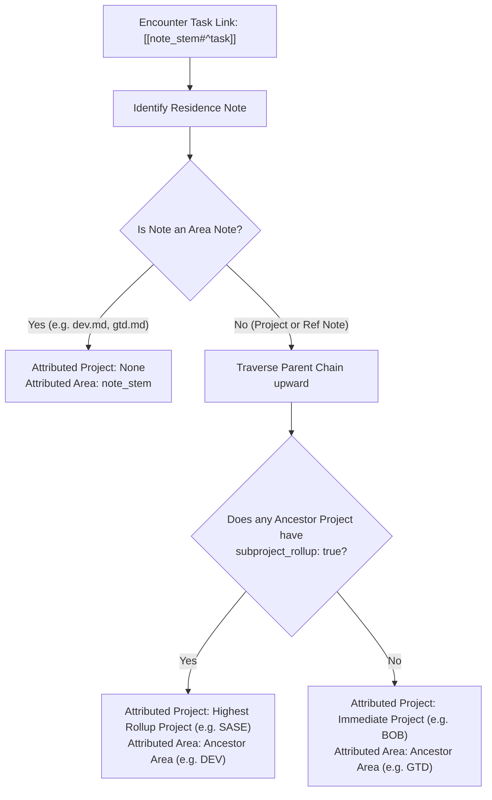
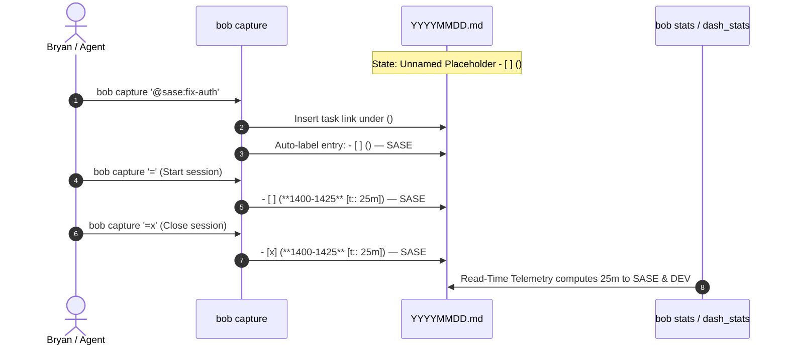

# Architectural Research: Project & Area Pomodoro Labeling and Stats Aggregation

**Author:** Researcher `gem` (Independent Swarm Evaluation)  
**Date:** 2026-10-18  
**Topic:** Automating Pomodoro labeling by Project/Area, Subproject Rollup Policy, and Multi-Tier Stats Aggregation in `dash_stats.md`

---

## 1. Executive Summary

This report investigates the transition from free-form, manually authored Pomodoro themes (e.g., `— GTD`, `— BOB`, `— BLOG`, `— MEMORY`, `— PYPI`) to an automated, ontology-backed labeling and telemetry system rooted in the Bob vault's existing Project and Area structure.

### Key Conclusions & Direct Answers

1. **Is this a good idea?**  
   **Yes, with one critical architectural pivot.** Free-form themes introduce high cognitive friction, arbitrary categorization, and artificial plan-budget exhaustion. However, coupling *telemetry* exclusively to *text strings in the markdown ledger* would repeat the exact fragility of themes. The key design pivot is **decoupling read-time telemetry from ledger authoring**:
   - The **Stats Engine** must attribute worked time at the *task-link level* (read-time derivation directly from vault ontology), allowing mathematically accurate splits for multi-project pomodoros and instant retrospective aggregation of historical data.
   - The **Ledger Labeling System** (`— LABEL` on pomodoro lines) serves human ergonomics, daily focus, and capture targeting, populated automatically upon task linkage or session start.

2. **How to handle Sub-projects (and `sase.md` Rollup):**  
   Projects with vast sub-project trees (such as `sase.md`, which manages over 20 sub-projects like `sase_blog`, `sase_memory`, `sase_art`, etc.) suffer from "telemetry fragmentation" and plan-budget cap blowouts. We recommend introducing a scalar frontmatter property:
   ```yaml
   subproject_rollup: true
   ```
   When configured on `~/bob/sase.md`, any task link pointing to `sase.md` or any of its descendant sub-projects (at any depth) is absorbed into the parent `sase` project for both Pomodoro labeling and stats aggregation.

3. **What, When, and How to label Pomodoros:**
   - **What:** Project-first with Area fallback. A session with tasks from a project gets the canonical upper-cased project stem (e.g., `— SASE`). A session with tasks directly in an Area note gets the area name (e.g., `— DEV`, `— GTD`). Multi-project sessions use a composite label (`— SASE + BOB`) or defer to the primary running task.
   - **When:** Dynamically at **Link Time** (as soon as a task is linked to an unnamed pomodoro), finalized at **Start Time** (`=`) and **Close Time** (`=x`).
   - **How:** Written onto the pomodoro line as `— <PROJECT|AREA>`, strictly respecting explicit user manual overrides (`Manual Sovereignty`).

4. **Stats Aggregation in `dash_stats.md`:**  
   Expand Bob's Schema-1 report to emit `parts["project"]` and `parts["area"]` alongside `parts["theme"]`. In the `bob-stats` Obsidian block on `dash_stats.md`, replace the single "Worked by theme" list with an interactive, dual-tier view: **Macro Life Balance (by Area)** and **Tactical Execution (by Project)**, accessible via sleek pill toggles and ranked visual bars.

---

## 2. Critique of the Plan & Philosophical Alignment

### 2.1 The Problem with the Status Quo (Free-Form Themes)

In the current workflow, every Pomodoro is labeled with an ad-hoc uppercase string:
```markdown
- [x] (**0710-0800** [t:: 50m]) — GTD
- [x] (**1310-1325** [t:: 15m]) — BOB
- [x] (**1350-1405** [t:: 15m]) — BLOG
- [ ] () — MEMORY
- [ ] () — PYPI
- [ ] () — HACK
```

This presents severe drawbacks:
1. **Cognitive Tax on Capture & Planning:** Bryan must mentally invent and remember theme tags before even starting work.
2. **Artificial Theme Cap Friction:** `plan.max_themes: 5` is designed to limit context switching. But because subprojects like `sase_blog`, `sase_memory`, and `sase_pypi_releases` were authored as distinct themes (`BLOG`, `MEMORY`, `PYPI`), Bryan hits his 5-theme cap while effectively working on just one unified project (`sase`).
3. **Telemetry Inconsistency:** Over months, tasks in `sase_blog` may be labeled `BLOG`, `SASE`, or `WRITING`, scattering analytics into meaningless micro-buckets.
4. **Neglect of Vault Authority:** The Bob vault already possesses a rigorous, canonical structure: Area notes (`type: "[[area]]"`) and Project notes (`type: "[[project]]"`), with explicit `parent:` links. The ledger should leverage this existing knowledge base rather than maintaining a disconnected parallel taxonomy.

### 2.2 The Risk: Don't Repeat Theme Fragility

If we simply replace manual theme strings with "automated project strings" and continue to aggregate stats *only by parsing the string after the em-dash (`— `)*, we preserve the same fundamental fragility:
- What happens when a 50-minute Pomodoro contains one `bob` task and one `sase` task? If the line is labeled `— SASE`, `bob` gets 0 minutes. If labeled `— BOB`, `sase` gets 0 minutes.
- What about the thousands of historical pomodoros in `YYYYMMDD.md`? Must Bryan run a destructive batch migration to rewrite every past daily note?

### 2.3 The Core Architectural Principle: Dual-Plane Architecture

To make this system intuitive, reliable, and beautiful, we propose a **Dual-Plane Architecture**:

```
┌────────────────────────────────────────────────────────────────────────┐
│                          VAULT ONTOLOGY                                │
│       Areas (dev, gtd, job)  ◄──  Projects (sase, bob)  ◄──  Subprojects │
└───────────────────────────────────┬────────────────────────────────────┘
                                    │
               ┌────────────────────┴────────────────────┐
               ▼                                         ▼
   ┌───────────────────────┐                 ┌───────────────────────┐
   │     LEDGER PLANE      │                 │    TELEMETRY PLANE    │
   │  (Operational Human)  │                 │    (Engine & Stats)   │
   ├───────────────────────┤                 ├───────────────────────┤
   │ • Visual `— SASE`     │                 │ • Attributed at Task- │
   │ • Capture selectors   │                 │   Link resolution     │
   │ • Plan budget meter   │                 │ • Exact min splits    │
   │ • Fast glance in tmux │                 │ • Retrospective for   │
   │ • Explicit overrides  │                 │   historical vaults   │
   └───────────────────────┘                 └───────────────────────┘
```

1. **The Telemetry Plane (Read-Time Derivation):** `bob stats` and `dash_stats.md` read the child task links inside each Pomodoro session, resolve them to their residence notes, apply the subproject rollup policy, and attribute minutes proportionally. This guarantees 100% mathematical precision and zero historical migration overhead.
2. **The Ledger Plane (Authoring & Ergonomics):** `bob capture`, start (`=`), and close (`=x`) commands automatically write clean, canonical Project/Area names into the daily note (`— SASE`), maintaining an uncluttered, human-readable ledger.

---

## 3. Sub-project Rollup Architecture

### 3.1 The Need for Subproject Absorption

Bryan notes:
> "We will need the ability to exclude sub-projects of some projects from being aggregated and/or used to label pomodoros directly. Instead, task links to tasks in these sub-projects should be treated as if (when labeling pomodoro and aggregating stats) they pointed to tasks in the parent project that configured this. We should configure the ~/bob/sase.md project note to use this functionality."

In GTD and P.A.R.A., large software initiatives naturally spawn satellite notes to hold dedicated task lists, research notes, and backlogs. In Bryan's vault:
- `sase.md` (Project under Area `dev.md`)
  - Sub-projects: `sase_blog.md`, `sase_memory.md`, `sase_pypi_releases.md`, `sase_art.md`, `sase_agents_repo.md`, `sase_monitor.md`, etc.
  - Sub-sub-projects: `sase_art.md` has `sase_art_file.md`, `sase_art_links.md`.

Treating every satellite file as an independent project in stats produces noise rather than signal. Bryan does not want "3% on sase_art, 4% on sase_blog, 2% on sase_pypi"; he needs to know: **"What fraction of my week was invested in SASE?"**

### 3.2 Frontmatter Specification

We recommend a clean, scalar frontmatter property on the parent project note:

```yaml
---
parent: "[[dev]]"
type: "[[project]]"
status: wip
subproject_rollup: true
---
```

#### Why Scalar `subproject_rollup: true` Wins Over Alternatives:

| Alternative | Mechanics | Fatal Flaw |
| :--- | :--- | :--- |
| **A. Explicit List in Parent**<br>`exclude_subprojects: [sase_blog, ...]` | List all children to exclude/rollup. | High maintenance; prone to drift whenever an agent or user captures a new subproject note. |
| **B. Property on Child Notes**<br>`rollup_into: "[[sase]]"` | Every subproject note declares where it rolls up. | Redundant; the child *already* declares `parent: "[[sase]]"`. Requires touching dozens of files. |
| **C. Scalar on Parent (Recommended)**<br>`subproject_rollup: true` | Parent declares that its entire subproject tree rolls up into itself. | **Zero maintenance.** Any current or future note pointing `parent: "[[sase]]"` automatically inherits rollup. |

### 3.3 The Resolution Algorithm

When the engine encounters a task link `[[note_stem#^block-id]]`:



#### Step-by-Step Traversal Rules:
1. **Find Residence Note:** Follow `NoteIndex` to locate the source file. If the task is in `ref/...`, read its frontmatter `parent:` or `source_note:` to find its owner project/area.
2. **Build Ancestor Chain:** Walk `parent:` wikilinks upward until reaching `parent: "[[area]]"` or an Area note (`type: "[[area]]"`).
   - *Cycle Protection:* The traversal tracks `seen_paths` and aborts if a loop is detected (matching the existing `StatsIndex::parent_ancestors` safeguards).
3. **Rollup Evaluation:**
   - Scan the ancestor chain from the residence note up to the top project (below the Area).
   - If any project along that path declares `subproject_rollup: true`, the **highest** project in that branch declaring rollup becomes the attributed project.
   - The Area note at the root of the chain becomes the attributed Area.
4. **Granular Override (Escape Hatch):** If a specific subproject under `sase` legitimately represents an independent initiative (e.g., `sase_blog` once it becomes an external publication), it can declare `subproject_rollup: false` in its own frontmatter to exempt itself from parent absorption.

---

## 4. Pomodoro Labeling Mechanics: The "What, When, and How"

### 4.1 "WHAT" to Label

The text label on the pomodoro line in the daily note must balance brevity, readability, and compatibility with the existing capture selector grammar (`[A-Z0-9&'()+,. /-]`):

```markdown
- [x] (**1310-1325** [t:: 15m]) — SASE
```

#### Canonical Labeling Rules:

1. **Pure Project Match (Single Project):**  
   If all task links resolve to the same project (either directly or via rollup), label with the uppercase project link stem:
   - Tasks in `sase.md`, `sase_blog.md`, and `sase_memory.md` $\rightarrow$ `— SASE`
   - Tasks in `bob.md` and `bob_git.md` (no rollup) $\rightarrow$ `— BOB_GIT` (or `— BOB` if `bob.md` configures rollup)

2. **Area Task Match (No Project):**  
   If tasks belong directly to an Area note (e.g., general bug triage in `dev.md` or weekly planning in `gtd.md`):
   - Tasks in `dev.md` $\rightarrow$ `— DEV`
   - Tasks in `gtd.md` $\rightarrow$ `— GTD`

3. **Multi-Project Sessions (The Composite Rule):**  
   If a session contains tasks from multiple distinct projects:
   - **Composite Syntax:** Bob already natively supports composite names separated by ` + ` (e.g., `split_components` in `src/native/plan_budget/mod.rs` and `docs/stats.md` line 129).
   - E.g., a session with a `bob` task and a `sase` task $\rightarrow$ `— BOB + SASE`.
   - **Order:** Order by first appearance in the sub-bullet list (or active running task first).
   - **Max Components:** Limit composite labels to 2 components. If 3 or more projects are present, or if tasks span diverse projects within the same Area, roll up to the common Area label (e.g., `— DEV`) to keep the line clean.

4. **Taskless Sessions:**  
   If a session starts or completes with no task links and no authored name, it remains `— UNNAMED` (or simply `()` placeholder without a label). It should never guess a project out of thin air.

5. **Manual Sovereignty Rule:**  
   If Bryan explicitly types a custom theme (e.g., `— DEEP WORK`, `— PLANNING`, `— INTERVIEW`), the system **NEVER overwrites it**. Auto-labeling only activates when the entry is unnamed or when the current label was machine-generated.

### 4.2 "WHEN" to Label (Lifecycle Triggers)

Auto-labeling must occur across the standard Pomodoro lifecycle:



1. **Trigger A: On Task Capture / Linkage (`bob capture '@project:id'`)**
   - When a task link is appended to an open Pomodoro that is currently unnamed (`- [ ] ()`), `bob capture` immediately evaluates the task's resolved project and labels the parent entry:
     `- [ ] () — SASE`
   - *Why immediate?* This provides instant visual feedback in Obsidian, tmux status line, and `bob capture-pomodoros` agenda views.

2. **Trigger B: On Session Start (`bob capture '='` / `=<X>`)**
   - If an open placeholder has child task links added manually in Obsidian (bypassing CLI capture) and is still unnamed, starting the session inspects the child links and adds the label alongside the timestamp:
     `- [ ] (**1410-1500** [t:: 50m]) — SASE`

3. **Trigger C: On Session Close (`bob capture '=x'`)**
   - When a session closes, if it is still unnamed, derive and seal the label.

4. **Trigger D: On Sub-Bullet Movement (`N<ctrl+shift+m>`)**
   - When moving task links between pomodoros using the Obsidian hotkey, if a task is moved into an empty placeholder, `bob-navigation-hotkeys` or `bob-ledger-tools` updates the target pomodoro's name.

### 4.3 "HOW" to Implement in Code

- **In `src/native/capture_pomodoros.rs`:**
  Add a helper `derive_pomodoro_label(links: &[StartLink], vault_index: &StatsIndex) -> Option<String>`.
- **In `src/native/capture/pomodoro_start.rs` & `capture_pomodoro_close/ledger.rs`:**
  During planning, if `entry.name.is_none()`, invoke the helper to generate the canonical name part and append ` — <LABEL>` to the rewritten ledger line.
- **In `src/native/plan_budget/`:**
  The meter that counts `themes` against `max_themes` now counts resolved **projects/areas**. Because `sase_blog` and `sase_memory` both resolve to `SASE`, the plan budget meter registers **1 project** instead of 2 themes!

---

## 5. Stats Aggregation & Dashboard Presentation (`dash_stats.md`)

### 5.1 Data Model Extensions (Schema-1 Compatible)

Currently, the `worked` metric in `bob stats -f json` emits:
```json
{
  "id": "worked",
  "kind": "pomodoro",
  "parts": {
    "theme": { "GTD": 50, "BOB": 25, "SASE": 25 }
  },
  "parts_summary": {
    "theme": [
      { "key": "GTD", "value": 50, "display": "50m", "share": "50%" },
      { "key": "BOB", "value": 25, "display": "25m", "share": "25%" },
      { "key": "SASE", "value": 25, "display": "25m", "share": "25%" }
    ]
  }
}
```

We extend `PomodoroSession` in `src/native/stats/index.rs` to parse and store the session's child task links. In `src/native/stats/metrics.rs`, the evaluator resolves each link through the `StatsIndex` ontology and populates two new dimensions:

```json
{
  "id": "worked",
  "kind": "pomodoro",
  "parts": {
    "theme": { "GTD": 50, "BOB": 25, "SASE": 25 },
    "project": { "sase": 50, "bob": 25, "(area-only)": 25 },
    "area": { "dev": 50, "gtd": 50 }
  },
  "parts_summary": {
    "project": [
      { "key": "sase", "value": 50, "display": "50m", "share": "50%" },
      { "key": "bob", "value": 25, "display": "25m", "share": "25%" },
      { "key": "(area-only)", "value": 25, "display": "25m", "share": "25%" }
    ],
    "area": [
      { "key": "dev", "value": 50, "display": "50m", "share": "50%" },
      { "key": "gtd", "value": 50, "display": "50m", "share": "50%" }
    ],
    "theme": [ ... ]
  }
}
```

> [!NOTE]
> **100% Backwards Compatible:** Because `parts` and `parts_summary` are dictionary maps of dimension keys, adding `"project"` and `"area"` does not break existing consumers. Legacy renderers simply continue reading `"theme"`, while updated renderers can select `"project"` or `"area"`.

### 5.2 Bonus: Extending Task Metrics (`done`, `created`, `net`)

Because every task in the vault already has a residence note, the same ontology engine allows `done`, `created`, and `dropped` metrics to emit `parts_summary["project"]` and `parts_summary["area"]` in addition to `parts_summary["note"]`. Bryan can now view:
- **"Tasks completed this month by Project"**
- **"Task creation vs completion flow by Area"**

### 5.3 Designing the Obsidian UI (`dash_stats.md`)

Bryan explicitly asked for a design that is **intuitive, reliable, and beautiful**.

#### Visual Architecture for the Context Panel

In `bob-ledger-tools/src/239-plugin-stats-panel-render.js`, the context panel below the main chart for `Worked` should be redesigned:

````carousel
```text
┌────────────────────────────────────────────────────────────────────────┐
│  Worked breakdown                   [ Projects ]  ( Areas )  ( Themes ) │
│  Total: 137h 40m over last 4 weeks                                     │
├────────────────────────────────────────────────────────────────────────┤
│  sase       ████████████████████████████░░░░░░░░░░░  56h 45m  (41%)     │
│  bob        ██████████████░░░░░░░░░░░░░░░░░░░░░░░░░  22h 20m  (16%)     │
│  job_2026   ████████░░░░░░░░░░░░░░░░░░░░░░░░░░░░░░░  13h 55m  (10%)     │
│  plex_hack  ████░░░░░░░░░░░░░░░░░░░░░░░░░░░░░░░░░░░   7h 10m   (5%)     │
│  other      ██████████████████░░░░░░░░░░░░░░░░░░░░░  37h 30m  (28%)     │
└────────────────────────────────────────────────────────────────────────┘
```
<!-- slide -->
```text
┌────────────────────────────────────────────────────────────────────────┐
│  Worked breakdown                   ( Projects )  [ Areas ]  ( Themes ) │
│  Total: 137h 40m over last 4 weeks                                     │
├────────────────────────────────────────────────────────────────────────┤
│  dev        ████████████████████████████████░░░░░░░  63h 55m  (46%)     │
│  gtd        ████████████████░░░░░░░░░░░░░░░░░░░░░░░  32h 16m  (23%)     │
│  job        ███████░░░░░░░░░░░░░░░░░░░░░░░░░░░░░░░  13h 55m  (10%)     │
│  cash       ███░░░░░░░░░░░░░░░░░░░░░░░░░░░░░░░░░░░   6h 20m   (5%)     │
│  other      ██████████░░░░░░░░░░░░░░░░░░░░░░░░░░░░  21h 14m  (16%)     │
└────────────────────────────────────────────────────────────────────────┘
```
````

#### Key UI Elements:
1. **Interactive Dimension Pills:** A segmented control at the top right of the panel (`Projects` | `Areas` | `Themes`). `Projects` is selected by default.
2. **Proportional Theme-Hue Bars:** Uses the existing Bob color palette (`bob-stats-svg-hue-orange` for Worked), with subtle CSS transitions.
3. **Hover & Day-Pin Synchronization:** When a specific day or week bucket is pinned on the main chart above, the breakdown dynamically filters to show that specific period's Project and Area distribution!
4. **Click-to-Open:** Clicking a Project row in the breakdown (e.g., `sase`) triggers Obsidian's internal navigation to open `~/bob/sase.md` in a leaf.

### 5.4 Terminal CLI UX (`bob stats show worked -c`)

In the terminal, `bob stats` renders clean, compact rows:

```text
Worked - minutes per day - Sep 20 – Oct 17 + today          5h 00m/day ▲ 2% vs prior

8h ┤   ▄▅▂    ▇ ▃     ▃    ▂     
5h ┤▆█▄███▄▇█▅█▂█▅▇▁▇▅█▅▅▁██▇▄█▆ 
2h ┤████████████████████████████▯
0  ┼─────────────────────────────
    Sep 20      Oct 4      Oct 18

 normal   4h 10m – 5h 29m (p25–p75) - total 137h 40m over 28 days - 28 of 28 days with data
 project  SASE 56h 45m 41% - BOB 22h 20m 16% - JOB 13h 55m 10% - other 44h 40m 33%
 area     DEV 63h 55m 46% - GTD 32h 16m 23% - JOB 13h 55m 10% - other 27h 34m 21%
```

---

## 6. Implementation Architecture & Phased Roadmap

To execute this transition reliably without breaking daily operations, we recommend a 5-phase implementation plan:

### Phase 1: Vault Ontology & Subproject Rollup Engine (`bob-cli`)
- **Files:** `src/native/projects/model.rs`, `src/native/projects/scan.rs`, `src/native/vault_links/mod.rs`
- Parse `subproject_rollup: bool` from project frontmatter.
- Implement `resolve_project_and_area(target_path: &Path, vault_index: &StatsIndex) -> (Option<String>, Option<String>)`.
- Test ancestor walking, cyclic protection, and sub-subproject rollup.

### Phase 2: Telemetry & Stats Engine (`bob stats`)
- **Files:** `src/native/stats/index.rs`, `src/native/stats/metrics.rs`, `src/native/stats/series.rs`
- Update `PomodoroSession` in `StatsIndex` to parse child task links.
- In `evaluate_pomodoros()`, map sessions to their resolved projects and areas.
- For sessions with multiple task links, distribute minutes proportionally across distinct projects.
- Populate `parts["project"]` and `parts["area"]` in `MetricReport`.
- Update terminal formatter in `src/native/stats/render.rs` to print `project` and `area` summary rows.

### Phase 3: Vault Configuration (`~/bob/sase.md`)
- Add `subproject_rollup: true` to `~/bob/sase.md` frontmatter:
  ```markdown
  ---
  parent: "[[dev]]"
  type: "[[project]]"
  template: "[[new_project]]"
  status: wip
  subproject_rollup: true
  ---
  ```
- Verify with `bob stats -f json` that tasks in `sase_blog.md`, `sase_memory.md`, etc., aggregate under `sase`.

### Phase 4: Automated Pomodoro Labeling (`bob capture`)
- **Files:** `src/native/capture/pomodoro_start.rs`, `src/native/capture_pomodoro_close/ledger.rs`, `src/native/plan_budget/`
- When `bob capture` links a task to an unnamed pomodoro, auto-assign `— <PROJECT>`.
- In `pomodoro_start` (`=`) and `pomodoro_close` (`=x`), if `name.is_none()`, auto-label before writing.
- In `plan_budget`, count unique open resolved projects/areas against `max_themes`.
- Add test coverage for single-task, multi-task composite, and manual override sovereignty.

### Phase 5: Obsidian UI Enhancement (`bob-plugins`)
- **Files:** `plugins/bob-ledger-tools/src/239-plugin-stats-panel-models.js`, `239-plugin-stats-panel-render.js`
- Add support for `project` and `area` dimension models in `statsPanelPomodoro`.
- Implement dimension pill toggles (`Projects` | `Areas` | `Themes`).
- Build preview fixtures and verify rendering with `npm test`.

---

## 7. Edge Cases & Risk Analysis

| Scenario / Edge Case | Risk | Mitigation |
| :--- | :--- | :--- |
| **Multi-project Pomodoro**<br>(e.g. 1 task in `bob`, 1 in `sase`) | Telemetry distortion if forced into a single project. | **Decoupled Resolution:** Stats splits minutes evenly (25m to `bob`, 25m to `sase`). The ledger line displays composite `— BOB + SASE`. |
| **Historical Daily Notes**<br>(thousands of past notes with manual themes) | Breaking historical reports or forcing batch rewrites. | **Dual Fallback:** If task links exist, derive Project/Area directly from links. If no links exist, match existing theme string against project/area stems (e.g. theme `SASE` $\rightarrow$ project `sase`). Past data is instantly upgraded with zero note mutations. |
| **Manual User Override**<br>(e.g. Bryan types `— DEEP WORK`) | Automation clobbering intentional user focus titles. | **Manual Sovereignty:** The system inspects if a name is already present and does not match the generated slug. If user-authored, it is left completely untouched. |
| **Taskless Pomodoro**<br>(Admin time, ad-hoc chat) | Attempting to guess an invalid project. | Falls back to `(unassigned)` or attributes to `theme` only. Never invents phantom project links. |
| **Deep Ancestor Cycle**<br>(Malformed parent wikilinks) | Infinite recursion during ancestor chain walking. | Traversal tracks a `BTreeSet<PathBuf>` of visited notes and terminates immediately upon cycle detection. |

---

## 8. Final Recommended Solution

1. **Adopt the Dual-Plane Design:** Use task links for pure read-time stats aggregation and auto-populate ledger labels for daily capture ergonomics.
2. **Implement `subproject_rollup: true` in `sase.md`:** This cleanly collapses all 20+ SASE satellite backlogs into a single coherent project identity across both plan budgeting and stats.
3. **Extend Bob's Schema-1 Report:** Add `project` and `area` dimension breakdowns to `parts` and `parts_summary` for `worked` and task flow metrics.
4. **Upgrade `dash_stats.md` UI:** Provide pill-switched Project and Area breakdowns in the Obsidian `bob-stats` block, allowing Bryan to seamlessly monitor both tactical project progress and macro life balance.
