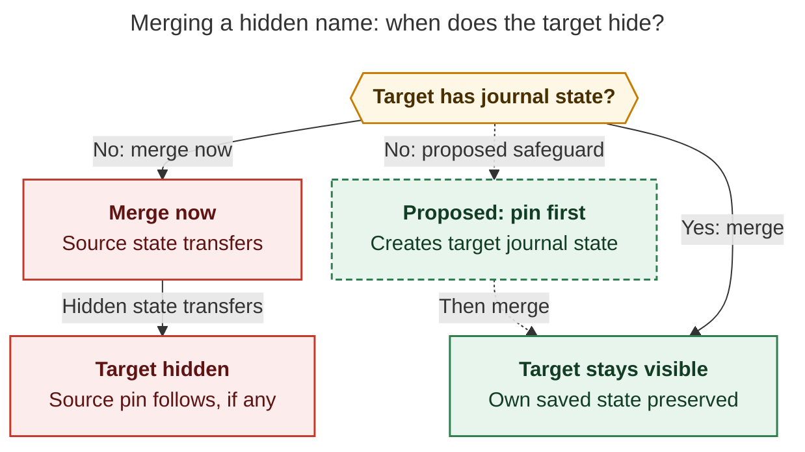

# Diagram proposals: Your six Pomodoro themes

Proposals for the swarm linker, not a report. Each diagram restates only what the source
report says.

```yaml
source: research:202610/pomodoro_six_theme_review/pomodoro_six_theme_review__final.md
producer: research.2n.image
check: "mmdc 12.0.0 with the PDF-mirroring config rendered 1 of 1 Mermaid diagrams; Puppeteer --no-sandbox; malformed-input check exited nonzero"
```

## hidden-theme-merge

```yaml
anchor: |-
  A rename moves the source's explicit state onto a target that has none
question: |-
  When does merging a hidden name hide a visible theme, and how does pinning prevent it?
illustrates: |-
  A merge transfers a hidden source's state to a target with no journal state, while pinning first gives the visible target its own state and protects it from that transfer.
caption: Merging a hidden theme can hide a target without journal state; pinning the target first prevents that transfer.
review: "657.695x516 px, fit 99.3%; question and visual checks passed; 0 revisions; arrows show alternative routes, so either incoming route suffices"
```


