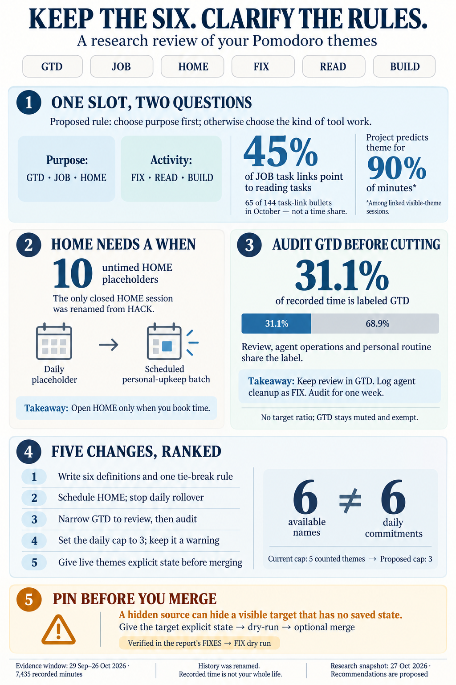
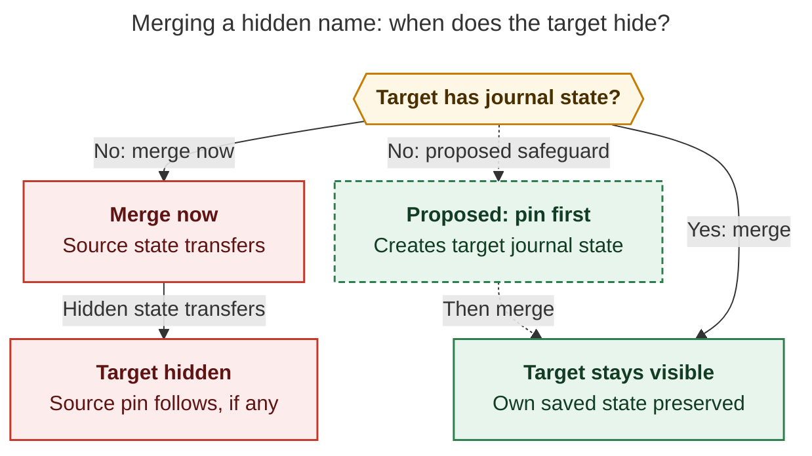

# Your six Pomodoro themes: what they hold, how they compare with established practice, and what to change

> **Research query:** How do I use my Bob themes, and how does that use compare with
> related established best practices? End with a ranked list of recommended changes
> to consider making to the themes I currently use, as shown by `bob themes list`.



## Bottom line

- **Keep the six names.** The Oct 26 cleanup (71 hides plus six renames) was the right
  move, and the size of the visible set is fine. The problems are in what the names are
  allowed to mean and in the daily rules around them. Spelling is not the issue.
- **The six names answer two questions in one slot.** JOB, HOME, and GTD say what a block
  is *for*. BUILD, FIX, and READ say what *kind* of work it is. Nothing written decides
  between them. In October, 65 of JOB's 144 task-link bullets pointed at `^ref-*` reading
  tasks. Today's running JOB session holds a `dev.md` Gmail re-auth task (see
  [JOB mixes a purpose with an activity](#job-mixes-a-purpose-with-an-activity)). A short
  written codebook with a precedence rule would fix this
  ([proposed codebook](#proposed-codebook)).
- **HOME has never been worked under its own name.** Its one closed session is a HACK
  session that was renamed into HOME yesterday. The other ten entries are untimed
  placeholders, and "Sell stocks now!" has rolled through nine of them (see
  [HOME is a rollover list](#home-is-a-rollover-list-not-a-work-block)).
- **GTD is 31% of recorded time** (Sep 29 – Oct 26), and 41–43% in two recent weeks. Its
  sessions also hold SASE agent operations and personal-routine chores, so the
  `review_time` figure overstates actual review. Audit what is inside GTD before deciding
  whether it is too much (see
  [GTD is review plus routine plus operations](#gtd-is-review-plus-routine-plus-operations)).
- **The theme cap can't fire.** `plan.max_themes` is 5, and only five non-exempt names are
  in use. Meanwhile your Morning review checklist says "≤3 themes". Pick one number,
  preferably 3 (see
  [the cap section](#the-cap-cannot-fire-and-it-disagrees-with-your-checklist)).
- **A live safety issue:** two of the five reports recommend merges like
  `bob themes rename FIXES FIX --merge`. A dry run shows that merge would **hide FIX**,
  because the hidden state moves to a target that has no journal state of its own
  ([the hidden-theme merge diagram](#figure-hidden-theme-merge)). Pin the visible themes
  before any merge ([rec 5](#rank-5---pin-the-five-non-exempt-themes-before-any-merge-rename)).
- **Your themes mostly restate the project.** The project of a session's main linked task
  predicts its theme for 90% of minutes. That matters for your pending
  `^theme-on-task` idea
  ([themes mostly restate the project](#your-themes-mostly-restate-the-project),
  [rec 6](#rank-6---make-theme-on-task-a-capture-time-default-and-cancel-delete-themes)).

The ranked list is in [Ranked recommended changes](#ranked-recommended-changes).

## What changed on Oct 26 and 27

The journal pins down the timeline that one report (cdx) said the ledger alone couldn't
establish:

- **Oct 24 09:21**
  - *Host:* apollo
  - *Event:* Color pins: SASE aqua, RESEARCH aqua, DECKS violet (all three now hidden)
- **Oct 26 18:03**
  - *Host:* Mac
  - *Event:* VIBE → BUILD
- **Oct 26 18:11**
  - *Host:* apollo
  - *Event:* **71 hides** in one write. The work log on `done/bob_done#^clean-up-themes`
    says "disable all themes not used in last 7d". JOB was among them.
- **Oct 26 18:58**
  - *Host:* apollo
  - *Event:* 17 BLOG sessions from Oct 18–23 hand-relabeled as READ (vault commit
    `a56a35a9`); then HACK → HOME, PYPI → READ, BOB → BUILD, BLOG → WRITE
- **Oct 26 21:11**
  - *Host:* Mac
  - *Event:* WRITE → JOB
- **Oct 27 09:02**
  - *Host:* Mac
  - *Event:* JOB unhidden

Your backlog also has three theme items that this research feeds:

- `bob#^decide-stable-themes` (In Progress, created today), which links to `^theme-on-task`.
- `bob#^theme-on-task` (P1, scheduled Nov 2). Its child bullet reads: "Project/area notes
  should be able to specify a theme that tasks inherit!"
- `bob#^delete-themes` (P1, scheduled Nov 3): "delete all currently disabled themes."

The direction of the cleanup is clear. You moved from project nouns (BOB, SASE, BLOG,
PYPI, HACK) to kinds of work (BUILD, READ, WRITE), and then deliberately folded WRITE
into JOB, which is a purpose rather than a kind of work. That last choice frames
everything below.

## How to read the numbers

Read the numbers with these limits in mind:

- **History has been rewritten.** The Oct 26 renames folded BOB and VIBE into BUILD, PYPI
  into READ, BLOG and WRITE into JOB, and HACK into HOME. Every pre-Oct-26 minute under
  those names was chosen under a different name.
- **Homes are derived from today's note tree.** Re-running later can shift attribution.
- **Recorded time is not your whole life.** Unlogged care, errands, and work don't show up.
  A theme's absence is not evidence of neglect.
- **`days used` counts open plans too.** A theme can recur without any completed work.
- **Composites split time evenly.** `GTD + BUILD` for 70 minutes counts as 35 minutes
  each. Composites are rare (about 1.3% of sessions).

## What the six themes actually hold

The window is Sep 29 – Oct 26: 7,435 recorded minutes (123h 55m), with a median of
4h 20m per day. "Sessions" counts only sessions with exactly that one name.

- **GTD**
  - *Minutes (share):* 2,310 (31.1%)
  - *Sessions · median · ≤10 min:* 78 · 25m · 14%
  - *Where the time goes:* 100% GTD review bucket
  - *Behavior on the ledger:* Daily, every morning; 54 of ~62 named days
  - *Hue (source):* muted (exempt)
- **BUILD**
  - *Minutes (share):* 1,585 (21.3%)
  - *Sessions · median · ≤10 min:* 65 · 20m · 28%
  - *Where the time goes:* bob 84%, bob_gtd 8%, sase 6% (99% dev area)
  - *Behavior on the ledger:* Often 5–10 min agent dispatches ("apollo agent")
  - *Hue (source):* yellow (hash)
- **JOB**
  - *Minutes (share):* 1,315 (17.7%)
  - *Sessions · median · ≤10 min:* 66 · 20m · 33%
  - *Where the time goes:* **sase_blog 30%**, job_2026_apply_29 22%, job 14%, CV 9%,
    job_2026 8%, bob 5% (area: job 54%, **dev 43%**)
  - *Behavior on the ledger:* Holds reading, the launch post, applications, and today a
    dev re-auth task
  - *Hue (source):* aqua (area `job`)
- **READ**
  - *Minutes (share):* 645 (8.7%)
  - *Sessions · median · ≤10 min:* 30 · 25m · 20%
  - *Where the time goes:* sase_pypi_releases 55%, sase 20%, sase_blog 10%
  - *Behavior on the ledger:* Mostly agent research reports for current projects
  - *Hue (source):* green (hash)
- **FIX**
  - *Minutes (share):* 150 (2.0%)
  - *Sessions · median · ≤10 min:* 5 · 25m · 0%
  - *Where the time goes:* sase 92%, job 8%
  - *Behavior on the ledger:* Small; one job reference sits under it
  - *Hue (source):* blue (hash)
- **HOME**
  - *Minutes (share):* 25 (0.3%)
  - *Sessions · median · ≤10 min:* 1 · 25m
  - *Where the time goes:* dev_plex_hack_patch (the renamed HACK session)
  - *Behavior on the ledger:* 10 untimed placeholders, never started
  - *Hue (source):* violet (hash)
- **Legacy names**
  - *Minutes (share):* 1,405 (18.9%)
  - *Behavior on the ledger:* Already 0% of minutes since Oct 19

### Your themes mostly restate the project

Across 167 closed visible-theme sessions with linked homes (3,685 minutes), I took each
session's main linked note and predicted the theme that note most often gets:

- By **project or home note**, that prediction is right for **90%** of minutes. bob is
  almost always BUILD, sase_blog and the job notes are JOB, and sase_pypi_releases is READ.
- By **area**, it is right for only **64%**, because JOB spans the job and dev areas.
- Mode is a real choice in exactly one place. **`sase.md` splits READ 150 / FIX 150 /
  BUILD 85.**

Part of this alignment is constructed: the Oct 26 renames mapped project-named themes
onto these names. Still, two conclusions follow:

1. gem said JOB and HOME carry "zero information". That is wrong at the area level,
   because JOB is the only thing that groups sase_blog with the job notes. It is closer
   to true at the project level, and the Day strip's root-parent lane works at that level.
2. A theme that a project note specifies and its tasks inherit (`^theme-on-task`) would be
   a good *default* under your current vocabulary. Under gem's mode-only vocabulary it
   would be nearly useless.

### JOB mixes a purpose with an activity

In October ledgers, JOB has 144 task-link bullets and 65 of them (45%) point at
`^ref-*` reading tasks. READ has 67 bullets, 45 of them reading. Reading the launch-post
outline counted as JOB, while reading the Gas Town manual for the same blog counted as
READ (cld). On Oct 22 the same code-review reference appears in two READ sessions and an
open JOB entry (cdx). None of these choices is wrong. The rule is simply unwritten, so
the Stats theme lane can't reliably answer either "how much did I read?" or "how much
went to the job hunt?"

### HOME is a rollover list not a work block

There are 11 HOME rows: Oct 10, Oct 17, Oct 18–23, and Oct 25–27.

- **The only closed one (Oct 17) is a HACK session** on `dev_plex_hack_patch#^prj`,
  renamed into HOME yesterday.
- **Every HOME you actually typed is an untimed `()` placeholder.**
- `dev_plex_hack_patch#^sell-stocks-now` rolled through all nine HOME placeholders since
  Oct 18. The UPS battery reference rolled through eight.
- HOME is not an area. Its tasks live in `dev`, `dev_plex_hack_patch`, and, as of today,
  `love`.

### GTD is review plus routine plus operations

GTD's weekly share was 26%, 41%, 18%, and 43% for the weeks of Sep 28, Oct 5, Oct 12, and
Oct 19. Over the 4-week window, `review_time` was 2,298 minutes, a median of 55 minutes
per day. The PRE chores in `gtd_daily.md` include:

- **Planning chores:** calendar review, email, and the Keep import.
- **Operational work:** "Clean up SASE agents on athena and apollo: restart failed agents,
  dismiss agents, review inboxes, update SASE on all machines." This is classic SRE toil.
- **Personal routine:** brush teeth, fish oil and L-tyrosine, weather, and stretches.

A session named only GTD always counts toward review, whatever its links. So part of the
31% comes from the label, not from measured review. No report found evidence that this
time is wasted. GTD's own coaching says some high-input workloads legitimately need
substantial processing time.

### BUILD is short bursts not long maker blocks

- 28% of BUILD sessions are 10 minutes or less.
- If you join back-to-back same-theme sessions separated by gaps of 15 minutes or less,
  the median BUILD run is 25 minutes.
- In two months, only one BUILD run reached 90 minutes.

Today's BUILD sessions were 5, 5, and 10 minutes, each launching an agent. Maker-schedule
advice (Graham, Newport) assumes you are the one making. In agent-heavy work, much of
BUILD is dispatching and reviewing. This doesn't call for a theme change. It does mean
fewer open themes and short resumption notes matter more than a promise of half-day
blocks.

### The cap cannot fire and it disagrees with your checklist

`plan.max_themes: 5` with `strict: false`. Bob's documented default is 3. The Morning
review asks for "highlight chosen (≤3 themes, highlight first)". With five non-exempt
names in use, a cap of 5 can only be exceeded by typing a hidden name. Today's plan is
4/5 (JOB, BUILD, FIX, HOME open) and raises no warning. Meanwhile, the median day
actually *works* 3 distinct non-GTD themes, and theme changes average about 5 per day.

### Color is fine within the theme lane but misleading next to the area lane

The six visible hues are all different, and the two live collision hints (CLEANUP,
MEMORY) involve hidden names. But the Day strip draws a root-parent lane above the theme
lane, and the area colors are dev blue, job aqua, love yellow, body green, gtd orange, and
cash magenta. That creates two mismatches:

- BUILD, which is 99% dev-area work, shows **yellow**, the `love` color.
- READ shows **green**, the `body` color.

The bigger issue is a latent hazard. Of the visible six, only JOB has journal state (from
its unhide). A rename moves the source's explicit state onto a target that has none, so
merging a hidden name into BUILD, HOME, FIX, or READ would hide that theme and move any
pin onto it. I verified this: `bob themes rename FIXES FIX -d -m` prints `state: hidden
FIXES moves to FIX`. cld verified the same for SASE → BUILD: the dry run printed "hidden
SASE moves to BUILD · color follows BUILD as aqua".
[The hidden-theme merge diagram](#figure-hidden-theme-merge) contrasts the two paths:
merging a hidden name into a target without journal state hides that target, while
pinning it first protects it.

<div id="figure-hidden-theme-merge">



_Merging a hidden theme can hide a target without journal state; pinning the target first prevents that transfer._

</div>

## What established practice supports and how strongly

No study shows that any particular set of six names, color scheme, or theme count is
optimal. What practice offers is principles about *functions*: what a category is for,
how many things you keep open at once, and how planning becomes action.

- **Controlled-vocabulary scope notes (ANSI/NISO Z39.19); qualitative codebooks (MacQueen
  et al. 1998)**
  - *Principle:* Each term gets a definition, when to use it, when *not* to use it, and an
    example
  - *What it means for you:* Write the six scope notes and a tie-break rule
    ([rec 1](#rank-1---write-the-six-line-codebook-and-precedence-rule))
  - *Strength and limits:* Standards and methods practice; designed for shared
    vocabularies, but the consistency logic carries over
- **Toggl categorization guide**
  - *Principle:* Decide the scheme up front; projects hold deliverables, while tags carry
    cross-cutting attributes such as activity type
  - *What it means for you:* Bob's homes already carry the *what*. The theme slot is your
    only cross-cutting tag, so it can carry one facet cleanly, or a documented hybrid
  - *Strength and limits:* Vendor guidance; verified this session
- **Personal informatics stage model (Li, Dey & Forlizzi, CHI 2010)**
  - *Principle:* Collection serves reflection, and barriers in early stages carry into
    later ones
  - *What it means for you:* Choose the theme facet by the review question you actually
    ask ("job-hunt time?" vs "reading time?")
  - *Strength and limits:* Interview and survey study; a design framework, not an effect
    size
- **GTD Horizons of Focus; Allen's three kinds of work**
  - *Principle:* Areas, projects, and actions answer different questions; defining work is
    real work but shouldn't crowd out doing it
  - *What it means for you:* JOB is a purpose, READ an activity, and a linked task the
    action. GTD should hold review, not implementation or operations
  - *Strength and limits:* Methodology, not a controlled test
- **Cirillo's Pomodoro Technique**
  - *Principle:* One chosen activity per pomodoro; the To Do Today sheet separates out
    unplanned and urgent work; records feed review
  - *What it means for you:* A theme needs a bounded task under it. FIX as the
    planned/unplanned split fits
  - *Strength and limits:* Creator's account; no comparative efficacy evidence
- **Personal Kanban WIP (Benson)**
  - *Principle:* Limit work in progress; 3 is a *starting* heuristic that Benson calls
    arbitrary
  - *What it means for you:* A cap only works if it is below the vocabulary size
  - *Strength and limits:* Practitioner heuristic, not a cognitive constant
- **Attention residue (Leroy 2009); ready-to-resume plans (Leroy & Glomb 2018);
  interruption cost (Mark et al., CHI 2008; ~23 min to resume)**
  - *Principle:* Unfinished task A degrades task B; a brief resumption plan helps
  - *What it means for you:* Open-but-unworked entries (HOME) keep work you aren't doing
    in view. Leave a one-line resumption note when switching projects or agents
  - *Strength and limits:* Lab and field studies; transferring the results to your
    workflow is an inference
- **Multitasking cost (Weinberg 1992)**
  - *Principle:* Each added concurrent project costs about 20% of capacity to switching
  - *What it means for you:* Supports a cap of 3 more than 5
  - *Strength and limits:* Illustrative table from a book, cited through secondary
    sources
- **Implementation intentions (Gollwitzer & Sheeran 2006: 94 tests, d ≈ 0.65)**
  - *Principle:* "When X, I will do Y" beats "I intend to do Y"
  - *What it means for you:* An untimed `() — HOME` names a goal but not a *when*
  - *Strength and limits:* Meta-analysis; strong for initiating action
- **Progress monitoring (Harkin et al. 2016: 138 RCTs, N = 19,951, d = 0.40)**
  - *Principle:* Monitoring progress improves goal attainment, especially when it is
    reviewed
  - *What it means for you:* Review what each theme *accomplished*, not just how often it
    appeared
  - *Strength and limits:* Strong; does not mean more tracking is always better
- **Google SRE: toil**
  - *Principle:* Repetitive operational work should be visible and capped
  - *What it means for you:* SASE agent cleanup belongs in a visible bucket, not inside
    review
  - *Strength and limits:* Engineering analogy; the 50% operations cap is not a personal
    target
- **Time theming / time blocking / maker schedule (Vardy, Newport, Graham)**
  - *Principle:* Pay the decision cost once per band; protect long maker blocks; batch
    shallow work
  - *What it means for you:* HOME as a scheduled batch beats a daily placeholder. The
    long-block advice applies less to agent dispatch (see
    [BUILD is short bursts](#build-is-short-bursts-not-long-maker-blocks))
  - *Strength and limits:* Practitioner frameworks
- **Tagging dynamics (Golder & Huberman 2006)**
  - *Principle:* Shared vocabularies stabilize through imitation
  - *What it means for you:* A personal vocabulary has no crowd to pull it back, so it
    needs a deliberate check-in
    ([rec 8](#rank-8---add-a-5-minute-theme-check-to-the-monday-weekly-prune-plus-a-minting-rule))
  - *Strength and limits:* Applying this to one person is an inference

Claims from the five reports that I **did not** carry forward:

- gem's Vardy "Create/Consume/Curate/Connect/Cultivate" modes. I couldn't verify them.
- gem's attribution of MECE to Ranganathan. MECE comes from Minto/McKinsey. Ranganathan's
  PMEST facets do separate an activity facet (Energy) from the subject (Personality),
  which is the defensible version of gem's point.
- mus's appeal to Miller's law. It is about short-term memory span, not menu design.
- mus's "8–12 core tags" figure. I couldn't trace it to a source.

## Where the reports disagreed and how I resolved it

- **Purpose vs. mode**
  - *Positions:* gem: retire JOB and HOME, add ADMIN and WRITE. grk: split the blog out of
    JOB. cdx and cld: keep the hybrid with a precedence rule. mus: keep.
  - *Resolution and deciding evidence:* **Keep the hybrid and write the rule.** JOB is 43%
    dev-area work, so the career purpose can't be recovered from areas. Your WRITE → JOB
    fold is one day old and deliberate. sase_blog already shows as its own root parent, so
    blog time is visible without a theme. Mode only matters inside `sase.md`. Revisit a
    mode-only scheme when the job search ends.
- **Theme cap**
  - *Positions:* cld, grk, gem: 3. cdx: change behavior first. mus: 5 is fine.
  - *Resolution and deciding evidence:* **Set 3, or knowingly 4, but below the vocabulary
    size.** 3 matches your checklist, Bob's default, Benson's starting point, and the 3
    themes per day you actually work. Keep `strict: false`.
- **GTD**
  - *Positions:* grk, gem, mus: ideal as is. cdx, cld: audit.
  - *Resolution and deciding evidence:* **Exempt and muted is right, but the contents need
    narrowing.** It holds agent operations and personal routine (see
    [GTD is review plus routine plus operations](#gtd-is-review-plus-routine-plus-operations)).
    Audit before cutting, and set no target ratio.
- **GTD color**
  - *Positions:* cld: pin GTD orange (un-mute it).
  - *Resolution and deciding evidence:* **Don't.** GTD review already shows in orange in
    the root-parent lane. Muting it in the theme lane carries the "not counted against the
    cap" meaning.
- **Legacy merges**
  - *Positions:* grk, mus: merge duplicates now. cld: back-code, but pin first. cdx: leave
    history alone.
  - *Resolution and deciding evidence:* **Pin first, then merge only if you want 90-day
    theme views cleaned.** Legacy names are already 0% of minutes since Oct 19 and age out
    of a 4-week view by mid-November.
- **HOME**
  - *Positions:* grk: make it an inventory label. gem: retire it. cdx, cld: schedule it.
    cld: maybe rename to LIFE.
  - *Resolution and deciding evidence:* **Schedule it or leave it off the ledger.** An
    inventory label still counts against the cap *and* warns every time it's open
    (docs/plan.md), even when HOME is a real block. mus wrongly said inventory labels never
    count.
- **Colors**
  - *Positions:* cdx: keep. grk: BUILD blue. cld, mus, gem: pin everything.
  - *Resolution and deciding evidence:* **Pin all five non-exempt themes.** Pins protect
    against the merge hazard. Move BUILD to blue and FIX to red; the rest is taste.
- **Lost-time bucket**
  - *Positions:* cld: revive SHIT as DRIFT. mus: let it lie. grk: covered by MISC.
  - *Resolution and deciding evidence:* **Optional.** Unlinked time fell from 1.8–5.1
    h/week in three September weeks to ≤0.4 h/week since Oct 1. The data can't tell
    whether less time is being lost or lost time is no longer logged.
- **`^theme-on-task`**
  - *Positions:* gem: reject it as a task field.
  - *Resolution and deciding evidence:* **Reframe it.** A project-level default written
    into the ledger at capture time fits 90% of minutes and respects the "ledger is the
    source of truth" decision. Inferring themes at read time would reopen that decision.

## Proposed codebook

A precedence rule turns two questions into one answer. Ask about the block's **purpose**
first. Only tool work that is left over gets split by **mode**. Decide before starting the
block, and don't relabel mid-session because the verb changed.

1. **GTD:** running the review or clarification process itself.
2. **JOB:** the block serves a named career milestone (an application, CV, interview, or
   the launch post), including reading done *for* that milestone.
3. **HOME:** a scheduled personal-upkeep batch.
4. Otherwise it's tool work, decided by the result you're after:
   - **FIX** restores broken behavior or runs a chosen maintenance operation.
   - **READ** is for understanding or deciding from references or agent reports.
   - **BUILD** produces new capability.

- **GTD**
  - *Use when:* Daily walk, inbox, triage, planning, weekly prune
  - *Not when:* Agent cleanup (FIX); building Bob features (BUILD); personal routine
  - *Done when:* Review pass done; next commitments clear
- **JOB**
  - *Use when:* Applications, CV, interviews, the SASE launch post, job-fit references
  - *Not when:* General SASE or bob work with no named career milestone; dev fixes that
    only enable email
  - *Done when:* Application sent, interview prepped, or a bounded post section done
- **HOME**
  - *Use when:* A timed batch of personal upkeep: money, house tech, care, admin
  - *Not when:* "Anything personal" kept as an all-day reminder
  - *Done when:* One obligation resolved, or the planned batch finished
- **FIX**
  - *Use when:* Restoring broken agents, bugs, outages; deliberate operational upkeep
  - *Not when:* Planned refactors (BUILD)
  - *Done when:* Failure resolved, or the cause isolated with a next step
- **READ**
  - *Use when:* Reading references or agent reports for your tools
  - *Not when:* Reading for the job hunt (JOB); docs read in passing while building (BUILD)
  - *Done when:* Decision made or next action written
- **BUILD**
  - *Use when:* Planned bob and SASE work, including agent dispatch
  - *Not when:* Anything above
  - *Done when:* Planned increment reaches acceptance

## Ranked recommended changes

Ranked by expected benefit for the effort. Ranks 1–5 take under 15 minutes each.

### Rank 1 - Write the six-line codebook and precedence rule

Close `^decide-stable-themes` with it.

- **Why:** This fixes the root issue (see
  [JOB mixes a purpose with an activity](#job-mixes-a-purpose-with-an-activity)). Without
  it, every Stats view of JOB, READ, and FIX stays noisy, and each future cleanup becomes
  another hand relabel (Oct 26 needed 17 manual BLOG → READ edits). All five reports
  converge on clearer boundaries. Scope notes and codebooks are the established fix.
- **Do:** Put the [proposed codebook](#proposed-codebook) where you name sessions: a short
  `themes` section in `gtd.md`, linked from the Morning review task.
- **Confidence:** high.
- **Cost:** about 15 minutes.

### Rank 2 - Stop carrying HOME as an untimed placeholder

- **Why:** HOME has never been worked under its own name (see
  [HOME is a rollover list](#home-is-a-rollover-list-not-a-work-block)). An unstarted daily
  `() — HOME` takes a theme slot, adds attention residue, and teaches you to read the plan
  as optional. Implementation intentions (d ≈ 0.65) and batching both say a domain needs
  a *when*.
- **Do:** Open `— HOME` only with a time, either an `## Events` line or a weekly
  two-Pomodoro batch. On other days its tasks wait in NEXT or the tickler. Separately,
  make one decision on "Sell stocks now!" after nine rollovers: do it, schedule it, or
  drop the "now".
- **Confidence:** high on the discrepancy; medium on the explanation.
- **Cost:** low. HOME will show zero on most days, which is accurate.

### Rank 3 - Narrow GTD to review and then audit it for one week

- **Why:** GTD is 31% of recorded time and the largest single allocation, but its label
  pulls operations and routine into `review_time` (see
  [GTD is review plus routine plus operations](#gtd-is-review-plus-routine-plus-operations)).
  SRE practice says to keep toil visible.
- **Do:**
  - Log "Clean up SASE agents" as its own `— FIX` session linked to the chore.
  - Keep teeth, pills, stretches, and weather out of timed GTD sessions if they currently
    happen inside them.
  - On long review days, write a one-line note on what dominated.
  - Then try a planned stopping point near your 55-minute median, with explicit
    extensions.
  - Don't chase a target ratio. Moving minutes to FIX shouldn't make them disappear.
- **Confidence:** high that the label inflates review time; medium that GTD time should
  fall.
- **Cost:** low.

### Rank 4 - Make the theme cap mean something

Set `plan.max_themes: 3`.

- **Why:** A cap of 5 with five non-exempt names can't fire, and it contradicts your
  checklist's "≤3 themes" (see
  [the cap section](#the-cap-cannot-fire-and-it-disagrees-with-your-checklist)). 3 is
  Bob's default and Benson's starting point, and it matches the 3 themes per day you
  actually work. Fewer open names means less residue and fewer switches.
- **Do:** Edit `plan.max_themes` in the chezmoi source for `~/.config/bob/config.yml`.
  Keep `strict: false`, so it stays a warning. If FIX + READ + BUILD tool days trip it
  constantly, use 4, but never 5. If you'd rather keep 5, change the checklist instead.
  Don't leave the two disagreeing.
- **Confidence:** medium-high.
- **Cost:** you'll see `plan_theme_cap_exceeded` on days like today.
  [Recs 2](#rank-2---stop-carrying-home-as-an-untimed-placeholder) and
  [7](#rank-7---open-fix-only-when-a-repair-is-actually-queued) clear most of them.

### Rank 5 - Pin the five non-exempt themes before any merge rename

- **Why:** Pins give each live theme journal state, so a later
  `rename X <live theme> --merge` can't hide it or move a stale pin onto it (see
  [the color section](#color-is-fine-within-the-theme-lane-but-misleading-next-to-the-area-lane),
  verified by dry run). They also fix the cross-lane mismatch: BUILD's work renders blue
  in the root-parent lane.
- **Do:**

  ```text
  bob themes color BUILD blue    # matches the dev / bob root-parent lane
  bob themes color FIX red       # free slot; frees blue; conventional "broken"
  bob themes color HOME violet   # current hue, now anchored
  bob themes color READ green    # current hue, now anchored (violet would avoid body's green)
  # JOB already has journal state and wears area aqua; GTD stays muted
  ```

  Optionally also run `bob themes color SASE auto`, and the same for RESEARCH and DECKS,
  to drop pins on hidden names.
- **Confidence:** high on the safety value; the exact hues are taste.
- **Cost:** about a minute.

### Rank 6 - Make theme-on-task a capture-time default and cancel delete-themes

Make `^theme-on-task` a capture-time default, and cancel `^delete-themes`.

- **Why:** Under the hybrid rule, a project's main theme predicts 90% of minutes (see
  [Your themes mostly restate the project](#your-themes-mostly-restate-the-project)).
  A theme declared on a project or area note and inherited by its tasks would remove most
  of the per-session choice. `sase.md` is the exception and still needs an explicit
  choice. To respect decision `pomodoro-theme-is-one-component`, the default should
  *write* `— NAME` into the ledger when the session starts. Inferring it at read time
  would make tasks, not the ledger, the source of truth.
  - `^delete-themes`: hiding already removes names from every menu. Real deletion would
    have to rewrite historical tails, which decision `theme-hide-is-recent-only` rejects.
    If the "70 hidden" count is what bothers you, that's a display question, not a data
    one.
- **Do:** Decide this after
  [rec 1](#rank-1---write-the-six-line-codebook-and-precedence-rule). Under a mode-only
  vocabulary, inheritance stops being useful.
- **Confidence:** medium.
- **Cost:** a feature decision, not a vault change.

### Rank 7 - Open FIX only when a repair is actually queued

- **Why:** Keeping FIX separate from BUILD preserves the planned-vs-unplanned split (the
  Cirillo and SRE logic). Leaving it open "just in case" adds residue and uses up a slot
  under a cap of 3.
- **Do:** Create the FIX entry when you take on the repair. With
  [rec 3](#rank-3---narrow-gtd-to-review-and-then-audit-it-for-one-week), it also gets the
  daily agent cleanup.
- **Confidence:** medium-high.
- **Cost:** none.

### Rank 8 - Add a 5-minute theme check to the Monday Weekly prune plus a minting rule

- **Why:** 38 of 76 names were used on a single day, and seven names were first used on
  Oct 8 alone. A personal vocabulary drifts unless someone checks on it.
- **Do:**
  - Append to the Weekly prune: `bob themes list -a`. Rename any non-codebook name into
    the six, hide it, or promote it with a codebook line. Check the `renamed_reappeared`
    list and the GTD and FIX shares.
  - Before minting a new name, ask: "Will I use this on three different days?" If not, use
    one of the six.
- **Confidence:** high as a guard against drift.
- **Cost:** 5 minutes a week.

### Rank 9 - Optionally back-code the legacy tail into the six after rec 5

- **Why:** Only worth it if you want 90-day theme views cleaned before about January.
  Legacy names are 18.9% of the 4-week window, 0% since Oct 19, and gone from 4-week views
  by mid-November.
- **Do:** Dry-run each merge (`-d`), then run it with `-m`. cld's mapping is a good
  starting point: SASE, REMOTE, TOOL(S), MEMORY*, SASE V18/19 → BUILD; FIXES, BUGS,
  FIX-APOLLO, RESTART(S) → FIX; RESEARCH → READ. Leave LATER, MISC, and NEW FEATURES
  alone, since config references them.
- **Cost:** merges are lossy for composites, and each one is a synced commit.
- **Confidence:** low value.

### Rank 10 - Two optional renames only if they solve a problem you actually feel

Lowest priority.

- **SHIT → DRIFT as a retroactive lost-time bucket.** Use it only for closed sessions that
  went sideways, so it never touches the cap. Consider it if you suspect derailed time now
  goes unlogged.
- **HOME → LIFE.** "Home" is already Bob's word for where a session's minutes are
  attributed. Rename to avoid that collision only if your HOME tasks really are life
  upkeep.

### Changes considered and not recommended

- **A mode-only palette:** retiring JOB and HOME and adding ADMIN and WRITE (gem). This
  would lose the only cross-area view of job-hunt time, overturn a deliberate decision
  from a day ago, and add two names to the vocabulary. Revisit when the job search ends.
- **Splitting the blog out of JOB into WRITE (grk).** Blog time is already visible as its
  own root parent.
- **Adding HOME to `inventory_labels` (grk).** It would warn even when HOME is a genuinely
  scheduled block.
- **Merging duplicates before pinning (grk, mus).** This would hide FIX.
- **`strict: true` or a hard allowlist now (gem).** That puts friction at capture time; try
  the weekly check first.
- **Routine `JOB + READ` composites.** An even split halves both parts, and both count
  against the cap.
- **Un-muting GTD (cld)**, or **deleting themes** (`^delete-themes`).

## Questions only you can answer

1. Is the SASE launch post JOB *by definition*? In other words, does Oct 26's WRITE → JOB
   fold still hold?
2. Do the personal PRE chores (teeth, pills, stretches) happen inside timed GTD sessions?
3. Is HOME meant to book real time, or to keep reminders visible? If the latter, it
   belongs in NEXT or the tickler, not the ledger.
4. Which review question matters more right now: "time on the job hunt" or "time
   reading"? The single theme slot can answer one of them cleanly. The
   [proposed codebook](#proposed-codebook) chooses the first.

## Evidence base and reproducibility

*Consolidated report · lead researcher · 2026-10-27. Merges five independent reports
(`__cdx`, `__cld`, `__grk`, `__mus`, `__gem` in this directory) with my own read-only
checks against the live vault, the bob-cli docs and decision records, and external
sources. Nothing in the vault, config, or theme journal was changed.*

- **`bob themes list [-a] [-f json]`, `bob 0.3.1`:** Catalog: 76 known, 70 hidden, 6
  visible, hues and hue sources, collision hints
- **`.bob/themes/{apollo,kellys-mbp,kellys-macbook-pro-local}.jsonl` (81 events):** The
  exact Oct 24–27 pin, hide, rename, and unhide sequence
- **`bob stats show worked review_time sessions -g day -f json`, Sep 29 – Oct 26 (28 days,
  294 closed sessions) and Aug 26 – Oct 26:** Minutes by theme, session lengths, homes,
  weekly shares
- **`2026/202610*.md` ledgers:** HOME rows, task-link bullets per theme, today's plan
- **`bob.md`, `done/bob_done.md`, `gtd_daily.md`, `~/.config/bob/config.yml`:** Backlog
  items about themes, PRE/POST chores, cap and exempt settings
- **`docs/plan.md`, `docs/stats.md`, `docs/pomodoro-themes.md`; decisions
  `pomodoro-theme-is-one-component`, `theme-hide-is-recent-only`,
  `theme-hue-is-pin-exempt-area-hash`, `theme-prefs-live-in-per-host-journal`:** What a
  theme does inside Bob
- **`bob themes rename FIXES FIX -d -m` (dry run only):** Checked the merge hazard
- **External methodology and research ([What established practice supports](#what-established-practice-supports-and-how-strongly), [Sources](#sources)):**
  Comparison with established practice

### Reproducibility

These are read-only commands:

```sh
bob themes list -a -f json
bob plan -f json
bob stats show worked review_time sessions -r 2026-09-29..2026-10-26 -g day -f json
bob stats show worked review_time sessions -r 2026-08-26..2026-10-26 -g day -f json
bob themes rename FIXES FIX -d -m    # dry run; prints the state move
```

The analysis scripts read the stats JSON:

- **Theme minutes:** even split across `+` components.
- **Exact-name session statistics.**
- **Same-theme runs:** gaps of 15 minutes or less are joined.
- **Weekly shares:** by ISO week.
- **Theme predicted from home:** the majority theme of each session's largest
  `homes.parts` entry.

A line-level parse of `2026/202610*.md` `## Pomodoros` sections gave the HOME rows and the
per-theme counts of `^ref-*` task-link bullets.

## Sources

**Vault and code (2026-10-27):**

- Vault data: `.bob/themes/*.jsonl`; `bob.md` (`^decide-stable-themes`, `^theme-on-task`,
  `^delete-themes`); `done/bob_done.md#^clean-up-themes`; `gtd_daily.md`;
  `2026/20261010.md`–`2026/20261027.md`; `~/.config/bob/config.yml`.
- bob-cli docs: `docs/plan.md` (inventory labels "still count as a theme", default cap 3,
  Recent shows at most 5 rows), `docs/stats.md` (even composite split),
  `docs/pomodoro-themes.md`.
- Decision records: `pomodoro-theme-is-one-component`, `theme-hide-is-recent-only`,
  `theme-hue-is-pin-exempt-area-hash`, `theme-prefs-live-in-per-host-journal`.

**External:**

- ANSI/NISO Z39.19 scope notes: [ASIS&T standards list](https://asist-archive.ischool.illinois.edu/asis-standards/2016-January/000554.html); [about the standard](https://marciazeng.metadataetc.org/Z3919/9Z3919.htm)
- MacQueen, McLellan, Kay & Milstein (1998), "Codebook Development for Team-Based Qualitative Analysis," *Cultural Anthropology Methods* 10(2) ([summary](https://www.eecs.tufts.edu/~asuh/files/coding_short.pdf))
- Toggl, [Track categorization guide](https://support.toggl.com/en-us/article/toggl-track-categorization-guide-17xmm1c) and data structure guide
- Li, Dey & Forlizzi (2010), [A stage-based model of personal informatics systems](https://courses.cs.washington.edu/courses/cse440/15au/readings/PersonalInformatics-Li2010.pdf), CHI 2010
- David Allen, [Horizons of Focus](https://gettingthingsdone.com/2018/12/the-gtd-horizons-of-focus-for-determining-your-priorities/); [three kinds of work](https://gettingthingsdone.com/wp-content/uploads/2014/10/Threefold.pdf); [Getting to inbox zero](https://gettingthingsdone.com/2018/10/getting-to-inbox-zero/)
- Francesco Cirillo, [The Pomodoro Technique was never just a timer](https://www.francescocirillo.com/blog/pomodoro-technique-was-never-just-a-timer/)
- Jim Benson, [Setting your personal WIP limit](https://personalkanban.com/pk/uncategorized-how-to-setting-your-personal-wip-limit/)
- Leroy (2009), [Why is it so hard to do my work?](https://www.sciencedirect.com/science/article/pii/S0749597809000399), *OBHDP* 109(2); Leroy & Glomb (2018), [Tasks interrupted](https://experts.umn.edu/en/publications/tasks-interrupted-how-anticipating-time-pressure-on-resumption-of/)
- Mark, Gudith & Klocke (2008), "The cost of interrupted work," CHI; Mark on resumption time ([Fast Company](https://www.fastcompany.com/944128/worker-interrupted-cost-task-switching))
- Weinberg, *Quality Software Management* (1992), table via [Coding Horror](https://blog.codinghorror.com/the-multi-tasking-myth/)
- Gollwitzer & Sheeran (2006), implementation intentions meta-analysis, *Adv. Exp. Soc. Psych.* 38 (d = 0.65 as reported in [Frontiers 2021](https://www.frontiersin.org/articles/10.3389/fpsyg.2021.565202/full))
- Harkin et al. (2016), [Does monitoring goal progress promote goal attainment?](https://www.apa.org/pubs/journals/releases/bul-bul0000025.pdf), *Psych. Bulletin*
- Aeon, Faber & Panaccio (2021), [Does time management work?](https://journals.plos.org/plosone/article?id=10.1371/journal.pone.0245066), *PLOS ONE*
- Google SRE book, [Eliminating Toil](https://sre.google/sre-book/eliminating-toil/)
- Golder & Huberman (2006), [Usage patterns of collaborative tagging systems](https://collablab.northwestern.edu/CollabolabDistro/nucmc/GolderAndHuberman-usage%20patterns%20collab%20tagging.pdf)
- Mike Vardy, [TimeCrafting / time theming](https://mikevardy.com/timecrafting/); Cal Newport, [time blocking](https://calnewport.com/deep-habits-the-importance-of-planning-every-minute-of-your-work-day/); Paul Graham, [Maker's Schedule, Manager's Schedule](http://www.paulgraham.com/makersschedule.html)
- Tiago Forte, [PARA](https://fortelabs.com/blog/para/)
- Dunlosky et al. (2013), [Improving students' learning with effective learning techniques](https://journals.sagepub.com/doi/10.1177/1529100612453266)
