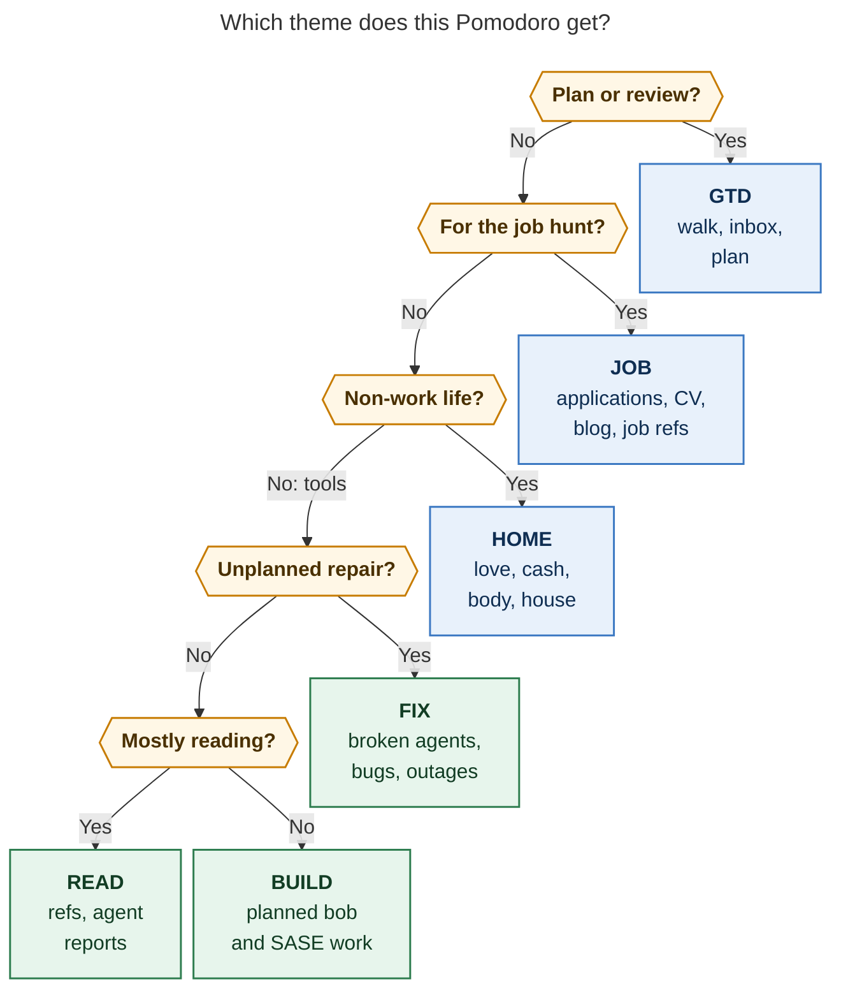

# Pomodoro themes: how you use them, how that compares with established practice, and what to change

*Researcher: cld · 2026-10-27 · Scope: the six themes `bob themes list` shows today (GTD,
BUILD, JOB, HOME, FIX, READ), measured against 62 days of ledger history and against
time-tracking, classification, and focus literature.*

## TL;DR

- **Yesterday's cleanup was the right move.** On Oct 26 you hid 71 themes, made six
  renames, and hand-relabeled 17 BLOG sessions as READ. That turned a vocabulary in which
  38 of 76 names were used on a single day into six names you reuse. Time-tracking and
  controlled-vocabulary guidance both favor a small, stable set of categories you decide
  up front. Keep the cleanup.
- **The six names mix two different questions in one slot.** JOB, HOME, and GTD say
  *what a session is for* (its purpose). BUILD, FIX, and READ say *what kind of work it
  is* (its mode). Each session holds only one name, so the line between them drifts. In
  October more reading links sat under JOB (65) than under READ (46). FIX holds a
  job-application reference, and today's JOB entry holds a dev-area Gmail re-auth task.
- **The daily theme cap no longer limits anything.** `plan.max_themes` is 5, and the
  vocabulary now has exactly 5 non-exempt names. Your Morning review text says "≤3
  themes". Bob's documented default is 3.
- **HOME is a rollover bucket, not a work block.** It was planned on 10 days through
  yesterday and worked once, for about 25 minutes. The same three tasks rolled forward every day.
- **GTD is your biggest theme and the least visible one.** It is 25% of logged time (41–43%
  in two of the last four weeks). It is muted (gray) in the Day strip and exempt from the
  cap, and it also holds ops chores such as SASE agent cleanup.
- **Theme colors clash with area colors in the Day strip.** BUILD wears love's yellow,
  READ wears body's green, and FIX wears dev's blue. Five pins fix it. Pin before you
  merge any legacy theme: a merge into BUILD would currently make BUILD hidden *and* aqua.

The ranked recommendations are at the end (§8).

---

## 1. What I looked at

| Source | What it gave |
| --- | --- |
| `bob themes list -a` (JSON and human) | 76 known themes, days used, hue and hue source, hidden state, collision hints |
| `.bob/themes/*.jsonl` (3 hosts, 81 events) | The Oct 26–27 hide, rename, and unhide sequence |
| Vault git history | Six `bob themes rename` commits, plus manual relabel commit `a56a35a9` (17 BLOG → READ) |
| `bob stats show worked … -f json`, Aug 27 – Oct 27 | 538 closed sessions (~277 h), each joined back to its ledger line to recover the theme name, both now and just before the renames (`10e8ef80`) |
| Ledger child bullets, Oct 1–27 | Which tasks each theme actually links to |
| `~/.config/bob/config.yml`, `gtd_daily.md`, area notes | Caps, exempt list, Morning review wording, area hues |
| `docs/pomodoro-themes.md`, `docs/plan.md`, `docs/stats.md`, theme decision records, `src/native/pref_journal` | How Bob uses themes (budget, highlight, Stats lane, hue rule, rename state moves) |
| Web sources (§7) | Established practice; several are secondary summaries, flagged where it matters |

Named Pomodoros start on 2026-08-26, so this is a two-month record. Treat the trends as
directional rather than settled.

## 2. What the six themes actually contain

### 2.1 The Oct 26 consolidation

Six renames, taken from the journal and the commit log, in order:

| From | To | Note |
| --- | --- | --- |
| VIBE | BUILD | made on the Mac, 18:03 |
| *(manual edit)* BLOG ×17 | READ | commit `a56a35a9`, Oct 18–23 sessions that were really reading |
| HACK | HOME | the Plex-compromise / home-network work |
| PYPI | READ | reading `sase_pypi_releases` research reports |
| BOB | BUILD | 60 sessions; BUILD's largest source |
| BLOG | WRITE | then **WRITE → JOB** on the Mac at 21:11 |

You also hid 71 themes at 18:11 (JOB among them, unhidden this morning). That left six
visible: GTD, BUILD, JOB, HOME, FIX, READ.

The direction is clear. You moved from **project nouns** (BOB, SASE, BLOG, PYPI, HACK) to
**kinds of work** (BUILD, READ, WRITE). Then you folded WRITE into **JOB**, a purpose. That
last step matters for everything below.

### 2.2 Theme by theme (October 1–26 unless noted)

| Theme | Worked | Where the time went (root parent) | What it really holds | Hue now (source) |
| --- | --- | --- | --- | --- |
| **GTD** | 38.5 h (25% of Sep–Oct) | GTD review 98% | Daily walk, PRE chores (email, calendar, Keep import, **SASE agent cleanup on athena/apollo**), POST review | muted (exempt) |
| **BUILD** | 23.2 h | bob 90%, sase 9% (whole window) | Planned feature work on bob and SASE | yellow (hash), the same as **love** |
| **JOB** | 21.9 h | job_2026 30%, **sase_blog 30%**, job 14%, job_update_cv 9%, sase 8%, bob 5% | Applications, CV, *and* SASE launch-post writing; 45% of its links are `^ref-*` reading tasks | aqua (area: job) |
| **READ** | 10.8 h | sase 79%, sase_blog 8%, bob 8% | Reading agent research reports, mostly `sase_pypi_releases` refs; 70% of its links are `^ref-*` | green (hash), the same as **body** |
| **FIX** | 2.5 h | mostly sase | SASE agent and bug repairs, plus one `job#^ref-third-wave-job-applications` | blue (hash), the same as **dev** |
| **HOME** | ~0.4 h | dev_plex_hack_patch, dev, love | Sell stocks, external backup, UPS battery, Lenard's ears | violet (hash) |

Other facts that matter:

- **Session shape.** Median session is 25 min for BUILD, READ, and GTD, and 20 min for
  JOB. JOB work arrives in smaller pieces.
- **Composites are rare.** Only 10 of 538 sessions used `+` (for example `GTD + ATHENA`).
- **First letters are unique.** B, F, G, H, J, and R each pick one theme, so a
  one-keystroke prefix selects it. Worth protecting.

### 2.3 Two questions in one slot

The six names answer two different questions:

- **Purpose: what is this session for?** JOB (get hired), HOME (non-work life), GTD (run
  the system).
- **Mode: what kind of work is it?** BUILD (planned making), FIX (unplanned repair), READ
  (consuming references).

A session can hold only one name (composites are rare and handled badly, see §5), so
every session that has both a purpose and a mode forces a choice. The October ledger
shows the choice being made inconsistently:

- **Reading.** 65 link-bullets under JOB point at `^ref-*` reading tasks, against 46 under
  READ. Reading the SASE launch-post outline counted as JOB. Reading the Gas Town manual
  for the same blog counted as READ.
- **Repairs.** `job#^ref-third-wave-job-applications` sits under FIX.
- **Today.** ★ JOB holds `dev#^ref-gmail-gog-reauth-apollo-athena`, a dev-area auth fix,
  presumably filed there because it unblocks recruiter-email reading.

None of these is wrong on its own terms. The problem is that the rule is unwritten, so
the Stats theme lane can answer neither "how much did I read?" nor "how much went to the
job hunt?" reliably.

There is a coherent scheme hiding in the data, though. **Purpose comes first. Only the
residual tool-building work (bob/SASE, ~65% of logged time) is split by mode.** That is a
legitimate two-level taxonomy: subdivide the branch that holds most of the volume. It
just needs writing down (§8, rec 1; figure in §6).

### 2.4 The cap no longer binds

- `plan.max_themes: 5` in `~/.config/bob/config.yml` (chezmoi-managed).
- Bob's documented default is 3 (`docs/plan.md`).
- The Morning review checklist says "highlight chosen (**≤3 themes**, highlight first)".

With a five-name non-exempt vocabulary, a cap of 5 can never be exceeded. From Oct 17 to
27 the ledger carried 5, 5, 6, 4, 4, 3, 4, 2, 4, 4, and 4 distinct non-exempt themes per
day. Today is 4/5 (JOB, BUILD, FIX, HOME), and `bob plan` says nothing.

When themes were fine-grained (SASE V18, MEMORY WEBS…), 5 was a real focus limit. Now
that each theme is a broad bucket, 5 means "everything".

### 2.5 HOME is a rollover bucket

HOME appears on 10 days from Oct 10 to Oct 26 (and again today), one entry a day, and **9
of those 10 entries were never started**. The single closed session is the Oct 17 HACK
session, about 25 minutes.
Since Oct 18 the same placeholder has carried the same three links:

- `dev_plex_hack_patch#^sell-stocks-now`
- `dev#^ref-cp1500pfclcd-battery-swap-and-athena`
- `dev_plex_hack_patch#^external-backup`

An untimed `() — HOME` records an intention but not a when. It uses a theme slot every
day, and each day it survives unstarted teaches you to read the plan as optional. JOB
shows a milder version: an open JOB entry was left unstarted on 14 of the 15 days from
Oct 12 to Oct 26.

### 2.6 GTD is large, muted, and mixed

- **Size.** From Sep 1 to Oct 26, GTD was 65 h of 259 h (25%). The `review_time` median is
  50 min/day (p25–p75: 29 min – 1 h 30 m). It was 41% of the week of Oct 5 and 43% of the
  week of Oct 19.
- **When.** GTD sessions cluster at 06:00–07:59 (48 of 136 sessions start then).
- **Visibility.** GTD is exempt from the cap and muted in the Day strip. The largest
  bucket is therefore the one the budget ignores and the lane grays out.
- **Contents.** The walk's PRE tier carries chores that are not planning: SASE agent
  cleanup on two machines, email, calendar, and the Keep import. The agent cleanup is
  textbook operational toil. It currently counts as review time.

GTD itself is not the problem; a daily walk replaces part of a weekly review. But at 50+
min/day it is worth knowing how much is planning and how much is ops.

### 2.7 Color: distinct within the theme lane, misleading across lanes

Within today's theme lane all six hues differ, so `bob themes` reports no live
collision. Its two current hints (BUILD/CLEANUP, HOME/MEMORY) involve hidden, retired
themes and are noise.

The Day strip, though, draws the **root-parent lane** (area hues) directly above the
**theme lane**. The six areas use six of the eight slots: job aqua, dev blue, body green,
cash magenta, gtd orange, and love yellow. Only violet and red are free.

| Theme | Hue | The same hue in the root-parent lane means… | Aligned? |
| --- | --- | --- | --- |
| JOB | aqua | job | yes |
| BUILD | yellow | love | **no** (BUILD is 99% dev-area work) |
| READ | green | body | **no** |
| FIX | blue | dev | partly |
| HOME | violet | — | n/a |
| GTD | muted | (GTD review bucket is orange) | hidden |

### 2.8 Half your Stats history still uses retired names

Over Aug 27 – Oct 27, **about 50% of logged minutes still carry hidden legacy names**.
Through Sep 21, legacy names were 57–86% of each week. They include SASE 13.8 h, SHIT
13.7 h, REMOTE 11.2 h, TOOL/TOOLS 10.8 h, MEMORY/MEMORY WEBS 11.3 h, GOALS 5.2 h, and
ATHENA 4.4 h. Hiding does not touch Stats, so any 30/90-day theme view is mostly retired
vocabulary.

### 2.9 The lost-time bucket disappeared

SHIT collected 13.7 h over 13 days (last used Oct 9). Its sessions were 73% unlinked,
with a median of 50 min, and its bullets read "Bullshit!" and "Untracked bullshit!". It
was an honest log of time that went sideways. It is now hidden, and none of the six
covers it.

Since late September, unlinked time has dropped from 2–5 h/week (three September weeks) to
≤0.4 h/week. Logged weeks ran 29–37 h in September and 26–34 h in October. The data can't distinguish
"less time lost" from "lost time no longer logged". Only you can.

## 3. How Bob actually uses a theme (why the choice matters)

| Consumer | What a theme does there | Implication for the vocabulary |
| --- | --- | --- |
| Plan budget (`max_themes`) | Counts distinct non-exempt components across open entries | The cap must be smaller than the vocabulary to mean anything |
| Highlight | The first open non-exempt entry is ★ | The highlight is a bucket name, so specificity must come from its links |
| Stats / Day strip theme lane | Splits minutes by component, with **even splits** across `+` parts | Composites halve each part; facets can't be stacked |
| Recent menu / completion | Ranks by recency; hidden names are excluded | A small set is fast to type; unique first letters help |
| tmux / Mac menu bar | Shows the current name | Broad names say little; the link list carries the detail |
| Rename / hide journal | Rename moves hidden state **and** pin to a target that has no journal entry | Pin the live six before merging anything into them (§8, rec 5) |

The root-parent lane already answers "where did the time go" (bob, sase, job_2026…). So a
theme earns its place by carrying information the hierarchy does not.

- **Mode is never derivable** from links. Reading is the exception: `^ref` tasks mark it.
- **Purpose is only partly derivable.** The SASE blog serves the job hunt but lives under
  dev, so JOB adds real information.

## 4. Established practice, compared with your usage

| Practice | What it says | You today |
| --- | --- | --- |
| **Decide categories up front; projects for *what*, tags for *how*** (Toggl categorization guide) | Settle the scheme before tracking. The project hierarchy carries the deliverable; flat tags cut across projects for activity type | ✔ Root parent carries *what*. ✘ The theme slot carries *what* (JOB, HOME) and *how* (BUILD, FIX, READ) at once |
| **Scope notes** (ANSI/NISO Z39.19 controlled vocabularies) | Each preferred term gets a note on its meaning, its usage, and how it differs from overlapping terms | ✘ No written definitions. Overlaps (JOB↔READ, FIX↔JOB) are resolved ad hoc |
| **Codebooks** (MacQueen et al. 1998) | Each code gets a name, short and full definition, *when to use*, *when not to use*, and an example; coders stay consistent only with this | ✘ Same gap. Yesterday's 17 manual relabels show the cost of fixing labels afterward |
| **Few, stable tags; prune drift** (Golder & Huberman 2006: shared tagging stabilizes through imitation) | A personal vocabulary has no crowd to converge it, so it needs deliberate review *(my inference from their result plus your data)* | ✔ Converged yesterday. ✘ No routine to stop 76 → 6 → 76 |
| **Limit work in progress; switching is expensive** (Weinberg's table: 2 projects ≈ 20% lost, 3 ≈ 40%; Leroy 2009, attention residue) | Fewer concurrent threads per day; finish or cleanly park before switching | ~ Cap exists, but at 5 it never binds. The checklist says 3 |
| **One daily Highlight, 60–90 min** (Knapp & Zeratsky, *Make Time*) | Pick one protected outcome a day | ✔ Bob's ★ highlight. ~ It names a bucket, not an outcome; keep it to one or two links |
| **Theme days and batching** (Dorsey 2011; Drucker: consolidate discretionary time into large blocks) | Batch a domain into its own block or day instead of sprinkling it | ✘ HOME is sprinkled as a daily untimed placeholder and never runs |
| **Implementation intentions** (Gollwitzer & Sheeran 2006: 94 tests, d ≈ 0.65) | "When X, I will do Y" beats "I intend to do Y" | ✘ `() — HOME` names the goal but not when |
| **Plan, then handle unplanned work separately** (Cirillo: *To Do Today* has an "Unplanned & Urgent" section; Records sheet feeds processing) | Separate planned from interrupt work, then review the records | ✔ FIX vs BUILD captures this split, if FIX is defined as unplanned |
| **Name unplanned work and cap toil** (*The Phoenix Project*'s four work types; Google SRE: operational work < 50%) | Make reactive work visible so it can't silently eat project time | ~ FIX exists (1.3% of time), but agent cleanup hides inside GTD |
| **Know thy time** (Drucker, *The Effective Executive*) | Log honestly, including time wasters, then prune | ✘ The honest "lost time" bucket (SHIT) is retired |
| **Shallow-work budget** (Newport, *Deep Work*: agree on a share, often cited as 30–50%) | Decide in advance how much shallow work is acceptable, then measure it | ~ GTD (25%) is measured, but it is muted and has no target |
| **Consistent color meaning across views** (general data-visualization practice; also Bob's PT6 "color is identity") | The same hue should not mean two things on one screen | ✘ Yellow means love in one lane and BUILD in the next |

## 5. Alternatives I considered

**A. Pure mode vocabulary** (BUILD, FIX, READ, WRITE, GTD), with purpose carried by the
note hierarchy.

- *For:* every name carries information Bob can't derive, and it measures how your role
  shifts as agents do more of the building (more READ and FIX, less BUILD).
- *Against now:* the job hunt is your top priority and spans job, dev (sase_blog), and
  bob notes. Getting "time on the job hunt" would need re-parenting `sase_blog`, which
  misfiles a SASE project to fix a report. You also already rejected this once (WRITE →
  JOB).
- **Revisit when the job search ends.** JOB then becomes the ongoing-work area, and the
  purpose/mode split is worth re-deciding.

**B. Pure purpose vocabulary** (JOB, HOME, TOOLS, GTD), folding BUILD, FIX, and READ into
TOOLS.

- *For:* it matches theme-day practice and the morning prioritization question.
- *Against:* it largely duplicates the root-parent lane, and it drops the planned vs
  unplanned signal (BUILD vs FIX) that Phoenix Project and SRE practice say to keep
  visible.

**C. Composites for two facets** (`JOB + READ`).

- *Against:* Stats splits minutes evenly across components, so each facet shows half the
  time. Each component also counts against the cap. Your near-zero composite use is
  correct.

**Chosen: keep the six and make the implicit tree explicit.** Purpose first; mode only
for tool work. That is §6 and rec 1.

## 6. The proposed precedence rule



*Figure 1. Ask the purpose questions first (blue outcomes); only work left on your own
tools gets split by mode (green outcomes). Under this rule, reading a job-fit reference
is JOB, and fixing a SASE agent is FIX. Rendered with mermaid-cli 12.0.0 at 853 × 1164 px
(77% PDF fit).*

## 7. Sources

**Vault and code (read-only, 2026-10-27):** `bob themes list -a [-f json]`; `bob plan`;
`bob stats show worked review_time`; `.bob/themes/{apollo,kellys-mbp,kellys-macbook-pro-local}.jsonl`;
vault commits `d3d0c9a8`, `21b54982`, `97126dd1`, `b7704bf9`, `95dcdde0`, `63fdc0c0`,
`a56a35a9`, and pre-rename snapshot `10e8ef80`; `2026/202608*.md`–`2026/20261027.md`
ledgers; `gtd_daily.md`; area notes `job`, `dev`, `body`, `cash`, `gtd`, and `love`;
`~/.config/bob/config.yml`; bob-cli `docs/pomodoro-themes.md` (PT1–PT10),
`docs/plan.md`, `docs/stats.md`, `docs/pomodoro-homes.md`, and
`src/native/pomodoro_themes/journal.rs` plus `pref_journal::move_state_for_rename`. The
rename gotcha was confirmed with a read-only `bob themes rename SASE BUILD -d -m`, which
printed "state: hidden SASE moves to BUILD · color: color follows BUILD as aqua"; the
working tree stayed clean. Decision records: `pomodoro-theme-is-one-component`,
`theme-hide-is-recent-only`, `theme-hue-is-pin-exempt-area-hash`, and
`theme-prefs-live-in-per-host-journal`. Prior research for context only:
`research:202610/pomodoro_theme_catalog/pomodoro_theme_catalog__final.md` (Oct 24).

**External** (several are secondary summaries; exact wording is unverified against
primary texts where noted):

- Toggl, [Toggl Track categorization guide](https://support.toggl.com/en-us/article/toggl-track-categorization-guide-17xmm1c) and [data structure guide](https://support.toggl.com/data-structure-guide).
- ANSI/NISO Z39.19-2005 (R2010), scope-note definition as quoted in [ASIS&T standards list](https://asist-archive.ischool.illinois.edu/asis-standards/2016-January/000554.html); [about the standard](https://marciazeng.metadataetc.org/Z3919/9Z3919.htm).
- MacQueen, McLellan, Kay & Milstein (1998), "Codebook Development for Team-Based Qualitative Analysis," *Cultural Anthropology Methods* 10(2):31–36; structure via [Suh summary](https://www.eecs.tufts.edu/~asuh/files/coding_short.pdf).
- Golder & Huberman (2006), "Usage patterns of collaborative tagging systems," *J. Information Science* 32(2):198–208 ([PDF](https://collablab.northwestern.edu/CollabolabDistro/nucmc/GolderAndHuberman-usage%20patterns%20collab%20tagging.pdf)).
- Weinberg, *Quality Software Management: Systems Thinking* (1992); table via secondary sources ([Coding Horror](https://blog.codinghorror.com/the-multi-tasking-myth/), [AYE](https://ayeconference.com/multiprojecting-the-illusion-of-progress.html)).
- Leroy (2009), "Why is it so hard to do my work?…," *OBHDP* 109(2):168–181, doi:10.1016/j.obhdp.2009.04.002 ([strategy+business](https://strategy-business.com/article/re00088)).
- Gollwitzer & Sheeran (2006), "Implementation intentions and goal achievement: a meta-analysis," *Adv. Exp. Soc. Psych.* 38:69–119; d = 0.65 as reported in [Frontiers 2021](https://www.frontiersin.org/articles/10.3389/fpsyg.2021.565202/full).
- Knapp & Zeratsky, *Make Time* (2018); Highlight summary via [URMC review](https://www.urmc.rochester.edu/education/graduate/myhub-blog/december-2019/book-review-of-make-time-authored-by-jake-knapp-an).
- Dorsey theme days: [CNN Money, 2011](https://money.cnn.com/2011/11/13/technology/dorsey_techonomy/).
- Drucker, *The Effective Executive*, "Know Thy Time" (summary: [Shortform](https://www.shortform.com/blog/peter-drucker-time-management)).
- Cirillo, *The Pomodoro Technique*; To Do Today / Records sheets ([pomodorotechnique.com](https://pomodorotechnique.com/), [sheet descriptions](https://francescocirillo.gumroad.com/l/hvfqu)).
- Kim, Behr & Spafford, *The Phoenix Project* ([IT Revolution summary](https://itrevolution.com/articles/10-minute-summary-of-the-phoenix-project/)).
- Google, *Site Reliability Engineering*, ch. 5 "Eliminating Toil" ([sre.google](https://sre.google/sre-book/eliminating-toil/)).
- Newport, *Deep Work* (2016), shallow-work budget ([Shortform summary](https://www.shortform.com/blog/deep-work-vs-shallow-work/)).
- GTD weekly-review duration in practice: [GTD forum](https://forum.gettingthingsdone.com/posts/105312). I found no Allen-stated fixed duration.

## 8. Ranked recommendations

Ranked by expected benefit per unit of effort. Ranks 1–5 are each under 15 minutes. The
**order matters** for 5 → 8.

### 1. Write scope notes and one precedence rule for the six themes

**Why.** This fixes the root problem in §2.3. Reading is split 65/46 between JOB and READ,
FIX holds a job ref, and JOB holds a dev fix. Without written definitions, every Stats
reading of BUILD, FIX, READ, or JOB is noisy, and each future cleanup becomes another
17-entry hand relabel. This is standard controlled-vocabulary and codebook practice.

**How.** Put the following six lines where you name sessions: the top of `gtd_daily.md` or
a short `themes` section in `gtd.md`, linked from the Morning review task. The rule is
purpose first (GTD → JOB → HOME), then tool work by mode (FIX → READ → BUILD), as in
Figure 1.

| Theme | Use when | Not when |
| --- | --- | --- |
| **GTD** | Daily walk, inbox, planning, review | Fixing agents, email for a specific purpose |
| **JOB** | Any session whose outcome is getting hired: applications, CV, interviews, the SASE launch blog, job-fit refs | General SASE work that isn't for the blog |
| **HOME** | Non-work life: love, cash, body, house and home infrastructure | Dev work that merely runs at home |
| **FIX** | Unplanned repair of something that broke: agents, bugs, outages | Planned refactors (BUILD) |
| **READ** | Reading or reviewing a reference or agent report for your tools | Reading for the job hunt (JOB) |
| **BUILD** | Planned making on bob/SASE | Anything above |

**Cost and risk.** None. Revisit with alternative A when the job search ends.

### 2. Lower `plan.max_themes` from 5 to 3

**Why.** With five non-exempt names, a cap of 5 cannot be exceeded (§2.4). Three matches
your own Morning review wording, Bob's documented default, Make Time's
one-highlight-plus-a-little logic, and Weinberg's curve (≈40% lost by the third
concurrent thread).

**How.** Edit `plan.max_themes: 3` in the chezmoi source for `~/.config/bob/config.yml`
(open it with `sase repo open chezmoi`). Leave `strict: false`, so it stays a warning.

**Cost and risk.** You will see `plan_theme_cap_exceeded` on days like today (4 themes).
That warning is the point: drop the placeholder you won't run, which is usually HOME
(rec 3). If FIX+READ+BUILD on one tool day keeps tripping it, 4 is the fallback. The cap
must stay below the vocabulary size.

### 3. Stop carrying HOME as an untimed daily placeholder; give it a time

**Why.** Nine of 10 HOME entries through Oct 26 were never started, and the same three
tasks rolled for 10 days (§2.5). Batching (Dorsey, Drucker) and implementation intentions (Gollwitzer &
Sheeran, d ≈ 0.65) both say to give the domain a *when*.

**How.** Pick one:

- **(a)** A weekly HOME block, for example two Pomodoros on Saturday morning, as a
  recurring `#gtd` chore or an `## Events` line.
- **(b)** Open `— HOME` only on days you also write an `## Events` time for it, such as
  "1300 — HOME".

On other days, leave HOME off the ledger and let its tasks wait in NEXT or the tickler.
Separately, `Sell stocks now!` has rolled since Oct 18. It deserves its own decision (do
it, schedule it, or drop "now").

**Cost and risk.** HOME time becomes visible as zero on most days. That is accurate, and
better than an unworked daily placeholder.

### 4. Narrow GTD to planning and review, and give it a target

**Why.** GTD is the single largest theme (25% of logged time, 41–43% in two recent
weeks). It is exempt from the cap, muted in the Day strip, and it holds operational toil
(SASE agent cleanup on two machines) that SRE practice says to measure separately. A
weekly review in practice runs 1–4 h/week. Your daily walk runs about 5–6 h/week at the
median.

**How.**

- Log the "Clean up SASE agents on athena and apollo" PRE chore in a `— FIX` session
  (link the chore), not inside GTD.
- Log email under the purpose it serves when it's substantial.
- Set a target in the Weekly prune line, for example "review_time median ≤ 40 min/day
  (`bob stats show review_time -r 4w`)".

**Cost and risk.** FIX will grow and GTD will shrink. That is the point: unplanned work
becomes visible.

### 5. Pin all six hues deliberately, before any merge rename

**Why.** BUILD currently wears love's yellow and READ wears body's green, directly under
the root-parent lane (§2.7). Pins also clear the two stale hints. Most urgently, pinning
gives each live theme a journal entry. Without one, a later `rename X BUILD --merge`
moves X's hidden state *and* pin onto BUILD (code-confirmed; the dry run says "hidden
SASE moves to BUILD · color follows BUILD as aqua").

**How.**

```text
bob themes color GTD orange    # same as the gtd area / GTD-review bucket; un-mutes the biggest bucket
bob themes color BUILD blue    # BUILD is 99% dev-area work, so dev's blue means the same thing
bob themes color FIX red       # free slot; conventional "something broke"
bob themes color READ violet   # free slot
bob themes color HOME yellow   # nearest life area (love); a judgment call, magenta (cash) also works
# JOB stays aqua (area)
```

The result: six distinct hues in the theme lane, and every cross-lane match means the
same thing (or uses a free slot).

**Cost and risk.** Un-muting GTD departs from the exempt default. The hue rule explicitly
lets a pin win over the exempt mute, and `bob themes color GTD auto` undoes it.

### 6. Bring back one sanctioned bucket for lost time

**Why.** SHIT was an honest Drucker-style log of derailed time (13.7 h). Since it was
retired, unlinked time is ~0 and logged weeks are shorter (§2.9). If time is now
disappearing unlogged, every share above is inflated.

**How.** Either run `bob themes unhide SHIT`, or rename it to something neutral with a
unique first letter, such as `bob themes rename SHIT DRIFT -d` then without `-d`. Use it
only retroactively for closed sessions; it never needs to be planned. Add it to the
codebook as "time that went somewhere I didn't intend".

**Cost and risk.** Low. Retroactive use never touches the cap, because only open entries
count.

### 7. Add a five-minute theme check to the Weekly prune

**Why.** You went from 76 themes to 6 in one sitting. A personal vocabulary has no crowd
pulling it back to convergence, so without a cadence it will sprawl again.

**How.** Append to the Monday Weekly prune task:

> `bob themes -a -n 15`: any new non-codebook name → rename into the six, hide, or promote
> it (with a codebook line); check `renamed_reappeared`; glance at the theme lane share
> (GTD, FIX).

**Cost and risk.** Five minutes a week.

### 8. (Optional) Back-code the legacy long tail into the six, after rec 5

**Why.** About half the window's minutes still use retired names (§2.8), so 30/90-day
theme views stay mostly noise until mid-November. Mapping history onto the current
vocabulary is how classification changes are normally handled. Task links keep the
fine-grained detail, and each rename is one revertable commit.

**How.** Dry-run each (`-d`), then run it with `-m`. Candidate mapping, from each theme's
root parents and links:

| → Target | Legacy themes |
| --- | --- |
| BUILD | SASE, REMOTE, TOOL, TOOLS, MEMORY, MEMORY WEBS, PLAN MEMORY, PROJECTS, SASE V18 / SASE-V18 / SASE V19, CAPTURE, DECKS, VERIFY, GOALS |
| FIX | FIXES, BUGS, FIX-APOLLO, ATHENA (agent restarts, disk, power), RELAUNCH, RESTARTS, RESTART MAC |
| READ | RESEARCH |
| Leave alone | SHIT (rec 6); LATER, MISC, NEW FEATURES (`plan.inventory_labels`, so rename refuses with `config_reference`); one-off names under 1 h |

**Cost and risk.**

- Merges are lossy for composites (`BUILD + STARTUP` collapses).
- They take `bob_sync.lock` and sync.
- **Do rec 5 first.** Otherwise SASE's hidden state and aqua pin land on BUILD.

### 9. (Lowest) Consider renaming HOME → LIFE

**Why.** "Home" is already Bob's word for where a session's time is attributed (Pomodoro
homes, `homes` in Stats JSON, home chips on every ledger row). "The HOME theme's home is
dev" is confusing in docs and agent conversations. LIFE is also closer to what the bucket
holds (love, cash, body, house).

**How.** `bob themes rename HOME LIFE -d`, then run it without `-d`. The pin follows the
rename.

**Cost and risk.** Muscle memory. L is still unique among visible names. Skip this if
HOME reads naturally to you.

---

**Keep doing:**

- One theme per session, no composites.
- Names with distinct first letters.
- JOB matching the job area's color.
- Using `bob themes rename` rather than hand edits to converge the vocabulary.
