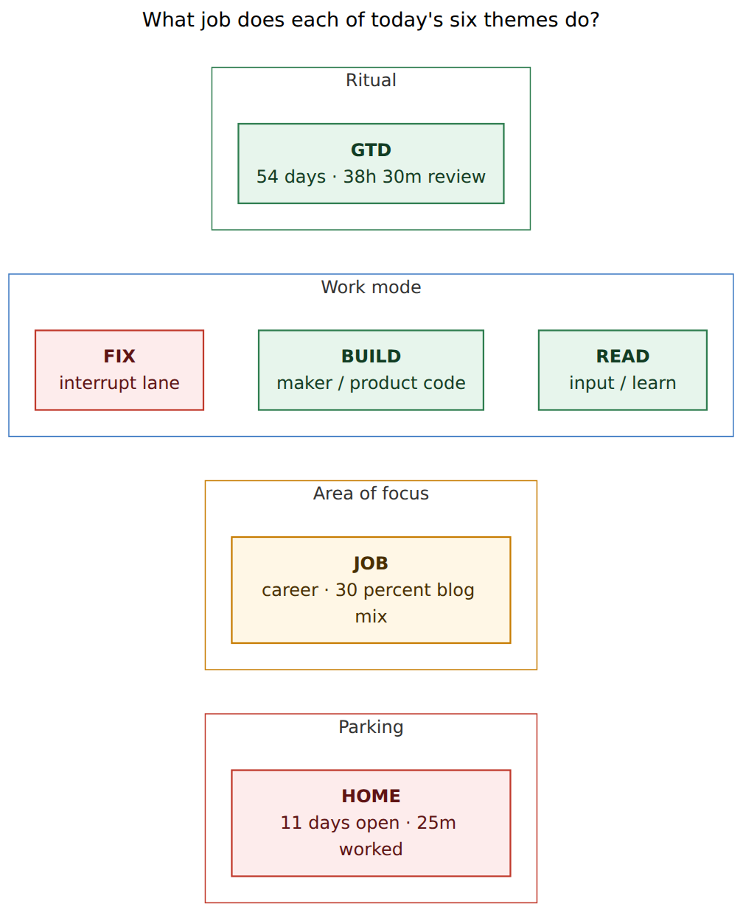
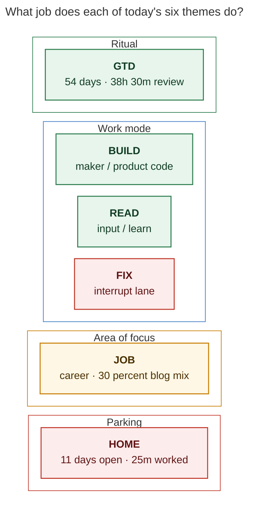
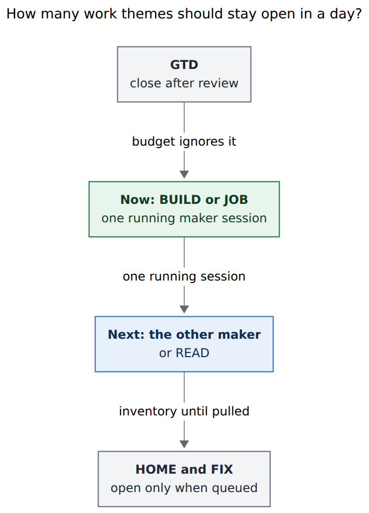
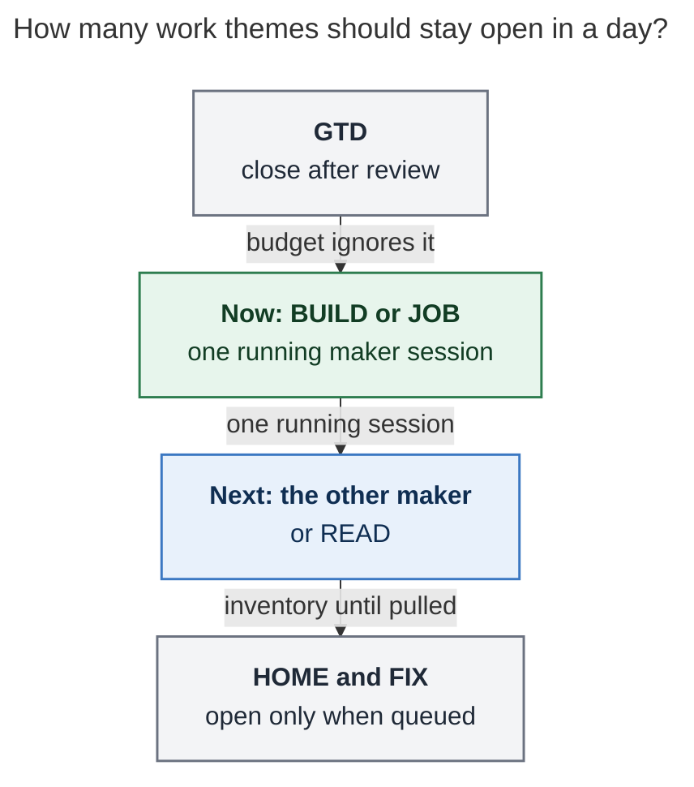

# Bryan's Pomodoro themes versus established practice

Independent swarm report · researcher `grk` · 2026-10-27

**Question.** How does Bryan actually use Pomodoro themes, and how does that usage compare with established practice in the Pomodoro Technique, GTD, time theming, time blocking, attention-residue research, and personal Kanban? What should change in the six themes that `bob themes list` currently shows?

**Bottom line.** The visible set is already the right *size* (six names, five of them on today's ledger). The problem is *role mixing*. GTD is a healthy daily-review ritual. BUILD and READ are coherent work modes. JOB is an area of focus that still carries a third of its minutes from former BLOG sessions. HOME is a parking column that almost never gets worked. FIX is a valid interrupt lane that stays open as if it were a maker theme. Four non-exempt themes sit open today against a raised cap of five, which keeps more unfinished work in mind than Cirillo, Leroy, or personal Kanban would allow. The 26 October hide-and-rename collapse was the right cleanup; the ranked list at the end refines that collapse rather than inventing a new vocabulary.

## Methods

Live, read-only evidence from 2026-10-27:

- `bob themes list -a -f json` (76-theme catalog, 90-day window)
- `bob plan -f json` and `bob capture-pomodoros --tasks` (today's ledger)
- `bob stats show worked -r 4w` and `-r 3m` (minutes, session names, homes)
- Theme catalog cache for `~/bob` (per-day co-occurrence)
- `.bob/themes/*.jsonl` (hide, color, rename, unhide)
- `~/.config/bob/config.yml` (`plan.max_themes: 5`, `exempt: [GTD]`, `inventory_labels: [LATER, MISC, NEW FEATURES]`)
- Vault area query (top-level areas: body, cash, dev, gtd, job, love)
- Bob contracts: `docs/pomodoro-themes.md`, `docs/plan.md`, glossary `pomodoro-theme`
- Prior *system* research `research:202610/pomodoro_theme_catalog/pomodoro_theme_catalog.md` and `plan:202610/pomodoro_themes.md` (how the catalog works). This report is about *usage*, not catalog design.
- External practice sources listed at the end.

No vault files were written. Peer swarm reports from this run were not opened.

## What a Bob theme is

A **theme** is one `+`-separated component of a Pomodoro's ` — NAME` tail, keyed by `normalize_component`. `— BOB + DECKS` is one name with two themes. The catalog is derived from canonical daily notes plus `.bob/themes/<host>.jsonl`. Hiding removes a name from Recent suggestions only. Hue is pin, then exempt mute, then matching top-level area stem, then a stable eight-slot hash.

Bob already separates three layers that the literature also separates:

| Bob layer | Question it answers | Closest established analogue |
| --- | --- | --- |
| Theme (` — NAME`) | What *kind* of session is this? | Cirillo activity type; Vardy time theme; GTD *mode* context |
| Home (area/project of linked tasks) | Where does this work *live*? | GTD area of focus (Horizon 2); PARA Area/Project |
| Plan budget (`max_themes`, `max_links`) | How much may stay open today? | Personal Kanban WIP limit |

`plan.exempt` (default and actual: `[GTD]`) keeps the morning review out of the theme count. `plan.inventory_labels` (Bryan: `LATER, MISC, NEW FEATURES`; docs default also included `SASE`) mark storage names: they still count as themes if left open, and they warn. Default `max_themes` is 3; Bryan's config is 5, with `strict: false`.

## How Bryan uses themes

### The visible six (2026-10-27)

`bob themes list` reports **76 known · 5 today · 70 hidden · last 90 days**. Six names remain visible:

| Theme | Last used | Days | Entries | 4-week minutes | Hue | Role in practice |
| --- | --- | --- | --- | --- | --- | --- |
| GTD | today (closed) | 54 | 142 | 2310 (31%) | muted · exempt | Daily review ritual |
| BUILD | today (open) | 30 | 92 | 1585 (21%) | yellow · hash | Maker / product code |
| JOB | today (open) | 20 | 89 | 1315 (18%) | aqua · area | Career area, plus blog mix |
| HOME | today (open) | 11 | 11 | 25 (0.3%) | violet · hash | All-day parking |
| FIX | today (open) | 5 | 8 | 150 (2%) | blue · hash | Interrupt lane |
| READ | Oct 25 | 15 | 45 | 645 (9%) | green · hash | Input / learn |

Today's plan is **4/5 themes, 6/15 links**, status `ok`. Running: JOB. Later: BUILD, FIX, HOME. GTD already closed (3 done, 55m). Capture homes on those open rows: JOB → `dev.md` (gmail reauth), BUILD → `sase.md`, FIX → `sase.md`, HOME → `love.md` plus `dev_plex_hack_patch.md`.



*Caption: The six visible names already split into four jobs: a review ritual, three work modes, one area of focus, and a parking column.*

Rendered size: 671 × 826 px; fit scale 97.2%. Mermaid CLI 12.0.0.



### Yesterday's collapse

Named Pomodoros begin 2026-08-26. For two months the catalog grew by minting a new ALL-CAPS name whenever the work felt specific: `AFTER TUI FIX`, `PRINT COMMAND`, `SASE V18`, `SWAP POMS`. Half of the 76 known keys (38) were used on exactly one day; 28 have a single entry. 26 October 18:11 apollo hid **71** of them in one journal write. Six global renames then folded history into the names that remain visible:

| From | To | When | Host |
| --- | --- | --- | --- |
| VIBE | BUILD | 18:03 | kellys-macbook-pro-local |
| HACK | HOME | 18:58 | apollo |
| PYPI | READ | 18:58 | apollo |
| BOB | BUILD | 18:58 | apollo |
| BLOG | WRITE | 18:58 | apollo |
| WRITE | JOB | 21:11 | kellys-mbp |

JOB itself was in the hide set; it was unhidden 2026-10-27 09:02 on kellys-mbp. Three color pins remain on names that are now hidden: SASE and RESEARCH aqua, DECKS violet. Collision hints still fire for hidden CLEANUP (yellow with BUILD) and MEMORY (violet with HOME).

That collapse is why Stats now attributes former BOB/VIBE minutes to BUILD, former PYPI to READ, and former BLOG/WRITE to JOB. The *current* vocabulary is one day old; the *histories* behind each name are older and mixed.

### Time, not just presence

Presence on the ledger and minutes worked tell different stories.

**GTD** is the most used name in both senses: 54 of ~62 named days, 81 closed sessions in four weeks, mean 28.8 minutes, every session homed to `GTD review`. That is Cirillo's planning/recording pass and Allen's daily review, wearing the exempt mute Bob designed for it.

**BUILD** is the maker theme. Four-week homes: 48 of 65 sessions on `bob`, with a tail on `sase` and `bob_gtd`. Mean session 23.8 minutes. It absorbed BOB (the product) and VIBE (the working style).

**JOB** is the only visible theme whose hue comes from a top-level area (`job`, aqua). Four-week homes split **59% job-area** (775m: `job_2026_apply_29`, `job`, `job_update_cv`) and **30% blog-writing** (390m: `sase_blog`). The blog slice is the BLOG→WRITE→JOB rename. Week of 12 October was a job-application sprint (915m JOB). Recent JOB sessions, including yesterday evening, are `sase_blog`. Today's running JOB pomodoro holds a **dev.md** gmail-reauth task.

**READ** is an input mode. 645m in four weeks, 16 of 30 sessions on `sase_pypi_releases` (300m). PYPI→READ generalized a project name into "consume / learn." It last closed on 25 October; it is the one visible theme not on today's ledger.

**FIX** is small and honest: 150m, five sessions, four of them homed to `sase`. Cirillo's "one Pomodoro a day for urgent interruptions" is exactly this. It is open today with a gates-reliability task.

**HOME** is the outlier. Eleven days, eleven entries (one per day), **one** closed session (25m on 17 October, homed to `dev_plex_hack_patch`). It is an open Later column for life admin, not a worked theme. Today's children mix `love.md` (dog care) and a stock-sale project. HOME is **not** a top-level area; those are body, cash, dev, gtd, job, love. Its violet is a name hash, so it will keep colliding with MEMORY if MEMORY is unhidden.

### Parallelism

On days with named Pomodoros, the catalog cache shows a mean **4.65** distinct themes per day (median 4, max 21). Recent days have stabilized around GTD + BUILD + JOB + HOME + (READ or FIX): five names, four of them non-exempt, which is why the plan meter sits at 4/5. 8 October minted thirteen names in one day (`BEADS`, `FIRE`, `HERMES`, `JITUX`, `RESTART MAC`, `SASE-V18`, …). Composite `+` names are rare: **10 of 786** sessions in three months (1.3%), mostly `GTD + X`.

Four-week co-occurrence among the visible six (days they share):

- BUILD + GTD: 28
- GTD + JOB: 20
- BUILD + JOB: 18
- GTD + READ: 13
- GTD + HOME: 11
- HOME + JOB: 11

BUILD and JOB already run together most job-search days. HOME rides along as an unused open entry.

### The hidden seventy

High-history names now hidden, with three-month minutes:

| Name | Days | Entries | 3-month minutes | Note |
| --- | --- | --- | --- | --- |
| SASE | 14 | 33 | 825 | Was in docs-default `inventory_labels`; product work now lives in BUILD |
| SHIT | 13 | 16 | 820 | Overflow dump; MISC is already an inventory label |
| REMOTE | 6 | 18 | 675 | Burst, last 29 September |
| MEMORY | 8 | 19 | 380 | Collides violet with HOME |
| SASE V18 | 6 | 12 | 220 | Twin of hidden `SASE-V18` |
| FIXES | 1 | 5 | 195 | Twin of visible FIX |
| DEV | 1 | 1 | 25 | Area stem; BUILD is the working name |
| LOVE | 1 | 1 | — | Area stem; tasks already home to `love.md` |

Near-duplicate clusters still in the catalog: FIX/FIXES/FIX-APOLLO, TOOL/TOOLS, SCREENSHOT/SCREENSHOTS, SASE V18/SASE-V18, MEMORY/MEMORY WEBS/MEMORY BEADS/AUDIT MEMORY/PLAN MEMORY. `bob themes rename --merge` exists for these.

## Established practice

### Pomodoro Technique (Cirillo)

A pomodoro is indivisible and dedicated to **one chosen activity**. Internal interruptions are written down and postponed; external ones use inform–negotiate–schedule–call back; if the interruption wins, the pomodoro is voided. Cirillo's sheets are To Do Today plus an Activity Inventory — a daily commitment list and a long backlog — with estimates in pomodori, not dozens of standing category names. He also allows **one dedicated pomodoro** for the urgent leftovers of the day. Bryan's FIX matches that leftover slot. Four open non-exempt names on the same ledger do not: they keep several activities "current" at once.

Sources: [Cirillo, *The Pomodoro Technique* (core process)](https://en.wikipedia.org/wiki/Pomodoro_Technique); interruption protocol in the 2006 booklet (FAA-hosted copy of the v1.3 text).

### GTD contexts and areas (Allen)

Allen splits **contexts** (what you need in order to act: tool, place, or situation) from **areas of focus** (Horizon 2: ongoing spheres you maintain, typically four to seven at work, ten to fifteen across a life). Context lists stay short: "as many as you need, as few as you can." Classic examples are @home, @computer, @errands, @agenda. Modern knowledge-work adaptations use mode contexts (@focus, @process, @quick) because @computer no longer filters anything. Areas are *maintained*, not finished; projects (Horizon 1) live under them.

Bryan's vault already has Horizon 2 as **area notes** (body, cash, dev, gtd, job, love) and Horizon 1 as **project notes**. Themes that repeat an area stem (JOB, and the unused DEV/LOVE) duplicate Horizon 2 on the ledger. Themes that name a mode (BUILD, READ, FIX) are closer to a GTD *context*. HOME is an @home context used as a standing open list.

Sources: [Allen, Horizons of Focus](https://gettingthingsdone.com/2011/01/the-6-horizons-of-focus/); [Allen on context lists](https://gettingthingsdone.com/2010/09/david-allen-on-why-sorting-your-lists-by-contexts-even-matters/).

### Time theming (Vardy)

Vardy's Time Theming assigns a **focus to a day, a week, or a repeating band of hours** (horizontal theming: "writing every evening"). The point is to pay decision cost once. He starts people on **one themed day**, keeps themes few and consistent, and treats theming as a filter ("does this belong to today's theme?") rather than a second project taxonomy. Appointments and other people's calendars are a poor fit for theming; maker work is a good fit.

Bryan already has one rock-solid daily theme: GTD every morning. The rest of the day is *multi-themed in parallel* (BUILD, JOB, HOME, FIX all open), which is the opposite of a daily theme. Horizontal theming would look like: GTD at the start, one maker band (BUILD *or* JOB), a later input band (READ), life-admin pulled only when that band starts.

Source: [Vardy, TimeCrafting / Time Theming](https://mikevardy.com/timecrafting/).

### Time blocking and deep work (Newport)

Newport's time blocking **gives every minute a job** on a daily grid, replanned in 10–20 minutes, with overflow blocks when reality moves. Deep work is a cognitive state that the grid protects; he estimates a 40-hour blocked week matches 60+ unblocked hours, and caps realistic deep work at about four to six hours a day. Shallow work is batched and capped ("drain the shallows").

Bob's Now / Next / Later ledger is already a light time block. The gap is that Later currently holds **three** named work themes (BUILD, FIX, HOME) plus a running JOB, so the grid has four jobs at once. Newport's deep-work cap also argues for keeping BUILD in longer consecutive sessions: 65 BUILD pomodoros in four weeks at mean 24 minutes is a lot of spin-up for maker work.

Sources: [Newport, "Deep Habits: Planning Every Minute"](https://calnewport.com/deep-habits-the-importance-of-planning-every-minute-of-your-work-day/); [Newport, "Focus Week"](https://calnewport.com/focus-week-take-control-of-your-time/).

### Attention residue and interruption cost

Sophie Leroy (2009) showed that unfinished Task A leaves **attention residue** that lowers performance on Task B; finishing, or writing a concrete plan for finishing, reduces the residue. Gloria Mark's workplace timing found activity switches about every three minutes, with **23 minutes 15 seconds** to resume an interrupted task the same day; a CHI 2008 lab study found interrupted work is finished faster at the cost of more stress and time pressure.

Every extra *open* named Pomodoro is an unfinished Task A sitting in the same visual field as the running session. HOME (open 11 days, 25m worked) is almost pure residue: a commitment displayed, rarely engaged. FIX as a *named slot you open when you pull an interrupt* is compatible with Leroy (a plan for the leftover). FIX as a standing open column beside BUILD is extra residue.

Sources: Leroy, *Organizational Behavior and Human Decision Processes* 109(2), 2009; [Mark interview on resume time](https://www.fastcompany.com/944128/worker-interrupted-cost-task-switching); Mark, Gudith & Klocke, CHI 2008.

### Personal Kanban WIP

Jim Benson's Personal Kanban has two rules: visualize work, and **limit WIP**. The starting Doing limit is **three**. "Stop starting and start finishing" (Anderson). A fourth item enters only when one finishes or is explicitly paused.

Bob's `max_themes` *is* a WIP limit on named open sessions. Default 3 matches Benson. Bryan raised it to 5 and runs at 4. GTD is exempt, so the comparison is non-exempt open names: today BUILD + JOB + HOME + FIX = 4, above the personal-kanban starting point even after GTD is closed.

Source: [Benson, "Setting Your Personal WIP Limit"](https://personalkanban.com/pk/uncategorized-how-to-setting-your-personal-wip-limit/).

### PARA (Forte)

PARA files by actionability: Projects (outcome + deadline), Areas (ongoing standard), Resources, Archives. Bryan's vault already *is* PARA at the note layer. Themes that copy area stems (JOB, DEV, LOVE) fight that layer. Themes that name a mode (BUILD, READ, FIX) sit beside PARA without competing. HOME as a catch-all area-theme competes with body/cash/love.

Source: [Forte, P.A.R.A. introduction](https://every.to/forte-labs/para-an-introduction-827085).

### Maker vs manager time (Graham)

Programmers and writers need **half-day units**; a single mid-block meeting fragments the afternoon. Bryan is a maker who also runs a job search (manager-shaped: applications, scheduling, writing). JOB and BUILD on the same morning, switching at pomodoro scale (~20–25 minutes), is a manager's schedule wearing maker names. Graham's protection is office-hours / clustered shallow work so a half-day of BUILD or a half-day of JOB survives.

Source: [Graham, "Maker's Schedule, Manager's Schedule" (2009)](http://www.paulgraham.com/makerschedule.html).

## Comparison

Bob's architecture already encodes the best of these systems: themes as session types, homes as areas/projects, GTD exempt, a numeric WIP cap, inventory labels, and Now/Next/Later. Bryan's *practice* after the 26 October cleanup is close. The remaining gaps:

1. **One name, two jobs (JOB).** Area hue says "career." A third of four-week minutes say "sase_blog." Cirillo, GTD, and Vardy each want a name to mean one filter.
2. **Parking displayed as work (HOME).** Eleven open days, 25m closed. Benson would not put that card in Doing. Cirillo would put it on To Do Today only for the pomodoro that will actually do it.
3. **WIP above the default.** Cap 5, load 4, plus an exempt ritual. Leroy and Benson both want fewer unfinished opens.
4. **Mode vs area vs ritual in one list.** Six visible names is a good *count* (GTD contexts: 4–7). The *kinds* are mixed. That is workable if each name has a sentence-long job. HOME and JOB currently fail that test.
5. **Maker sessions sliced to ~24 minutes** while BUILD is the deep-work theme. Newport and Graham want BUILD (and sometimes JOB writing) in longer consecutive bands, with FIX/HOME/READ batched around them.
6. **Minting.** The catalog still contains 38 one-day names. Hide keeps them out of Recent; `strict: false` still lets tomorrow's `JITUX` onto the ledger. Cirillo's Activity Inventory holds those one-offs as tasks, not as new activity types.
7. **Theme/home mismatch on the running row.** Today's JOB session is a `dev.md` task. The home chip already tells the truth; the theme name does not.

GTD-as-exempt-ritual, BUILD-as-maker, READ-as-input, and FIX-as-interrupt are already aligned with Cirillo and with Bob's own contracts. Those four should stay. The changes below are about JOB, HOME, the cap, and hygiene.

## Ranked recommended changes

Highest expected value first. Each item is a change to the *themes currently in use* (the visible six, plus how they relate to the hidden seventy). Commands are the ones Bob already ships.

### 1. Split JOB: keep JOB for the job area, restore WRITE (or BLOG) for `sase_blog`

**Why.** JOB is the only visible theme that inherits an area hue, and 59% of its four-week minutes are job-application homes. The other 30% (390m) are `sase_blog`, glued on by BLOG→WRITE→JOB yesterday. Today's running JOB row is a `dev.md` gmail task, which is a third identity. GTD, PARA, and Vardy all want one name to mean one filter; the area hue will keep saying "career" while Stats and the day strip mix in product writing.

**Do.** `bob themes rename` is the wrong tool here (it would move *all* JOB history). Going forward: start blog/writing sessions as `=write` (or `=blog`) and leave JOB for `job.md` / `job_2026*` work. If yesterday's merge was deliberate because the blog *is* the job hunt, write that sentence down and stop putting `dev.md` tasks under JOB.

**Cost.** One extra visible name, unless WRITE stays hidden and is typed when needed. Cap pressure if HOME and FIX also stay open.

### 2. Treat HOME as inventory, not a work theme

**Why.** Eleven days on the ledger, one closed session, 25 minutes. That is a GTD @home list parked in Doing. Leroy residue plus Benson WIP both say: do not display an unfinished column you are not working. Bob already has `plan.inventory_labels` for this (`LATER`, `MISC`, `NEW FEATURES`). HOME is the name actually used.

**Do.** Add `HOME` to `plan.inventory_labels` in chezmoi-managed `config.yml`. Open a HOME pomodoro only when life-admin is Next or Now. Close it when the band ends, even if tasks remain on the note (they already live in `love.md` / cash / body). Keep using those area notes as the source of truth; do not mint LOVE, BODY, or CASH as themes (DEV and LOVE were already tried for one day and hidden).

**Cost.** `inventory_label_open` will warn on days HOME is left open, which is the point.

### 3. Drop `max_themes` from 5 to 3

**Why.** Default Bob, default Personal Kanban, and Cirillo's "one activity" all land on three. GTD stays exempt, so a day can still hold GTD (closed after review) + Now + Next + one more. Today would have to drop HOME or FIX from the open set, which recommendation 2 and 4 also want. The 4/5 meter currently *permits* the parallel opens; it does not push back.

**Do.** `plan.max_themes: 3` (and consider `strict: true` later, once muscle memory settles). Leave `max_links: 15`.

**Cost.** A day that honestly needs JOB + BUILD + READ + a FIX interrupt will go `over` unless FIX is closed or merged. That warning is useful.



*Caption: Close GTD after review, run one maker theme, keep at most one Next theme, and open HOME or FIX only when that work is queued.*

Rendered size: 481 × 670 px; fit scale 100%. Mermaid CLI 12.0.0.



### 4. Keep FIX as the interrupt lane; open it only when it is Next or Now

**Why.** Cirillo explicitly budgets a pomodoro for urgent leftovers. Four of five closed FIX sessions were `sase` product work, which could have been BUILD, but the *mode* (unplanned repair) is worth a name so BUILD stays a maker block. The current habit is leaving FIX open all day with one task, the same anti-pattern as HOME.

**Do.** Create FIX when the interrupt is chosen. Close or omit it on days with no interrupt. If the running work is "fix this in the product," `=build` (or a rare `BUILD + FIX` composite) is enough; composites are 1.3% of sessions and already split minutes in Stats.

### 5. Pin BUILD to blue so it shares the dev-area hue

**Why.** BUILD is the working name for the `dev` area (48/65 four-week sessions on `bob`, plus `sase`). DEV as a theme was used one day and hidden. Hue rule: area stems wear the area color; BUILD is a hash yellow, so the maker theme and the maker area disagree. Pins exist for this (`bob themes color BUILD blue`). Visible hues today are already unique; this is identity, not collision repair. The live collision hints (CLEANUP yellow, MEMORY violet) point at *hidden* names and can wait.

**Do.** `bob themes color BUILD blue`. Leave JOB on area aqua, GTD muted, READ green, FIX on another slot if blue is taken (orange is free among the visible six).

### 6. Keep READ as input/learn; send implementation off it

**Why.** READ is the healthiest mode name in the set: 10h 45m in four weeks, last used two days ago, green, not on today's ledger (so it is not a parking column). Historical PYPI minutes dominate it (300m of 645m on `sase_pypi_releases`). If a session is *shipping* the PyPI train, that is BUILD. If it is *reading* release notes, docs, or papers, that is READ. Newport batches shallow/input; Vardy would horizontal-theme a reading band. Do not unhide LISTEN as a second input theme unless listening becomes a repeating daily band.

### 7. Merge the leftover duplicate keys

**Why.** Hide does not delete. Similarity badges and prefix shadowing (documented in the catalog research as SASE vs SASE V18, FIX vs FIXES) still fire. The 26 October pass hid them; it did not merge them.

**Do, dry-run first:**

```text
bob themes rename FIXES FIX --merge -d
bob themes rename SASE-V18 "SASE V18" --merge -d
bob themes rename TOOLS TOOL --merge -d
bob themes rename SCREENSHOT SCREENSHOTS --merge -d
```

Leave SASE, MEMORY, SHIT, DEV, LOVE hidden. SASE duplicates BUILD; DEV duplicates BUILD; LOVE belongs on area notes; SHIT is overflow that `MISC` already labels.

### 8. Leave the seventy hidden, and drop pins that no longer serve

**Why.** 70/76 hidden is the correct Recent list. Using a hidden name does not unhide it (PT9), which is what you want for `JITUX`. Pins on hidden SASE, RESEARCH, and DECKS still color Stats if those names are typed again. DECKS was a composite partner of BOB; BOB is now BUILD.

**Do.** `bob themes color SASE auto`, same for RESEARCH, and for DECKS unless a DECKS week is coming. Do not unhide JOB's cousins (SASE, SASE V18) to "see product time"; BUILD already holds that time.

### 9. Adopt a minting rule: three days or it is not a theme

**Why.** 38 one-day names produced the 71-hide. Cirillo puts one-off work on To Do Today under an existing activity. Oct 8 (13 themes) is the failure case. `strict: true` would refuse a fourth non-exempt name; the social rule is cheaper to try first.

**Do.** Before `=newname`, ask: will I use this on three different days? If no, use BUILD, FIX, READ, JOB, or HOME. If yes, mint it, then `bob themes hide` when the burst ends (ATHENA, REMOTE, SASE V18 were bursts).

### 10. Horizontal-theme the day: GTD, one maker block, then input or admin

**Why.** GTD already runs every morning (54 days). Graham and Newport want the remaining maker hours contiguous. Vardy calls that a horizontal theme. A practical shape that fits Bob's Now/Next/Later:

1. GTD until closed (already happening).
2. Now = BUILD *or* JOB for a multi-pomodoro band (half-morning or half-afternoon).
3. Next = the other of BUILD/JOB, or READ.
4. HOME and FIX exist as rows only when that band is queued.

This is a practice change, not a rename. It is what recommendation 3's cap will enforce.

## What to leave alone

- **GTD as exempt, muted, and daily.** 54 days, 31% of four-week minutes, 100% review homes. This is the best-aligned name in the catalog.
- **The hide-from-Recent model.** PT9 is the right match for a 76-name history. Deleting history would break Stats.
- **Homes as the area/project layer.** Job vs sase vs love is already visible on the chips. Themes should not re-encode that, except JOB, which earned an area hue by being the career *session type*.
- **Eight-slot hues with pins.** Visible names are already one-each (muted, yellow, aqua, violet, blue, green). Pins are for identity (BUILD→blue) and for collisions after an unhide.

## Library check

Canonical practice texts were searched in the Bob reference library before any reading recommendation: *Getting Things Done*, *The Pomodoro Technique*, *Deep Work*, *Slow Productivity*, *Building a Second Brain* / PARA, Vardy time theming, Graham's maker-schedule essay, Leroy 2009, Mark CHI 2008, and related URLs. **Library check: 0 of 33 candidates already in your library (0 finished).** This report therefore cites those works as practice sources and does not add them as a reading queue.

## Sources

### Vault and Bob (2026-10-27)

- `bob themes list -a -f json`; `.bob/themes/apollo.jsonl`, `kellys-mbp.jsonl`, `kellys-macbook-pro-local.jsonl`
- `bob plan`; `bob capture-pomodoros --tasks`; `bob stats show worked -r 4w` / `-r 3m`
- `~/.config/bob/config.yml` (`plan.max_themes: 5`, `exempt: [GTD]`)
- `docs/pomodoro-themes.md` PT1–PT10; `docs/plan.md` (theme budget, inventory labels)
- Glossary: Pomodoro Theme; decisions: `pomodoro-theme-is-one-component`, `theme-hide-is-recent-only`, `theme-hue-is-pin-exempt-area-hash`
- `research:202610/pomodoro_theme_catalog/pomodoro_theme_catalog.md`; `plan:202610/pomodoro_themes.md`

### External practice

- Francesco Cirillo, Pomodoro Technique core process: <https://en.wikipedia.org/wiki/Pomodoro_Technique>
- Cirillo interruption rules (v1.3 booklet): <https://www.faasafety.gov/files/events/SO/SO15/2024/SO15134204/Cirillo_--_Pomodoro_Technique.pdf>
- David Allen, Horizons of Focus: <https://gettingthingsdone.com/2011/01/the-6-horizons-of-focus/>
- David Allen on context lists: <https://gettingthingsdone.com/2010/09/david-allen-on-why-sorting-your-lists-by-contexts-even-matters/>
- Mike Vardy, TimeCrafting / Time Theming: <https://mikevardy.com/timecrafting/>
- Cal Newport, time blocking: <https://calnewport.com/deep-habits-the-importance-of-planning-every-minute-of-your-work-day/>
- Cal Newport, Focus Week: <https://calnewport.com/focus-week-take-control-of-your-time/>
- Sophie Leroy (2009), attention residue, *OBHDP* 109(2): <https://www.sciencedirect.com/science/article/abs/pii/S0749597809000399>
- Gloria Mark, resume-time interview: <https://www.fastcompany.com/944128/worker-interrupted-cost-task-switching>
- Mark, Gudith & Klocke, CHI 2008, *The cost of interrupted work*
- Jim Benson, personal WIP limit: <https://personalkanban.com/pk/uncategorized-how-to-setting-your-personal-wip-limit/>
- Tiago Forte, P.A.R.A.: <https://every.to/forte-labs/para-an-introduction-827085>
- Paul Graham, "Maker's Schedule, Manager's Schedule" (2009): <http://www.paulgraham.com/makerschedule.html>
