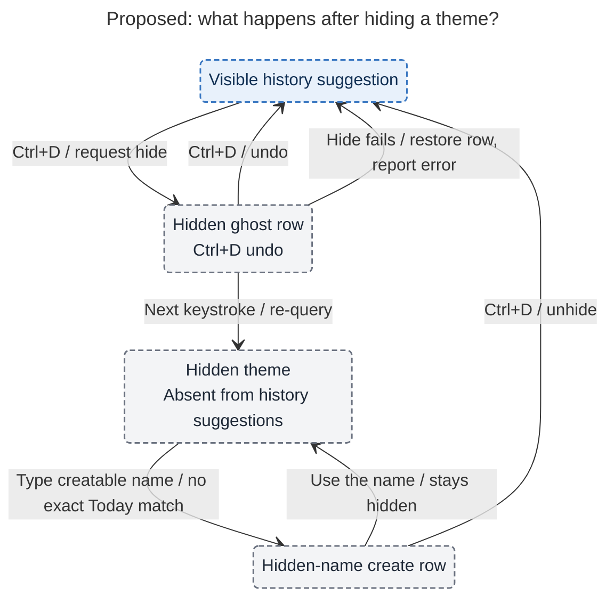

# Diagram proposals: Pomodoro themes: a shared catalog with today-first suggestions, hiding, safe rename, and stable colors

Proposals for the swarm linker, not a report. Each diagram restates only what the source
report says.

```yaml
source: research:202610/pomodoro_theme_catalog/pomodoro_theme_catalog__final.md
producer: research.2c.image
check: "mmdc 12.0.0 with --no-sandbox and the PDF-mirroring config rendered 1 of 1 Mermaid diagrams"
```

## hide-lifecycle

```yaml
anchor: |-
  On failure it restores the row and reports in the status
question: |-
  What happens after hiding a history suggestion, including undo and write failure?
illustrates: |-
  The hidden ghost row supports Ctrl+D undo and write-failure recovery, while using a hidden name never silently unhides it.
caption: "Hiding supports undo and failure recovery; using the name keeps it hidden from history suggestions, while today's entries stay visible."
review: "620.776x802 px, fit 100.0%; question, arrows, labels, crossings, and source checks passed; 1 revision across 2 visual look rounds; unique body anchor confirmed"
```


