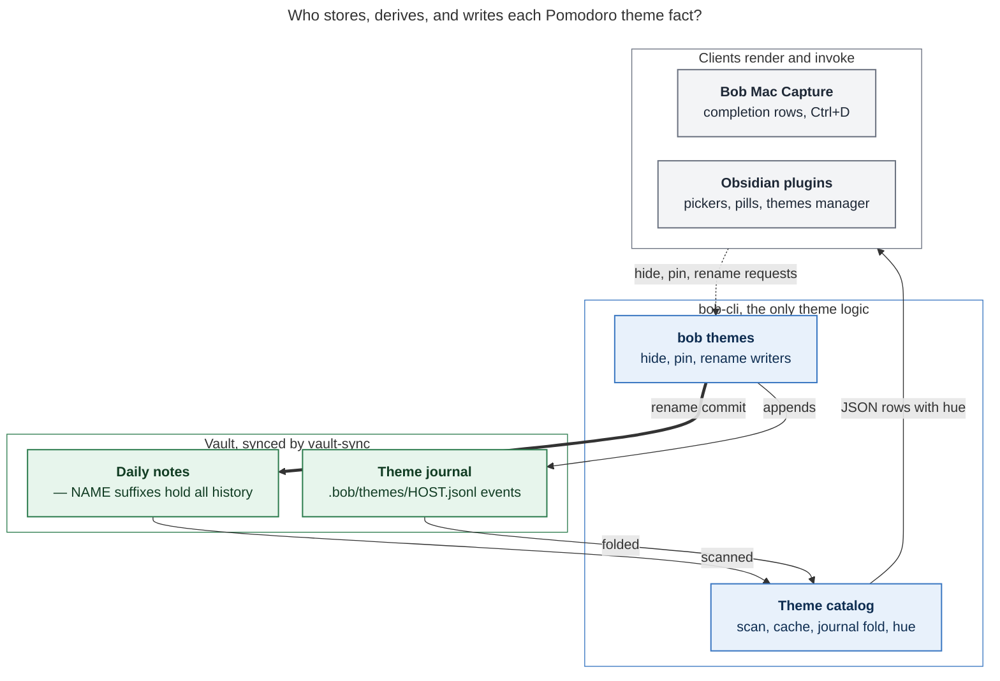
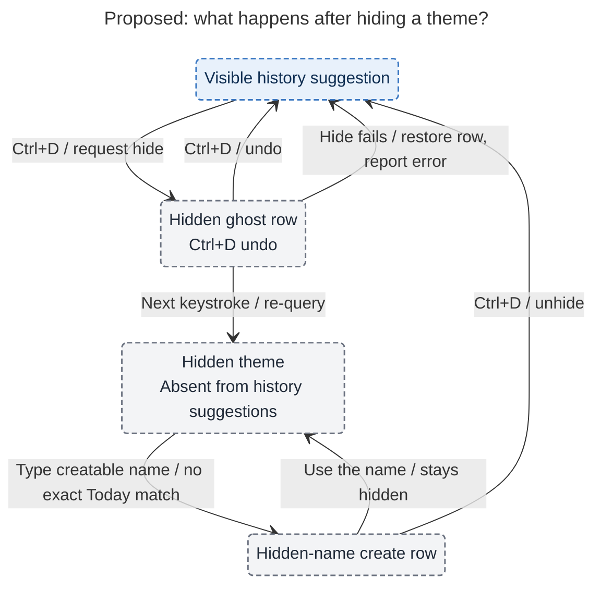

# Pomodoro themes: a shared catalog with today-first suggestions, hiding, safe rename, and stable colors

> **Research query:** What is the best way to add much better support for Pomodoro
> themes (aka Pomodoro names): a new glossary term; suggestions of previously used themes
> in every completion menu that lists themes, including bob-mac-capture, with matching
> existing names shown first; global rename across all daily files; a way to disable a
> theme so it leaves completion menus (perhaps a `<ctrl+d>` keymap); and a distinct,
> deterministic per-theme color used wherever themes appear, including Obsidian? Is this
> plan a good idea, would you take a different approach or adjust the requirements
> (calling adjustments out clearly), and what solution do you recommend for a design that
> is intuitive, reliable, and beautiful?


## Bottom line

**Build it.** Pomodoro names are already semi-structured data. The plan budget counts their
`+` components as *themes*, and Stats has a `theme` dimension. But nothing remembers them
past midnight. The vault shows the cost:

- 81 distinct themes in the two months since named Pomodoros began (2026-08-26).
- 40 of them used on exactly one day.
- Near-duplicate clusters: FIX/FIXES, TOOL/TOOLS, SCREENSHOT/SCREENSHOTS, and
  SASE V18/SASE-V18.

Suggestions stop the drift, and rename repairs what has already drifted.

**Recommended shape:**

1. **Catalog.** A bob-owned [theme catalog](#data-model-and-ownership) is derived from the
   daily notes. Each theme is one `+` component of a ` — NAME` suffix.
2. **Preferences.** Hide and color pins live in a small append-only journal that syncs
   with the vault. Nothing is stored per theme anywhere else.
3. **Completion.** Every [Pomodoro-name menu](#completion) lists **today's rows first, in
   today's order**, then recently used themes. Accepting a history row has to submit
   exactly the name it shows.
4. **Hide.** **Ctrl+D** [hides the selected history row](#where-and-how-to-hide). It is
   reversible in place, and it is also available in a themes manager and the CLI.
5. **Rename.** **[Global rename](#global-rename)** is one bob transaction that ends in a
   single revertable Git commit, modeled on `bob ref rename`.
6. **Color.** Each theme gets a **[stable color](#color)**: the existing eight validated
   area hues, hashed from the name, with an optional per-theme pin. It is drawn as a
   **tinted pill with normal text**, so it never looks like the ● area dot on the same
   row.

**Requirement adjustments I'm making** (see
[Requirement adjustments](#requirement-adjustments)):

- A theme is a `+` component, not a whole name.
- "Disable" becomes **Hide from suggestions**.
- "Distinct color" means *stable*, not *unique*.
- GTD-style exempt themes render muted.
- Ctrl+D is scoped to the completion menu.
- Two additions: reuse must be **lossless** (a prerequisite, already a live bug) and
  creating a near-duplicate gets a heads-up.

## About this report

Consolidated report · lead researcher · 2026-10-24

Inputs: five independent reports (`__cdx`, `__cld`, `__grk`, `__mus`, `__gem` in this
directory) plus my own verification. I checked the reports' disputed claims against
bob-cli, bob-plugins, bob-mac-capture, chezmoi, and a read-only scan of the live vault.
Where a claim comes from one report I name it. Where I checked it myself, I say so.

No product, memory, or vault files were changed. One defect found during verification
was filed as a task bead: **bob-cli-bb** (see
[New findings from verification](#new-findings-from-verification)).

## Is this a good idea

Yes. Reuse at the moment of naming removes recall work exactly when it is needed. Rename
turns the theme vocabulary from append-only into something that converges. Color makes a
day with three to seven themes scannable. All five reports agree on this.

The risks are in the details, and each one has a concrete failure mode:

- **"Theme" means two things:** Docs and code use *theme* for a budget component
  (`docs/plan.md`, Stats) and for the whole name (the mac-pom glossary strand says
  "THEME is the Pomodoro's ` — NAME`"). Rename, hide, and color would each pick a
  different meaning.
- **History rows that lie:** A history row that inserts a slug can create the wrong
  spelling ([V1](#new-findings-from-verification)) or silently select a different
  session by prefix (V2).
- **"Disable" that removes real work:** If hiding also hid today's open entry, you could
  not select, link, or finish a session you are in.
- **A "distinct" color promise:** No stateless hash can keep a day's themes distinct.
  Half of real multi-theme days collide in every palette size (see [Color](#color)).
- **Two-colors-one-row confusion:** Theme and area home already share each ledger row.
  The same visual form for both would make them read as one thing.
- **Storing state where it can't sync:** `config.yml` is chezmoi-managed (V4). A single
  JSON registry conflicts under vault-sync and lands in `_conflicts/`.
- **A vault-wide rewrite from a completion menu:** A one-keystroke, history-wide edit is
  the wrong blast radius for a menu used to type.

### Where the reports disagreed and my call

- **Unit of a theme**
  - *cdx:* full name (component scope optional)
  - *cld:* `+` component
  - *grk:* component
  - *mus:* component
  - *gem:* mostly full name
  - *Decision:* **Component.** It matches the budget and Stats, and composites are rare
    (V3).
- **Hide-state storage**
  - *cdx:* `.bob/` JSON file
  - *cld:* per-host union JSONL journal
  - *grk:* `config.yml`
  - *mus:* config
  - *gem:* `config.yml`
  - *Decision:* **Journal.** Config is chezmoi-managed (V4), and a single file conflicts.
    The journal has a precedent (V5).
- **Palette**
  - *cdx:* new 12 slots
  - *cld:* reuse 8, pill form, pins
  - *grk:* new 12, colored text
  - *mus:* reuse 8, distinct glyph
  - *gem:* new 16, hex table
  - *Decision:* **Reuse 8, pill form, optional pins** (see [Color](#color)).
- **Disable gesture**
  - *cdx:* manager, no Ctrl+D default
  - *cld:* Ctrl+D on history rows
  - *grk:* empty-query two-step Ctrl+D
  - *mus:* none in v1
  - *gem:* Option+D / Ctrl+X
  - *Decision:* **Ctrl+D while completion is visible, on history rows** (see
    [Where and how to hide](#where-and-how-to-hide)).
- **Create-row position**
  - *cdx:* after history
  - *cld:* after history prefix matches
  - *grk:* before history
  - *mus:* after history
  - *gem:* after history
  - *Decision:* **After today's rows and history exact/prefix matches, before history
    substring matches.**
- **Lossless reuse**
  - *cdx:* exact quoted literal
  - *cld:* slug + drop shadowed rows
  - *grk:* not addressed
  - *mus:* not addressed
  - *gem:* not addressed
  - *Decision:* **Exact literal when needed** (see [Completion](#completion)). cdx's
    concern is confirmed by V1 and V2.
- **Rename mechanics**
  - *cdx:* journal + undo protocol
  - *cld:* copy `bob ref rename`
  - *grk:* lock + dry-run + merge
  - *mus:* dry-run + warnings
  - *gem:* dry-run + atomic
  - *Decision:* **Copy `bob ref rename`.** This is the tested precedent, and Git is the
    undo.
- **History cache**
  - *cdx:* local cache dir
  - *cld:* `bob_cli_cache_dir()`
  - *grk:* in-vault `.bob/` file, gitignored
  - *mus:* small mtime cache
  - *gem:* `~/.cache` + incremental
  - *Decision:* **Machine-local cache** in `bob_cli_cache_dir()`, never synced.
- **CLI noun**
  - *cdx:* `bob theme`
  - *cld:* `bob theme`
  - *grk:* `bob pomodoro theme`
  - *mus:* `bob themes`
  - *gem:* `bob theme`
  - *Decision:* **`bob themes`** (plural catalog noun, like `projects` and `plugins`);
    subject to bob-cli-4b.

## Requirement adjustments

These are explicit call-outs. Accept or reject each one.

- **ADJ-1: a theme is one `+` component; the Pomodoro name is the whole suffix.**
  - `— BOB + DECKS` is one name with two themes. Suggestions, hide, rename, and color all
    operate on themes, keyed by `normalize_component`.
  - Why: it keeps one meaning with `plan.max_themes` and Stats. Full composite names are
    8 of 86 names, so composites are not worth a second identity.
  - Known quirk: a name like `C++` splits to the theme `C` everywhere, budget included.
    Leave that alone in v1.
- **ADJ-2: "disable" becomes "Hide from suggestions."**
  - A hidden theme leaves history suggestions only. Today's ledger rows are never hidden.
  - You can still type the name, and it still creates. History, Stats, and colors are
    unchanged.
  - Using a hidden name does **not** silently unhide it. The project avoids state changes
    behind your back, as in `decisions:unblocked-tasks-are-offered`.
- **ADJ-3: colors are stable and learnable, not unique.** "Distinct" and "deterministic
  from the name" conflict on about half of real days (see [Color](#color)). The name hash
  is the default, an explicit **pin** fixes recurring collisions, and the name text always
  accompanies the color.
- **ADJ-4: exempt themes (GTD by default) render muted.** GTD is on 51 of the 60 days
  with named Pomodoros. A colored GTD pill would add noise twice a day and would clash with the orange
  `gtd` *area* dot. This mirrors "exempt rows are dimmed" in `bob plan`.
- **ADJ-5: Ctrl+D is scoped to the completion menu.** While completion is visible:
  - on a history row, Ctrl+D hides it;
  - on the create row of a hidden name, it unhides;
  - on today's rows, it shows a hint and does nothing.

  When no menu is visible, Ctrl+D stays forward-delete. The same action is reachable from
  the manager and the CLI, so the key is never the only way in.
- **ADJ-6: global rename does not live in completion menus.** It lives in
  `bob themes rename` and in the Obsidian themes manager. The existing "rename this one
  session" gesture keeps its scope, so the two never share a key.
- **ADJ-7 (added): reuse must be lossless.** A history row must submit exactly the name
  it shows. Ship this before history rows, and fix **bob-cli-bb** first.
- **ADJ-8 (added, small): near-duplicate heads-up.**
  - A create row whose name is within edit distance 2 of a known theme, or is its plural
    or singular, gets a `like FIX` badge.
  - It never reorders rows or changes Return. That keeps the "Return never changes" spirit
    of `decisions:similar-tasks-are-a-settled-heads-up`.
  - The vault shows this is where drift comes from (FIX/FIXES, TOOL/TOOLS).
- **ADJ-9 (behavior change): the create row moves down.** Today's *substring* matches now
  rank above it, and so do history exact and prefix matches. Otherwise typing `=#bo` and
  pressing Return would create `BO` instead of reusing `BOB`.
- **ADJ-10 (added): the Mac "Name it" prompt gets the same suggestions.** It is a naming
  surface that currently has no memory.

## Design

### Vocabulary

Proposed glossary strand `glossary:pomodoro-theme`. Write it through `/sase_memory_write`;
this research does not edit memory.

> **Pomodoro Theme** — aka theme, Pomodoro name
>
> One `+`-separated component of a [[pomodoro]]'s ` — NAME` suffix. Most names are a
> single theme; `— BOB + DECKS` is one name with the themes BOB and DECKS.
>
> - **Identity.** Themes compare case-insensitively after collapsing whitespace (the plan
>   budget's component key) and display ALL-CAPS. The name is the identity: there is no
>   id, note, or registry entry.
> - **One meaning everywhere.** A theme is what `plan.max_themes` counts (except
>   `plan.exempt` themes such as GTD), what the Stats `theme` dimension reports, and what
>   `bob themes` lists, hides, colors, and renames.
> - **Catalog.** Every theme on any canonical daily note's Pomodoro entries, open or
>   closed, plus the hide and pin events in `.bob/themes/*.jsonl`.
> - **Hiding** removes a theme from history suggestions only. Today's entries, history,
>   Stats, colors, and typing the name are unaffected.
> - **Color.** A pin, else muted for exempt themes, else `fnv1a32(key) % 8` over the
>   Pomodoro-home hue slots; drawn as a tinted pill, never as an area's ● dot.
> - **Not** a Pomodoro home (derived from Task Links), not an Obsidian appearance theme,
>   and not the budget's `(unnamed)` placeholder.

Also do the following:

- Link the new strand from `glossary:pomodoro`.
- Change the mac-pom strand's "THEME is the Pomodoro's ` — NAME`" to "NAME". Epic
  bob-cli-9k currently holds the edit authorization for that strand, so coordinate.
- In code and CSS, use `pomodoro_theme` / `bob-pomo-theme-*` to avoid colliding with
  Obsidian themes and `.theme-dark` (cld).

Draft these decision records for acceptance:

1. `pomodoro-themes-are-name-components`
2. `hidden-themes-leave-suggestions-only`
3. `theme-colors-are-hashed-area-hues-with-pins`
4. `theme-state-is-a-union-merged-vault-journal`

Use [Rejected alternatives](#rejected-alternatives) for their rejected alternatives.

### Data model and ownership



*Only two things are stored: the daily notes and an append-only journal. bob derives
everything else, and clients change theme state only by asking bob.* Dashed lines are
requests from clients. The heavy line is the one history-rewriting write.

**Three layers, one source per fact:**

- **History**
  - *Where:* Canonical `YYYY/YYYYMMDD.md` Pomodoro entries, all states, fenced code
    skipped
  - *Rule:* Authoritative. Per theme, derive the display spelling (most recent),
    `first_used`, `last_used`, `days_used`, and `entries`. Exclude `_templates/`,
    `done/`, `_conflicts/`, and `*_poms.md`/`*_done.md` siblings. Never infer names from
    task text or homes.
- **Preferences**
  - *Where:* `.bob/themes/<host>.jsonl`, one file per host, append-only
  - *Rule:* Events: `theme.hide`, `theme.unhide`, `theme.color` (`hue` or `null` to
    unpin), and `theme.rename`. Fold by sorting on `(ts, host, line)`, last writer wins
    per key. A rename moves the source's state to the target unless the target already
    has explicit state.
- **Acceleration**
  - *Where:* `bob_cli_cache_dir()/themes/catalog-v1.json`
  - *Rule:* Disposable. Per-file `(mtime_ns, size)` fingerprints, and today's note is
    always read live. Rebuilt on miss, after a rename, and by `bob nightly`.

Example journal lines:

```json
{"v":1,"ts":"2026-10-24T09:41:07-04:00","host":"mac","kind":"theme.hide","key":"fixes","name":"FIXES","via":"bob-mac-capture"}
{"v":1,"ts":"2026-10-24T09:43:00-04:00","host":"apollo","kind":"theme.color","key":"job","hue":"aqua"}
{"v":1,"ts":"2026-10-24T10:02:11-04:00","host":"apollo","kind":"theme.rename","from":"fixes","to":"fix"}
```

**Rollout of the journal.** Add `!/.bob/themes/*.jsonl` to the vault `.gitignore` and
`.bob/themes/*.jsonl merge=union` to `.gitattributes`, documented in
`docs/vault-git-sync.md` next to the Stats journal. Until that allowlist reaches a host,
hides written there stay local; document this.

Last-writer-wins across hosts trusts the clocks. For one user toggling a single theme,
clock skew is an acceptable risk (cdx raised it).

**Keeping the cache cheap per keystroke.** The Mac spawns `capture-complete` on every
keystroke, which costs about 5 ms today.

- A full stat sweep would add roughly 20 ms (V8), so do it at most once per minute, or
  when a year directory's mtime changes.
- Otherwise stat only today's note.
- A past-day hand edit then shows up within a minute.
- Rename previews and `bob themes list --fresh` always rescan from source.
- Measure on the Mac before tuning.

### Completion

**Surfaces:**

- **bob-cli** — `capture-complete` contexts `pomodoro_name` (`@r:id#…`, `@r^id+#…`) and
  `pomodoro_start_name` (`=#…`, `=<X>#…`). These cover Mac Capture and zsh.
- **Mac** — the "Name it" prompt.
- **Obsidian** — the Ctrl+Shift+Enter link picker (block-id-prompt), and nav's bullet-move
  (new-name split) and entry move/merge/rename pickers.

**Order (both contexts).** Filter first, then group by where the row comes from:

1. **Today**: every matching row from today's ledger, with today's existing contents and
   internal order unchanged. That is open names, again rows, name-it rows, and running
   last in start context. This is the request's "existing names first" rule.
2. **Recent, exact and prefix matches.** Ordered by `last_used` descending, then
   `days_used` descending, then name. An exact match comes first.
3. **Create row**, only when the query is creatable (`named_creation_name`) and no Today
   or Recent row matches it exactly. An exact Recent match *is* the create row: it
   carries `creates_pomodoro`, `plan_themes_after`, and `plan_themes_cap`.
4. **Recent, substring matches.**

**Caps:**

- An empty query keeps today's list and adds up to **5** recent themes under a "Recent"
  header. This matters most first thing in the morning, when today's ledger is empty.
- A non-empty query shows up to about 12 history rows.
- The full list lives in the manager.
- Do not gate one-off names. Recency ordering already buries them, and ADJ-8 catches the
  near-duplicates they cause.

**Guards that make it reliable:**

- **Dedupe.** Drop a history theme already present anywhere in today's ledger, composite
  components included. Today's row already surfaces it through substring matching.
- **Lossless acceptance (ADJ-7).**
  - Bob emits the plain slug, with the existing bare/`#` spelling rule, only when it
    round-trips. That means `canonicalize(slug)` equals the displayed name, and
    `select_named(today, slug)` would not resolve to a different open entry.
  - Otherwise bob emits an **exact-name literal**. cdx's candidate is `=#"SASE V18"` /
    `@route:id#"SASE V18"`. `"` is not a selector byte, so it is lexically free, and bob
    already has an internal `PomodoroLinkTarget::ExactName` (used by the reference
    library's Today path) for the semantics.
  - Most rows stay clean: in V3 terms, single-word names that no open entry shadows use
    the bare slug.
- **No silent writes.** Fetching, filtering, and accepting suggestions never touch the
  journal. "Last used" comes from committed ledger entries.
- **Same refusals as typing.** History rows never bypass the missing-section,
  multiple-running, strict-budget, or placement checks that typing would hit.

**Additive JSON on `PomodoroNameCandidate`.** `schema_version` stays 1, and the Mac
decodes with `decodeIfPresent`.

- **`origin`:** `"today"` or `"history"`; absent means today
- **`themes`:** `[{key, name, hue, hue_source}]` for every component (`hue_source`:
  `pin` / `hash` / `exempt`)
- **`last_used`, `days_used`:** history rows
- **`hidden`:** `true` on the create row of a hidden theme
- **`similar_to`:** `["FIX"]` on a create row (ADJ-8)

History rows set `creates_pomodoro: true`, which is truthful. An old Mac build shows them
as "New X" rows, which is still the correct action.

**Mac rendering:**

```text
 =bo▏
 ┌──────────────────────────────────────────────────────┐
 │ TODAY                                                │
 │ ▪ BOB           Planned · 2 links             Next   │
 │ RECENT                                               │
 │ ▪ BOOKS         Oct 21 · 3 days          +1 · 4/5    │
 │ ▪ BOT           Sep 29 · 1 day           +1 · 4/5    │
 │ + New Pomodoro BO                             New    │
 │                          ⇥ accept    ⌃D hide theme   │
 └──────────────────────────────────────────────────────┘
```

- `▪` is the theme's 8 pt rounded-square swatch. Area dots stay circles.
- Section labels are quiet. Time, status, and counts stay neutral.
- The `⌃D` hint shows only when the selected row can be hidden.
- Refresh keeps the selection by row identity, not array index, so late history cannot
  change what Return accepts (cdx).

**Name it prompt:**

- Suggestions come from `bob themes list -q Q -f json`, which the app may filter.
- Exclude names already open today; using one would create a duplicate open name.
- The prompt keeps its single-entry scope.

### Where and how to hide

**Primary gesture: Ctrl+D while a completion menu is visible.** It applies in Mac Capture
and in every Obsidian Pomodoro-name picker.

What Ctrl+D does depends on the selected row:

- **History row:** Hide. The row stays in place as a ghost, `BOOKS hidden · ⌃D undo`,
  until the next keystroke re-queries. Pressing again undoes.
- **Create row of a hidden theme (`FIXES · hidden`):** Unhide.
- **Any today row:** Nothing; status hint "BOB is on today's ledger — nothing to hide".

Ctrl+D is always consumed while the menu is visible, so the same key never means "hide"
on one row and "delete a character" on the next. With no menu visible, it is
forward-delete as before.

**Why Ctrl+D is the right key here, against cdx, mus, gem, and grk:**

- **The Mac app already does this.** It overrides Control keys while completion is
  visible: Ctrl-N/P navigate, Return/Tab accept, Ctrl-T replaces transpose
  ([V6](#new-findings-from-verification)). Forward delete is rarely needed while
  completing, because the caret sits at the end of the token.
- **It is Bryan's existing vocabulary.** In Obsidian, Ctrl+D already means "delete the
  selected item" on the Task Card, Depends-On, and Links to (V7). Ctrl+X means merge
  there.
- **Hide is reversible in place, so one press is enough.** Two-step arming (grk) suits
  destructive actions like template delete.
- **grk's empty-query-only rule defeats the main use.** You find a stale name by typing
  part of it.
- **Option+D (gem) is a poor fit.** It types `∂` in Cocoa text fields, and Bryan's
  Obsidian keymaps use Alt+letter heavily (Alt+F, Alt+N, Alt+P).

**Discoverable, recoverable homes:**

- The footer hint.
- `bob themes hide|unhide NAME…` and `bob themes list --hidden`.
- The Obsidian themes manager.

**Write path:**

- The Mac runs `bob themes hide NAME -f json` in its own process lane, so a completion
  re-query cannot cancel it. On failure it restores the row and reports in the status
  line, following the `capture-templates delete` pattern (cld).
- Obsidian desktop calls the same command through `api.themes`.
- Bob is the only writer of the journal.

[The hide-lifecycle diagram](#figure-hide-lifecycle) follows a history row through the
proposed Ctrl+D ghost row, undo or write-failure restore, and shows that using a hidden
name never silently unhides it.

<div id="figure-hide-lifecycle">



_Hiding supports undo and failure recovery; using the name keeps it hidden from history suggestions, while today's entries stay visible._

</div>

### Global rename

```text
bob themes rename OLD NEW [-d/--dry-run] [-f/--format human|json] [-m/--merge] [-o/--offline]
```

**Scope.** It rewrites the theme component in ` — NAME` tails of Pomodoro entries in
every canonical daily note — past, today, and future; open and closed — plus
`_templates/daily.md` (V10).

- Separators keep their ` + ` spelling.
- A resulting duplicate component collapses: `FIX + FIXES` becomes `FIX`.
- Every other byte is preserved: statuses, time ranges, links, child bullets, line
  endings.
- Prose, task text, and fenced examples are never touched.

**Flow (copy `bob ref rename`):**

1. Take `bob_sync.lock`, then pre-sync unless `--offline`, then replan from the synced
   files.
2. Snapshot every target and compare it right before writing. A note that changed since
   planning aborts with `stale_note`.
3. Write each file atomically, then append the `theme.rename` journal event.
4. Verify: rescan, OLD is absent, entry counts are unchanged, and only name tails differ.
   On failure, restore the before-images.
5. Make one commit, `bob themes rename: FIXES → FIX`, then post-sync. Undo is
   `git revert`, with a documented runbook.

**Refusal codes:**

- `unknown_theme`, `invalid_name`, `unchanged`.
- `theme_exists`: NEW is already used. Requires `--merge`, because BLOG → BOB is a
  plausible typo.
- `config_reference`: OLD appears in `plan.exempt`, `plan.inventory_labels`, or a Stats
  metric filter, and NEW does not. Edit the chezmoi config to add NEW first. That way a
  rename never silently changes budget behavior, and bob never writes chezmoi files.
- The `bob ref rename` set: `lock_busy`, `dirty_paths`, `not_a_worktree`,
  `sync_failed`, and `verify_failed`.

**Human dry run (cld):**

```text
RENAME  FIXES → FIX   merge: FIX already used on 3 days
  2026/20260903.md   2 entries   — FIXES          → — FIX
  2026/20261016.md   1 entry     — BOB + FIXES    → — BOB + FIX
  state              FIXES hidden → FIX keeps its own (visible)
  color              ▪ violet → ▪ blue   (colors follow the new name)
dry run · nothing written · rerun with --merge to apply
```

**UIs only preview and invoke.** The Obsidian manager runs `-d -f json`, shows the
preview, and confirms. Before applying it saves the active editor, and it refuses if the
editor reports unsaved changes to a target note (cdx). The Mac gets no rename UI in v1.

**After a rename:**

- The theme's color changes to the new name's color, and the preview says so. That is
  visible confirmation the rewrite happened (grk).
- If the old spelling reappears later, for example from an offline host or muscle memory,
  the manager lists it as "renamed name reappeared", detected from the journal's rename
  event. It only lists it; it never auto-rewrites.

### Color

**Measured on the vault.** Days with at least two non-GTD themes where two of that day's
themes share a color:

- **`fnv1a32 % 8` (the area hash):** 27/55 (49 %); 36/60 (60 %) with GTD
- **`% 10` / `% 12` / `% 16`:** 27 % / 45 % / 33 %
- **`% 8` over 200 hash salts:** 49–67 % (median 53 %)
- **`% 12` over 200 hash salts:** 16–60 % (median 40 %)
- **`% 8` + two pins (JOB → aqua, BLOG → red):** 21/55 (38 %); no pair collides on more
  than 2 days

This is the birthday problem. Days carry two to six themes, so more slots change little,
and the variation across salts is mostly noise. Tuning a salt to today's data would
overfit.

What actually hurts are recurring pairs:

- BOB and JOB are both magenta, together on 7 days.
- SASE and BLOG are both orange, together on 6 days.

Two pins remove both. My counts reproduce cld's within one day.

**Algorithm (pin as rule T-hue in a new `docs/pomodoro-themes.md`):**

1. A pin from the journal wins.
2. Else a key in `plan.exempt` is **muted**, with `hue: null` and
   `hue_source: "exempt"`.
3. Else use `Hue::ALL[fnv1a32(key) % 8]`, reusing `palette::fallback_hue`.

Ship cross-language test vectors in `tests/fixtures/pomodoro_themes/vectors.json`. Rust
and JS compute the hue; Swift and Lua only consume `hue`.

**Why reuse the eight area hues instead of a new palette (against cdx, grk, gem):**

- **More slots don't fix collisions** on real data (the measurements above).
- **More than about eight categorical hues stop being distinguishable**, especially as
  16 % tints.
- **A near-twin palette is worse than the same palette in a new shape.** Next to an area
  dot it reads as a mistake: grk's "coral" beside the area "red", "teal" beside "aqua".
- **The eight are already validated** in Rust, JS, and Swift, with light/dark hex,
  xterm-256, and CSS variables.
- **The contrast weakness doesn't apply.** cld's palette check shows aqua, yellow, and
  magenta below 3:1 *as text*, but the pill form never uses the hue as text color.

**Form: names wear a tint, places wear a dot.**

- **Pill.** `background: color-mix(in srgb, var(--bob-hue-X) 16%, transparent)`,
  `color: var(--text-normal)`, `border-radius: 4px`.
- **Muted pill.** `--background-modifier-hover` with `--text-muted`.
- **CSS tokens.** Introduce `--bob-hue-<slot>` and alias the existing `--bob-area-*` to
  it.
- **Swatch.** Dense rows use an 8 pt rounded square. Area homes keep the ● dot.
- **Composites.** Each component gets its own pill, and the ` + ` stays neutral.
- **Typing.** While you type an unknown name, keep the neutral span color, so the text
  doesn't flicker through hues on every keystroke (cld).
- **Without color.** Color is never the only signal. The name text, `Today`/`Recent`
  labels, and `hidden`/`exempt` badges carry the meaning under `NO_COLOR` and Increase
  Contrast.

```text
- [x] (**0920-0950** [t:: 30m]) — ⟦BOB⟧ + ⟦DECKS⟧          ● bob · dev
- [ ] () — ⟦GTD⟧ (muted)
```

**Surfaces, in priority order:**

1. **Priority 1**
   - **Mac completion rows; Obsidian picker rows:** swatch before the name; hidden rows
     dimmed
   - **Obsidian Live Preview of daily-note entries:** `Decoration.mark` per component of
     the ` — NAME` tail, so the text stays editable. Reuse the home-chip line scan and
     refresh effect.
   - **Obsidian Reading view:** post-processor wraps the components, scoped to canonical
     daily-ledger rows
   - **Mac editor `pomodoro_name` spans:** background tint behind *known* names only.
     `capture-parse` spans gain `themes` with component offsets.
2. **Priority 2**
   - **Mac idle agenda, preview cards, `+1 BOB` chip, destination rows:** pill or
     swatch, using bob-provided hues
   - **`bob-plan` block theme line `★ A · B`:** pills
   - **Stats Themes panel:** bars in the theme hue ("color follows the entity, not its
     rank"); folded "other" is gray
   - **CLI: `bob plan`, `bob capture` output, `bob themes list`, `bob pomodoro`:**
     xterm-256 `■` swatch plus a default-color name
3. **Priority 3**
   - **tmux status line; Hammerspoon mac pom:** swatch only. Never tint the menu-bar
     title: red and green already mean overdue and worked.

**Collision hint.** `theme_hue_collision` mirrors `area_hue_collision`. It covers
unpinned pairs that met on two or more of the last 30 days, and it suggests the least-used
free slot. When a theme shares a top-level area's name (JOB / `job`), it suggests that
area's hue, so the same word gets the same color. It is advisory only; nothing pins
automatically.

### Themes CLI

The command is `bob themes`.

**Membership rule:** read or change the Pomodoro theme catalog. It is a new top-level
catalog noun, listed in "Daily workflow".

- Not under `bob task`, which is reserved for task-line rewrites.
- Not under `bob pomodoro`, which is runtime status with a flag-taking bare default.
- Never a `capture-*` sibling.
- Plural matches `projects`, `plugins`, and `articles`. Revisit if bob-cli-4b picks a
  different policy.

Commands and their purpose:

- **`bob themes` = `bob themes list [-a/--all] [-f/--format] [-F/--fresh] [-H/--hidden] [-q/--query Q]`:**
  Catalog, ranked as in [Completion](#completion) when `-q` is given. Bare is allowed: a
  flag-only, read-only default.
- **`bob themes color NAME HUE|auto`:** pin or unpin
- **`bob themes hide NAME…` / `bob themes unhide NAME…`:** journal writes
- **`bob themes rename OLD NEW …`:** see [Global rename](#global-rename)

`list` mock:

```text
THEMES  81 known · 4 today · 2 hidden · last 90 days
  ■ BOB        today    26d   magenta
  ■ BLOG       Oct 23   14d   orange
  ■ JOB        Oct 16    7d   magenta
  □ GTD        today    51d   muted · exempt
  hint  BOB and JOB share magenta and met on 7 days → bob themes color JOB aqua
```

### Client integration

**Mac (thin client):**

- Decode `origin`, `themes`, `last_used`, `days_used`, `hidden`, and `similar_to`.
- Add Today and Recent headers, swatches, Ctrl+D with the ghost row, Name-it suggestions,
  span tints, and agenda pills.
- Add a refresh trigger after theme actions. Also add a narrow agenda-refresh exception
  for `.bob/themes/`, because hidden paths are filtered today (cdx).
- Update `docs/keyboard.md` and the `docs/protocol.md` compatibility rows.

**Obsidian.** Add a `bob-ledger-tools` `api.themes` v1 namespace that every picker
plugin uses:

- **Data.** It caches `bob themes list -f json`, serving stale data at once and refreshing
  in the background, the same pattern as `api.stats` (V9). Today's rows still come from
  the live editor buffer, as now.
- **Mirrors.** A small JS mirror holds the hue rule, the journal fold (read-only, so pins
  color correctly on mobile and before bob answers), and the history ranking. All three
  are gated by the shared vectors.
- **Writes.** Every write goes through bob.
- **Degraded mode.** When bob is unavailable (mobile), pickers keep today-only behavior
  and colors still render.

Do not create three history scanners or per-plugin hidden lists.

**Themes manager.** A new command, **Bob: Pomodoro themes**, opens a nav
`FilteredPickerModal`:

- Rows show a pill, last used, days used, and `today`/`hidden`/`pinned` badges. Filters
  are Active and Hidden, plus a "possible duplicates" view of same-slug or near names
  such as SASE V18 / SASE-V18.
- Ctrl+D toggles hide.
- Enter opens actions: `r` rename (preview, then confirm), `c` color (1–8 or auto), `h`
  hide/unhide, `o` occurrences.

## Rejected alternatives

- **Hide state in `config.yml` (grk, mus, gem):** chezmoi-managed (V4): a Mac or
  Obsidian write drifts and never propagates
- **One vault JSON/YAML registry (cdx):** concurrent edits conflict and vault-sync parks
  one side in `_conflicts/`; the union journal cannot conflict
- **One note per theme, UUIDs on ledger rows:** 81 notes in two months; a second source
  of truth for a short label
- **New 12- or 16-slot palette; continuous hash hue:** no collision benefit on real data;
  near-twins of area hues; three runtimes to re-validate
- **Per-day collision-free assignment:** BOB would change color on some days, which
  breaks learnability and determinism
- **Theme color = dominant area hue:** most work is in `dev`, so nearly every pill would
  be blue; drifts with history
- **Colored theme *text* (grk):** three of the eight hues fail contrast as text on light
  backgrounds
- **Hash a salt tuned to today's data:** overfits; future themes collide at the same
  rate
- **History rows that insert the plain slug always (cld):** confirmed to author the wrong
  spelling (V1) or select the wrong session (V2)
- **Dropping shadowed history rows instead of an exact literal (cld):** hides the most
  common real case (SASE while SASE V18 is open)
- **Option+D or Ctrl+X for hide (gem):** Option+D types `∂`; Ctrl+X already means merge
  in nav
- **Empty-query, two-step Ctrl+D (grk):** you find stale names by typing; hide is
  reversible
- **No keymap in v1 (mus):** hide must be cheap at the moment you notice the stale name
- **Auto-unhide on use; auto-pin on first sight:** silent, multi-writer state changes
- **Rename from the completion menu:** wrong blast radius for a typing surface
- **Global text replacement:** touches prose, task names, and partial words
- **Frequency-weighted score (gem):** less explainable than "most recent first, then most
  days"; no evidence it ranks better
- **Each plugin spawns bob per keystroke:** picker latency; the cached `api.themes` makes
  one call

## Risks and open questions

**Risks:**

1. **Mac keystroke latency.** Keep the catalog warm and bound the stat sweep (see
   [Data model and ownership](#data-model-and-ownership)). Measure `capture-complete` on
   the Mac before and after.
2. **The exact-literal grammar** is new lexer surface. It needs round-trip fixtures for
   spaces, punctuation (`SASE.MD`, `FIX-APOLLO`), digits, and shell quoting.
3. **JS/Rust drift** in the hue rule, journal fold, and ranking. Shared vectors gate all
   three.
4. **Rename vs open editors.** Compare-before-write plus Obsidian's reload of clean
   buffers bound the risk, and capture already writes today's note under these
   conditions.
5. **Journal allowlist lag** on a host that hasn't synced `.gitignore` yet. Hides there
   stay local; document it.

**Questions for Bryan:**

1. Accept "theme = component" (ADJ-1)? Or should a whole composite name be one theme?
2. Is **Hide** the right word, or do you want **Retire**?
3. Should GTD be muted (ADJ-4)?
4. Accept the create-row move (ADJ-9)? A short new name that prefixes an old theme then
   needs ↓ before Return.
5. Seed the pins JOB → aqua and BLOG → red now, or wait for the collision hint?
6. `bob themes` (plural) or `bob theme`? See bob-cli-4b.
7. Do you use Obsidian on mobile? Colors and today-only pickers would work there;
   history, hide, and rename would be desktop-only.

## Recommended solution

**One rule:** a theme is a name component, stored only in the daily notes, and bob owns
everything derived from it.

- **Catalog.** bob-cli builds a theme catalog from canonical daily notes, cached locally,
  folded with a union-merged `.bob/themes/<host>.jsonl` journal for hide and pin state.
- **Suggestions.** Every Pomodoro-name menu shows today's rows first, in today's order,
  then recent themes (exact and prefix matches, the create row, then substring matches).
  History rows submit the exact name they show.
- **Hide.** Ctrl+D inside the menu, reversible in place, plus the manager and CLI.
- **Rename.** One `bob ref rename`-style transaction and one revertable commit, driven
  from the CLI or the Obsidian manager.
- **Color.** The eight existing hues, hashed from the name, with pins and muted exempt
  themes, worn as a soft tint so names and homes stay visually distinct.

**Phased rollout.** Each phase ships independently on the daily train:

0. **Phase 0**
   - *Repo:* bob-cli
   - *Deliverable:* Fix **bob-cli-bb**; write `docs/pomodoro-themes.md` (terms, T-hue,
     ranking, hide, rename, JSON) and the vectors; glossary strand and decision records
     via `/sase_memory_write`
1. **Phase 1**
   - *Repo:* bob-cli + vault
   - *Deliverable:* `pomodoro_themes` module (scan, cache, journal fold, hue);
     `bob themes list/hide/unhide/color`; journal allowlist and `merge=union` runbook;
     CLI swatches
2. **Phase 2**
   - *Repo:* bob-cli
   - *Deliverable:* Exact-name literal; history rows in `pomodoro_name` and
     `pomodoro_start_name` with ordering, guards, and additive JSON; `themes` on
     `capture-parse` spans, `capture-pomodoros` / agenda, `bob plan`, Stats;
     near-duplicate badge; `docs/capture.md`
3. **Phase 3**
   - *Repo:* bob-mac-capture
   - *Deliverable:* Decode and render: Today/Recent, swatches, Ctrl+D ghost row, Name-it
     suggestions, span tints, agenda pills, refresh exception; keyboard and protocol docs
4. **Phase 4**
   - *Repo:* bob-plugins
   - *Deliverable:* `api.themes` (cached bob list plus JS hue, fold, and ranking
     mirrors); pills in Live Preview, Reading view, and the plan block; history rows and
     Ctrl+D in the link and nav pickers; Stats theme hues; Themes manager
5. **Phase 5**
   - *Repo:* bob-cli → bob-plugins
   - *Deliverable:* `bob themes rename` transaction, refusal codes, revert runbook;
     manager rename action
6. **Phase 6**
   - *Repo:* chezmoi (optional)
   - *Deliverable:* mac pom and tmux swatches from bob JSON

Phases 1–2 alone deliver the most-wanted capability, history suggestions, in the Mac app
and the shell. Rename does not wait on color. Color does not wait on rename.

What makes it **intuitive** is that the name you type is the thing, and the menu shows
today before the past. What makes it **reliable** is one scanner, one hash, one journal,
one rewrite path, and rows that submit exactly what they show. What makes it **beautiful**
is quiet, stable tints that you learn within a week, set apart from the area dots, and
calm when color is off.

## What I verified

### New findings from verification

These either settle [a disagreement between the reports](#where-the-reports-disagreed-and-my-call)
or were missed by all of them.

- **V1**
  - *Finding:* **Reusing a multi-word name through a slug loses its spelling, and it has
    already happened.** On a day when `DEEP WORK` exists only in history, `=#deep-work`
    creates `DEEP-WORK`. Worse, when `DEEP WORK` completed **today**, the link form
    `@route:id#deep-work` still creates `DEEP-WORK`, while the start form `=#deep-work`
    keeps `DEEP WORK`. In the vault on 2026-10-08, an open `— SASE-V18` placeholder sits
    below four completed `— SASE V18` sessions.
  - *How verified:* `bob capture -d` in a scratch vault; root cause is
    `capture_task_toggle/relocation.rs::insert_named_placeholder`, which canonicalizes
    the raw selector. Filed as **bob-cli-bb** (bug, small, ready).
- **V2**
  - *Finding:* **Prefix shadowing is real and common.** If today has `BOB BUILD` open,
    `=#bob` selects BOB BUILD. The vault has 22 slug-prefix pairs, including SASE ↔ SASE
    V18/V19/AGENTS, MEMORY ↔ MEMORY WEBS/BEADS, FIX ↔ FIXES, and TOOL ↔ TOOLS.
  - *How verified:* Scratch-vault dry run; `select_by_slug` exact-then-prefix in
    `capture_pomodoros.rs`; vault scan.
- **V3**
  - *Finding:* 18 of 86 distinct full names contain spaces. Composite (`+`) names are
    rare: 8 distinct, mostly `GTD + X`.
  - *How verified:* Vault scan of 1,169 canonical daily notes (384 with `## Pomodoros`,
    1,237 entries, 598 named).
- **V4**
  - *Finding:* `~/.config/bob/config.yml` **is chezmoi-managed**, so app-written hide
    state there would drift and never reach other hosts.
  - *How verified:* `chezmoi managed` lists it; the source is
    `home/dot_config/bob/config.yml` in the chezmoi repo.
- **V5**
  - *Finding:* The vault already syncs per-host, union-merged JSONL:
    `!/.bob/stats/**/*.jsonl` in `.gitignore` and `.bob/stats/**/*.jsonl merge=union` in
    `.gitattributes`. The Obsidian plugins already write it.
  - *How verified:* Read the vault's `.gitignore`, `.gitattributes`, and
    `.bob/stats/review/`.
- **V6**
  - *Finding:* **Mac Capture already claims Control keys while completion is visible.**
    Return and Tab accept the selected row, Ctrl-N and Ctrl-P move the selection, and
    Ctrl-T replaces AppKit's transpose. Ctrl-D is currently unbound in the capture
    editor, so it does native forward-delete. In Bob Refs, Ctrl-D is half-page down.
  - *How verified:* bob-mac-capture `docs/keyboard.md`.
- **V7**
  - *Finding:* **In Obsidian, Ctrl+D already means "delete or clear the selected item"**
    on the Task Card property list, the Depends-On row, and Links to. Ctrl+X is
    "absorb/merge" in nav's Pomodoro move picker.
  - *How verified:* bob-plugins `docs/task-card.md:49`, `docs/task-relations.md:65`,
    `200-filtered-picker-modals.js:726`.
- **V8**
  - *Finding:* A full scan is cheap on apollo: stat of all 1,169 daily notes took 22 ms
    and reading them (2.5 MB) took 25 ms, with a warm cache and in Python. A Rust pass
    will be faster. The Mac is unmeasured.
  - *How verified:* Timed scan.
- **V9**
  - *Finding:* `bob-ledger-tools` already spawns bob, with a cache that serves stale data
    immediately and refreshes in the background, sharing one in-flight request
    (`api.stats`, `bob stats show -a -f json`). This is the precedent for an
    `api.themes`.
  - *How verified:* `236-plugin-stats-data.js`.
- **V10**
  - *Finding:* `_templates/daily.md` contains `- [ ] () — GTD`, so a rename of GTD must
    update it.
  - *How verified:* Read the template.
- **V11**
  - *Finding:* Open bead **bob-cli-4b** asks for a singular-or-plural policy for
    command-group nouns. It bears on `bob theme` vs `bob themes`.
  - *How verified:* `sase bead read`.

### Facts the reports agreed on (spot-checked)

- **Names.** A named Pomodoro is the ` — NAME` suffix on a column-0 `## Pomodoros`
  entry. `canonicalize_pomodoro_name` collapses whitespace and ASCII-uppercases.
  Selectors use `selector_slug` (lowercase, words joined by `-`).
- **Themes in the budget and Stats.** `plan_budget::split_components` splits on every
  `+` and `normalize_component` lowercases. Both `plan.max_themes` and Stats theme parts
  use these components, and `plan.exempt` defaults to `[GTD]`.
- **Completion is today-only.** `pomodoro_name` lists open entries, then a create row.
  `pomodoro_start_name` lists planned placeholders (next-up first), the create row,
  today's completed "again" rows, name-it rows, and the running entry last. Ranking is
  prefix then substring. The create row is inserted after prefix matches
  (`insert_pomodoro_creation_candidate`).
- **Name it.** The Mac "Name it" prompt is free text with no suggestions.
- **Rename.** `capture-pomodoro-name` names one open entry. No vault-wide rename exists.
- **Area hues.** These are eight validated slots (blue, orange, aqua, yellow, magenta,
  green, violet, red) with light/dark hex and xterm-256 values. The fallback is
  `fnv1a32(lowercase) % 8`. Rust and JS hash it; Swift consumes `hue` from bob. CSS has
  `--bob-area-*` variables.
- **Rename precedent.** `bob ref rename` takes `bob_sync.lock`, pre-syncs, replans,
  snapshots, writes atomically, verifies, makes one scoped commit, then post-syncs.
  Rollback is `git revert`.
- **Thin client.** Per `decisions:mac-capture-is-a-thin-client`, the Mac app renders and
  filters what bob returns. It never scans the vault or decides syntax.

## Sources

- **Researcher reports (this directory):**
  - `pomodoro_theme_catalog__cdx.md`: lossless selection, manager, sync and transaction
    rigor, accessibility.
  - `pomodoro_theme_catalog__cld.md`: vault data, collision measurements, journal,
    `bob ref rename` model, Ctrl+D.
  - `pomodoro_theme_catalog__grk.md`: identity framing, history as generalized "again",
    rename recolor, phasing.
  - `pomodoro_theme_catalog__mus.md`: exempt vs hidden split, regression framing,
    rendering-only clients.
  - `pomodoro_theme_catalog__gem.md`: cache and latency framing, rename substring risks,
    undo toast.
- **bob-cli (verified at `0afeb2f3`):**
  - Selection and creation: `src/native/capture_pomodoros.rs` (`select_named`,
    `select_by_slug`, `named_creation_name`, `canonicalize_pomodoro_name`) and
    `src/native/capture_complete/pomodoros.rs`.
  - The lossy path: `src/native/capture_task_toggle/{ledger,relocation}.rs`; also
    `src/native/capture/{pomodoro_start,pomodoro_insert,pomodoro_link}.rs`.
  - Components and hues: `src/native/plan_budget/mod.rs` and
    `src/native/pomodoro_homes/palette.rs`.
  - Docs: `docs/pomodoro-homes.md` R8, `docs/ref.md` (`bob ref rename`), and `bob --help`.
- **bob-plugins:** `bob-ledger-tools` (`142-pomodoro-home-chips.js`,
  `236-plugin-stats-data.js`, `styles.css`), `docs/task-card.md`,
  `docs/task-relations.md`, and nav `200-filtered-picker-modals.js`.
- **bob-mac-capture:** `docs/keyboard.md` and `docs/refs.md`.
- **chezmoi:** `home/dot_config/bob/config.yml`; `chezmoi managed`.
- **Vault (read-only, 2026-10-24):**
  - Scanned 1,169 canonical daily notes.
  - Read `.gitignore`, `.gitattributes`, `.bob/stats/review/`, `_templates/daily.md`,
    and the 2026-10-08 ledger.
  - Ran collision analysis over 55 multi-theme days.
- **Memory:** `glossary:pomodoro`, `glossary:mac-menu-bar-pomodoro-indicator`,
  `decisions:mac-capture-is-a-thin-client`, `cli_rules.md`, and the decisions roster.
- **Beads:** bob-cli-bb (filed), bob-cli-4b (noun policy), bob-cli-9k (mac-pom strand
  authorization).
