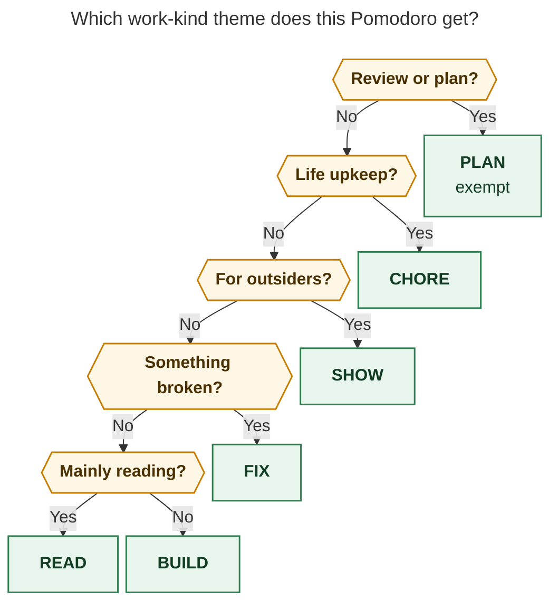

# Work-kind Pomodoro themes: a six-month audit of what you actually do

> **Research query:** I'd like to start using Pomodoro themes that describe what *kind*
> of work a Pomodoro holds (reading, building, fixing) rather than what the work is
> *for*. I plan to rename GTD to PLAN and HOME to CHORE, but I don't know what other
> themes to expect. Audit the last six months of work and recommend a set of themes
> that fits the work I actually do.

*Researcher: cld · 2026-10-27 · Context: `research:202610/pomodoro_six_theme_review/pomodoro_six_theme_review.md`
(consolidated six-theme review). This audit made no vault, config, or theme-journal
changes. The only write commands it ran were dry runs and a throwaway scratch vault.
While it ran, you renamed HOME → CHORE yourself (vault commit `4b07dc29`, 14:15).
The HOME numbers below are from before that rename.*

## Bottom line

- **Recommended set:** **PLAN** (exempt), **BUILD**, **FIX**, **READ**, **SHOW**,
  **CHORE**, plus **DRIFT** as a label you apply only *after* a session, to time that
  went sideways. That is five working themes, one exempt review theme, and one
  after-the-fact label. Five reserve names (TALK, DRILL, REVIEW, WRITE, OPS) wait until
  the work they describe actually shows up. The [recommended set](#recommended-theme-set)
  closes this report.
- **Your sketch is almost right.** PLAN, BUILD, FIX, READ, and CHORE cover **95%** of the
  712 hours you logged between Apr 27 and Oct 27 (96% of the hours I could classify).
  They leave out one kind of work: things you make for outside readers or reviewers,
  such as the CV, applications, LinkedIn, and launch-post writing. In October that was
  7% of your time, and it is already growing: today's `job.md` holds "Finish Stripe
  assessment (due today)!" and a Stripe industry-screen study guide. **SHOW** fits it
  best. It is also the name you suggested this morning in
  `bob#^plan-and-show-themes`.
- **Four kinds of work make up 94% of your time.** BUILD is 53%, PLAN 16%, FIX 13%, and
  READ 12% (content-based, after mapping the fine codes in the
  [table below](#what-kinds-of-work-actually-appear)). Everything else together is 6%.
  Splitting out TEST, SHIP, or OPS would add names you'd use on only 8–31 days in six
  months, and sessions would get *less* clean, not more (see the
  [comparison](#candidate-sets-compared)).
- **Don't rename JOB to SHOW.** In the content of JOB-named sessions, 40% of the minutes
  are reading, 37% are SHOW work, and 16% are building. A rename would carry that mix
  into SHOW's history. Hide JOB and start SHOW clean.
- **Renaming GTD to PLAN takes two prerequisites, both checked:**
  1. `bob themes rename GTD PLAN` refuses to run until PLAN is in `plan.exempt`.
  2. Once PLAN is the exempt name, review minutes stop counting toward the `gtd` area
     unless a `plan.md` note sits under `gtd`. I reproduced this in a scratch vault.
     See [switching safely](#switching-safely).
- **`^theme-on-task` should infer the theme from the task's verb, not inherit it from the
  project.** With work-kind themes, a project's most common theme predicts only 75% of
  linked-task minutes, because `sase.md` alone splits into BUILD 65%, FIX 20%, and READ
  12%. Meanwhile, 86% of linked-task minutes sit on tasks whose title starts with an
  action verb: Add, Fix, Read, Release, E2E test, Apply.

## How I measured

**Sources**

- Every `## Pomodoros` entry in `2026/2026MMDD.md` (May 28 – Oct 27).
- The zorg-converted `2026/2026MMDD_poms.md` logs (Apr 27 – May 27).

That comes to 1,343 Pomodoro rows. 1,202 of them are closed with a time: **712 hours on
162 days**. I resolved 2,621 Task Links against 42,310 block IDs across the vault. Only
32 failed to resolve.

**Unit of analysis**

Each distinct Task Link or free-text bullet under a Pomodoro is one unit. A session's
minutes are split evenly across its units, the same even-split rule Bob uses to
attribute session time to homes. Struck links count, as they do in
`docs/pomodoro-homes.md` R3.

**Classifier**

Rules look at the task title's leading verb and keywords, then fall back to the home
note (`job*`, `cash`, `ref/`, dev projects), then to legacy session names. The result is
16 fine codes, which I then mapped onto each candidate theme set.

**Validation**

- I hand-labelled a minute-weighted sample of 60 units. The first rule set agreed on
  53/60 (88%). Five of the seven misses came from three narrow rules: a
  reference-link fallback, a missing "Ran" verb, and old-format `#gtd` tags. For
  example, "Launch E2 tools epic from [[lib/…]]" was coded READ because it links a
  reference.
- After fixing those three rules, a fresh 40-unit holdout agreed on 38/40.
- Treat roughly 90% as the accuracy of any single label. The aggregates are sturdier
  than any one unit.

**Limits**

- Recorded time isn't your whole life. CHORE work is badly under-logged.
- The zorg era (Apr 27 – May 27) is sparse. Many units read only "#sase Stuff!", and
  May 10–19 has no Pomodoro log at all.
- The even split assigns minutes to tasks that were only *listed* in a session. This
  mostly affects PLAN sessions that link the tasks you're dispatching.
- History before Oct 26 already carries the Oct 26 renames (BOB → BUILD, BLOG/WRITE →
  JOB, HACK → HOME, and so on). For that reason I classified by content, not by name.

## Six months in three eras

**Monthly work-kind shares under the recommended set** (minutes, content-classified)

| Month | Hours | PLAN | BUILD | FIX | READ | SHOW | CHORE | DRIFT | TALK¹ | other |
|---|---|---|---|---|---|---|---|---|---|---|
| Apr 27–30 | 19 | 6% | 44% | 13% | 4% | 0% | 0% | 0% | 18% | 14% |
| May | 38 | 0% | 75% | 16% | 1% | 0% | 4% | 0% | 3% | 2% |
| Jun | 123 | 14% | 63% | 10% | 9% | 3% | 1% | 0% | 0% | 0% |
| Jul | 118 | 17% | 56% | 14% | 12% | 0% | 0% | 0% | 0% | 1% |
| Aug | 152 | 18% | 56% | 13% | 9% | 0% | 1% | 0% | 1% | 1% |
| Sep | 147 | 11% | 45% | 19% | 17% | 0% | 0% | 7% | 0% | 0% |
| Oct 1–27 | 114 | 27% | 40% | 5% | 19% | 7% | 1% | 0% | 0% | 0% |
| **All** | **712** | **15.9%** | **53.2%** | **12.9%** | **12.2%** | **1.7%** | **1.0%** | **1.5%** | **0.8%** | **0.9%** |

¹ TALK is on the reserve bench, not in the recommended set. It is shown here because it
was real work in April.

1. **Google wind-down (Apr 27 – May 22).** Team `@EVENT` meetings, `#bug` CLs, CL review
   replies, and "Return [[goog]] Equipment!" on May 22. This is the only period with
   meaningful meeting time (TALK 18% in late April).
2. **SASE and bob build-out (June – September).** BUILD runs 45–63% of every month. The
   morning review settles at 14–18%. September was the rough month: FIX reached 19% and
   DRIFT 7%. That month holds 12 of the 13 days you labelled SHIT ("Bullshit!",
   "[[sase]] bullshit (trying to fix memory and performance issues)!" on Sep 12).
   The pattern started with the Aug 15 "Fire fighting [[sase]]!" evenings.
3. **Job search and launch (October).** PLAN rises to 27%, READ to 19%, and SHOW appears
   at 7%: applications to Tower, Tailscale, Figma, Warp and others, the CV proofread,
   "Change LinkedIn NOW!", and the launch post. BUILD falls to 40%.

## What kinds of work actually appear

**Fine codes**, six months (hours; share; days with ≥15 minutes of that kind)

| Fine code | Hours | Share | Days | Typical units | Goes to |
|---|---|---|---|---|---|
| build | 355.3 | 49.9% | 154 | "Add `/sase_var` support!", "Implement memory webs/strands!", "Migrate … to `sase update`!" | BUILD |
| review | 102.9 | 14.5% | 112 | `[[gtd_daily]]`, `[[#^gtd]]` | PLAN |
| read | 78.7 | 11.1% | 62 | "Read and act on beads research!", `#ref` blogs/chat reports | READ |
| fix | 67.5 | 9.5% | 79 | "Fix `sase plan approve`…", "FIX: The `@@file` should not…", "Fix GitHub Actions…" | FIX |
| ops | 24.4 | 3.4% | 31 | "Re-launch failed sase agents!", "Restart failed epics from yesterday!", "Set up [[sase]] on apollo!" | FIX (restore) / BUILD (setup) |
| test | 14.1 | 2.0% | 19 | "E2E test `bob plugins sync` on macbook!" | BUILD |
| show | 12.0 | 1.7% | 12 | "Apply to Tower and Tailscale!", "Final proofread of CV!", "Write introduction!" | SHOW |
| drift | 10.5 | 1.5% | 10 | "Untracked bullshit!", "A bunch of shit!" | DRIFT |
| plan | 10.0 | 1.4% | 13 | "Clean up and plan roadmap for [[sase_art]]!", "Review and plan tasks in [[sase_memory_webs]]" | PLAN |
| chore | 7.0 | 1.0% | 10 | "Did enrolling for unemployment work!", "Finish Google Exit Packet!", "Set up outside umbrella!" | CHORE |
| research | 6.3 | 0.9% | 9 | "Launch research agent!", "Launch new research for /sase_remote!" | READ |
| talk | 5.8 | 0.8% | 5 | Google-era `#team @EVENT`, "Ping … back!" | (reserve TALK) |
| release | 5.6 | 0.8% | 8 | "Release v0.16.0!", "Release new versions of sase-github and sase-telegram!" | BUILD |
| write (internal) | 3.7 | 0.5% | 2 | "v2 Proofread of AGENTS.md!", "Write 'Requirements' section…" | BUILD |
| code review | 1.8 | 0.3% | 3 | "Review CL again for linter messages!" (Google) | READ |
| unknown | 6.4 | 0.9% | 8 | zorg "@WIP", bare project links | — |

## Findings

### 1. BUILD is mostly new capability, and more and more of it is dispatch

By leading verb, BUILD minutes break down as **Add 33%**, Make 7%, Migrate 4%, Start 3%,
Improve 3%, Use 3%, Implement 2%, Launch 2%, Create 2%, Rename 2%, and a long tail.
Another 6% (23 hours) is zorg-era "Stuff!".

205 of 1,140 Bob-format sessions carry sub-bullets about agents, such as "Launched
`sase-il` epic!", "apollo agent", "Epic running on athena", or "Waiting on apollo
agents." Your BUILD now consists largely of writing a task, dispatching an agent, and
verifying the result. That argues for:

- **Keeping E2E testing and releases inside BUILD** (2.0% and 0.8%). They are the
  acceptance end of the same loop.
- **Counting agent-facing prose as BUILD** (AGENTS.md proofreads, plan files,
  requirements sections). That prose is how you build now, so a separate WRITE theme
  would blur into BUILD.

### 2. FIX is a third product bugs and half keeping the fleet and CI alive

Of the 92 hours of fix plus ops:

- 34% are bugs in sase or bob behavior ("Fix `<ctrl+n/p>` in prompt input widget!").
- 26% is agent-related breakage and outages.
- 19% is restoring the agent fleet ("Re-launch failed epics from last night + fix
  failure!").
- 11% is CI and release breakage ("Fix all existing GitHub Actions failures!").
- 2% is performance.
- 8% (7 hours) is setup work ("Set up SSH access to athena from phone!"). That is new
  capability, so the codebook sends it to **BUILD**, not FIX. The scores in this report
  still count it under FIX, which overstates FIX by about one point.

Everything except the setup work is reactive. What it shares is the question "was this
working before?", which is exactly the test FIX needs. Fleet tending (ops) reached 8.3%
in September. May's 9.8% was mostly machine setup, and every other month stayed at or
below about 3%. A separate OPS theme would have been justified in September and in no
other month. Fold it
into FIX now, and split it out only if it stays above ~5% for a month (see the
[reserve bench](#reserve-bench)).

### 3. READ is mostly agent research reports, not books

Of READ's 87 hours, 68% is agent research reports and your own notes, 20% is external
blogs, papers, and docs, and 7% is commissioning new research. Typical report reading:

- "Read and act on beads research!" (3.7 h)
- "Read [[ref/chat/sase_tool_epic_roadmap]]!"
- "Read dynamic agent family critique!"
- `#ref [[ref/chat/…]]` notes

External reading, such as Lilian Weng's "Harness Engineering" and the Anthropic
engineering posts under `sase_pypi_releases`, is the minority. Launching a
research swarm takes minutes; reading what comes back takes 25–75. So READ should
include **commissioning** research, and stop at the first action. "Read and act on X"
is READ until you start dispatching changes.

### 4. Your five-name sketch has one gap: work for outsiders

Under PLAN, BUILD, FIX, READ, and CHORE, **17.8 hours (2.5%) have no home**: the
applications, CV, LinkedIn, and launch-post work (12.0 h), plus Google-era meetings
(5.8 h). This gap is the part of JOB that a work-kind scheme still needs a word for.
Under your current name, JOB's content was READ 40%, SHOW 37%, BUILD 16%, and PLAN 5%.
In other words, JOB was mostly a *purpose* wrapped around three other kinds of work.

There are two candidate names for what remains:

- **SHOW** (recommended). The test is "something an outside audience will judge":
  posts, CV, cover letters, applications, demos, interviews, recruiter calls.
  - It covers interviews without a separate TALK theme, and it survives the end of the
    job search (talks, demos, launch posts).
  - It approximately preserves the "how much time is going to the hunt?" view that the
    six-theme review wanted to keep.
- **WRITE** (alternative). This is a purer verb, but it fails twice.
  - It would also pull in agent-facing prose, which is BUILD (see finding 1).
  - It can't hold an interview, so you would need TALK as well.

### 5. You already label lost time, and you should keep doing it

You used **SHIT** on 13 days for 13.7 named hours. 71% of that content really is
untracked or derailed time ("Untracked bullshit!"). The rest is agent restarts, fixes,
and some building logged under the same label. An honest after-the-fact bucket is
worth keeping. Because you only ever
apply it to *closed* sessions, it never appears in an open plan and never counts toward
`plan.max_themes`. DRIFT is a gentler spelling. Keeping SHIT works just as well.

### 6. Chores barely reach the ledger

CHORE work comes to 7 hours on 10 days in six months: bills, benefits paperwork, the
Google exit packet, a razor, headphones. HOME, its predecessor, was an untimed
placeholder on 10 of its 11 rows (six-theme review). CHORE is the right *kind* word:
low-cognition upkeep of life. It still only earns its slot when it is booked with a
time.

### 7. Mixed sessions are normal; decide by intent

63% of sessions (58% of minutes) are at least 80% one kind of work. In the mixed ones,
the dominant pairs are:

- BUILD + FIX (32% of mixed minutes). Building a feature and fixing what it broke.
- BUILD + PLAN (31%). Mostly morning reviews that list the tasks you dispatch.
- BUILD + READ (13%). "Read and act on…".

No candidate set makes these clean. The finest 11-theme set lowers the clean share to
55%.
A precedence rule, applied once when the session is named, does more good than extra
names.

### 8. Verbs predict work kind; projects don't

Your task titles are imperative and verb-first. 86% of linked-task minutes sit on titles
whose first word maps to a kind:

- Add, Implement, Make, Migrate, Launch → BUILD
- Fix, `FIX:`, Re-launch, Restart → FIX
- Read, `#ref`, Research → READ
- Apply, Proofread, Write intro → SHOW
- Plan, Decide, Triage → PLAN

Where a verb maps, it agrees with the content label 94% of the time. Project
inheritance, by contrast, predicts only 75% under work-kind themes. bob is 90% BUILD,
but `sase` splits into BUILD 65%, FIX 20%, and READ 12%. The 94% agreement is partly
circular, because my classifier also reads verbs. The 86% coverage figure is not
circular.

**Implication for `bob#^theme-on-task`:** use a verb → theme default at capture or
start time, with an explicit per-task override. Keep a per-note default only for
single-kind notes such as `cash` (CHORE) or reading-list projects (READ). Writing the
default into the ledger at session start still honors the
`pomodoro-theme-is-one-component` decision.

## Candidate sets compared

All sets were scored on the same 712 content-classified hours. "Clean sessions" is the
share of minutes in sessions where one theme holds at least 80% of the session. "No
home" excludes the 0.9% of units no set can classify (zorg "@WIP", bare project
links).

**S0 – current six (GTD, BUILD, JOB, READ, FIX, HOME) plus SHIT**

- *Clean sessions:* 58%
- *No home:* 0.8% (Google-era meetings)
- *Smallest working theme:* HOME, 1.0%, 10 days
- *Verdict:* Answers "what for?" and "what kind?" in one slot. JOB holds more reading
  (40%) than work for outsiders (37%).

**S1 – your sketch (PLAN, BUILD, FIX, READ, CHORE)**

- *Clean sessions:* 58%
- *No home:* **2.5%**, plus 1.5% drift with no name
- *Smallest working theme:* CHORE, 1.0%
- *Verdict:* Right shape. Applications, CV, posts, and interviews have nowhere to go.

**S2 – recommended (S1 + SHOW + DRIFT)**

- *Clean sessions:* 58%
- *No home:* 0.8% (Google-era meetings only)
- *Smallest working theme:* CHORE, 1.0%. SHOW is 1.7% overall and 7% in October.
- *Verdict:* Covers everything but the Google-era meetings. Every name is a kind of work. Still five
  working names.

**S2w – S1 + WRITE + DRIFT**

- *Clean sessions:* 58%
- *No home:* 0.8% (Google-era meetings) plus future interviews
- *Smallest working theme:* CHORE, 1.0%
- *Verdict:* Pulls agent-facing prose out of BUILD, and interviews still need TALK.

**S3 – fine 11 (adds TEST, SHIP, OPS, WRITE, TALK)**

- *Clean sessions:* **55%**
- *No home:* 0%
- *Smallest working theme:* SHIP 0.8% and TALK 0.8%, each on 5–8 days in six months
- *Verdict:* More names, fewer clean sessions. TEST, SHIP, and TALK would fail your own
  "three different days" minting rule in most months.

Under S2, the median day has **2** distinct non-PLAN themes, and 155 of 160 days have
3 or fewer. That supports the six-theme review's `plan.max_themes: 3`: a cap of 3 sits
below the five working names, so it can actually fire.

## Switching safely

I verified each step with dry runs on `bob 0.4.0`, and checked the review-bucket
behavior in a scratch vault.

1. **Add PLAN to `plan.exempt` before renaming, and put PLAN first.**
   - `bob themes rename GTD PLAN -d` refuses with: "GTD is a plan config reference; add
     PLAN to plan.exempt or plan.inventory_labels first."
   - In the chezmoi source for `~/.config/bob/config.yml`, set
     `exempt: [PLAN, GTD]`. The first exempt name labels the review bucket that unnamed
     `[[#^gtd]]` sessions bridge into (`exempt.first()` in
     `pomodoro_homes/session.rs`).
   - Run the rename, then trim the list to `exempt: [PLAN]`.
2. **Decide where review minutes count.**
   - Bob looks up the review bucket's area by finding a note named after the exempt
     theme (`review_home` in `pomodoro_homes/resolve.rs`).
   - In a scratch vault with `exempt: [PLAN]` and no `plan.md`, review minutes still
     counted toward `review_time`, but their area became `@review:PLAN`, with no area
     and no hue.
   - Adding a `plan.md` with `parent: "[[gtd]]"` restored area `gtd.md`.
   - So you have two choices: create `plan.md` under `gtd` (it needs a `parent`
     field), or accept that review time leaves the `gtd` area lane.
3. **HOME → CHORE is already done** (vault commit `4b07dc29`, 14:15 today). `bob themes
   list` now hints that CHORE's hashed aqua collides with JOB's area aqua on 10 days.
   Pinning CHORE's color (step 6) clears that hint. SHOW is not in the catalog yet, so
   creating it is not a merge and cannot trigger the hidden-state merge hazard described
   in the six-theme review.
4. **Hide JOB rather than renaming it:** `bob themes hide JOB`. A `JOB SHOW` rename
   would put 40% reading minutes into SHOW's history (the dry run rewrites 89 JOB tails,
   starting Oct 7). Old JOB rows stay readable in Stats.
5. **DRIFT is optional.** `bob themes rename SHIT DRIFT` moves SHIT's hidden state onto
   DRIFT (rename transfers explicit state, per the six-theme review's dry runs). That is
   arguably right for a label you type on purpose and never plan. Alternatively, keep
   SHIT and unhide it.
6. **Pin hues for the new names, and keep the cap below the vocabulary.**
   - Pin colors for CHORE and SHOW once they exist. Pins give each a journal state.
     Work-kind names never match an area, so without pins every hue comes from a hash.
   - Set `plan.max_themes: 3`.
   - Update the Morning review checklist so it says the same number.

## Recommended theme set

A precedence rule turns "what kind of work is this?" into one answer, decided when you
name the session. Ask the questions in order. Don't rename a running session because
the verb changed. Relabel a closed session only to DRIFT.

_Ask the questions in order and stop at the first yes. Anything left over is BUILD.
DRIFT is not on this path: it is applied only after a closed session went sideways._

### The set

**PLAN** · exempt and muted · 15.9% of the last six months

- *Use when:* Morning review, weekly prune, inbox and Keep import, triage, project
  roadmaps, deciding what to dispatch
- *Not when:* A session whose purpose is launching or steering agents to build (BUILD);
  daily SASE agent cleanup (FIX)

**BUILD** · 53.2%

- *Use when:* New or changed capability in your tools: Add, Implement, Make, Migrate,
  Rename. Also covers dispatching and verifying agents, E2E-testing your own features,
  releases, machine setup, and agent-facing prose (AGENTS.md, plans, requirements)
- *Not when:* Something that worked yesterday is broken (FIX)

**FIX** · 12.9%

- *Use when:* Restoring broken behavior: product bugs, CI and GitHub Actions failures,
  failed or stalled agents and epics, outages, and the daily "Clean up SASE agents"
  chore
- *Not when:* Planned refactors and new setup (BUILD)

**READ** · 12.2%

- *Use when:* Reading to understand or decide: agent research reports, `#ref`
  articles, papers, and docs. Also covers commissioning a research swarm, and "Read and
  act on…" up to the first action
- *Not when:* Docs skimmed while building (BUILD)

**SHOW** · 1.7% overall, 7% in October

- *Use when:* Making or doing something an outside audience will judge: applications,
  cover letters, the CV, LinkedIn, blog and launch posts, demos, interviews, recruiter
  calls
- *Not when:* Researching roles or reading about the post (READ); coding the site
  (BUILD)

**CHORE** · 1.0%

- *Use when:* A timed batch of personal upkeep: bills, benefits and unemployment
  paperwork, insurance calls, errands, house tech, stock sales
- *Not when:* As an untimed all-day reminder. Leave those tasks in NEXT or the tickler

**DRIFT** · after the fact only · 1.5%

- *Use when:* Relabelling a *closed* session that went sideways or wasn't tracked
- *Not when:* Planning, or any open entry

Map task titles to a theme by their leading verb, both at capture and when you name a
session. That gives `^theme-on-task` its default rule:

- Add, Implement, Make, Migrate, Launch, E2E test, Release → **BUILD**
- Fix, `FIX:`, Re-launch, Restart → **FIX**
- Read, `#ref`, Research → **READ**
- Apply, Proofread, Write intro → **SHOW**
- Plan, Decide, Triage → **PLAN**

### Reserve bench

Don't create these names until the work appears on at least three days in a month. That
is your own minting rule from the six-theme review.

- **TALK.** Meetings, 1:1s, and pairing, once you have colleagues. It was 18% of late
  April at Google. Until then, interviews and recruiter calls go to SHOW.
- **DRILL.** Interview practice (coding problems, system-design mocks), if interview
  prep becomes a regular block. It isn't reading and it isn't building. Watch for this
  first: today's Stripe screen study guide is READ, but practicing for the screen
  would be DRILL. The assessment itself is SHOW.
- **REVIEW.** Reviewing other people's code at a new job. Google-era CL reviews were
  1.8 h; agent output review stays in BUILD.
- **WRITE.** Long prose for human colleagues, such as design docs, if it outgrows the
  agent-facing prose BUILD already holds. Internal writing was 3.7 h in six months.
- **OPS.** Split fleet tending out of FIX if it stays above ~5% for a month. It was 8.3%
  in September and 0.5% in October.

**From now on use: PLAN · BUILD · FIX · READ · SHOW · CHORE, with DRIFT as an
after-the-fact label.**
