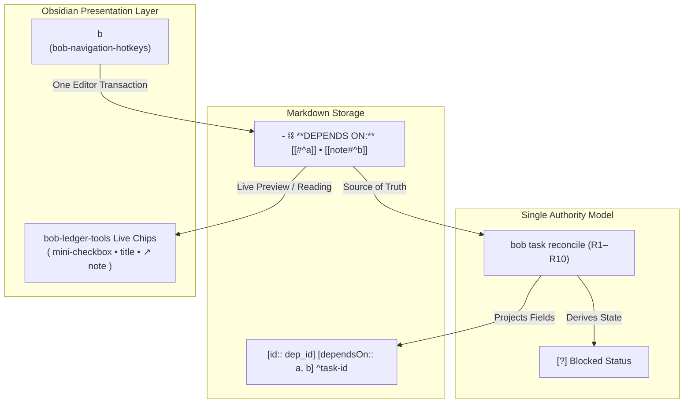
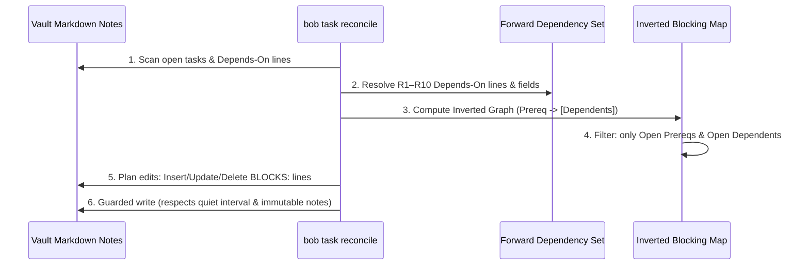

# Task Blocking Sub-Bullets: Research, Critique, and Design for Reverse Dependency Indicators

> **Research query:** I would like to start automatically adding a new sub-bullet to tasks that other
> tasks depend on to indicate that the task blocks one or more other tasks. We already use a "Depends
> On" sub-bullet on the dependent tasks. This should happen automatically when dependencies are added
> to tasks (via the `<ctrl+shift+p>` keymap, for example). The `bob task reconcile` command should
> ensure the appropriate sub-bullets all exist and are consistent. Lead the design on this: make sure
> it is intuitive, reliable, and beautiful. Critique the plan in general: is this a good idea? Would
> you take a different approach? Make any justified adjustments to the requirements and end with a
> recommended solution.

---

## 1. Executive Summary & Bottom Line

### 1.1 The Verdict
**The motivation is spot-on, but physical Markdown sub-bullets are an architectural trap.**

Bryan's underlying goal—knowing immediately when a task is a critical blocker for other work—is
exceptionally high-leverage for daily GTD execution. In task management, high out-degree tasks
(prerequisites that unblock cascades of subsequent work) are the highest-value candidates for Next
and In Progress promotion. Today, that information is invisible when viewing the prerequisite task.

However, attempting to solve this by automatically writing a physical, bidirectional sub-bullet
(e.g., `- ⛓️ **BLOCKS:** [[...]]`) into the Markdown file of prerequisite tasks introduces severe
architectural, transactional, and operational costs:
1. **Dual Source of Truth / Desynchronization:** If both `DEPENDS ON:` and `BLOCKS:` exist in
   Markdown, hand edits to either line create ambiguous conflicts that `bob task reconcile` cannot
   safely resolve without stomping user intent.
2. **Extreme Write Amplification & Vault Churn:** Adding, removing, or—critically—**completing** a
   dependent task in Note B forces automated writes into Note A. Foundational tasks accumulate massive
   lists of links, creating noisy Git diffs and constant file modification across the entire vault.
3. **Broken Atomic Undo in Obsidian:** `<ctrl+shift+p>` can only perform an atomic, single-step
   editor transaction (`Ctrl+Z`) on the currently active note. Modifying a cross-note prerequisite's
   file via background disk I/O breaks undo semantics and risks overwriting dirty editor buffers.
4. **Violation of Immutability Boundaries:** In the Bob ecosystem, historical daily notes (`YYYYMMDD.md`)
   and completed archive tasks in `done/` are strictly read-only ("The previous daily note snapshot is
   never written," `docs/task-dependencies.md` §4.1). If a task in an immutable note blocks something,
   or is blocked by something, a physical sub-bullet cannot be legally written, resulting in permanent
   inconsistency.

### 1.2 The Recommended Solution
We recommend a **two-tier architecture**:

* **Tier 1 (Recommended / Default): Virtual "Blocks" Chips in `bob-ledger-tools`**
  Instead of dirtying Markdown on disk, compute reverse dependencies **in memory** using Obsidian's
  existing Tasks/Dataview graph. In Live Preview and Reading View, render a sleek, interactive
  **Blocks Chip** (e.g. `🚧 blocks 3`) directly on the prerequisite task line. Clicking or hovering the
  chip opens a popover detailing the blocked tasks with their live statuses and jump links.
  - **Zero file churn, zero Git noise, zero sync conflicts.**
  - **100% reactive:** When a dependent task is closed, the chip count updates in real time without
    touching the note.
  - **Works everywhere:** Even on tasks in past daily notes or archived project notes.

* **Tier 2 (Fallback / Strict Markdown Specification): Asymmetric Derived Projection**
  If physical Markdown is strictly required for headless CLI/terminal workflows, it must follow an
  **asymmetric, strictly downstream projection model**:
  - `⛓️ **DEPENDS ON:**` remains the **sole authority**.
  - `⛓️ **BLOCKS:**` is strictly a **derived view**, never an edit surface.
  - It lists **only open, actively blocked dependents** (completed tasks are pruned immediately so
    lines do not grow unbounded).
  - When all blocked tasks resolve, the line is **deleted entirely**.
  - Daily notes and archived notes are explicitly exempt from receiving `BLOCKS:` lines.
  - `<ctrl+shift+p>` updates same-note prerequisites in the editor transaction, but defers cross-note
    `BLOCKS:` writes to `bob task reconcile` to avoid multi-file editor corruption.

---

## 2. Background: The Current Dependency Architecture

To evaluate reverse dependencies properly, we must examine the contract established in epic `bob-cli-3n`,
codified in `docs/task-dependencies.md`, and governed by decision `task-deps-are-depends-on-links`:



### 2.1 The Single Source of Truth Contract
* **The Line is the Authority:** A task's prerequisites live on one managed first-child line:
  `- ⛓️ **DEPENDS ON:** [[#^a]] • [[note#^b]]`.
* **Fields are a Derived Index:** `[dependsOn::]` and `[id::]` are projected downstream by
  `bob task reconcile` for use by the Obsidian Tasks plugin and Dataview.
* **Rejected Alternative:** A "field-authoritative generated line" was explicitly rejected because
  writers would have to update fields and regenerate lines in lockstep, destroying hand-editability.
* **One Transaction per Gesture:** In Obsidian, `<ctrl+shift+p>` commits the line, the fields, and
  same-note target IDs in a single atomic editor transaction (`Ctrl+Z`). Cross-note targets only
  receive passive ID preparation (`^block-id` and `[id::]`) before the dependent's transaction runs.
* **Live Status Chips:** In `bob-ledger-tools`, the plain wikilinks on `DEPENDS ON:` are parsed in DOM
  and decorated as interactive status chips showing target checkbox state, title, and link destination,
  collapsing completed tasks into muted badges.

---

## 3. Detailed Critique of the Proposed Plan

Is automatically writing a physical sub-bullet to prerequisite tasks a good idea?

### 3.1 What Makes the Idea Attractive
1. **Critical GTD Prioritization Context:** When looking at an open backlog, tasks with high downstream
   blocking impact should be tackled first. Currently, you have to inspect the dependent to know what it
   waits on, rather than inspecting the blocker to see what it enables.
2. **Symmetry:** Users naturally think of dependencies as bidirectional relationships: "A depends on B"
   implies "B blocks A". Having explicit text markers on both tasks feels intuitively complete.
3. **Headless / Terminal Visibility:** In plain text viewers (CLI `cat`, Vim, GitHub Web UI) without
   Obsidian plugins running, having the relationship visible in both files makes navigation possible.

### 3.2 The Five Critical Flaws of Physical Markdown Sub-Bullets

Despite its surface appeal, writing physical `BLOCKS:` sub-bullets to disk creates severe operational and
architectural problems:

```mermaid
flowchart LR
    subgraph Scenario [Scenario: Task B in projects/web.md depends on Task A in core/api.md]
        TaskB["Task B (Dependent)<br/>projects/web.md"]
        TaskA["Task A (Prerequisite)<br/>core/api.md"]
    end

    TaskB -->|Adds dependency| Hazard1["Hazard 1: Cross-Note Write & Undo Breakage"]
    TaskB -->|Marked Done [x]| Hazard2["Hazard 2: Write Amplification (Completing B dirties A)"]
    TaskA -->|Manual Hand-Edit| Hazard3["Hazard 3: Dual Source of Truth Conflict"]
    TaskA -->|Lives in Past Daily Note| Hazard4["Hazard 4: Immutability Boundary Violation"]
    TaskA -->|Blocks 10 tasks| Hazard5["Hazard 5: Visual Clutter & Line Bloat"]
```

#### Hazard 1: Dual Source of Truth & Reconciliation Ambiguity
If both `DEPENDS ON:` and `BLOCKS:` exist as physical text:
* Suppose a user in Vim or Obsidian deletes `[[web#^task-b]]` from Task A's `BLOCKS:` line.
* What should `bob task reconcile` do?
  - **Option A:** Re-insert it because Task B still has `DEPENDS ON: [[core#^task-a]]`. (Result: The user's
    manual edit is silently stomped on the next cron or hook run).
  - **Option B:** Open `projects/web.md` and delete the `DEPENDS ON:` link from Task B. (Result: A deletion
    in one file unexpectedly deletes data in another file, creating an uncontrollable dual-master sync
    loop).
* If `BLOCKS:` is defined as purely a derived view that cannot be edited, users who edit Markdown by hand
  will be perpetually frustrated when their edits to `BLOCKS:` are reverted.

#### Hazard 2: Write Amplification & Vault Churn
Consider what happens across the lifecycle of a task:
1. **Creation:** You add a dependency to Task B in `feature.md`. Now `core.md` must also be opened and
   written.
2. **Completion:** You complete Task B (`[x]`). Does Task A still block Task B?
   - **No!** A completed task is no longer blocked.
   - If Task A only lists *active* blocked tasks, then marking Task B done in `feature.md` **forces an
     automated write to `core.md`** just to prune `[[feature#^task-b]]`.
   - If Task A has 8 dependents, completing those dependents across a week will dirty `core.md` 8 separate
     times, generating endless Git commits and sync events for a file whose own content never changed!
3. **Alternative: Retaining Closed History:** If Task A retains completed tasks as history (like `DEPENDS ON`
   does), then foundational tasks will accumulate dozens of links over time:
   `- ⛓️ **BLOCKS:** [[proj1#^t1]] • [[proj2#^t2]] • [[proj3#^t3]] • ... • [[proj15#^t15]]`.
   This leads to unbounded line bloat that swamps the actual task description.

#### Hazard 3: Broken Atomic Undo in Obsidian (`<ctrl+shift+p>`)
Obsidian's CodeMirror editor transaction model is scoped strictly to the **active editor view**:
* When you press `<ctrl+shift+p>` on Task B in `projects/web.md`, you are in an active editor.
* If the keymap also writes to Task A in `core/api.md`:
  - `core/api.md` must be modified via `app.vault.process()` in the background.
  - If the user immediately presses `Ctrl+Z` (Undo) in `projects/web.md`, Task B reverts and removes the
    dependency.
  - **Task A in `core/api.md` is NOT reverted!** Its `BLOCKS:` line remains written to disk.
  - Even worse: if `core/api.md` happens to be open in a background tab with unsaved typing, background
    vault writes can trigger conflict notices or overwrite editor cursor state.

#### Hazard 4: Violation of Immutability Boundaries
The Bob ecosystem enforces strict immutability rules:
* `docs/task-dependencies.md` §4.1: *"The previous daily note snapshot is never written."*
* Closed tasks in `done/` are historical records and are never modified.
* What happens when:
  - Task A lives in yesterday's daily note (`2026/20261012.md`), and Task B in a project note depends on it?
  - Task A lives in `done/archive.md`, but is mistakenly linked by an open task?
  - `bob task reconcile` **refuses to write to previous daily notes**.
  - As a result, Task A *cannot* receive a `BLOCKS:` sub-bullet. The system becomes inconsistent: some
    prerequisites show `BLOCKS:`, while others cannot.

#### Hazard 5: Visual Clutter and Information Hierarchy
A well-maintained task in Bob can already possess multiple child lines:
```markdown
- [ ] Refactor payment processor gateway ^pay-gw
  - ⛓️ **DEPENDS ON:** [[stripe#^webhook-handler]]
  - 🗓️ **SCHEDULE LOG**
    - 2026-10-15: Scheduled for sprint cutover
  - 1000-1030 Investigated API signature differences
```
If we inject another sub-bullet:
```markdown
- [ ] Refactor payment processor gateway ^pay-gw
  - ⛓️ **DEPENDS ON:** [[stripe#^webhook-handler]]
  - ⛓️ **BLOCKS:** [[checkout#^cart-ui]] • [[billing#^invoice-job]] • [[mobile#^apple-pay]]
  - 🗓️ **SCHEDULE LOG**
    - 2026-10-15: Scheduled for sprint cutover
  - 1000-1030 Investigated API signature differences
```
The task now has 4+ child bullets. The visual hierarchy becomes inverted: metadata dominates the note,
pushing actual tasks down the screen.

---

## 4. Exploration of Alternative Approaches

To deliver an intuitive, reliable, and beautiful experience, we evaluate four distinct architectural
approaches:

| Dimension | Approach 1: Virtual Live Preview Chips (Recommended) | Approach 2: CodeMirror Virtual Sub-Bullet | Approach 3: Asymmetric Physical Markdown | Approach 4: Task Card `<ctrl+shift+p>` Only |
| :--- | :--- | :--- | :--- | :--- |
| **Where it Lives** | In-memory DOM decoration (`bob-ledger-tools`) | CodeMirror ViewPlugin decoration | Physical file on disk (`.md`) | In-memory modal UI on keypress |
| **Markdown Churn** | **Zero** | **Zero** | **High** (writes both files on link/close) | **Zero** |
| **Undo Safety** | **100% Safe** (atomic single-note `Ctrl+Z`) | **100% Safe** | **Unsafe** (multi-file drift on Undo) | **100% Safe** |
| **Daily Note Safe** | **Yes** (decorates in memory) | **Yes** (decorates in memory) | **No** (forbidden to write past daily notes) | **Yes** |
| **Dynamic Pruning** | **Instant** (updates when dependent closes) | **Instant** | **Lagged** (requires disk rewrite or reconcile) | **Instant** |
| **Headless/CLI View** | None (visible only in Obsidian/CLI report) | None | Full text visible in `cat`/Vim | CLI command needed (`bob task inspect`) |
| **Beauty & Polish** | **Exceptional** (interactive pills, popovers) | Moderate (rendered bullet) | Low (raw wikilink text) | High (structured modal) |

---

## 5. The Recommended Solution: Design Specification

We recommend implementing **Approach 1 (Virtual "Blocks" Chips in `bob-ledger-tools`)** as the primary,
canonical feature, supplemented by **CLI inspection tools** and an optional **strictly bounded Physical
Markdown projection (Approach 3)** if headless file inspection is deemed mandatory.

### 5.1 Design for Approach 1: Virtual "Blocks" Chips (The Beautiful Way)

#### 5.1.1 How It Works
Obsidian's Tasks plugin and `bob-ledger-tools` already maintain an in-memory index of all tasks in the
vault (`getTasks()`). Every task has an `id` and a `dependsOn` array.
* Instead of scanning disk, `bob-ledger-tools` builds an in-memory inverted index:
  $$\text{ReverseGraph}: \text{PrerequisiteId} \longrightarrow \text{List}[\text{DependentTask}]$$
* When rendering any task line in Live Preview or Reading View, if that task's ID (or block ID) exists
  in the `ReverseGraph`, the plugin decorates the line with a **Blocks Chip**.

#### 5.1.2 Visual Anatomy of the Blocks Chip
In Live Preview and Reading View, the chip appears inline at the end of the task description (or on a
sub-line, styled identically to the existing status chips):

```text
[ ] Refactor payment processor gateway ^pay-gw   [ 🚧 blocks 3 ]
```

When clicked or hovered, an elegant popover opens:

```text
┌─────────────────────────────────────────────────────────────┐
│ 🚧 Blocks 3 Tasks                                           │
├─────────────────────────────────────────────────────────────┤
│  [?] Build checkout UI                       ↗ projects/web │
│  [?] Sync recurring invoice cron             ↗ billing/job  │
│  [x] ~~Initial schema migration~~            ↗ db/schema    │
├─────────────────────────────────────────────────────────────┤
│  ↵ Jump to task  ·  Click to open note                      │
└─────────────────────────────────────────────────────────────┘
```

#### 5.1.3 Benefits of the Virtual Chip Approach
1. **Zero Disk Modifications:** Absolutely no files are written. Zero Git churn. Zero sync conflicts.
2. **Instant Reactivity:** When you complete a dependent task (`[x]`), the prerequisite's chip
   immediately recalculates from `blocks 3` to `blocks 2` without touching the prerequisite note.
3. **Full Immutability Compliance:** Works perfectly for tasks in past daily notes, archived notes, and
   templates, because no write permissions are required.
4. **Clean, Uncluttered Markdown:** The raw Markdown remains clean and readable, free of redundant
   metadata links.

---

### 5.2 Design for Approach 3: Physical Markdown Sub-Bullet (The Strict Fallback Spec)

If Bryan decides that physical Markdown bullets are an absolute requirement (e.g. for Vim/CLI editing),
the feature **must** be implemented under the following strict architectural constraints to prevent vault
corruption.

#### 5.2.1 Grammar & Writer Form
* **Label & Emoji:**
  `- ⛓️ **BLOCKS:** [[note#^task-b]] • [[note#^task-c]]`
  *(We recommend `⛓️` over `🚧` to preserve syntactic and aesthetic family identity with
  `- ⛓️ **DEPENDS ON:**`).*
* **Link Formatting:** Shortest unambiguous block links (`canonical_link`), separated by ` • `, with no
  aliases, embeds, or strikes.
* **Child Hierarchy Placement:**
  The sub-bullet ordering under a `#task` item must be deterministic:
  1. `❌ **CANCEL LOG**` (if present)
  2. `⛓️ **DEPENDS ON:**` (if present)
  3. `⛓️ **BLOCKS:**` (if present)
  4. `🧩 **Sub-projects:**` (if on `^prj`)
  5. `🗓️ **SCHEDULE LOG**`
  6. Prose notes, sub-tasks, and Work Log entries.

```markdown
- [ ] Implement user authentication backend ^auth-be
  - ⛓️ **DEPENDS ON:** [[db#^schema-v2]]
  - ⛓️ **BLOCKS:** [[ui#^login-page]] • [[api#^session-tokens]]
  - 🗓️ **SCHEDULE LOG**
```

#### 5.2.2 The Asymmetric Authority Rule
* **`DEPENDS ON:` is the SOLE AUTHORITY.**
* **`BLOCKS:` is a STRICTLY DERIVED PROJECTION.**
* It is **NOT** an edit surface:
  - If a user manually types a link into `BLOCKS:`, `bob task reconcile` will **NOT** create a
    `DEPENDS ON:` line on the target. It will either drop the link or emit a warning
    (`unauthorized_manual_blocks_link`).
  - To add a dependency, the user MUST add `DEPENDS ON:` to the dependent (via `<ctrl+shift+p>` or by hand).

#### 5.2.3 Lifecycle & Dynamic Pruning Rules
To prevent unbounded bloat and stale references:
1. **Active Tasks Only:** The `BLOCKS:` line lists **only open dependent tasks that are currently
   waiting on this prerequisite**.
2. **Pruning on Completion:** Once a dependent task is marked Done (`[x]`) or Cancelled (`[-]`), it is
   pruned from the prerequisite's `BLOCKS:` line during reconciliation.
3. **Deletion on Empty:** When all blocked tasks are resolved or unlinked, the `BLOCKS:` line is
   **completely deleted from the note**. No empty `- ⛓️ **BLOCKS:**` line is ever left behind.

#### 5.2.4 Immutability & Scope Exemptions
`BLOCKS:` sub-bullets must **never** be written to:
* Daily notes prior to the active anchor date (`YYYY/YYYYMMDD.md`).
* Notes in `done/` or `_archive/`.
* Closed/completed prerequisite tasks.

#### 5.2.5 Orchestration in `bob task reconcile`
Reconciliation implements the reverse projection as a safe second pass:



1. **Step 1:** Run standard forward reconciliation (R1–R10) to settle all `⛓️ **DEPENDS ON:**` lines and
   `[dependsOn::]` fields.
2. **Step 2:** Construct the inverted blocking map:
   For every open task $D$ with resolved prerequisites $P_1, P_2, \dots$:
   If $D$ is open, add $D$ to $\text{Blocks}[P_i]$.
3. **Step 3:** For every scanned open task $P$ in mutable notes:
   - If $\text{Blocks}[P]$ is non-empty: format canonical `⛓️ **BLOCKS:**` line. If existing line differs,
     queue replacement or insertion.
   - If $\text{Blocks}[P]$ is empty: if an existing `BLOCKS:` line exists, queue line deletion.
4. **Step 4:** Apply edits via existing guarded note writes (`task_status_hooks_write`).

#### 5.2.6 Hotkey Integration in `bob-navigation-hotkeys` (`<ctrl+shift+p>`)
To protect against multi-file corruption during interactive editing:
* **Same-Note Prerequisite:** If the linked prerequisite lives in the **same file**, update both the
  dependent's `DEPENDS ON:` line and the prerequisite's `BLOCKS:` line in the **single editor transaction**
  (one `Ctrl+Z` cleanly reverts both).
* **Cross-Note Prerequisite:** When linking a task in another note:
  - **Do NOT perform synchronous multi-file writes during the keystroke.**
  - Let `<ctrl+shift+p>` perform its existing duty: prepare the target's ID and commit the active note.
  - Leave the cross-note `BLOCKS:` line creation to the next `bob task reconcile` run (or trigger a
    debounced, non-blocking background reconcile). This guarantees that the active editor transaction
    remains atomic and never fights background buffer states.

---

## 6. Requirement Adjustments (ADJ-1 to ADJ-8)

To make this design robust and maintainable, we recommend the following formal adjustments to the
original requirements:

| # | Original Requirement / Assumption | Recommended Adjustment | Rationale & Impact |
| :--- | :--- | :--- | :--- |
| **ADJ-1** | Add physical sub-bullet to Markdown | **Make Virtual Chips (Tier 1) the primary implementation.** Physical sub-bullets (Tier 2) should be optional. | Eliminates vault churn, Git diff pollution, and sync conflicts while delivering superior UI aesthetics. |
| **ADJ-2** | Sub-bullet added automatically on `<ctrl+shift+p>` | **Same-note targets update immediately; cross-note targets are deferred to `reconcile`.** | Prevents breaking Obsidian's single-note `Ctrl+Z` undo stack and avoids race conditions on dirty background editor buffers. |
| **ADJ-3** | Sub-bullet indicates blocked tasks | **`BLOCKS:` lines must list ONLY open, active dependents.** | Retaining completed tasks causes unbounded line bloat. Pruning completed tasks keeps notes compact. |
| **ADJ-4** | Sub-bullet exists permanently | **Delete the `BLOCKS:` line when all blocked tasks are resolved.** | Zero clutter: tasks that no longer block other work revert to clean, standard task representations. |
| **ADJ-5** | Bi-directional consistency | **`DEPENDS ON:` is the sole authority; `BLOCKS:` is strictly a read-only projection.** | Prevents dual-source-of-truth conflicts. Hand-editing `BLOCKS:` is not an authoring surface. |
| **ADJ-6** | All tasks in vault participate | **Explicitly exempt historical daily notes (`YYYYMMDD.md`) and `done/` archive notes from receiving `BLOCKS:` lines.** | Enforces the ecosystem's foundational immutability rules. |
| **ADJ-7** | Formatting & Syntax | **Use `- ⛓️ **BLOCKS:** [[...]] • [[...]]` joined by ` • `.** | Preserves visual and parser symmetry with `- ⛓️ **DEPENDS ON:**`. |
| **ADJ-8** | Sub-bullet position | **Position `BLOCKS:` immediately beneath `DEPENDS ON:` and above `SCHEDULE LOG` / Work Log.** | Establishes a predictable, deterministic child bullet hierarchy. |

---

## 7. Comparison Matrix & Trade-Off Analysis

| Criteria | Virtual "Blocks" Chips (Tier 1 - Recommended) | Physical Derived Markdown (Tier 2 - Bounded Spec) | Unbounded Naive Physical Markdown |
| :--- | :--- | :--- | :--- |
| **User Experience** | Interactive, colorful, expandable popover | Plain text wikilinks | Plain text wikilinks |
| **Vault Cleanliness** | 100% clean; zero diffs | Modified on every dependency/close event | Extreme clutter; files bloated forever |
| **Undo Behavior** | Instant and atomic | Atomic for same-note; deferred for cross-note | Multi-file broken undo |
| **Cross-Device Sync** | Zero sync events | Generates frequent sync events across notes | High potential for sync merge conflicts |
| **CLI / Vim Support** | Requires CLI command (e.g. `bob task inspect`) | Native text visible in `cat`/Vim | Native text visible in `cat`/Vim |
| **Implementation Complexity**| Moderate (pure JavaScript in `bob-ledger-tools`) | High (cross-repo sync between Rust hooks & JS) | Very High (unstable edge-case management) |

---

## 8. Final Recommended Roadmap

We recommend executing this feature in three focused phases:

### Phase 1: Virtual Blocks Chips in `bob-ledger-tools` (Immediate Win)
1. In `bob-ledger-tools`, build an in-memory reverse dependency map from the existing Tasks cache:
   `Map<prerequisiteId, Array<dependentTask>>`.
2. Add a Live Preview and Reading View decorator that appends a `[ 🚧 blocks N ]` pill to any task
   line whose ID has active, open dependents.
3. Add a lightweight hover popover displaying the titles, notes, and statuses of the blocked tasks.
4. *Result:* Instant visual feedback across the entire vault with **zero risk to vault data integrity**.

### Phase 2: CLI Inspection Command (`bob task blockers`)
1. In `bob-cli`, add a fast query subcommand:
   ```bash
   bob task blockers <block-id>
   ```
2. Allows terminal and script users to query reverse dependencies instantly from the CLI without needing
   physical sub-bullets written to disk.

### Phase 3: Optional Physical `BLOCKS:` Projection in `bob task reconcile`
1. If Bryan evaluates Phase 1 and still desires physical Markdown bullets for raw text workflows:
2. Implement the inverted graph generator in `src/native/task_status_hooks/reconcile.rs` following the
   strict Tier 2 specification (derived-only, open-only, pruned-on-resolve, immutable exemptions).
3. Update `bob-navigation-hotkeys` to handle same-note atomic writes and defer cross-note writes to
   `reconcile`.
4. Update `docs/task-dependencies.md` to formally document the `⛓️ **BLOCKS:**` projection contract.
