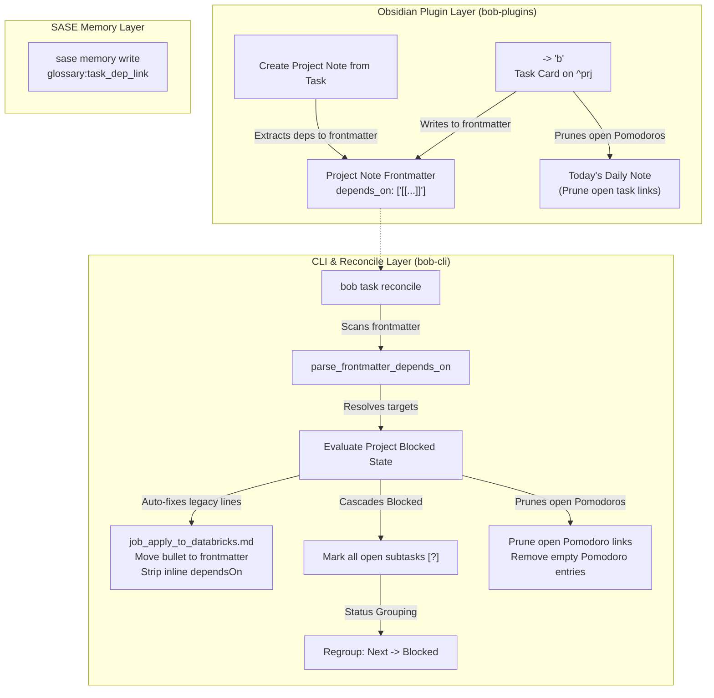

# Research Report: Project Task Dependency Links, Frontmatter Projection, and Cascading Blocked Status

- **Author**: Researcher `gem` (5-researcher independent swarm)
- **Date**: 2026-10-12
- **Topic**: Adding full support to project tasks (`^prj`) for task dependency links (`depends_on` frontmatter, blocked project inheritance, `<ctrl+shift+p>` / `<cmd+ctrl+shift+n>` Obsidian keymaps, Pomodoro link pruning, and `bob task reconcile` auto-fixing).
- **Target Repositories**: `bob-cli` (Rust), `bob-plugins` (TypeScript/JS), Bob Obsidian Vault (`~/bob/`).

---

## 1. Executive Summary

This research investigates extending task dependency links to Bob **project tasks** (`^prj` lifecycle tasks in `type: "[[project]]"` notes). 

Currently, adding a dependency to a `^prj` task via the Obsidian Task Card (`<ctrl+shift+p>` → `b`) treats the line like an ordinary task: it writes an inline `[dependsOn:: ...]` field onto the `^prj` line and appends a `⛓️ **DEPENDS ON:**` child bullet. This produces counter-intuitive formatting in project notes, fails to cascade the project's blocked state to its member tasks, and leaves dead task links inside today's open Pomodoros.

A real-world illustration of this failure was discovered directly in the user's live vault at [`~/bob/job_apply_to_databricks.md`](file:///home/bryan/bob/job_apply_to_databricks.md) and [`~/bob/2026/20261012.md`](file:///home/bryan/bob/2026/20261012.md):
1. `job_apply_to_databricks.md` contains an open `^prj` task with child bullet `⛓️ **DEPENDS ON:** [[job#^update-linkedin]]`.
2. The prerequisite `job#^update-linkedin` is open (`[/] In Progress`).
3. Despite the project being blocked, two internal project tasks remain `[*]` in `### Next & In Progress`.
4. Both blocked tasks are actively linked under today's open Pomodoro session `- [ ] (**0645-0710** [t:: 25m]) — JOB` in `20261012.md`.

### Core Assessment & Verdict
The user's plan is **fundamentally sound and necessary**. Storing project-level dependencies in YAML frontmatter (`depends_on`) mirrors how project schedules (`scheduled: YYYY-MM-DD`) already function in `docs/projects.md`. Cascading blocked status to all open tasks within a blocked project closes a severe GTD integrity leak, and pruning blocked task links from open Pomodoros enforces the fundamental ledger invariant: *Open Pomodoros represent actionable work for today*.

However, the plan introduces **two critical behavioral tensions** that must be explicitly understood and designed around:
1. **The Sticky Lane Erasure Problem**: In Bob's Kanban architecture ([`decisions:task-lanes-are-sticky`](file:///home/bryan/.local/state/sase/workspaces/bobs-org/bob-cli/bob-cli_16/sase/memory/decisions/task-lanes-are-sticky.md)), *lanes do not survive Blocked*. When all tasks in a blocked project become `[?]`, their prior Next `[*]` or In Progress `[/]` status is erased. When the project unblocks, tasks recover to Ready `[ ]` (unless linked today or in recent activity). We conclude this is GTD-correct (a waking project requires intentional triage) but must be clearly documented.
2. **Pomodoro Link Pruning Boundary**: Link pruning must apply strictly to **open and planned** Pomodoros (`- [ ] ()` or `- [ ] (timespan)`). Completed/closed Pomodoro bullets (`- [x] (timespan)`) are immutable historical work logs and must never be pruned.

Below is the complete analysis, critique, requirement adjustments, and detailed multi-repository implementation blueprint.

---

## 2. Real-World Case Study: Inspection of `job_apply_to_databricks.md`

To establish the exact problem space, we inspected the vault state referenced by the user:

### 2.1 The Project Note: `~/bob/job_apply_to_databricks.md`
```markdown
---
parent: "[[job]]"
template: "[[new_project]]"
type: "[[project]]"
status: wip
created: 2026-10-12T06:26:32-04:00
task_count: 2
open_task_count: 2
---
- [?] #task #prj Apply to DataBricks NYC role(s)! [fresh:: 2026-10-12] [created::2026-10-12] #hide [dependsOn:: job__update-linkedin] ^prj
	- ⛓️ **DEPENDS ON:** [[job#^update-linkedin]]

## Tasks
[`⚪ 0 open`](#Tasks) · [`🔵 2 next/wip`](#Tasks#Next%20&%20In%20Progress) · [`🔴 0 blocked`](#Tasks#Blocked) · [`🟢 0 done/canceled`](#Tasks#Done%20&%20Canceled)

### Next & In Progress
<!-- bob:task-status-group:v1:active -->

- [*] #task #ref [[ref/chat/databricks_nyc_cv_and_role_pitches|Databricks NYC Application: Two Roles, One CV, LinkedIn Updates, and Pitches]] [fresh:: 2026-10-12] [created::2026-10-10] [id:: job_apply_to_databricks__ref-databricks-nyc-cv-and-role-pitches] ^ref-databricks-nyc-cv-and-role-pitches
- [*] #task #ref [[ref/chat/databricks_nyc_cv_and_role_pitches_v2|Databricks NYC application follow-ups (v2)]] [fresh:: 2026-10-12] [created::2026-10-10] [id:: job_apply_to_databricks__ref-databricks-nyc-cv-and-role-pitches-v2] ^ref-databricks-nyc-cv-and-role-pitches-v2

### Blocked
<!-- bob:task-status-group:v1:blocked -->

### Done & Canceled
<!-- bob:task-status-group:v1:closed -->
```

### 2.2 The Daily Ledger: `~/bob/2026/20261012.md`
```markdown
- [ ] (**0645-0710** [t:: 25m]) — JOB
	- [[job#^re-organize-job]]
	- [[job_update_cv#^ref-software-engineer-cv-redesign]]
	- [[job#^update-linkedin]]
	- [[job_apply_to_databricks#^ref-databricks-nyc-cv-and-role-pitches]]
	- [[job_apply_to_databricks#^ref-databricks-nyc-cv-and-role-pitches-v2]]
```

### 2.3 Diagnostic Breakdown of Defects
1. **Misplaced Visual Hierarchy**: The child bullet `\t- ⛓️ **DEPENDS ON:** [[job#^update-linkedin]]` sits between the completion criterion `^prj` line and the `## Tasks` heading. In Bob's project grammar (`docs/projects.md`), child bullets directly under `^prj` are reserved for:
   - `- 🧩 **Sub-projects:** [[...]]` lines generated by `bob projects sync`.
   - Managed logs (`🗓️ SCHEDULE LOG`, `❌ CANCEL LOG`, Work Logs).
   Placing a dependency line here collides with project sub-block parsing (`src/native/projects/scan.rs::parse_prj_sub_block`).
2. **Metadata Asymmetry**: In project notes, status, parent hierarchy, template, and schedules all live in YAML frontmatter (`scheduled: YYYY-MM-DD`). Having dependencies live as a task-level child bullet while schedule lives in frontmatter is a glaring architectural inconsistency.
3. **Leaked Actionability**: The prerequisite `job#^update-linkedin` is open (`[/] #task Change LinkedIn NOW!`). While `^prj` was marked `[?]`, the two follow-up tasks remain `[*] Next` in `### Next & In Progress`. The badge says `🔵 2 next/wip · 🔴 0 blocked`. Anyone reviewing the project sees active, actionable tasks.
4. **Ledger Contamination**: Today's daily note has scheduled the blocked sub-tasks for an open work session (`0645-0710`). A user sitting down to execute that session is instructed to work on sub-tasks whose prerequisite has not been completed.

---

## 3. Critical Analysis & Critique of the Plan

### 3.1 Is this a good idea?
**Yes.** The proposed architecture is an overdue unification of the project data model:
- **Consistency with Project Schedules**: `docs/projects.md` §2 established that `^prj` never receives an inline `[scheduled::]`. Project scheduling is stored in YAML frontmatter as `scheduled: YYYY-MM-DD`. `bob projects sync` and the Task Card already manage frontmatter for schedules. Bringing `depends_on` to YAML frontmatter aligns dependency management with schedule management.
- **Hierarchical Dependency Integrity**: A project is not merely an arbitrary tag; it is an outcome container. If the project cannot proceed because it is waiting on another task or project, its constituent tasks cannot proceed. Allowing constituent tasks to float in `Next` or `In Progress` violates finish-to-start dependency semantics.
- **Cleaner Note Bodies**: Eliminating `⛓️ **DEPENDS ON:**` from the project note body leaves `^prj` followed cleanly by its Sub-projects line, log lines, and `## Tasks`.

### 3.2 Key Architectural & Operational Tensions

#### Tension 1: The Sticky Lane Erasure Problem upon Unblocking
Under Bob's decision [`decisions:task-lanes-are-sticky`](file:///home/bryan/.local/state/sase/memory/decisions/task-lanes-are-sticky.md):
> *"6. Blocked stays derived, overrides every lane, and recovers to the existing derived rank (Ready unless linked today or reached by recent activity)... Lanes don't survive Blocked... No hidden previous-status field is stored."*

If an entire project becomes blocked, every open task (whether `[ ]`, `[*]`, or `[/]`) transitions to `[?]`.
When the project's dependency resolves and the project unblocks:
- The tasks recover to derived rank.
- Since they are no longer linked under today's Pomodoros (having been pruned), they will recover to **Ready `[ ]`**.
- Any tasks that were previously marked `[*] Next` or `[/] In Progress` will **lose their lane designation**.

**Critique & Evaluation**:
Is this a flaw or a feature?
- *GTD / Kanban Rationale*: In GTD, when a stalled project wakes up after days or weeks, blindly resuming prior "In Progress" work is an anti-pattern. The project backlog must be reviewed in the morning review walk, and the user must pull the next actionable task into `Next` via `Alt+N`.
- *Swarm / Work-in-Progress Risk*: If a project was temporarily blocked for a few hours (e.g. waiting for a single review), the user loses their staged `Next` markers.
- *Conclusion*: Storing a hidden "pre-blocked" status was explicitly rejected in `task-lanes-are-sticky` ("*Reopens when: Lanes must survive Blocked (then Blocked becomes an overlay)*"). We should **NOT** violate this decision. Tasks in unblocked projects recovering to `[ ]` Ready is the correct, consistent behavior under current Bob architecture.

#### Tension 2: Definition of a "Blocked Project"
The user specifies:
> *"any task that lives in a blocked project should also be blocked (in this case, because the project has an unmet dependency, but whenever a project is blocked this rule applies)."*

We must clearly codify every condition that renders a project "blocked":
1. **Unmet Frontmatter Dependencies**: YAML `depends_on` contains at least one task or project wikilink that resolves to an open task (status Todo `[ ]`, Next `[*]`, In Progress `[/]`, or Blocked `[?]`).
2. **Future Schedule**: YAML `scheduled: YYYY-MM-DD` is strictly greater than today's anchor date (`scheduled > today`).
3. **Blocked Project Task**: The project's completion criterion task `^prj` has checkbox `[?]`.
4. **Waiting / Blocked Frontmatter Status**: YAML `status` is set to `waiting` or `blocked`.

*Adjustment*: If any of these 4 conditions is true, `is_project_blocked` evaluates to `true`. All open tasks in the note inherit the blocked state.

#### Tension 3: Inherited Derivation vs. Inline Field Stamping
Should `bob task reconcile` stamp `[dependsOn:: ...]` on every subtask inside a blocked project?
**No. Absolutely not.**
- Stamping `[dependsOn::]` on every subtask would pollute the task lines.
- It would trigger R2 adoption in `task_status_hooks/reconcile.rs`, attempting to synthesize `⛓️ **DEPENDS ON:**` child bullets for dozens of subtasks.
- The subtasks do not individually depend on the external prerequisite; their blocking is **inherited from their containing project**.
- Deriving `has_derived_block = true` at scan/reconcile time in `sync.rs` is instantaneous, clean, requires zero task line rewrites, and recovers cleanly when the project unblocks.

#### Tension 4: Scope of Pomodoro Link Pruning
The user specifies:
> *"Keep in mind that blocked tasks should not have corresponding task links, so those should be removed (along with the pomodoro section they live in if it becomes empty) if they exist."*

We must maintain a strict boundary:
- **Open / Planned Pomodoro Entries** (`- [ ] ()` or `- [ ] (timespan)`): Any link pointing to a task that is Blocked (or derived Blocked) **must be pruned**. If that link was the only content of a bullet, the bullet subtree is removed. If the containing Pomodoro entry has no remaining child bullets, the Pomodoro entry itself is pruned (`plan_empty_pomodoro_removals`).
- **Completed / Closed Pomodoro Entries** (`- [x] (timespan)`): **Must NEVER be pruned**. Completed entries record historical work executed during that session. Even if the task later became blocked, erasing historical logs from daily notes would corrupt the ledger.

---

## 4. Frontmatter Syntax & Grammar Specification

### 4.1 YAML Frontmatter Format for `depends_on`
To guarantee robust parsing and human ergonomics, `depends_on` in project notes must adhere to the following schema:

```yaml
---
parent: "[[job]]"
template: "[[new_project]]"
type: "[[project]]"
status: wip
scheduled: 2026-10-15
depends_on:
  - "[[job#^update-linkedin]]"
  - "[[onboarding#^setup-laptop]]"
---
```

### 4.2 Writer Standard (Obsidian Keymaps & Bob Tools)
1. **Canonical Writer Form**:
   - For multiple dependencies: Block-list with quoted wikilinks:
     ```yaml
     depends_on:
       - "[[target_note#^target-block-id]]"
       - "[[other_note#^other-block-id]]"
     ```
   - For a single dependency: Either single-item block list or single quoted scalar:
     ```yaml
     depends_on: "[[target_note#^target-block-id]]"
     ```
2. **Quoting Requirement**: Wikilinks in YAML frontmatter **must be quoted** (`"[[...]]"`). Bare `[[...]]` violates YAML syntax because `[` and `]` denote flow sequences.
3. **Order Preservation**: Dependency targets must preserve addition order. Appending a dependency appends to the list; removing and re-adding moves to the end.

### 4.3 Reader Tolerance
In accordance with Bob's reader tolerance standards (`src/native/projects/scan.rs`):
The parser must accept:
1. Block-list form: `depends_on:\n  - "[[...]]"`
2. Flow-list form: `depends_on: ["[[...]]", "[[...]]"]`
3. Scalar string form: `depends_on: "[[...]]"`
4. Unquoted / resilient wikilinks if entered by hand.
5. Empty / null fields (`depends_on: []` or `depends_on: ~` or `depends_on:`), treated as no dependencies.

### 4.4 The `^prj` Task Line Rule
- The `^prj` lifecycle task **must NOT carry an inline `[dependsOn::]` field**.
- The `^prj` lifecycle task **must NOT have a `⛓️ **DEPENDS ON:**` child bullet**.
- When `bob task reconcile` encounters a legacy `⛓️ **DEPENDS ON:**` child bullet or `[dependsOn::]` field on `^prj`, it automatically migrates the links into frontmatter `depends_on`, deletes the child bullet, and removes the inline field.

---

## 5. Detailed Implementation Blueprint across Repositories



### 5.1 Repository 1: `bob-cli` (Rust Core)

#### File 1: `src/native/projects/scan.rs` & `src/native/projects/model.rs`
1. Add `depends_on: Vec<WikilinkRef>` to `Project` model in `model.rs`.
2. Add `parse_project_dependencies(relative_path: &Path, frontmatter: &Frontmatter<'_>, issues: &mut Vec<ScanIssue>) -> Vec<WikilinkRef>` in `scan.rs`:
   - Matches `depends_on` in frontmatter.
   - Handles scalar string, flow list (`split_flow_items`), and block list.
   - Extracts wikilink targets using `wikilink_ref_from_inner`.
3. In `parse_project`:
   - Store parsed `depends_on` on the `Project` struct.

#### File 2: `src/native/task_status_hooks/reconcile.rs`
1. **Special Handling for `^prj` in `plan_dependent`**:
   - Inspect `view.task`: If `view.task.block_id.as_deref() == Some("prj")` (or the note is a project note and the task has trailing `^prj`):
     - **Auto-Fix Legacy Sub-Bullet**: If a `DependencyLine::Accepted` exists under `^prj`:
       - Extract the resolved links.
       - Queue a mutation to insert or append them into the note's frontmatter `depends_on`.
       - Queue deletion of the `⛓️ **DEPENDS ON:**` child bullet.
       - Queue removal of `[dependsOn:: ...]` from the `^prj` task line.
       - Record an adoption/auto-fix update in `ReconcileOutcome`.

#### File 3: `src/native/task_status_hooks/sync.rs`
1. **Determine Project Blocked State**:
   - For each scanned file that is a project note (`NoteKind::Project`):
     - Resolve its frontmatter `depends_on` targets against the vault task index.
     - Check if any target is an open task (`[ ]`, `[*]`, `[/]`, `[?]`).
     - Check if frontmatter `scheduled` date is future (`scheduled > anchor`).
     - Check if `^prj` task status is `?`.
     - Check if frontmatter `status` is `"waiting"` or `"blocked"`.
     - If any condition is met, mark the file index in a `blocked_project_files: BTreeSet<usize>`.
2. **Status Derivation Loop (lines 499–537)**:
   - For each task in file `file_index`:
     ```rust
     let in_blocked_project = blocked_project_files.contains(&file_index) 
         && !task.status.is_terminal(); // terminal tasks (x, -) stay terminal
     
     let has_derived_block = in_blocked_project
         || !dependency_state.open_dependency_ids.is_empty()
         || future_scheduled_date.is_some();
     ```
   - If `has_derived_block` is true, the task executes `Transition::MarkBlocked` (`replacement: '?'`).
   - If `in_blocked_project`, record the project note's path in `dependency_status_change` details.
3. **Task Status Grouping**:
   - Because the tasks transition to `[?]`, the existing grouping engine (`src/native/task_status_groups/`) automatically places them into `### Blocked` and updates the count badge row to reflect `🔴 N blocked`.

#### File 4: `src/native/task_status_hooks/structure.rs`
1. **Pruning Blocked Links from Open Pomodoros**:
   - In `plan_structural_changes`:
     - Currently, lines 215–240 identify `canceled_links` under `source.open` entries and delete their bullet subtree.
     - Add a check for **blocked links**:
       ```rust
       let blocked_links = bullet
           .links
           .iter()
           .filter(|link| {
               source.open
                   && resolved.get(&link.reference).is_some_and(|reference| {
                       // Task is currently blocked, or resolved target is in a blocked project / has unmet deps
                       is_blocked_reference(reference, &blocked_project_identities, ...)
                   })
           })
           .collect::<Vec<_>>();
       ```
     - For each blocked link in an open Pomodoro:
       - Append to `deleted_lines` (removing the bullet subtree).
       - Record in `removed_blocked_references`.
2. **Pomodoro Entry Removal**:
   - The existing `plan_empty_pomodoro_removals` automatically removes childless open Pomodoro entries after `deleted_lines` are applied.

#### File 5: `src/native/task_status_hooks/output.rs`
- Add `removed_blocked_references` to the human summary line and JSON report output:
  `"... {} blocked-reference triggers, {} empty Pomodoros removed ..."`

---

### 5.2 Repository 2: `bob-plugins` (Obsidian Frontend)

#### File 1: `plugins/bob-navigation-hotkeys/src/660-plugin-project-notes.js` & `110-project-seed.js`
1. **`<cmd+ctrl+shift+n>` Forward Conversion (`createProjectNoteFromTask`)**:
   - In `parseProjectSourceTaskLine` / `getProjectSourceTaskBlock`:
     - Inspect `sourceBlock.childLines` for a `⛓️ **DEPENDS ON:**` line (using `isDependencyLine`).
     - Inspect the source task for an inline `[dependsOn::]` field.
   - In `buildProjectSeedFromChildBullets`:
     - Do **not** process `⛓️ **DEPENDS ON:**` as a child task or note section bullet. Exclude it from `childTaskLines` and `sections`.
   - In `applyProjectCreationFrontmatter`:
     - If the source task had dependencies, serialize them into `frontmatter.depends_on`:
       ```javascript
       if (dependencies.length > 0) {
         frontmatter.depends_on = dependencies.map((dep) => `[[${dep}]]`);
       }
       ```
2. **Reversal Conversion (`convertProjectNoteToTask`)**:
   - When converting a project note back to a task in its parent note:
     - Read `frontmatter.depends_on`.
     - Synthesize the `⛓️ **DEPENDS ON:**` child bullet and `[dependsOn::]` field back onto the restored parent task.

#### File 2: `plugins/bob-navigation-hotkeys/src/080-dependency-identity.js` & `580-plugin-properties-and-dependency-edit.js`
1. **`<ctrl+shift+p>` Task Card (`set-bullet-property` → `b`)**:
   - In `openDependencyStageAtCursor`:
     - If cursor is on a `^prj` line (`isProjectLifecycleTaskLine(lineText)`):
       - Target mode becomes `kind: "project-frontmatter"`.
   - In `commitBulletProperty` / `applyDependencyPickerBatch`:
     - If target is a `^prj` task:
       - Update `depends_on` in the YAML frontmatter of the note.
       - Remove any existing `⛓️ **DEPENDS ON:**` child bullet under `^prj`.
       - Strip any inline `[dependsOn:: ...]` from `^prj`.
       - If any newly added dependency is open:
         - Mark `^prj` checkbox as `[?]`.
         - Scan all open tasks in the current note and set their checkboxes to `[?]`.
         - Invoke `planDeferredPomodoroLinkCleanup` for all tasks in the note to prune matching links from today's open Pomodoros.

---

### 5.3 Repository 3: SASE Memory & Documentation

#### File 1: `sase/memory/glossary/task-dependency-link.md`
Update the glossary definition to formalize the project note frontmatter distinction:

```markdown
# Task Dependency Link

A plain (never transcluded) [[task-link]] to a prerequisite of another Obsidian
task. For ordinary tasks, a task's dep links sit on its Depends-On line, its
first direct child: `⛓️ **DEPENDS ON:** [[#^a]] • [[note#^b]]`. For [[project-task]]s
(`^prj`), dep links sit in the [[project-note]]'s YAML frontmatter under
`depends_on: ["[[note#^b]]"]`.

That frontmatter field or Depends-On line is the source of truth: Bob derives
the task's `[dependsOn::]` field and each target's `[id::]` from it, and the
task stays Blocked `[?]` while any target is open. When a project is blocked (by
an unmet `depends_on` prerequisite, future `scheduled` date, or blocked `^prj`),
every task residing in that project note derives Blocked `[?]`. Blocked tasks
cannot have corresponding Task Links under today's open Pomodoros; any such
links are pruned. Linking the dependent under today's Pomodoros raises its open
prerequisites to Next. Add or remove dep links with Ctrl+Shift+P → Depends on,
which fuzzy-searches open tasks across the vault, or by editing the note. A dep
link is a prerequisite, not a sub-task: closing the dependent never closes its
targets, and dep links never count as Pomodoro Task Links. See
[[decisions/task-deps-are-depends-on-links]]; syntax details live in
`docs/task-dependencies.md` and `docs/projects.md`.
```

#### File 2: Documentation Updates
- Update `docs/task-dependencies.md` §2 to add **Section 2.5: Project Task Dependencies (`depends_on` frontmatter)**.
- Update `docs/projects.md` §4 to specify `depends_on` frontmatter and cascading blocked status for all member tasks.

---

## 6. Walkthrough: Auto-Fixing `job_apply_to_databricks.md`

To verify the design, let us trace exactly what happens when the updated `bob task reconcile` runs on the user's current vault:

### Step 1: Scan & Reconcile `job_apply_to_databricks.md`
1. Reconcile detects that `job_apply_to_databricks.md` is a project note (`type: "[[project]]"`).
2. It detects that `^prj` has a child bullet `⛓️ **DEPENDS ON:** [[job#^update-linkedin]]`.
3. It performs the **R1-Project Migration**:
   - Writes `depends_on: "[[job#^update-linkedin]]"` (or block-list form) to frontmatter.
   - Deletes `\t- ⛓️ **DEPENDS ON:** [[job#^update-linkedin]]`.
   - Strips `[dependsOn:: job__update-linkedin]` from line 10.
4. Target `job#^update-linkedin` is resolved:
   - Target status in `job.md` is `[/]` (In Progress / Open).
   - Because the target is open, `job_apply_to_databricks` is **Blocked**.

### Step 2: Cascade Blocked Status to Tasks
1. The project task `^prj` is marked Blocked: `- [?] #task #prj ... ^prj`.
2. The two tasks inside the project:
   - `- [*] #task #ref [[...|Databricks NYC Application...]] ^ref-databricks-nyc-cv-and-role-pitches`
   - `- [*] #task #ref [[...|Databricks NYC application follow-ups (v2)]] ^ref-databricks-nyc-cv-and-role-pitches-v2`
   inherit `has_derived_block = true`.
3. Both tasks transition from `[*]` to `[?]`.
4. Task status grouping engine moves both tasks from `### Next & In Progress` to `### Blocked`.
5. The badge row updates to:
   `[`⚪ 0 open`](#Tasks) · [`🔵 0 next/wip`](#Tasks#Next%20&%20In%20Progress) · [`🔴 2 blocked`](#Tasks#Blocked) · [`🟢 0 done/canceled`](#Tasks#Done%20&%20Canceled)`.

### Step 3: Prune Pomodoro Task Links in `20261012.md`
1. In `2026/20261012.md`, the open Pomodoro entry is:
   ```markdown
   - [ ] (**0645-0710** [t:: 25m]) — JOB
   	- [[job#^re-organize-job]]
   	- [[job_update_cv#^ref-software-engineer-cv-redesign]]
   	- [[job#^update-linkedin]]
   	- [[job_apply_to_databricks#^ref-databricks-nyc-cv-and-role-pitches]]
   	- [[job_apply_to_databricks#^ref-databricks-nyc-cv-and-role-pitches-v2]]
   ```
2. The references to `job_apply_to_databricks` resolve to tasks that are now Blocked.
3. Because the Pomodoro entry is open (`- [ ]`), both blocked bullets are **pruned**.
4. The remaining Pomodoro entry preserves the 3 unblocked tasks:
   ```markdown
   - [ ] (**0645-0710** [t:: 25m]) — JOB
   	- [[job#^re-organize-job]]
   	- [[job_update_cv#^ref-software-engineer-cv-redesign]]
   	- [[job#^update-linkedin]]
   ```
   *(Note: If those two had been the only tasks under the Pomodoro, the entire `- [ ] (**0645-0710** ...)` entry would be deleted).*

---

## 7. Recommended Implementation Sequence

To ensure safety and zero data loss across the vault, the implementation should proceed in four distinct phases:

1. **Phase 1: Rust Core Parsing & Auto-Fix (`bob-cli`)**
   - Implement `parse_project_dependencies` in `src/native/projects/scan.rs`.
   - Implement legacy sub-bullet migration and `^prj` inline field stripping in `src/native/task_status_hooks/reconcile.rs`.
   - Unit tests covering scalar, flow, and block list YAML parsing.
2. **Phase 2: Blocked Inheritance & Pomodoro Link Pruning (`bob-cli`)**
   - Implement `blocked_project_files` resolution in `src/native/task_status_hooks/sync.rs`.
   - Update `task_transition` to block all tasks in blocked projects.
   - Implement blocked reference pruning in `src/native/task_status_hooks/structure.rs`.
   - Integration test running against fixtures matching `job_apply_to_databricks.md` and `20261012.md`.
3. **Phase 3: Obsidian Hotkeys & Gestures (`bob-plugins`)**
   - Update `<cmd+ctrl+shift+n>` forward and reverse conversion in `bob-navigation-hotkeys`.
   - Update `<ctrl+shift+p>` Task Card to target frontmatter `depends_on` when on `^prj`.
   - Hook up `planDeferredPomodoroLinkCleanup` on dependency additions to `^prj`.
   - Deploy via `bob plugins sync`.
4. **Phase 4: SASE Memory Web & Contract Documentation**
   - Update `sase/memory/glossary/task-dependency-link.md` via `/sase_memory_write`.
   - Update `docs/task-dependencies.md` and `docs/projects.md`.
   - Run `bob task reconcile` on Bryan's live vault to auto-fix `job_apply_to_databricks.md`.
