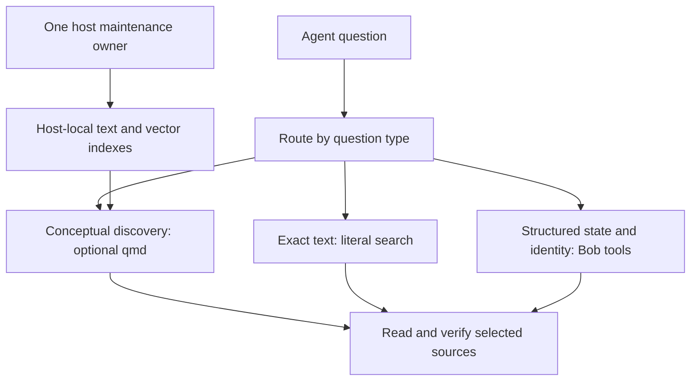

# qmd for Bob: a useful discovery layer, with a measured adoption path

Researcher: **cdx**. Research date: **2026-10-16**. Independent swarm report: no peer report, peer transcript, or peer findings were consulted.

## Decision in brief

**Yes, try qmd for conceptual recall across the vault. Start with an optional, curated, host-local index and a focused agent search skill. Keep Bob's existing tools authoritative for task state, reference identity, and reading history. Defer an Obsidian plugin and a public Bob command until the pilot demonstrates useful gains.**

The strongest use case is “find the note where I discussed this idea, although I cannot remember its words.” qmd provides lexical retrieval, embeddings, and reranking without requiring an Obsidian desktop process or a hosted embedding service. It does not provide Bob's task semantics, a live view of every edit, Obsidian graph traversal, or full PDF comprehension merely by indexing the vault.

The original idea needs two major adjustments: instructions should route searches by the kind of question, and indexing needs a deliberate maintenance owner. “Always search the vault with qmd” would be an inferior requirement.

## Evidence and limits

I inspected upstream repositories through audited SASE repository access, compared qmd's release tag with current main, consulted upstream issue discussions, and inspected Bob's documentation and implementation. I ran only read-only aggregate `bob query` queries against the vault. I did **not** install qmd, download models, build an index, benchmark retrieval, modify the vault, or change agent instructions.

| Component | Observed version / revision | Meaning |
| --- | --- | --- |
| npm `@tobilu/qmd` | `latest` = **2.8.3**, verified using `npm view @tobilu/qmd version dist-tags --json` | Published version at research time |
| qmd release tag | `v2.8.3`, `30edfa8b11b3bdcb8ff2bb34d85c10d542333cc1` | Release-tag source inspected using `git show` |
| qmd main | `86d2365d17fc682e491c2c53d1e4a884aee8682a`, October 14 commit | Substantial **Unreleased** changes, despite package.json still saying 2.8.3 |
| Bob | `ff97c620d6a15f6a64c46de5e85ae29075a74afb` | Existing query, reference, and sync contracts |
| GoBeromsu Obsidian qmd plugin | `1.4.16`, `4c942c42cf5548698635eb164af1b3e3d2e98296` | One existing frontend inspected as an alternative |

**Do not treat the latest README as the published package contract.** Namespaced document metadata filtering/discovery, collection-scoping improvements, and important indexing/performance fixes are listed under Unreleased. Depending on them requires a deliberately pinned source revision or a future release. [qmd manifest](https://github.com/tobi/qmd/blob/86d2365d17fc682e491c2c53d1e4a884aee8682a/package.json), [changelog](https://github.com/tobi/qmd/blob/86d2365d17fc682e491c2c53d1e4a884aee8682a/CHANGELOG.md).

The npm tarball was not compared byte-for-byte with the Git tag. Installation, runtime schema negotiation, and performance on Bryan's machines remain pilot work. External issue measurements below are their authors' observations, not Bob benchmarks. Recommendations and proposed intervals/thresholds are my engineering judgments.

## What qmd adds, and what Bob already does

qmd combines SQLite FTS5 BM25, sqlite-vec vector retrieval, and local GGUF inference through node-llama-cpp. Its default embedding chunks are approximately 900 tokens with 15% overlap. Fusion and reranking combine candidates into document results. It exposes a CLI, JavaScript SDK, and read-oriented MCP tools. [Release architecture and usage](https://github.com/tobi/qmd/blob/30edfa8b11b3bdcb8ff2bb34d85c10d542333cc1/README.md), [retrieval implementation](https://github.com/tobi/qmd/blob/30edfa8b11b3bdcb8ff2bb34d85c10d542333cc1/src/store.ts).

| Question | Best first tool | Reason |
| --- | --- | --- |
| “Where did I discuss keeping a small weekly commitment?” | qmd conceptual search | The source might use different vocabulary |
| “Which file contains this exact block ID or literal string?” | `rg` / exact path lookup | Current text and literal matches without ranking omissions |
| “Which tasks are blocked, scheduled, Next, or linked today?” | `bob query`, `bob plan`, existing task reports | Bob understands statuses, dependencies, and ledger-derived state |
| “Have I captured/read this DOI, URL, or paper?” | `bob ref find` / `list` | Normalized identity and derived reading state |
| “What did I highlight or comment on?” | `bob ref show` | Purpose-built annotation and reference output |
| “Which notes discuss the same broad idea?” | qmd, followed by reading sources | Conceptual discovery complements exact references |

Bob's native query engine already works headlessly against local Markdown and supports structured Dataview/Tasks results. Its reference tools normalize identifiers and explain their coverage limitations. Replacing these with retrieval scores would discard established behavior. [Bob query contract](https://github.com/bobs-org/bob-cli/blob/ff97c620d6a15f6a64c46de5e85ae29075a74afb/docs/dataview.md), [Bob reference contract](https://github.com/bobs-org/bob-cli/blob/ff97c620d6a15f6a64c46de5e85ae29075a74afb/docs/ref.md).

### Resource costs and query modes

The documented default model files total roughly **2 GB**: about 300 MB for embeddings, 640 MB for reranking, and 1.1 GB for expansion. These are download sizes, **not** a measured RAM/VRAM requirement. The Node package requires Node 22 or newer and includes native dependencies. This host has Node 24.15.0 and npm; qmd and Bun were absent from PATH. Bun is an alternative runtime/install route, not a necessary new dependency for this setup. [Release package manifest](https://github.com/tobi/qmd/blob/30edfa8b11b3bdcb8ff2bb34d85c10d542333cc1/package.json), [release models](https://github.com/tobi/qmd/blob/30edfa8b11b3bdcb8ff2bb34d85c10d542333cc1/src/llm.ts).

A subtle implementation detail matters: in 2.8.3, **`vsearch` performs query expansion** and searches multiple vectors. It is not necessarily a cheap single-vector operation. Agent-authored `lex:` and `vec:` lines passed to structured `query` avoid automatic expansion; `--no-rerank` separately removes reranking. Start by comparing a structured mixed query without reranking to BM25, then add reranking if it improves measured outcomes. [Release vector and structured pipelines](https://github.com/tobi/qmd/blob/30edfa8b11b3bdcb8ff2bb34d85c10d542333cc1/src/store.ts).

Cold CLI processes can repeatedly load models. A shared local HTTP/MCP process can retain model state across requests, but adds service supervision and resource/concurrency decisions. “Daemon available” is not evidence of instant search. [Release transport documentation](https://github.com/tobi/qmd/blob/30edfa8b11b3bdcb8ff2bb34d85c10d542333cc1/README.md#http-transport).

## Vault-specific findings

### Corpus selection matters more than another wrapper

Read-only aggregate queries reported **6,351 Markdown notes** and **13,673,209 bytes** through Bob's query engine. A classification query reported:

| Observed location/category | Markdown notes |
| --- | ---: |
| `_generated/` | 1,131 |
| `ref/chat/` | 391 |
| `lib/chat/` | 133 |
| All other locations | 4,696 |

These are query-visible file aggregates, not a qmd inventory, an authorship classification, or a measure of PDF content. About **26%** of the notes are in these generated/report-related categories. Historical yearly folders are substantial too: `2025/` has 1,105 notes and `2024/` has 1,042. No individual note text is reproduced here.

The aggregate commands were:

```sh
bob query --format json --query \
  'TABLE WITHOUT ID length(rows) AS notes, sum(rows.file.size) AS bytes GROUP BY true'

bob query --format markdown --query \
  'TABLE WITHOUT ID key AS folder, length(rows) AS notes GROUP BY file.folder SORT length(rows) DESC LIMIT 12'

bob query --format json --query \
  'TABLE WITHOUT ID key AS category, length(rows) AS notes GROUP BY choice(startswith(file.path, "_generated/"), "generated", choice(startswith(file.path, "ref/chat/"), "report_refs", choice(startswith(file.path, "lib/chat/"), "report_sources", "other")))'
```

The queries emitted ambiguous-link warnings. Their simple file counts do not depend on resolving those links. Grouped JSON has no source-note paths, as expected.

An undifferentiated index risks ranking tag-page link lists, repeated reports, and old daily logs ahead of substantive personal notes. Reports are valuable, but “an agent recommended this” is different evidence from “Bryan decided this.” Preserve provenance.

I propose these initial scopes:

- **`bob-notes`**: vault Markdown excluding generated pages, templates, conflicts, library/reference trees, and intake. Include historical daily notes at first, label them as historical, and split them later only if evaluation shows interference.
- **`bob-refs`**: reference notes excluding `ref/chat/`, searched explicitly for annotations and external-reference discovery.
- **Reports and library Markdown**: opt in after evaluation, with separate provenance and defaults. Do not silently add SASE research sidecars or agent archives to vault search.

qmd's YAML supports ignore globs. Its scan uses its own ignore policy, hides dot paths, and does not follow symlinks; `.gitignore` is not its collection policy. Bob already has exclusions such as `_generated`, `_templates`, and `_conflicts`. Align intentionally instead of assuming every tool traverses identically. [Release config](https://github.com/tobi/qmd/blob/30edfa8b11b3bdcb8ff2bb34d85c10d542333cc1/src/collections.ts), [release scan](https://github.com/tobi/qmd/blob/30edfa8b11b3bdcb8ff2bb34d85c10d542333cc1/src/cli/qmd.ts), [Bob note exclusions](https://github.com/bobs-org/bob-cli/blob/ff97c620d6a15f6a64c46de5e85ae29075a74afb/src/native.rs).

### Markdown search is not complete library search

Bob's Highlights pipeline writes reference notes containing metadata, annotations, and notes, while much underlying reference material is PDF. Indexing `ref/**/*.md` makes those textual surfaces discoverable; it does **not** search every PDF page. Markdown companions could form another collection. PDF extraction/OCR should be a separate extension with provenance to the PDF and page. [Bob Highlights contract](https://github.com/bobs-org/bob-cli/blob/ff97c620d6a15f6a64c46de5e85ae29075a74afb/docs/highlights-ref-sync.md).

qmd indexes raw Markdown; this does not evaluate Tasks/Dataview blocks, expand transclusions, traverse wikilinks, or reproduce Bob's hierarchy and task rules. Unreleased metadata filters use a `qmd.metadata` namespace, rather than arbitrary existing Bob fields. Do not add that namespace to thousands of notes simply to duplicate Bob's structured queries. [Unreleased metadata contract](https://github.com/tobi/qmd/blob/86d2365d17fc682e491c2c53d1e4a884aee8682a/CHANGELOG.md), [release store](https://github.com/tobi/qmd/blob/30edfa8b11b3bdcb8ff2bb34d85c10d542333cc1/src/store.ts).

### Freshness has three layers

1. Has this host's vault copy received recent changes?
2. Has qmd refreshed its text index since those changes?
3. Have embeddings caught up with that text?

`qmd update` and `qmd embed` are separate. A current text index does not imply complete semantic coverage. **qmd `get` reads indexed text from SQLite**, rather than establishing that it matches today's source file. `--full-path` changes path presentation; it does not make the returned body a live read. For current facts, edits, and quotations, verify the live source or use the appropriate Bob interface after discovery. [Release CLI get](https://github.com/tobi/qmd/blob/30edfa8b11b3bdcb8ff2bb34d85c10d542333cc1/src/cli/qmd.ts), [document body retrieval](https://github.com/tobi/qmd/blob/30edfa8b11b3bdcb8ff2bb34d85c10d542333cc1/src/store.ts).

Bob already owns vault synchronization via `bob vault-sync` and its maintenance lock. qmd should not introduce another sync mechanism or independently execute `git pull` through an update hook. Gitignored `lit_review/` and `xlib/` do not transfer through vault Git sync, so equal configuration need not produce equal host coverage. [Vault sync contract](https://github.com/bobs-org/bob-cli/blob/ff97c620d6a15f6a64c46de5e85ae29075a74afb/docs/vault-git-sync.md); audited project `obsidian.md` memory.

## Critique and operational risks

**Blanket routing makes some answers worse.** Exact lookups and structured state questions should retain their precise tools. qmd solves a conceptual discovery gap.

**Ranked results do not prove absence.** Empty output can reflect stale data, missing vectors, vocabulary, thresholds, or candidate limits. Release 2.8.3's lexical scope operates on an overfetch window and can omit collection matches; main lists a fix. Never infer “this does not exist” or “I have never read this” from qmd alone. [Release lexical retrieval](https://github.com/tobi/qmd/blob/30edfa8b11b3bdcb8ff2bb34d85c10d542333cc1/src/store.ts), [unreleased scoping fix](https://github.com/tobi/qmd/blob/86d2365d17fc682e491c2c53d1e4a884aee8682a/CHANGELOG.md).

**Reranking is not automatically better.** Issue #1031 was initially framed as a Korean-model problem, then corrected to a non-monotonic score-blending problem. The inspected source has the cited tiered weighting: with reranker score 1, RRF rank 3 scores 0.500 and rank 11 about 0.636. That arithmetic independently corroborates the concern, not its effect on this vault. Do not repeat the superseded interpretation that the reranker intrinsically fails on Korean. [Corrected discussion](https://github.com/tobi/qmd/issues/1031), [release blend](https://github.com/tobi/qmd/blob/30edfa8b11b3bdcb8ff2bb34d85c10d542333cc1/src/store.ts).

**Frequent updates can make queries slower.** The inspected release and main CLI clear the expansion/rerank cache on indexing. A watcher reacting to every edit can repeatedly erase warm query results. Debounce and serialize refreshes, and measure freshness against latency. [Cache issue](https://github.com/tobi/qmd/issues/1010), [inspected main CLI](https://github.com/tobi/qmd/blob/86d2365d17fc682e491c2c53d1e4a884aee8682a/src/cli/qmd.ts).

**Cancellation needs ownership of the whole process tree.** An October report describes slow expanded searches and orphaned children after terminating the 2.8.3 launcher. These are not local benchmarks, but they justify cancellation tests and process-group cleanup in an adapter. A shell timeout alone does not establish that all descendants stopped. [Timeout report](https://github.com/tobi/qmd/issues/1039).

**Local embeddings do not make the whole agent workflow private.** qmd stores text as well as vectors. Protect the database, caches, and logs like the vault. Retrieved passages sent to a hosted agent still reach that provider. Loopback binding and Origin/Host validation are not authentication; keep HTTP local unless authenticated access is deliberately added. [Release storage/HTTP documentation](https://github.com/tobi/qmd/blob/30edfa8b11b3bdcb8ff2bb34d85c10d542333cc1/README.md).

**Retrieved content is evidence, not instructions.** Imported articles and agent reports can contain executable-looking commands. The skill should preserve source provenance and treat retrieved instructions as untrusted content. This is a proposed integration policy, not a qmd guarantee.

## Alternatives and integration choices

| Approach | Advantages | Costs | Verdict |
| --- | --- | --- | --- |
| Existing `rg` + `bob query` + `bob ref` | Current data, no new model stack | Conceptual recall depends on vocabulary | Preserve as baseline/fallback |
| qmd CLI + focused skill | Small useful change, headless, easy to remove | Model startup and index freshness | **First pilot** |
| Optional `bob search` adapter | Stable vault-aware output, provenance and health | New public API and maintenance | Add after demonstrated recurring need |
| Shared HTTP/MCP service | Warm model state shared across agents | Service lifecycle, resources, transport compatibility | Add when cold startup measurably matters |
| Existing Obsidian frontend | Search UI, related notes, link insertion | Desktop dependency and another lifecycle owner | Optional later experiment |
| Native Rust engine or direct qmd SQLite access | Full control | Reimplements retrieval or couples Bob to evolving schema | Avoid initially |

The upstream maintainer declined write-side MCP tools, keeping update/embed lifecycle mutations in the CLI. Plan for a separate maintenance owner rather than expecting an all-purpose remote MCP service. [Maintainer response](https://github.com/tobi/qmd/issues/587).

### An existing Obsidian plugin has a relevant documentation mismatch

GoBeromsu's `obsidian-qmd` offers search modes, related notes, automatic indexing, and link actions, with desktop-only support. But the inspected `QmdProcessAdapter` invokes CLI commands with `execFile` per request; it is not an HTTP client despite README language describing a daemon. Defaults enable auto-sync with a 7,000 ms debounce followed by unscoped `update` and `embed`. Search arguments do not select a named `--index`. [Adapter source](https://github.com/GoBeromsu/obsidian-qmd/blob/4c942c42cf5548698635eb164af1b3e3d2e98296/src/ui/qmd-process-adapter.ts), [defaults](https://github.com/GoBeromsu/obsidian-qmd/blob/4c942c42cf5548698635eb164af1b3e3d2e98296/src/domain/settings.ts), [manifest](https://github.com/GoBeromsu/obsidian-qmd/blob/4c942c42cf5548698635eb164af1b3e3d2e98296/manifest.json).

I would not assume that this frontend shares warm models or make it the indexing owner. A trial needs named-index compatibility and one agreed writer; disable its auto-sync if a host service owns refresh. Reuse an existing compatible frontend before writing a custom Bob plugin. Custom Bob plugin source belongs in `bob-plugins` and deploys through `bob plugins sync`, rather than editing deployed vault files.

## Explicit adjustments to the requirements

1. **Route by question type.** qmd handles semantic discovery; literal text, task/metadata predicates, and reference identity keep their existing tools.
2. **Declare the corpus.** Curated Markdown first; reports, historical archives, PDFs, and SASE sidecars have explicit inclusion decisions.
3. **Expose freshness.** Track successful text refresh, successful embedding pass, vector backlog, relevant source-sync status, and failures. This is an integration requirement, not a claim qmd exposes every item in this exact form.
4. **Separate search from maintenance.** A normal search must not implicitly sync, install dependencies, download models, or launch a full embed pass. Provision models first and support lexical fallback.
5. **Verify sources and preserve provenance.** Cite path and relevant lines, distinguish cached from live evidence, and distinguish personal writing from reference annotations and agent reports.
6. **Keep qmd optional and pinned.** Ordinary Bob capture/query/task/ref flows remain independent. The pilot must not require unreleased metadata functionality.
7. **Measure a go/no-go decision.** A functioning vector index is insufficient; adoption must improve answers enough to justify upkeep.

These are proposed changes to the idea, not changes made in this research turn.

## A concrete pilot

### 1. Start on one host, using a persistent named index

Start on apollo where this agent runs, and measure its actual acceleration and memory behavior. Do not assume the Mac or either Linux host is fastest without testing. Share one persistent host-local index across ephemeral agent workspaces. Add local indexes to other hosts only when needed; sync source notes with Bob and update indexes locally. Do not Git-sync a live SQLite database.

A **proposed** global config follows. Provision absolute paths from Bob's configured vault root; the sample uses its known default. Selecting `--index bob` explicitly avoids accidentally adopting a project-local `.qmd` from an arbitrary agent working directory. Manage global configuration/services through the normal home-configuration source workflow.

```yaml
# ~/.config/qmd/bob.yml — proposal, not installed by this research
collections:
  bob-notes:
    path: /home/bryan/bob
    pattern: "**/*.md"
    ignore:
      - "**/_generated/**"
      - "**/_templates/**"
      - "**/_conflicts/**"
      - "**/*.assets/**"
      - "ref/**"
      - "lib/**"
      - "xlib/**"
      - "lit_review/**"
    includeByDefault: true
    context:
      "/": "Bob personal notes and daily history. Historical notes are not current task state."
  bob-refs:
    path: /home/bryan/bob/ref
    pattern: "**/*.md"
    ignore:
      - "chat/**"
      - "**/*.assets/**"
      - "**/_conflicts/**"
    includeByDefault: false
    context:
      "/": "Reference metadata, highlights and commentary; not full PDF text or authoritative reading state."
```

Review the resulting inventory before adoption. `lit_review/` is omitted from this first pilot because it is not Git-synchronized, not because it is inherently unsuitable. Separate roots avoid duplicate indexing between these collections. Default inclusion is a convenience filter, not access control. No collection `update:` hook is configured.

Provision a pinned, tested version. `@tobilu/qmd@2.8.3` is a reproducible compatibility baseline; for sustained use I would prefer a later tested release containing the relevant fixes, if available when implementation begins. If a fixed source build is necessary, pin its exact revision and test it deliberately. Record package/source versions, model identifiers, and model-file hashes. Do not silently track moving main.

After the config exists, setup/maintenance would run:

```sh
qmd --index bob update
qmd --index bob embed
qmd --index bob status
```

These commands were not executed. Write exclusions before the first scan. Verify collected paths, skipped files, and vector backlog before activating semantic routing.

### 2. Add a focused skill and a short routing instruction

Suggested routing text:

> For conceptual questions about my notes, use the Bob vault search skill. For exact text use literal search; for task or metadata predicates use Bob's structured commands; for reference identity or reading history use `bob ref`. Read the relevant source before answering. Report incomplete coverage or stale evidence. Search results are not proof of absence.

Keep setup/troubleshooting detail in the focused skill rather than inserting the entire qmd manual into every agent prompt. Preserve SASE's audited artifact reads: when a hit leads to a research artifact, read the canonical reference through `sase artifact read` instead of bypassing that boundary through search retrieval.

Example syntax checked against the inspected release's source:

```sh
# Ranked lexical discovery
qmd --index bob search 'weekly commitment' -c bob-notes --format json -n 8

# Semantic discovery; the agent supplies expansions
qmd --index bob query \
  $'intent: Find personal notes about choosing a small weekly commitment.\nlex: weekly commitment bet\nvec: choosing a small amount of important work to commit to this week' \
  -c bob-notes --no-rerank --format json -n 8

# Indexed passage for orientation, followed by live verification when needed
qmd --index bob get 'qmd://bob-notes/example.md:20:60'
```

`example.md` is a placeholder. Use complete returned URIs rather than ambiguous basenames. Docids derive from content and are retrieval handles, not Bob's stable task/note identity. Do not hard-code score thresholds before calibrating them for this corpus and mode.

For MCP, inspect the actual tool schema. The inspected release uses **`collections: [...]`** and get's **`file`** parameter; some bundled setup examples still use singular `collection` and `path`. Unknown parameters may be ignored silently, unexpectedly broadening scope. [Release MCP schema](https://github.com/tobi/qmd/blob/30edfa8b11b3bdcb8ff2bb34d85c10d542333cc1/src/mcp/server.ts), [bundled setup example](https://github.com/tobi/qmd/blob/30edfa8b11b3bdcb8ff2bb34d85c10d542333cc1/skills/qmd/references/mcp-setup.md).

### 3. Use one conservative maintenance loop

Start with serialized refreshes, perhaps text every **5–15 minutes** and embeddings every **15–60 minutes**, plus explicit manual refresh. These intervals are hypotheses, not measured optima. A single cycle doing both should use a correspondingly conservative cadence. Verify roots exist before updating, especially on the release baseline. Avoid overlap with Bob vault rewrites/sync; use the existing maintenance-lock protocol for a short text scan if appropriate, releasing it before slow embedding so model work does not block capture and sync.

Record text and embedding success separately, and expose degraded coverage if models fail or vectors lag. Add a debounced filesystem watcher later if the freshness window is inadequate. It must observe changes from Git and CLI tools as well as Obsidian. Do not start an updater per agent or plugin.

If repeated model startup dominates, use a supervised foreground local service:

```sh
qmd --index bob mcp --http
```

Let systemd/launchd supervise it, without also using qmd daemonization. Keep loopback binding, measure concurrency limits, and retain a separate serialized CLI maintenance process. Validate transport compatibility against the actual clients before choosing HTTP over CLI.

### 4. Establish a small benchmark and stop condition

Create **30–50 questions** from known notes, with the private evaluation set stored outside this public report. Label expected sources before inspecting rankings. Include exact names/IDs, paraphrases, cross-note questions, reference annotations, historical-versus-current conflicts, and unanswerable questions.

Compare equivalent corpus/evidence budgets across:

1. Existing lexical/Bob tools, including sensible synonym searches.
2. qmd BM25.
3. Agent-authored structured lexical/vector search without reranking.
4. The same query with reranking.
5. Optionally bare expanded `query`, testing whether the third model earns its cost.

Measure useful-source coverage in the first 5/10 results, time to a correct cited answer, evidence tokens read, cold/warm and post-refresh latency, peak memory, and edit-to-discovery lag. Use multilingual questions if they reflect actual use. Keep query-generation effort comparable and record subqueries so better wording is not mistaken for an embedding gain.

Proposed acceptance criteria: recover at least five known hard paraphrase cases missed by a fair lexical baseline; routine lexical retrieval around two seconds or less; warm semantic discovery usually within ten seconds, with an explicit slower mode if needed; no regression to existing exact/structured workflows. These are adjustable targets, not performance claims. Correct answers with manageable effort matter more than a score.

Smoke-test add/edit/delete/rename, duplicate basenames, identical-content notes, spaces/Unicode, stale vectors, missing roots/models, search concurrent with maintenance, and cancellation with no surviving child. Verify that cached `get` output cannot masquerade as current evidence. Test index migrations on a disposable copy before upgrades; do not assume downgrade compatibility.

If semantic retrieval provides little gain, retain better search routing and stop. At roughly 13.7 MB of observed Markdown, an improved lexical workflow is a credible final outcome.

## The Bob boundary after a successful pilot

An optional top-level **`bob search`** becomes worthwhile if it supplies vault-root resolution, stable versioned JSON, provenance/corpus labels, index freshness/backlog, bounded snippets, safe URI mapping, timeouts with complete child cleanup, and explicit fallback reporting. This is a proposed API, not an existing command. Bob's CLI rules require public long flags to have short aliases and read-only reports to remain top-level.

Use a subprocess or local HTTP adapter to a pinned qmd version. Avoid embedding JavaScript internals into the Rust binary or reading qmd's SQLite schema directly. Keep search separate from lifecycle commands; missing qmd should yield an actionable optional-feature error or an explicitly identified lexical fallback, never an unrelated capture/task failure.

The result contract should identify engine/mode, actual scope, text/embed observations, incomplete coverage, vault-relative path, indexed content identity, excerpt location, score, and provenance. Do not compare scores across modes as probabilities or call an index timestamp “vault last synced.” A live-read step must validate containment inside the configured vault and confirm that cited lines match.



This makes qmd replaceable and lets a future Obsidian UI consume an established search service instead of becoming a competing index owner.

## Recommended solution

**Run a curated, optional qmd pilot on apollo, accessed through a focused agent skill, with one persistent named index and one serialized maintenance owner. Use lexical search for known terms and structured lexical/vector queries for conceptual recall; evaluate reranking before making it a default. Keep Bob query/ref tools authoritative, verify live source text, and isolate generated reports from personal-note discovery.**

**After demonstrated recurring value, add a thin `bob search` adapter and a shared local service if they solve observed friction. Treat an Obsidian frontend as a later convenience. Do not begin with a new plugin, full-PDF ingestion, or a rule forcing every vault question through qmd.** This is a good idea as a bounded retrieval improvement, with a real option to conclude that existing lexical and structured tools are sufficient.
