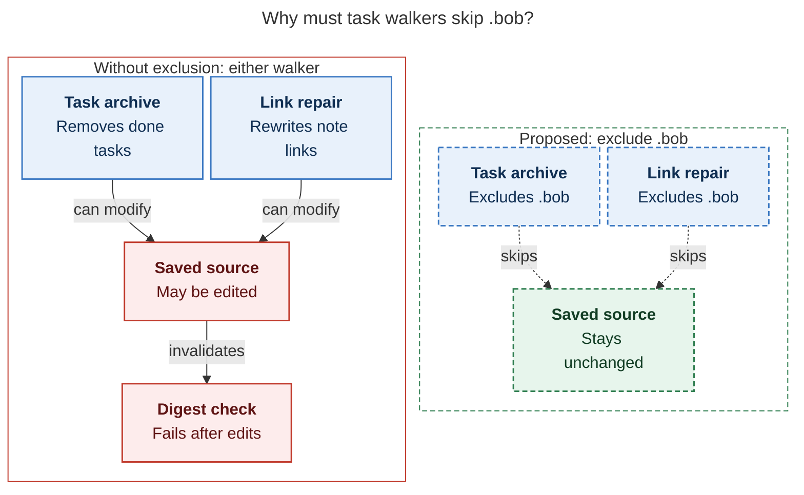

# Diagram proposals: Copying Code Blocks from the Bob Refs Copy Card, and ⌘Y in Highlights

Proposals for the swarm linker, not a report. Each diagram restates only what the source
report says.

```yaml
source: research:202610/ref_code_block_copy/ref_code_block_copy__final.md
producer: research.5b.image
check: "mmdc 12.0.0 with the PDF-mirroring config rendered 1 of 1 Mermaid diagrams"
```

## protect-saved-sources

```yaml
anchor: |-
  a nightly archive or a task move could
question: |-
  Why must task walkers skip .bob before Markdown sources are stored?
illustrates: |-
  Excluding .bob prevents task archive and link repair from silently editing write-once sources and failing the digest check.
caption: "Either walker can silently edit saved Markdown; the proposed .bob exclusion protects sources from both."
review: "860x613 px, fit 75.9%; question, source-trace, and visual checks passed; 2 revisions, 2 visual look rounds; unique anchor verified"
```


