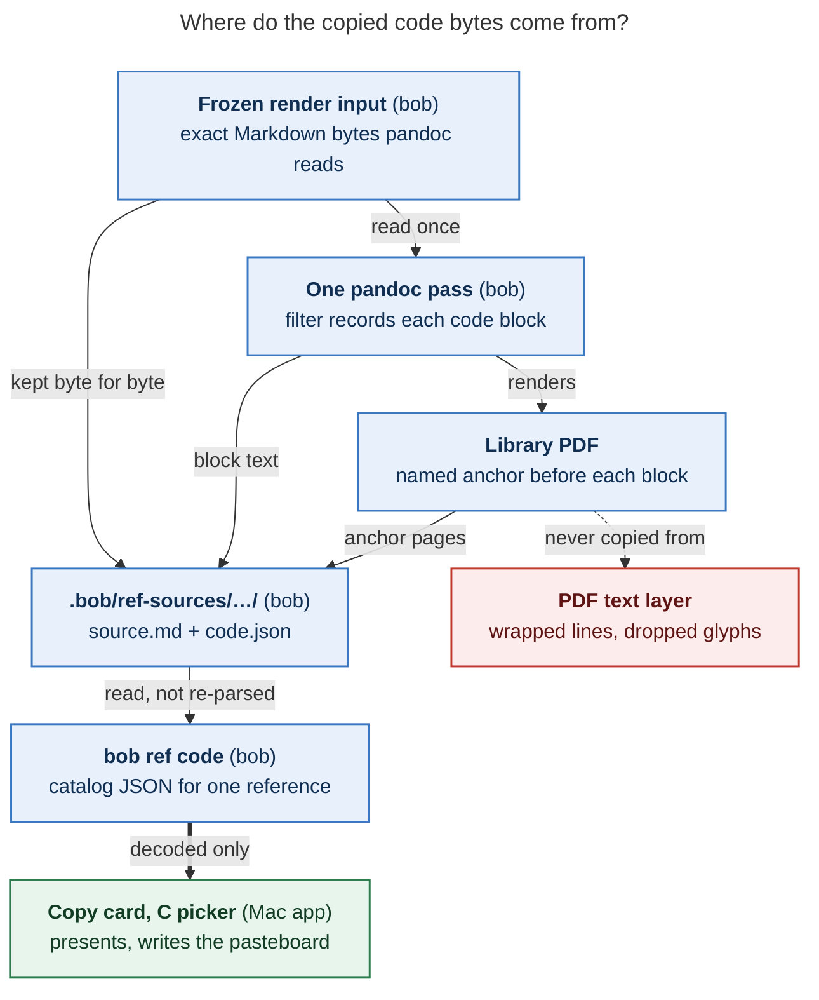
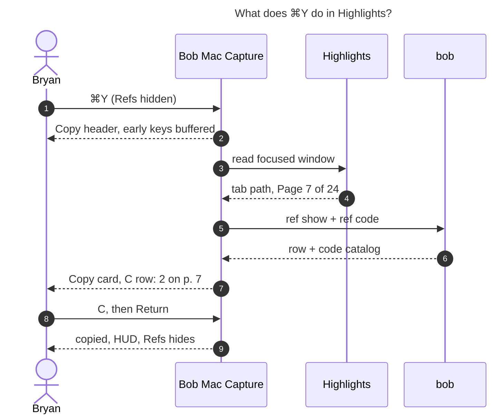

# Copying Code Blocks from the Bob Refs Copy Card, and ⌘Y in Highlights

- **Date:** 2026-10-26
- **Role:** lead researcher. This report consolidates five independent reports
  (`__cdx`, `__cld`, `__grk`, `__mus`, `__gem`, all in this directory) with my own
  verification.
- **Request:** Let the Copy card (the "copy mode" that ⌘Y opens in Bob Mac Capture's
  Bob Refs panel) copy the contents of code blocks. This probably works only for
  references that `bob ref create` rendered from Markdown, and may mean keeping that
  Markdown somewhere nearby. Also add a ⌘Y in Highlights that opens Bob Refs in copy mode
  for the current PDF. Design it to be intuitive, reliable, and beautiful. Critique the
  plan, adjust the requirements where justified, and recommend a solution.
- **Inspected:** bob-cli `4ee76d11`, bob-mac-capture `1311536` (the ephemeral
  Highlights-key session), Highlights **2026.1.2** on the MacBook, and the live vault
  and library on athena.

---

## 0. Verdict

**Build it.** Bryan is right to keep the Markdown. Reading code out of the PDF is a dead
end. The five researchers agree on that core design, and my checks settle the four
points they left open or got wrong.

1. **bob records the copy text while it renders the PDF, and never extracts it from the
   PDF afterwards.** `bob ref create` already runs pandoc with bob-owned Lua filters.
   One more filter records each code block's exact text, language, and section. It also
   drops an invisible named destination before each block. bob reads those destinations
   back for page numbers and writes a small catalog.
2. **The Markdown is preserved in a hidden, git-synced, write-once store, not beside the
   PDF:** `.bob/ref-sources/<type>/<birth-stem>--<hash12>/{source.md, code.json}`. A
   `source_markdown` field on the reference note points to it. *New finding:* two bob
   walkers currently scan dot-directories, so `.bob/` must first be excluded from them.
   One is `bob task archive`, the other is task-move link repair (§4.3).
3. **The Copy card gains `C · Code block…` and `M · Markdown source`.** `C` opens a
   picker modelled on the existing `H` highlight picker. It adds one new visual element,
   a **preview well** that shows exactly what will paste. When Bob knows the page you're
   on in Highlights, the picker opens on that page's code.
4. **In Highlights, ⌘Y opens a Highlights-key session (like today's ⌘T) with the
   standard Copy card on the focused PDF.** Bob Mac Capture takes ⌘Y as a takeover key,
   the same way it already takes ⌘O and ⌘T. *Verified:* Highlights 2026.1.2 does not bind
   ⌘Y.
5. **The headline gesture is `⌘Y C ↵`**: copy the code block on the page you're reading,
   exactly as written. `⌥↵` copies it as fenced Markdown. `⌘Y ⌘Y` keeps its current
   meaning: copy the default row.

---

## 1. Is this a good idea?

**Yes, and the numbers make it clear.**

| Evidence | Value | Source |
| --- | --- | --- |
| PDF-backed references that were born as Markdown | **473 of 531 (89%)** are `chat` agent reports; vault-note snapshots (`notes`) are only 3 so far | `bob ref list -R all -A -f json` on athena, today (matches cld) |
| Reports containing fenced code | **449 of 538 (83%)**; 2,329 blocks; median 4 per report, maximum 21 | Recount over the research sidecar (matches cld's 445/533) |
| Blocks with a line over 80 columns (these wrap in the PDF) | **1,095 (47%)** | Same recount |
| Blocks whose meaning depends on leading whitespace | **~60%** (cld 57%, my count 62%) | Same recount |
| Blocks containing a literal tab | **70** (Makefiles, TSV, Go) | Same recount |
| What the PDF text layer gives back | `↪`/`⌋` wrap glyphs, lines split mid-token, emoji dropped (no glyph in DejaVu Sans Mono), tabs gone, table cells that look like code | cld and cdx probes with `pdftotext` and `mutool` |

Agent reports carry commands, configs, schemas, and mockups that Bryan pastes into
terminals, prompts, and notes. Copying them out of Highlights is wrong for roughly half
of all blocks. Worse, it fails *silently*: the paste looks plausible but has the wrong
indentation or stray glyphs. A one-gesture exact copy closes that gap. Most of the
pieces already exist: the Lua-filter and anchor machinery, the Copy card and `H` picker,
the Highlights takeover keys, and the page-aware ⌘T session.

### 1.1 Critique of the plan as stated

| Plan element | Assessment |
| --- | --- |
| "Only for Markdown→PDF refs" | Correct, and that is 89% of the PDF library. Include **both** pandoc routes: plain Markdown (agent reports, `-M`) and vault-note snapshots. Web clips can join later. PDFs and arXiv papers never will |
| "Unless we can read the PDF directly" | **No.** All five reports reject it on evidence. The PDF is at most a *locator*, used once during backfill (§8), and never the source of copied text |
| "Copy the Markdown to some nearby location" | **Preserve it: yes. Beside the PDF: no.** `lib/<stem>.md` is Highlights' annotation sidecar slot. Any `.md` under `lib/` is indexed by Obsidian and scanned by bob's task walkers (§4) |
| "Copying the Markdown is enough" | **Not quite.** Only the render knows which blocks reached the PDF, after transclusion, `-S` section filtering, and the Mermaid swap. It is also the only place pages are known. Store a render-time **catalog** next to the source |
| "Add a ⌘Y keymap to the Highlights app" | We don't ship Highlights. This becomes a Bob Mac Capture **takeover key** that is active only while Highlights is frontmost. It can be turned Off and steps aside while Refs is visible |
| "Lead the design; make it beautiful" | Don't invent a second surface. Code copy should join the card's existing vocabulary: fixed letters, a picker layer, `⌥` alternates, and hide-on-copy with a HUD. Its one new element is a preview well, because seeing the exact paste is what makes it trustworthy |

---

## 2. What exists today (verified)

| Fact | Where | Consequence |
| --- | --- | --- |
| Copy card letters are `I T W U L X D N O P F R S`, `1`–`9`, `A`, and `H`. **`C` and `M` are free.** Rows that don't apply are hidden without moving other keys. `↵`/⌘Y copies the default row (marker ID, else wiki link) | Mac `RefsCopy.swift` (`RefsCopyKey`), `docs/refs.md` §Copy card | New rows fit without re-lettering anything. `⌘Y ⌘Y` must keep its meaning |
| `H` opens a 9-row window (36 pt rows) with non-selectable section headers. Digits copy the visible window, `⌥` swaps payloads in place, Escape returns to the card | `RefsHighlightPicker.swift`, `RefsVisualTokens.swift:94-107` | The code picker reuses this interaction with a different payload |
| A successful copy verifies the pasteboard, hides Refs, and shows a glass HUD; Highlights stays frontmost. A failed write keeps the card open so Return can retry | `docs/refs.md` | `⌘Y … ↵` from Highlights returns you to Highlights |
| `HotKeyAction` uses ids 1–4. ⌘O and ⌘T are Highlights-only takeovers, and ⌘T steps aside while the panel is visible | `HotKeyRegistry.swift:101-104`, `HighlightsTakeover.swift` | ⌘Y becomes action 5 with the same step-aside rule |
| ⌘T from Highlights is an **ephemeral session**: fresh defaults, Tabs on, focused PDF selected, nothing remembered. Since `1311536` it also scrolls the inspector to **Highlights' current page** | `docs/refs.md`, `docs/refs-inspector.md`, `1311536` | ⌘Y can reuse this session and get the page for free |
| The Accessibility reader returns the focused tab's **full path** (`AXDocument`) and the page from the window title (`name.pdf – Page 5 of 25`). Matching tries the resolved path, then a unique file name, and flags collisions | `AXHighlightsTabsReader.swift:470-540`, `RefsHighlightsTabs.swift:295-335` | ⌘Y can target the exact PDF by path |
| **Highlights 2026.1.2 binds no ⌘Y.** Copy is ⌘C, Smart Copy ⌥⌘C, and Custom Copy ⇧⌘C (the old Highlights 1.x "⌘Y plaintext export" moved there). No `NSUserKeyEquivalents` overrides exist on the Mac | *Lead:* parsed the app's compiled `MainMenu.nib` (NIBArchive) over SSH | Resolves the P0 question every report left open |
| Plain-Markdown render passes the **original path** to pandoc (`cmd.arg(&plan.source)`), even though `CreatePlan.source_markdown` already holds the bytes in memory. Nothing is persisted | `create.rs:5266`, `:287` | Persisting is new work. Rendering from a frozen copy also closes a read-twice race (cdx) |
| Snapshot route: `snapshot.source_markdown` is the note's raw bytes. Pandoc reads a separate `projected.md` in scratch | `note_snapshot/plan.rs:102`, `create.rs:2827` | "Which bytes do we keep?" has two answers here (§4.2) |
| Fenced blocks render through fvextra `Highlighting` (`breaklines,breakanywhere`). **Untagged blocks render through plain `verbatim`** (no wrap) | `create.rs:64-67`; *lead:* `pandoc -t latex` | Matters for the tab fix (§3.2) |
| Bob already emits named PDF destinations (`\BobReturnAnchor` → `\special{pdf:dest …}`). **A `lopdf` reader that maps `/Names /Dests` to page numbers already exists** (as a test helper) | `return_links.tex`, `create.rs:6200-6280`, `Cargo.toml` (`lopdf 0.40`) | Page mapping is cheap. Promote the helper |
| Library PDFs have **no `/PageLabels`** and already contain a `/Dests` tree | *Lead:* `mutool show … trailer/Root/PageLabels` → `null` | Highlights' "Page N" is the physical page, so anchor pages and title pages agree |
| `lib/<stem>.md` is the Highlights sidecar: `discover_sidecar_path` and `intake_companion_moves` treat it as annotations, and create refuses a same-stem `.md` beside an output PDF | `sidecar.rs:193`, `doctor.rs:1094`, `docs/highlights-ref-sync.md:213` | Disqualifies the gem report's companion location |

---

## 3. Decision A: where the copied text comes from



*Figure 1. bob captures each block's exact text and page during the one pandoc pass that
makes the PDF. The Mac app only decodes bob's catalog, and the PDF's text layer is never
a copy source.*

| Option | Verdict | Why |
| --- | --- | --- |
| PDF text layer (PDFKit, `pdftotext`, Highlights selection) | Rejected (all five) | Wraps, dropped glyphs, lost tabs, false positives |
| PDF embedded file (`/EmbeddedFiles`) | Rejected (cld, grk, mus) | Adds a PDF write path under `decisions:open-pdf-writes-are-coordinated`. Unverified whether Highlights saves preserve it |
| Store the Markdown and **parse it when read** (Rust fence walker or `pulldown-cmark`) | Rejected (proposed by grk, mus, gem) | CommonMark is not pandoc's Markdown dialect: unclosed fences, tilde and indented blocks, and list containers diverge. Also blind to transclusions, `-S`, and pages. Two parsers would disagree about what "block 3" is |
| **Store the Markdown plus a render-time catalog** | **Chosen** (cdx, cld) | The catalog matches the PDF by construction. Pages come from anchors. Reading it is a JSON read through `bob`, with no pandoc needed on the Mac |

### 3.1 The catalog filter

Add one bob-owned Lua filter, shared by the plain-Markdown route and the vault-note
snapshot profile. It runs **before** the diagram swap filter, so Mermaid sources are
still visible.

- Walk every `CodeBlock` in document order, including blocks inside lists and quotes.
  Record `n`, `lang` (first class), the raw info string and attributes (`title=`),
  `kind` (`code` or `mermaid`), the exact `text`, and the enclosing printed section
  (number and title).
- Emit an invisible `\BobCodeAnchor{n}` before each block and an end anchor after it.
  Build them like `\BobReturnAnchor`, with `\nopagebreak` so a start anchor stays on its
  block's page.
- Write a JSON report via `-M bob-code-report=<path>`, the same pattern return links use.
- After the PDF exists, bob uses the promoted `lopdf` `/Dests` reader to map
  `bob-code-n` and `bob-code-n-end` to physical pages, then writes `code.json`.
- bob also computes `summary` (the first *meaningful* line: it skips blank lines, `---`,
  lone braces, and box-drawing rules) and `fenced` (a fence one backtick longer than
  the longest run inside). The roughly 370 `markdown`/`md` blocks often contain
  fences themselves. The Mac computes neither (`decisions:mac-capture-is-a-thin-client`).

### 3.2 Tab fidelity: one pass, verified (lead experiment)

cdx found that pandoc **expands tabs to spaces before parsing**, so today's
`CodeBlock.text` has already lost a Makefile's tabs. `--preserve-tabs` keeps them, but
it also changes how the PDF looks. Untagged blocks go through plain `verbatim`, which
renders a literal tab badly. I tested three fixes with pandoc 3.1.11.1 and XeLaTeX:

| Variant | Copy text | PDF rendering vs. today |
| --- | --- | --- |
| Today's flags | Tabs lost (`\t` → 4 spaces) | baseline |
| `--preserve-tabs` alone | Exact | **Regresses:** `Highlighting` uses tab size 8, and untagged `verbatim` collapses tabs |
| `--preserve-tabs` + fvextra `obeytabs,tabsize=4` | Exact | Same for tagged blocks. Untagged blocks need `\RecustomVerbatimEnvironment` too, which changes their wrapping |
| **`--preserve-tabs` + the catalog filter records `el.text`, then expands tabs to 4-column stops in `CodeBlock` and inline `Code`** | **Exact** | **Same AST as today** for top-level and list-nested blocks, so the rendered PDF is unchanged |

**Use the last variant.** It needs one pass, one AST, no TeX changes, and the anchors
and ordinals line up with the recorded text by construction. One residual difference:
inside a blockquote, a leading tab now renders as 4 columns where pandoc rendered 2.
That is cosmetic, and arguably more faithful. Inline-code tabs in lazy list
continuations can shift too. List structure is identical with and without
`--preserve-tabs` (verified). Make Makefile, TSV, blockquote, and nested-list fixtures
mandatory.

### 3.3 The clipboard contract

- **Plain (default):** the recorded block text. Fences and container indentation are
  removed. Tabs, spaces, blank lines, trailing spaces, and Unicode are kept. Line
  endings are LF, and **no trailing newline is added**, so a pasted shell command never
  runs itself.
- **Fenced (`⌥`):** `fenced` from bob. That is a fence with the language tag, the text,
  the closing fence, and a final newline.
- **Never:** provenance comments (gem proposed `# From: …`, but no comment syntax is safe
  for every language), prompt stripping, Unicode normalization, or a truncated copy
  presented as complete. Citations already have `W`/`L`.

---

## 4. Decision B: where the Markdown lives

### 4.1 Options

| Location | Proposed by | Verdict | Why |
| --- | --- | --- | --- |
| `lib/<type>/<stem>.md` | gem | **Disqualified** | That is the Highlights annotation sidecar: bob would import the source as annotations, and Highlights would overwrite it. gem's "intake already moves same-stem `.md`" is the *sidecar* path |
| `lib/<type>/<stem>.source.md` (+ `.source.json`) | grk | Rejected | Obsidian indexes `lib/` (no `userIgnoreFilters` in `.obsidian/app.json`), and so do Tasks and Dataview. bob's task-status hooks walk `lib/` too: they skip only `done/`, dot-dirs, and `.git/.obsidian/_conflicts/_generated/_templates`. **94 of 538 reports (17%) contain `- [ ] … #task`-shaped lines.** It also needs new occupancy, rename, and intake kinds, plus a `<stem>.source.pdf` sidecar collision rule |
| `lib/<type>/<stem>.source/` directory | cdx | Rejected | Same walker and index exposure, and it must move on every rename |
| `.bob/ref-sources/<stem>.md` | mus | Close | Hidden and synced, but keyed by stem, so rename has to move it |
| **`.bob/ref-sources/<type>/<birth-stem>--<hash12>/`** | cld | **Chosen** | Hidden from Obsidian (dot-folder). Git-synced like other `.bob/` data. Write-once and content-addressed, so rename, intake, and overwrite never move a file. Readable by name |
| `xlib/`, the ref-note frontmatter, or the research repo | — | Rejected | `xlib/` isn't synced. Frontmatter bloats every note read. Research repos aren't on the Mac, and `research_ref` is set on only 1 row |

```text
~/bob/.bob/ref-sources/
  chat/
    ace_refresh_loop_and_link_rail_regression--5d3be944e47e/
      source.md    # exact bytes pandoc read (the render input)
      code.json    # catalog: digests, blocks, sections, pages
```

- `hash12` is the first 12 hex digits of SHA-256(`source.md`). The full digest is in
  `code.json`, and `bob ref doctor` verifies it.
- The directory keeps the **birth stem**, so after a rename it honestly reads "captured
  as". Identity always comes from the pointer.
- Pointer: frontmatter `source_markdown: .bob/ref-sources/chat/…--5d3be944e47e`, a plain
  string because Obsidian cannot open dot-folders. It is **also written to the PDF
  marker**, like `source_note` and `captured`, so queued intake can file it.
- Vault `.gitignore` is an allowlist. `source.md` is already covered by `!*.md`; add
  `!/.bob/ref-sources/**/code.json`. Add `.bob/ref-sources/` to the scoped ingest commit.
- Size: the median report is 30 KB, so all 538 sources come to about 16 MB of text,
  which git compresses well.

### 4.2 Which bytes to keep

Keep the **render input**: the exact bytes pandoc read.

- **Plain Markdown and `-M`:** the original file. Copy it into scratch first and render
  from that frozen copy, keeping `--resource-path=<original parent>` so images still
  resolve. This closes cdx's race, where the file could change between planning and
  rendering.
- **Vault-note snapshots:** the projected Markdown (`projected.md`), which is what the
  PDF shows. The live note already sits in the same vault and its git history.
  `code.json` records `source_note` and that note's SHA-256 for provenance. (cdx wanted
  both the original and the projection; cld wanted the raw note. Both add bytes without
  adding a capability.)
- The source lands under its stem, Mermaid fences intact. The Markdown bytes aren't
  rewritten: the diagram swap happens in the AST.
- **Promise text, not a rebuild.** Linked images, fonts, and renderer versions are not
  archived. Sources also keep content the PDF hides, such as HTML comments and
  frontmatter. That is fine in a private vault, but document it.

### 4.3 New prerequisite: `.bob/` must be invisible to bob's walkers

cld wrote that bob's task walkers skip dot-directories. That is true only for task-status
hooks. Two other walkers use `collect_done::collect_markdown_files`, which skips only
`done/` and `ALWAYS_EXCLUDED_NOTE_DIRECTORY_NAMES` (`.git`, `.obsidian`, `_conflicts`,
`_generated`, `_templates`; `src/native.rs:3`):

- **`bob task archive`**, which moves `- [x] … #task` blocks out of their files. Five
  reports contain such lines.
- **Task-move and inbox-route link repair** (`link_repair_markdown_files`), which
  rewrites links in *every* `.md`.

Today `.bob/` holds only JSON and JSONL, so this never mattered. With `source.md` files
there, a nightly archive or a task move could **silently edit a write-once source**, and
the digest check would then fail. **Add `.bob` to `ALWAYS_EXCLUDED_NOTE_DIRECTORY_NAMES`**,
with regression tests. A `- [x] … #task` line and a `[[note#^id]]` link inside
`.bob/ref-sources/**/source.md` must never be archived, rewritten, planned, or queried.

### 4.4 Lifecycle

| Event | Store | Pointer |
| --- | --- | --- |
| Create with inline ingest | Written under the create locks (temp file, then rename; idempotent). Staged in the same scoped commit as the PDF and note | Frontmatter + marker |
| Create queued in `xlib/` | Written at create time. It syncs before intake as a harmless orphan | Marker; intake copies it to frontmatter |
| `bob ref rename` | Untouched | Unchanged (it isn't the `id`, which re-keys on rename) |
| Reread (`__vN`) | New directory | The new note's own pointer |
| `-f overwrite` | New directory; the old one stays as history | Repointed inside the overwrite transaction, so rollback leaves at most an orphan. An overwrite from a non-Markdown input **clears** the pointer |
| Annotation save or sync | Untouched | Untouched. A PDF hash is *not* a validity check, because Highlights saves change the PDF bytes |
| Dry run | Nothing written | Shows the planned path |
| Deletion or manual cleanup | Orphans remain | `doctor` reports orphans, dangling pointers, and digest mismatches |

---

## 5. UX design

### 5.1 Principles

1. **The card stays the card.** Nothing is reordered or re-lettered. `C` and `M` are new
   fixed letters, and `⌘Y ⌘Y` still copies the default row.
2. **You see exactly what you'll paste.** Rows preview real lines, and the preview well
   shows the selected block as it will paste: true indentation, no soft wrapping.
3. **Start where the reader is.** If Bob knows Highlights' page, that page's code is
   counted on the card and preselected in the picker.
4. **Exact by default, Markdown on request.** `↵` copies plain code; `⌥↵` copies it
   fenced.
5. **Absence explains itself.** A row that doesn't apply is hidden, following the card's
   rule, and pressing its key says why.

### 5.2 The Copy card: a new contents group

The new group sits between Files and Your Notes (cld, grk, and mus agree):

```text
╭───────────────────────────────────────────────────────────────────────────╮
│ ▣ COPY                                                 Highlights · p. 7  │
│   Why `sase ace` Is Slow: A Chronic Refresh Loop Plus an Acute Link-Rail… │
│ ▌[I] Marker ID      ace_refresh_loop_and_link_rail_regression             │
│  [T] Title          Why `sase ace` Is Slow: A Chronic Refresh Loop…       │
│  [W] Wiki link      [[ref/chat/ace_refresh_loop_and_link_rail_regression]]│
│  ─────────────── U L X D · N O P F R S unchanged ───────────────────────  │
│  [C] Code block…    6 blocks · ● 2 on this page · yaml, rust, bash        │
│  [M] Markdown       source · 41 KB · captured Oct 20                      │
│  ───────────────────────────────────────────────────────────────────────  │
│  YOUR NOTES 3                                                             │
│  [1] Note 1         ↳ This is the regression, not the loop          p. 4  │
│  [A] All your notes 3 notes · Markdown                                    │
│  [H] Pick a highlight…   12 highlights                                    │
│ ↵ copies Marker ID · C code · ⌥ alternates · esc back                     │
╰───────────────────────────────────────────────────────────────────────────╯
```

- **`C` Code block…** opens the picker and copies nothing by itself, like `H`. Its
  preview shows the block count, "● N on this page" when the page is known, and up to
  three languages.
- **`M` Markdown** copies the whole preserved source as text, ready for an LLM or a note.
  **`⌥M`** copies its `~/bob/.bob/ref-sources/…/source.md` path, which works for agents
  on athena too. This is how "always have the original Markdown" becomes usable.
- **Why the row is missing** (shown when the key is pressed, in the card's existing
  message line):

| State | Message |
| --- | --- |
| Not born from Markdown (paper, arXiv, web clip) | "Code copy needs a reference rendered from Markdown" |
| Born from Markdown before this feature | "Markdown wasn't saved for this reference · `bob ref doctor` explains backfill" |
| Pointer set, store not synced yet | "Saved source isn't on this Mac yet" |
| Digest mismatch | "Saved source doesn't match · run `bob ref doctor`" |
| No code blocks | "No code blocks in this reference" (`M` still shows) |
| Older `bob` | "Code copy needs a newer bob" (other rows keep working) |
| Loading | The existing pending state, "Loading code… esc cancels". It never blocks other rows |

### 5.3 The `C` picker

```text
╭───────────────────────────────────────────────────────────────────────────╮
│ ▣ COPY › CODE  6                                       Highlights · p. 7  │
│   Why `sase ace` Is Slow: A Chronic Refresh Loop Plus an Acute Link-Rail… │
│   2  Reproduction                                                         │
│  [1] bash   sase ace --profile 2>&1 | tee ace.log                   p. 5  │
│             3 lines                                                       │
│   3  Root cause                                                           │
│ ▌[2] yaml   refresh:                                              ● p. 7  │
│             interval_ms: 250 · 14 lines                                   │
│  [3] rust   fn refresh_loop(state: &mut AppState) {             ● p. 7–8  │
│             41 lines                                                      │
│   4  Link rail                                                            │
│  [4] mermaid flowchart LR · diagram source                          p. 9  │
│ ╭ yaml · Root cause ─────────────────────────────── 14 lines · p. 7 ──╮   │
│ │ refresh:                                                            │   │
│ │   interval_ms: 250                                                  │   │
│ │   jitter_ms: 40                                                     │   │
│ │   on_focus: true                                                    │   │
│ │   …                                                  +6 more lines  │   │
│ ╰─────────────────────────────────────────────────────────────────────╯   │
│ ↵ copy · ⌥↵ fenced · 1–9 copy · ↑↓ choose · esc back                      │
╰───────────────────────────────────────────────────────────────────────────╯
```

| Gesture | Result |
| --- | --- |
| `↑↓`, `⌃N/P/J/K` | Move the selection and preview; the window scrolls (`H` behaviour) |
| `1`–`9` | Copy the block in that visible position (`H` convention) |
| `↵` or ⌘Y, or click a row | Copy the selection as plain code |
| Hold `⌥` | The well shows the fenced form, with fences in a tertiary colour, and the footer says "fenced". `⌥↵`, `⌥`+digit, and `⌥`-click copy it |
| `esc` / `⌃[` | Back to the card. Escape again goes to the inspector, then the panel closes |

**Visual spec, for beauty without new vocabulary:**

- **Rows** use the `H` metrics (36 pt). A language chip is lowercase monospace in a
  quiet capsule (secondary fill). Use no per-language hues: the reference-type chips
  already own colour. Next comes bob's `summary` in the card's 11.5 pt monospace, and a
  right-aligned page pill. Line 2 shows the second meaningful line or `title=`, plus the
  line count.
- **Section headers** are the printed section number and title, drawn exactly like `H`
  group titles. Non-selectable.
- **"On this page"**: an accent dot `●` on blocks whose page range contains Highlights'
  page. VoiceOver reads it as "on this page".
- **Preview well:** 12 pt system monospace on a subtly different surface, with rounded
  corners matching the card's rows. The height is fixed, so moving the selection never
  resizes the card. About 15 lines fit on a MacBook. There is no soft wrapping: long
  lines clip with a trailing fade, and the bottom fades with a `+N more lines` pill. Line
  numbers are never shown, so they can't be confused with the payload.
- **Initial selection:** with page *P* known, select the first block whose range
  contains *P*. Otherwise take the first block after *P*, else the last before it, and
  scroll so it starts the window. Without a page, select block 1.
- **Never auto-copy,** not even with one block. The preview is the product (cdx, grk,
  and mus; gem proposed auto-copy).
- **HUD:** "Copied yaml · 14 lines · p. 7", "Copied Mermaid source · p. 9", or "Copied
  yaml · fenced".
- **Accessibility:** "Code block 2 of 6, yaml, 14 lines, page 7, on this page". Never
  speak the code. Respect Increase Contrast, Reduce Transparency (an opaque surface
  already exists), and light and dark appearance.
- **Deferred:** syntax colouring (bob could later supply token spans), a `/` filter (with
  a median of 4 and a p90 of 11 blocks, page preselection plus sections suffice), and an
  `A` copy-all (`M` covers "everything", and 21 unrelated snippets aren't one paste).

---

## 6. ⌘Y in Highlights



*Figure 2. ⌘Y resolves the focused PDF and its page before the card appears, so
`⌘Y C ↵` lands on the right block even when typed faster than the Accessibility read
completes.*

| Step | Behaviour |
| --- | --- |
| Registration | `HotKeyAction.refsHighlightsCopy = 5`. Settings › References: "Copy key in Highlights: Command-Y / Off". Registered only while Highlights (or the override app) is frontmost **and Refs is hidden** |
| Session | The same ephemeral Highlights-key session as ⌘T (fresh defaults, Tabs on, focused PDF selected, nothing remembered), plus the Copy card opened on that row. One mental model: **⌘Y is ⌘T plus Copy**. Escaping the card leaves you in exactly the ⌘T view |
| Target | The main window's focused tab, matched by **resolved `AXDocument` path**. The name-only fallback is used only when the path is missing, and the header then says "matched by name". A path outside the library, or a collision, never falls back to the previous selection |
| Page | From the window title. bob PDFs have no page labels, so this is the physical page that anchors report |
| Type-ahead | Keys typed before the card is ready (`C`, digits, `↵`, `⌥↵`, `M`, letters) are buffered and replayed in order, and never reach the search field. `esc` cancels. After about 2 s without a target, the buffer is dropped and a failure state appears |
| Failure states | Accessibility not granted: the existing Tabs explainer. No document: "Highlights has no open document". Unmatched: "“x.pdf” isn't in your Bob library". Collision: the Tabs collision row to choose from. Read failed: "Couldn't read Highlights · ⌘R retries". A Highlights modal sheet in front: say so; don't guess |
| After copy | Refs hides, the HUD shows, and Highlights stays frontmost, so ⌘V works immediately |

**Landing on the card, not the code picker.** grk would auto-enter the picker when the
page has code, and mus whenever blocks exist. I side with cdx, cld, and gem: ⌘Y opens
the **standard** card.

From Highlights, ⌘Y is also the fastest way to copy the PDF's marker ID or wiki link.
If the landing depended on page content, `⌘Y ⌘Y` and `⌘Y ↵` would silently change
meaning, which is the trap the original Copy card research rejected when it chose a
fixed default. Code costs one key (`C`). The card makes that key obvious: the C row shows
"● 2 on this page", and the picker opens already on that block. For the same reason, the
card's default *selection* stays I/W even when the page has code.

---

## 7. bob CLI contract

```text
bob ref code <REF> [N] [-f human|json|markdown|raw] [-p PAGE]
```

- **No `N`:** a coloured human list grouped by section (n, language, page, lines,
  summary), ending with `hint: bob ref code <ref> 2 | pbcopy`.
- **With `N`:** that block, `raw` by default, so `bob ref code x 2 | pbcopy` reproduces
  the card's copy byte for byte.
- `-f json` is the Mac contract. `-f markdown` prints fenced blocks under section
  headings, for agents. `-p` keeps blocks that touch a page. `REF` resolves exactly like
  `bob ref show`. The command is read-only and needs no pandoc. It goes in the Library
  help section, alphabetically, with short aliases (`cli_rules.md`).

```json
{
  "schema_version": 1,
  "reference": "ref/chat/ace_refresh_loop_and_link_rail_regression.md",
  "status": "available",
  "source": {
    "kind": "markdown",
    "path": ".bob/ref-sources/chat/ace_refresh_loop_and_link_rail_regression--5d3be944e47e/source.md",
    "sha256": "5d3be944e47e…",
    "bytes": 41213,
    "captured": "2026-10-20"
  },
  "blocks": [
    {
      "id": "5d3be944e47e/2",
      "n": 2,
      "kind": "code",
      "lang": "yaml",
      "info": "yaml",
      "summary": "refresh:",
      "lines": 14,
      "text": "refresh:\n  interval_ms: 250\n…",
      "fenced": "```yaml\nrefresh:\n…\n```\n",
      "section": { "number": "3", "title": "Root cause" },
      "page": 7,
      "page_end": 7
    }
  ]
}
```

- **`status`** is one of `available | no_code | no_source | source_missing |
  source_invalid`, matching §5.2's messages. The Mac maps a missing command to "needs a
  newer bob".
- **`id`** is generation-scoped (the hash plus `n`). Any later lazy fetch must send both,
  so a recapture can never substitute a different block.
- **Size:** responses are complete. A block over 256 KiB omits `text` and sets
  `too_large: true`, and the app fetches it with `-f raw` when copying. Nothing is ever
  silently truncated.
- **Additive elsewhere:** `bob ref show` gains a small `source` summary (path, bytes,
  captured, block count, languages, pages with code). The cached inspector row can then
  draw the C row instantly, and the full catalog loads when the card opens (or at once on
  ⌘Y). `bob ref doctor` gains a `ref_sources` check. All JSON growth is additive, decoded
  with `decodeIfPresent`, and `schema_version` stays 1.
- **Docs:** `docs/ref.md`, `docs/highlights-create.md`, `docs/highlights-ref-sync.md`
  (the marker field), and the Mac's `refs.md`, `keyboard.md`, and `permissions.md`.
  Releases ride the daily train; agents don't touch the version or `CHANGELOG.md`.

---

## 8. The existing library: an explicit, verified backfill

New creates are covered automatically. For the 473 existing agent reports, cld found
**429 (91%)** with a same-stem candidate in the research sidecars on athena (45 stems
are ambiguous). cld's verification needs no re-render:

1. Parse each candidate with the same catalog filter (AST only, no XeLaTeX).
2. Locate each non-Mermaid block, in order, in the library PDF's text, with whitespace
   and wrap glyphs normalized away.
3. In an 8-report sample, every report matched in order. 21 of 32 blocks matched at
   ≥ 99%, and the rest fell to wrapped box-drawing, a missing emoji, or post-render edits.
4. Accept a candidate when the title matches and at least 80% of blocks match at
   ≥ 85%. Pages come from the match (`page_source: text_match`).

Run it as a one-off command with a dry run first (cld proposes
`bob ref backfill-sources -s DIR… -d`; finalize the spelling under `cli_rules.md`).
Commit in batches. **Never** backfill silently from a live vault note or a same-named
file, and never re-render annotated PDFs just to enable this. Backfill is a fast-follow,
not a v1 blocker, because the `C` row explains a missing source.

---

## 9. Disagreements, resolved

| Question | Positions | Resolution |
| --- | --- | --- |
| Where the source lives | gem `lib/<stem>.md`; grk `lib/<stem>.source.md`; cdx `lib/<stem>.source/`; mus `.bob/ref-sources/<stem>.md`; cld content-addressed `.bob/ref-sources/` | **cld's store, plus the `.bob` walker exclusion** (§4). gem's slot is the Highlights sidecar. `lib/` is indexed and walked |
| Which bytes | cdx original + projection; cld raw note; mus and grk projection | **The render input** (§4.2) |
| Where blocks are extracted | cdx and cld at render time; grk, mus, and gem by parsing when read | **At render time.** One dialect, exact projection, pages |
| Tabs | Only cdx raised them | **`--preserve-tabs` plus filter-side expansion:** exact text, unchanged PDF (§3.2) |
| Pages in v1 | cld and grk yes; cdx and mus defer; gem none | **v1.** The `/Dests` reader exists, there are no page labels, and Highlights' page is already parsed |
| ⌘Y landing | grk and mus: the picker; cdx, cld, and gem: the card | **The card,** with a page-aware C row and picker (§6) |
| Session and resolution | cld: the ⌘T session with full path; grk: no Tabs; mus: file-name match | **The ⌘T session, with a path match** |
| ⌘Y binding risk | Open in all five | **Verified free** in Highlights 2026.1.2 |
| Auto-copy a single block | gem yes | **Never** |
| Provenance in fenced copy | gem yes | **No** |
| `A` in the picker | cld and mus yes; cdx and grk no | **No in v1;** `M` covers bulk |
| `M` (whole source) | cld v1; grk later | **v1:** cheap, and it serves "always have the original" directly |
| Contract | grk, mus, and gem: extend `ref show`; cdx and cld: `bob ref code` | **`bob ref code`** for the catalog, plus a small `source` summary in `ref show` |
| Backfill | grk and cdx: recapture only; mus: a deterministic scan; cld: verified matching | **cld's explicit, verified command,** as a fast-follow |

---

## 10. Risks and open questions

| Item | Plan |
| --- | --- |
| A future Highlights binds ⌘Y | The setting goes Off. Re-run the NIB scan (appendix) after upgrades |
| The Carbon ⌘Y might not beat Highlights' key handling | Expected to work, because ⌘O already overrides File › Open. Confirm in P0 on the Mac |
| An anchor lands at the bottom of a page and its block starts on the next | `\nopagebreak`, an end anchor, and ranges. P0: compare anchor pages with text-match pages on about 20 scratch re-renders |
| A walker or plugin indexes `.bob/ref-sources/**/source.md` | The `.bob` exclusion plus regression tests (§4.3). Obsidian, Tasks, and Dataview ignore dot-folders |
| An extra marker line on PDF page 1 (`source_markdown: …`) | **Ask Bryan.** Alternative: frontmatter only, with intake relinking by matching the queued PDF's SHA-256 recorded in `code.json` |
| Hidden source content (comments, frontmatter) is synced | Acceptable in a private vault. Document it in `highlights-create.md` |
| Blockquote tab rendering shifts by ≤ 3 columns | Cosmetic. Covered by a fixture |
| An old `bob` with a new app (or the reverse) | Rows hide with "needs a newer bob". Additive JSON |
| Slow Accessibility read | Show the header immediately. A type-ahead buffer with a 2 s cap |

**Questions for Bryan:**

1. Is the `source_markdown` marker line on page 1 acceptable?
2. Should `M` copy the text (recommended) or the path by default?
3. Backfill the whole library at once, or on demand?
4. Is `Command-Y / Off` enough, or do you want `Control-Y` offered as well?

---

## 11. Recommended solution

**Adopt the design above in this order.** Each phase leaves a coherent contract.

| Phase | Repo | Scope | Done when |
| --- | --- | --- | --- |
| **P0 spike** (~2 h) | Mac + athena | Carbon ⌘Y wins over Highlights. The title page equals the anchor page on a multi-page bob PDF. Anchor accuracy on about 20 re-renders. The tab fixtures render unchanged | Findings recorded; go or no-go on ⌘Y |
| **P1 Store + catalog** | bob-cli | `.bob` walker exclusion and tests. Catalog filter (`--preserve-tabs`, tab expansion, anchors) on both pandoc routes, before the diagram swap. Render from the frozen input. Promote the `/Dests` reader. Write-once store inside the create locks and scoped commit. `source_markdown` in frontmatter and marker. Intake, overwrite, and reread wiring. `.gitignore` line. `doctor` check | A new report's `code.json` matches every fence byte for byte (Makefile tabs included), with correct pages. Rename, queued intake, and overwrite keep a valid pointer. `bob task archive` and task moves leave sources untouched |
| **P2 Read surface** | bob-cli | `bob ref code` (human, json, markdown, raw; `-p`). `ref show` `source` summary. Docs | `bob ref code x N` reproduces each block byte for byte, and the JSON contract is golden-tested |
| **P3 Card + picker** | bob-mac-capture | Decode the new fields. `C` and `M` rows in the contents group. `RefsCodePicker` (in RefsCore: pure and unit-tested). Preview well. HUD strings. Hidden-reason messages. Light and dark design fixtures. VoiceOver | `⌘Y C ↵` in the panel copies exact text. Fixtures reviewed. `portable-check` passes, and the Mac targets compile per that repo's `AGENTS.md` |
| **P4 Highlights ⌘Y** | bob-mac-capture | `HotKeyAction` 5. Setting. Takeover with step-aside. ⌘T-style session plus Copy. Path resolution. Type-ahead. Failure states. `refs.md`, `keyboard.md`, `permissions.md` | On page 7, `⌘Y C ↵` copies page 7's block even when typed within 150 ms of ⌘Y, and Highlights stays frontmost |
| **P5 Backfill** | bob-cli | The verified backfill command, run on athena (dry run, review, write) | Most of the 429 candidates attached. Skips reported with reasons |
| Later | both | Web-clip sources (reader-mode Markdown). "Repair copy": select text in Highlights, press ⌘Y, and preselect the block containing it (Accessibility selection is unverified). Syntax colour from bob-supplied tokens. A `/` filter if block counts grow | — |

Once P1 lands, record two decisions with `/sase_memory_write`. Both are choices a later
agent might otherwise undo:

- **"Reference sources are preserved write-once in `.bob/ref-sources`."**
- **"Code copy reads bob's render-time catalog, never the PDF text layer."**

**The result:** while reading any agent report in Highlights, **`⌘Y C ↵` puts the code
block you're looking at on the clipboard exactly as it was written**: tabs, indentation,
long lines, Mermaid source and all. The card shows it to you first. And every report's
original Markdown is one key (`M`) away.

---

## Appendix: lead verification methods

- **Highlights shortcuts.** I copied
  `Highlights.app/…/Main.storyboardc/MainMenu.nib/keyedobjects-110000.nib` from the Mac
  over SSH (read-only). I decoded it with a small NIBArchive reader, then listed every
  `NSMenuItem` key equivalent with its modifiers. There is no ⌘Y. Smart Copy is ⌥⌘C and
  Custom Copy is ⇧⌘C. `defaults read` found no app or global `NSUserKeyEquivalents`.
  This covers the static main menu, not dynamically inserted items.
- **Walker audit.** `src/native.rs:3`, `task_status_hooks/parse.rs:38`,
  `collect_done/transform.rs:24-77`, and the `link_repair_markdown_files` callers
  (`task_move/command.rs`, `task_move/plan.rs`, `capture/inbox_route.rs`).
  `.obsidian/app.json` has no `userIgnoreFilters`. Report scan: 94/538 contain
  `- [.] … #task` lines, and 5 contain `- [x] … #task`.
- **Pandoc tab experiment** (pandoc 3.1.11.1, XeLaTeX, `pdftotext -layout`):
  - Compared native ASTs for today's flags, `--preserve-tabs`, and `--preserve-tabs`
    with a Lua filter that expands tabs at 4-column stops. Fixtures covered Makefile tabs,
    mid-line tabs, list and blockquote fences, and mixed Unicode.
  - Rendered PDFs for fvextra `tabsize=4` and `obeytabs` variants.
  - Confirmed that untagged blocks emit `verbatim` and that `--preserve-tabs` leaves
    list structure unchanged.
- **Library and PDFs.** Ran `bob ref list -R all -A -f json` (531 PDF-backed, 473 agent
  reports, 3 `notes`, 1 `research_ref`). `mutool show` on recent library PDFs:
  `/PageLabels` null, `/Names /Dests` present.
- **Corpus statistics.** A fence scan over 538 research-sidecar reports: 449 with code,
  2,329 blocks, 1,095 with lines over 80 columns, 1,433 indentation-dependent, 70 with
  tabs.
- **Figures.** Rendered with Mermaid CLI 12.0.0 under the PDF-mirroring configuration.
  Figure 1 is 647 × 1070 px (fit 83.4%); Figure 2 is 812 × 623 px (fit 80.4%).
- **Limits.** No Swift was written or compiled. ⌘Y precedence over Highlights was not
  exercised live; it is inferred from the ⌘O precedent and is a P0 item. Latency targets
  (card visible within about 100 ms, catalog within about 300 ms warm) are design goals,
  not measurements.
