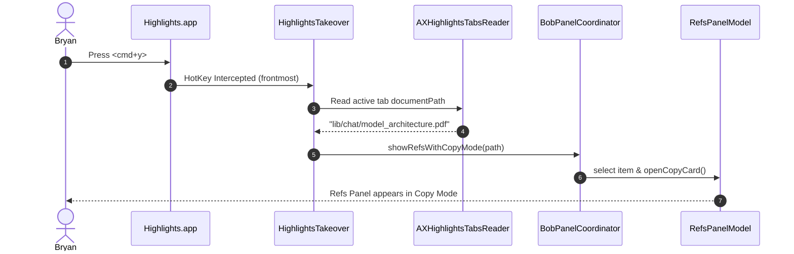
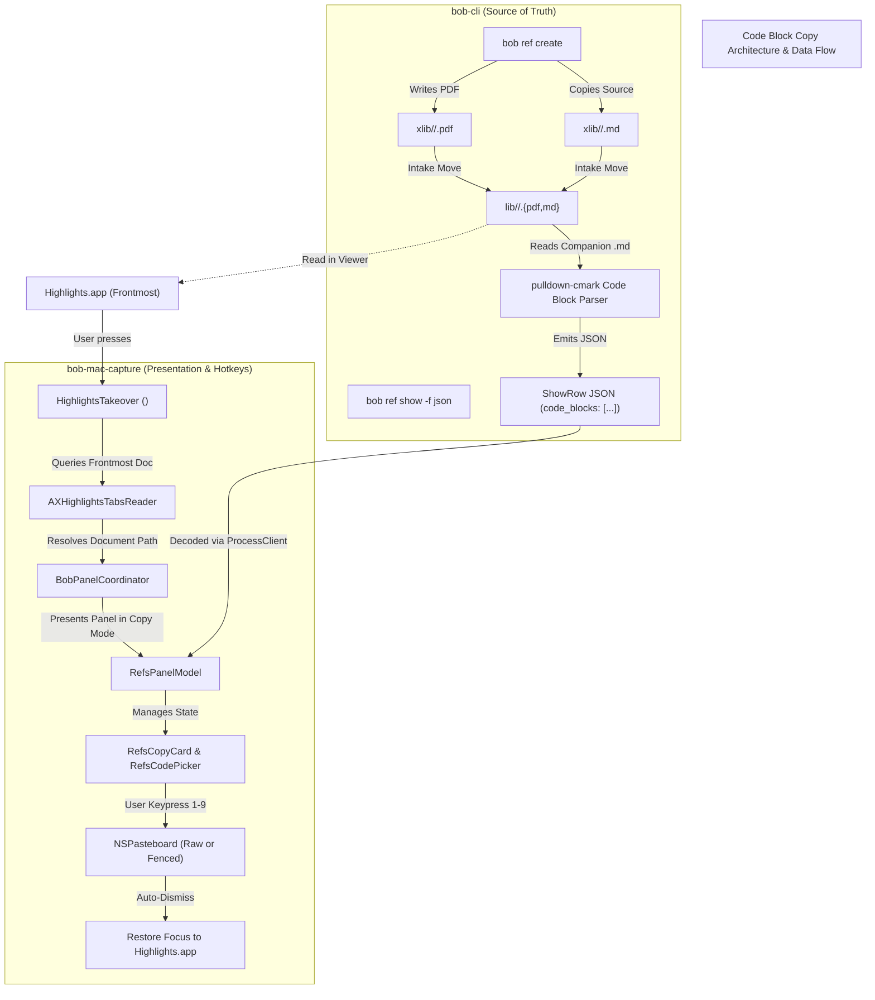
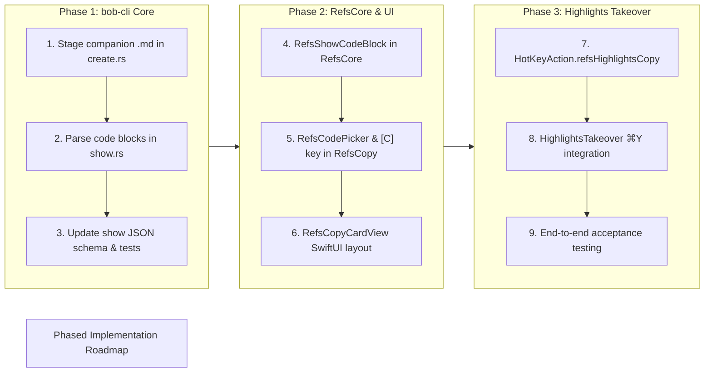

# Code Block Targeting in Ref Copy Mode & Highlights `<cmd+y>` Integration

**Author:** Researcher Gem  
**Date:** 2026-10-26  
**Status:** Completed Research & Design Proposal  
**Artifact Ref:** `research:202610/ref_copy_mode_code_blocks__gem.md`  

---

## 1. Executive Summary

This report investigates adding code block copy targeting to the reference copy mode (`<cmd+y>`) in **Bob Mac Capture**, and pairing it with a frontmost `<cmd+y>` keymap in **Highlights.app** that summons copy mode directly for the current PDF document.

### Key Conclusions & Assessment
1. **Strongly Recommended Feature:** Technical reading frequently demands extracting snippets (shell commands, configuration blocks, Python/Rust algorithms). Copying code directly from PDF viewers is notoriously broken: line wraps insert extraneous newlines, syntax styling splits words into fragmented text spans, ligatures mangle symbols, and page breaks fracture functions. Adding dedicated code block copy targeting directly solves this friction.
2. **Never Extract Code from Rendered PDFs; Leverage Companion Markdown:** Reverse-engineering code blocks from PDF text streams is fragile and lossy (no language tags, lost indentation, broken page splits). Instead, Bob should preserve the source Markdown as a companion file (`lib/<type>/<stem>.md`). Crucially, **Bob's intake pipeline already supports `.md` companion moves and Git tracking in `intake_companion_moves`**; `bob ref create` simply needs to stage the input Markdown file alongside the PDF during generation.
3. **Preserve Thin-Client Separation of Concerns:** In accordance with architecture decision `decisions:mac-capture-is-a-thin-client`, `bob-cli` remains the single source of truth for parsing Markdown and resolving references. `bob ref show -f json` should return pre-parsed `code_blocks` with language tags, line numbers, and section breadcrumbs. Bob Mac Capture merely decodes and presents them.
4. **Highlights `<cmd+y>` Integration is Native and Clean:** Highlights is a closed third-party application (`net.highlightsapp.universal`), but Bob Mac Capture already implements app-scoped Carbon hotkey takeover (`HighlightsTakeover.swift`) and Accessibility tab inspection (`AXHighlightsTabsReader.swift`). Adding a frontmost `⌘Y` takeover key provides an instantaneous shortcut from Highlights into Bob's Copy Card for the active document.
5. **Ergonomic, Beautiful UX Design:** Within the Copy Card, keycap **`C`** is completely unallocated. Pressing `C` flips the card into a dedicated `RefsCodePicker` displaying a window of up to 9 code blocks with syntax pill badges, section breadcrumbs, and monospaced previews. Direct keypresses `1`..`9` copy immediately: plain for **Raw Code** (ready for terminals/editors), and `Option` for **Fenced Markdown** with provenance attribution.

---

## 2. Critique of the Plan & Requirements Analysis

### 2.1 Is This a Good Idea?
**Yes, emphatically.** 

Reading technical PDFs in Highlights presents a stark contrast: reading and highlighting prose feels great, but extracting code blocks is painful. When selecting text across multiple lines in a PDF:
- Soft line wraps introduced during typesetting (e.g., via LaTeX's `fvextra` package) are copied as literal line breaks.
- Indentation (tabs/leading spaces) is often lost or converted into variable-width whitespace.
- Special programming symbols and ASCII punctuation can be transformed into Unicode ligatures or math symbols.
- Long code blocks that cross page boundaries interleave running headers, footers, and page numbers directly into the middle of the code.

By providing a keyboard-driven code block copy mode that extracts directly from pristine Markdown source, Bob transforms PDFs from "static printouts" into actionable technical references.

### 2.2 Critique: Can We Read Code Blocks Directly from the PDF?
**No. Attempting PDF text extraction for code blocks is an anti-pattern.**

When `bob ref create` runs pandoc with XeLaTeX:
- Pandoc translates Markdown code fences into LaTeX `Verbatim` / `Highlighting` environments.
- In the compiled PDF binary, code fences (````` ``` `````) and language tags (e.g. `python`, `rust`) are completely stripped.
- The PDF text layer consists only of positioned character glyphs. A PDF text parser has no semantic concept of a "code block".
- Heuristic detection based on monospace fonts or bounding boxes fails when:
  1. Documents use variable-width fonts or unlisted font families.
  2. Inline `code` spans appear inside normal paragraphs.
  3. Code spans across multiple pages.
  4. Language identifiers cannot be determined.

### 2.3 Critique: Storing the Source Markdown File
**The user's intuition to store the source Markdown file is not only sound—it aligns directly with existing Bob architecture.**

A thorough review of `bob-cli`'s codebase revealed an important fact:
In `src/native/highlights_ref/doctor.rs:1094-1104`:
```rust
pub(super) fn intake_companion_moves(
    source: &Path,
    destination: &Path,
) -> Result<Vec<(PathBuf, PathBuf)>> {
    let mut companions = Vec::new();

    let markdown = source.with_extension("md");
    if markdown.is_file() {
        companions.push((markdown, destination.with_extension("md")));
    }
    // ...
```
Bob's intake subsystem (`finish_intake`, `scan -i`, `plan_xlib_intake`) **already detects and moves same-stem `.md` files from `xlib/` to `lib/`**, validates destination conflicts, and stages them for atomic Git commit alongside the PDF!

The only missing piece is in `src/native/highlights_ref/create.rs`: when `bob ref create <file.md>` renders `render.pdf` into `xlib/`, it currently leaves the source `.md` file at its original path rather than staging a copy at `xlib/<type>/<stem>.md`. By having `create.rs` copy the source file into `xlib/<type>/<stem>.md`, the existing pipeline automatically carries it through to `lib/<type>/<stem>.md` and commits it to the vault.

### 2.4 Critique: Scope of Supported References
The user prompt anticipated:
> *"We will probably only be able to make this work for ref notes that were created by converting markdown files to PDFs (via the `bob ref create` command)."*

We should refine and expand this scope:
1. **External Markdown Files (`bob ref create report.md`):** Full support via companion file `lib/chat/report.md`.
2. **Vault Note Snapshots (`bob ref create harbor_cranes`):** **Must be included!** Vault notes are Markdown documents. When `bob ref create` snapshots a vault note, it generates a projected Markdown file (`projected.md`) in its scratch directory. Copying this `projected.md` to `lib/notes/<stem>.md` guarantees that vault note snapshots also have 100% code block copy support, perfectly synchronized with what was typeset into the PDF.
3. **Scanned / Downloaded PDFs (arXiv, books, manual uploads):** These do not have source Markdown. If a user presses `C` on an arXiv paper, the Copy Card should display a clean, graceful message: `No code blocks on this reference` (matching the existing behavior of `H` and `1..9`).
4. **Future Expansion (Web Article Clips):** Web article clips (`bob ref create <URL>`) currently use a Python headless browser adapter rendering directly to PDF. In a future Phase 2, the reader-mode Markdown extracted prior to PDF rendering can also be written to `lib/blogs/<stem>.md`, effortlessly extending code block copying to web articles.

---

## 3. User Experience & Visual Design

The feature must be **intuitive**, **reliable**, and **beautiful**, adhering strictly to Bob Mac Capture's design language (`RefsVisualTokens.swift`).

### 3.1 The `<cmd+y>` Keymap in Highlights.app
When reading a PDF in Highlights:
1. Bryan spots a snippet of code on page 4 of `lib/chat/model_architecture.pdf`.
2. Bryan presses **`<cmd+y>`**.
3. `HighlightsTakeover.swift` intercepts the Carbon hotkey.
4. `AXHighlightsTabsReader` queries the active window's `kAXDocumentAttribute` and determines that `lib/chat/model_architecture.pdf` is active.
5. Bob Mac Capture matches this path to `ref/chat/model_architecture.md`.
6. The Bob Refs panel appears with **Copy Mode** already active.
7. Bryan is presented immediately with the Copy Card for that exact document.



### 3.2 Main Copy Card: The `[C]` Keycap
Within the Copy Card, the following keys are currently mapped:
- Identity: `I` (Marker ID), `T` (Title), `W` (Wiki Link)
- Sources: `U` (Source URL), `L` (Markdown Link), `X` (arXiv), `D` (DOI)
- Files: `N` (Note Path), `O` (Obsidian Link), `P` (PDF Path), `F` (PDF File), `R` (Reading Task), `S` (Research Ref)
- Notes: `1`..`9` (Commented Notes), `A` (All Notes), `H` (Pick a Highlight)

**Keycap `C` is completely unassigned.** It is the most natural mnemonic for **C**ode blocks.

In `catalogRows`, right above or alongside the Notes group:
```text
┌────────────────────────────────────────────────────────────────┐
│  [C]  Pick a code block…                 4 blocks · python, sh │
└────────────────────────────────────────────────────────────────┘
```
- If the reference has **0 code blocks** or no companion Markdown:
  - If `C` is pressed, the inline message bar displays: `No code blocks on this reference`.
- If the reference has **1 code block**:
  - The row displays: `[C] Code block · python` with a preview of line 1. Pressing `C` or `Enter` copies it directly, or opens the preview card.
- If the reference has **2 or more code blocks**:
  - Pressing `C` (or clicking the row) transitions the card into the **Code Block Picker**.

### 3.3 The Code Block Picker (`RefsCodePicker`)
Just as `H` transitions `RefsCopyCard` into `RefsHighlightPicker`, pressing `C` smoothly flips the card into `RefsCodePicker`.

#### Visual Layout Specification
```text
┌────────────────────────────────────────────────────────────────┐
│ [Tile]  CODE BLOCKS (4)                                        │
│         Attention Is All You Need                              │
├────────────────────────────────────────────────────────────────┤
│ § 3.2 Multi-Head Attention                                     │
│ [1]  PYTHON   L1–14                                            │
│      class MultiHeadAttention(nn.Module):                      │
│          def __init__(self, d_model, num_heads): ...           │
│                                                                │
│ [2]  PYTHON   L1–8                                             │
│      def scaled_dot_product_attention(q, k, v, mask=None):     │
│          scores = torch.matmul(q, k.transpose(-2, -1)) ...     │
│                                                                │
│ § 5.1 Training Setup                                           │
│ [3]  BASH     L1–3                                             │
│      pip install torch torchvision torchaudio                  │
│      python train.py --config configs/transformer_base.yaml    │
│                                                                │
│ [4]  YAML     L1–12                                            │
│      d_model: 512                                              │
│      n_heads: 8                                                │
├────────────────────────────────────────────────────────────────┤
│ 1–4 copies raw code · ⌥ copies fenced markdown · esc back      │
└────────────────────────────────────────────────────────────────┘
```

#### Visual Tokens & Styling Details
1. **Window Size:** Up to 9 visible rows (matching `pickerWindowSize = 9`), scrollable via `↑`/`↓`, `J`/`K`, or `Ctrl+N`/`Ctrl+P`.
2. **Language Badge:** A pill badge rendered in monospaced semibold font (e.g., `PYTHON`, `BASH`, `RUST`, `JSON`, `SWIFT`) with adaptive background tinting derived from language tokens.
3. **Section Breadcrumbs:** When a code block resides under a Markdown heading (e.g., `### Multi-Head Attention`), display `§ 3.2 Multi-Head Attention` in secondary semibold text.
4. **Code Typography:** 2 lines rendered in `RefsVisualTokens` monospace font (`DejaVu Sans Mono` / `SF Mono`), ensuring indentation and code punctuation are crisp and legible.
5. **Right Meta:** Line count badge (e.g. `L1–14`).

### 3.4 Primary vs. Alternate Copying (Dual Payloads)
Bob Mac Capture uses the `Option` modifier to provide alternate copy formats (e.g., raw URL vs. Markdown link; unquoted note vs. quote block).

For code blocks, this provides an extraordinarily useful distinction:

| Trigger | Mode | Output Format | Use Case |
| :--- | :--- | :--- | :--- |
| **`1`..`9` / `Enter`** | **Raw Code** | Clean, unescaped code string without fences or backticks. | Pasting straight into terminal, python repl, or code editor. |
| **`⌥1`..`⌥9` / `⌥Enter`** | **Fenced Markdown** | ````python<br># From: Attention Is All You Need (§ 3.2)<br>class MultiHeadAttention(nn.Module):<br>    ...<br>```` | Pasting into Obsidian daily note, PR review, or Slack. |

### 3.5 Toast & Automatic Dismissal
- When a code block is copied, a glass HUD toast appears:
  - Raw: `Copied Python Code (14 lines)`
  - Alternate: `Copied Fenced Python Code (14 lines)`
- If the Refs panel was opened via Highlights `<cmd+y>` (or over an active Capture draft), `BobPanelCoordinator.dismissRefsAfterCopy()` **automatically hides the Refs panel**, returning keyboard focus seamlessly to Highlights.app.
- The user workflow is literally: **`⌘Y`** (in Highlights) $\rightarrow$ **`C`** $\rightarrow$ **`1`**. The code is in the clipboard, the panel disappears, and Bryan is back reading.

---

## 4. Architectural Design & Separation of Concerns

Mermaid figure illustrating the end-to-end architecture across repositories:



### 4.1 `bob-cli` Changes
1. **`src/native/highlights_ref/create.rs`:**
   - In `create_markdown_route`:
     ```rust
     let companion_md = plan.target.with_extension("md");
     std::fs::copy(&plan.source, &companion_md)?;
     ```
   - In `create_vault_note_route`:
     ```rust
     let companion_md = plan.target.with_extension("md");
     std::fs::write(&companion_md, &snapshot.source_markdown)?;
     ```
   - Because `intake_companion_moves` already scans for same-stem `.md` files, this staged companion is automatically moved into `lib/` and committed to git during intake.
2. **`src/native/ref_library/show.rs`:**
   - Define `ShowCodeBlock`:
     ```rust
     #[derive(Debug, Clone, Serialize, Deserialize)]
     pub(crate) struct ShowCodeBlock {
         pub index: usize,
         pub language: Option<String>,
         pub code: String,
         pub line_count: usize,
         pub section: Option<String>,
     }
     ```
   - In `resolve_show`:
     If `lib/<type>/<stem>.md` exists, parse it using `pulldown-cmark`:
     - Scan for `Event::Start(Tag::Heading(..))` to track current section breadcrumb.
     - Scan for `Event::Start(Tag::CodeBlock(CodeBlockKind::Fenced(lang)))`.
     - Collect text until `Event::End(Tag::CodeBlock)`.
     - Append to `ShowRow.code_blocks`.
   - Update `ShowRow` to serialize `code_blocks` under `schema_version`.

### 4.2 Bob Mac Capture Changes
1. **`Sources/RefsCore/RefsInspector.swift`:**
   - Add `RefsShowCodeBlock: Decodable, Equatable, Sendable`.
   - Add `public let codeBlocks: [RefsShowCodeBlock]` to `RefsShowRow`.
2. **`Sources/RefsCore/RefsCopy.swift`:**
   - Extend `RefsCopyKey`:
     ```swift
     public enum RefsCopyKey: Equatable, Hashable, Sendable {
         // ...
         case codePicker // Glyph: "C"
         case codeBlock(Int)
     }
     ```
   - Add `RefsCodePicker` struct (modeled after `RefsHighlightPicker`):
     - Window of up to 9 rows.
     - Selection tracking (`selectedIndex`).
     - Window positioning (`windowStart`, `windowSize`).
     - `rawPayload` vs `fencedPayload`.
   - Update `RefsCopyCard`:
     - Holds `public private(set) var codePicker: RefsCodePicker?`.
     - When `key == .codePicker`, initializes `RefsCodePicker` and sets active picker layer.
     - Handles `RefsCopyCommand` for code blocks.
3. **`Sources/BobMacCapture/Refs/RefsCopyCardView.swift`:**
   - Render `[C]` row in `catalogRows`.
   - Render `codePickerRows` when `card.codePicker != nil`.
   - Implement language pill badges and 2-line monospaced previews.
4. **`Sources/BobMacCapture/HighlightsTakeover.swift`:**
   - Add `refsHighlightsCopyKey: () -> RefsHighlightsCopyKey`.
   - Add `sync(action: .refsHighlightsCopy, configuration: copyConfiguration)`.
5. **`Sources/BobMacCapture/HotKeyRegistry.swift`:**
   - Add `case refsHighlightsCopy = 5` to `HotKeyAction`.
6. **`Sources/BobMacCapture/BobPanelCoordinator.swift`:**
   - Add `showRefsWithCopyMode(source: .highlightsCopy, documentPath: String?)`.
   - Looks up the active item in `RefsLibrary` and immediately triggers `openCopyCard()`.

---

## 5. Risk Assessment & Edge Cases

| Risk / Edge Case | Likelihood | Impact | Mitigation Strategy |
| :--- | :--- | :--- | :--- |
| **Document has dozens of code blocks** | Medium | Low | Use the same proven 9-row clamped windowing layout as `RefsHighlightPicker`. `↑`/`↓` and `J`/`K` scroll through windows cleanly. |
| **Code block has no language tag** | High | Low | If `language` is empty or nil, display a neutral `CODE` badge and use plain fences in alternate copy mode. |
| **Very long code block (>100 lines)** | High | Low | The picker row limits preview to 2 lines with a trailing ellipsis. The entire buffer is copied to the clipboard. |
| **Single 1-line shell command** | High | Low | The picker cleanly formats single-line snippets. Raw copy omits trailing newline if desired, or copies exactly. |
| **Highlights is frontmost with no open tabs** | Medium | Low | If `AXHighlightsTabsReader` finds no open tabs, `<cmd+y>` falls back to opening the standard Refs panel without activating copy mode. |
| **Older `bob` CLI installed** | Low | Low | `RefsShowRow` decodes `codeBlocks` with `decodeIfPresent`. If missing or older `bob` is used, `card.catalog` simply hides `[C]`. |
| **Unsaved annotations in Highlights** | Medium | None | Reading the document path and copying code blocks are strictly read-only operations. File coordination (`NSFileCoordinator`) is not invoked and existing annotations are untouched. |

---

## 6. Implementation Roadmap



1. **Phase 1: `bob-cli` Companion Storage & Parser**
   - Update `create.rs` to write companion `.md` files for Markdown and vault-note targets.
   - Implement `pulldown-cmark` code block extraction in `show.rs`.
   - Add CLI unit tests in `tests/cli/highlights/create.rs` and `tests/cli/ref_library/show.rs`.
2. **Phase 2: Bob Mac Capture Copy Card & Code Picker**
   - Update `RefsCore` data models and `RefsCopy.swift` state machine.
   - Implement `RefsCodePickerView` with language pill badges and dual copy payloads.
   - Add SwiftUI previews and unit tests in `Tests/RefsCoreTests/RefsCopyTests.swift`.
3. **Phase 3: Highlights Frontmost `<cmd+y>` Takeover**
   - Register `HotKeyAction.refsHighlightsCopy` in `HotKeyRegistry.swift`.
   - Wire `HighlightsTakeover.swift` to invoke `showRefsWithCopyMode()`.
   - Verify focus restoration and dismissal ergonomics on macOS.
