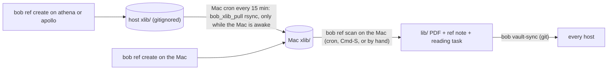
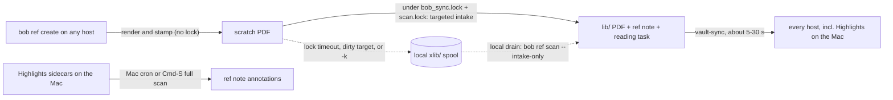

# Making `bob ref create` land in the library without a manual `bob ref scan`

## TL;DR

- **Why you have to scan by hand.** Only the MacBook ever turns intake PDFs into library entries. The Mac is a laptop that sleeps with its lid shut, and it checks for new intake only every 15 minutes. Every one of the 299 `lib/` PDFs added to the vault since 2026-09-20 was committed by the Mac.
- **Measured delay.** For 286 bob-rendered PDFs, the time from rendering to arriving in the library was:
  - median 4.6 min, p75 10.6 min, p90 29.9 min;
  - 18 PDFs (6%) waited more than an hour, up to 11.6 h, all overnight;
  - 108 PDFs (38%) arrived within 2 min, which looks like you pressing ⌘S or running `scan` by hand.
- **The plan is a good one, aimed slightly wrong.** Don't make `bob ref scan` run more often, or on more machines. Instead, split what `scan` does:
  1. **Intake**: move the PDF into `lib/`, write its ref note, file its reading task. This should happen on the machine that made the PDF, as the last step of `bob ref create`.
  2. **Annotation sync** (Highlights sidecars → notes) stays a Mac job, because Highlights runs only there.
- **Recommendation: ingest on the creating host ("ingest-at-birth").**
  - After rendering, `bob ref create` takes the vault lock, does a targeted intake of just its own PDF, and releases the lock. The background vault-sync then pushes the PDF, note and task as one commit.
  - Leftovers (lock timeout, a target note with unsaved edits, opt-outs) wait in the local `xlib/` spool. A local `bob ref scan --intake-only` timer drains them.
  - The cross-host `bob_xlib_pull` rsync bridge gets retired.
  - Expected result: a PDF made on athena/apollo is in the Mac's `lib/` about 5–30 s after `create` returns. Its note and reading task exist even while the Mac is asleep.
- **Don't run a full `bob ref scan` on every host or after every create.** I confirmed that this causes duplicate notes and Git conflicts (§4).

---

## 1. What happens today (verified on 2026-10-18)

1. **`bob ref create` stops at the intake directory.**
   - It renders and stamps the PDF into `~/bob/xlib/<ref-type>/<stem>.pdf`, then prints `next: bob ref scan` (`src/native/highlights_ref/stamp.rs`, `print_next_step`).
   - I reproduced this in a scratch vault: after `create`, the only new file was `xlib/chat/test_report.pdf`.
2. **`xlib/` is gitignored; `lib/` is tracked.**
   - The vault `.gitignore` re-allows `*.pdf`, then excludes `xlib/` and `lit_review/`.
   - `git check-ignore` confirms that `lib/**/*.pdf`, sidecars, and `*.mp3` are tracked.
   - So a PDF moves between machines only after a scan has moved it into `lib/`. `lib/` is currently 418 MB (469 PDFs); `.git` is 2.1 GB.
3. **Only the Mac drains intake.**
   - The config hook `highlights.pre_scan_hook: PATH="$HOME/bin:$PATH" bob_xlib_pull` runs before every writing scan.
   - `bob_xlib_pull` exits 0 immediately on anything but Darwin. On the Mac, it SSH-probes athena and apollo, rsyncs their `xlib/` with `--remove-source-files`, then scans.
   - The Mac's crontab (read live) runs `*/15 * * * * ~/bin/maybe_bob_highlights_sync -w`.
   - The Bob Refs panel's ⌘S runs the same scan on demand.
4. **The Mac is often unavailable.**
   - `pmset -g log` shows repeated `Clamshell Sleep` entries today.
   - The tailnet memory note says the Mac "is offline unless it is powered on with its lid open".
5. **Failures are invisible.** `/var/tmp/maybe_bob_highlights_sync.log` is 0 bytes and was last written on Sep 14. The cron line redirects only stdout, and the wrapper prints only on failure, to stderr.

### Measured delay

**Method.**
- For every PDF added under `lib/` since 2026-09-20, I took the PDF's own `/CreationDate` (set when bob renders it) and the commit that added it to `lib/`. Every one of those commits came from the Mac (`kellys-macbook-pro-local` 215, `kellys-mbp` 84).
- I excluded `lib/papers/`, because those PDFs keep their publisher's creation dates.

**Results (n = 286):**

| Statistic | Value |
| --- | --- |
| Median | 4.6 min |
| p75 | 10.6 min |
| p90 | 29.9 min |
| Max | 694 min (11.6 h) |

| Bucket | Count | Likely cause |
| --- | --- | --- |
| ≤ 2 min | 108 | Manual ⌘S or `scan` right after `create` |
| 2–16 min | 132 | Waiting for the 15-minute cron |
| 16–60 min | 28 | Mac asleep, or a cron tick skipped |
| > 60 min | 18 | Overnight, Mac lid closed |

**Caveat.** The commit time includes up to 15 s of Mac vault-sync lag. The rendering timestamp is when the PDF was rendered, which is slightly before `create` returns. Neither changes the picture.

**What "using the PDF" waits on.** The PDF has to be in the Mac's `lib/` before Highlights can open it. Separately, `⌘↩` on a reading task, the Refs panel, `bob ref list`, `bob ref today`, and agents all need the ref note and reading task, and those exist only after a scan.

## 2. Why `create` and `scan` are separate steps (history)

- **2026-08-13, `453dfdf` "feat(highlights)!: add xlib PDF intake workflow".**
  - The plan (`plan:202608/highlights_xlib_intake.md`) gives the reason: new PDFs should land in an `xlib/` folder "that Obsidian Sync tracks, so a PDF rendered on the Linux host reaches his synced devices".
  - `xlib` was described as "new, synced, transient". In other words, the split was about **transport**, not a principle that `create` must never write notes.
- **2026-08-27, git sync replaces Obsidian Sync.**
  - The cutover research (`research:202608/obsidian_vault_git_sync`) flagged that `xlib/` would get "swept into the repo permanently" and asked whether it belonged in git.
  - It was gitignored. The transport was replaced by a Mac-side rsync pull (`bob_xlib_pull`), so the "the Mac scans" assumption carried over.
- **September and October: patches on the Mac-hub model.**
  - `plan:202609/highlights_pre_scan_hook.md` (the hook plus auto-scan) and `plan:202609/bob_xlib_pull_apollo_source.md` (pull from apollo too).
  - `plan:202610/bob_refs_scan_keymap.md` (⌘S in the Refs panel). Its own motivation: "A report an agent finishes on athena can therefore wait up to 15 minutes before Bob Refs can show it."

So the manual step is left over from an earlier transport. Nothing about Highlights requires the *intake* to happen on the Mac:
- A freshly created PDF has no sidecar yet.
- Its first scan needs no PDF write-back: `pdf_marker_action: none` in my scratch run, because `create` already stamps the marker.

## 3. Critique of the plan as stated

> "Make `bob ref scan` more convenient/automatic so I rarely run it manually."

**What's right about it**
- The two-step workflow exposes an implementation detail. You think "create = add to my library"; the system thinks "create = put in a staging spool". Every producer pays for that gap:
  - `bob ref create`;
  - the `bob capture` URL worker ("Capture and its worker do not run that scan", `docs/ref-jobs.md`);
  - `bob gkeep pull` URL clips.
- Automating it is clearly worth doing.

**What I'd change**
1. **Don't automate "scan"; make "create" complete.**
   - `scan` does two jobs with different natural owners:
     - **intake**, owned by the producer of the PDF;
     - **annotation sync**, owned by the Mac, where Highlights writes sidecars.
   - Automating the whole `scan` drags the Mac-only part along with it.
2. **"From any of the three machines" should not mean "any machine may scan".**
   - Several hosts running full scans cause conflicts (§4).
   - The right rule: *each PDF is ingested exactly once, by the host that made it; only the Mac syncs annotations.*
3. **Avoid filesystem watchers** (systemd `.path`, launchd `WatchPaths`/`QueueDirectories`). They watch the symptom (a file appeared) rather than the event (create finished), and both are fragile here (§5, option C).
4. **The Mac should not be a hub.** It sleeps, it's shared ("Kelly's MacBook Pro"), and every PDF from athena or apollo currently waits on it. athena is always on but has had outages this week (see `athena_outage_recovery_and_remote_power`), so making athena the hub only moves the single point of failure.

## 4. Constraints any solution must keep (with evidence)

I built a scratch vault (git repo plus one area note), ran the installed `bob ref create`, then ran `scan` under various conditions.

| # | Constraint | Evidence |
| --- | --- | --- |
| C1 | **A given PDF is created as a library entry by exactly one host.** | When a clone had the `lib/` PDF but not its note (a "half-committed" state), a scan there planned `note_action: create` and `reading_task: insert home.md ^ref-test-report`, i.e. a duplicate note and task. A new note's `created:` field is the scan host's clock time, so two hosts produce different files and hit an add/add Git conflict. |
| C2 | **Intake must be atomic with respect to `vault-sync`.** If a background sync commits after the PDF move but before the note write, another host can see the C1 half-state. | Scan moves the intake PDF first, then plans and writes notes (`sync.rs::scan_library`). Scan uses only its own `scan.lock`, never `bob_sync.lock`. athena's watcher (`bob_vault_sync_watch`) syncs about 5 s after any inotify event. |
| C3 | **Annotation sync must stay single-writer (the Mac).** | `highlights_synced_at` is set to `current_timestamp()` whenever highlights re-render (`note.rs`). Two hosts re-rendering the same sidecar write different notes, Git conflicts, and conflict copies pile up in `_conflicts/`. |
| C4 | **No PDF byte writes off the Mac.** | The first scan of a create-stamped PDF reports `pdf_marker_action: none` and `pdf_markers_would_update: 0`, so intake is note-only. Marker write-back (`-w`) stays on the Mac cron. |
| C5 | **Re-scanning an ingested PDF must be a no-op on any host.** | After committing, a second scan, and a scan of a fresh clone, both reported `1 unchanged … writes: none`. So the Mac's 15-minute full scan won't fight a reference ingested on athena. |
| C6 | **Never lose a PDF, never overwrite an annotated library copy.** | These are existing guarantees (the intake collision preflight and `create`'s library-destination guard). Any automation must fall back to the spool, never discard or overwrite. |
| C7 | **Cheap enough to run inline.** | A full read-only scan of the real vault (469 PDFs) took **7.24 s**. A single-PDF `bob ref sync --dry-run` took **0.08 s**, and a one-PDF scratch writing scan 0.01 s. Targeted intake adds well under a second to a `create` that already spends seconds rendering. |

## 5. Options considered

| Option | What it is | Latency (athena-made PDF → Mac `lib/`) | Works with the Mac asleep? | Breaks a constraint? | Verdict |
| --- | --- | --- | --- | --- | --- |
| **A. Tighter Mac cron** | Run the cron every 1–5 min instead of 15 | ~1–5 min while awake | No (overnight tail stays) | No | Interim at best. Each tick is a 7 s full scan plus two SSH probes on a laptop battery. |
| **B. Push-kick** | After `create`, `ssh mac bob_xlib_pull` (best-effort, detached) | Seconds while awake | No | No | A reasonable zero-code stopgap for interactive use, but agents call `bob ref create` directly and still depend on the Mac. |
| **C. Filesystem watchers** | systemd `.path` on Linux, launchd `QueueDirectories`/`WatchPaths` on the Mac, triggering a scan | Seconds | Linux yes, Mac no | C2 unless the scan takes `bob_sync.lock` | **Reject.** Path units are not recursive (inotify), and `xlib/<type>/` subdirectories survive intake (confirmed: scan leaves an empty `xlib/chat/`). `DirectoryNotEmpty=` would therefore fire forever, and `QueueDirectories` "keeps the job alive as long as the directory … [is] not empty". Apple's man page says `WatchPaths` is "highly discouraged … entirely possible for modifications to be missed". |
| **D. Full scan everywhere** | Alias `create && scan`, or a scan timer on every host | Seconds to minutes | Yes | **C1, C2, C3** | **Reject.** Multi-writer annotation sync means `highlights_synced_at` conflicts. On the Mac, the hook adds SSH probes, and a dirty file anywhere in the library fails the scan. |
| **E. Track `xlib/` in git, athena as hub** | Remove the `xlib/` gitignore; athena alone ingests | ~30–60 s (two sync hops) | Yes, while athena is up | C1 unless every other host's intake is disabled | **Reject.** Moves the single point of failure to athena, needs a scanner daemon plus a "who may ingest" config, and adds two hops of latency. |
| **F. Ingest at birth** *(recommended)* | `create` ingests its own PDF under the vault lock; leftovers drain locally | **≈5–30 s**; **0 s** on the Mac | **Yes**: note and task exist immediately; the Mac downloads the PDF on wake | None, if implemented as below | **Adopt.** |
| G. `create` writes straight to `lib/` | The pre-August behavior | Seconds for the PDF | Note still waits for the Mac | C1 (lib PDF without a note) | **Reject.** It publishes exactly the half-state from C1. |

## 6. Recommended solution: ingest at birth

### Phase 1: `bob ref create` ingests its own PDF (bob-cli)

Add one shared entry point, e.g. `inline_ingest::ingest_created_pdf(config, target, opts) -> IngestOutcome`, under `src/native/highlights_ref/`. Call it from:
- `create`, for the `TargetWorkflow::Intake` and `TargetWorkflow::Library` workflows (not `External`, which still prints `next: bob ref sync …`);
- the ref-jobs worker after a successful `ingest_url` clip;
- `bob gkeep pull` URL clips;
- the `--listen` attach path, which currently leaves `xlib/<rel>.mp3` "for `bob ref scan` to pair".

**Steps**

1. **Render outside any lock.** This is unchanged, and matches `gkeep pull`'s rule: "Slow clipping stays outside the lock."
2. **Take the locks in rename's order.**
   - First `bob_sync.lock`, via `ob::acquire_lock_waiting` with a 60 s wait. This is the lock the background `bob vault-sync -q` skips on, so no commit can land mid-write (C2).
   - Then the scan writer lock (`acquire_scan_writer_lock`), which serializes with the Mac's cron and ⌘S scans on the same host.
3. **Install and plan under the lock.**
   - Install the stamped PDF and companion audio into `xlib/`.
   - Plan intake for that one source by reusing `plan_xlib_intake` filtered to the source, which keeps the existing collision preflight for the PDF, sidecars and audio.
   - Plan the note with `plan_pdf_sync` against the library destination, using `ScanContext::build`.
   - Unlike batch `scan`, **plan and check before moving**, so a refusal leaves the PDF in the spool untouched.
4. **Check for unsaved edits.**
   - Run `ensure_safe_to_write` on that single plan.
   - If a target (normally the parent note) has uncommitted edits, run one `vault_sync::run_cycle_with_existing_lock_report` and replan once. This is the same "sync sandwich" `bob ref rename` uses.
   - If it is still refused, or the host is offline, fall back.
5. **Write.** Move into `lib/` and call `execute_pdf_sync`: ref note plus reading task, never PDF marker writes (C4).
6. **Release both locks.** The background vault-sync commits PDF, note and task together.
7. **Report.**
   - Success: `ingested: ref/chat/<stem>.md · reading task → <parent>.md`.
   - Fallback: `queued: xlib/chat/<stem>.pdf (<reason>) · next: bob ref scan`.
   - The exit code stays 0 on fallback, because the PDF exists and is safe (C6).
   - `--dry-run` prints the planned ingest and keeps ending with `writes: none`.

**CLI and config surface** (per `cli_rules.md`: alphabetical options, a short alias for every long option)

- `bob ref create -k, --keep-intake`: skip the ingest and leave the PDF in `xlib/` (today's behavior). `-k` is currently unused.
- `highlights.ingest_on_create: true` in `~/.config/bob/config.yml`, with an env override `BOB_HIGHLIGHTS_INGEST_ON_CREATE=0`. This lets you roll back on one host without reinstalling, and is what the worker and `gkeep pull` read.

**Tests (scratch-vault integration, like `tests/cli.rs`)**

- `create` leaves the PDF in `lib/`, the note written, the task filed, and `xlib/` empty. A second `scan` reports `writes: none`.
- Fallback cases leave the PDF in `xlib/` and print `queued:`:
  - a dirty parent note;
  - `bob_sync.lock` held (use `BOB_VAULT_SYNC_LOCK_FILE` and a short wait);
  - a library-destination collision.
- `-k` and the config/env switches restore today's output.
- `--dry-run` writes nothing.

### Phase 2: drain leftovers locally and retire the cross-host bridge (bob-cli plus chezmoi)

- **New scan mode.** Add `bob ref scan -i, --intake-only` (`-i` is unused on `scan`). It runs intake for the local `xlib/` and then plans and writes **only the PDFs it just moved** (plus late-pair audio). It skips the full-library annotation pass and refuses `-w`. This makes intake safe on any host without breaking C3.
- **athena and apollo.** A chezmoi-managed user systemd **timer** (every 10 min) runs `bob ref scan -i -n`. A timer, not a `.path` unit, for the reasons in option C.
- **Mac.** Keep the 15-minute `maybe_bob_highlights_sync -w` full scan: it drains the Mac's own `xlib/` and syncs annotations.
- **Retire the bridge.** Once all three hosts run the new bob, set `highlights.pre_scan_hook: ""`, which retires `bob_xlib_pull`.
  - Rule: **each host's `xlib/` has exactly one drainer**. A local timer and the Mac's rsync must never drain the same `xlib/`. If both acted on one file (rsync copying while the local intake renames it), each host would create its own note for it (C1).
  - If you keep the bridge during the transition, make its remote probe and transfer skip files younger than ~2 minutes (`find … -mmin +2` feeding `rsync --files-from`). An in-flight `create` then can't lose its file to the Mac.
- **Observability.** `bob ref doctor` should warn when the oldest `xlib/` PDF is older than 1 h, the same threshold it already uses for ref-job pending age. Also fix the Mac cron redirect (see §8).

### Phase 3 (optional polish)

- **Notification for references made elsewhere.** A Mac notification when vault-sync pulls in a new `ref/**` note born on another host ("New reference: <title>"), so you know it's openable without looking.
  - The Refs panel already watches the vault with FSEvents (`plan:202610/bob_refs_scan_keymap.md`), so rows will appear anyway. They just won't sit in the "JUST SCANNED" section, which is driven by the scan JSON.
  - Under `decisions:mac-capture-is-a-thin-client`, bob should produce the "new since" signal and the app should only render it.
- **Docs.** Update the typical order in `docs/highlights-ref-sync.md`, the "Choose a command" table in `docs/ref.md`, the Highlights bridge section in `docs/vault-git-sync.md`, and the scan sentences in `docs/ref-jobs.md`.
- **Decision record.** Record the new invariant: *references are ingested by the host that creates them; annotation sync stays on the Mac*. Add it to the `decisions` web through `/sase_memory_write` once you accept it.

### Requirement changes I'm proposing

1. **Reframed goal.** Not "scan runs automatically", but: *a successful `bob ref create` means the reference is in the library on the host that ran it*.
2. **New hard requirement: exactly one host creates each library entry, with no Git conflicts.** This comes from C1–C3; the obvious automations violate it.
3. **New requirement: graceful degradation.** When inline ingest can't run, `create` still succeeds, says `queued:` loudly, and a local drain picks the PDF up later. It never fails the render and never needs the Mac.
4. **Expanded scope: all producers.** `bob capture` URL jobs, `gkeep pull`, and `--listen` attach get the same ingest, not just `create`.
5. **Narrowed scope: annotation sync is unchanged.** It stays on the Mac (15-minute cron plus ⌘S). Automating it further is a separate question.
6. **Changed contract: `create` now writes tracked vault files** (ref note plus reading task). Agents running `create` on athena or apollo will produce vault commits from those hosts. That's already normal for `capture` and `task reconcile`, but it is a contract change: `-k` and the config switch exist for it.

### Expected outcome

| Where the PDF was made | Today (measured) | With Phase 1 |
| --- | --- | --- |
| On the Mac | Up to 15 min (cron), or ⌘S | Openable in Highlights when `create` returns |
| On athena or apollo, Mac awake | Median 4.6 min, p90 about 30 min | About 5–30 s: athena's watcher waits about 5 s, then pushes; the Mac pulls within 15 s |
| On athena or apollo, Mac asleep | Overnight, up to 11.6 h; note and task don't exist yet | Note and task exist immediately everywhere; the PDF is in the Mac's `lib/` within about 15 s of waking |

**Residual risks**
- **Lock contention.** `bob nightly` holds `bob_sync.lock` for minutes at 03:30. A `create` then falls back to the spool and gets drained later. That's acceptable and visible.
- **Same-stem race.** Two hosts could pick the same new stem within one sync window. That's rare, and it ends in the existing conflict policy: remote wins, the local copy goes to `_conflicts/`. The Mac-hub design avoids this only because a single host does all intake.
- **Agent load.** Agents now write vault commits; see requirement change 6.

**Effort.** Phase 1 is a medium change, mostly plumbing that reuses existing planners and guards, plus tests. Phase 2 is small: one flag, one timer unit, one config line.

**Stopgap until Phase 1 ships.** For your own interactive creates on athena or apollo, `bob ref create … && ssh mac '~/bin/bob_xlib_pull'` (option B) gets you seconds of latency while the Mac is awake. It reuses the existing locks and changes no code. Agents keep the 15-minute cron path.

## 7. Questions for you

1. Is there a workflow where you *want* a PDF to sit unpublished before it becomes a library entry and reading task (for example, previewing an agent report before filing it)? If so, `-k` covers it; if it's common, flip the default.
2. Do you read in Highlights on iPad or iPhone as well? If so, "visible on the Mac" isn't the only target, and this recommendation would need checking against how those devices get PDFs.
3. Retire `bob_xlib_pull` entirely (my recommendation), or keep it as the leftover drainer instead of local timers? It's simpler to keep, but leftovers then wait for the Mac.

## 8. Side findings (outside the main question)

- **Bug: relative paths in `bob ref sync`.**
  - From the vault root, `bob ref sync lib/chat/qmd_agent_vault_search.pdf --dry-run` resolves the note as `ref/qmd_agent_vault_search.md` (the legacy out-of-library target). It plans `note_action: create` and a **duplicate reading task** (`insert bob.md ^ref-qmd-agent-vault-search-2`).
  - The same PDF given as an absolute path correctly resolves `ref/chat/qmd_agent_vault_search.md` with `note_action: none`.
  - Without `--dry-run` this would write a duplicate note and task. The relative path is apparently compared against `lib_dir` without being made absolute against the current directory first.
- **The Mac crontab doesn't match the docs.**
  - `docs/vault-git-sync.md` documents three jobs staggered 0/5/10 minutes apart, the highlights job with `>> log 2>&1`, and `task reconcile --retry-timeout 120`.
  - The live crontab runs all three at `*/15`, i.e. at the same minute, with no stagger, stdout-only redirects, and no `--retry-timeout`.
  - Effect: the highlights log has been empty since Sep 14, and scan failures go to cron mail, if anywhere.
- **`create`'s next-step hint.** `create` and `--listen` attach both print `next: bob ref scan`. After Phase 1, that line should appear only on fallback.

## Sources

**Live checks (2026-10-18)**
- The `~/bob/.gitignore` file and `git check-ignore` results.
- Vault git history: `lib/` additions by host, and PDF `/CreationDate` versus commit time.
- `crontab -l` and `pmset -g log` on the Mac.
- athena's `bob-vault-sync.service` and `~/bin/bob_vault_sync_watch`.
- `~/bin/bob_xlib_pull` and `~/bin/maybe_bob_highlights_sync`.
- Scratch-vault `bob ref create` / `bob ref scan` experiments.
- Timings: real-vault `bob ref scan --dry-run` and `bob ref sync --dry-run`.

**bob-cli code and docs**
- Code: `src/native/highlights_ref/{sync.rs, doctor.rs, stamp.rs, note.rs, reading_plan.rs, scan_json.rs}`, `src/native/{ob.rs, vault_sync.rs, gkeep/pull.rs}`.
- Docs: `docs/highlights-ref-sync.md`, `docs/ref.md`, `docs/ref-jobs.md`, `docs/vault-git-sync.md`.

**Plans and earlier research**
- Plans: `plan:202608/highlights_xlib_intake.md`, `plan:202609/highlights_pre_scan_hook.md`, `plan:202609/bob_xlib_pull_apollo_source.md`, `plan:202610/bob_refs_scan_keymap.md`.
- Research: `research:202608/obsidian_vault_git_sync/obsidian_vault_git_sync.md`.
- Commit `453dfdf`.

**Man pages and web references**
- `man systemd.path` (athena) and `man launchd.plist` (Mac), quoted above.
- [systemd.path(5) man page](https://man.cs50.io/5/systemd.path)
- [siduction manual: systemd path units are not recursive](https://manual.siduction.org/systemd-path_en.html)
- [launchd.plist(5), Apple open source](https://opensource.apple.com/source/launchd/launchd-106/launchd/src/launchd.plist.5.auto.html)
- [launchd-changes: QueueDirectories semantics](https://lists.macosforge.org/pipermail/launchd-changes/2007-March/000319.html)
- [Apple Developer Forums: WatchPaths reliability](https://developer.apple.com/forums/thread/786316)
