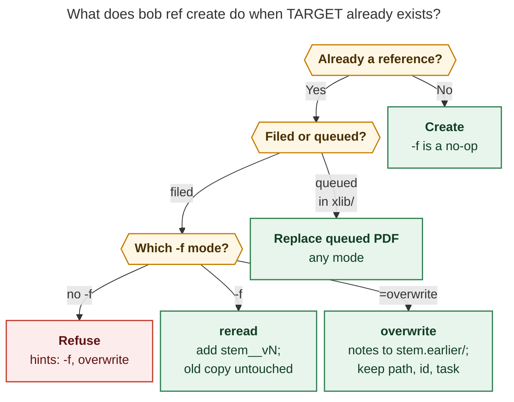

# `bob ref create -f|--force[=MODE]`: reread and overwrite a reference that already exists

Researcher: `cld` (one of five in the swarm). Date: 2026-10-25. Repo state: bob-cli `a8ef1718`.

## TL;DR

The feature is worth building. Today the only way to recapture a filed reference is the
hint `open the note, or delete it to recapture`. That deletion loses the annotations,
orphans the reading task, and leaves dangling `🔖` links. The live vault already shows the
cost: revised research reports have been filed as unlinked, hash-suffixed duplicates
instead of versions (§2.6).

The plan as written has six problems that change the design:

1. **`-f/--force` already exists** on `bob ref create`, as a boolean with three narrower
   meanings. The new option must absorb them, not sit beside them.
2. **An optional-value flag in front of a positional is a parsing trap.** Probed against
   the repo's clap 4.6.7: plain `num_args(0..=1)` makes `bob ref create -f URL` fail,
   because clap takes the URL as the mode. `require_equals(true)` fixes that, but then
   `-f overwrite URL` silently turns `overwrite` into a second TARGET (§4.1).
3. **"Delete the note, log its contents, create from scratch" breaks identity.** The
   reading task, `^ref-…` block ID, Task Links, Depends-On links, and every `🔖`
   follow-up link point at the old note. A stale Highlights sidecar beside the reused PDF
   path would also re-render the *old* highlights into the "fresh" note.
4. **"Reread" creates a second PDF-backed note with the same `source_url`.** Today that
   raises the `duplicate_identity` doctor warning, makes `bob ref find` ambiguous, and
   puts two identically titled reading tasks in the parent note. It needs a lineage
   concept.
5. **A log of old notes stored as Markdown under `ref/` would be indexed as a live
   reference** by every reference walker unless it is explicitly excluded.
6. **"First available integer"** can reuse a deleted version number, so version order
   stops matching chronology.

**Recommendation (§8):**

- Keep the `-f, --force[=MODE]` spelling, with `require_equals`, `reread` as the bare
  default, and a guard that catches `-f overwrite`.
- **reread** adds `<stem>__vN` beside the old copy and never writes to it.
- **overwrite** keeps the reference's path, id, and reading task. It re-captures the
  material, and when the old note has highlights or authored notes it freezes that note
  into `ref/<type>/<stem>.earlier/<stem>__<date>.md` and moves inbound highlight links
  there.
- Both modes write a note-local `earlier:` property on the new note.
- Without `-f`, every route refuses with one consistent message that names both
  remedies.
- Ship reread first; overwrite needs a transaction and is the larger phase.

---

## 1. Question and scope

Bryan wants `bob ref create -f|--force <mode>`, with mode `reread` (the default when no
value is given) or `overwrite`, so a reference can be created even when its source
already has one:

- **reread** creates a `__v<N>` copy (N = first free integer ≥ 2) and de-duplicates the
  filename, the id, and anything else that needs it.
- **overwrite** deletes the existing note, logs its contents somewhere, creates the note
  from scratch, and links the logged annotations plus any earlier logs.
- Without the option, a duplicate must fail with a useful error.

This report checks the plan against the code and the live vault, critiques it, and ends
with a concrete recommended design. Implementation is out of scope.

## 2. What exists today (evidence)

### 2.1 Duplicate detection is spread across four sites with four messages

| Site | When it fires | Message today |
| --- | --- | --- |
| `sources.rs:409` `check_dedupe` | URL routes, before any fetch | `already captured as <ref note> (source_url <key>)` + `hint: open the note, or delete it to recapture` |
| `stamp.rs:272` `plan_default_target` | Default-target walk (`<stem>`, `<stem>_2` … `_999`) | `already captured as <path> (<title>); pass -N/--name to capture under a different name` + listen hint |
| `pdf_target.rs:433` | Local PDF that already carries a marker | `already captured; bob ref sync <pdf> re-syncs it` + listen hint |
| `collection.rs:1163` | Multi-URL collections | `already captured as … (source_url …)` + listen hint + delete hint |

`report_create_error` (`create.rs:637`) only splits on the first `\nhint: `, so each site
gets one hint line. Same-reference detection works like this:

- **URL routes:** the `source_url` dedupe key (arXiv-aware).
- **Markdown and local PDF routes:** the create-time title, compared against the page-1
  marker or Info `Title` of the PDF *at the same candidate stem* (`stamp.rs:433`). The
  same document under a different filename is therefore not detected. §2.6 shows this
  happening.
- **Vault-note snapshots:** dated stems `<note>_<YYMMDD>`. Each day is naturally a new
  version, and a second snapshot on the same day refuses.

### 2.2 `--force` already exists, with narrower meanings

`create.rs:364-370` declares `-f, --force` (`ArgAction::SetTrue`, help *"Overwrite an
existing target PDF"*). It is threaded through every route and does three things:

1. **Same-reference queued intake:** overwrite a PDF still waiting in `xlib/`
   (`stamp.rs`, the `already queued in …; pass --force to overwrite it` branch).
2. **Exact `-o` path:** overwrite an existing target file (`refuse_target_collisions`,
   `stamp.rs:515`).
3. **Companion audio:** allow replacing audio with different bytes (the "Audio" help
   section).

It **never** overrides a filed reference. Two CLI tests encode that:
`tests/cli/highlights/create.rs` around line 5134 (*"a captured URL must refuse even with
--force"*) and around line 5789 (*"scanned library must refuse"* for `[]` and
`["--force"]`). The new feature deliberately reverses those two assertions.

Callers that pass `--force` to `ref create`: none in bob-plugins, none in Bob Mac Capture
(grep of both linked repos), and none in the chezmoi SASE config. The only automated
caller is the SASE file hook
`bob ref create --include-id -P "$SASE_FILE_HOOK_PROJECT"` in
`home/dot_config/sase/sase.yml`, and it passes no `-f`. Capture `URL %` and
`bob gkeep pull` go through `ingest_url`, which is hard-coded to `force = false`.

### 2.3 Identity rules any versioning scheme must respect

- **`decisions:reference-ids-follow-file-stems`:** a reference's `id` must equal its note
  stem, distinct across all of `ref/`. The only exception is a `_N` suffix that avoids a
  duplicate (`is_duplicate_avoiding_suffix`, `ref_library/mod.rs:929`). A `__v2` stem
  with `id: <stem>__v2` satisfies the rule with no exception.
- **`decisions:reference-renames-keep-identity`:** the `^ref-…` reading-task block ID
  joins the task to the reference. Changing it churns Today, Task Links, and Depends-On
  links.
- **Doctor:** `apply_supersession` (`ref_library/mod.rs:781`) raises `duplicate_identity`
  whenever more than one PDF-backed note shares an identity key. As things stand, every
  reread would trip it.
- **Reading task IDs:** `ref-<slug>`, capped at 44 characters by `slug_ref_stem`
  (`ref_tasks/line.rs:148`), which cuts at a `-` boundary. For a long stem, a trailing
  `-v2` would be cut off, and only the generic `-2` collision suffix would keep the IDs
  unique.

### 2.4 Where the "annotations" actually live

- **The PDF itself:** Highlights writes annotations into the file.
- **A Highlights export sidecar** beside the PDF (`lib/<type>/<stem>.md` or
  `.textbundle`). Sync discovers it by stem.
- **The ref note's managed `## Highlights` region:** `^h-…` blocks rendered from the
  sidecar. Their IDs hash *source PDF path*, page, kind, and text.
- **Image assets** under `ref/<type>/<stem>.assets/`.
- **Follow-up tasks:** usually in the parent note, carrying
  `[[ref/<type>/<stem>#^h-…|🔖]]` backlinks and `[h::]` processed IDs derived from the
  ref note path.
- **Authored text** the user wrote in the ref note outside the managed region.

"Log the current ref note contents" covers the rendered projection and the authored
text. The actual annotation geometry stays in the old PDF, which git already keeps
because `lib/` is tracked.

### 2.5 Machinery overwrite could reuse

- **`bob ref rename`** already does the hard parts of an in-vault reference
  transaction. It takes `bob_sync.lock`, then `scan.lock`, pre-syncs, and snapshots every
  Markdown before-image. It moves files with no-clobber semantics, rewrites inbound
  links, verifies with a dry-run sync, rolls back on failure, and makes one scoped commit
  with a revert runbook.
- **Rename refusal codes** `legacy_reference`, `intake_reference`, `not_in_sync`,
  `dirty_paths`, `lock_busy`, and `scan_busy` are exactly the preconditions overwrite
  needs.
- **Annotated references:** rename refuses them, because `^h-` IDs hash the PDF path.
- **Create-time intake** (`decisions:references-are-ingested-at-birth`) already
  serializes under the same locks.
- **`decisions:open-pdf-writes-are-coordinated`:** every PDF write on the Mac goes
  through `.forMerging` file coordination, so Highlights flushes unsaved annotations
  first.

### 2.6 Live-vault evidence (read-only survey of `~/bob/ref`)

- **Size:** 1,132 Markdown files under `ref/`. 528 carry a managed Highlights region,
  and about 92 of those (around 17%) have non-empty highlights. Overwriting an annotated
  reference is a real case, not a corner case.
- **Duplicates that should have been versions:** five hash-suffixed research notes in
  `ref/chat/`. For example, `conditional_launch_admission.md` and
  `conditional_launch_admission-ad048d84997e.md` have the same title (*"Conditional
  launch admission with `%if`"*), both `status: read`, and no link between them.
  `finalizer_integrity_and_capabilities{,-460733ec5bb6}.md` is the same pattern.
- **Existing double-underscore stems:** researcher suffixes such as `__gem`, `__mus`,
  and `__cld` already exist, so `__v2` matches an established visual idiom
  (`foo__cld__v2`).
- **Open authored tasks in ref notes:** almost all of them are in zorg-era legacy notes
  (for example `zorg/clean_arch/clean_arch_ref.md` has 25). Among modern notes, a few
  `ai/` notes have one or two. Managed, PDF-backed notes essentially never have them.
- **Tracker split:** 320 notes still carry an in-note v1 `^ref` tracker (mostly closed),
  and 208 carry the v2 parent-note embed.

## 3. Critique: is this a good idea?

**Yes.** Recapturing is a normal reference lifecycle event: a source gets revised, a
capture renders badly, or you deliberately read something again a year later. A
first-class, linked, reversible recapture is clearly better than "delete it to
recapture", which destroys exactly what the user cares about. Both modes are worth
having because they answer different questions:

| | reread | overwrite |
| --- | --- | --- |
| User intent | "Read it again as a separate reading." | "This capture should be replaced." |
| Old copy | Stays a live, first-class reference | Frozen into a read-only earlier capture |
| Reading task | New task for the new version | Same task: identity, links, and lane kept |
| Typical trigger | Second read; a substantively new version | Bad render; a revised report not yet read |
| Risk | Low: never writes to the old copy | High: replaces a live PDF and rewrites links |

What I would change:

1. **Fold the existing `--force` meanings into the new modes** instead of inventing a
   second flag (§4.1).
2. **Overwrite should replace the material, not the identity.** "Create from scratch"
   should apply to the note body only. The path, the id, and above all the reading task
   should survive (§4.5).
3. **The old note needs a real home** that Obsidian renders, wikilinks resolve to, and
   bob's reference walkers ignore (§4.5).
4. **Both modes need lineage**, so versions read as one reference in Obsidian, `find`,
   `show`, and doctor (§4.6).
5. **One refusal renderer** should replace the four drifting "already captured"
   messages (§4.3).
6. **Version numbers should be monotonic** (§5, item A6).

I would not build a separate `bob ref recapture <REF>` subcommand now (see §6). `create`
already owns every source route and its flags (`-L`, `-A`, `-p`, `-T`, `-S`, `-C`, `-M`,
`-H`), and Bryan's mental model ("create it again") is the right one.

## 4. Design

### 4.1 CLI surface and parsing

I probed clap 4.6.7 (the version in `Cargo.lock`) with an option declared like this:
`num_args(0..=1)`, `default_missing_value("reread")`, and
`value_parser(["reread","overwrite"])`.

| argv | without `require_equals` | with `require_equals(true)` |
| --- | --- | --- |
| `URL -f` | reread ✓ | reread ✓ |
| `-f URL` | **error: invalid value 'URL' for --force** | reread ✓ |
| `--force URL` | **error** | reread ✓ |
| `-fd URL` (bundled `-d`) | **error: invalid value 'd'** | reread + dry-run ✓ |
| `-f overwrite URL` | overwrite ✓ | **reread, with TARGETS = [overwrite, URL]** ⚠ |
| `-f=overwrite URL` / `--force=overwrite URL` | overwrite ✓ | overwrite ✓ |
| `-foverwrite URL` | overwrite ✓ | error |

Without `require_equals`, the most natural spelling (`-f` before TARGET) fails, as does
bundling `-f` with switches. With it, the only hazard is the space-separated mode. That
hazard is detectable, because `reread` and `overwrite` are never plausible targets.
There is precedent: `bob capture --clip[=HEADER]` already uses `num_args(0..=1)` with
`require_equals(true)` (`src/native/capture/cli.rs:491`).

**Recommendation:** `require_equals(true)`, plus a post-parse guard. If any TARGET token
equals `reread` or `overwrite` (ASCII case-insensitive) and no such path exists, exit 2
with:

```text
bob ref: error: `overwrite` looks like a --force mode but was read as a TARGET
hint: attach the mode with `=`: bob ref create -f=overwrite <TARGET>  (or --force=overwrite)
```

The help row clap renders (verified):

```text
  -f, --force[=<MODE>]
          Capture TARGET again even though it is already a reference

          Possible values:
          - reread:    Keep it; capture a fresh <name>__vN beside it
          - overwrite: Archive its notes; replace it in place
```

Add a `Recapture:` section to the `after_help` and a matching `docs/highlights-create.md`
section, then update the existing "Output" and "Dedupe" paragraphs, which currently
promise that `--force` never overrides a filed reference.

### 4.2 Decision flow



*Figure 1. The mode only matters when there is something to preserve. A capture that is
merely queued has no note, task, or annotations, so any `-f` replaces it exactly as
`--force` does today. For a filed reference, bare `-f` (or `--force=reread`) adds a
version and `--force=overwrite` replaces in place. Rendered with mermaid-cli 12.0.0 at
765.6 × 854 px (85.3% PDF fit).*

How the old `--force` meanings map onto the new option:

- **Queued-only same reference** (old meaning 1): unchanged. Any mode replaces it.
  Output: `replaced: xlib/papers/x.pdf (queued, never filed)`.
- **External `-o` path, outside `lib/` and `xlib/`** (meaning 2): unchanged. There is no
  reference identity, so any mode overwrites the file. `-o` combined with an explicit
  `--force=reread` into `lib/` or `xlib/` is a usage error, because an exact path cannot
  take a version suffix.
- **Audio replacement** (meaning 3): unchanged under any mode.
- **No duplicate at all:** `-f` is a silent no-op, so `-f` is safe to pass in scripts.

### 4.3 The refusal (no `-f`)

One renderer, used by all four sites in §2.1, so URL, title, marker, and collection
duplicates look identical:

```text
bob ref: error: already captured: Attention Is All You Need
  ref/papers/attention_is_all_you_need.md · read · 41 highlights · captured 2026-03-02
  also: attention_is_all_you_need__v2 (wip · 3 highlights)
hint: -f                  reread it as attention_is_all_you_need__v3 (the existing copies stay as they are)
hint: --force=overwrite   replace v2 in place; its highlights move to attention_is_all_you_need__v2.earlier/
hint: -L                  narrate the existing capture instead
```

- Exit code stays 1. The JSON or exit-code split is not needed: `create` has no JSON
  mode, and a dedicated duplicate exit code is an optional extra.
- `report_create_error` must learn to print several `hint:` rows.
- The `also:` rows reuse the vocabulary vault-note snapshots already print
  (`earlier: <stem> (<status>, N highlights)`).
- The hints name the *computed* next version, so `-f` is never a surprise.

### 4.4 `reread`

**Naming.**

- The base is the *existing* reference's stem with any `__vN` removed, not the
  freshly derived name. A paper first captured with `-N my_paper` therefore rereads as
  `my_paper__v2`, so versions sort together.
- The version is *one more than the highest existing version* in the family. The family
  is the bare stem `B` and `B__v<N>`, checked across `xlib/`, `lib/`, `ref/`, and the
  `ref/` id map that `DefaultTargetOccupancy` already builds. That makes it monotonic
  (adjustment A6).
- After intake's pre-sync, the version is re-validated under the locks and bumped if
  another host took it.
- An explicit free `-N` is used verbatim. Only a name that collides with the same
  reference gets `__vN`. A name owned by a *different* reference still walks `_2`, `_3`,
  … as today.

**What gets the suffix:**

- **Suffixed:**
  - the stem of the PDF, ref note, Highlights sidecar, companion audio, and `.assets/`
    directory;
  - the marker and frontmatter `id` (= stem, so no doctor exception is needed);
  - the reading-task block ID `^ref-<slug>-v2`. `slug_ref_stem` must truncate the
    *base* and then append `-vN`, so the suffix survives the 44-character cap.
  - the reading-task alias, `[[ref/papers/x__v2|Attention Is All You Need (v2)]]`, so
    the parent note, Today, and the review walk can tell the two tasks apart.
- **Not suffixed:**
  - `title` in the marker or frontmatter (it is bibliographic);
  - the PDF Info Title;
  - the listen `{title}`.

**Defaults that make `-f` a one-word gesture:**

- **`-P` is optional for reread.** It defaults to the existing reading task's residence,
  then the marker parent. That is the same value the user would have typed, and URL
  targets otherwise require `-P`. This needs dedupe to run before
  `resolve_parent_for_target` in `run_create`.
- **Status defaults to `ready`** (the normal create default).
- **Audio is not inherited.** If v1 has narration, print
  `hint: v1 is narrated (lib/papers/x.mp3); pass --audio lib/papers/x.mp3 to reuse it or -L to re-narrate`.
- **An unread earlier version prints a hint, not a refusal.** Print
  `hint: attention_is_all_you_need is still ready with 0 highlights; --force=overwrite would replace it instead`.
  This is the precedent vault-note snapshots set (`hint: earlier snapshot <stem> is
  still unread`).

**Writes:** zero bytes are written to v1. That property is what makes reread a safe
default.

**Success output** (same shape as today's, plus one line, like the existing `renamed:`
line):

```text
ok created Highlights-ready PDF
reread: attention_is_all_you_need → attention_is_all_you_need__v2 (v1 read 2026-03-20 · 41 highlights)
source: https://arxiv.org/abs/1706.03762 (arXiv 1706.03762)
pdf: /home/bryan/bob/xlib/papers/attention_is_all_you_need__v2.pdf
title: Attention Is All You Need
id: attention_is_all_you_need__v2
ingested: lib/papers/attention_is_all_you_need__v2.pdf → ref/papers/attention_is_all_you_need__v2.md · task → sase.md ^ref-attention-is-all-you-need-v2
sync: committed <sha7> · pushed
```

### 4.5 `overwrite`

**Contract.** Overwrite replaces the material, not your progress.

- **Kept:**
  - the note path and stem;
  - `id`;
  - the `^ref-…` reading task: its line, lane, status, Task Links, Depends-On links,
    relations, keep log, and freshness;
  - inbound links to the note itself;
  - `created`, unless you prefer a fresh one (see open questions).
- **Replaced:**
  - the PDF bytes and marker;
  - the note body, rebuilt from scratch;
  - the managed Highlights region, now empty;
  - the sidecar, which is removed.
- **Frozen**, when there is something worth keeping: the old note, under
  `ref/<type>/<stem>.earlier/`.

**Steps:**

1. **Plan and render first.** Resolve the existing reference, then fetch or render the
   new PDF in private scratch. A failed render writes nothing, which matches create's
   existing all-or-nothing rule.
2. **Lock, sync, recheck.** Take `bob_sync.lock`, then `scan.lock`, pre-sync, re-plan,
   and check the preconditions:
   - The note is a modern, PDF-backed note in its `ref/<type>/` directory. Reuse rename's
     `legacy_reference` and `intake_reference` checks.
   - **The note is current with its PDF.** The PDF's sha256 must equal the note's
     `source_pdf_sha256`, and a dry-run sync of that PDF must plan nothing. Otherwise
     refuse with `not_in_sync` and `hint: run bob ref scan -w on the Mac first`. This
     guarantees the frozen copy contains every synced annotation.
   - On the Mac with `coordinate_pdf_writes` on, the read-and-replace of the old PDF runs
     inside one `.forMerging` coordination. Highlights flushes unsaved annotations first,
     and any hold refuses with `hint: close the PDF in Highlights and retry`. Never fall
     back to an uncoordinated replace.
   - The note has no open checkbox tasks outside its managed tracker or embed. Open
     authored tasks are commitments. Refuse and list them; this is rare (§2.6). A note
     with an open in-note v1 tracker refuses with `hint: bob ref migrate-tasks`.
3. **Freeze the old note**, but only when it has highlights, image assets, or authored
   text outside the generated skeleton. Otherwise skip the archive and say so
   (adjustment A4). The frozen note goes to
   `ref/<type>/<stem>.earlier/<stem>__<YYYY-MM-DD>.md`, dated by the *replaced capture's*
   `created` date (the "March reading"), with `_2` on a same-day collision.
   - **Body:** byte-for-byte, so every `^h-` block resolves.
   - **Managed reading-task embed:** replaced by a banner callout, so the archive never
     transcludes the live task:

     ```markdown
     > [!info] Earlier capture · replaced 2026-10-25
     > Captured 2026-03-02 · read · 41 highlights · current: [[ref/papers/attention_is_all_you_need|Attention Is All You Need]]
     ```

   - **Frontmatter rewritten to an archive schema** that no reference walker can mistake
     for a live reference:
     - kept as provenance: `parent` (pointing at the live note), `title`, `source_url`,
       `captured`, `created`;
     - added: `replaced` (timestamp), the `status` at replacement, `highlights_count`,
       `source_pdf_sha256`, and `source_pdf_commit` (the vault commit that still holds
       the annotated PDF);
     - dropped: `type`, `id`, `ref_type`, `source_pdf`, `highlights_sidecar`, every
       `highlights_marker_*` field, `pipeline_version`, and `audio`.
   - **Image assets:** `<stem>.assets/` moves to `…/<stem>__<date>.assets/`, and the
     frozen note's embeds are rewritten to match.
4. **Move inbound highlight links.** Every vault link of the form
   `[[ref/<type>/<stem>#^h-…]]` (the `🔖` follow-ups) is rewritten to the frozen note
   with the shared link rewriter. Links to the note itself, or to heading fragments,
   stay on the live note. Each follow-up therefore keeps pointing at the passage it came
   from. Without this step it would dangle, or, worse, silently re-resolve if the same
   passage is highlighted again (the `^h-` hash inputs are unchanged at the same path).
5. **Replace.**
   - Delete the old Highlights sidecar from `lib/`. It is derived from the old PDF, and
     git keeps it. Leaving it would pair the stale export with the new PDF and re-render
     old highlights.
   - Install the new PDF at the same `lib/` path with a marker carrying the same `id`
     and the reading task's current status. That way the new marker agrees with the
     kept checkbox and no sync conflict appears.
   - Rewrite the note from scratch with the managed embed and the `earlier:` property
     (§4.6). Earlier entries carry forward, newest first.
   - If `-T` changed the title, update the reading-task alias.
6. **Verify and commit.** Verify the way rename does: a dry-run sync plans nothing, the
   reading task `(path, block_id)` is unchanged, there is no new `duplicate_identity`,
   and no link dangles. On failure, restore the before-images and PDF bytes. Then make
   one scoped commit, `bob ref create: overwrite papers/attention_is_all_you_need`, and
   post-sync.

**Flag interactions:**

- `-k`, or any case where inline intake cannot run (ingest disabled, lock busy, vault
  unreachable), **refuses** instead of queueing. A queued overwrite would need `scan` to
  understand overwrite.
- `-N`, `-o`, or `-t` naming a different place, or `-P` naming a different parent,
  conflict with in-place replacement. For a different parent, hint `bob task move`.
- `-s` changes the kept status **only when given explicitly** (clap `value_source`), so
  `-s ready` is the documented way to reopen.
- Existing companion audio is **kept** unless `-L` or `-a` supplies a new episode (git
  keeps the old one). Print
  `audio: kept … (narrates the replaced capture; add -L to re-narrate)`.

**Success output:**

```text
ok replaced Highlights-ready PDF
overwrite: attention_is_all_you_need (read · 41 highlights)
earlier: ref/papers/attention_is_all_you_need.earlier/attention_is_all_you_need__2026-03-02.md (41 highlights · 3 follow-up links moved)
pdf: /home/bryan/bob/lib/papers/attention_is_all_you_need.pdf (replaced)
task: kept sase.md ^ref-attention-is-all-you-need [x] read · pass -s ready to reopen
audio: kept lib/papers/attention_is_all_you_need.mp3 (narrates the replaced capture; add -L to re-narrate)
sync: committed <sha7> · pushed
```

A dry run prints the same plan, plus the link-rewrite list and the sidecar removal, and
ends with `writes: none`.

### 4.6 Lineage: one `earlier:` property for both modes

The new note records its history as a **note-local** frontmatter list, newest first,
using aliased wikilinks. Obsidian's Properties panel renders these as clickable chips:

```yaml
# reread v3
earlier:
  - "[[ref/papers/attention_is_all_you_need__v2|v2 · 2026-09-01]]"
  - "[[ref/papers/attention_is_all_you_need|v1 · 2026-03-02]]"
# overwrite
earlier:
  - "[[ref/papers/attention_is_all_you_need.earlier/attention_is_all_you_need__2026-03-02|2026-03-02 · 41 highlights]]"
```

- **Note-local, not in the PDF marker**, exactly like `created`. It is excluded from the
  synced projection, hash, and base, and sync preserves it verbatim. Putting it in the
  marker would make `bob ref rename` of an earlier version a two-sided edit.
- **Rename-safe:** rename's inbound-link rewrite updates frontmatter wikilinks (verify
  this in implementation).
- **Static aliases only:** version and date, plus a highlight count for frozen archives.
  A live version's status changes over time, so it is not baked into the alias.
- **Derived, then stored.** The stem family (`B`, `B__vN`, and `B.earlier/*`) is the
  source of truth. `earlier:` is the clickable mirror written at birth, whether the note
  is born in create or later by `scan` after a queued (`-k`) reread. One derivation
  function serves birth, doctor, and find.
- **"Earlier" is already the codebase's word** for prior snapshots (create's dry-run
  `earlier:` rows and `hint: earlier snapshot …`). Reusing it for the property, the
  `.earlier/` folder, and the refusal's `also:` rows gives the feature one vocabulary.
  "Archive" would collide with `done/` reading-task archives.

### 4.7 What other commands must learn

| Consumer | Change |
| --- | --- |
| `ref_library` index walkers (`collect_member_files`, `mod.rs:212`), `stamp.rs` `collect_reference_ids`, the `sources.rs` recorded-source walker, the `attach.rs` source-pdf walker, the ref-task locator | Skip `*.earlier/` directories the way they skip `*.assets/`. Use one shared predicate, not five string checks. |
| Doctor `duplicate_identity` (`apply_supersession`) | Exempt keys shared only within one stem family. Add a warning for a `.earlier/` folder whose live note is gone. |
| `bob ref find <url>` | Primary hit is the latest version, with earlier versions as `also` rows. Do **not** reuse `superseded_by`, which hides rows from `list`; v1 is a completed reading, not a superseded legacy note. |
| `bob ref show` / `list` / Mac Refs panel / reading board | Add a `vN` chip and an "Earlier" section. JSON grows additively (`version`, `earlier`), per `decisions:mac-capture-is-a-thin-client`. |
| `bob ref rename` | Move `<stem>.earlier/` with the bundle. Decide whether renaming one family member should warn (open question). |
| `bob task archive` and other task walkers | Confirm they ignore closed v1 trackers inside frozen notes, or exclude `*.earlier/`. |

## 5. Adjustments to the requirements (called out)

| # | Requested | Adjusted to | Why |
| --- | --- | --- | --- |
| A1 | `-f\|--force <mode>`, value optional | `-f, --force[=MODE]` with `require_equals`, plus a guard for `-f overwrite` | §4.1 probe: without `=`, `bob ref create -f URL` and `-fd` fail. With it, a space-separated mode would be swallowed as a TARGET unless guarded. Matches the `capture --clip[=HEADER]` precedent. |
| A2 | A new flag | The **existing** `-f/--force` gains modes; its three old meanings keep working under any mode | Two force flags on one command would be unlearnable. No external caller passes `-f` (§2.2). |
| A3 | Overwrite deletes the note and creates it "from scratch" | Overwrite **keeps the path, id, and reading task**; only the body and PDF are rebuilt | Otherwise Task Links, Depends-On links, Today, relations, and keep history break (`decisions:reference-renames-keep-identity`). "From scratch" still holds for the content. |
| A4 | Always log the old note | Freeze it only when it has highlights, assets, or authored text; otherwise just replace (git keeps the old bytes) | The common "fix a bad capture" case should not leave empty clutter. |
| A5 | "Log the note somewhere" | A frozen, Obsidian-visible note under `ref/<type>/<stem>.earlier/`, with inbound `#^h-` links moved to it; the annotated PDF stays in git (`source_pdf_commit`), not on disk | Keeps follow-up links valid. Avoids a stale-sidecar collision (Highlights auto-exports `<stem>.md` beside any PDF it opens) and duplicate binary churn across hosts. |
| A6 | `__v<N>`, first free N ≥ 2 | One more than the **highest** existing version; base = the existing reference's stem | Keeps version order chronological even after a deleted version, and groups versions under one prefix even when the new derived name differs. |
| A7 | "De-duplicate the ID and anywhere else" | Stems, `id`, sidecar, audio, assets, `^ref-…-vN` (suffix survives the 44-character cap), task alias `(vN)`; **not** `title` | `title` is bibliographic. The task alias is where humans need to tell versions apart. |
| A8 | — | Reread defaults `-P` to the existing reading task's residence | Makes `bob ref create URL -f` a complete command. |
| A9 | — | One refusal renderer for all four "already captured" sites, naming both remedies and the next version | Today's four messages drift and point at destructive advice. |
| A10 | — | `-L` with `-f` narrates the new capture; `-L` without `-f` keeps attach mode | One rule: `-f` always means "make a new capture". |
| A11 | — | Overwrite refuses rather than queueing (`-k`, or intake unavailable) | An in-place replacement must be one transaction. |

## 6. Alternatives considered

- **A separate `bob ref recapture <REF> [--mode]` command.** It would resolve the
  reference by any key and refetch from its recorded source. Nice later sugar, especially
  for "reread whatever this note is". Rejected for now: it would duplicate every create
  route flag, and local Markdown sources (research reports) are naturally addressed by
  path. It could be added later as a thin wrapper over `create -f`.
- **Overwrite by renaming the old copy into a `__v1` live reference.** Rejected:
  - `^h-` IDs hash the PDF path, so re-syncing a moved annotated PDF re-keys every block.
    That is exactly why `bob ref rename` refuses annotated references.
  - It would also leave two live references with two reading tasks, which is reread
    under another name.
- **Keep the annotated PDF beside the frozen note.** Deferred:
  - Highlights auto-exports `<stem>.md` beside a PDF it opens, so a PDF and a note
    sharing a stem in one folder can clobber each other.
  - It duplicates megabytes on every host.
  - Git already holds the bytes, and `source_pdf_commit` makes them one command away. A
    later `bob ref show <frozen> --restore-pdf` can materialize them on demand.
- **Inline the old highlights into the new note** as a collapsed callout. Rejected:
  re-highlighting the same passage at the same path mints the *same* `^h-` ID, so one
  note would hold duplicate block IDs and Obsidian links would break.
- **Re-anchor old annotations onto the new PDF.** Rejected: Highlights annotations are
  geometric. Text re-anchoring is a research project whose partial failure would be
  silent data loss.
- **Make reread automatic, with no flag.** Rejected: dedupe exists precisely to stop
  silent duplicates. The SASE file hook would mint a version on every revision.
- **Version through frontmatter only, with no filename suffix.** Impossible: PDFs need
  distinct paths, and ids must equal stems across `ref/`.

## 7. Risks and open questions

1. **Remote unsaved annotations.** Overwriting an annotated reference from athena or
   apollo cannot see unsaved annotations in an open Highlights tab on the Mac. The sha
   precondition catches synced-but-unscanned changes, not unsaved ones. This is the same
   residual risk `bob ref rename` documents. Recommend documenting "close the PDF in
   Highlights first" and considering a "Mac-only for annotated references" rule after
   first use.
2. **Reread whose TARGET is the library PDF** (`bob ref create lib/papers/x.pdf -f`).
   Stamping it "as is" would copy v1's highlights into v2. Recommend: recapture from the
   reference's recorded `source_url` or `source_note`, and refuse when there is none
   (`hint: pass the original file or URL`).
3. **Collections with partial overlap** keep refusing even with `-f`. Force applies only
   to the same reference (the same URL set).
4. **Overwrite and `created`.** Should the rebuilt note keep the original `created`
   timestamp (identity view) or take a new one (content view)? I lean toward keeping it
   and recording the new time as the frozen note's `replaced`.
5. **The SASE research hook.** Revised reports currently become hash-suffixed duplicates
   (§2.6). Should the hook pass `-f` (reread), or `--force=overwrite` for reports still
   `ready` with 0 highlights? Out of scope here, but it is the most frequent real caller.
   It may deserve its own task once this ships.
6. **Release note.** `-f` on a filed reference changes from a refusal to a new version.
   Only failures become successes, but under
   `decisions:bob-cli-releases-ride-a-daily-train`, Bryan should decide whether that
   counts as a `!` contract change.
7. **A decision record** ("recapture keeps identity: reread adds `__vN`, overwrite
   freezes to `.earlier/`") should be written once this is accepted, through
   `/sase_memory_write`.

## 8. Recommended solution

**CLI:** `-f, --force[=MODE]` on `bob ref create`, with `MODE` one of `reread` (default
when bare) or `overwrite`. Use `require_equals(true)`, a post-parse guard that rejects
`reread` or `overwrite` read as TARGET, and clap possible-value help. The old boolean
meanings (queued-intake replace, exact-path replace, audio replace) hold under any mode,
and `-f` is a no-op when nothing exists.

**No flag:** one unified `already captured` refusal (exit 1). It names the reference,
its versions, and the next `__vN`, with aligned hints for `-f`, `--force=overwrite`, and
`-L`.

**reread:** a new, first-class reference beside the old one.

- Named `<base>__v<max+1>`, with `id` equal to the stem.
- Reading task `^ref-<slug>-vN` with alias `Title (vN)`, defaulting to the old task's
  parent.
- Note-local `earlier:` links to every prior version.
- Zero writes to earlier versions.

**overwrite:** an in-place recapture in one locked, verified, revertable transaction
that keeps the path, `id`, reading task, and status (unless `-s` is given).

- Requires the old note to be modern, PDF-backed, in sync, coordinated on the Mac, and
  free of open authored tasks.
- Freezes the old note (body verbatim, archive frontmatter, banner, assets moved) to
  `ref/<type>/<stem>.earlier/<stem>__<captured-date>.md` when it has anything to keep.
- Moves inbound `#^h-` links there and removes the stale sidecar.
- Rebuilds the note with `earlier:` carried forward.
- Commits once.

**Ecosystem:** add a shared `*.earlier/` exclusion to the reference walkers. Make doctor,
find, show, list, and rename lineage-aware (additive JSON for the Mac app).

**Phasing:**

1. **Phase 1, small to medium:**
   - CLI parsing and guard;
   - unified refusal renderer;
   - reread end to end (naming, id, block-ID suffix, alias, `-P` default, `-L` rule,
     `earlier:`, doctor exemption);
   - help and `docs/highlights-create.md`;
   - tests (flip the two "refuse even with --force" assertions; add parse-table tests
     mirroring §4.1).
2. **Phase 2, large:** overwrite on top of `bob ref rename`'s transaction, link-rewrite,
   and verify machinery, plus coordination and preconditions, the `.earlier/` writer,
   sidecar removal, the dry-run plan, and a rollback runbook in `docs/ref.md`.
3. **Phase 3, small:** lineage presentation in `find`, `show`, `list`, the reading
   board, and the Mac Refs panel, plus `rename` family awareness.

## Appendix: evidence pointers

- **Force flag and run path:** `src/native/highlights_ref/create.rs:364-370` (the
  `force` arg), `:606` (read into `CreateOptions`), `:637` (`report_create_error`),
  `:495` (`after_help` "Output", "Audio", and "Listen" sections).
- **Same-reference walk and collisions:** `src/native/highlights_ref/stamp.rs:272`
  (`plan_default_target`), `:433` (`candidate_is_same_reference`), `:515`
  (`refuse_target_collisions`), `:244` (`ensure_reference_id_available`).
- **URL dedupe:** `src/native/highlights_ref/sources.rs:377,409`.
- **Other refusal sites:** `src/native/highlights_ref/pdf_target.rs:433`,
  `src/native/highlights_ref/collection.rs:1163`.
- **Index and doctor:** `src/native/ref_library/mod.rs:212` (walker exclusions), `:781`
  (`duplicate_identity`), `:859`/`:929` (id rules).
- **Reading-task IDs:** `src/native/ref_tasks/line.rs:148-230`.
- **Optional-value precedent:** `src/native/capture/cli.rs:491-500` (`--clip`).
- **Tests encoding today's refusal:** `tests/cli/highlights/create.rs` around lines 5122
  and 5789.
- **Docs:**
  - `docs/highlights-create.md`: "Dedupe", "Listen", "Attach", "Vault note targets";
  - `docs/highlights-ref-sync.md`: "Generated Body Contract", "Reading Tasks In Parent
    Notes (v2)", "PDFs open in Highlights";
  - `docs/ref.md`: "Identity", "`bob ref rename`".
- **Decisions:** `reference-ids-follow-file-stems`, `reference-renames-keep-identity`,
  `references-are-ingested-at-birth`, `open-pdf-writes-are-coordinated`,
  `mac-capture-is-a-thin-client`, `bob-cli-releases-ride-a-daily-train`.
- **External callers checked:** bob-plugins and bob-mac-capture (no `ref create --force`);
  chezmoi `home/dot_config/sase/sase.yml` (the file hook, no `-f`).
- **Clap behaviour:** a scratch probe against clap `=4.6.7` (the table in §4.1 and the
  rendered help) run outside the repo.
