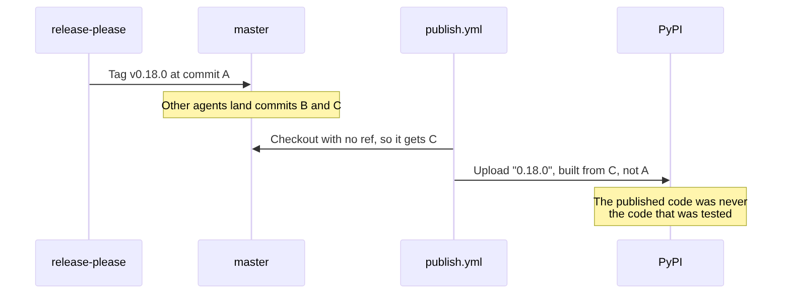
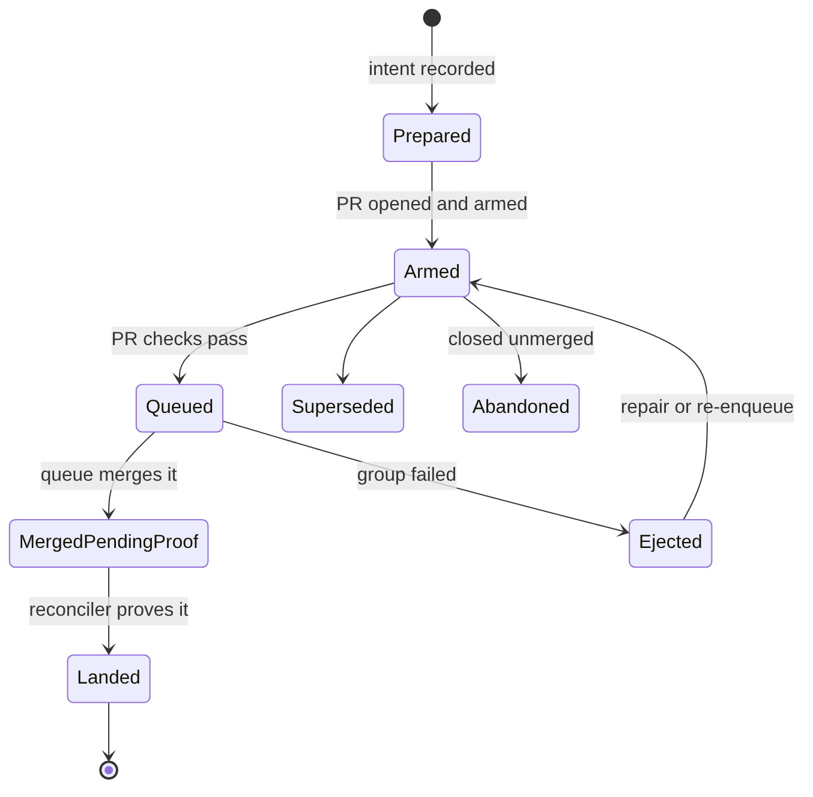

# Mermaid diagrams in `bob ref create` PDFs

- **Researcher:** grk
- **Date:** 2026-10-17
- **Question:** `bob ref create` prints Mermaid fences as wrapped source instead of diagrams (see the Highlights screenshot of *The merge-queue reassessment, explained simply*). What is the best way to add support? Is the idea sound? What should change?
- **Verdict:** Build it. Keep pandoc + XeLaTeX. Add a scratch-directory Mermaid preprocessor that shells out to `@mermaid-js/mermaid-cli` (`mmdc`) and replaces each ` ```mermaid ` fence with a linewidth-scaled PDF figure. Soft-fail per diagram. Do not print the whole document through Chromium.

---

## 1. In one breath

The screenshot is the **generic Markdown route** (`render_temp_pdf` in `src/native/highlights_ref/create.rs`), not the note-snapshot print profile. Pandoc sees a fenced `CodeBlock` with class `mermaid` and emits a `Highlighting` verbatim environment. XeLaTeX wraps the source (`breaklines,breakanywhere`). HTML `<br/>` in node labels prints as literal text.

That route already includes ordinary images. The same PDF's infographic rendered as "Figure 1". Only Mermaid fences are missing.

A 2026-10-17 spike on athena rendered the first flowchart, the sequence diagram, and the state diagram with host `mmdc` 11.4.2 in about two seconds each, then included the mermaid-cli **PDF** (not SVG, not PNG) in a pandoc/XeLaTeX document. Body fonts stayed DejaVu CID TrueType (`xdvipdfmx`). Diagram labels stayed Arimo CID TrueType. `pdftotext` extracted the node text. `pdfimages` reported no raster. This is the shape to ship.

---

## 2. What the screenshot actually is

### 2.1 The captured object

| Field | Value |
| --- | --- |
| Highlights id | `merge_queue_fence_reassessment_explained` |
| Ref note | `~/bob/ref/chat/merge_queue_fence_reassessment_explained.md` |
| Library PDF | `~/bob/lib/chat/merge_queue_fence_reassessment_explained.pdf` |
| Created | 2026-10-17T18:00:16-0400 |
| Source | `sase--research` `202610/merge_queue_fence_reassessment_explained.md` |
| Trigger | `research-highlights` file hook (`bob highlights create --include-id`, alias of `bob ref create`) |

`pdfinfo` on the library PDF:

- 17 pages, Letter
- `Creator: LaTeX via pandoc`
- `Producer: xdvipdfmx (20240305)`
- Numbered TOC (`1.2.1 How code reaches master…`) from `--toc --number-sections`

Those flags exist only on the generic Markdown route. The note-snapshot profile (`render_note_pdf`) uses `commonmark_x`, bundled Source Serif 4 / Inter / JetBrains Mono, and **unnumbered** headings.

`pdfimages -list` reports **one** image: the infographic at 1024×1536, 165 ppi, page 3. All twelve Mermaid fences are in the text layer as source.


### 2.2 The source fences

Twelve ` ```mermaid ` blocks in that one report:

| # | Kind |
| --- | --- |
| 6 | `flowchart LR` |
| 3 | `flowchart TD` / `TB` |
| 1 | `sequenceDiagram` |
| 1 | `stateDiagram-v2` |
| 1 | `flowchart LR` with `subgraph` |

Labels use Mermaid HTML (`<br/>`). One ASCII art block is already a ` ```text ` fence and printed correctly. The research-swarm linker prompt already warns about pandoc tables and double-numbered headings. It is silent about Mermaid, so agents keep drawing diagrams this way.

### 2.3 Why the engine dumps source

`render_temp_pdf` runs:

```
pandoc SOURCE -o PDF --standalone --toc --toc-depth=3 --number-sections
  --pdf-engine=xelatex --resource-path=PARENT --highlight-style=tango
  --lua-filter code-break --lua-filter return-links
```

No `--from` override, so the default pandoc Markdown reader. A fence with info string `mermaid` becomes a `CodeBlock`. Nothing in the Lua chain (`PANDOC_CODE_BREAK_FILTER`, `return_links.lua`) special-cases class `mermaid`. `return_links.lua` even skips `CodeBlock` as a return-link target.

The header include wraps every `Highlighting` environment with `fvextra` `breaklines,breakanywhere`, which is why the dump wraps instead of overflowing. That code was written for logs and command lines. It is the wrong treatment for a diagram language.

The note-snapshot filter (`note.lua`) also passes `CodeBlock` through unchanged after stripping U+FE0F.

---

## 3. Demand

Measured 2026-10-17:

| Corpus | ` ```mermaid ` files | Fence count |
| --- | --- | --- |
| `sase--research` | 91 files | 139 fences |
| `bob-cli--research` | 36 files | 44 fences |
| Bob vault notes (`~/bob/**/*.md` outside `lib/` / `xlib/`) | 0 | 0 |
| `:::mermaid` colon fences in `sase--research` | 0 | 0 |
| `~/bob/lib/chat/*.pdf` (this route's customers) | 410 PDFs | — |

Mermaid in this product is a **research-report / generic Markdown** problem, driven by the `research-highlights` file hook in `sase-research-artifacts`. Vault notes do not use it today. The preprocessor should still run on the note-snapshot path so a future `type: "[[article]]"` note with a flowchart gets the same treatment. The first customer is `render_temp_pdf`.

---

## 4. Critique of the plan

The implied plan: "add Mermaid support to `bob ref create` Markdown → PDF."

### What is right

- PDF is the right object. Bryan reads and highlights in Highlights Pro. `scan` turns those annotations into `ref/` notes. `-L` narrates the staged PDF on this route. A Markdown-only preview would skip that loop.
- `create` is the right command. It already owns scratch staging, markers, collision walks, listen, doctor, and intake install. A sibling `bob mermaid` would duplicate that contract. CLI rules also keep write verbs on the existing noun.
- Mermaid is the right authoring language. GitHub, Obsidian, and the research macros already speak it. Asking authors to paste PNGs would fight the agents that write these reports.
- The existing typesetter is the right typesetter. Body text must stay pandoc + XeLaTeX for a Highlights-clean CID TrueType layer. That conclusion is already recorded in the 2026-10 area/project note-snapshot research: Chrome/Skia full-page PDFs embed Bob's variable woff2 faces as Type 3 and damage quotes.

### What would be a bad implementation

1. **Printing the whole Markdown file through Chromium** to get `mermaid.js` for free. That copies the web-article Type 3 / quote-damage failure onto chat PDFs. The screenshot document is 17 pages of prose plus tables plus diagrams. Only the diagrams need a browser.
2. **Feeding mermaid SVG to XeLaTeX / `rsvg-convert`.** Mermaid labels often live in SVG `foreignObject` HTML. Stack Overflow (2024-10, still the current advice) and mermaid-cli's own docs treat SVG as the HTML path. A spike on this host: the first flowchart SVG had 1 `foreignObject`; the state diagram had 1; the sequence diagram had 0. The count is diagram-type-dependent. SVG is an unreliable print input.
3. **`mermaid-filter` (npm, last publish 2023-12-21).** It wraps an old mermaid-cli, defaults to PNG or inline data URLs, wants ` ```{.mermaid format=pdf} ` instead of the fences agents already write, and is unmaintained relative to Mermaid 11.
4. **Network renderers** (`mermaid.ink`, hosted Kroki). Research reports leave the machine. The file hook runs on commit. Offline and reproducible win.
5. **Failing the whole `create` when one diagram is invalid.** A 17-page reading packet with eleven good diagrams and one typo should still install.
6. **Mutating the source Markdown in the research sidecar.** Scratch only. `BOB_HIGHLIGHTS_KEEP_WORKDIR=1` already keeps that scratch for debugging.

The idea is a good product. The implementation that changes the document engine is a bad one. The implementation that is a **pre-pandoc diagram pass** is a good one.

---

## 5. Justified requirement adjustments

These change the user's wording. They are deliberate.

**A1. Soft-fail per diagram, never fail the PDF.**
Original: "add support." Adjustment: a missing `mmdc`, a Chrome launch failure, or a single bad fence leaves that fence as code, prints a warning, and continues. Doctor treats mermaid as a warning row, matching `pandoc` / `xelatex` / `latex_packages`. Reason: Markdown PDFs must keep installing on a laptop without Node, and a research report with twelve diagrams must survive one syntax error.

**A2. Primary output is mermaid-cli PDF figures, included by XeLaTeX.**
Original: unspecified format. Adjustment: `mmdc -e pdf --pdfFit` → `` → `\includegraphics[width=\linewidth]`. PNG is the fallback when PDF include fails. Reason: measured on athena today (see §7). SVG is rejected because of `foreignObject` and because the note-snapshot asset pipeline already marks SVG as "Image not printable."

**A3. One preprocessor, both Markdown PDF routes.**
Original: the screenshot is the generic route. Adjustment: call the same function from `render_temp_pdf` and `render_note_pdf`. Reason: the code is one fence walker plus one subprocess; note snapshots are free once the walker exists.

**A4. Empty alt text, linewidth via a Lua Image filter.**
Original: unspecified. Adjustment: rewrite to `` and set `width=100%` on the AST Image, so pandoc's `implicit_figures` does not caption every diagram "Figure N: diagram." Reason: the same library PDF already captions the infographic "Figure 1: The reassessment's own infographic…". Mermaid should not add twelve more figure numbers.

**A5. No new CLI flag in v1.**
Original: unspecified. Adjustment: auto-detect fences; `BOB_MMDC_COMMAND` overrides the binary like `BOB_PANDOC_COMMAND`; discovered Chrome is `BOB_CHROME` then the web-clip search path. Reason: CLI rules want a short alias on every public long option. A `--no-mermaid` flag is extra surface for a feature that should just work. An empty override or a missing binary already disables it.

**A6. Short `TMPDIR` for the mermaid child.**
Original: unspecified. Adjustment: the `mmdc` child must run with `TMPDIR` equal to the existing scratch directory. Reason: a spike with SASE's long agent `TMPDIR` failed immediately: `Socket path too long: …/com.google.Chrome.…/SingletonSocket`. `ScratchDir` already refuses a `TMPDIR` longer than 40 bytes and falls back to `/tmp`. The web-clip adapter already documents the same Chrome constraint and sets `os.environ["TMPDIR"] = workdir`.

**A7. v1 fence set is ` ```mermaid ` and ` ~~~mermaid ` only.**
Original: "mermaid syntax." Adjustment: info string starts with `mermaid` (so `mermaid` and `mermaid filename=…` match). Colon fences (`:::mermaid`) wait. Reason: 139 of 139 sase-research fences are backtick fences; 0 colon fences. Bob already has a CommonMark fence walker in `src/native/markdown.rs` (`fence_marker` / `fenced_lines`) that knows backtick and tilde.

**A8. Dry-run reports the plan and does not launch Chrome.**
Matches today's Markdown `--dry-run` (returns before pandoc). Print `mermaid: N fences · would-render with mmdc (path)` or `mermaid: N fences · mmdc missing; will print as code`.

**A9. Out of scope for v1.**
PlantUML, Graphviz, D2, Mermaid inside web-article HTML, rewriting the research-sidecar sources, landscape pages for wide `flowchart LR`, and pinning mermaid-cli into the repo. Wide diagrams scale to `\linewidth`. Pinning is v2 if host `mmdc` version-skews against Mermaid 11 syntax.

---

## 6. Options compared

| Option | How it works | Fits Highlights body text | Diagram quality | Host cost | Verdict |
| --- | --- | --- | --- | --- | --- |
| A. Rust preprocess + `mmdc -e pdf --pdfFit` | Replace fences in scratch, existing pandoc/XeLaTeX | Yes (outer `xdvipdfmx`) | Vector, Arimo CID TrueType labels | `mmdc` + Chrome (athena already has both) | **Ship this** |
| B. Same, PNG `-s 2` | Raster `\includegraphics` | Yes | 231 ppi on Letter linewidth in the spike; soft when zoomed | Same | Fallback |
| C. `mermaid-filter` pandoc `--filter` | Node filter during pandoc | Yes | Depends on its old mermaid-cli; SVG/data-URL footguns | Extra global npm, last publish 2023-12 | Reject |
| D. Lua filter that shells out to `mmdc` | Same subprocess, worse errors | Yes | Same as A | Same | Inferior to Rust (tests, TMPDIR, isolation) |
| E. Full-document Chromium print | HTML + mermaid.js + `page.pdf()` | Type 3 / quote damage on body | Native mermaid.js | Already have Chrome | Reject for this route |
| F. Playwright adapter + vendored `mermaid.min.js` | Screenshot or `page.pdf()` per fence, reuse web-clip Chrome | Yes if only diagrams go through it | Equal to A | No host `mmdc` | v2 if Mac/apollo lack `mmdc` |
| G. `mermaid.ink` / Kroki | HTTP image URLs | Yes | Network, non-reproducible | Network | Reject |
| H. Mermaid → TikZ / Typst | Translate syntax | Yes | Incomplete language coverage | New engine surface | Reject |
| I. Author-supplied PNGs | Agents emit images | Yes | Fine, high friction | None | Reject as the product |

Option A won because the spike produced a combined PDF whose **body** is still `Creator: LaTeX via pandoc` / `Producer: xdvipdfmx` and whose **diagram labels** extract as text (`pdftotext` saw "Agent finishes its work", "Green?", "Uploads to PyPI"). `pdffonts` showed DejaVu Serif plus `AAAAAA+Arimo` CID TrueType, both embedded. This is a different Chrome PDF than the web-article template: mermaid-cli's diagram PDF is a 600×125 pt snippet with Arimo, not a full-page Skia document with variable woff2 Source Serif 4.

---

## 7. Spike evidence (athena, 2026-10-17)

Host: `mmdc` 11.4.2 (`@mermaid-js/mermaid-cli`, mermaid `^11.0.2`, puppeteer `^23` peer), `pandoc` 3.1.11.1, `/opt/google/chrome/chrome` 155, XeLaTeX present. Puppeteer config:

```json
{
  "executablePath": "/opt/google/chrome/chrome",
  "args": ["--no-sandbox", "--disable-setuid-sandbox"]
}
```

`--no-sandbox` is the mermaid-cli documented Linux workaround. Pointing `executablePath` at the Chrome bob already discovers avoids a second Chromium download.

| Trial | Result |
| --- | --- |
| `mmdc` with SASE's long `TMPDIR` | Fail, Chrome `SingletonSocket` path too long |
| Same with `TMPDIR=/tmp` | First flowchart PNG in 2.07 s, 1568×300 RGB |
| Markdown rewrite `mini.md` → `mini-out.md` | Surrounding heading, table, and prose preserved; fence became `` |
| Sequence diagram from the source | 1568×590 PNG, readable |
| `stateDiagram-v2` from the source | 1354×1328 PNG, readable |
| `mmdc -e pdf --pdfFit` on the first flowchart | 17 KB, page 600×125 pt, `Producer: Skia/PDF m155`, font Arimo CID TrueType, `pdftotext` extracts labels |
| pandoc/XeLaTeX include of that PDF as `{width=100%}` | 1-page Letter, `Creator: LaTeX via pandoc`, DejaVu + Arimo, diagram text in the text layer, `pdfimages` empty |
| Same include with a non-empty alt | Unwanted `Figure 1:` caption (`implicit_figures`) |

Rendered diagrams from the actual source fences:






Twelve diagrams at ~2 s each is about 24 s extra on this report if each call launches Chrome. Acceptable for a 17-page capture. A later optimization is one `mmdc` Markdown-mode pass over a scratch file that contains only the N fences, then splice the numbered `*-1.pdf` artefacts back. v1 should isolate per diagram so one bad fence cannot drop the other eleven. Cold-start cost can wait.

---

## 8. Recommended solution

### 8.1 Shape

A new module `src/native/highlights_ref/mermaid.rs` (name flexible) owned by `bob ref create`, called from both PDF routes after scratch exists and before pandoc:

1. Walk the Markdown with `markdown::fence_marker` / a sibling that also returns the info string. A fence whose info string's first token is `mermaid` is a candidate. Ignore mermaid inside other fences.
2. If there are zero candidates, return the original string.
3. Resolve `mmdc`: `BOB_MMDC_COMMAND`, else `mmdc` on `PATH`. If missing, warn once and return the original string.
4. Write `puppeteer.json` into scratch with `executablePath` from the existing Chrome discovery (`BOB_CHROME`, then `/opt/google/chrome/chrome`, `/usr/bin/google-chrome`, macOS app, Playwright Chromium — same order as web clip) and `args: ["--no-sandbox", "--disable-setuid-sandbox"]`.
5. For each fence, write `bob-mermaid-N.mmd` into scratch, run:

   ```
   mmdc -i bob-mermaid-N.mmd -o bob-mermaid-N.pdf -e pdf --pdfFit
        -b white -t default -p puppeteer.json -q
   ```

   Child env: `TMPDIR=<scratch>` (the `ScratchDir` path is already short). Timeout on the order of the web-clip per-request budget, not unbounded.
6. On success, replace the fence (opening line through closing fence) with:

   ```
   
   ```

   On failure, keep the fence, push a warning `mermaid N: <stderr one-liner>`.
7. A small addition to the existing code-break Lua filter (or a third `--lua-filter` before return-links): for an `Image` whose `src` matches `bob%-mermaid%-`, set `attributes.width = "100%"`. Empty alt already suppresses `implicit_figures`.
8. Point pandoc at the rewritten scratch Markdown. Keep `--resource-path` as `scratch:original-parent` (colon-separated) so mermaid PDFs resolve from scratch and the document's own PNGs (the infographic) still resolve from the source directory.

Note snapshots: run the same function on `projected.md` inside scratch after `serialize_projected_markdown` / asset preparation and before `render_note_pdf`'s pandoc. The PNGs/PDFs sit next to `projected.md`; `cwd=scratch` already makes `\includegraphics` work. Do **not** send mermaid artefacts through `assets.rs` (that path is for vault embeds and rejects non-raster).

### 8.2 Doctor, dry-run, tests, docs

- `bob ref doctor`: `mermaid: available (/usr/local/bin/mmdc 11.4.2)` or `mermaid: warn (mmdc not found; Mermaid fences in Markdown PDFs print as code)`. Warning, never a doctor failure.
- `--dry-run`: fence count and renderer path; no Chrome.
- Tests: fence extraction (info string, tilde fences, nested non-mermaid fences, indented fences up to 3 spaces); rewrite with a stub `BOB_MMDC_COMMAND` that writes a tiny PDF; missing binary leaves source; one failing child leaves that fence and still rewrites the others; Lua width attribute. Live `mmdc` stays behind an existing-binary gate, like today's pandoc filter tests.
- Docs: a short subsection in `docs/highlights-create.md` under Markdown prerequisites. `BOB_MMDC_COMMAND` next to `BOB_PANDOC_COMMAND` in the env table.
- `sase-research-artifacts` swarm prompt: after this ships, drop any temptation to ban Mermaid. Until it ships, the linker can keep drawing; the hook will just keep dumping source.

### 8.3 Listen

On the generic Markdown route, `--listen` already passes `{target}` as the **staged PDF**, so TTS follows whatever Highlights would see. Diagrams as figures are an improvement over a spoken `flowchart LR`. On the note-snapshot route, `{target}` is `projected.md`; running the preprocessor before listen means the narrator sees an image, not twelve lines of arrows. No extra listen work in v1.

### 8.4 v2, only if needed

- Pin `@mermaid-js/mermaid-cli` (npm 12.0.0 is current; athena is 11.4.2) the way web clip pins Playwright, if syntax skew appears.
- A Playwright + vendored `mermaid.min.js` adapter for hosts without `mmdc`, reusing web-clip Chrome.
- One Chrome session for all fences (Markdown-mode bundle) once per-diagram isolation is tested.
- `accTitle` / `accDescr` → image title/alt for accessibility.
- Measure Highlights zoom on a real mermaid-PDF include; if nested Skia snippets ever damage quotes, fall back to PNG for the diagram layer only. The spike's combined `pdffonts` showed CID TrueType Arimo, which is the good embedding.

---

## 9. What to implement, in order

1. `mermaid.rs` walker + subprocess + warnings, stub-tested.
2. Wire into `render_temp_pdf` (the screenshot route) with scratch copy + combined `--resource-path`.
3. Doctor row + dry-run line + `BOB_MMDC_COMMAND` + Chrome/TMPDIR handling.
4. Lua width filter; empty-alt rewrite.
5. Wire the same function into `render_note_pdf`.
6. Docs.
7. A live gate on athena: recreate `merge_queue_fence_reassessment_explained` from the research sidecar into a scratch vault, open page 2 in Highlights, confirm the first flowchart is a diagram and body quotes still copy as whole words.

Step 7 is the acceptance test. The screenshot is the regression fixture.

---

## 10. Risks

- **Chrome sandbox / AppArmor** on Ubuntu 24+: mermaid-cli issue #730. Mitigation: `executablePath` to system Google Chrome (already AppArmor-profiled) plus `--no-sandbox` in the scratch puppeteer config. Web clip already runs this Chrome.
- **Version skew:** reports written against Mermaid 11 on GitHub, rendered by an older `mmdc`. Mitigation: warn and leave source; pin later.
- **Wide `flowchart LR`:** scaling to `\linewidth` shrinks labels. The first flowchart is a two-row LR chart and remained readable in the spike. Extreme diagrams may need authors to switch to `TD`. Do not landscape the whole Letter PDF.
- **Nested Skia PDF inside xelatex:** theoretically a Highlights edge. Spike `pdftotext` and `pdffonts` look clean. Confirm in step 7 before calling the feature done.
- **File-hook latency:** +~2 s per diagram on the commit host. Twelve diagrams added ~24 s in the worst v1 shape. The hook already launches pandoc/XeLaTeX; this is the same class of cost.
- **Mac without `mmdc`:** doctor warns, fences print as today. The production hook for research PDFs runs on athena, where `mmdc` is already `/usr/local/bin/mmdc`.

---

## 11. Recommended decision

**Yes, add Mermaid support. Do it as a scratch preprocessor in `bob ref create`, driven by host `mmdc`, emitting PDF figures into the existing pandoc + XeLaTeX pipeline, soft-failing per diagram.**

That is a small, local extension of a pipeline that already stages scratch files, already discovers Chrome, already sets a short `TMPDIR` for Chrome, already includes images, and already treats Markdown-render tools as doctor warnings. It fixes the screenshot. It does not reopen the document-engine decision.
