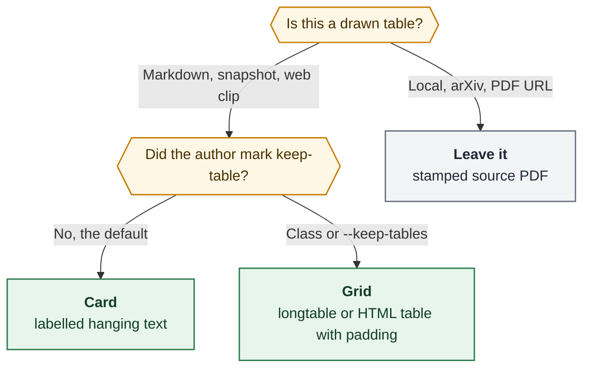

# Flatten PDF tables so Highlights can quote the cells

- **Researcher:** grk
- **Date:** 2026-10-29
- **Question:** How should `bob ref create` change the way it draws tables in Highlights PDFs so cell contents are easy to highlight, without making the pages harder to read? Is “make the tables better” even the right plan?
- **Verdict:** Yes, fix it — but do not try to make PDF grids annotation-friendly. Highlights and PDFKit treat a visual table as a table (or as one shared baseline per row). Restyling `longtable` will not beat that. Flatten tables into labelled reading cards at PDF render time, keep the write-once source as authored Markdown/HTML, and leave a `.keep-table` escape hatch for the rare numeric matrix.

---

## Bottom line

Bryan’s guess is directionally right, and slightly the wrong object.

Highlights does treat tables as a first-class thing, but the documented table feature is **image-selection Table Recognition** that turns a rectangle into CSV ([highlightsapp.net table extract](https://highlightsapp.net/how-to/mac/extract-pdf-table-to-excel/)). The pain of highlighting *words inside a cell* is a different path: macOS PDFKit text selection. On a Linux host I cannot click in Highlights, but I can measure the PDFs bob already produces, and those measurements plus Apple’s own Preview behavior are enough to pick a design.

1. **Do not restyle the grid and hope selection improves.** Doubling `\tabcolsep` and `\arraystretch` on a bob-identical XeLaTeX render left wrapped cells on the same baseline. Adjacent cells in a prose table were separated by as little as **12 pt**, which is a word space, not a cell boundary.
2. **Do not switch engines for this.** XeLaTeX, Typst, and Chromium all draw grids. Chromium is worse here: `web_clip_render.py` already prints with `tagged=True`, so HTML `<table>` becomes a PDF `Table`/`TR`/`TD` tree. Recent Preview/PDFKit on macOS Tahoe selects those cells as cells and **blocks highlighting the cell text** ([Apple Discussions 256257514](https://discussions.apple.com/thread/256257514), March 2026).
3. **Flatten at render time.** A Lua filter on the pandoc routes, and a DOM rewrite on the web-clip route, should turn each table into hanging-indent labelled cards. The write-once source stays a table. Existing annotated library PDFs stay untouched.
4. **This is a large corpus, not a polish item.** In the live vault’s write-once chat sources I counted **989 tables in 200 of 273 files** (73% of chat refs). **90% of those tables have a cell longer than 40 characters**, which is exactly the wrapped-`p{}`-column case that shares a baseline across cells.

The plan as stated (“make tables work better with Highlights annotations, and at least do not hurt readability”) is a good *goal*. The natural implementation people reach for — prettier `longtable`, more rules, zebra stripes, Typst tables, tagged PDF — would miss the goal and can make selection worse. Flattening is the approach that uses the text layer bob has already spent months protecting.

---

## Critique of the plan

The request is sound as a product need. Research reports, which `bob ref create` turns into `lib/chat/` PDFs, are full of comparison tables, and those are the pages Bryan highlights. Leaving them as pandoc `longtable` fights two layers bob does not control: PDFKit’s line grouping, and Highlights’ table-as-object UX.

What I would change about the *framing*:

- **“Render tables better” is the wrong verb.** The Markdown and note-snapshot routes already render a correct visual table. The failure is that a correct visual table is a bad annotation surface in Highlights. The work is to stop emitting a grid when the reader’s job is to quote a sentence that happens to live in a cell.
- **Readability is not at risk if we flatten prose tables.** 90% of chat-source tables already wrap. A squeezed 4-column `longtable` on Letter with 0.85 in margins is harder to read than a stack of `**Header:** value` cards at body size. Flattening is a readability win for that majority, and a wash for short 2-column status tables.
- **Do not couple this to an engine migration.** Prior note-snapshot research already parked Typst as a reopen for *all* Markdown refs, on contract and font grounds. Tables do not reopen it. Typst tables are still grids.
- **Do not enable tagged PDF on XeLaTeX to “help” tables.** Bob’s XeLaTeX PDFs are untagged today (`/StructTreeRoot` count 0 on a bob-flag render). Tagging would give PDFKit a real `TD` to select. That is the Preview Tahoe failure mode.
- **Do not paint tables as images.** That would hand the problem to Highlights Table Recognition (good for CSV extract, useless for quoting a clause) and would destroy the text layer the rest of `create` protects.
- **Do not recapture the library.** Annotated PDFs are pagination-sensitive. Ship the new behavior on new creates. Recapture of table-heavy chat refs is a later, explicit gesture.

Would I take a different approach than “improve table rendering”? Yes: treat tables as a **projection problem**, the same way note snapshots already project tasks and logs into a reading view. The typesetter stays pandoc+XeLaTeX / Chromium. The AST/DOM changes before ink hits the page.

---

## Requirement adjustments

These are deliberate changes to the request. Each one is a recommendation, not a silent redefinition.

> **A1. Success is a clean Highlights quote of a substring of one logical cell.**
> “The table looks nicer” is not the bar. A passing PDF lets Bryan drag across `PDFKit can treat a cell` inside a former cell and get that phrase back, with no neighbour-cell words and no hyphen/ligature damage. The existing PDFKit probe (`selectionsByLine` against source vocabulary) plus one live Highlights round trip are the gates.

> **A2. Scope is every `bob ref create` renderer that *draws* tables, not every PDF in the library.**
> In scope: generic Markdown (pandoc/XeLaTeX), vault-note snapshots (same engine, `note.lua` currently passes `Table` through), web articles and collections (Chromium `page.pdf(..., tagged=True)`). Out of scope: local PDFs, arXiv PDFs, and PDF URLs, which are stamped as-is. Out of scope: already-annotated `lib/` files.

> **A3. Flatten by default. Keep a grid only when the author asks.**
> A heuristic that “small tables stay as tables” will still emit the wrapped 3-column case that is 90% of the corpus. Default flatten. Escape hatches: a caption class `{.keep-table}` for one table, and a document flag `--keep-tables` for a whole create. No config key in v1.

> **A4. Flatten at PDF render time. Do not rewrite the write-once source.**
> `decisions:reference-sources-are-preserved-write-once` already stores the Markdown pandoc consumed. That Markdown should keep its pipe tables. `bob ref code --source` and a later recatalog still see the authored grid. Only the Highlights PDF becomes cards.

> **A5. Do not turn off document tagging globally on the web-clip route.**
> Headings in tagged Chromium PDFs are useful. Un-table the tables in the DOM so they never enter the structure tree as `Table`. Leave `tagged=True`.

> **A6. Table Recognition (CSV extract) is a accepted loss on flattened tables.**
> Highlights’ documented table workflow is: image-select the grid, run Table Recognition, Smart Copy as CSV. Cards will not look like a table, so that path gets worse. For this vault the reading job is quoting claims, not extracting spreadsheets. `{.keep-table}` preserves the extract path where it matters.

> **A7. No engine change, no new TeX packages, no `colortbl` zebra, no vertical rules.**
> Padding-only and decorative rules are rejected below on measurements. Zebra cell fills add untagged path objects in Chromium ([Chromium issue 419034670](https://issues.chromium.org/issues/419034670)) and give hit-testing a rectangle per cell.

---

## Diagnosis

Three mechanisms can make “highlight the words in this cell” feel like “the app selected the cell.” They are easy to mix up, and they want the same fix.

### 1. Geometric line-joining (XeLaTeX `longtable`, measured here)

Pandoc’s LaTeX writer emits `longtable` + `booktabs` with `@{}` on both ends, so edge padding is stripped. Simple columns are `l`/`r`/`c`. Any cell that needs to wrap becomes a `p{(\columnwidth - 2(n-1)\tabcolsep)*\real{w}}` minipage. Default `\tabcolsep` is 6 pt, so the gap between adjacent cells is **12 pt** when both cells are full.

I rendered a three-table fixture through bob’s Markdown flags (`xelatex`, DejaVu, `Ligatures=NoCommon`, ragged-right, hyphenation off, 0.85 in margins) on this host (pandoc 3.1.3, XeTeX 3.141592653, `xdvipdfmx` 20260317). Then I dumped glyph positions with `mutool draw -F xmltext` and clustered them into visual lines.

**Default bob table PDF:**

- `/StructTreeRoot`, `/MarkInfo`, `/Table`, `/TD`, `/ActualText`: **all zero**. These PDFs are untagged. Highlights is not selecting a PDF `TD` tag on the Markdown route. Whatever feels like “the cell” is coming from geometry.
- Table 1 (2-col, short cells): gap after `Ligatures off` → `done` was **13.7 pt**. After `Ragged right` → `done` was **12.0 pt**. That is a word space.
- Table 2 (4-col): some gaps were 50–90 pt (short cells), others **12 pt** (full cells). PDFKit cannot tell “next cell” from “next word.”
- Table 3 (wrapped prose, the common case) placed **three cells on one baseline**:

```
Keep longtable | A grid with booktabs rules and | PDFKit can treat a cell or a
               | tight cells                    | whole row as the selection
```

The gap between column 2 and column 3 on the first of those lines was **12.0 pt**. `selectionsByLine()` — the API bob’s own Mac PDFKit probe already uses — will therefore treat a row of cells as one line. Dragging across “booktabs rules” can pick up “PDFKit can treat a cell.” That is the Highlights quote-pollution bug, in the text layer, with no tagging involved.

`text.rs` already documents that **PDFKit ignores `/ActualText`**. There is no hidden-text workaround.

### 2. Tagged table cells (Chromium web clip, predicted)

`scripts/web_clip/web_clip_render.py` prints with:

```python
page.pdf(..., format="Letter", print_background=True, outline=True, tagged=True, ...)
```

Chrome has emitted tagged PDFs from HTML since Chrome 85, including `Table`/`TR`/`TH`/`TD` from real tables ([Chromium blog, 2020](https://blog.chromium.org/2020/07/using-chrome-to-generate-more.html); design doc: structure tree, “better text selection”). The reader template styles those tables as tables: `border-collapse`, 0.5 pt cell borders, 0.4 em padding, **zebra `nth-child(even)` fills**, 8.5 pt Inter, full measure.

On macOS Tahoe 26.3, Preview (PDFKit) single-click selects a PDF table cell, and **annotation of that selected cell text is blocked**. Acrobat Reader can highlight the same PDF. That is a PDFKit behavior change, not a Highlights-only quirk, and Highlights is `net.highlightsapp.Highlights` on top of PDFKit (`pdf_write_policy.rs`).

I did not print a web-clip PDF on this host (no Chromium). The tagging is in bob’s source; the Preview failure is a 2026 Apple thread. The Mac spike below should confirm Highlights inherits it.

### 3. Highlights Table Recognition (real product, different gesture)

Highlights Pro documents table handling as:

1. Make an **image selection** over the table.
2. Run Table Recognition (ML, on-device).
3. Smart Copy the result as CSV.

Power Tools bind a markup color to that flow so an image selection in that color auto-runs recognition ([Power Tools](https://highlightsapp.net/how-to/mac/power-tools/)). Changelog items about “jumpy text selection” and “multi-column PDFs” are about sort order and superscripts, not cell highlighting.

So: if Bryan is drag-selecting *text*, Table Recognition is not the selector. It can still *feel* like the app “wants the table,” because a grid looks like the thing the app’s table tool is for. Flattening removes that visual cue, which is what we want for quote-centric reading.

### What bob already got right

The Markdown and note-snapshot routes already spend real effort on a clean Highlights text layer: ragged right, hyphenation off, `Ligatures=NoCommon`, no Type 3 body fonts, status glyphs drawn in TikZ so they never enter the text layer, return-link pills stripped on the way into the note because PDFKit ignores `/ActualText`. Prior research (`research:202610/area_project_note_reading_pdfs/area_project_note_reading_pdfs.md`) measured Chrome/Type 3 quote damage at 5.4% of words versus ~0.2% for XeLaTeX. **Tables are the remaining structured block that still fights that investment.** `note.lua` and the generic Markdown path both pass `Table` nodes through to pandoc’s default `longtable` writer. There is no table profile.

---

## Corpus: this is the research-report path

Vault-note snapshots were previously measured as having **zero** Markdown tables in the area/project corpus. The volume is `lib/chat/` research PDFs.

Write-once sources under `~/bob/.bob/ref-sources/` on 2026-10-29:

| Shelf | Sources | With tables | Tables | Pipe rows |
| --- | ---: | ---: | ---: | ---: |
| chat | 273 | 200 (73%) | 989 | 8,916 |
| blogs | 1 | 1 | 1 | 8 |

Of those 989 chat tables:

| Shape | Count | Share |
| --- | ---: | ---: |
| 2 columns | 255 | 25.8% |
| 3 columns | 387 | 39.1% |
| 4+ columns | 347 | 35.1% |
| Any cell longer than 40 characters | 888 | **89.8%** |
| Median rows (including header) | 7 | — |
| p90 rows | 13 | — |
| Longest table | 67 rows | — |

31% of all 26,105 cells are longer than 40 characters. On a ~6.5 in text block those cells wrap. That is Table 3 in the fixture, at vault scale.

Research finals in this sidecar routinely carry 8–14 pipe tables each. Those reports are exactly the documents `bob ref create` turns into Highlights PDFs.

---

## Options, and why most of them lose

### A. Pad `longtable` (rejected as the primary fix)

I rerendered the same fixture with `\setlength{\tabcolsep}{12pt}` and `\renewcommand{\arraystretch}{1.55}`.

- 2-col gaps grew from ~13 pt to ~25 pt. Better, still not a fence.
- Wrapped 3-col tables **still shared baselines**. Column 2 and column 3 on a wrapped row were 24–27 pt apart. The line-join bug remains.
- The page got longer. Readability of wrapped cells did not become “one cell, one story.”

Padding is a reasonable extra on `{.keep-table}` grids. It is not the fix.

### B. Tagged PDF / `tabularray` / Typst tables (rejected)

These make a more structured or prettier grid. Preview Tahoe shows that a structured grid is the thing PDFKit will not let you highlight. Typst is already the recorded reopen for a wholesale Markdown-engine change; using it only for tables would split the create pipeline for no annotation gain.

### C. CSS-only un-tabling on the web clip (`display: block` on `table/tr/td`)

This can drop `Table` tags if Blink’s accessibility tree no longer sees a table, and it stacks cells. It is a cheap experiment for the Mac spike. I would not ship it as the only web-clip fix: leftover borders and zebra fills can still look like cells, and `display: block` tables are a known Chromium print footgun ([Formfeed, 2026](https://formfeed.dev/blog/page-breaks-in-tables)). A DOM rewrite to cards is explicit and testable.

### D. Flatten to labelled cards (recommended)

I rendered the same content as hanging-indent bullets (`**Header:** value` per field). Glyph clustering found **no intra-line gaps above a word space**. Line-start x-positions collapsed to `{61, 75, 86}` pt (body, bullet, wrap) plus the page number. That is ordinary body text, which Highlights already quotes cleanly on XeLaTeX PDFs.

Readability: body-size serif, one field per line or a short `Header: value` run, wrapping inside a single column. For a 4-column comparison with prose cells this is easier to read on an iPad than four 1.5 in minipages. For a 2-column `Feature | Status` table it is slightly more vertical space and much easier to highlight.

### E. Dual representation (grid plus a text duplicate)

Noisy, doubles length, and the grid still captures the pointer. Rejected.

### F. Images of tables

Lets Table Recognition work. Destroys quoting. Rejected.

---

## Recommended solution

**Flatten tables into reading cards at PDF render time, on every create renderer that typesets Markdown or HTML. Keep the authored table in the write-once source. Keep a grid only when the author marks it.**



**Title:** When should bob draw a table as a grid?

**Caption:** Flatten drawn tables into labelled cards so Highlights quotes cell text; keep a padded grid only when the author asks, and never restyle a stamped source PDF.

### Card shape

One bullet (or hanging paragraph) per row. Each cell becomes `**Header:** value` on its own wrapped line. A caption, if present, becomes a small heading or a lead-in sentence above the list. Row-header-looking first columns (short, unique) can be bolded as the bullet’s lead text; that is a nicety, not v1-critical.

Example, from a typical research-report table:

```markdown
- **Option:** Flatten to cards
  **What the reader sees:** Each row becomes a labelled paragraph
  **Why Highlights struggles:** Selection is ordinary body text
```

Do not join the fields with middots on one line. One field per line keeps `selectionsByLine()` aligned with one claim.

Two-column key/value tables can use the same shape (`**Feature:** Ligatures off` / `**Status:** done`). Special-casing them as definition lists is optional polish.

### Markdown and note-snapshot routes

Add `tables.lua` to `write_render_filters` and run it **after** `code_catalog` / diagrams swap and **before** `return_links`. Flattened links are ordinary list inlines, which `return_links.lua` already walks. Today `return_links` has special Table head/foot skip contexts; after flatten those skip paths become unused for default tables and should stay for `{.keep-table}`.

`note.lua` currently does `blk.t == "Table" or blk.t == "Figure" then pass through`. If flatten runs first, snapshots inherit it. If a snapshot-only table style is ever wanted, it still goes through the same filter.

`{.keep-table}` on the caption (pandoc table attributes) skips the rewrite. `--keep-tables` sets a metadata flag the filter honors for every table. Keep-table grids get a small header bump, not a new package:

```tex
\setlength{\tabcolsep}{10pt}
\renewcommand{\arraystretch}{1.35}
```

No vertical rules, no `colortbl`. Doctor stays as it is: `longtable.sty` and `booktabs.sty` remain, because keep-table and any filter miss still need them.

### Web-clip route

In the print HTML, rewrite each `<table>` to a `<div class="bob-table-cards">` of rows/fields **before** `page.pdf`. Do this after Defuddle, so the saved GFM can still hold the table (today GFM is `pandoc -f html -t gfm` of the printed article HTML — **keep the pre-rewrite HTML for the write-once source**, or rewrite only a clone used for printing). Prefer a print clone: source stays a table, PDF is cards, same as Markdown.

Drop zebra striping on any leftover `keep-table` HTML. Increase cell padding. Do not set `tagged=False`.

### CLI and docs

- `--keep-tables` on `bob ref create`, documented next to the other render flags in `docs/highlights-create.md`. Default off.
- One short paragraph in that doc: tables print as labelled cards so Highlights can quote them; add `{.keep-table}` under the caption to keep a grid.
- No new subcommand. No `bob ref table-*`.

### What not to build

- A Typst or WeasyPrint table engine.
- Tagged XeLaTeX (`tagpdf` / `\DocumentMetadata`).
- Rasterized tables.
- Auto-recapture of `lib/chat/` PDFs.
- A config default that keeps “small” tables as grids.
- Teaching Highlights Table Recognition to be the quoting tool.

---

## Phasing

**P0 — Mac diagnosis, about half a day, no product code.**
Take the three PDFs I already rendered conceptually (default `longtable`, padded `longtable`, flattened cards) plus one web-clip article that still has an HTML table. In Highlights:

1. Drag-select a mid-cell phrase in a wrapped prose table.
2. Drag-select a whole short cell in a 2-col table.
3. Click once in a cell and see whether the cell highlights as a unit.
4. Confirm Table Recognition still wants an image selection, not a text selection.

Pass criterion for flatten: (1) on the card PDF quotes the phrase and only the phrase. Predicted failures: (1) on default `longtable` includes neighbour-cell words; (1) on a tagged Chromium table either snaps to the cell or refuses the highlight.

If P0 shows that default `longtable` already quotes cleanly in the installed Highlights version, stop and reopen this report — do not flatten a working text layer. I do not expect that result, given the 12 pt gaps and `selectionsByLine` grouping, but the Mac is the authority.

**P1 — Flatten on the pandoc routes.**
Lua filter, `--keep-tables`, `{.keep-table}`, keep-table padding header, docs, tests. This covers research reports, generic Markdown, and note snapshots. Size: small (one filter, wiring in `write_render_filters` / both pandoc command builders, a handful of golden AST tests, one mutool geometry test).

**P2 — Web clip.**
Print-clone DOM rewrite, CSS for cards, `keep-table` class passthrough, drop zebra. One Mac Highlights pass on a clipped article.

**P3 — Optional.**
Row-key detection for card titles. Recapture tooling for old chat PDFs, only if Bryan asks, never automatic.

---

## Tests and gates

1. **Lua/AST goldens.** A 2-col table, a wrapped 3-col table, a table with links in cells, a `{.keep-table}` table, a table with a caption. Flatten preserves inline formatting and link targets.
2. **Geometry gate (Linux-capable).** `mutool draw -F xmltext` on a flattened fixture: no intra-line gap above ~8 pt except at list indent. The same fixture rendered with `--keep-tables` still contains `longtable` in the kept `.tex` when `BOB_HIGHLIGHTS_KEEP_WORKDIR=1`.
3. **Return-link regression.** Existing tests that plant links in table head/body/caption still resolve for `{.keep-table}` and for flattened cards.
4. **PDFKit probe on the Mac.** Reuse `pdfkit_probe.swift`. Flattened cards: unknown-token rate matches surrounding prose (target: 0 non-source words). Default `longtable` of Table 3 is allowed to look “fine” to `pdftotext` and still fail this probe, because poppler does not group the way PDFKit does.
5. **Live Highlights round trip.** Create a fixture ref, highlight a mid-cell phrase, `bob ref scan`, check the quote in the reference note. This is the A1 bar.

---

## Open questions for Bryan

1. **Are you quoting cell prose, extracting CSV, or both?** If quoting is 95% of the job, flatten-all is right. If you often image-select tables into spreadsheets, `{.keep-table}` should be easier to reach — maybe a create flag that keeps tables *and* is sticky per parent note. I am assuming quoting.
2. **Is a 2-column `Feature | Status` grid precious?** I would still flatten it. If you want those to stay grids, say so; they are only a quarter of the corpus and they still have 12 pt cell gaps.
3. **Should old `lib/chat/` research PDFs ever be recaptured?** I would not do it in v1. A later `create -f` of the saved source would pick up cards, at the cost of invalidating existing highlight quads.

---

## Confidence and limits

**High**

- XeLaTeX tables are untagged `longtable` with 12 pt inter-cell gaps and shared baselines on wrapped rows (measured).
- Padding does not break shared baselines (measured).
- Flattened cards become a single reading column (measured).
- Chat refs are table-heavy, and almost all of those tables wrap (counted on the live write-once store).
- Web clip prints tagged PDFs and styles real HTML tables (source).
- PDFKit ignores `/ActualText` (already in `text.rs`); Highlights Table Recognition is an image-selection tool (vendor docs).

**Medium**

- Highlights on current macOS inherits Preview’s “cell is a selection unit, highlight is blocked” behavior. PDFKit is the shared framework; I have not clicked it.
- Flattening will *improve* readability for wrapped 3–5 column tables. That is a judgment from the corpus shape, not a reader study.

**Not verified here**

- Any Highlights or PDFKit click. This host is Linux.
- A Chromium-printed table PDF’s structure tree (no Chrome on this host).
- How Defuddle currently emits tables on the one blog source.

---

## Sources

### Bob

- `src/native/highlights_ref/create.rs` — `PANDOC_HEADER_INCLUDES`, `render_temp_pdf_from` XeLaTeX flags, `write_render_filters`
- `src/native/highlights_ref/render_tex.rs` — `longtable.sty`, `booktabs.sty`
- `src/native/highlights_ref/note_snapshot/{note.lua,note.tex,profile.rs}` — Table pass-through, no table profile
- `src/native/highlights_ref/text.rs` — PDFKit ignores `/ActualText`
- `src/native/highlights_ref/pdf_write_policy.rs` — `net.highlightsapp.Highlights`
- `scripts/web_clip/web_clip_render.py` — `page.pdf(..., tagged=True)`
- `scripts/web_clip/template/reader.css` — table borders, zebra, 8.5 pt Inter
- `docs/highlights-create.md` — clean text layer, PDFKit measurements
- Live write-once store `~/bob/.bob/ref-sources/chat/**/source.md` (read-only count)
- Empirical renders in `/tmp/bob-table-pdf-grk/` (default, padded, flattened PDFs; not kept)

### Prior research (independent of this swarm)

- `research:202610/area_project_note_reading_pdfs/area_project_note_reading_pdfs.md` — XeLaTeX vs Chromium quote damage; PDFKit probe
- `research:202610/web_url_reference_pdf_capture/web_url_reference_pdf_capture.md` — renderer choice, Highlights quote quality
- `decisions:reference-sources-are-preserved-write-once`
- `decisions:code-copy-reads-render-time-catalog`
- `decisions:open-pdf-writes-are-coordinated`

### External

- [Highlights: extract PDF table to Excel](https://highlightsapp.net/how-to/mac/extract-pdf-table-to-excel/)
- [Highlights Power Tools](https://highlightsapp.net/how-to/mac/power-tools/)
- [Highlights features (Table Recognition, Smart Copy CSV)](https://highlightsapp.net/features/)
- [Apple Discussions: Preview blocks highlighting of PDF table cell text (Tahoe 26.3, 2026-03-06)](https://discussions.apple.com/thread/256257514)
- [Chromium: tagged PDFs from HTML tables](https://blog.chromium.org/2020/07/using-chrome-to-generate-more.html)
- [Pandoc LaTeX tables are `longtable`](https://pandoc.org/demo/example33/8.9-tables.html)
- [Pandoc `tabcolsep` / minipage column widths](https://github.com/jgm/pandoc/issues/6883)
- [Drasil: Preview selects LaTeX table text wrongly; Chrome PDF viewer does not](http://gitmemories.com/JacquesCarette/Drasil/issues/663)
- [Chromium: untagged path objects for table cell backgrounds](https://issues.chromium.org/issues/419034670)

Library check: 0 of 5 candidates already in your library (0 finished).
