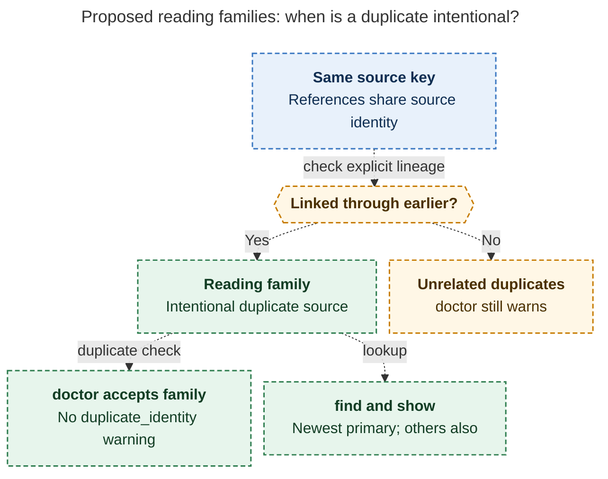

# Diagram proposals: `bob ref create` recapture modes

Proposals for the swarm linker, not a report. Each diagram restates only what the source
report says.

```yaml
source: research:202610/ref_create_recapture_modes/ref_create_recapture_modes__final.md
producer: research.2g.image
check: "mmdc 12.0.0 with --no-sandbox and the PDF-mirroring config rendered 1 of 1 Mermaid diagrams"
```

## reading-family

```yaml
anchor: |-
  After that, the index reads it rather than re-deriving
question: |-
  How does Bob distinguish intentional rereads from unrelated duplicates?
illustrates: |-
  References sharing a source identity key form a reading family through explicit `earlier:` links, so the family avoids `duplicate_identity` warnings and its newest reading becomes primary.
caption: "Explicit earlier links distinguish intentional rereads from unrelated duplicates; the newest family reading becomes primary."
review: "644.5x788 px, fit 100%; question, source trace and PNG visual checks passed; 0 visual revisions; PNG succeeded on one permitted connection-failure retry"
```


