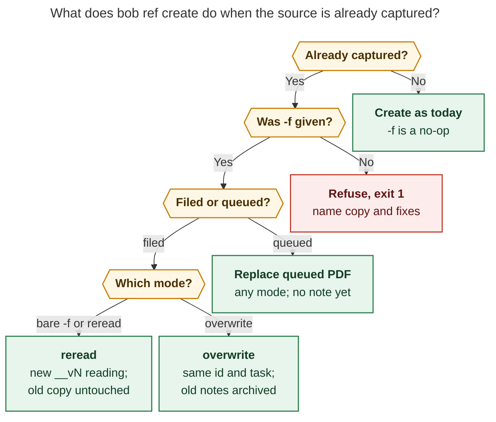

# `bob ref create -f|--force[=reread|overwrite]`: recapturing a source you already have

Lead researcher · 2026-10-25 · Merges the independent reports
[`__cdx`](ref_create_recapture_modes__cdx.md), [`__cld`](ref_create_recapture_modes__cld.md),
[`__grk`](ref_create_recapture_modes__grk.md), [`__mus`](ref_create_recapture_modes__mus.md),
and [`__gem`](ref_create_recapture_modes__gem.md). I also checked their claims against
bob-cli `4e3a3915`, bob-plugins, Bob Mac Capture, and the live vault (read-only), and
ran my own clap 4.6.7 parser probe.

## Verdict

**Build it.** Today the only way to recapture a filed reference is the hint
`open the note, or delete it to recapture`. Following it loses the annotations, orphans
the reading task, and leaves dangling `🔖` follow-up links. Both requested modes answer
real questions:

- **reread:** "I want to read this again, separately."
- **overwrite:** "This capture is wrong, so replace it."

All five researchers agree on that. Four of the five agree on most of the shape.

Four facts change how the request should be built:

1. **`-f/--force` already exists.** It is a boolean ("Overwrite an existing target PDF")
   with three narrow meanings. The new modes should take over that flag and keep its old
   meanings. A second force flag would be the wrong move.
2. **Every spelling you asked for can work.** That includes `-f`, `-f overwrite URL`,
   `URL --force overwrite`, `--force=overwrite`, and bundled `-fd`. It takes clap's
   `require_equals` plus a small post-parse rule, which I verified against clap 4.6.7
   (§5.1). Without that rule, either `-f URL` fails or `-f overwrite` silently becomes a
   second TARGET.
3. **Overwrite should replace the material, not the identity.** "Delete the note and
   create it from scratch" would break the reading task (`^ref-…`), Today, Task Links,
   Depends-On links, and every `🔖` follow-up. Overwrite should keep the path, `id`, and
   reading task, and rebuild the body and PDF from scratch.
4. **The log of the old note must not look like a live reference.** No walker should
   treat it as a reference, task, or duplicate, and git must actually track it. Two
   researchers' archive locations fail this check:
   - `.assets/` is still walked by the URL-dedupe scan.
   - `manifest.json` and `.txt` files are dropped by the vault's `.gitignore`.

   The design below puts the log in a top-level `ref_history/`, as frozen, inert notes.

**Recommended shape:**

- **Bare `-f`** reads the source again as `<stem>__vN`: a new note, PDF, `id`, and
  reading task, defaulting to the existing reading's parent. It writes zero bytes to
  earlier readings.
- **`-f overwrite`** recaptures in place, in one locked transaction with a single
  commit.
  - It keeps the path, `id`, and reading task, including its status.
  - When the old note holds anything you made (highlights, image selections, prose), it
    freezes the note into `ref_history/`, moves inbound `#^h-` links there, and records
    the archive in an `earlier:` property.
  - Previous `earlier:` entries carry forward.
- **No `-f` on a known duplicate** refuses before any fetch. The error names the existing
  copy, the next `__vN` name, and both fixes.
- **Delivery in three phases:**
  1. Reread.
  2. Overwrite of notes with no PDF annotations.
  3. Overwrite of annotated references. This phase runs on the Mac, where Highlights
     holds the annotations.

---

## 1. What exists today (verified)

| Area | Today | Why it matters |
| --- | --- | --- |
| The flag | `create.rs:365` declares `-f, --force` as `SetTrue`. Its three meanings: replace a same-reference PDF still queued in `xlib/`; replace an exact `-o` path; replace companion audio with different bytes. | It must become a mode flag that keeps all three meanings. |
| URL dedupe | `sources.rs::check_dedupe` runs before any fetch. A PDF-backed note refuses **even with `--force`**, which a test asserts (`tests/cli/highlights/create.rs:5113–5140`). A legacy note with no `source_pdf` warns and captures fresh. | This is the main site the feature unlocks. Flip that test. |
| Name walk | `stamp.rs::plan_default_target` tries `<stem>`, `_2`, … `_999`. `_N` means "taken by a *different* reference". A same-reference hit refuses. Local PDF and Markdown identity is the title at the candidate stem. | `_N` already has a meaning, so rereads need their own suffix. |
| Ids | `id` equals the stem; the one exception is a duplicate-avoiding `_N` (`is_duplicate_avoiding_suffix`, `ref_library/mod.rs:929`). | A `__v2` stem with `id: <stem>__v2` follows the rule and needs no exception. |
| Reading task | `^ref-<slug>` lives in the parent. `slug_ref_stem` caps the id at 44 characters by cutting at a `-` (`ref_tasks/line.rs:148`). | For a long stem, the cap trims the `-v2` off a `foo__v2` slug, so the generic `-2` collision suffix is the only thing left to tell the readings apart. |
| Highlight ids | `^h-` = sha256(source PDF **path**, kind, page label, text)[..12] (`sidecar_render.rs:1408`). | A new capture at the same path that highlights the same passage gets the same id. Old `#^h-` links would dangle, or quietly re-attach to the new highlight. |
| Index | `apply_supersession` emits `duplicate_identity` when two PDF-backed notes share a source key. `primary_rank` prefers non-superseded notes, then the most advanced reading state (`resolve.rs:78`). | Every reread would look like library corruption, and `find` would rank the finished v1 above the new v2. |
| Walkers | `ref_library` and `stamp` occupancy skip `.`-prefixed and `*.assets` directories. `ref_tasks/walk.rs` skips `*.assets`. The **`sources.rs` dedupe walkers skip only `.git`** (lines 110, 170, 261). Vault-wide task walkers (`capture_dependency_tasks`, the dataview task index) skip only hidden directories. | An archived note under `ref/` would be read as a duplicate source. Any archived `#task` line would be indexed as a live task. |
| Rename machinery | `bob ref rename` takes the locks, checks preconditions (`not_in_sync`, `intake_reference`, `lock_busy`, `scan_busy`), rewrites inbound links (including frontmatter, `done/`, and daily notes), verifies, rolls back, and makes one commit. It refuses annotated references, and an existing `<stem>.assets/` directory counts as annotated. | Overwrite can reuse almost all of this. |
| Note-local frontmatter | Sync re-emits frontmatter keys that it neither manages nor projects verbatim from the raw lines (`model.rs::render_with_projection`). `created` is the documented note-local precedent. | A new `earlier:` list property survives sync without becoming part of the PDF marker. |
| Vault git | `.gitignore` ignores `*`, then allows `*.md`, `*.pdf`, images, and audio. Plain `.json` and `.txt` stay ignored. | Archive files must use tracked extensions. |
| Callers | No `ref create -f/--force` in bob-plugins or Bob Mac Capture. The Obsidian snapshot command runs `["ref","create",path(,"-C")]`. `ingest_url`, `bob ref jobs`, and `bob gkeep pull` hard-code `force=false`. | Changing the meaning of bare `-f` has no programmatic callers to break. |
| Optional-value precedent | `bob capture -c/--clip[=HEADER]` already uses `num_args(0..=1)` + `require_equals(true)` (`capture/cli.rs:491`). | The `--force[=MODE]` spelling has a house precedent. |

**What the live vault says** (read-only survey):

- 86 of 1,132 notes under `ref/` have `highlights_count ≥ 1`.
- Only 14 `[[ref/…#^h-…]]` links exist outside `ref/`.
- Five hash-suffixed duplicates in `ref/chat/` (added between August and September 2026)
  share a title with an existing note, for example `conditional_launch_admission.md` and
  `conditional_launch_admission-ad048d84997e.md`. Both are `status: read`, and nothing
  links them.

So overwriting an annotated reference is real but uncommon. The common case is
replacing a capture nobody has annotated yet. The duplicates in §8 show the problem
already happens in practice.

## 2. Is this a good idea?

Yes. A reference can legitimately need recapturing:

- the source was revised;
- the render was bad (a paywall stub, a truncated article);
- you want to read it again a year later with a clean page.

Today's answer, "delete it", destroys exactly what the user cares about. Each mode
covers a different case:

| | reread | overwrite |
| --- | --- | --- |
| Intent | "Read it again as a separate reading." | "This capture is wrong; replace it." |
| Old copy | Stays a live, first-class reference | Frozen into an inert note in `ref_history/` |
| Reading task | A new task for the new reading | The same task: identity, lane, status, and links kept |
| Typical trigger | Deliberate second pass; a substantively new edition | Bad render; a revised report you have not read yet |
| Risk | Low: never writes to the old copy | Higher: replaces a live PDF and rewrites links |

Defaulting bare `-f` to `reread` is right even though Unix habit reads `-f` as "clobber"
(gem's critique). The safe, additive gesture should be the shortest one. Two things make
it unsurprising:

- the refusal and the success output always name the resulting stem;
- the error that `-f` used to produce on a library hit was never a replace either.

What I would change is the mechanics, not the idea. See §4.

## 3. Where the reports disagreed, and how I resolved it

| Question | cdx | cld | grk | mus | gem | Resolution |
| --- | --- | --- | --- | --- | --- | --- |
| Parser | `=` required; spaced form only as an alternative | `=` + guard for a mode word read as TARGET | No `=`; pre-clap argv shim | `=` | `=` + extra `-R/--reread` | **`=` + adopt a mode word right after bare `-f` + guard.** Every requested spelling works (§5.1). |
| Reread suffix | `__vN` | `__vN` | `__vN` | **`_N` (reuse walk)** | `__vN` | **`__vN`.** `_N` already means "a different reference took this name", and it is the one allowed id exception. Reusing it would make families invisible. |
| Next N | first free ≥ 2, reserving numbers still in history | **max + 1** | first free | n/a | first free | **max + 1 across the family.** It matches first-free unless a reading was deleted, and keeps version order chronological (adjustment A3). |
| Overwrite identity | Keep task and id | Keep path, id, task | Keep task | Refresh in place | **Reset task to ready** | **Keep path, id, task, and status;** `-s` reopens explicitly. A silent status change goes against sticky lanes. |
| Where the log goes | `ref_history/<ts>-<op>/` + `.md.txt` + `manifest.json` | `ref/<type>/<stem>.earlier/` | `ref/_archive/` + `lib/_archive/` | **None; git is the archive** | `<stem>.assets/` | **`ref_history/<type>/`, tracked extensions only.** See below. |
| Archive the old PDF | Yes | No (git + `source_pdf_commit`) | Yes | No | No | **Yes, but only when it is annotated**, by renaming it (§5.5). |
| Lineage record | `reread_of` + `reading_number` | `earlier:` frontmatter, both modes | `reread_of`/`reading_pass` + body line | `supersedes:` | `edition_of` + callouts on both notes | **One `earlier:` list property, both modes**, written at birth. The old note gets no writes. |
| Ambiguous overwrite | New `--existing <REF>` | Newest version | Use `-o`/`-N` | n/a | n/a | **Newest reading by default; `-N <stem>` picks another.** No new option. |
| Queued-only hit | New reading | Replace queued PDF, any mode | Replace queued PDF | Replace | n/a | **Replace the queued PDF under any mode.** There is no note, task, or annotation to protect. |
| Off-Mac annotated overwrite | **Refuse** | Allow; document the risk | Refuse if open | n/a | n/a | **Run it on the Mac** (the annotation host), with coordination when that is on. Unannotated overwrites run anywhere. |

**Why `ref_history/` won the archive question.** Every candidate under `ref/` or `lib/`
needs a new exclusion in each reference walker, and some fail outright:

- the three `sources.rs` dedupe walkers, `ref_library`, `stamp` occupancy, `ref_tasks`,
  `attach`, and rename would all need the exclusion, and every future walker would have
  to remember it;
- `.assets/` is walked by dedupe today;
- an existing `.assets/` directory makes `bob ref rename` refuse the reference forever;
- `lib/_archive/*.pdf` would be picked up by scan.

A top-level directory sits outside every reference walker by construction:

- Rename never has to move it. Its link rewriter already updates the `parent:` and
  `earlier:` wikilinks that point into it.
- Vault-wide task walkers still see it, so the frozen note itself must be inert (§5.5)
  wherever it lives.
- cdx's layout is the right idea, but two of its files would never reach git:
  `original.md.txt` and `manifest.json`.

mus's "git is the archive" is right whenever there is **nothing you made** to keep. In
that case, overwrite writes no archive (adjustment A6).

## 4. Requirement adjustments (explicitly called out)

| # | You asked for | I recommend | Why |
| --- | --- | --- | --- |
| A1 | A new `-f\|--force <mode>` option | The **existing** `-f/--force` becomes `--force[=MODE]`. Its old meanings (queued-PDF replace, exact `-o` replace, audio replace) hold under either mode. | Two force flags on one command would be unlearnable, and no caller depends on the boolean. |
| A2 | `-f <mode>`, bare `-f` means reread | Kept as asked. `-f overwrite`, `-f=overwrite`, and `--force overwrite` all work. A misplaced or misspelled mode word is a usage error, never a TARGET. To capture a file literally named `overwrite`, write `./overwrite`. | §5.1 probe. `-foverwrite` (no separator) is not supported. |
| A3 | `__v<N>`, N = first available ≥ 2 | `__v<N>` with N = **one more than the highest reading in the family** (minimum 2), skipping any stem that is occupied anywhere. Base = the family's root stem. | Identical in the normal case. Keeps order chronological after a deletion, and rereading `x__v2` gives `x__v3`, never `x__v2__v2`. |
| A4 | De-duplicate "the ID and anywhere else" | Suffixed: PDF, note, sidecar, audio, `.assets/` stems, frontmatter and marker `id`, block id `^ref-<slug>-vN` (cut the base, then append, so the suffix survives the 44-character cap), task alias `Title (v2)`. **Not suffixed:** `title`, PDF Info title, listen title. | The title is bibliographic. The task alias is where you need to tell two open readings apart. |
| A5 | Overwrite deletes the note and creates it from scratch | It keeps the path, `id`, `created`, and **reading task** (block id, lane, status, links). The body and PDF are rebuilt from scratch. The status changes only with an explicit `-s`. | `decisions:reference-renames-keep-identity`: the block id joins Today, Task Links, and Depends-On. |
| A6 | Always log the old note "somewhere" | Freeze it as an inert note in `ref_history/<type>/` only when it holds highlights, image selections, or prose outside the generated skeleton. Otherwise say `nothing to archive` and rely on git. | Most overwrites fix an untouched bad capture, and an empty archive would be clutter. |
| A7 | (unstated) | Inbound `[[ref/…#^h-…]]` links (the `🔖` follow-ups) move to the frozen note. Links to the note itself stay. | Otherwise they dangle, or quietly re-attach when you highlight the same passage again. |
| A8 | (unstated) | Overwrite refuses rather than queueing. It needs a clean sync state, clean git paths, and no open authored tasks. **Annotated** overwrite runs on the Mac. | An in-place replacement must be one transaction, and annotation work belongs on the annotation host (`decisions:references-are-ingested-at-birth`). |
| A9 | (unstated) | One refusal renderer for all four "already captured" sites. It names every match, the next `__vN`, and both modes, and drops "delete it to recapture". | The messages drift today and give destructive advice. |
| A10 | "Throw on any duplicate" | Scoped exceptions keep today's behavior: <ul><li>vault-note dated snapshots (a new day needs no `-f`);</li><li>legacy PDF-less matches (warn and capture);</li><li>`-L` without `-f` (attach audio);</li><li>automatic producers (never force).</li></ul> Collections can be forced only for the **exact** URL set. | These are designed paths, not duplicates. A partial collection overlap must never delete or merge a packet. |
| A11 | (unstated) | `--force=overwrite` with no match refuses: `nothing to overwrite`. Reread with no match just creates the first reading. | A destructive intent that finds no target is information. An additive one is not. |
| A12 | (unstated) | Ship under `feat(ref)!:`. | `-f` on a library hit changes from an error to a write (`decisions:bob-cli-releases-ride-a-daily-train`). |

## 5. Recommended design

### 5.1 CLI surface and parsing

```rust
Arg::new("force")
    .long("force").short('f').value_name("MODE")
    .num_args(0..=1).require_equals(true)
    .default_missing_value("reread")          // never default_value: absent must stay absent
    .value_parser(["reread", "overwrite"]).ignore_case(true)
```

After clap parses, two rules finish the job:

1. **Adjacent-mode adoption.** If `force` came from a bare `-f`/`--force`, and the TARGET
   token immediately after it is exactly `reread` or `overwrite` (any case), that token
   becomes the mode and is removed from TARGET. Adjacency comes from clap's
   `index_of("force")` and `indices_of("target")`.
2. **Stray-mode guard.** Any remaining TARGET that equals a mode word, or is within edit
   distance 2 of one and is neither an existing path nor a URL, exits 2:
   `` `overwite` looks like a --force mode; use -f overwrite (or --force=overwrite) ``.
   If adoption leaves no TARGET at all, it is the usual missing-TARGET usage error.

The run below uses clap **4.6.7** (the `Cargo.lock` version) in a disposable scratch
crate, with the same arguments as above plus the two rules:

| argv after `create` | Result |
| --- | --- |
| `URL` | no force |
| `URL -f` / `-f URL` / `--force URL` | reread |
| `-f overwrite URL` / `URL -f overwrite` / `URL --force overwrite` | overwrite (adopted) |
| `--force=overwrite URL` / `-f=overwrite URL` | overwrite |
| `-fd URL` / `-df URL` / `-f -d URL` | reread + dry run |
| `URL -f overwrite -d` | overwrite (adopted) + dry run |
| `-f Overwrite URL` | overwrite (adopted, case-insensitive) |
| `-f overwite URL` | TARGETs `[overwite, URL]`, caught by the guard |
| `-fd overwrite URL` | not adjacent: `overwrite` stays a TARGET, caught by the guard |
| `-f overwrite` (no TARGET) | adopted, then missing-TARGET error |
| `-f overwrite -f URL` / `--force=reread --force=overwrite URL` | clap `ArgumentConflict` (usage error) |
| `URL1 URL2 -f overwrite` | overwrite, collection `[URL1, URL2]` |
| `-foverwrite URL` | clap `UnknownArgument` (unsupported; documented) |

Without `require_equals`, `-f URL` and `-fd URL` both fail, because clap takes the URL or
`d` as the mode (cdx's and cld's probes agree). With it and no adoption rule, `-f
overwrite URL` quietly becomes a two-URL collection. Adoption plus the guard gives every
requested spelling without grk's pre-clap argv shim. Lock the matrix above as CLI tests,
because a clap upgrade could change index semantics.

Internally, `CreateOptions.force: bool` becomes
`duplicate: DuplicatePolicy { Reject, Reread, Overwrite }`:

- Each old boolean use maps to `!= Reject`.
- The dedupe sites switch on the specific mode.

Help row, alphabetical position unchanged:

```text
-f, --force[=<MODE>]  Capture a source that is already a reference
                      reread (bare -f): add a new <stem>__vN reading beside it
                      overwrite: recapture it in place; earlier notes move to ref_history/
```

Add a `Recapture:` section to `after_help`. It covers both modes, the queued-PDF rule,
`-N` as the overwrite selector, and the `./overwrite` escape. Update the "Output" and
"Audio" paragraphs, which today say `--force` never overrides a filed reference, and add
a `docs/highlights-create.md` section.

### 5.2 Routing



*Figure 1. The mode only matters when a filed reference has something to protect.*

- A queued PDF has no note, task, or annotations yet, so any `-f` replaces it, exactly as
  `--force` does today.
- `-L` without `-f` keeps attaching audio to the existing capture. It is not drawn, to
  keep the figure small.
- `--force=overwrite` with no match refuses (A11).

Rendered with mermaid-cli 12.0.0 at 790.5 × 958 px (82.6% PDF fit).

### 5.3 The refusal (no `-f`)

A single renderer serves all four sites (URL dedupe, the same-reference stem walk, an
already-marked local PDF, and collections), so every route looks the same:

```text
bob ref: error: already captured: Attention Is All You Need
  ref/papers/attention_is_all_you_need.md · read · 41 highlights · captured 2026-03-02
  also: attention_is_all_you_need__v2 (wip · 3 highlights)
hint: -f                 read it again as attention_is_all_you_need__v3 (existing readings stay as they are)
hint: -f overwrite       recapture attention_is_all_you_need__v2 in place; its notes move to ref_history/
hint: -L                 narrate the existing capture instead
```

- Exit code stays 1. `report_create_error` must learn to print several `hint:` rows;
  today it splits only on the first `\nhint: ` (`create.rs:637`).
- The hints name the **computed** next stem and the **actual** overwrite target, so `-f`
  is never a surprise.
- The `also:` rows reuse the vocabulary of vault-note snapshots (`earlier: <stem>
  (<status>, N highlights)`).
- Unrelated duplicates (a pre-existing `duplicate_identity` pair) list every path and
  ask for `-N <stem>`.
- A partial collection overlap lists the overlapping members and refuses even with
  `-f`.

### 5.4 reread

**Family.** A reading family is the set of live references that share the source
identity key and are linked through `earlier:`. A reference with no rereads is a family
of one. The **root** is the member with no family predecessor.

**Naming.**

- The new stem is `<root>__v<max+1>`, starting at `__v2`.
- Occupancy is checked across the whole bundle: note, PDF, sidecar or `.textbundle`,
  audio, `.assets/`, and case-insensitive `id`s under `ref/`, `lib/`, and `xlib/`.
- After intake's pre-sync, the number is re-checked under the locks and bumped if another
  host took it. Never fall back to `_N`.
- Cap at `__v999`, matching today's `_999` failure.
- An explicit free `-N name` is used as is, and family membership still comes from
  `earlier:`. A `-N` that names a *different* reference walks `_2`, `_3`, … as today.

**Defaults that make `-f` a one-word gesture:**

- `-P` defaults to the newest reading's task residence, so `bob ref create URL -f` is a
  complete command. This needs dedupe to run before `resolve_parent_for_target`.
- Status is `ready`, unless `-s` is given.
- Audio is not inherited. Print
  `hint: v1 is narrated (lib/papers/x.mp3); add -L to narrate this reading`.
- An unread earlier reading gets a hint, not a refusal: `hint:
  attention_is_all_you_need is still ready with 0 highlights; -f overwrite would replace
  it instead`. Vault-note snapshots already do this.

**Writes:**

- A new bundle, a new reading task with the alias `Title (v2)` and block id
  `^ref-<slug>-v2`, and `earlier:` on the new note.
- **Zero bytes to earlier readings.** Obsidian backlinks and `bob ref show` (a derived
  `later:` row) supply the forward direction. That is why gem's "newer edition"
  callouts on v1 are unnecessary.

**Refusals:**

- `-o` into `lib/` or `xlib/`: an exact path cannot take a suffix.
- A TARGET that is the library PDF itself, such as `bob ref create lib/papers/x.pdf -f`:
  it would copy v1's highlights into v2. Recapture from the recorded `source_url`, or
  ask for the original file.
- `-k`, or intake that cannot run, is fine: the PDF queues as `<root>__vN.pdf`, and
  scan's birth step writes `earlier:` using the same derivation (stem pattern plus the
  same identity key).

**Success output.** This is today's shape plus one line, like the existing `renamed:`:

```text
ok created Highlights-ready PDF
reread: attention_is_all_you_need → attention_is_all_you_need__v2 (v1 read · 41 highlights)
id: attention_is_all_you_need__v2
ingested: lib/papers/attention_is_all_you_need__v2.pdf → ref/papers/attention_is_all_you_need__v2.md · task → sase.md ^ref-attention-is-all-you-need-v2
sync: committed <sha7> · pushed
```

### 5.5 overwrite

**Contract: overwrite replaces the material, not your progress.**

| Kept | Rebuilt from scratch | Frozen (only when there is something you made) |
| --- | --- | --- |
| <ul><li>Note path and stem</li><li>`id`</li><li>`created`</li><li>The `^ref-…` reading task: line, lane, status, Task Links, Depends-On, relations, keep log, freshness</li><li>Inbound links to the note itself</li><li>Companion audio, unless `-L` or `-a`</li></ul> | <ul><li>The PDF bytes and marker (same `id`, the task's current status)</li><li>The note body (template plus managed embed)</li><li>`captured`</li><li>A new note-local `recaptured:` timestamp</li></ul> | <ul><li>The old note, as an inert note</li><li>Its `.assets/`</li><li>The annotated PDF, when `highlights_count > 0`</li></ul> |

**Target.** The newest reading of the family. `-N <stem>` selects another member, and
must name a member of the matched family. Unrelated duplicates refuse.

**Incompatible flags:**

- `-o`, `-t`, or a `-P` different from the task's residence (`hint: bob task move …`).
- `-k`.
- Any case where inline intake cannot run (ingest disabled, lock busy, vault
  unreachable). Overwrite refuses rather than queue, because a queued overwrite would
  need scan to understand overwrite.

**Preconditions.** These reuse rename's refusal codes:

- The note is modern, PDF-backed, and not an intake item (`legacy_reference`,
  `intake_reference`).
- The PDF's sha256 equals `source_pdf_sha256`, and a dry-run sync of the PDF plans
  nothing (`not_in_sync`: `hint: run bob ref scan -w on the Mac first`).
- Every path the operation touches is clean in vault git (`dirty_paths`).
- The note has no **open** authored checkbox tasks outside the managed embed or tracker.
  Refuse and list them. This is rare in managed notes.
- **The old PDF has annotations (`highlights_count > 0` or an `.assets/` directory)
  → run on the Mac.**
  - Where `highlights.coordinate_pdf_writes` is on, the read and move of the old PDF run
    inside one `.forMerging` coordination. Highlights saves first, and any hold refuses
    with `close it in Highlights and retry`.
  - Elsewhere: `error: this reference has 41 highlights, which Highlights holds on the
    Mac; run the overwrite there` and `hint: -f starts a new reading from any host`.
  - This follows the accepted rule that annotation work belongs to the Mac (§3).

**The frozen note.** It is written to `ref_history/<type>/<stem>__<YYYY-MM-DD>.md`, dated
the day it was replaced, with `_2` on a same-day collision.

- **Body:** verbatim, so every `^h-` and `^s-` anchor still resolves.
- **Two edits that make it inert:**
  - The managed reading-task embed becomes a banner. This keeps the live task from being
    transcluded:

    ```markdown
    > [!info] Earlier capture · replaced 2026-10-25
    > Captured 2026-03-02 · read · 41 highlights · current: [[ref/papers/attention_is_all_you_need|Attention Is All You Need]] · [[ref_history/papers/attention_is_all_you_need__2026-10-25__annotated.pdf|annotated PDF]]
    ```

  - A legacy in-note `^ref` tracker loses its `#task` tag and block id.
- **Frontmatter:**
  - **Kept:** `title`, `source_url`, `created`.
  - **Added:** `parent: "[[ref/papers/attention_is_all_you_need]]"` (vault convention),
    `replaced`, `status_when_replaced`, `highlights_count`, and `annotated_pdf`.
  - **Dropped:** `type`, `id`, `ref_type`, `source_pdf`, `highlights_*`,
    `pipeline_version`, and `audio`.

  No reference walker sees `ref_history/`, and nothing in the note reads as a reference
  or an open task.
- **Assets:** `<stem>.assets/` moves to `…__<date>.assets/`, and the frozen note's embeds
  are rewritten to match.
- **The annotated PDF is renamed**, not copied, to `…__<date>__annotated.pdf`:
  - The distinct basename keeps a Highlights export of it from overwriting the frozen
    note.
  - A rename adds no git objects, because the blob is already in history.
  - On the Mac, an open Highlights document follows a same-volume rename, so a late
    autosave lands in the archive, not in the new capture.
  - Unannotated PDFs are simply replaced; git keeps the bytes.

**Inbound highlight links.** Every vault link of the form `[[ref/<type>/<stem>#^h-…]]`
(14 exist today) is rewritten to the frozen note with rename's link rewriter. That
rewriter already covers frontmatter, `done/`, and daily notes. Links to the note itself,
or to its headings, stay on the live note.

**Transaction.** It mirrors rename's machinery and is computed in full before any write:

1. **Plan.** Resolve the family and target and check the lock-free preconditions. Render
   the new PDF in private scratch; a failed fetch or render writes nothing. `-d` stops
   before the fetch and prints the plan from known metadata, ending `writes: none`.
2. **Lock and recheck.** Take `bob_sync.lock → scan.lock`, pre-sync, and recheck every
   precondition and planned hash. A changed preimage aborts.
3. **Intent.** Write a local intent marker under `.bob/` (ignored by vault git) that
   lists the touched paths. Because `dirty_paths` demanded clean paths, **git HEAD is the
   before-image**. A crash leaves a state the next `create` or `scan` detects and rolls
   back from HEAD before doing anything else. That replaces cdx's bespoke journal.
4. **Apply.**
   - Freeze the note and move the assets and annotated PDF.
   - Rewrite the inbound `#^h-` links.
   - **Remove the stale Highlights sidecar** (`lib/<type>/<stem>.md` or `.textbundle`).
     Otherwise the next scan pairs the old export with the new PDF and renders the old
     highlights into the "fresh" note.
   - Publish the new PDF with no-clobber semantics.
   - Rebuild the note, and update the task alias if `-T` changed the title.
5. **Verify.**
   - A dry-run sync plans nothing.
   - The task's `(path, block_id)` is unchanged.
   - There is no new `duplicate_identity`.
   - No rewritten link dangles.
   - Failure restores from HEAD and removes created files.
6. **Commit and push.** Make one scoped commit, `bob ref create: overwrite
   papers/attention_is_all_you_need`, push, and clear the intent. A push failure after the
   commit reports `overwritten; push pending`, never "run it again".

**Success output:**

```text
ok replaced Highlights-ready PDF
overwrite: attention_is_all_you_need (read · 41 highlights)
earlier: ref_history/papers/attention_is_all_you_need__2026-10-25.md (41 highlights · 3 follow-up links moved · annotated PDF kept)
task: kept sase.md ^ref-attention-is-all-you-need [x] read · pass -s ready to reopen
audio: kept lib/papers/attention_is_all_you_need.mp3 (narrates the replaced capture; add -L to re-narrate)
sync: committed <sha7> · pushed
```

When there is nothing to archive, the `earlier:` row reads
`earlier: nothing to archive (0 highlights, no notes); git keeps the old capture`.

### 5.6 Lineage: one `earlier:` property for both modes

```yaml
# a reread v3
earlier:
  - "[[ref/papers/attention_is_all_you_need__v2|v2 · 2026-09-01]]"
  - "[[ref/papers/attention_is_all_you_need|v1 · 2026-03-02]]"
# an overwrite (the previous entries carry forward, newest first)
earlier:
  - "[[ref_history/papers/attention_is_all_you_need__2026-10-25|replaced 2026-10-25 · 41 highlights]]"
```

- **Note-local, like `created`.** Sync re-emits unknown keys verbatim and keeps them out
  of the marker projection and hash (§1). Putting it in the marker would make renaming
  an earlier reading a two-sided edit.
- **Machine-readable and rename-safe.** Carry-forward copies a list and never parses
  prose. Rename's link rewriter already rewrites frontmatter wikilinks. Obsidian's
  Properties panel shows the entries as clickable links.
- **The index's source of truth for families.** It is written once at birth: by create,
  or by scan for a queued reread. After that, the index reads it rather than re-deriving
  from filenames. A stem that only looks versioned, like `protocol__v2`, never forms a
  family on its own.
- **Static aliases only:** a version plus a date, and a highlight count for frozen notes.
  A live reading's status changes, so it is never baked in.
- **"Earlier" is already this codebase's word** for prior snapshots (create's dry-run
  `earlier:` rows). "Archive" would collide with `done/` and `bob task archive`.

### 5.7 What other commands must learn

| Consumer | Change |
| --- | --- |
| `apply_supersession` (doctor `duplicate_identity`) | Exempt keys shared only within one `earlier:`-linked family. Unrelated duplicates still warn. Add a warning for an `earlier:` link that dangles. |
| `find` / `show` / `resolve` | Within a family, the **newest reading** is primary and the others are `also:` rows. Outside families, `primary_rank` is unchanged. `show` adds a derived `later:` row. Never reuse `superseded_by`, which hides rows from `list`. |
| `list`, reading board, Mac Refs panel | Add a `vN` chip. JSON grows additively (`reading`, `earlier`), omitted when unset. Clients follow later, per `decisions:mac-capture-is-a-thin-client`. |
| Reading-task allocation | `slug_ref_stem` truncates the base before appending `-vN`. |
| Vault-wide task walkers | No change. Frozen notes are inert. Add a test asserting `ref_history/` adds no tasks. |
| Automatic producers | No change. `ingest_url`, jobs, and Keep keep `force=false`, because a retried clip must never mint `__v2`, `__v3`, …. |

## 6. Alternatives I would not take

- **A separate `bob ref recapture <REF>` verb.** `create` already owns every source
  route and its flags, and "create it again" is the right mental model. A thin wrapper
  over `create -f` could come later.
- **`_N` for rereads (mus).** It already means "a different reference took this name"
  and is the sole id exception, so families would be invisible.
- **Refresh in place, with git as the only archive (mus).** This is adopted only when
  there is nothing you made. Git history cannot be clicked in Obsidian, and stale `#^h-`
  follow-ups need a real target.
- **Archive into `<stem>.assets/` (gem).** The dedupe walker reads it, it pollutes the
  image-selection namespace, and rename would refuse the reference forever.
- **`.earlier/` siblings (cld) or `_archive/` subtrees (grk).** Workable, but every
  current and future reference walker would need a new exclusion. `ref_history/`
  excludes itself by construction.
- **Reset the reading task on overwrite (gem).** That silently moves a task out of its
  lane. `-s ready` is the explicit gesture.
- **`-R/--reread` (gem) or `-F/--overwrite` (grk fallback).** These give two spellings
  for one choice, and are unnecessary now that every `-f` spelling parses (§5.1).
- **`--existing <REF>` (cdx).** `-N` already means "the name of the reference this
  command produces". For overwrite, that is the one it replaces.
- **Renaming the original to `__v1` on first reread.** That is an annotated rename, which
  re-keys every `^h-` id and the marker.
- **Inlining or re-anchoring old highlights into the new note.** Highlighting the same
  passage at the same path mints the same `^h-` id, which gives duplicate block ids.
  Geometric re-anchoring could lose data without any warning.
- **Automatic reread with no flag.** That defeats dedupe, and the SASE file hook would
  mint a version on every revision.
- **cdx's full crash journal with `manifest.json` and `original.md.txt`.** Vault git
  ignores both extensions. Clean-path preconditions plus git HEAD as the before-image
  give the same recovery with existing primitives.

## 7. Delivery plan and the tests that matter

1. **Phase 1 (medium): parser, refusal, reread.**
   - Build: `DuplicatePolicy`, adoption plus the guard, the unified refusal with
     multiple hints, the reread allocator, block-id and alias suffixes, the `-P`
     default, the `-L` rule, `earlier:` at birth (including queued birth), the family
     exemption in doctor, the newest-first family ranking in `find`/`show`, and help and
     docs.
   - Flip the two "must refuse even with --force" tests.
2. **Phase 2 (medium): overwrite without PDF annotations, on any host.**
   - Build: rename-style preconditions, the plan, the render-first transaction, the
     intent marker, sidecar removal, the frozen note for prose-only references, and
     `earlier:` carry-forward.
   - This covers the common bad-capture case.
3. **Phase 3 (large): annotated overwrite on the Mac.**
   - Build: `.forMerging` coordination, renaming the annotated PDF into `ref_history/`,
     asset moves, and inbound `#^h-` link moves.
   - Hardening: if a scan finds the live PDF's sha equal to the archived PDF's sha,
     hold with `Highlights wrote the replaced capture back`.
   - Run this phase's acceptance on real Highlights.

**Tests** (behavior, not implementation):

- **Parser:** the §5.1 matrix, plus completion and the hidden `bob ref clip` alias.
- **Refusals:**
  - refusal before any fetch, adapter call, or write;
  - URL variants, arXiv editions, and list-valued `source_url`;
  - partial collection overlap still refuses with `-f`;
  - `-f overwrite` with no match refuses.
- **reread naming:**
  - `__v2` taken and `__v4` taken gives `__v5`;
  - an unrelated `foo_2` is ignored;
  - a sidecar-only, audio-only, or `id`-only occupant is skipped;
  - a long stem keeps `-vN` in the block id;
  - a natural `protocol__v2` stem does not form a family;
  - a queued reread gets `earlier:` at scan birth.
- **overwrite, two in a row:** both frozen notes exist, the live `earlier:` lists both,
  and the reading task's `(path, block_id)` and status are unchanged.
- **No archive:** `nothing to archive` when there are no highlights or prose. Old
  highlights never reappear after the next scan, because the sidecar is gone.
- **Links:** moved `#^h-` follow-ups resolve into the frozen note, and plain note links
  still resolve to the live note.
- **Inert archive:** `ref_history/` never yields library rows, dedupe hits, tasks, or
  annotation tasks.
- **Fault injection:** a failure after the render, after each apply step, at verify, at
  commit, and at push leaves either the intact old state or the committed new state. A
  killed process recovers through the intent marker.
- **On the Mac:** an open PDF with unsaved annotations under coordination, a
  coordination hold, and a late Highlights autosave.

**Docs and release:**

- Update `docs/highlights-create.md` (Dedupe, Output, Audio, and a new Recapture
  section).
- Update `docs/ref.md` (Identity) and `docs/highlights-ref-sync.md` (`earlier:`,
  `recaptured:`, `ref_history/`).
- Run `just docs-gen`.
- Do not edit `Cargo.toml` or `CHANGELOG.md`.
- Use a `feat(ref)!:` subject.
- Once accepted, write a decision record ("recapture keeps identity: reread adds `__vN`;
  overwrite freezes to `ref_history/`") through `/sase_memory_write`.

## 8. Risks, open questions, and one adjacent finding

1. **The SASE research file hook may dodge dedupe entirely.** The hook is the most
   frequent real caller of `bob ref create`.
   - The five hash-suffixed duplicates in `ref/chat/` look like revised research reports
     filed from artifact snapshots named `<stem>-<12 hex>.md`.
   - Markdown identity is the title *at the candidate stem*, so a hash suffix bypasses
     dedupe, and the new refusal would never fire.
   - All five were added between 2026-08-22 and 2026-09-30, and none have appeared since.
     So I could not confirm that today's hook and linker flow still produce them, and I
     did not file a task.
   - Worth checking before the hook's policy is decided. If it still happens: strip a
     trailing `-<12 hex>` artifact id when deriving Markdown stems, then have the hook
     choose `-f overwrite` while the earlier report is unread, otherwise `-f`. That is a
     follow-up across bob-cli and chezmoi, not part of this feature.
2. **Off-Mac write-back.** Even unannotated overwrites replace a PDF that the Mac may
   have open. That is the residual risk `bob ref rename` already documents. Phase 3's
   sha guard narrows it.
3. **`[h::]` processed ids across an overwrite.** Re-highlighting the same passage with a
   `#task` comment yields the same `^h-` id, and probably counts as already processed.
   I think treating it as the same follow-up is right, but a test should pin the
   behavior down.
4. **Vault size.** Annotated overwrites keep one more PDF in every host's working tree.
   Renaming it adds nothing to git history. Overwrites are rare.
5. **Decide:** should overwrite keep `created`? I recommend yes, with `recaptured:` for
   the new material. Should a forced reread of a **legacy** PDF-less reference be
   allowed? I recommend yes: it creates a managed `__v2` and leaves the legacy bytes
   alone.

## 9. Recommended solution

Turn the existing `-f/--force` into `--force[=reread|overwrite]` with `require_equals`.
Add a post-parse rule that adopts a mode word right after a bare `-f`, plus a guard for
stray mode words. Every spelling you asked for then works: `-f`, `-f overwrite`,
`--force=overwrite`, and `-fd`. The flag's old boolean meanings still hold.

**Without `-f`,** a duplicate refuses before any fetch, with one consistent message. It
names the copy, the next `__vN`, and both remedies.

**reread (bare `-f`):**

- adds `<root>__v<max+1>` as a complete new bundle, with a matching `id`;
- creates a new reading task (`^ref-…-vN`, alias `Title (vN)`) under the previous
  reading's parent;
- writes an `earlier:` list linking every earlier reading;
- writes nothing to the earlier readings.

**overwrite** is one locked, verified, single-commit transaction:

- It keeps the reference's path, `id`, `created`, and reading task with its status.
- It rebuilds the PDF and note from scratch and removes the stale sidecar.
- When the old note holds highlights, image selections, or prose, it freezes the note
  into an inert, git-tracked note in `ref_history/<type>/`, together with its assets and
  its annotated PDF. Inbound `#^h-` follow-ups move there too.
- `earlier:` links that archive and every earlier entry.
- Annotated overwrites run on the Mac, where Highlights can save first.

Deliver it in three phases: reread first, then plain overwrite, then annotated overwrite.
Teach doctor, `find`, and `show` that a reading family is not a duplicate. Ship it as a
`!` CLI contract change.

---

## Evidence index

**Repository (bob-cli `4e3a3915`)**

- Flag and run path: `src/native/highlights_ref/create.rs:365` (`force`), `:606`
  (`CreateOptions`), `:637` (`report_create_error`), `:495` (`after_help` Output and
  Audio).
- Dedupe walkers: `src/native/highlights_ref/sources.rs:79,92,110,170,261` (skip only
  `.git`).
- Name walk and occupancy: `src/native/highlights_ref/stamp.rs:201,267,291`.
- Ids and doctor: `src/native/ref_library/mod.rs:233` (skips `.`/`.assets`), `:781`
  (`apply_supersession`), `:929` (`is_duplicate_avoiding_suffix`).
- Primary ranking: `src/native/ref_library/resolve.rs:78`.
- Reading-task ids: `src/native/ref_tasks/line.rs:148–230`. Walker:
  `src/native/ref_tasks/walk.rs:86–107`.
- Highlight ids: `src/native/highlights_ref/sidecar_render.rs:1408–1425`.
- Rename: `src/native/highlights_ref/rename/plan.rs` (`lock_busy`, `scan_busy`,
  `not_in_sync`, `intake_reference`, `verify_failed`, rollback,
  annotated refusal at `:1242–1262`); `rename/links.rs` (frontmatter, `done/`, and daily
  notes scanned).
- Note-local frontmatter: `src/native/highlights_ref/model.rs:1016–1100`;
  `docs/highlights-ref-sync.md:620`.
- Optional-value precedent: `src/native/capture/cli.rs:491–499`.
- Tests that encode today's refusal: `tests/cli/highlights/create.rs:5113–5193`.

**Experiments and surveys (this report)**

- clap 4.6.7 probe in a disposable scratch crate (§5.1 matrix).
- Vault `.gitignore` allowlist and `git check-ignore` on every candidate archive path:
  `.pdf` and `.md` are tracked under all of them; `.json` and `.txt` are not.
- Read-only vault survey: 1,132 notes under `ref/`, 86 with `highlights_count ≥ 1`, 14
  inbound `#^h-` links outside `ref/`, and five hash-suffixed duplicates in `ref/chat/`.
- Linked repos: no `ref create -f/--force` in bob-plugins or Bob Mac Capture. The
  plugin's snapshot passes `["ref","create",path]`.
- Figure 1: mermaid-cli 12.0.0, 790.5 × 958 px, 82.6% fit.

**Memory**

- `decisions:reference-ids-follow-file-stems`
- `decisions:reference-renames-keep-identity`
- `decisions:references-are-ingested-at-birth`
- `decisions:open-pdf-writes-are-coordinated`
- `decisions:bob-cli-releases-ride-a-daily-train`
- `glossary:reference-note`, `glossary:reference-task`, `glossary:annotation-section`
- `cli_rules.md`, `obsidian.md`

**Swarm reports:** [cdx](ref_create_recapture_modes__cdx.md) (transaction, history
format, parser probe), [cld](ref_create_recapture_modes__cld.md) (identity-keeping
overwrite, `earlier:`, live-vault survey, parser probe),
[grk](ref_create_recapture_modes__grk.md) (bundle model, intake carve-out, test names),
[mus](ref_create_recapture_modes__mus.md) (the `_N` and git-as-archive dissent),
[gem](ref_create_recapture_modes__gem.md) (UX framing, `__vN` versus `_N`, task reset).
