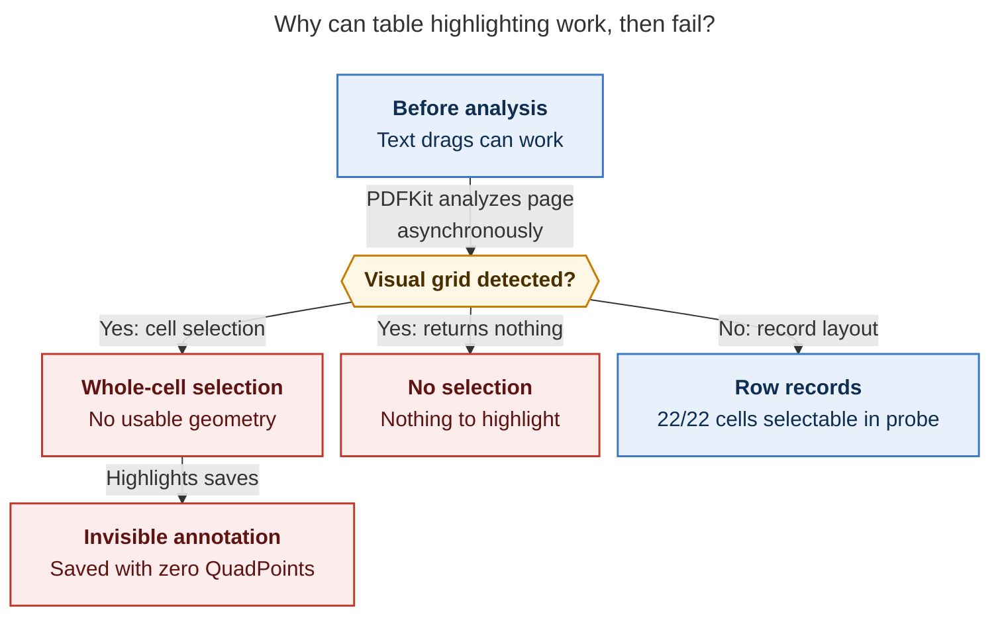

# Diagram proposals: Tables in `bob ref create` PDFs vs. Highlights annotation: consolidated recommendation

Proposals for the swarm linker, not a report. Each diagram restates only what the source
report says.

```yaml
source: research:202610/ref_create_table_layout_for_highlights/ref_create_table_layout_for_highlights__final.md
producer: research.2u.image
check: "Mermaid CLI 12.0.0 (npx pinned, Puppeteer --no-sandbox) with the PDF-mirroring config rendered 1 of 1 Mermaid diagrams"
```

## pdfkit-selection-takeover

```yaml
anchor: |-
  **The failure is time-dependent.** Analysis runs asynchronously per page.
question: |-
  Why can table highlighting work initially and fail later?
illustrates: |-
  Asynchronous per-page analysis changes grid drags into a whole-cell selection with no geometry or nothing, while row records keep normal selection in the Mac probe.
caption: Background analysis can turn working grid drags into selections without geometry; row records retained normal selection in the Mac probe.
review: "772.3x764 px, fit 84.5%; question, source trace, labels, arrowheads, crossings, and visual checks passed; 1 revision"
```


