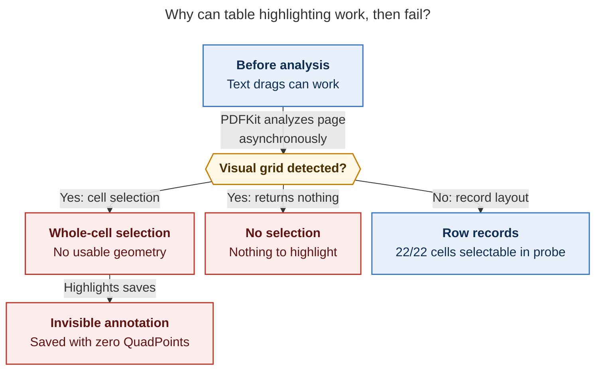
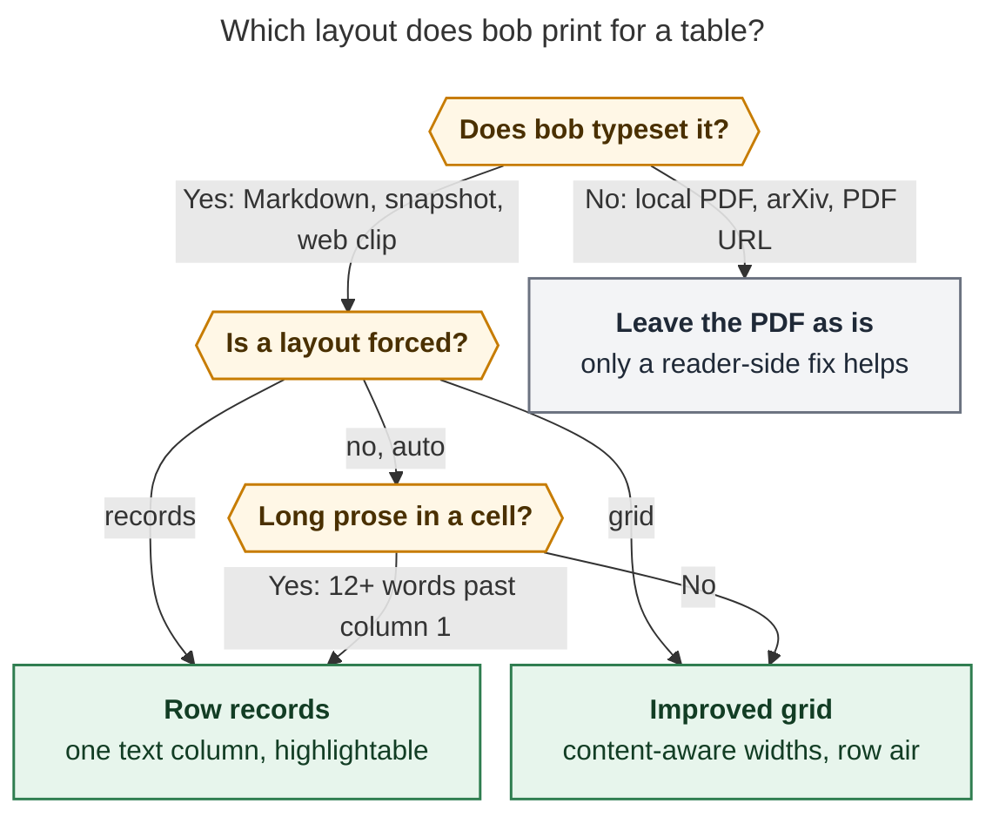

# Tables in `bob ref create` PDFs vs. Highlights annotation: consolidated recommendation

> **Research query:** How should `bob ref create` render tables in PDFs so that cell contents
> are easier to highlight in the Highlights app (which seems to try to select the table cell
> instead) and easier to read, or at least no less readable? Critique the plan (is it a good
> idea, would a different approach be better, and which requirements should change, clearly
> called out), and end with a recommended solution.

## Bottom line

- **Build it, but change the object of the fix.** On macOS 26, a table cannot be both a visual
  grid and cleanly highlightable:
  - PDFKit's built-in document analysis recognizes tables **visually** and takes over drags
    inside them. Highlights inherits this.
  - The takeover yields a
    [whole-cell selection with no geometry](#figure-pdfkit-selection-takeover), or nothing at
    all.
  - No styling of a grid avoids detection. Only a **non-grid layout** gets normal text
    selection back.
- **Your guess was right.** "Highlights tries to select the table cell" is almost exactly
  what happens. The selector is [Apple's PDFKit](#the-evidence-chain), not Highlights' own
  table feature.
- **Recommended shape:**
  - Add a render-time
    **[table-layout pass](#one-shared-table-layout-filter-for-the-pandoc-routes)** to bob.
    Tables whose cells hold prose print as **row records**: a bold lead-in per row, then
    `Header: value` lines in one text column.
  - Short-cell data tables keep an **improved grid**, with content-aware column widths and more
    row air.
  - The policy is reversible through a config default, a frontmatter key, and a per-table
    class.
  - It applies to **new renders only**.
- **[Rejected](#options-considered):**
  - Cosmetic-only fixes as a highlighting fix: padding, open booktabs, borders, zebra stripes.
  - Switching engines (Chrome, Typst, tabularray).
  - Tagged PDF.
  - Rasterized tables.
  - Duplicate "highlight-friendly appendix" copies.
  - Bulk re-rendering of annotated PDFs.
- **In parallel**, [report the PDFKit behavior](#reader-side-now-in-parallel) to the Highlights
  developer and to Apple Feedback. Only a reader-side fix can help PDFs bob does not typeset,
  such as arXiv papers.

## What is actually happening

### The evidence chain

1. **Your own PDF shows the failure directly.** I re-checked cld's claim independently on the
   synced vault copy of `lib/blogs/the_ai_native_sdlc_playbook.pdf` (page 6, a Chrome
   web-clip table):
   - The page holds **28 markup annotations**.
   - **5** are real highlights or underlines on the table, created between 04:51 and 04:57 UTC.
   - The next **20**, created between 04:59 and 05:30, have **all-zero `/QuadPoints`**. Their
     `/Rect` is either `2147483647` on every side (an "infinite" box) or exactly a table
     cell's rectangle.
   - The last 3 annotations, created after 05:33, are on the prose below the table, and they
     work.
   - So whole-cell attempts were silently saved as invisible annotations, and early attempts
     succeeded until something changed.
   - Script: `dump_page6_quadpoints.js` in the lead assets.
2. **cld reproduced the mechanism on the Mac.**
   - The probe loaded bob PDFs into an invisible `PDFView` and synthesized drags. Once
     analysis had run, drags in tables returned a private `isTableCellSelection` selection
     with infinite bounds, or `nil`.
   - Disabling the private `documentAnalysisEnabled` switch restored text selection: 22/22
     cells.
   - Only the row-record layout got 22/22 with analysis on.
   - Even the public `PDFPage.selection(from:to:)` returned `nil` for 20 of 22 cells after
     analysis.
   - Modifier-key drags and `isInMarkupMode` did not help.
3. **Apple users report the same behavior in Preview.**
   - "Preview cannot highlight text or select text when detected as a Table in a pdf file"
     ([thread 256257514](https://discussions.apple.com/thread/256257514)):
     - Opened March 2026 on macOS 26.3, with 119 "me too" votes.
     - The top reply: "Preview blocks annotation (including highlight) of that selected text
       in the table."
     - No setting or `defaults` workaround.
   - The broader "macOS 26 preview does not allow highlighting on much of text"
     ([thread 256139925](https://discussions.apple.com/thread/256139925)):
     - 463 votes. Users single out text in tables, and Acrobat and Chrome are the
       workarounds.
     - One user says 26.3.1 fixed it. cld's probe on 26.5 shows it did not.
   - Neither thread has an Apple response.
4. **No public off-switch exists.** I grepped the macOS 26.5 SDK's public PDFKit headers on
   the Mac:
   - They contain no document-analysis, table-detection, or table-cell API.
   - The names `documentAnalysisEnabled` / `setDocumentAnalysisEnabled` appear only as
     private selectors in the system's shared cache.
   - CoreGraphics' private page-layout code holds the table machinery
     (`CGPDFPageLayoutTable*`, `…CopyTableAtPoint`). Its feature-flag domain lists
     `ModernSelection` and `LayoutWithCTLD`.
   - Whether those flags gate the takeover is **unverified**: the Mac went offline. Toggling
     system feature flags is not something to recommend anyway.
   - **Implication:** an App Store app like Highlights probably cannot ship a supported
     "disable table detection" toggle. The durable reader-side fix has to come from Apple.

### What this settles among the reports

- **Detection is visual and engine-independent.** cld's probe found every grid variant
  detected:
  - booktabs (today's output);
  - content-aware widths;
  - added row spacing;
  - hairline row rules;
  - a full grid;
  - Chrome's tagged bordered table;
  - a CSS-grid "table" with no table tags.
- That contradicts **gem**: no closed borders means no detection.
- It contradicts **mus**: header-only cosmetics are a sufficient first step.
- It contradicts **cdx**: width and spacing may fix selection.
- It refutes the hope in **cdx/mus** that tags matter. Tags are irrelevant.
- **grk's geometric diagnosis is real but secondary.**
  - Pandoc's wrapped `p{}` columns sit 12 pt apart, and adjacent cells share baselines. grk
    measured this, and it is true.
  - cld's page-level probe, run with no analysis, still found 90% of jittered cell drags
    clean.
  - Once analysis runs, geometry no longer matters. Flattening fixes both problems at once.
- **The failure is time-dependent.** Analysis runs asynchronously per page. That explains
  "it can be hard" rather than "it is impossible", and it explains your 04:51–04:57 successes.
- **The text layer is fine.** cdx, grk, and mus each confirmed with MuPDF that cell text is
  extracted in order. The problem is selection, not extraction.

[The selection-takeover diagram](#figure-pdfkit-selection-takeover) shows the branch: once
asynchronous per-page analysis detects a grid, drags yield a geometry-less cell selection or
nothing; row records stayed selectable in the Mac probe.

_Background analysis can turn working grid drags into selections without geometry; row records retained normal selection in the Mac probe._

## What bob does today

Each bob route renders tables as follows:

- **Generic Markdown (`chat` reports, `-M`)**
  - *Engine:* pandoc → XeLaTeX (`render_temp_pdf_from` in `create.rs`)
  - *Table output:* pandoc `longtable` with `booktabs` rules. Wrapped tables get `p{}`
    columns sized from pipe-separator dash counts, so `|---|---|---|` means equal thirds.
    Default `\arraystretch` 1.0 and `\tabcolsep` 6 pt.
- **Vault-note snapshot**
  - *Engine:* pandoc → XeLaTeX with `note.tex` / `note.lua` (`note_snapshot/profile.rs`)
  - *Table output:* The same `longtable`. `note.lua:536` passes `Table` through untouched.
- **Web article / collection**
  - *Engine:* Defuddle → Chromium print (`web_clip_render.py`, `page.pdf(..., tagged=True)`),
    `reader.css`
  - *Table output:* `<table>` with 0.5 pt borders on every cell, zebra rows, 8.5 pt Inter, full
    width.
- **Local PDF, arXiv, PDF URL**
  - *Engine:* Stamped as-is
  - *Table output:* bob cannot change the layout.

The Markdown chain's filter order is the same on both pandoc routes:
`code_catalog` → diagrams swap → `code_break` → `return_links` → (`note.lua`) →
`code_catalog_report`. `code_catalog.lua` walks into table cells, and `return_links.lua`
treats table head, foot, and caption as ineligible for return pills.

## How much this matters

- **Tables are mostly in research reports.**
  - 996 tables across the preserved sources (cld; my rerun matches). 199 of 273 chat sources
    (73%) contain at least one.
  - grk counted 989 chat tables with a slightly different parser.
  - Tables hold about 13% of chat-source text.
- **Most of them are prose tables.**
  - 68% of tables have a cell outside the first column with 12 or more words. Those tables hold
    89% of all table text.
  - grk found 90% of tables have a cell longer than 40 characters.
- **The library is dominated by chat PDFs.**
  - About 498 chat PDFs and 26 blog PDFs.
  - Only about 6 blog PDFs carry tagged tables (roughly 9 tables), but your observed failure
    today was one of them.
- **You effectively never annotate tables.** cld hand-checked every highlight in the
  XeLaTeX-rendered PDFs and found none in a table cell. Meanwhile you annotate the numbered
  lists in the same reports heavily. That is consistent with "it's hard", and it means the
  latent value is large.

### Threshold sensitivity

Lead check, `prose_threshold_sensitivity.py`. This shows what share of tables would print as
row records if the rule were "some cell past column 1 has at least N words":

- **6 words:** Tables as records 87% · Table text as records 97%
- **8 words:** Tables as records 80% · Table text as records 94%
- **10 words:** Tables as records 73% · Table text as records 92%
- **12 words (proposed default):** Tables as records **68%** · Table text as records **89%**
- **15 words:** Tables as records 58% · Table text as records 83%
- **20 words:** Tables as records 44% · Table text as records 71%

The curve is gentle. Any value from 8 to 15 puts 83–94% of annotatable text into records.
Treat 12 as a starting value and tune it on real reports.

## Is this a good idea? Critique

- **Yes. The need is real and measurable.**
  - Tables carry about an eighth of the text in the reports you read most.
  - On macOS 26 they are effectively unannotatable, and failed attempts leave invisible ghost
    annotations behind.
  - This is not polish.
- **The premise needs one correction: "render tables better" is the wrong verb.**
  - The reflexive plan is to restyle the grid: padding, rules, borders, zebra stripes, a
    prettier engine. That improves readability but **cannot** fix highlighting, because
    PDFKit classifies anything grid-shaped as a table.
  - The fix is a **change of representation** for the tables you would annotate.
- **"Don't decrease readability" conflicts with the goal for one class of table.**
  - A prose comparison table, such as `#now` vs `[/] In Progress` across ten attributes, loses
    side-by-side scanning when it becomes records.
  - Records gain body-size text in one column. That is easier to read as prose and lets one
    drag capture the row's lead-in together with the claim, so the quote keeps its context.
    This addresses gem's point that cell quotes lose their row and column.
  - Whole-document readability does not suffer. With bob's flags on five real reports, cld
    measured page counts of 15→15, 11→11, 12→10, 4→4, and 23→22. Records add space, and
    better grid widths elsewhere give it back.
  - The requirement should be made explicit rather than aspirational. See
    [R3 below](#adjusted-requirements).
- **Would I take a different approach?**
  - Mostly [cld's hybrid](#options-considered), tightened by cdx's fidelity rules and mus's
    contract cautions.
  - It ships automatically. An opt-in Div (cdx, mus) would never be used, because agents
    write these reports and you would have to hand-mark tables.
  - It is not flatten-everything (grk). Pure data tables are 13% of tables and 3% of table
    text. They are where a grid is most useful and highlighting is least needed.
- **Pursue the upstream fix too.** File the PDFKit report, because bob cannot fix papers.
  Optionally, nudge the SASE research guidance to prefer numbered lists over prose tables for
  decisions and open questions. You already annotate those lists heavily. That change lives
  outside bob.

## Adjusted requirements

These are deliberate departures from the request.

- **R1, reframed (changed).**
  - **Was:** make tables work better with Highlights.
  - **Now:** print the tables you would annotate in a layout PDFKit does not classify as a
    table, and keep grids where scanning matters more than quoting.
  - **Success test:** in Highlights you can select a word, a phrase, a wrapped passage, and a
    whole former cell. Each saves with real geometry. `bob ref scan` imports exactly the
    intended text.
- **R2, no promise for grids (added).** Under macOS 26, cells in a grid are not reliably
  highlightable in any PDF. For the rare data-table annotation, the stopgap is Highlights'
  rectangle (image) selection, or a per-table `records` override.
- **R3, readability made testable (changed).**
  - **Per document:** no more pages than today, no cramped columns, and visibly separated
    rows.
  - **Per table:** body-size text everywhere. No shrinking tables to fit.
  - The loss of side-by-side scanning in prose comparison tables is an **accepted, called-out
    trade-off**, reversible per table.
- **R4, scope (narrowed and ordered).**
  1. The generic Markdown route, which carries most of the volume, and the note-snapshot route,
     which shares the filter.
  2. [The web-clip route](#web-clip-route-as-committed-phase-2) as phase 2.
  3. Local, arXiv, and PDF-URL PDFs are out of bob's reach. The reader-side report is part of
     the plan.
- **R5, fidelity (added).**
  - The preserved `source.md` keeps the authored table. Only the print changes
    (`decisions:reference-sources-are-preserved-write-once`).
  - Records preserve wording, order, empty cells (shown as `—`), links, inline code, emphasis,
    captions, table numbering, and ids.
  - Complex tables (row or column spans, multiple header rows, footers) stay grids, with a
    diagnostic.
- **R6, reversible (added).** Apple may change PDFKit in 26.x or 27. Provide a global default,
  a per-document override, and a per-table override. Changing the default must never touch
  existing PDFs or notes.
- **R7, new renders only (added).** Annotated PDFs are pagination-sensitive. Never
  bulk-recapture. Re-render a specific reference only on an explicit request.
- **R8, accepted loss (added).** Highlights' image-selection Table Recognition (CSV export)
  stops working on tables printed as records. Quoting is your actual use.

## Options considered

- **A. Restyle grids (widths, spacing, rules, open booktabs, no borders)**
  - *Highlightable on macOS 26:* ✗ still detected (cld)
  - *Readability:* ↑
  - *Cost / risk:* Low
  - *Verdict:* **Do it, for data tables only**
- **B. Records for every table (grk)**
  - *Highlightable on macOS 26:* ✓
  - *Readability:* ↓ for numeric and data tables
  - *Cost / risk:* Low
  - *Verdict:* Too blunt
- **C. Hybrid: records for prose tables, improved grid for data (cld)**
  - *Highlightable on macOS 26:* ✓ where 89% of table text lives
  - *Readability:* ≈ per document (page counts equal or lower)
  - *Cost / risk:* Medium: one Lua filter plus tests
  - *Verdict:* **Recommended**
- **D. Opt-in records only (cdx, mus)**
  - *Highlightable on macOS 26:* ✓ only where hand-marked
  - *Readability:* Unchanged
  - *Cost / risk:* Low
  - *Verdict:* Never used for agent-written reports
- **E. Hanging-indent label gutter**
  - *Highlightable on macOS 26:* Partial: still detected on some pages
  - *Readability:* ↑ for two-column tables
  - *Cost / risk:* Medium
  - *Verdict:* Rejected
- **F. Engine switch (Chrome, Typst, tabularray)**
  - *Highlightable on macOS 26:* ✗
  - *Readability:* Varies
  - *Cost / risk:* High
  - *Verdict:* Rejected
- **G. Tagged PDF**
  - *Highlightable on macOS 26:* ✗ (a tagged Chrome table was detected)
  - *Readability:* n/a
  - *Cost / risk:* High
  - *Verdict:* Rejected
- **H. Grid plus linear appendix**
  - *Highlightable on macOS 26:* ✓ in the appendix only
  - *Readability:* ↓ (length, duplicate quotes)
  - *Cost / risk:* Medium
  - *Verdict:* Rejected
- **I. Tables as images**
  - *Highlightable on macOS 26:* ✗ (no text)
  - *Readability:* ↓
  - *Cost / risk:* Low
  - *Verdict:* Rejected
- **J. Reader-side: disable document analysis**
  - *Highlightable on macOS 26:* ✓ for every PDF
  - *Readability:* n/a
  - *Cost / risk:* Not ours; private API today
  - *Verdict:* **Report it; don't block on it**
- **K. Table-cell catalog, like the code catalog (mus)**
  - *Highlightable on macOS 26:* Not in-app; copy only
  - *Readability:* n/a
  - *Cost / risk:* A new JSON contract
  - *Verdict:* Out of scope; reopen if cell copy is wanted

## Where the reports disagreed, and how I resolved each point

### Root cause

- **The disagreement:**
  - gem: closed borders trigger VisionKit cell snapping.
  - mus: the text layer is clean, so app heuristics are at fault; reproduce first.
  - cdx: geometric ambiguity is a hypothesis; test before acting.
  - grk: 12 pt gaps and shared baselines.
  - cld: private PDFKit document analysis, measured.
- **Resolved for cld.** It is the only report with Mac measurements. Its conclusion
  independently explains the zero-quad annotations I verified in the vault, and the Apple
  threads corroborate it.
- **mus's "reproduce first" gate has been met.** The gate is satisfied by the probe and by
  your own failed annotations. No further diagnosis is needed before building. A Mac
  acceptance pass is still needed after building.

### Automatic default vs. opt-in vs. flatten-all

- **The positions:**
  - cdx and mus: keep grids by default, opt in to prose.
  - grk: flatten every table and opt out with `{.keep-table}`.
  - cld: classify automatically.
  - gem: two-column prose tables only, mostly as width changes.
- **Resolved as automatic classification at 12 words, with three override levels.**
  - Opt-in fails the real workflow.
  - Flatten-all spends readability on the 13% of tables where a grid helps most and
    annotation matters least.
  - gem's two-column-only rule misses three- and four-column comparison tables. Those are 74%
    of tables (grk's shape counts).

### Hanging-indent "label gutter" layouts

- grk's "cards" and cld's "records" are the **same single-column idea**, and both work.
- cld's separately tested *hanging-indent key/value* variant, with labels in a left gutter, was
  still classified as a table on some pages (10 text / 5 cell / 4 nothing).
- **Resolved:** no side-by-side label column. Labels go inline (`Header: value`) or above the
  value.

### Filter position

- **The positions:**
  - cld: run first.
  - cdx and grk: after catalog capture and the diagrams swap, before `return_links`.
  - mus: warns that any `Table` rewrite risks the catalog and return-link contracts.
- **Resolved: run the table pass first, as AST-to-AST.**
  - Every later pass then sees the printed structure: catalog capture, `code_break`, return
    links, `note.lua`, and the catalog report.
  - That matches the render-time-catalog decision ("pandoc's render is the only point that
    knows which blocks reached the PDF").
- **The hazard mus raises is avoided by two rules:**
  1. **Move cell content as AST nodes.** Never use `stringify` or `RawBlock` for cell bodies.
     Links, inline code, emphasis, and footnotes then remain visible to `code_catalog` and
     `return_links`.
  2. **Emit header labels as plain strings.** Pandoc headers rarely carry links. Plain labels
     never duplicate a link or an id once per record.
- Inline code bytes do not change when a node moves. Pipe tables cannot contain fenced code or
  Mermaid blocks. Grid tables can, and their blocks move intact.

### CLI flag vs. in-document and config switches

- **The positions:** grk proposed `--keep-tables`. mus argued against any new flag.
- **Resolved: no CLI flag in v1.** bob already has precedents for each level:
  - a frontmatter switch: `bob-return-links: false`;
  - a config key: `highlights.coordinate_pdf_writes`.
- A per-create flag would carry `cli_rules.md` obligations (a short alias and help text) for
  something that belongs with the document or the user's preferences.

### Web route

- **The positions:**
  - cdx and mus: leave it unless a repro shows the problem.
  - cld: phase 2.
  - grk: in scope, with a DOM rewrite on a print clone.
  - gem: CSS restyle.
- **Resolved: in scope as a [committed phase 2](#web-clip-route-as-committed-phase-2).** Your
  observed failure today *was* a web-clip table, but the volume is about 1% of tables.
- **The fix:** rewrite prose `<table>`s into record markup on the **print clone only**, leave
  `tagged=True` on, and verify with the probe. cld did not test Chrome-printed records;
  confirming that they escape detection is part of phase 2.
- **Also adopt gem's `reader.css` readability fixes for remaining grids:** drop the vertical
  borders and zebra stripes, and raise the text from 8.5 pt to about 9.5 pt. These are for
  readability only.

### Tagged PDF, other engines, dual rendering

- **Unanimous where tested.** Tagging and engine changes do not escape visual detection: a
  tagged Chrome table was detected.
- mus's "dual render" option (a grid plus a linear appendix) keeps the grid's pointer
  capture. It also doubles the length and creates duplicate quote locations.
- **All rejected.**

## Recommended design

**Caption:** bob prints prose tables as single-column row records, which PDFKit leaves
selectable. Short-cell data tables keep an improved grid. An explicit per-table,
per-document, or global setting overrides the automatic choice.

A layout is "forced" by, in order of precedence:

1. a per-table class;
2. the document's `bob-tables` frontmatter;
3. the `highlights.table_layout` config default.

The figure was rendered with Mermaid CLI 12.0.0 using the PDF-mirroring config: 661 × 804 px,
a 98.8% fit. PNG export failed in this environment's sandboxed browser. I checked the labels
in the SVG text and the measured fit, but did not visually review the image.

### One shared table-layout filter for the pandoc routes

- **Name and wiring:**
  - Add `table_layout.lua`, embedded like `return_links::FILTER`.
  - Write it in `write_render_filters` (`create.rs`) and pass it as the **first**
    `--lua-filter` in both chains: `render_temp_pdf_from` and `note_snapshot/profile.rs`.
- **Classification:**
  - **Prose:** a table is prose when any body cell outside column 1 has at least
    `prose_words` words. The default is 12.
  - **Data:** every other table.
  - **Complex:** tables with spans, multiple header rows, intermediate heads, or footers always
    stay grids. The filter reports them to the render log.
- **Record layout:**
  - **Lead-in:** one record per body row. Column 1 becomes a **bold run-in lead line** when it
    is short (8 words or fewer) and its header is empty or generic. Otherwise column 1 is
    rendered as an ordinary `Header: value` field.
  - **Two-column tables:** the value follows as an indented paragraph.
  - **Three or more columns:** each remaining cell is its own line. The header label is plain
    text in muted semibold sans, followed by the cell's original inlines and blocks.
  - **Spacing and breaks:** about 4 pt between records. `\needspace` keeps a lead-in with its
    first field; `needspace.sty` is already in `RENDER_TEX_PACKAGES`. Records stay breakable
    across pages.
  - **Captions:** the caption and table number survive as a numbered caption line. For example,
    step the `table` counter and keep the `\label` or id on a wrapper `Div`, so
    cross-references and return links still resolve. cdx's prototype dropped "Table 1"; don't
    ship that.
  - **No side-by-side columns** anywhere in a record.
- **Grid layout (data and complex tables):**
  - **Widths:** compute content-aware widths in the AST by adjusting `colspecs`. The minimum is
    the longest word and the maximum is the longest cell, as in cld's `table_widths.lua`. When
    everything fits, keep natural `l` columns. Respect author-supplied widths when the
    separator was clearly deliberate.
  - **Rows:** add row air with a header-only `\arraystretch` of about 1.2, scoped to
    `longtable`.
  - **Hairline row rules (cld):** these look better. They need either a `RawBlock` rewrite or a
    template hook. Ship them only once the catalog and return-link tests run with tables in the
    fixtures. Otherwise defer.
  - **Type size:** body size. No shrinking.
- **Overrides:**
  - Config `highlights.table_layout = auto|records|grid` (default `auto`), plus
    `highlights.table_prose_words` (default 12). Both are passed as pandoc metadata.
  - Frontmatter `bob-tables: auto|records|grid`, mirroring `bob-return-links: false`.
  - Per-table: a fenced Div `::: {.bob-records}` or `::: {.bob-grid}` around the table. cdx
    notes this works on pandoc 3.1.3, unlike newer caption-attribute syntax.
  - Document all three in `docs/highlights-create.md` and in `bob ref create --help`'s
    rendering notes, following `docs.md`.
- **Unchanged:**
  - the preserved source;
  - `bob ref code`'s contract;
  - the source store;
  - marker writes and PDF coordination.
  - New PDFs get freshly derived catalogs, as today.

### Web-clip route as committed phase 2

- **Where:** in `web_clip_render.py`, rewrite prose `<table>`s into record markup on the
  **print DOM only**, after Defuddle and after the saved-source conversion. The saved source
  keeps the table.
- **Rules:** use the same classification rule and threshold. Keep `tagged=True`, because
  headings and outline benefit from it.
- **Remaining grids:** remove per-cell vertical borders and zebra fills, raise the table type
  to about 9.5 pt, and keep `thead` repeating.
- **Verify with cld's probe.** Chrome-printed records are expected to escape detection, but
  this has not been measured.

### Reader side now in parallel

- **Send the Highlights developer the specifics:**
  - macOS 26 `PDFView` runs document analysis by default.
  - Drags in detected tables yield `isTableCellSelection` selections with infinite bounds.
  - Highlights then saves zero-QuadPoint annotations.
  - Disabling analysis restores selection.
- **Ask for two things:**
  - a preference, if one is feasible;
  - at least a refusal to save geometry-less annotations.
- **File the same with Apple Feedback.** No public API exists, so Apple is the durable path.
- **Until then,** use rectangle selection for tables in papers.

## Verification

1. **Filter and AST tests** (pandoc-gated, following the existing pattern in `create.rs`):
   - **Classification:** a prose table yields no `longtable` in the kept `.tex`, and its
     labels and values appear in text extraction. A data table keeps `longtable` with the
     computed widths.
   - **Overrides:** a complex table stays a grid. All three override levels work.
   - **Contracts:** links and inline code in prose cells still produce return-link pills and
     code-catalog link entries. The existing table head/foot/caption ineligibility tests still
     pass for grids.
   - **Captions:** numbering and table ids survive in records.
2. **Fidelity check.** Whitespace-normalized MuPDF text of every table's cells appears once,
   in order, with nothing dropped or duplicated, on fixtures and on five real chat reports.
   Page counts are no higher than today.
3. **Mac probe.** Re-run cld's `cells_probe.swift` on the new renders. The expected result is
   **0 table-cell selections** on record content, with phrase drags succeeding.
4. **One real Highlights session** on a fixture reference and one real report:
   - select a word, a phrase, a wrapped passage, and a whole former cell;
   - save, close, and reopen;
   - confirm each annotation has non-zero `/QuadPoints`;
   - run `bob ref scan` and compare the quotes.
5. **Readability check by you** on two or three real reports at your normal zoom:
   - find a fact;
   - compare across rows;
   - say which table a quote came from.
   - Tune `prose_words` if comparison tables you care about flip the wrong way.

## Risks and open questions

- **Comparison tables you want kept as grids.** Some prose comparison matrices will flip to
  records. The per-table and per-document overrides exist for that.
  - The [threshold sensitivity list above](#threshold-sensitivity) shows how much each step
    moves.
  - If misclassification is common, consider adding a "short-cell majority" rule rather than
    raising the threshold.
- **Apple changes PDFKit.** If a future macOS stops hijacking table drags, flip
  `highlights.table_layout` to `grid`. That is one config line, with no stored data to
  migrate.
- **Highlights on iPad.** It is untested. iPadOS 26 PDFKit probably behaves the same, and
  records help there too.
- **Feature-flag lead.** CoreGraphics' `ModernSelection` and `LayoutWithCTLD` flags may gate
  the behavior. The Mac went offline before I could check. Treat this as curiosity, not a
  workaround: overriding system flags is unsupported.
- **Agent prompt nudge.** Asking research agents to prefer numbered lists over prose tables
  would reduce the problem at the source, but it changes report style everywhere. That is
  your call, and it is outside bob.
- **Open question for you:** do you ever use Highlights' table-to-CSV export on these
  reports? If you do, [R8](#adjusted-requirements) needs a cheaper way to keep grids, such as
  a sticky per-parent-note setting.

## Follow-ups

Each follow-up is separable.

- **Emoji print as missing glyphs** on the generic Markdown route. For example, 🍅 becomes
  tofu, visible in cld's `compare_*.png` assets. DejaVu has no emoji fallback, while note
  snapshots ship Noto Emoji. This is unrelated to tables (cld).
- **`note.lua` passes `Table` through untouched** (`note.lua:536`), so snapshot table cells
  skip `process_inlines` (gem). It is low impact, because area and project notes have
  essentially no Markdown tables (grk). Running the new filter first also changes what
  `note.lua` sees for prose tables.
- **Optional `bob ref doctor` warning** counting zero-geometry ghost annotations. The SDLC
  playbook page has 20. They do not reach the reference note today; the note shows only the
  real table quotes.
- **A decision record** once the design ships: "prose tables print as records". Its reopen
  condition is a PDFKit change that stops table-drag hijacking.
- **Optional explicit re-render** of unannotated, table-heavy chat PDFs. Never automatic.

## Recommended solution

Add a shared, AST-only `table_layout.lua` pass that runs **first** in both pandoc → XeLaTeX
chains:

- **Prose tables become records.** Tables with a cell of 12 or more words outside the first
  column print as single-column row records: a bold lead-in, then `Header: value` lines, with
  captions, numbering, ids, links, and inline code preserved.
- **Data tables get a better grid.** All other tables keep a grid with content-aware widths and
  more row air.
- **The choice is reversible at three levels:**
  - `highlights.table_layout` (default `auto`);
  - frontmatter `bob-tables`;
  - per-table `.bob-records` / `.bob-grid` classes.
- **It touches nothing else.** No CLI flag, no new engine, no tagging, no source-store change,
  and no re-rendering of existing PDFs.

Then extend the same rule to web clips with a print-DOM rewrite, plus `reader.css` cleanup,
and confirm with the Mac probe and [one real Highlights session](#verification). In parallel,
report PDFKit's table-cell takeover to the Highlights developer and to Apple. It is the only
fix for PDFs bob does not typeset.

This works because the selection failure comes from PDFKit's visual table detection, which no
restyled grid escapes. Moving prose out of grids is the one change that measurably restores
normal highlighting. With better widths in the remaining grids, it leaves documents no longer
than today.

## About this report

- **Date:** 2026-10-29
- **Lead researcher:** consolidation of five independent reports in this directory
  (`__cdx`, `__cld`, `__grk`, `__mus`, `__gem`), plus new lead checks against the live
  vault and the MacBook.
- **Code inspected:** bob-cli `master` @ `d0603a5d`.
- **Environment checked by the lead:** MacBook on macOS 26.5 (25F71) with Highlights 2026.1.2,
  reached over SSH before it went offline. Linux host with the synced vault, pandoc 3.1.3, and
  MuPDF.
- **Lead assets:** `ref_create_table_layout_for_highlights__final_assets/`. These hold the
  annotation dump script, the threshold-sensitivity script, and the figure source. No
  production code or vault content was changed.

## Sources

**Swarm reports (this directory):**

- `ref_create_table_layout_for_highlights__cld.md`, with assets in
  `ref_create_tables_vs_pdfkit_cell_selection__cld_assets/`. These include the Mac probe,
  prototype filters, corpus script, and comparison renders.
- `ref_create_table_layout_for_highlights__grk.md`: geometry measurements and the web-clip
  design.
- `ref_create_table_layout_for_highlights__cdx.md`, with trials in
  `highlights_table_annotation_trials__cdx.zip`: requirements framing and the fidelity rules.
- `ref_create_table_layout_for_highlights__mus.md`: contract hazards and the no-CLI-flag
  argument.
- `ref_create_table_layout_for_highlights__gem.md`: `reader.css` readability, quote-context
  loss, and the `note.lua` pass-through.

**Lead checks:**

- Vault `lib/blogs/the_ai_native_sdlc_playbook.pdf`, page 6: annotation `/QuadPoints` and
  `/Rect` dump.
- `~/bob/.bob/ref-sources/*/*/source.md`: threshold sensitivity.
- `~/bob/lib/**.pdf`: producer split and tagged-table counts.
- MacBook (macOS 26.5, Highlights 2026.1.2):
  - public PDFKit SDK headers (no analysis API);
  - shared-cache strings (`documentAnalysisEnabled`, `CGPDFPageLayoutTable*`);
  - `/System/Library/FeatureFlags/Domain/{PDFKit,CoreGraphics}.plist`.

**bob-cli:**

- `src/native/highlights_ref/create.rs`: `PANDOC_HEADER_INCLUDES`, `write_render_filters`,
  filter order in `render_temp_pdf_from`.
- `src/native/highlights_ref/note_snapshot/{profile.rs,note.lua}`.
- `src/native/highlights_ref/{return_links.lua,code_catalog.lua,render_tex.rs}`.
- `scripts/web_clip/{web_clip_render.py,template/reader.css}`.
- `docs/highlights-create.md`.

**Decisions:**

- `decisions:reference-sources-are-preserved-write-once`
- `decisions:code-copy-reads-render-time-catalog`
- `decisions:open-pdf-writes-are-coordinated` (via cdx and mus)

**External:**

- [Apple Community 256257514](https://discussions.apple.com/thread/256257514): Preview cannot
  highlight text detected as a table (macOS 26.3).
- [Apple Community 256139925](https://discussions.apple.com/thread/256139925): macOS 26
  Preview highlighting failures, concentrated in tables.
- [Highlights: extract PDF table](https://highlightsapp.net/how-to/mac/extract-pdf-table-to-excel/)
  and [Power Tools](https://highlightsapp.net/how-to/mac/power-tools/): Table Recognition is
  an image-selection workflow.
- [Pandoc pipe-table widths](https://pandoc.org/MANUAL.html#extension-pipe_tables) and the
  [Lua table API](https://pandoc.org/lua-filters.html#type-table).
