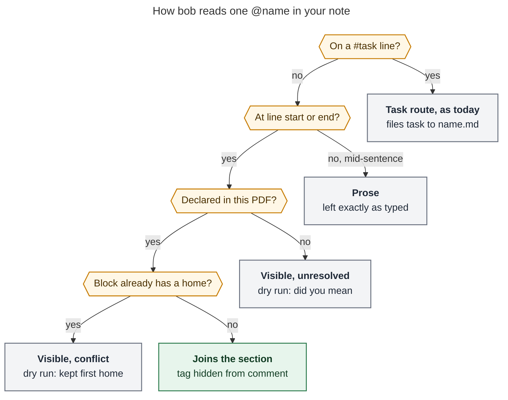
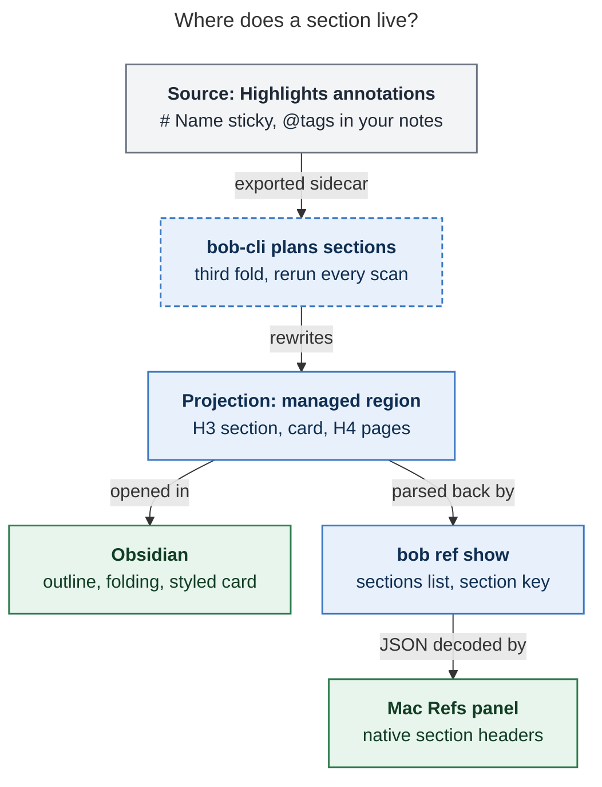

# Named sections for ref-note annotations (`# Name` + `@name`)

**Consolidated report** by the lead researcher, 2026-10-24. It merges five independent
reports (`__cdx`, `__cld`, `__grk`, `__mus`, `__gem`, kept beside this file) with my own
checks. I verified against bob-cli `0afeb2f3`, bob-mac-capture `8400bd3`, the vault
(`~/bob/lib` sidecars and `~/bob/ref` notes, read only), and the Obsidian and Highlights
documentation. Nothing was implemented, and nothing was tested in the real Highlights or
Obsidian apps.

> **Request.** Group annotations under a *section annotation* of the form `# <name>`,
> with an optional description after a blank line. Any highlight note, underline note, or
> standalone note containing `@<name>` renders under that section. The result must look
> good in Obsidian, in the Bob Mac Capture Refs panel, and wherever else ref notes are
> read. Lead the design, critique the plan, call out requirement changes, and recommend a
> solution.

## Bottom line

**Build it, with a stricter grammar than the request.** The gesture is right: name a
bucket once and tag the things that belong in it, all while reading in Highlights. Only
one part of the spec has to change: "contains `@<name>`" is too loose to be reliable.

- **Declare** a section with a sticky note whose first line is `# Name`. Everything after
  that line is the description.
- **Join** a section by typing `@name` at the **start or end of a line** in your own note
  text. A mid-sentence `@word`, a `#task` line, and quoted PDF text never join. Only names
  declared in the same PDF count. Matching ignores case, spaces, `-`, and `_`, so
  `@open-questions` finds "Open questions".
- **Persist nothing new.** Your annotations are the record. bob re-derives the grouping on
  every scan, as it already does for `<` continuations and underline emphasis. Nothing
  is written to the PDF, the sidecar, frontmatter, or a state file.
- **Render real headings.** Each section gets `### Name`, a quiet section card (tag,
  count, pages, description), and `#### Page N` captions. Under those sit the same
  callouts and `^h-` IDs as today. Unsectioned blocks go under `### Other highlights`.
  A note with no declarations renders **byte-for-byte as today**.
- **Clients stay thin.** `bob ref show` JSON gains an additive `sections` list and a
  per-annotation `section` key. The Mac panel draws native section headers from that
  JSON and never parses `#` or `@`.
- **Three gates come before feature code:**
  - a two-minute Highlights export test on the Mac;
  - the quote-wrap parser fix already filed as `bob-cli-ba`;
  - page-heading detection that respects heading level.

## 1. Is this a good idea?

**Yes.** Three facts make it worth building.

1. **The demand already shows up as prose.** Ref notes on Bryan's own drafts carry
   comments like "Include this in the memory section as well." and "Maybe reference this
   from the section where I talk about types of AI debt?" (`ref/notes/sase_blog_261019.md`).
   Another note has "Add this to intro." and "I like 'Why a TUI?' in this section."
   (`ref/chat/sase_launch_post_outline.md`). `@memory` is the structured form of a
   sentence that is already being typed. For papers and books, the same gesture becomes
   thematic synthesis ("Methods", "Objections") across distant pages.
2. **It fits a pattern bob has already proven.** Underline emphasis and `<` continuations
   are both stateless folds computed at render time. Each is reversible, safe for block
   identity, and leaves leftover markers visible when they don't apply. Sections are a
   third fold of the same kind.
3. **Not using it should cost nothing.** 516 ref notes have a managed region. The median
   annotation count is 0. 28 notes have at least 5 blocks, 12 have at least 10, and 6
   have at least 20 (the maximum is 28). Most notes will never declare a section, so
   output for them must not change.

**The costs, stated plainly:**

- **More grammar.** Comments already carry `<`, `#task … @route`, and image paths. This
  adds `# ` and `@tag`.
- **No autocomplete.** Highlights has no Bob-aware completion, so typos will happen. The
  design answers them with visible leftovers and "did you mean" diagnostics.
- **One home per block.** A highlight that fits two themes has to pick one.
- **Page order is lost.** A sectioned note no longer reads strictly by page, so every
  group keeps its page captions.
- **Work in two repos.** bob-cli lands first. The Mac half is gated by macOS CI.

**Would I take a different approach?** No. The named-section gesture beat every
alternative the five reports raised:

| Alternative | Why it loses |
| --- | --- |
| Highlights color categories | Colors are global and few, they have no descriptions, bob never sees them in the sidecar, and a color-sorted export breaks `<`. |
| `#hashtag` membership | Collides with `#task`, Bryan's `#a` prefix, and Highlights' own `#tag` feature. It also sits too close to `# Name`. |
| Positional "chapters" (Readwise `.h1`: everything after a heading) | Cannot gather pages 3 and 15 into one theme, and membership shifts when an annotation is added in between. |
| Automatic grouping from the PDF outline | Answers "what is the document's structure", not "what is my synthesis". Worth adding later as a separate "by chapter" view. |
| Obsidian-side tags, Dataview, or editing headings in the region | The managed region is regenerated on every scan, so edits are lost. Obsidian-only. |
| A separate note per section, using transclusion | Extra files and lifecycle for a gesture local to one document. Better as a later "extract section" action. |
| Grouping in the Mac app over flat JSON | Breaks `decisions:mac-capture-is-a-thin-client`. Obsidian, agents, and Copy would disagree with the app. |
| One wrapping callout per section | Obsidian: "We do not support links to specific parts of quotations, callouts, and tables." Every member's `^h-` link and 🔖 task link would be at risk. |

## 2. Facts that shape the design (verified)

1. **The sidecar parser deletes headings.** `parse_sidecar_chunk`
   (`src/native/highlights_ref/sidecar.rs:295`) drops any chunk made only of headings. It
   also filters heading lines out of comments and standalone notes.
   - Today a sticky note reading `# Methods` vanishes.
   - A `# Methods` sticky with a description renders as a plain `[!note]` holding only the
     description.
   - No user note in the vault starts with `# `, so shipping declarations changes no
     existing note.
2. **Page-heading detection ignores heading level.** `sidecar_page_heading_details`
   (`sidecar_render.rs:2050`) treats any `#`-led line whose label starts with `page `,
   `page:`, `p. `, or `p ` as a page break. A sticky titled `# P values` or `# Page
   layout` would split the page stream today.
3. **Quote-wrap bug `bob-cli-ba` (ready, filed by cld).** In linked sidecars, a
   hard-wrapped quote line that starts with `# ` ends the quote, is deleted, and the rest
   of the quote is shown as a Comment. Two real notes are affected
   (`ref/docs/gastown_readme.md`, `ref/chat/sase_listen_antennapod_setup.md`). A naive
   grammar would also read those lines as section declarations.
4. **`@` already routes tasks.** `split_annotation_task_route_suffix`
   (`annotation_tasks.rs:198`) peels a trailing `@name` off a `#task` item and files the
   task to `~/bob/name.md`. If that note is missing, the whole PDF fails (`:245`).
   - Three real sidecar lines use it (`- #task … @sase`), so grk's "zero `@tokens`"
     finding is wrong.
   - The only other `@word` in a user comment is prose: "Keep @chat and @agent!".
5. **The region parser treats every H3 as a page.** `parse_managed_region` (`region.rs:81`)
   reads every H3 except "Removed highlights" as a page label. Only `^h-` lines count as
   block IDs (`:292`). Anything it can't classify goes to `unparsed`.
6. **ID reuse goes through the parsed region.** `plan_block_ids` (`sidecar_render.rs:1054`)
   keeps an existing ID when (kind, page label, normalized text) from the parsed region
   matches the sidecar, with the comment as a tiebreaker. Highlight IDs ignore comments.
   Sticky-note IDs hash their full text (`:924`). Image IDs hash the image bytes. So the
   new region parser must report exactly the same page labels for grouped blocks, and
   tag handling must keep sticky-note text stable (see §4.7).
7. **Absorbed underlines join their host.** An absorbed underline's comment, images, and
   `#task` join the host block (`docs/highlights-ref-sync.md`, Underline emphasis).
8. **The Mac panel reads JSON, not Markdown.**
   - It decodes `bob ref show -f json` tolerantly, using `decodeIfPresent`
     (`RefsCore/RefsInspector.swift`, `RefsShowRow`).
   - It renders one flat HIGHLIGHTS feed with a page-run label rule
     (`RefsInspectorFeed.entries`).
   - It **drops annotations of an unknown `kind`** (`isInspectorEntry` defaults to `false`).
   - Its tokens use adaptive system colors only. Yellow, gold, and orange mean your
     highlights, underlines, and notes (`RefsVisualTokens.swift`).
9. **Obsidian rules.**
   - A structured block (quote, callout) takes its `^id` "on a separate line, with a blank
     line before and after".
   - IDs "can only consist of Latin letters, numbers, and dashes".
   - Headings fold by default.
   - Custom callouts are styled through `.callout[data-callout=…]`. The vault snippet
     `~/bob/.obsidian/snippets/ref-highlights.css` (tracked in vault git) already styles
     `data-callout-metadata` captions.
10. **There is one annotation writer.** Annotation sync is the Mac's full scan
    (`decisions:references-are-ingested-at-birth`). athena and apollo only *read* ref
    notes, mostly through `bob ref show` for agents.
11. **Highlights' export of `# ` is undocumented.** Highlights exports comments and sticky
    notes "as regular text", and `#a` and `#task` survive verbatim. Its docs don't say
    whether a line starting with `# ` is exported verbatim. That needs a real export test.

## 3. Requirement adjustments (explicit)

| # | You asked | I recommend | Why |
| --- | --- | --- | --- |
| A1 | A section annotation of the form `# <name>` | A **sticky note** (standalone note) whose first non-empty line is `# Name`: one `#` and a space. The blank line before the description is conventional but not required. *(Clarification.)* | A sticky note carries only your words. Letting highlight comments declare raises the question of whether the quote renders as a card or a member, and invites the `bob-cli-ba` false positives. Highlight-anchored declarations (Readwise style) can come later. |
| A2 | Any note that **contains** `@<name>` | `@tag` counts only at the **start or end of a line**, or as a line of only tags, and only in your own text: comments, sticky text, image captions. Never in a quote, never mid-sentence, never on a `#task` line. **This is the biggest change.** | Stripping a mid-sentence tag mangles prose ("Critical insight for @storage performance." becomes "Critical insight for performance."). Leaving it in clutters the note. Positional tags are where people type tags anyway. |
| A3 | (implicit) | Only names **declared in the same PDF** count. Forward references work. An unknown tag stays visible and gets a "did you mean" diagnostic. | Declarations act as an allowlist, so `@chat` in prose is never captured by accident. |
| A4 | Exact `@<name>` | **Forgiving key**: lowercase, keeping only letters and digits. `@open-questions`, `@OpenQuestions`, and `@open_questions` all match "Open questions". Optional **aliases** on the heading line: `# Open questions @q`. | Multi-word names need no quoting syntax. iPad autocapitalization stops mattering. An alias lets you rename a title without retagging. |
| A5 | (silent) | On a `#task` line, a trailing `@name` is **always a route**, exactly as today. To join a section, put the tag on another line. | Behaviour stays deterministic and keeps today's route semantics and error contract. cld's "route only if the note exists" would let a section tag quietly become a route the day a matching root note appears (the vault has 653). |
| A6 | "One or more annotations" per section | Each displayed block has **one home**. The first matching tag in reading order wins, and extra tags stay visible with a diagnostic. | `^h-` IDs must stay unique, and a block cannot be rendered twice. |
| A7 | Highlight, underline, and standalone notes | Image captions can join too. An absorbed underline joins through its host block. A `<` group joins as one unit. | The units already exist in the render. Splitting them would break their identity contracts. |
| A8 | (unspecified) | **Sections render first**, in declaration order, then `### Other highlights` by page. Notes without declarations stay byte-identical. | Your structure leads. "In place at the sticky's page" (mus, gem) would put page-9 quotes inside the page-3 flow. |
| A9 | "Think hard about persistence" | **Persist nothing new** (§4.4). | One source of truth, the same as the two existing folds. |
| A10 | (implicit) | Adding, removing, or changing membership **never changes a `^h-` ID** and never re-creates a task. | 🔖 links, Task Links, and `[h::]` deduplication must survive reorganization. |
| A11 | (unspecified) | An empty section still renders, as a scaffold. | Lets you sketch an outline first and fill it while reading. |

**Deferred on purpose:** nested sections, several homes per block, several declarations
in one sticky, highlight-anchored declarations, positional chapters, PDF-outline grouping,
and a section-rename tool.

## 4. Design

### 4.1 Declaring a section

```text
# Memory

Everything that belongs in the blog's memory section.
```

- **Where.** Only in a sticky note. The first non-empty line may follow an optional
  `Note:` label, and Highlights' `##### date:` annotation headers are ignored. That line
  must be `# ` followed by a non-empty title.
- **Title and aliases.** The title is the rest of the line, trimmed. A trailing run of
  `@alias` tokens adds match keys and is removed from the title. Heading-unsafe
  characters (`#`, `|`, `^`, `[[`, `]]`) are stripped for display.
- **Description.** All later lines, with blank edges trimmed and beautified like any note.
  - `#task` bullets in the description import as usual and 🔖-link to the section.
  - Image-note paths render on the card.
  - `@tags` in the description are literal text, because sections do not nest.
- **Never a declaration:**
  - a highlight or image comment starting `# `, which renders as literal text with a hint;
  - `##` or deeper headings;
  - a `<` note;
  - a line that continues a wrapped quote (`bob-cli-ba`);
  - `\# Name`, which is an escape.
- **Keys and IDs.**
  - The match key is NFKC-normalized and lowercased, with only letters and digits kept.
  - The section ID is `^s-<slug>`. The slug comes from the first alias, or else from the
    title's words, joined with `-` and lowercased ASCII. When the name has no Latin
    letters, the ID is `s-` plus 8 hex digits of a hash of the PDF and the key.
  - IDs never use the `h-` prefix, so counts, tombstones, rename, and task code can never
    mistake a section for an annotation.
- **Duplicates.** Two declarations with the same key merge into one section. The first
  supplies the title, the descriptions are concatenated in order, and a dry-run warning
  names both pages. No content is lost.
- **Reserved titles.** "Other highlights" and "Removed highlights" are reported and
  ignored.
- **Order.** Sections appear in declaration (sidecar) order. Tip: stack your declaring
  stickies on page 1 to set the outline order on purpose.

### 4.2 Joining a section



*Figure 1. bob scans only your own words (comments, sticky text, image captions), never
quoted PDF text. A tag joins only when every check passes. Otherwise it stays visible,
so **if you still see an `@name`, it did not group**. That is the same rule `<` already
uses.*

- **Token.** `@`, then a letter or digit, then letters, digits, `_`, or `-`. One trailing
  `.`, `,`, `;`, `:`, `!`, `?`, or `)` is tolerated. The `@` must start the line or follow
  whitespace, so email addresses never match. Inline code and fenced code are ignored.
- **Order of stripping.** Tags are read after the `Comment:` or `Note:` label and after a
  leading `<` are removed, so `< @memory` works. Lines are read inside one list marker, so
  `- @memory` works and is inert to the task importer, which only fires on `#task` items.
- **Consumption.** A matched tag is removed from the rendered text and whitespace
  collapses. A line left empty disappears. A comment left empty means no Comment card.
- **Escape.** `\@memory` renders as literal `@memory`, matching the existing `\<`
  convention.
- **Better error.** When a `#task` route target is missing but the name matches a declared
  section, keep today's error and add a hint: "to join section Memory, put `@memory` on
  its own line".

| Your note | Result |
| --- | --- |
| `@memory` | Joins Memory. No comment card. |
| `@Memory Compare with table 2` | Joins. The comment reads `Compare with table 2`. |
| `Use these as placeholders @visuals` | Joins Visuals. The comment reads `Use these as placeholders`. |
| `Keep @chat and @agent!` | Prose, even if `# Chat` is declared. |
| `- #task Draft the intro @sase` | A route to `sase.md`, as today. It never joins a section. |
| `@memory`, then `- #task Check the numbers @sase` | Joins Memory, and the task still routes to `sase.md`. |
| `@memry` | Stays visible. Dry run says `did you mean @memory?`. |
| `@memory @visuals` | Joins Memory. `@visuals` stays visible with a conflict diagnostic. |

### 4.3 Resolving membership across the other folds

Plan sections **after** `plan_annotation_folds` (underlines first, then continuations),
over *displayed blocks*:

- a highlight with any absorbed underlines;
- a `<` group;
- a sticky note;
- an image;
- a standalone underline.

Within a block, tags are taken in this order: the head's, then the followers' in sidecar
order, then absorbed underlines' in run order. The first match is the block's home.
Declarations never join a section. The planner is a pure function of the sidecar, so
deleting a tag or a declaration and rescanning restores the previous layout exactly.

### 4.4 Persistence: where the grouping lives



*Figure 2. The text you type in Highlights is the only record of a section. bob plans the
grouping on every scan (dashed box: the one new step). It writes the grouping into the
managed region, and every viewer reads that one projection, either directly or as JSON.*

| Option | Verdict |
| --- | --- |
| **Derive from the sidecar on every scan, encode it in the managed region, expose it through `ref show` JSON** | **Recommended.** One source of truth that is stateless and reversible, and identical to how `<` and underlines work. |
| Write sections into the PDF (outline bookmarks, annotation subjects, colors) | Rejected. It reopens the coordinated-write risk (`decisions:open-pdf-writes-are-coordinated`), triggers Highlights reloads, and resets undo. |
| Store membership in frontmatter, a `.sections.yml` file, or a Mac preference | Rejected. A second source of truth that drifts, is invisible from Highlights and the iPad, and must be migrated forever. |
| Add a key to the page-1 marker | Rejected. The marker holds status metadata synced both ways, and extra keys complicate conflict logic. |
| Derived `highlights_sections:` frontmatter, written only when sections exist | Optional later, for Dataview or list search. Same class as `highlights_count`. |

### 4.5 The rendered note

The example uses real blocks from `ref/notes/sase_blog_261019.md`, assuming two page-1
stickies (`# Memory` with a description, and `# Visuals`) and `@memory` and `@visuals`
on four comments. The `^h-` IDs shown are the note's current IDs. Highlight comments are
not hashed, so tagging leaves them unchanged.

```md
## Highlights

<!-- highlights:begin -->

### Memory

> [!summary|section] @memory · 2 highlights · Pages 4–5
> Everything that belongs in the blog's memory section.

^s-memory

#### Page 4

> [!quote] Make a point about how if I were building AI from scratch right now, I would probably just implement skills as (procedural) memory.

^h-496b1ca10117

#### Page 5

> [!quote] Mention that you've implemented project memory every wrong way possible so I have to be converging towards a good solution at some point soon, right?

^h-6bbab22c999c

### Visuals

> [!summary|section] @visuals · 2 highlights · Pages 3–4

^s-visuals

#### Page 3

> [!quote] Stick figure art! Funny stick figure art!
>
> > [!note] Comment Some kind of AI-generated image/video would be nice.

^h-b11372b8063b

#### Page 4

> [!quote] Use angel/devil‑themed stick figures and diagrams!

^h-e3685439e6f0

### Other highlights

#### Page 2

> [!quote] POTENTIAL QUOTES: • I'm bad at naming things but I worry that indicates a deeper problem with the design
>
> > [!note] Comment No, but point out that sase started at a lower level of abstraction than gastown …

^h-38a082b00de9

…

### Removed highlights
…
<!-- highlights:end -->
```

**Why this shape:**

- **Headings, not a wrapping container.** Sections appear in Obsidian's Outline pane, fold
  natively, and take heading links and embeds: `![[ref/notes/sase_blog_261019#Memory]]`
  in the blog note is a live view of the curated subset. Member markup stays exactly as
  today, with each `^h-` line on its own line outside the callouts.
- **The card teaches and summarizes.** Its title line (`@memory · 2 highlights · Pages
  4–5`) shows the tag to type and the section's size. Its body is your description.
  - With no description it is a slim bar. An empty section reads `@related · nothing
    tagged yet`.
  - `summary` is a built-in callout type, so even without CSS the card looks distinct
    from the `[!note]` cards used for standalone notes. A custom `[!section]` type would
    fall back to note styling.
  - The `|section` metadata lets CSS restyle only these cards.
  - The card is also the parser's structural signature, so a title like "Page turners"
    is safe.
- **`####` page captions, not `[!quote|Page N]`.** Captions are visible in every viewer
  without CSS, members stay byte-identical, and the parser keeps reading page labels from
  headings, which ID reuse depends on (§2.6). The page-run rule and group labels
  (`Pages 3–4`) are reused unchanged.
- **The structure is consistent.** `## Highlights` > `### section` or `### Other
  highlights` > `#### page`, then `### Removed highlights` as today. Notes without
  declarations keep `### Page N` exactly.

### 4.6 Reading it back (region parser contract)

- **Sectioned region.** A region is sectioned when it contains at least one section card:
  an H3 followed by a depth-1 `[!summary|section]` callout and an `^s-` line. In a
  sectioned region:
  - an H3 with a card opens a section;
  - `### Other highlights` opens the ungrouped group;
  - `#### …` sets the page label;
  - `### Removed highlights` keeps its meaning.
- **Any other region** parses by today's rules exactly.
- **New fields.** `RegionBlock` gains `section: Option<String>` (the slug). `RegionParse`
  gains `sections: Vec<RegionSection { id, title, tag, aliases, description, block_id }>`.
- **Counts are unchanged.** Cards are never counted as annotations: `highlights_count`,
  the Reading Board's `✎ N`, library counts, and `doctor` keep their meaning.

### 4.7 Identity rules (the subtle part)

The five reports agreed that IDs must not churn. They underspecified how. These are the
rules I'd insist on, derived from §2.6:

1. **Sticky-note identity ignores tag-position tokens, whether or not they resolve.**
   Strip leading and trailing `@tokens` from the identity text on *both* sides of the
   match: the sidecar side and the parsed existing region.
   - Stripping only *resolved* tags would re-mint a sticky's ID when its declaration is
     deleted, because the tag reappears in its text.
   - Stripping only on the sidecar side would mismatch the region text.
   - With both sides stripped, existing stickies that already end in `@word` keep their
     published IDs through the normal reuse path.
2. **The comment tiebreaker uses tag-stripped comments** on both sides, so tagging one of
   two identical quotes doesn't swap their IDs.
3. **Grouped blocks report their true page label** from the `####` caption, never the
   section title.
4. **The declaring sticky is a card, not an `^h-` block.**
   - If it was published earlier as a `[!note]`, its old ID gets a redirect stub only when
     it is linked or already tombstoned, the same rule as `Merged emphasis`. No such
     stickies exist in the vault today.
   - `#task` bullets in a description use `s-<slug>` as their source block, for both the
     🔖 link and the processed identity. They stay stable across description edits, and a
     kept alias keeps them stable across renames.
5. **A section that disappears leaves no tombstone.** Its members fall back to "Other
   highlights" with their tags visible again, which diagnoses itself. A `[!info] Removed
   section` stub appears only if vault Markdown links to that `^s-` ID.
6. **Routed tasks never re-create.** Task identity already excludes the route suffix, and
   `#task` lines carry no section tags.

### 4.8 Obsidian: making it beautiful

Plain Obsidian already reads well: real headings, a teal summary card, and familiar quote
cards. For polish, append this to the vault's `ref-highlights.css`. It speaks the
snippet's existing language (quiet rules, faint small caps) and gives structure a cool
violet, so yellow quotes and gold underlines stay the loudest marks on the page. *I have
not tested it in Obsidian.*

```css
/* bob ref: a `# Name` sticky note opens a section. Its card sits right
   under the section heading: a quiet violet rule, a faint small-caps line
   with the @tag, count, and pages, then your description in muted ink.
   Yellow quotes and gold underlines stay the loudest marks on the page. */
.callout[data-callout="summary"][data-callout-metadata="section"] {
  --callout-color: var(--color-purple-rgb);
  margin: -0.35em 0 1.2em;
  padding: 0.1em 0 0.1em 0.85em;
  border: 0;
  border-left: 3px solid rgba(var(--callout-color), 0.55);
  border-radius: 0;
  background: transparent;
}
.callout[data-callout-metadata="section"] > .callout-title {
  font-size: var(--font-smallest);
  font-variant: all-small-caps;
  letter-spacing: 0.06em;
  color: var(--text-faint);
}
.callout[data-callout-metadata="section"] > .callout-title .callout-icon {
  display: none;
}
.callout[data-callout-metadata="section"] > .callout-content {
  color: var(--text-muted);
}
```

**Deferred:** a managed `cssclasses: [bob-ref]` would allow small-caps `####` captions and
an accent on section H3s. It needs merge rules for classes you set yourself, and plain
`####` already reads fine.

### 4.9 Mac Refs panel

The app stays a thin client.

**What bob sends.** `bob ref show -f json` stays at `schema_version` 1 and grows
additively, the same precedent as `pieces` for `<` groups:

```json
"sections": [
  {
    "id": "memory",
    "title": "Memory",
    "tag": "@memory",
    "aliases": [],
    "description": "Everything that belongs in the blog's memory section.",
    "block_id": "s-memory",
    "link": "[[ref/notes/sase_blog_261019#^s-memory]]",
    "count": 2,
    "pages": "Pages 4–5"
  }
],
"annotations": [ { "…": "…", "section": "memory" } ]
```

- `annotations` follow region order, so sectioned blocks come first.
- Both new fields are omitted when empty.
- There is **no new `kind`**. gem's `kind: "section"` would be dropped silently by today's
  feed (§2.8), and every other consumer (Copy, counts, the `bob_ref` skill) would have to
  filter it out.

**How the panel shows it:**

```text
HIGHLIGHTS 17  ✎ 15
▍Memory                                         @memory · 2
▍Everything that belongs in the blog's memory section.
   Page 4
   ┃ Make a point about how if I were building AI from scratch…
   Page 5
   ┃ Mention that you've implemented project memory every wrong…
▍Visuals                                       @visuals · 2
   Page 3
   ┃ Stick figure art! Funny stick figure art!
   ╭─────────────────────────────────────────────────────╮
   │ ✎ Some kind of AI-generated image/video would be…   │
   ╰─────────────────────────────────────────────────────╯
OTHER HIGHLIGHTS 13
   Page 2
   ┃ POTENTIAL QUOTES: • I'm bad at naming things but I…
```

- **Decoding.** Add `RefsShowRow.sections` (default `[]`) and `RefsShowAnnotation.section`,
  both through `decodeIfPresent`. `RefsInspectorFeed` inserts header rows only when
  `sections` is non-empty, and resets the page-run rule at every header.
- **Header row.**
  - A 3 pt rounded bar in adaptive `Color.indigo` or purple at about 0.6 opacity, fully
    opaque under Increase Contrast.
  - The title in `.subheadline.weight(.semibold)`.
  - `@memory · 2` on the right in `.caption2.monospacedDigit()`, tertiary.
  - The description in `.callout`, secondary color, clamped to 3 lines (compact) or 5
    (wide), with a "More" control.
  - A new `inspectorSectionGap` of about 14 pt above each header.
  - Members keep today's quote rule, note cards, images, and `<` seams.
- **"Other highlights".** Reuses the caption style of the `HIGHLIGHTS` label, so the
  hierarchy reads HIGHLIGHTS → section → page.
- **Pagination.** Still counts entries only. A header appears with its first visible
  member, so a header is never orphaned. Empty sections appear in order. The disclosure
  text gains a clause: `Show 8 more · 2 sections`.
- **Accessibility.** Headers carry `.isHeader`, labelled "Section Memory, 2 highlights.
  Everything that belongs…". Entry labels add the section: "Highlight, Memory, Page 4: …".
  Color is never the only cue.
- **Copy card.**
  - **A** (all) emits `### Title`, the description as a `>` line, then the members in the
    same groups.
  - The **H** picker shows section names as non-selectable group labels.
  - Copy-one stays unchanged.
  - A later **G** key, which is free, could copy one section or its `[[…#^s-…]]` link.
- **Version mismatches.** An old app with a new bob shows a flat feed in the new order
  without headers; only descriptions are lost. A new app with an old bob shows today's
  feed.

### 4.10 Everywhere else

| Surface | Behavior |
| --- | --- |
| `bob ref show` (human) | A bold section title, a dim description, the `@tag` and count, indented members, then `Other highlights`. |
| `bob ref show -f markdown` (the `bob_ref` skill, agent digests) | Grouped under section headings with the description as a blockquote, so agents see your synthesis directly. `-c` keeps a section header when any kept member belongs to it. |
| `bob ref rename` | Rewrites `[[old#^s-…]]` and `[[old#Title]]` like any other link to the note. Add a test. |
| Note → PDF snapshot (`bob ref create` on a vault note) | Headings become PDF outline bookmarks for free. The renderer must skip the `^s-` lines. |
| qmd and agent vault search | Headings improve chunking with no extra work. |
| GitHub or plain Markdown viewers | Headings read cleanly. Callout syntax shows literally, as it does today. |
| The Highlights sidebar | Unchanged. You see `# Memory` and `@memory` as the text you typed. |

### 4.11 Diagnostics

These follow the existing `continuation_dangling` and `underline_standalone` style. A
section problem never fails a PDF.

- **`bob ref sync <pdf> --dry-run` prints:**
  - `sections: 2 (memory 2, visuals 2)`
  - `section_tag_unknown: Page 4 @memry (did you mean @memory?)`, using edit distance ≤ 2.
  - `section_conflict: Page 7 @memory, @visuals (kept @memory)`
  - `section_duplicate: "Memory" (Page 9) merged into "Memory" (Page 1)`
  - `section_reserved_title: "Other highlights" (Page 1) ignored`
  - `section_declaration_in_comment: Page 3 "# Memory" is literal; declare sections on a sticky note`
- **Concise `bob ref scan`** adds `2 sections` and `1 unknown section tag`.
- **Scan JSON** adds `notes[].sections` and `notes[].section_tags_unknown`, each omitted
  when zero. `schema_version` stays at 1.

### 4.12 Compatibility and rollout

- **No feature flag is needed.** A note changes only when you write its first `# `
  sticky, so **you hold the switch**.
- **Install the release everywhere first.** Wait until every host (Mac, athena, apollo)
  runs the release before writing the first declaration.
- **Old readers degrade without damage.** The Mac's full scan is the only annotation
  writer, so an outdated Linux host can misread a sectioned note but never rewrite it.
  Its old parser takes section H3s as page labels. The card and `####` lines then fall
  into `unparsed`, so `bob ref show` reports `annotations_status: unparsed` for that note
  until the host updates.
- **Ship order.** bob-cli ships through the daily release train. The Mac app follows,
  because the JSON is additive in both directions.

## 5. Where the reports disagreed, and how I resolved it

| Question | Positions | Resolution |
| --- | --- | --- |
| Who may declare? | cdx, grk, mus: stickies only. cld, gem: highlight comments too. | **Stickies only in v1.** Clear intent, no `bob-cli-ba` false positives. Highlight-anchored declarations are deferred. |
| Where does `@name` count? | cdx: its own line. cld: start or end of a line. grk, mus, gem: anywhere. | **Start or end of a line** (cld). It includes cdx's own-line form, matches how people type tags, and strips cleanly. |
| `#task` lines | cdx, mus: always a route. cld: a route if the note exists, otherwise a section. grk: claimed PDF notes carry no routes (wrong; three do). gem: silent. | **Always a route.** Deterministic and backward-compatible. |
| Name matching | cdx: exact casefold plus a quoted `@"…"` form. cld: letters-and-digits fold plus aliases. grk: slug. mus, gem: greedy multi-word matching against declared names. | **cld's fold plus aliases.** No quotes (iPad smart quotes would break them) and no greedy matching. |
| Placement | cdx, cld, grk: sections first. mus, gem: at the declaring sticky's page. | **Sections first, then Other highlights.** |
| Page labels inside sections | cdx, cld: `####` captions. grk, mus, gem: `[!quote|Page N]` metadata. | **`####`.** Visible without CSS, members stay byte-identical, and the parser keeps the page labels that ID reuse needs. |
| Section marker in the region | cdx: hidden HTML-comment JSON markers. cld: `[!summary|section]` card plus `^s-`. grk: tell H3s apart by a page-label regex. mus: a plain paragraph. gem: `### §` plus `[!section]`. | **cld's card.** Visible, styleable, and parseable without hidden metadata. Regex classification is fragile, and `§` is noise in the outline. |
| Section ID | cdx, grk: reuse the sticky's `^h-`. cld: `^s-slug`. mus: `^h-section-hash`. gem: `^h-sec-hash`. | **`^s-slug`.** Stable across description edits, and never counted or tombstoned as an annotation. |
| Duplicate declarations | cdx: neither wins. cld, mus: merge. grk: the first wins. | **Merge**, keep the first title, concatenate the descriptions, and warn. |
| Conflicting tags on one block | cdx: leave the block ungrouped. Others: the first wins. | **The first wins**, the extras stay visible. |
| JSON shape | cdx: `annotation_sections` plus compatibility note records. cld, grk: `sections` plus `section`. gem: a new `kind`. mus: no change needed. | **`sections` plus `section`.** mus is wrong: the panel never reads Markdown (§2.8). |
| `cssclasses: [bob-ref]` | grk: in the same PR. cld: defer. | **Defer.** |

**What this consolidation adds:**

- the both-sides identity rule (§4.7);
- that ID reuse depends on page labels parsed from the region;
- that the Swift feed drops unknown kinds;
- the correction to grk's route finding;
- the fallback look of a `summary` callout versus a custom type;
- that you hold the rollout switch.

## 6. Risks and open questions

- **Highlights export (blocking, cheap).** Nobody has confirmed that a sticky note starting
  with `# ` is exported verbatim in both Markdown and TextBundle forms. Test on the Mac:
  - a sticky with `# Test section`;
  - a sticky with `# Other`, a blank line, and a description;
  - a highlight comment with `@test-section`;
  - an underline comment with a tag;
  - `\@x`.

  Read the sidecar bytes, and repeat on iPad (autocapitalization, smart punctuation). If
  `#` is escaped or dropped, switch the declaration to another spelling before building;
  don't guess.
- **Fixing `bob-cli-ba` re-mints two IDs once** (the gastown and antennapod quotes gain
  their lost lines). This is a separate, accepted cost.
- **Mixed-up IDs for duplicate quotes.** Two identical quotes on the same page in
  different sections could swap IDs if their tag-stripped comments are also identical.
  This is rare and only moves 🔖 links between twin quotes. Cover it with a test.
- **The CSS and layout are untested in Obsidian.** Check reading view and Live Preview,
  light and dark themes, and mobile.
- **More grammar.** Docs should lead with the two rules of thumb: "**a `# ` first line on
  a sticky starts a section**" and "**if you still see an `@name`, it didn't group**".
- **Write a decision record on landing,** through `/sase_memory_write`, covering
  name-keyed membership, tag positions, route precedence, sections first, and "persist
  nothing new".

## 7. Recommended solution

Ship **name-keyed section folds rendered as headings**, in four steps.

**Phase 0: gates (small).**

1. Run the Highlights export test (§6) on the Mac, and on the iPad if you annotate there.
2. Land `bob-cli-ba`: a `#`-led line that directly continues a quote stays quote text, and
   the comment starts only after a blank line.
3. Make page-heading detection level-aware: only headings at the sidecar's page-heading
   level are page breaks, so `# P values` is not one.

**Phase 1: bob-cli (medium to large; one epic phase or two).**

1. **Sidecar parser.** Keep a first-line `# Title` in sticky notes as a declaration
   candidate. Render other heading-shaped lines in a declaration's description as escaped
   text instead of deleting them.
2. **`sections.rs`.** Add `scan_section_declaration`, `scan_section_tags`, and
   `plan_sections(annotations, &folds) -> SectionPlan` (sections, homes, consumed spans,
   diagnostics). Run it after `plan_annotation_folds`.
3. **Renderer.** With no sections, run the current path unchanged. With sections:
   - section H3, then the `[!summary|section]` card, then `^s-slug`;
   - `####` page captions;
   - `### Other highlights`, then `### Removed highlights`;
   - consumed tags stripped from rendered text.
4. **Identity.** Strip tag-position tokens on both sides (§4.7), tie-break on stripped
   comments, use `s-<slug>` as the task source for declaration tasks, and apply the
   redirect-stub rules.
5. **Task routes.** Unchanged. Add the hint to the missing-route error.
6. **Region parser.** Detect sections by their card signature, take pages from `####`,
   and add `RegionBlock.section` and `RegionParse.sections`. Never count `^s-`.
7. **`bob ref show`.** JSON `sections` and `annotations[].section`, plus grouped human and
   Markdown output.
8. **Reports.** Dry-run, concise, and JSON diagnostics (§4.11).
9. **Docs and style.**
   - A "Sections (`#` and `@`)" subsection in `docs/highlights-ref-sync.md`, next to
     Continuation and Underline emphasis, with the two rules of thumb and the table from
     §4.2.
   - The CSS in the vault's `ref-highlights.css`, mirrored in the doc.
10. **Tests.**
    - Fixtures for linked and simple sidecars.
    - A regression for `# P values` / `# Page turners`.
    - Tags on `<` groups, underline comments, and image captions.
    - Route precedence, unknown, duplicate, conflicting, and escaped tags.
    - ID stability while toggling tags and deleting declarations.
    - Region round-trip and JSON shape.
    - The whole current fixture corpus stays byte-identical.
    - A vault-wide `bob ref scan --dry-run` shows zero changes before any declaration
      exists.

**Phase 2: Bob Mac Capture (medium).** Decode the new fields, project section headers in
`RefsInspectorFeed`, add the header view, pagination clause, VoiceOver labels, and Copy
grouping (§4.9). Verify with macOS CI and screenshots: light and dark, compact and wide,
large text.

**Phase 3: polish, only after real use.** Candidates:

- the **G** section copy;
- jump chips at the top of HIGHLIGHTS;
- highlight-anchored declarations;
- `cssclasses` captions;
- derived `highlights_sections` frontmatter;
- several homes per block through block embeds;
- a separate "chapters from the PDF outline" view.

This keeps your gesture as you imagined it, `# Name` on a note and `@name` on the things
that belong there. It adds only what keeps it reliable: declared names, tag positions,
one home per block, and unchanged routes. Notes that never use it pay nothing.

## Sources

- **bob-cli** (`0afeb2f3`):
  - `src/native/highlights_ref/sidecar.rs` (`parse_sidecar_markdown`, `parse_sidecar_chunk`);
  - `sidecar_render.rs` (`sidecar_page_heading_details`, `is_quote_continuation_line`,
    `is_markdown_heading`, `identity_quote_key`, `annotation_block_id`, `plan_block_ids`);
  - `region.rs` (`parse_managed_region`, `region_block_id`, `classify_region_block`);
  - `annotation_tasks.rs` (`split_annotation_task_route_suffix`, `route_name_to_note_path`);
  - `src/native/ref_library/show.rs` (`ShowAnnotation`, `ShowRow`);
  - `docs/highlights-ref-sync.md` (Underline emphasis, `ref-highlights` snippet).
- **bob-mac-capture** (`8400bd3`): `Sources/RefsCore/RefsInspector.swift`
  (`RefsShowRow`, `RefsShowAnnotation`, `isInspectorEntry`, `RefsInspectorFeed.entries`)
  and `Sources/BobMacCapture/Refs/RefsVisualTokens.swift`.
- **Vault** (read only):
  - `~/bob/lib/**` sidecars: `# ` and `@token` scans;
  - `~/bob/ref/**` notes: annotation counts and demand comments, including
    `ref/notes/sase_blog_261019.md` and `ref/chat/sase_launch_post_outline.md`;
  - `~/bob/.obsidian/snippets/ref-highlights.css`.
- **Memory:** `obsidian.md`, `glossary:reference-note`, `glossary:reference-task`,
  `decisions:mac-capture-is-a-thin-client`, `decisions:open-pdf-writes-are-coordinated`,
  `decisions:references-are-ingested-at-birth`.
- **Bead:** `bob-cli-ba` (the quote-wrap `# ` bug, filed by cld during this swarm).
- **Web:**
  - [Obsidian internal links (block IDs)](https://obsidian.md/help/Linking+notes+and+files/Internal+links)
  - [Obsidian callouts](https://obsidian.md/help/callouts)
  - [Obsidian folding](https://obsidian.md/help/folding)
  - [Highlights: extract annotations](https://highlightsapp.net/how-to/mac/extract-pdf-annotations/)
  - [Highlights: note format](https://highlightsapp.net/how-to/mac/format-pdf-notes/)
  - [Highlights FAQ (tags)](https://highlightsapp.net/faq/)
  - Prior art cited by cld:
    [Readwise action tags](https://docs.readwise.io/readwise/guides/action-tags) and
    [Readwise chapters](https://blog.readwise.io/add-chapters-to-highlights/).
- **Researcher reports** (beside this file): `ref_note_annotation_sections__cdx.md`,
  `__cld.md`, `__grk.md`, `__mus.md`, `__gem.md`.
