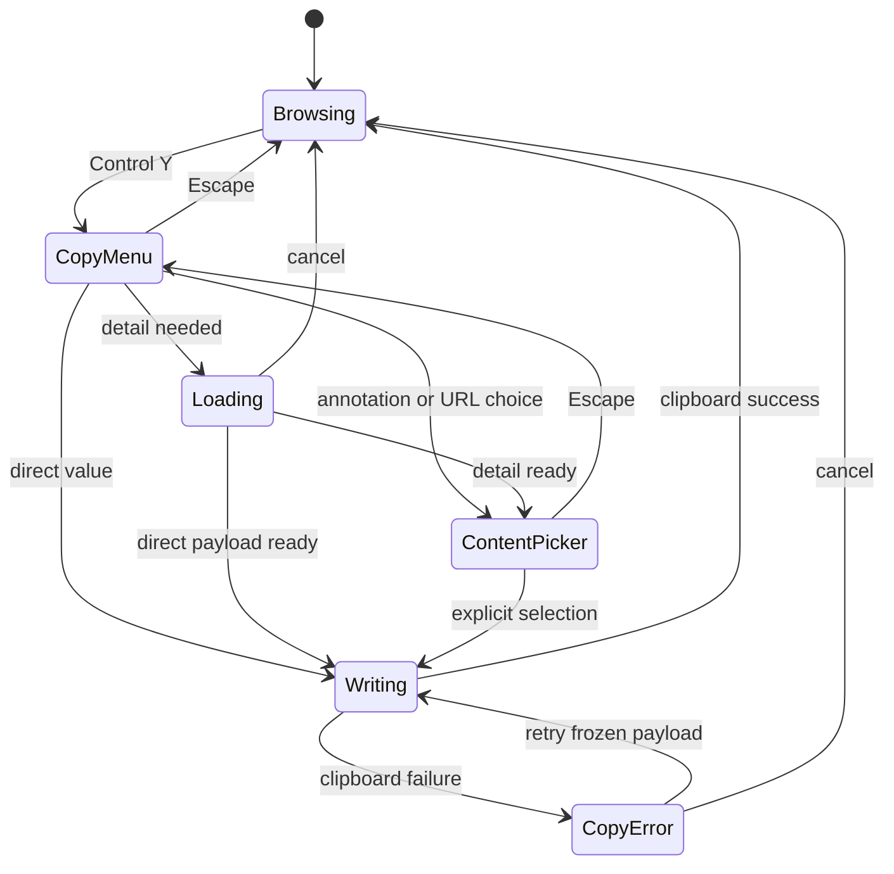

# A thoughtful ⌃Y copy menu for Bob Refs

Independent research by **cdx**, 2026-10-14.

I investigated bob-mac-capture, bob-cli, and primary platform documentation. I did not consult the other researchers' reports, findings, transcripts, or summaries. This is a design recommendation, not an implemented or usability-tested feature.

**Recommendation:** add a compact native **Copy…** menu opened by **⌃Y**, with stable letter choices, concise previews, and a separate picker for individual annotations. Keep reference parsing in bob-cli and make clipboard success observable. This is a good feature when it moves useful material out of the reading library; trustworthy payloads and attribution matter more than the number of formats.

## 1. Critique and explicit requirement adjustments

The panel is a natural place to copy: the user has found a source and can inspect its identity and notes. Zotero's Quick Copy similarly treats reference export as a frequent operation, with clipboard bibliography, citation, and data formats. This supports the direction, although Bob lacks Zotero's complete bibliographic records. [Zotero Quick Copy](https://www.zotero.org/support/creating_bibliographies).

Three weaknesses need attention:

- **⌃Y is not conventional Mac copy.** Apple documents it as pasting from the application's Control-K kill buffer. Bob already repurposes Control-K, Control-N/P, and Control-D/U for panel navigation, so a local ⌃Y fits its vocabulary. Advertise **Copy…**, scope it to Refs, and preserve ⌘C for normal text selection. [Apple Mac shortcuts](https://support.apple.com/en-us/102650), [M1].
- **One key cannot identify an arbitrary highlight in a long document.** It can choose a title or ID, but selecting one of hundreds of annotations needs another choice. Never silently interpret highlight as the first, newest, or currently scrolled-to highlight.
- **An unlimited menu would become an export browser.** Solve linking, quoting, and personal-note reuse first. Every PDF property, checksum, and rendering format together would weaken the interaction.

Apple recommends small relevant contextual menus, shallow hierarchy, and visible access to the same actions. Apply those principles while treating this as an explicit keyboard chooser with local selection hints. [Apple context-menu guidance](https://developer.apple.com/design/human-interface-guidelines/context-menus).

| Explicit adjustment | Reason |
| --- | --- |
| One key after opening for direct values; another selection step for annotations/multiple URLs | Avoid arbitrary choices and scale beyond a few highlights. |
| Initially copy the reference note's synchronized `id`, labelled **Marker ID (synced)** | The PDF may have unsynchronized edits; the index reads frontmatter rather than the live marker. |
| Your notes includes manual note text, standalone PDF notes, and annotation comments | The current inspector displays only commented highlights. |
| Fixed compact core menu; specialized values under **More…** | Stable muscle memory and manageable height. |
| Copy keeps Refs open with success feedback | Existing behavior; allows several copies without repeating a search. |
| Plain text/Markdown clipboard payloads initially | Predictable pasting into Bob, editors, messages, and terminals. |

A live-marker option would require an explicit read-only backend request and a distinct freshness label. Ordinary copying should not depend on it.

## 2. What the current code establishes

Inspected revisions: bob-cli `ae9e6efdced09d880bda63ead7b73aa82206dd86`; bob-mac-capture `44051a0039a711035ff67b5383c4116d294c4ee1`. Source IDs below refer to the pinned evidence catalogue.

| Finding | Consequence |
| --- | --- |
| ⌘K already presents `NSMenu` with Copy Wiki Link and Copy PDF Path; it anchors to the row and suppresses hide-on-resign while tracking. | Reuse presentation infrastructure. [M2, M3] |
| Current copies preserve Bob's `link`, copy an absolute PDF path, and toast for 1.5 seconds. | Compatibility baseline. [M4] |
| Clipboard protocol returns `Void`; implementation discards `setString`'s Boolean result. | Current success feedback does not check success; fix with this feature. [M2, M4] |
| `RefItem.id` is the note path; Rust's separate frontmatter `id` is omitted from JSON. | **Never copy `RefItem.id` or a PDF stem as Marker ID.** Add backend data. [M5, B1] |
| Inspector calls `bob ref show <path> -f json -c`; `-c` removes uncommented highlights. | Arbitrary-highlight copy needs unfiltered detail. [M6, B2] |
| Backend returns `own_notes`, annotation `asset`, `block_id`, and `link`; Swift does not decode them. | Most missing content is a decoder/data-retention gap. [M7, B2] |
| Inspector's personal-note projection uses only `commentedHighlights`. | Copy from complete detail, including standalone notes and image comments. [M7, M8] |
| Summary paragraphs cap at 360 characters; abstracts at 420. | Label any such copy **excerpt**, not full abstract. [M7] |
| Detail cache uses path and snapshot time; loader falls back to first response row on path mismatch. | Copy must require exact matching and reject stale results. [M8] |
| Rows without safe `source_pdf` are excluded from `RefItem.make`. | This feature initially serves the existing PDF-backed panel; all non-PDF references need a separate model change. [M5] |

Bob separates quotations from comments and excludes marker mirrors, preamble, and removed annotations. Its JSON discloses annotations as the last scan's snapshot, not live PDF state. Preserve these guarantees. [B2, B3]

I audited `decisions:mac-capture-is-a-thin-client`: Bob owns semantics/vault mutation, the app owns presentation/process orchestration, and JSON evolves additively. Swift should format structured payloads, not parse reference Markdown or PDF marker grammar. Existing PDFKit preview extraction is presentation infrastructure, not an alternate reference parser.

## 3. Menu contents and exact semantics

Name the entry **Copy…**, not Yank or Export. Add **⌃Y Copy** to the footer, an accessible copy button near the inspector heading, and **Copy…** inside ⌘K. Keep existing direct copy actions backed by the same service.

Nine fixed mnemonic slots in three groups:

| Key | Label | Payload or next step |
| --- | --- | --- |
| `l` | Note link | Bob's `link` verbatim, e.g. `[[ref/books/example]]`. |
| `u` | Source URL | One stored HTTP(S) URL as text; several distinct valid URLs open **Source URL…**. Never invent a canonical URL. |
| `t` | Title | Complete decoded title without UI chips, clipping, or duplicate-title disambiguators. |
| `n` | Your notes · Markdown | All manual note text, comments, and standalone notes; source quotations excluded. |
| `h` | Note or highlight… | Picker for all highlights, standalone notes, and image comments/backlinks. |
| `c` | Reference card · Markdown | Title, author/date, URL(s), note link, DOI/arXiv when known; no local paths by default. |
| `i` | Marker ID (synced) | Decoded `id` scalar, e.g. `systems-performance`; no list prefix, YAML quoting, path, task ID, annotation ID, or invented slug. |
| `p` | PDF path | Resolved absolute path as text; explicitly preview **Absolute path**. |
| `m` | More… | One group of specialized values. |

Letters never change with type, usage frequency, or missing fields. A missing file can still have a useful stored PDF path; disclose **File missing** instead of inventing another target. Loading is distinct from absent data.

Keep unavailable core rows with reasons such as **No source URL**, **No marker ID**, or **Notes unavailable**. This intentionally differs from Apple's usual contextual-menu advice to hide irrelevant entries: an explicitly invoked chooser benefits from stable letter slots and capability explanations. Hide unavailable specialized entries in More…. Never reassign a missing command's key.

### Creative options worth considering

| Value | Why useful | Recommendation |
| --- | --- | --- |
| DOI (`d`), arXiv ID (`a`) | Research prompts/search | Include when returned by Bob; preserve defined normalized representation. |
| Obsidian URL (`o`) | Clickable note from another app | Include with vault context and correct encoding; explain that it opens a local vault. |
| Relative note path (`r`) | Scripts/task references/debugging | Include; distinct from wiki link and PDF path. |
| Research artifact reference (`s`) | SASE citations | Include when `research_ref` exists; copy returned canonical ref. |
| Reading-task link (`k`) | Connect follow-up work to reading | Include only for unambiguous returned task; residence can differ from note. |
| PDF wiki link (`f`) | Attach PDF in vault notes | Include when safely representable. |
| Summary/abstract excerpt (`e`) | Reuse visible excerpt | Optional, exact text and honest excerpt label. |
| Outline (`b`) | Discuss sections/plan reading | Later; headings can be absent or capped. |
| Actual PDF file | Attach to Finder/Mail/chat | Later as **Copy PDF file**, using file-URL clipboard data; path strings are different. |
| Image selection | Reuse a figure | Later with image bytes and attribution; initially copy comment/backlink explicitly. |
| BibTeX/RIS/APA/Chicago | Scholarly writing | Defer until trustworthy records and real citation/export engine exist. |
| Full PDF text/OCR/checksum/all metadata/marker serialization | Automation/forensics | Defer; separate fidelity/performance/meaning contracts. |

Obsidian supports vault-relative note/attachment links, block links, and `obsidian://open` URLs. URI parameters require encoding; use a URL builder for spaces, `#`, and Unicode. [Obsidian internal links](https://help.obsidian.md/links), [Obsidian URI](https://help.obsidian.md/uri).

The **reference card** is the strongest creative addition: portable identity plus local backlink, without pretending sparse metadata is a formal citation. Invented example:

```markdown
## Systems Performance
Brendan Gregg · 2020

Source: https://example.com/book
Note: [[ref/books/systems-performance]]
```

Omit missing fields; never use PDF file dates as publication dates. Include all URLs when a card claims to include them.

## 4. Selecting and copying annotations

**⌃Y → h** opens a picker for the same reference. Each row shows kind, page, excerpt, and whether it contains quotation, personal note, or both. Keep stored order; do not rank best highlights.

```text
Note or highlight                         Systems Performance

[1] Highlight · Page 12
    Latency is not throughput.
    Your note: Compare this with SLO notes.

[2] Note · Page 12
    Check the benchmark methodology.

[3] Image · Page 18
    Figure note: Useful explanation of queueing.

/ Find    ↑↓ Navigate    ↵ Copy with source    esc Back
```

With list focus, `1–9` copy labelled rows on the current explicit page. Arrows/Return reach every row; Page Up/Down change pages. Labels update only after the new page commits. `/` focuses search; all printable characters then belong to search, including digits. Searching 2024 must not copy row 2. Mouse and accessible controls work too.

Default **Copy with source**; a visible keyboard-accessible format control also offers **Text only** and **Block link**. Number keys use the displayed format. Every invocation starts with the same default, avoiding a remembered setting silently changing output.

Default commented-highlight payload:

```markdown
> Latency is not throughput.

My note: Compare this with SLO notes.

Source: Systems Performance · Page 12
[[ref/books/systems-performance#^h-2b91f0a4c7de]]
```

Retain quotation lines, comment paragraphs, and code blocks. Missing page labels produce no invented page. Backlinks come from Bob. Standalone notes get **My note:** without fabricated quotes. Image rows initially copy comments/backlinks and identify that payload.

**Your notes · Markdown** directly copies manual `own_notes`, then standalone notes and comments, with page/backlink context in stable order. Exclude author quotations and reading tasks. Do not deduplicate distinct comments because their text matches. Preserve manual text as Bob exposes it; a legacy body can contain mixed Markdown, so label it **Note body** rather than parsing artificial annotations.

Partial parsing must not resemble an empty collection. Show **Some annotations could not be read** and never claim the aggregate is complete. An explicit **Parsed annotations only** option is acceptable. Bob continues excluding marker mirrors/tombstones.

## 5. Beauty through restraint

Reuse adaptive system colors and existing panel material. The shell is 880 × 560 points, with concentric 20/12-point corners, 8-point inset, and 30-point footer. Do not resize it as menu/picker data arrives. [M9]

**Prefer ordinary `NSMenu` items with SF Symbols and native subtitles.** The app targets macOS 26, and AppKit exposes `NSMenuItem.subtitle`; two-line rows need no custom-painted top-level menu. [AppKit subtitle](https://developer.apple.com/documentation/appkit/nsmenuitem/subtitle), [M10]

Low-fidelity hierarchy:

```text
Copy from Systems Performance

Note link                                  L
  [[ref/books/systems-performance]]
Source URL                                 U
  example.com/book
────────────────────────────────────────────
Title                                      T
Your notes · Markdown                      N
  6 personal notes
Note or highlight…                         H
Reference card · Markdown                  C
────────────────────────────────────────────
Marker ID (synced)                          I
  systems-performance
PDF path                                   P
  systems-performance.pdf · Absolute path
More…                                      M
```

Title identifies target; subtitles explain values/formats; letters reveal next actions. Previews may truncate, payloads never do. Add subtitles only when helpful. Familiar link/copy/quote/file symbols aid recognition; avoid a different accent color on each row.

Native tracking supplies standard appearance/placement. The content picker can use SwiftUI within the existing panel, with readable excerpts, restrained separators, selected-payload preview, and one clear copy action. On narrow panels without an inspector, anchor the menu to the selected row and show the picker over the content well. Neither depends on previous inspector hydration.

Honor Reduce Motion/Transparency, increased contrast, focus visibility, and VoiceOver. Announce **Copied marker ID** or **Copied highlight from Page 12** after actual success. Key legends supplement accessible names. Avoid a second glass surface, large expansion animation, or persistent sidebar.

## 6. Implementation boundaries and reliability

### Backend and decoding

Use existing `ref list`/`ref show`, not a clipboard CLI or Swift file parser.

1. Expose frontmatter scalar as additive **`reference_id`**; keep Rust's internal `id` for resolution. Swift adds `referenceID`; `RefItem.id` remains a path. Document note metadata ordinarily synchronized with the marker, not a live PDF read. Keep schema version 1 for this additive field.
2. Fetch full detail with `bob ref show <exact-note-path> -f json`, without `-c`. Retain `own_notes`, `annotations_status`, and annotation kind/quote/comment/page/asset/block ID/link. Decode `research_ref` where needed.
3. Share full detail with inspector presentation. Inspector can retain its current commented-highlight projection, but cache the complete response separately. Include request variant in cache keys while filtered/unfiltered calls coexist.
4. Initially load full detail on demand for content actions, with bounded caching. Reuse cached full responses; measure before changing every inspector request. Do not prefetch the whole library.
5. Old responses degrade gracefully. Missing `reference_id` differs from present/null: show **Requires newer Bob** versus **No marker ID** when capability information permits. Do not fail library decoding.

Backend content separation and tombstone exclusion already exist. Preserve them and extend contract checks instead of duplicating generated-region parsing.

### Target, loading, and event ownership



Capture **target note path, selected item snapshot, invocation token** on opening. Actions/results belong to that target. Delayed callbacks never consult whatever is selected now, and never fall back to the first detail row. Refresh cannot change target or letters. If the target disappears or changes incompatibly, invalidate the chooser and let the user invoke again.

One copy operation may be pending. Show **Loading notes…** with cancellation; write only once ready. Escape, dismissal, invalidation, and a newer invocation revoke authority to write. A subprocess may finish, but its obsolete result cannot reach the clipboard.

Chooser events take precedence over panel commands. Escape closes one chooser level before the existing banner/query/scope/hide ladder. Arrows/Return cannot also move/open a reference. Restore search text/caret/selection, selected row, and inspector scroll on closing.

Use menu-scoped `NSMenuItem` letter equivalents with explicit empty modifier mask. Apple separates Unicode equivalents from modifier flags. Never register bare letters application-wide. Prototype with the local event monitor: ordinary type-to-select is not evidence of activation. W3C's menu pattern, for example, uses printable keys to move focus; immediate-action letters require deliberate behavior. [AppKit key equivalents](https://developer.apple.com/library/archive/documentation/Cocoa/Conceptual/MenuList/Articles/SettingMenuKeyEquiv.html), [W3C menu behavior](https://www.w3.org/WAI/ARIA/apg/patterns/menubar/).

Document **⌃Y, release Control, then the letter**. Ignore opener repeats. Interpret characters for layout/Caps Lock and respect marked-text composition. If the native-menu spike cannot satisfy activation/focus reliably, use a small custom chooser with explicit focus ownership and the same action model.

### Clipboard contract

Make `RefsPasteboardWriting` expose success/failure; live writing runs on the main actor. Build/validate nonempty payloads before touching the clipboard. Clear/write the general pasteboard and check its result. Only success dismisses the chooser and triggers existing 1.5-second feedback. Failure says **Couldn't copy** and retries the frozen payload. [AppKit NSPasteboard](https://developer.apple.com/documentation/appkit/nspasteboard).

This is not transactional: an OS failure after clearing may leave an empty clipboard. Cancellation, missing/empty metadata, and failed loading cause no mutation; failed writes never get success feedback.

Use `.string`, including Markdown. A path is text; an actual file is a later file-URL payload. Do not auto-paste. Preserve stored source URLs; copying does not fetch, follow redirects, or strip meaningful query parameters.

## 7. Alternatives, rollout, and validation

| Approach | Strength | Cost | Verdict |
| --- | --- | --- | --- |
| Everything in ⌘K | Small presentation change | Copy competes with open/reveal/scan | Keep as entry; add dedicated ⌃Y. |
| ⌘C copies note link | Very fast | Competes with selected-text copy; misses other values | Preserve native ⌘C initially. |
| Native menu plus picker | Existing architecture/system styling | Routing spike and one focused picker | Recommended. |
| Entire custom palette | Maximum layout control | More accessibility/focus/event work | Fallback if native activation is insufficient. |
| Flat menu of every annotation | Direct for tiny sources | Unbounded height/unreadable excerpts | Reject. |
| Auto-dismiss panel on copy | Faster return to destination | Breaks current repeated-copy behavior | Keep open first; evaluate real use. |
| AI summary as copy action | Potential future value | Generates content; adds latency/quality questions | Separate feature; copy existing excerpts only. |

Build in reviewable order: native activation/focus spike; ID/full-detail contract and decoding; direct actions/fallible clipboard; annotation picker/personal-note aggregate; visual/accessibility polish. Secondary formats share the action model and need not delay core workflows.

Meaningful acceptance checks:

- **Identity:** marker ID, path, PDF stem, reading-task ID, annotation ID all differ in a fixture; commands copy correct values. Duplicate stems cannot redirect targets.
- **Completeness:** uncommented/commented highlights, standalone note, image comment, manual Markdown, tombstone, and malformed region establish exact inclusions. Partial data stays visible.
- **Concurrency:** selection/refresh/close/cancel during loading produces no stale write. Different response paths fail safely.
- **Keyboard:** actual event-monitor tests cover repeat/release, immediate activation, IME, non-US layout, arrows/Return/Escape, search digits, and restored focus. Normal typing works outside chooser.
- **Clipboard:** success/failure, empty/unavailable/cancelled actions, multiline Unicode, complete unclipped payloads.
- **Compatibility:** old Bob supports existing link/title/path choices; filtered caches cannot claim completeness.
- **Visual/accessibility:** light/dark, contrast, Reduce Transparency/Motion, narrow display, long titles/paths, VoiceOver. Core choices fit without scrolling.

These are behavioral checks, not tests mirroring every enum case. Follow linked `AGENTS.md`: `just portable-check` for portable Swift; AppKit/SwiftUI changes additionally compile a disposable scratch copy on the Mac with `bundle.sh` and `just typecheck-tests`; CI executes macOS tests. Never install into Bryan's checkout for verification. This research changed no product code and ran no compilation or interactive Mac tests.

## 8. Evidence catalogue and uncertainty

Repository reads used audited local checkouts. Links identify inspected revisions, not web-fetched source files.

| ID | Primary source |
| --- | --- |
| M1 | [RefsKeyRouter.swift](https://github.com/bobs-org/bob-mac-capture/blob/44051a0039a711035ff67b5383c4116d294c4ee1/Sources/BobMacCapture/Refs/RefsKeyRouter.swift) |
| M2 | [RefsActionsMenu.swift](https://github.com/bobs-org/bob-mac-capture/blob/44051a0039a711035ff67b5383c4116d294c4ee1/Sources/BobMacCapture/Refs/RefsActionsMenu.swift) |
| M3 | [RefsPanel.swift](https://github.com/bobs-org/bob-mac-capture/blob/44051a0039a711035ff67b5383c4116d294c4ee1/Sources/BobMacCapture/Refs/RefsPanel.swift) |
| M4 | [RefsPanelModel.swift](https://github.com/bobs-org/bob-mac-capture/blob/44051a0039a711035ff67b5383c4116d294c4ee1/Sources/BobMacCapture/Refs/RefsPanelModel.swift) |
| M5 | [RefsModel.swift](https://github.com/bobs-org/bob-mac-capture/blob/44051a0039a711035ff67b5383c4116d294c4ee1/Sources/RefsCore/RefsModel.swift) |
| M6 | [RefsFetching.swift](https://github.com/bobs-org/bob-mac-capture/blob/44051a0039a711035ff67b5383c4116d294c4ee1/Sources/RefsCore/RefsFetching.swift) |
| M7 | [RefsInspector.swift](https://github.com/bobs-org/bob-mac-capture/blob/44051a0039a711035ff67b5383c4116d294c4ee1/Sources/RefsCore/RefsInspector.swift) |
| M8 | [RefsInspectorLoader.swift](https://github.com/bobs-org/bob-mac-capture/blob/44051a0039a711035ff67b5383c4116d294c4ee1/Sources/BobMacCapture/Refs/RefsInspectorLoader.swift) |
| M9 | [RefsVisualTokens.swift](https://github.com/bobs-org/bob-mac-capture/blob/44051a0039a711035ff67b5383c4116d294c4ee1/Sources/BobMacCapture/Refs/RefsVisualTokens.swift) |
| M10 | [Package.swift](https://github.com/bobs-org/bob-mac-capture/blob/44051a0039a711035ff67b5383c4116d294c4ee1/Package.swift) |
| B1 | [ref_library/row.rs](https://github.com/bobs-org/bob-cli/blob/ae9e6efdced09d880bda63ead7b73aa82206dd86/src/native/ref_library/row.rs) |
| B2 | [ref_library/show.rs](https://github.com/bobs-org/bob-cli/blob/ae9e6efdced09d880bda63ead7b73aa82206dd86/src/native/ref_library/show.rs) |
| B3 | [docs/ref.md](https://github.com/bobs-org/bob-cli/blob/ae9e6efdced09d880bda63ead7b73aa82206dd86/docs/ref.md) |
| B4 | [docs/highlights-ref-sync.md](https://github.com/bobs-org/bob-cli/blob/ae9e6efdced09d880bda63ead7b73aa82206dd86/docs/highlights-ref-sync.md), Marker Note Grammar / Synced Properties / Generated Body Contract |

External sources are linked beside supported claims. They establish platform behavior/precedents; menu contents, shortcuts, defaults, and rollout are my judgments. Marker grammar/synchronization come from B4. I did not measure latency, inspect Bryan's private library, or operate this on a Mac. Native activation with the local monitor, full-detail sizes, and density of nine rows require implementation-time validation. No usability study is claimed.

## 9. Recommended solution

**Ship ⌃Y as a focused native Copy… menu with stable mnemonic keys and short previews.** Include note link, source URL, title, personal notes, individual note/highlight selection, compact reference card, synchronized marker ID, and PDF path. Put relevant secondary identities/paths under More….

Allow one extra selection step for annotations/multiple URLs. Prefer annotation payloads that separate quotation from personal comment and preserve source backlinks. Extend Bob JSON additively for the authored ID, retain full structured detail, freeze each invocation's target, and check clipboard success before feedback. Reuse panel/native styling; add a restrained picker where search and previews help.

This is a good feature with those boundaries. Its promise is simple: **find a reference, choose the useful thing, and paste exactly what the interface said you copied.**
