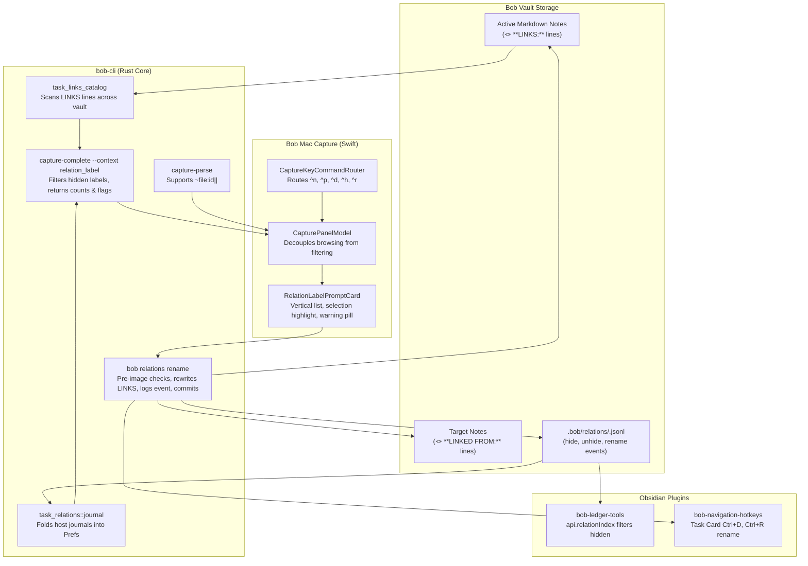

# Relation Card Completion, Hidden Descriptions, and Label Lifecycle

**Researcher.** `gem` (Swarm Research Report)  
**Date.** 2026-10-24  
**Target Systems.** `bob-mac-capture`, `bob-cli` (Rust core), `bob-plugins` (`bob-navigation-hotkeys`, `bob-ledger-tools`), Bob Vault  
**Artifact.** `research:202610/relation_card_completion_and_label_lifecycle__gem.md`

---

## 1. Executive Summary & Problem Formulation

### 1.1 The Problem
When linking tasks in **Bob Mac Capture** (`~` / `~~`), pressing `<tab>` or `|` opens the **Relation Card** (`RelationLabelPromptCard`), which allows authoring an optional relationship description (e.g., `inspired by`, `follow-up of`). However:
1. **Broken Tab-Completion / Cycling:** Pressing `<tab>` in the Relation Card completes only the first matching description (or briefly advances to the $n$-th item if pressed in rapid succession before an asynchronous process round-trip completes). Once completed, pressing `<tab>` again does nothing; cycling is completely frozen.
2. **Missing Standard Menu Navigation:** Power users cannot use standard `<ctrl+n>` / `<ctrl+p>` (or Down / Up arrow) keys to navigate relation description candidates.
3. **No Support for Temporary / One-Off Descriptions:** Every relation label ever written on any `#task`'s `🪢 **LINKS:**` line across the entire vault is permanently harvested into the suggestion catalog. One-off relationship descriptions (e.g. `laptop migration temp sync`, `review after vacation`) permanently pollute the suggestion list forever.
4. **Lack of Lifecycle Controls (Hide, Unhide, Show All, Rename):** There is currently no mechanism to hide stale or one-off descriptions, view hidden descriptions, unhide them, or reliably rename an existing description across all referencing tasks and mirror lines.
5. **No Capture Grammar for One-Off Relationships:** Capture syntax lacks an expressive shorthand to create a relation whose description is marked hidden from future completion candidates at birth.

### 1.2 Evaluation of the Proposed Feature
The user's vision proposes:
- Fixing the card navigation with `<ctrl+n/p>` keymaps.
- Introducing a `<ctrl+d>` keymap on the relation card to hide/disable descriptions.
- Supporting a "show all" keymap to inspect and unhide disabled descriptions.
- Supporting a global rename command (`bob relations rename`) operable from the CLI, the relation card, and Obsidian.
- Introducing a `~file:id||<desc>` double-pipe capture syntax that marks new relation descriptions as hidden at birth, with a proactive user warning if `||` is used on an already existing description.
- Redesigning the relation card to be reliable, intuitive, and visually beautiful.

**Verdict:** The plan is sound, necessary, and addresses severe ergonomics deficiencies. However, the architectural design must carefully separate **edge-level link semantics** from **catalog-level description preferences** to preserve the proven invariants of the Bob architecture (specifically citing `docs/task-relations.md`, `theme-prefs-live-in-per-host-journal`, and `theme-hide-is-recent-only`).

---

## 2. Root Cause Analysis: The Tab-Completion Bug

To determine why Tab-completion freezes, we traced the execution across `CaptureKeyCommandRouter.swift`, `CapturePanelController.swift`, and `CapturePanelModel.swift` in `bob-mac-capture`.

```
User Presses <tab>
       │
       ▼
CaptureKeyCommandRouter.swift (line 523)
  └─ Maps KeyCode.tab to .cycleRelationLabelSuggestionForward
       │
       ▼
CapturePanelModel.swift: cycleRelationLabelSuggestion(by: 1)
  ├─ 1. Increments prompt.selectedSuggestionIndex (e.g. 0 -> 1)
  ├─ 2. prompt.authoredLabel = prompt.suggestions[1].label ("inspired by")
  └─ 3. Calls fetchRelationLabelSuggestions()
              │
              ▼
       fetchRelationLabelSuggestions() sends async probe:
       `bob capture-complete "..." --cursor ...` with `|"inspired by"`
              │
              ▼
       bob capture-complete filters candidates matching "inspired by"
       Returns [ Candidate("inspired by") ] (Count = 1)
              │
              ▼
CapturePanelModel.swift: applyRelationLabelSuggestions()
  ├─ 1. current.suggestions = response.candidates  <--- COLLAPSES TO 1 ITEM!
  └─ 2. if current.selectedSuggestionIndex >= count { selectedIndex = 0 }
              │
              ▼
Next <tab> Press:
  count = 1
  next = (0 + 1 + 1) % 1 = 0
  Result: prompt.suggestions[0] is still "inspired by". STUCK FOREVER!
```

### 2.1 The Two Compounding Flaws

#### Flaw 1: Destructive Query Refiltering on Suggestion Navigation
In `CapturePanelModel.swift` (lines 6631–6648):
```swift
private func cycleRelationLabelSuggestion(by offset: Int) {
    guard var prompt = relationLabelPrompt, !prompt.isSaving,
          !prompt.suggestions.isEmpty
    else { return }
    let count = prompt.suggestions.count
    let next = (prompt.selectedSuggestionIndex + offset + count) % count
    prompt.selectedSuggestionIndex = next
    if let label = prompt.suggestions[next].label, !label.isEmpty {
        prompt.authoredLabel = label
    }
    prompt.suggestionAuthoredLabel = nil
    prompt.pendingSubmit = false
    prompt.errorMessage = nil
    relationLabelPrompt = prompt
    fetchRelationLabelSuggestions() // <--- CRITICAL BUG: Refetches with the completed text!
}
```
When `fetchRelationLabelSuggestions()` executes, it constructs a probe containing `|"\(prompt.authoredLabel)"` and calls `bob capture-complete`.
In `bob-cli` (`src/native/capture_complete/candidates.rs`), `relation_label_suggestions` ranks candidates matching that query:
```rust
let ranked = rank(labels, &normalized_query, |(label, _)| label);
```
Because the query is now the complete label `"inspired by"`, the returned candidate list contains **only** `"inspired by"`.
When the asynchronous response arrives in `applyRelationLabelSuggestions()`:
```swift
current.suggestions = response.candidates // Overwrites the 5 initial suggestions with just 1!
if current.selectedSuggestionIndex >= current.suggestions.count {
    current.selectedSuggestionIndex = 0
}
```
The suggestion list is permanently truncated to 1 candidate. Every subsequent Tab press computes `(0 + 1) % 1 == 0`.
**Why rapid pressing reached the $n$-th item:** Because `fetchRelationLabelSuggestions()` calls an out-of-process CLI asynchronously (`Task { await processClient.captureComplete(...) }`). If the user pressed `<tab>` 3 times within 80ms before the first subprocess response returned to the main actor, each press advanced through the original 5-item array. As soon as the first response landed, the array was overwritten with 1 item and froze.

#### Flaw 2: Key Suppression in `CaptureKeyCommandRouter.swift`
In `CaptureKeyCommandRouter.swift` (lines 519–537 and 654–685):
```swift
private func relationLabelPromptCommand(for event: NSEvent, modifiers: NSEvent.ModifierFlags) -> CaptureKeyCommand? {
    if event.keyCode == KeyCode.tab {
        if modifiers.isEmpty { return .cycleRelationLabelSuggestionForward }
        if modifiers == .shift { return .cycleRelationLabelSuggestionBackward }
    }
    return isolatedPromptCommand(for: event, modifiers: modifiers, ...)
}
```
When any key other than Tab is pressed, it falls into `isolatedPromptCommand`:
```swift
case KeyCode.tab, KeyCode.arrowDown, KeyCode.arrowUp:
    return modifiers.contains(.command) ? nil : .consumeKey
case KeyCode.n, KeyCode.p:
    return modifiers == .control ? .consumeKey : nil
```
`<ctrl+n>`, `<ctrl+p>`, Up Arrow, and Down Arrow are **explicitly eaten** (`.consumeKey`). Neither Cocoa text navigation nor custom picker navigation can occur.

---

## 3. Critique of the Proposed Plan

### 3.1 Keymaps: `<ctrl+n/p>` vs `<tab>` vs Arrows
- **Proposed:** Use `<ctrl+n/p>` to navigate completion menu entries.
- **Analysis:**
  - In Emacs/Readline conventions (and throughout `bob-mac-capture`'s picker, which already routes `Ctrl-N/P` and `Ctrl-J/K` to `.nextPickerRow` / `.previousPickerRow`), `<ctrl+n>` and `<ctrl+p>` are the canonical next/previous item navigators.
  - In macOS `NSTextField`, `<ctrl+n>` and `<ctrl+p>` normally map to `moveDown:` and `moveUp:`.
  - In addition to `<ctrl+n/p>`, the Down (`↓`) and Up (`↑`) arrow keys **must** also navigate suggestions.
  - **What should `<tab>` do?**
    - In standard completion systems (zsh, bash, fish, IntelliJ, VS Code): `<ctrl+n/p>` or arrow keys change the active selection index. `<tab>` either cycles forward or inserts/accepts the selected item.
    - If `<tab>` continues to cycle forward (and `<shift-tab>` backward), it must be an alias for `<ctrl+n>` / `<ctrl+p>` and **must not** trigger destructive refiltering.
    - If a suggestion is highlighted, `<enter>` accepts and inserts it into the draft.

### 3.2 Hiding / Disabling Relation Descriptions
- **Proposed:** Add `<ctrl+d>` to disable/hide relation descriptions for one-off relationships, with a keymap to show all and unhide.
- **Analysis & Core Architectural Choice:**
  - Where does "hidden" state live?
    1. *Option A (Anti-pattern): Store hidden flags on Markdown `🪢 **LINKS:**` lines.*  
       If markdown wrote `🪢 **LINKS:** ||one-off [[target]]`, then hiding or unhiding an existing description across 30 tasks would require rewriting 30 markdown notes across the vault. It would break existing line parsers and violate `docs/task-relations.md` §2 ("A relation write never changes anything except the minted id").
    2. *Option B (Recommended & Proven): Per-Host Journal `.bob/relations/<host>.jsonl`.*  
       This directly mirrors the accepted architectural decision `theme-prefs-live-in-per-host-journal` (`.bob/themes/<host>.jsonl`).
       - Vault-synced via Git across machines (Athena, Apollo, Mac).
       - Append-only events: `relation_label.hide`, `relation_label.unhide`, `relation_label.rename`.
       - Folded into a memory-cached `Prefs` map by `bob`.
       - Zero mutation of historical markdown notes when a label is hidden or unhidden.
  - What does "hiding" affect?
    Following `theme-hide-is-recent-only`:
    - Hiding a relation description removes it from **suggestions and autocompletion only**.
    - It does **not** delete or invalidate existing relations. Existing tasks continue to render `🪢 **LINKS:** one-off [[target]]`, and Obsidian chips continue to display `one-off → target`.
    - If the user types a hidden description explicitly by hand, it remains valid. Using it does **not** auto-unhide it.

### 3.3 Critique of `<ctrl+d>` Keymap Conflict
- In standard macOS NSTextField / Emacs bindings, `Ctrl-D` is `deleteForward:` (delete the character in front of the cursor).
- If Bryan is typing a description in the text field and presses `Ctrl-D`, does he want to delete the character in front of the cursor, or hide the highlighted suggestion?
- **Recommendation:**
  - When the user has navigated into the suggestions list (a candidate is actively highlighted via `<ctrl+n/p>`), `<ctrl+d>` executes **Hide / Disable Suggestion**.
  - When no suggestion is highlighted and text is being authored, `<ctrl+d>` passes through to text editing (or we can use `<ctrl+x>` / `<opt+d>` as an unambiguous alternative). Supporting `<ctrl+d>` when a candidate is selected is intuitive and satisfies Bryan's exact request.
  - For unhiding: When viewing hidden items, pressing `<ctrl+d>` on a hidden candidate **toggles** it back to unhidden (or `<ctrl+u>` for explicit unhide).
  - For showing all: `<ctrl+h>` (mnemonic for **H**idden / toggle hidden) or `<ctrl+a>` (mnemonic for **A**ll). `<ctrl+h>` is cleanest because it matches the CLI flag `-H`.

### 3.4 Critique of `~file:id||<desc>` Capture Syntax (Double Pipe)
- **Proposed:** The new `~file:id||<desc>` syntax specifies that the relation description `<desc>` should be created as hidden. Warn the user if they attempt to hide an existing description.
- **Analysis:**
  - In existing capture grammar (`docs/task-relations.md` §12 and `src/native/capture_language/relations.rs`), the pipe `|` separates the target locator from the label: `~work:task-123|"follow-up of"`.
  - Today, `||` is rejected with `forbidden_character: labels may not contain '|'`.
  - Introducing `||` as the "hidden relation separator" is natural, intuitive, and concise.
  - **What happens on disk vs journal?**
    - On disk in Markdown: writes standard `🪢 **LINKS:** <desc> [[file#^id]]`. Markdown remains 100% clean, standard, and backwards-compatible.
    - In the journal: `bob capture` writes a `relation_label.hide` event for `<desc>` into `.bob/relations/<host>.jsonl`.
  - **The Warning Requirement:**
    - If Bryan captures `Buy milk ~groceries:list||errand`, and `errand` is already a well-established relation description used on 25 tasks, using `||` would hide `errand` from completion everywhere!
    - This warning is essential:
      - `bob capture-parse` / `bob capture-complete` checks if `<desc>` is already an active (unhidden) description with $\text{count} \ge 1$.
      - If active, it emits a structured warning:
        `"Relation description 'errand' is currently active on 25 tasks. Capturing with '||' will hide it from future completion suggestions."`
      - `bob-mac-capture` renders an amber warning banner in the live preview and in the relation card, while still allowing the capture to proceed.

### 3.5 Critique of Global Renaming
- **Proposed:** Reliably rename a relation description from the relation card, CLI, and Obsidian, updating all tasks with that same description.
- **Analysis:**
  - This is a full vault refactoring operation, exactly like `bob themes rename` and `bob ref rename`.
  - In `docs/task-relations.md`, relation labels are stored on source tasks (`🪢 **LINKS:**`) and mirrored on target tasks (`🪢 **LINKED FROM:**`).
  - **Authority:** `bob relations rename OLD NEW` must be the single authority. The Mac card and Obsidian must delegate to `bob relations rename`.
  - **Safety guarantees:**
    - Must acquire `bob_sync.lock`.
    - Must verify working tree is clean.
    - Must normalize `NEW` through `task_relations::label::normalize_relation_label`.
    - If `NEW` already exists, require `--merge` (matching `bob themes rename --merge`).
    - Rewrite `LINKS` lines across active notes.
    - Log a `relation_label.rename` event to `.bob/relations/<host>.jsonl` so preferences (hidden state) carry over.
    - Run `reconcile_relation_lines` to update all `LINKED FROM` mirrors.
    - Commit as a single atomic Git commit (`git commit`).

---

## 4. UI/UX Design: An Intuitive, Reliable, and Beautiful Relation Card

Look at the current relation card from screenshot `~/tmp/screenshots/20261024_093115.png`:
- The horizontal `ScrollView` of small `.bordered` buttons is difficult to scan.
- There is zero visual indication of which button is currently selected.
- Key navigation hints are minimal (`Tab cycles suggestions · esc back to picker`).

### 4.1 The Overhauled Card Architecture

```
┌────────────────────────────────────────────────────────────────────────┐
│ 🪢  Relation                                               (3/8)  [Esc]│
│                                                                        │
│   “Buy new SDD for athena!”                                            │
│   ↳ [ inspired by ] ➔ “What was athena doing at 07:57 on 2026-10-24?”  │
│                                                                        │
│ ┌────────────────────────────────────────────────────────────────────┐ │
│ │ inspired by                                           [ 🚫 Hidden ]│ │
│ └────────────────────────────────────────────────────────────────────┘ │
│                                                                        │
│ ┌─ Suggestions ────────────────────────────────── [^h Show Hidden] ──┐ │
│ │   sparked by              · 14 tasks                               │ │
│ │ ▶ inspired by             ·  6 tasks                     [Active]  │ │
│ │   follow-up of            · 32 tasks                               │ │
│ │   blocks rollout of       ·  2 tasks                               │ │
│ │   temporary sync          ·  1 task   (hidden)          [Hidden]   │ │
│ └────────────────────────────────────────────────────────────────────┘ │
│                                                                        │
│  ⚠️  Warning: 'inspired by' is active on 6 tasks.                      │
│     Saving with '||' will hide it from future suggestions.             │
│                                                                        │
│  Inserts |"inspired by"                                                │
│  ────────────────────────────────────────────────────────────────────  │
│  ^n/^p Select   Tab / ↵ Accept   ^d Hide/Unhide   ^r Rename   Esc Back │
│                                      [ Cancel ]  [ Insert Relation ↵ ] │
└────────────────────────────────────────────────────────────────────────┘
```

### 4.2 Interactive Details
1. **Dynamic Selection & Inline Preview:**
   - As the user presses `<ctrl+n>` / `<ctrl+p>` (or `↓`/`↑`), the highlighted row moves smoothly with a subtle spring animation.
   - The text field updates to preview the highlighted label, but **does not trigger a backend search**.
   - Pressing `<ctrl+p>` past the first item returns the text field to the user's raw typed text (`originalAuthoredQuery`).
2. **Hidden Badge & Amber Warning Callout:**
   - When `||` is typed or the active suggestion is hidden, an indicator pill `[ 🚫 Hidden ]` appears inside the trailing edge of the text field.
   - If the label already exists and is active, an amber warning callout smoothly expands below the suggestions list with a warning icon and clear explanation.
3. **Menu Aesthetics:**
   - Replaces the clumsy horizontal scroll with an elegant, vertically scrolling list of suggestion rows.
   - Each row features:
     - Left indicator chevron `▶` and bold font when active.
     - Label name with matched prefix highlighted in accent color.
     - Frequency count capsule: `· 14 tasks` in muted secondary font.
     - Eye-slash icon `􀋭` for hidden items when "Show Hidden" (`^h`) is toggled.
4. **Rename Modal (`<ctrl+r>`):**
   - Pressing `<ctrl+r>` on any suggestion opens a sleek modal sheet:
     `Rename 'inspired by' across 6 tasks to: [ sparked by ]`
     `[ Cancel ]  [ Rename All (6 tasks) ]`

---

## 5. Technical Specification & Implementation Plan

### 5.1 Architecture Overview



---

### 5.2 Component 1: `bob-cli` Core Enhancements (Rust)

#### 1. Relation Preferences Journal (`src/native/task_relations/journal.rs`)
Model on `src/native/pomodoro_themes/journal.rs`:
- Storage path: `<vault>/.bob/relations/<host>.jsonl`.
- Host label: derived from `vault_sync::hostname_slug()`.
- Event schema (`v: 1`):
  ```json
  {"v": 1, "ts": "2026-10-24T16:15:00-04:00", "host": "athena", "payload": {"type": "relation_label.hide", "label": "one-off sync"}}
  {"v": 1, "ts": "2026-10-24T16:16:00-04:00", "host": "athena", "payload": {"type": "relation_label.unhide", "label": "one-off sync"}}
  {"v": 1, "ts": "2026-10-24T16:20:00-04:00", "host": "athena", "payload": {"type": "relation_label.rename", "from": "inspired by", "to": "sparked by"}}
  ```
- Fold algorithm:
  - Scans all `.bob/relations/*.jsonl`.
  - Sorts by `(ts, host, path, line)`.
  - Returns `RelationPrefs`: `by_label: BTreeMap<String, LabelPref>` where `LabelPref { hidden: bool }`.
  - Renames migrate the hidden state to the target name.

#### 2. CLI Command Group: `bob relations` (`src/native/task_relations/cli.rs`)
Adhering to `cli_rules.md`:
- `bob relations`: Bare group defaults to `bob relations list`.
- Subcommands:
  - `bob relations list [-a|--all] [-H|--hidden] [-q|--query <str>] [-f json]`:
    Lists known relation descriptions, usage counts across active notes, and hidden status.
  - `bob relations hide <LABEL>`:
    Appends `relation_label.hide` to `<host>.jsonl`.
  - `bob relations unhide <LABEL>`:
    Appends `relation_label.unhide` to `<host>.jsonl`.
  - `bob relations rename <OLD> <NEW> [-m|--merge] [-d|--dry-run] [-f json]`:
    - Validates `OLD` exists.
    - Normalizes `NEW` via `task_relations::label::normalize_relation_label`.
    - If `NEW` exists, requires `--merge`.
    - Rewrites `🪢 **LINKS:**` lines in active notes.
    - Appends `relation_label.rename` event.
    - Triggers `reconcile_relation_lines` to update `LINKED FROM` lines.
    - Single atomic Git commit.

#### 3. Capture Syntax & Grammar (`src/native/capture_language/relations.rs`)
- In `scan_relation_modifier`:
  - When encountering `|`, check if `line.as_bytes()[cursor + 1] == b'|'`.
  - If so, record `relation_label_separator` of length 2 (`||`), and set `hidden: true`.
  - The label parser accepts both bare and quoted forms: `~file:id||label` and `~file:id||"multi word"`.
  - In `capture-parse` JSON:
    ```json
    {
      "relations": [
        {
          "direction": "to",
          "note": "file",
          "block_id": "id",
          "label": "desc",
          "label_hidden": true,
          "range": [12, 28]
        }
      ],
      "warnings": [
        {
          "kind": "hiding_existing_relation_label",
          "message": "Relation description 'desc' already exists on 6 tasks. Using '||' will hide it from future completion suggestions."
        }
      ]
    }
    ```

#### 4. Capture Completion (`src/native/capture_complete/candidates.rs`)
- In `relation_label_suggestions(bob_dir, query)`:
  - Load `RelationPrefs`.
  - Mark each suggestion with `hidden: bool`.
  - By default, filter out suggestions where `hidden == true`, unless the user explicitly query-matches it or `--all` is passed.
  - Candidate JSON payload adds: `"hidden": true|false`.

---

### 5.3 Component 2: `bob-mac-capture` Enhancements (Swift)

#### 1. Key Command Router (`CaptureKeyCommandRouter.swift`)
Update `relationLabelPromptCommand`:
```swift
private func relationLabelPromptCommand(
    for event: NSEvent,
    modifiers: NSEvent.ModifierFlags
) -> CaptureKeyCommand? {
    switch event.keyCode {
    case KeyCode.tab:
        return modifiers == .shift ? .cycleRelationLabelSuggestionBackward : .cycleRelationLabelSuggestionForward
    case KeyCode.n:
        return modifiers == .control ? .cycleRelationLabelSuggestionForward : nil
    case KeyCode.p:
        return modifiers == .control ? .cycleRelationLabelSuggestionBackward : nil
    case KeyCode.arrowDown:
        return modifiers.isEmpty ? .cycleRelationLabelSuggestionForward : nil
    case KeyCode.arrowUp:
        return modifiers.isEmpty ? .cycleRelationLabelSuggestionBackward : nil
    case KeyCode.d:
        return modifiers == .control ? .toggleRelationLabelHidden : nil
    case KeyCode.h:
        return modifiers == .control ? .toggleShowHiddenRelationLabels : nil
    case KeyCode.r:
        return modifiers == .control ? .renameRelationLabel : nil
    default:
        return isolatedPromptCommand(
            for: event,
            modifiers: modifiers,
            submit: .submitRelationLabelPrompt,
            cancel: .cancelRelationLabelPrompt
        )
    }
}
```

#### 2. Fixing Suggestion Navigation in `CapturePanelModel.swift`
Decouple typed search query from candidate navigation:
```swift
struct CaptureRelationLabelPromptState: Equatable {
    ...
    var authoredLabel: String                 // Current text in input field
    var originalAuthoredQuery: String        // The text actually typed by the user before cycling
    var isBrowsingSuggestions: Bool          // True while navigating with ^n/^p
    var showHidden: Bool                     // Toggled via ^h
    var selectedSuggestionIndex: Int         // -1 = unselected (showing raw typed query)
    var suggestions: [CaptureCompletionCandidate]
}
```
In `cycleRelationLabelSuggestion(by offset: Int)`:
```swift
private func cycleRelationLabelSuggestion(by offset: Int) {
    guard var prompt = relationLabelPrompt, !prompt.isSaving, !prompt.suggestions.isEmpty else {
        return
    }
    let count = prompt.suggestions.count
    // Allow cycling through -1 (the user's original query)
    let totalSlots = count + 1
    let currentSlot = prompt.selectedSuggestionIndex == -1 ? count : prompt.selectedSuggestionIndex
    let nextSlot = (currentSlot + offset + totalSlots) % totalSlots
    let nextIndex = nextSlot == count ? -1 : nextSlot

    prompt.selectedSuggestionIndex = nextIndex
    prompt.isBrowsingSuggestions = (nextIndex != -1)

    if nextIndex == -1 {
        prompt.authoredLabel = prompt.originalAuthoredQuery
    } else {
        prompt.authoredLabel = prompt.suggestions[nextIndex].label ?? ""
    }
    prompt.errorMessage = nil
    relationLabelPrompt = prompt
    // CRITICAL: DO NOT call fetchRelationLabelSuggestions() here!
}
```
When user types characters:
- `prompt.originalAuthoredQuery = newText`
- `prompt.selectedSuggestionIndex = -1`
- `fetchRelationLabelSuggestions()` is called **only on text input events**, never on navigation key events.

#### 3. Toggle Hide / Unhide (`toggleRelationLabelHidden`)
```swift
func toggleRelationLabelHidden() {
    guard let prompt = relationLabelPrompt, prompt.selectedSuggestionIndex >= 0 else { return }
    let candidate = prompt.suggestions[prompt.selectedSuggestionIndex]
    let label = candidate.label ?? candidate.replacement
    Task {
        let isCurrentlyHidden = candidate.hidden ?? false
        if isCurrentlyHidden {
            try await processClient.run(["relations", "unhide", label])
        } else {
            try await processClient.run(["relations", "hide", label])
        }
        await MainActor.run {
            fetchRelationLabelSuggestions()
        }
    }
}
```

#### 4. Redesigned `RelationLabelPromptCard` View (`CapturePanelView.swift`)
- Replaces horizontal scroll with a vertical `VStack` inside a maxHeight `ScrollView`.
- Active row rendered with:
  ```swift
  .background(isSelected ? Color.accentColor.opacity(0.18) : Color.clear)
  .clipShape(RoundedRectangle(cornerRadius: 6))
  .overlay(
      RoundedRectangle(cornerRadius: 6)
          .stroke(isSelected ? Color.accentColor : Color.clear, lineWidth: 1)
  )
  ```
- Frequency pill `· N tasks` and `(hidden)` indicator rendered on each row.
- Amber callout banner dynamically shown if `model.relationLabelCollisionWarning` is non-nil.

---

### 5.4 Component 3: Obsidian Integration (`bob-plugins`)

1. **`bob-ledger-tools` (`src/145-relation-index-model.js`):**
   - Startup scan reads `.bob/relations/*.jsonl`.
   - `api.relationIndex.labelSuggestions()` respects `showHidden` parameter, filtering hidden items by default.
2. **`bob-navigation-hotkeys` (`src/426-picker-relation-stage.js` & `src/312-task-card-relations.js`):**
   - In the Task Card's `Links to (l)` / `Linked from (⇧L)` stages:
     - `Ctrl+D` on a relation suggestion toggles hide/unhide via `bob relations hide/unhide`.
     - `Ctrl+R` opens a rename input prompt, delegating to `bob relations rename`.

---

## 6. Comprehensive Test & Verification Strategy

### 6.1 `bob-cli` Rust Conformance Vectors
Add to `src/native/task_relations/tests.rs` and `capture_language/relations.rs`:
- **`LP19` (Double Pipe Parse):**
  - Input: `Fix it ~work:foo||one-off`
  - Output: `relation_label_separator` is `||`, `label` is `one-off`, `hidden: true`.
- **`LP20` (Double Pipe with Quotes):**
  - Input: `Fix it ~work:foo||"multi word one off"`
  - Output: `label` is `multi word one off`, `hidden: true`.
- **`LP21` (Double Pipe Warning on Active Existing Label):**
  - With vault containing 5 tasks with `inspired by`:
  - Input: `Fix it ~work:foo||"inspired by"`
  - Output: `warnings` contains `hiding_existing_relation_label`.
- **`RJ1` (Journal Fold):**
  - Read multiple host files: `hide`, `unhide`, `rename`.
  - Verify last-writer-wins fold semantics.
- **`RN1` (Rename Execution):**
  - Verify multi-file rewrite across active notes.
  - Verify LINKED FROM reconciliation mirrors updated label.
  - Verify refusal if `NEW` exists without `--merge`.

### 6.2 `bob-mac-capture` Swift Unit & Integration Tests
Add to `Tests/BobMacCaptureTests/CapturePanelModelTests.swift`:
- `testCycleRelationLabelSuggestionDoesNotRefilterOrCollapseCandidates`:
  - Seed prompt with 5 candidates.
  - Advance forward 3 times; verify index is 2 and candidates count is still 5.
  - Advance backward 4 times; verify index wraps correctly without losing candidate array.
- `testCtrlNAndCtrlPRoutesToRelationLabelSuggestionCycle`:
  - Simulate KeyCode.n with .control; verify event routes to `.cycleRelationLabelSuggestionForward`.
- `testDoublePipeTriggersHiddenIndicatorAndWarning`:
  - Input draft with `||existing-label`; verify warning banner state is populated.

---

## 7. Recommended Action Plan & Implementation Sequencing

| Phase | Component | Key Deliverables | Risk / Complexity |
| :--- | :--- | :--- | :--- |
| **Phase 1** | `bob-mac-capture` | **Fix Tab Bug & Key Navigation:** Decouple candidate browsing from filtering in `CapturePanelModel.swift`; route `<ctrl+n/p>`, `↑/↓` in `CaptureKeyCommandRouter.swift`. | Low risk; immediate high-value fix. |
| **Phase 2** | `bob-cli` | **Relation Preferences Journal & CLI:** Implement `.bob/relations/<host>.jsonl`, `task_relations::journal`, and `bob relations list/hide/unhide`. Filter hidden items in `capture-complete`. | Low risk; modeled on existing theme journal. |
| **Phase 3** | `bob-cli` | **Double-Pipe Syntax & Warnings:** Extend `capture_language/relations.rs` to parse `||`, detect active collisions, and emit warning in `capture-parse`. Append hide event on capture. | Medium risk; strictly additive grammar. |
| **Phase 4** | `bob-cli` + UI | **Global Rename Engine:** Implement `bob relations rename OLD NEW [--merge]`; wire rename modal in Mac Capture (`^r`) and Obsidian Task Card (`Ctrl+R`). | Medium risk; requires atomic multi-file write and reconcile pass. |
| **Phase 5** | `bob-mac-capture` | **Visual Overhaul:** Replace horizontal buttons with elegant vertical card, selection highlights, count badges, and amber warning callout. | Low risk; purely presentation polish. |

---
*Report completed independently by researcher `gem` for swarm synthesis.*
