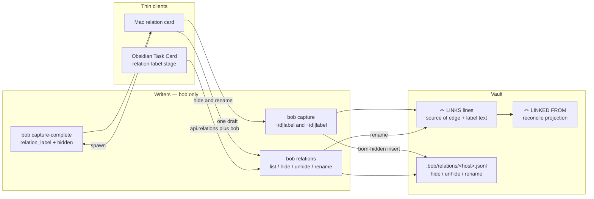

# Relation card: reliable completion, one-off hide, and catalog rename

Researcher: `grk`. Date: 2026-10-24.

This report diagnoses why Bob Mac Capture's relation card cannot cycle labels, critiques the proposed hide / show-all / rename / `||` plan, and recommends a design that stays a thin client of `bob`, matches the theme-catalog hide/rename precedent, and makes the card feel like the rest of Capture.

**Verdict.** The direction is right. The Tab-as-fill widget is the wrong control, hide belongs in a suggestion journal rather than on the LINKS line, and rename is a catalog rewrite that must not ride on Insert. Ship navigation first; then hide plus `||`; then rename.

---

## 1. What is broken, exactly

The screenshot (`~/tmp/screenshots/20261024_093115.png`) is the **relation-label card**, opened after a `~` pick of `sase:ref-athena-load-swap-thrash-20261024`. The field already contains `inspired by`, one chip repeats that same string, the live sentence is correct, and the footer still promises "Tab cycles suggestions".

That matches the code, and it also explains the "Tab once, then dead" feel.

### 1.1 Tab does reach the cycle handler

`CaptureKeyCommandRouter.relationLabelPromptCommand` maps plain Tab / Shift-Tab to `cycleRelationLabelSuggestionForward/Backward`. The panel's local `NSEvent` monitor consumes those keys. Unit tests (`testRelationCardTabCyclesSuggestions`) prove the model walk when the candidate list is held still.

The cycle is not a missing keymap. It is a collapsing menu.

### 1.2 Fill-then-refetch collapses the menu

`cycleRelationLabelSuggestion(by:)` does four things on every Tab:

1. Advances `selectedSuggestionIndex`.
2. **Writes that row's label into the text field.**
3. Untags the current suggestions (`suggestionAuthoredLabel = nil`).
4. Calls `fetchRelationLabelSuggestions()`, which probes `bob capture-complete` with `|"<filled label>"`.

`relation_label_suggestions` in `src/native/capture_complete/candidates.rs` then:

- prefix/substring-filters the catalog against that exact label;
- drops the matching catalog row;
- inserts a **typed** row at index 0.

For a unique full spelling such as `inspired by`, the response is one row. The next Tab is `(0 + 1) % 1 == 0`. Nothing changes.

Rapid Tab "works" because several increments land against the **pre-fetch** list. The first completed fetch then replaces that list with the typed singleton. That is the user's report, including the "hit Tab fast enough" hedge.

The screenshot is the post-collapse state: field filled, one chip, Inserts line advertising that same chip.

### 1.3 There is no visible selection

`selectedSuggestionIndex` is stored and never rendered. `RelationLabelPromptCard` draws every candidate as an identical bordered chip. Clicking a chip **commits** (`insertRelationLabelSuggestion`) instead of highlighting. The card cannot look like a menu because it is not one.

### 1.4 Ctrl+N/P are already swallowed, and do nothing

After the Tab branch, the relation card falls through to `isolatedPromptCommand`, which maps Ctrl+N / Ctrl+P (and Up / Down) to `.consumeKey`. Those chords never type into the field, and they never move a row. On every other Capture surface they already mean next/previous:

| Surface | Next | Previous |
| --- | --- | --- |
| Inline completion | Down / Ctrl+N | Up / Ctrl+P |
| Task / relation / dependency pickers | Down / Ctrl+N | Up / Ctrl+P |
| Stash picker | Down / Ctrl+N | Up / Ctrl+P |
| Template shelf | Down / Ctrl+N | Up / Ctrl+P |
| Relation-label card today | consumed, no-op | consumed, no-op |

Asking for Ctrl+N/P is not a new idiom. It is reconnecting this card to the idiom it already reserved the keys for.

### 1.5 The field is the wrong widget

Block ID and Name Pomodoro use AppKit `NSTextField` wrappers with focus repair in `repairPromptFieldFocusIfOrphaned`. The relation card uses a SwiftUI `TextField` plus `@FocusState`. The focus-repair path does not know it exists. That is a reliability gap even once the cycle logic is fixed.

Obsidian's Task Card relation-label stage is already closer to the right widget: a filter field plus a **vertical list**, typed row first, catalog rows with `used N×`, Enter commits the highlighted row. Mac should copy that, not the other way around.

---

## 2. Critique of the proposed plan

The request bundles four jobs:

1. Make completion navigation reliable (Ctrl+N/P over Tab-fill).
2. Hide / unhide relation descriptions for one-off vocabulary.
3. Rename a description across every task that uses it.
4. Add `~file:id||<desc>` so a label can be born hidden, with a warning when that description already exists.

**This is a good idea.** Relation labels are a small, growing vocabulary (live vault census, 2026-10-24: 6 labelled edges, 3 unique labels — `inspired by` ×3, `implements` ×2, `duplicate of` ×1). One-off sentences will pollute suggestions the first month they are used freely. Hide and rename are the same two catalog operations Pomodoro themes already have, and they belong here before the catalog gets noisy.

The plan needs several adjustments. Each is called out as **Adjustment**.

### 2.1 Tab-as-complete is the wrong control

**Adjustment A — highlight, do not fill.**

Tab currently *is* a complete-into-field gesture. That is why it dies. Treat the field as a **filter** and the list as a **menu**:

- Ctrl+N / Down / Tab move the highlight down among **currently visible** (non-hidden, unless show-all) rows.
- Ctrl+P / Up / Shift-Tab move it up.
- The field text does not change until Return / Insert.
- Return commits the highlighted row, or the typed row when the highlight is on it / when the list is empty and the typed label is valid.
- Empty Return still drops the pipe and leaves a bare `~note:id`.

Tab may stay as an alias for next-row so the current footer is not a lie. It must stop being the only advertised path, and it must stop writing the field.

This matches inline completion, pickers, stash, and the Obsidian relation-label stage. It also makes hide meaningful: a hidden row is simply absent from the walk.

### 2.2 Hide is a suggestion preference, not an edge flag

**Adjustment B — journal hide, leave LINKS bytes alone.**

A hidden description must keep rendering on every existing 🪢 LINKS / LINKED FROM chip. Deleting it from the vault, or stamping a marker onto each edge, would mix a recency preference with history. That is exactly the rejected theme alternative ("delete from the catalog").

Follow `decisions:theme-hide-is-recent-only` and `decisions:theme-prefs-live-in-per-host-journal`:

- Hide removes the label from **suggestion lists only**.
- Using a hidden label never unhides it.
- Today's chips, typed exact matches, Stats-like counts, and the live relation index stay unchanged.
- bob is the only writer.

Do not encode hide in the LINKS grammar. A one-off still stores `inspired by [[…]]` like any other label.

### 2.3 Ctrl+D is the right chord on this card, with one collision to document

**Adjustment C — Ctrl+D toggles hide on the highlighted catalog row.**

On the Task Card, Ctrl+D on **Links to…** already means "remove every outgoing relation". That is a different surface and a different object (edges vs vocabulary). Keep both. Spell the distinction in the footer and in plugin help:

- Task Card `Links to…` + Ctrl+D → unlink all.
- Relation-label card + Ctrl+D → hide/unhide this **description**.

On the label card:

- Highlight a visible catalog row, Ctrl+D → hide it (journal write via bob). The row leaves the default walk.
- Show-all on, highlight a hidden row, Ctrl+D → unhide.
- Highlight the typed row for a **new** spelling, Ctrl+D → mark this insert as hidden (the token becomes `||label`). That is the one-off path without a catalog row yet.

A second unhide-only chord is unnecessary. Show-all plus toggle is enough, plus CLI `unhide` for scripts.

Do not steal Ctrl+A (beginning of line), Ctrl+E, Ctrl+U, or Ctrl+K from the field.

### 2.4 Show-all must not steal emacs field keys

**Adjustment D — Ctrl+Shift+A toggles "include hidden", and the header shows a Hidden N chip.**

`bob themes list` already has `-a` / `-H`. The card needs the same two views:

- Default: visible descriptions + the typed row.
- Show-all: hidden rows included, dimmed, with a `hidden` capsule.

Ctrl+Shift+A (or clicking the header chip) toggles the view. Hidden rows sort after visible ones, still by count then code point.

bob should **return** hidden rows with `hidden: true` on every `relation_label` completion. The app filters. That is allowed by `decisions:mac-capture-is-a-thin-client` ("It may filter or rank what bob returned") and avoids a new `capture-complete` flag for a UI mode.

Reuse the existing additive `hidden` field on `CaptureCompletionCandidate`. It already means "subdued / not in the default walk" for `#hide` tasks. Older bob omits it; decode stays `false`.

### 2.5 Rename is a vault-wide rewrite; Insert must not do it

**Adjustment E — rename is a confirmed catalog command, never a side effect of picking a row.**

Relabelling one edge already exists: capture the same pair with a new `|label`, or ⇧↵ on a CURRENT row in the Links stage (LW4, LG4). That is **per-edge**.

The new request is **vocabulary rename**: every LINKS entry whose collapsed case-insensitive key matches OLD becomes NEW, then reconcile rewrites LINKED FROM mirrors.

That is `bob themes rename`, not "type in the card and hit Insert". From Mac Capture and Obsidian, rename is:

1. Highlight a catalog row (or name it on the CLI).
2. Ctrl+R / command-palette "Rename relation".
3. Type NEW in a nested field.
4. bob dry-run returns `{old, new, edges, notes, hidden_state_moves}`.
5. Confirm: `Rename “inspired by” → “inspired-by” on 3 links in 3 notes`.
6. bob writes LINKS lines under `bob_sync.lock`, appends a journal `relation.rename`, reconcile updates mirrors.

If NEW already exists, refuse unless `--merge` (same shape as themes). Merging `see` into `inspired by` is a real cleanup.

**Do not** put a live vault rewrite on the relation card's Insert button. Insert still only splices `|label` (or `||label`) into the draft.

### 2.6 `||` is a good spelling, and it is currently invalid

**Adjustment F — `||` is a second separator, not a label character.**

Labels already forbid `|` (`docs/task-relations.md` §3.2, `FORBIDDEN_CHARS` in `src/native/task_relations/label.rs`). The scanner stops the block id at the first `|`. Today:

- `~note:id||desc` tries to parse the label as `|desc` and refuses (`label contains a forbidden character`).
- `capture-rewrite` **excludes** `Fix ~tasks:target ||` from `attach_relation_label` (`rewrite_draft_attach_relation_label_exclusions`).

So `||` is free, unambiguous, and currently a teaching-error / leftover-prose hole. Extending the separator to `|` | `||` is the right grammar:

```text
~note:id|label          visible catalog insert
~note:id|"multi word"
~note:id||label         born hidden
~note:id||"multi word"
~~note:id||label        reverse direction, born hidden
```

`|||` is invalid: "use `||` to hide a relation, or `|` to label one".

Glue rewrite should treat `~note:id ||` the way it treats `~note:id |`: delete the spaces and leave the caret after `||`.

The stored LINKS line is identical for `|` and `||`. Hide is a journal event fired at capture execution.

### 2.7 Warning when `||` names an existing description

**Adjustment G — structured preview warning, two-Return only on the card's hide of a shared word, never a silent extra Capture confirm for a brand-new one-off.**

User intent: hiding an existing description is allowed, and it must be obvious.

bob already has a two-submit pattern on this panel (`testOldBobCapabilityWarningRequiresTwoSubmits`). Use it **narrowly**:

| Situation | Capture preview | Relation card |
| --- | --- | --- |
| `||brand-new` | quiet `one-off` capsule on the relation row | typed row wears a `one-off` capsule; Insert writes `||label` |
| `||inspired by` while that key has count ≥ 1 | amber banner, still one Capture | Ctrl+D on that catalog row: banner plus a second Return to confirm the journal hide |
| Typing `||inspired by` in the editor, then Capture | amber banner on the live preview is enough; Capture itself stays one press | — |

Do not make every hidden insert a two-step Capture. One-offs should stay cheap. Shared-vocabulary hide should feel like a preference change.

Preview JSON (additive, `schema_version` stays 1):

```json
"relation_label_hides": [
  {
    "label": "inspired by",
    "key": "inspired by",
    "already_existed": true,
    "count": 3,
    "warning": "inspired by is used on 3 links · || hides it from suggestions, not from those tasks"
  }
]
```

Mac renders that string. It does not invent the count.

### 2.8 Auto-hiding hapaxes would be a mistake

**Adjustment H — never auto-hide a new spelling.**

`duplicate of` is currently a hapax and a built-in inverse pair. Auto-hiding first-use labels would hide vocabulary Bryan is still forming. Hide is an explicit gesture (`Ctrl+D` or `||`).

### 2.9 Inverse phrases stay display-only

Rename of `follow-up of` → `follow up of` is a catalog rewrite of stored text. Inverse chips (`followed up by`) keep matching the **stored** key against the built-in table. Do not add journal-defined inverses in this work.

---

## 3. Recommended architecture

bob-cli owns meaning. Mac and Obsidian render it. That is non-negotiable (`decisions:mac-capture-is-a-thin-client`).



### 3.1 Label identity

Mirror themes:

- **Key:** `normalize_relation_label` then ASCII/Unicode case-fold. Today's suggestions already dedupe case-insensitively.
- **Display name:** most recently authored spelling (first-seen in the current catalog fold if we need a deterministic pick; capture-complete already keeps the first-inserted casing).
- **Not a label:** empty after collapse, forbidden characters, >40 writer characters.

### 3.2 Journal

Path: `.bob/relations/<host>.jsonl` inside the vault, allowlisted like `.bob/themes/*.jsonl` (`!/.bob/relations/*.jsonl`, `merge=union`).

Events (`v: 1`):

```json
{"v":1,"ts":"2026-10-24T14:01:00Z","host":"mac","via":"bob-mac-capture","kind":"relation.hide","key":"inspired by"}
{"v":1,"ts":"2026-10-24T14:02:00Z","host":"mac","via":"bob-mac-capture","kind":"relation.unhide","key":"inspired by"}
{"v":1,"ts":"2026-10-24T14:03:00Z","host":"apollo","via":"bob-cli","kind":"relation.rename","from":"inspired by","to":"inspired-by"}
```

Fold: every `*.jsonl`, skip malformed lines with a bounded warning, sort by `(ts, host, path, line)`, last writer wins per key. A rename moves hide state unless the target already has state.

Writers serialize through bob under `bob_sync.lock` (3 s, `lock_busy`). Clients never append.

### 3.3 CLI noun

**Adjustment I — new catalog noun `bob relations`, not a `bob capture` child, and not split across `bob task` for hide.**

CLI rules: never add a subcommand under `bob capture`; `bob task <verb>` is reserved for commands that rewrite task lines across the whole vault; nest only under a noun with a stated membership rule.

Membership rule: **`bob relations` operates on the relation-label catalog** (list, hide, unhide) **and on vault-wide relabel of LINKS text** (rename).

This is the `bob themes` precedent: hide is a journal preference, rename happens to rewrite daily notes / LINKS lines, and the user-facing object is still the catalog.

Bare `bob relations` = `list`. Members, alphabetical:

- `hide NAME…`
- `list [-a/--all] [-H/--hidden] [-f/--format human|json] [-q/--query Q]`
- `rename OLD NEW [-d/--dry-run] [-f/--format] [-m/--merge] [-o/--offline]`
- `unhide NAME…`

Every public long option gets a short alias. Help is colored. Human list:

```text
RELATIONS  3 known · 1 hidden
  inspired by     3
  implements      2
  □ duplicate of  1  hidden
```

Place the group in **Tasks and projects**, after `task`, not under Daily workflow. Relations are not a morning ritual.

Rename is the one command that rewrites task lines. If the CLI-rule reading is held strictly, an acceptable alternative is `bob task relabel` for the rewrite plus `bob relations` for list/hide/unhide. I would not split them: two nouns for one vocabulary is worse than stretching the themes precedent.

### 3.4 Completion contract (additive, schema 1)

`relation_label` candidates gain nothing new except using fields that already exist:

| Field | Meaning on a label row |
| --- | --- |
| `label` | display spelling |
| `count` | LINKS occurrences, omitted on the typed row |
| `typed` | canonical spelling of the current filter |
| `hidden` | journal-hidden; default walk omits it |
| `replacement` | `\|label`, `\|"multi word"`, or `\|\|…` when the probe itself used `||` / the typed row is marked one-off |
| `disabled_reason` | invalid typed row |

bob also sends `relation` (token range, direction) and `owner` as today.

When the probe separator is `||`, the typed row's replacement uses `||`. Catalog rows still offer `|` replacements unless the client is inserting a hidden pick of an already-hidden name (then `||` is fine either way; hide state does not depend on the separator of later uses).

**Using a hidden name by typing it exactly** still inserts. It does not unhide. The typed row may show a dim `hidden` capsule so the user knows it will not return to Recent.

### 3.5 Parse / execute contract

`capture-parse` `relations[]` gains additive `hidden: true` when the separator was `||` (omit when false). `label_range` still covers only the label bytes, not the pipes. The separator span is 1 or 2 bytes (`relation_label_separator`).

`capture` execution, per labelled relation:

1. Write the LINKS entry as today (label text only).
2. If `hidden` and the key is not already hidden, append `relation.hide`.
3. If `hidden` and the key already existed in the catalog, also emit `relation_label_hides[]` with `already_existed: true`.
4. Relabel of an existing edge does not change hide state unless `||` is present.

Dry-run shows the same JSON and writes nothing, including no journal line.

---

## 4. The card, redesigned

Keep what already works: the knot header, the live `S — label → T` sentence, empty-Return drops the pipe, Escape returns to the picker, Insert is ↩.

Replace the horizontal chip strip with a short vertical menu. Caps at 8 visible rows, scroll after that. Typed row pinned at top when the field is non-empty.

```text
┌ 🪢 Relation ──────────────────────────────────── Hidden 1 ┐
│ “Buy new SDD …” — inspired by → “What was athena doing…” │
│ ┌──────────────────────────────────────────────────────┐ │
│ │ inspired by                                   filter │ │
│ └──────────────────────────────────────────────────────┘ │
│   inspired by · 3                              ← selected│
│   implements · 2                                         │
│   + inspired-by-the-swap            one-off     typed    │
│                                                          │
│ Inserts |"inspired by"                                   │
│ ⌃N/P move · ↩ insert · ⌃D hide · ⌃⇧A hidden · ⌃R rename  │
│ esc back to picker                                       │
│                                            Cancel  Insert│
└──────────────────────────────────────────────────────────┘
```

Visual language (reuse, do not invent a palette):

- Selected row: the same highlight the task picker uses.
- Catalog counts: muted `· 3`, matching today's chip accessory.
- Hidden row (show-all): 50% opacity, `hidden` capsule, still highlightable.
- Typed new spelling: `+` prefix, `is-create` styling (Obsidian already does this).
- Typed new spelling marked one-off: extra `one-off` capsule in the mint knot accent.
- Existing-hide warning: amber caption under the Inserts line, not red. Red stays for invalid labels (`a (b)`, too long, empty after collapse).
- Header **Hidden N** chip: off by default; on = show-all. Count is hidden keys, not edges.

Focus: replace the SwiftUI `TextField` with an AppKit field twin of `BlockIDField` / `PomodoroNameField`, including `requestFocus(.relationLabelPromptField)` repair in `repairPromptFieldFocusIfOrphaned`. Emacs Ctrl+A/E in the field keep working because the router returns `nil` for them.

### 4.1 Keymap (label card only)

| Key | Action |
| --- | --- |
| Ctrl+N / Down / Tab | Next **visible** row (wrap) |
| Ctrl+P / Up / Shift-Tab | Previous visible row (wrap) |
| Return / Insert | Commit highlighted row into the draft |
| Empty Return | Drop the pipe, keep `~note:id` |
| Ctrl+D | Toggle hide on the highlighted **catalog** row; on a new typed row, toggle one-off (`||` vs `|`) |
| Ctrl+Shift+A | Toggle include-hidden |
| Ctrl+R | Rename the highlighted catalog row (confirm sheet) |
| Escape / Ctrl+[ | Back to picker, or editor for the `\|` flow |
| Ctrl+Tab | Still switches Capture ↔ Refs (already matched first) |

The relation **task** picker is unchanged: Tab still accepts a task row, ⇧↩ still opens this card.

### 4.2 Obsidian parity

The Task Card relation-label stage (`showRelationLabelStage` in bob-navigation-hotkeys) already has the list. Add:

- Footer hints for ⌃N/P, ⌃D, ⌃⇧A, ⌃R.
- Filter out `hidden` keys unless show-all.
- `labelSuggestions` grows `{label, count, hidden}` from the journal fold bob reports. Preferred path: call `bob relations list -a -f json` through the existing plugin bob-spawn helper (same as `api.themes`), cache, subscribe. Do not parse `.bob/relations` in JS.
- Rename opens a confirm using `bob relations rename -d -f json`, then the live write.
- Ctrl+D here must **not** fire the Task Card "unlink all" handler; the relation-label stage already intercepts Escape/Backspace before the card keymap.

Hand-edited LINKS lines never need a hide marker. Suggestion state is the journal.

### 4.3 CLI / scripts

```bash
bob relations                     # visible labels, count desc
bob relations -a                  # include hidden
bob relations hide "inspired by"
bob relations unhide "inspired by"
bob relations rename "inspired by" "inspired-by" -d
bob capture 'Buy SSD @dev:harddrive ~sase:ref-athena-load-swap-thrash-20261024||"rack anecdote"'
```

---

## 5. Warning and one-off UX, specifically

The screenshot's `inspired by` is the live catalog's most common label (3/6 labelled edges). Hiding it via `||inspired by` is the case the warning exists for.

**Mac, editor draft with `||`:** the live preview relation row grows an amber line under the usual 🪢 copy:

> **inspired by** is used on 3 links. `||` will hide it from suggestions. Existing chips stay.

Capture remains one press. The banner is the disclosure.

**Mac, relation card Ctrl+D on `inspired by`:** the same sentence, Insert/Return the first time only arms hide (`pendingHideConfirm`), the button title becomes **Hide & Insert** (or **Hide** if the field is empty and this is a catalog-only preference write). Second Return performs it.

**Mac, Ctrl+D on a typed hapax:** no confirm. The typed row immediately shows `one-off`, replacement becomes `||…`, Insert is one press.

**CLI:** human capture output includes a `🪢 hide inspired by (used 3×)` line in the relation group. JSON carries `relation_label_hides`.

---

## 6. Rename details

Planner walks every accepted LINKS line (same scan as `task_links_catalog`, including `done/` as read-only sources that **cannot** be rewritten; report them as `skipped: read_only` if they still hold OLD).

For each writable source entry whose normalized key equals OLD:

- Relabel in place (LW4), preserving order.
- If NEW equals the existing label already, no-op.

Then `reconcile_relation_lines` updates LINKED FROM (LR2, LR18). One git commit from bob, message `bob relations rename: OLD → NEW`, same recover-by-revert runbook as themes.

Refuse:

- `unknown_label` (OLD not in catalog and not hidden)
- `invalid_name` (NEW fails §3.2)
- `unchanged` (same key)
- `label_exists` (NEW in catalog, no `--merge`)
- `lock_busy`, `dirty_paths`, `not_a_worktree`, `sync_failed`

`--merge` rewrites OLD → NEW and sums counts; hide state of NEW wins if both were explicit.

From the card, Ctrl+R is disabled on the typed row unless that spelling is already a catalog key. You cannot "rename" a name that does not exist yet.

---

## 7. What I would not do

- **Keep Tab-fill and add Ctrl+N/P beside it.** Two models on one list is how the current card got confusing. One model: highlight.
- **Store hide on the LINKS line** (`(hidden)`, a second glyph, a tag). History would churn for a suggestion preference.
- **Auto-unhide on use.** Fights the one-off gesture the next morning (`theme-hide-is-recent-only`).
- **Auto-hide hapaxes.** Kills `duplicate of` and every first use of a real verb.
- **A Mac-only hide list in app memory.** Would not sync to apollo/Obsidian; violates the thin client rule.
- **`bob capture hide-relation`.** Capture's free-text TEXT would swallow it; the protocol names are frozen siblings.
- **Making Insert also rename** because the typed text differs from the highlighted row. That is a filter, not a rewrite. Divergence is normal while searching.
- **A new inverse-phrase editor.** Out of scope; the five pairs stay built-in.
- **Blocking Capture on the existing-label `||` warning.** Disclose, then trust the explicit `||`.

---

## 8. Phasing

Navigation is a bugfix. Hide/`||` is a catalog feature. Rename is a vault rewriter. Do not ship them as one PR.

| Phase | Where | What | Why this order |
| --- | --- | --- | --- |
| **N0** | bob-cli docs + Mac | Highlight-not-fill; Ctrl+N/P/Up/Down/Tab; AppKit field; paint `selectedSuggestionIndex`; stop refetch-on-cycle; do not commit on chip click | Unblocks the screenshot today; no grammar change |
| **N1** | bob-cli | `.bob/relations` journal, `bob relations list/hide/unhide`, `hidden` on `relation_label` candidates | Clients can filter |
| **N2** | bob-cli | `||` parse/rewrite/execute, `relation_label_hides[]`, dry-run warnings | Grammar after the catalog exists |
| **N3** | Mac, then plugins | Card hide / show-all / one-off capsule / amber banner; Obsidian list parity | Thin clients of N1–N2 |
| **N4** | bob-cli, then UIs | `bob relations rename` + confirm sheets | Last, because it rewrites the vault |

N0 can ship on the Mac train as soon as bob already returns the current `relation_label` list (it does). It must not wait for the journal.

Each public CLI flag needs a short alias; `just docs-gen` plus `docs/task-relations.md` vectors for `||`, hide, and rename. New decision records after implementation:

- `relation-hide-is-suggestion-only`
- `relation-prefs-live-in-per-host-journal`

Do not reopen `mac-capture-is-a-thin-client`.

---

## 9. Test vectors to add

Capture parse / complete / execute (cite from `docs/task-relations.md` once landed):

| ID | Input | Expect |
| --- | --- | --- |
| LH1 | `Fix it ~work:foo\|\|see` | parse `hidden: true`, label `see`, separator span 2 |
| LH2 | `Fix it ~work:foo\|\|"follow-up of"` | quoted hidden label |
| LH3 | `Fix it ~work:foo\|\|\|see` | invalid, teaching `||` |
| LH4 | `Fix it ~work:foo \|\|` | rewrite glues to `~work:foo\|\|`, need `relation_label` |
| LH5 | `\|\|brand-new` on a unique spelling | execute hide journal, no `already_existed` warning |
| LH6 | `\|\|inspired by` while count is 3 | execute hide, `already_existed: true`, count 3 |
| LH7 | hide then `capture-complete` empty query | catalog row `hidden: true`; default Mac walk omits it |
| LH8 | type the hidden name exactly | typed row inserts; still hidden after |
| LR1 | `bob relations rename "inspired by" inspired-by -d` | 3 edges, 3 notes |
| LR2 | rename without `--merge` onto `implements` | `label_exists` |
| LN1 | Mac cycle with 3 visible rows, filter empty | Tab/Ctrl+N walks 0→1→2→0, field stays empty until Return |
| LN2 | after highlighting row 1, type `in` | list refilters; highlight clamps; field is `in` |
| LN3 | Ctrl+N/P while SwiftUI would have stolen them | monitor consumes, selection moves |

JS `labelSuggestions` currently prefix-only; Rust `rank()` is prefix then substring. **Adjustment J — Obsidian should consume bob's ranked list** (or copy the Rust ranker) so hide/show-all and filter match Mac. Do not leave two rankers.

---

## 10. Recommended solution

**Do the work. Change the widget.**

1. **Fix the card as a picker, not an autocomplete.** Ctrl+N/P, Up/Down, and Tab move a painted highlight across rows that are not hidden. The field is a filter. Return inserts. Stop filling the field on Tab, stop refetching on cycle, stop committing on chip click. Use an AppKit field with the same focus repair as Block ID.

2. **Treat descriptions as a catalog, like themes.** `.bob/relations/<host>.jsonl` for hide/unhide/rename. `bob relations` is the noun. Hide never rewrites LINKS text. Using a hidden name never unhides it. Show-all is Ctrl+Shift+A plus a Hidden N chip.

3. **Ctrl+D hides.** On a catalog row it toggles journal hide. On a new typed spelling it marks the insert one-off (`||`). Confirm with two-Return only when hiding a description that already has count ≥ 1.

4. **`~note:id||label` is the capture spelling of born-hidden.** Additive parse field `hidden`, identical on-disk label, preview warning when the key already exists. `|||` is a teaching error. Glue ` ||` like `|`.

5. **Rename is a confirmed catalog rewrite.** CLI first, then Ctrl+R with a dry-run confirm naming edge and note counts. Insert never renames.

6. **Ship N0 immediately**, then journal/CLI, then `||`, then Mac/Obsidian hide UI, then rename.

That is intuitive (one menu, keys Bryan already uses), reliable (no race against a collapsing fetch, AppKit focus), and beautiful (live sentence stays, chips become a real list, one-off and hidden states are capsules rather than missing UI).

The original plan's only structural mistake was treating Tab as complete-into-field. Everything else — hide for one-offs, show-all, unhide, global rename, `||` with a warning — stands, with the adjustments above.
