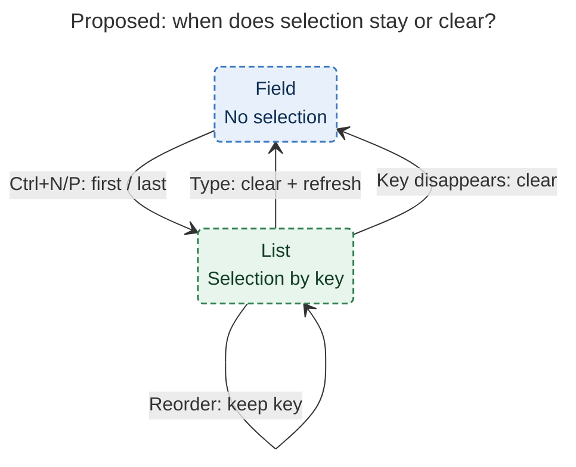
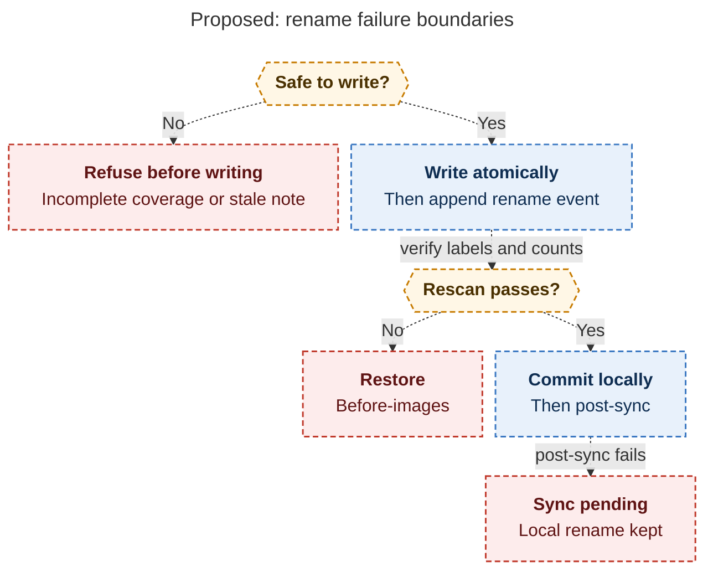

# Diagram proposals: Relation card: completion that works, hidden labels, and global rename

Proposals for the swarm linker, not a report. Each diagram restates only what the source
report says.

```yaml
source: research:202610/relation_card_label_vocabulary/relation_card_label_vocabulary__final.md
producer: research.2e.image
check: "mmdc 12.0.0 (pinned npx; Puppeteer --no-sandbox) with the PDF-mirroring config rendered 2 of 2 Mermaid diagrams"
```

## selection-by-key

```yaml
anchor: |-
  Typing clears the selection and refreshes.
question: |-
  When do navigation, typing, and refreshed results preserve or clear selection?
illustrates: |-
  In the proposed card, navigation changes only the selected key and sentence pill, typing clears selection, and a refresh preserves the selected key unless it disappears.
caption: Navigation leaves the query unchanged; typing clears selection; reordered results retain the same key, while missing keys clear it.
review: "751.422×326 px, fit 86.9%; question and visual checks passed; 1 revision"
```



## rename-failure-boundaries

```yaml
anchor: |-
  Snapshot every target and compare right before writing
question: |-
  When do coverage, snapshot, verification, and sync failures stop or preserve a global rename?
illustrates: |-
  The proposed rename refuses incomplete coverage and stale notes, restores before-images after failed verification, and reports renamed locally separately from sync pending.
caption: Coverage or snapshot failures refuse before writing; failed verification restores files; failed post-sync preserves the local rename.
review: "664.484×914 px, fit 97.7%; question and visual checks passed; 1 revision"
```


