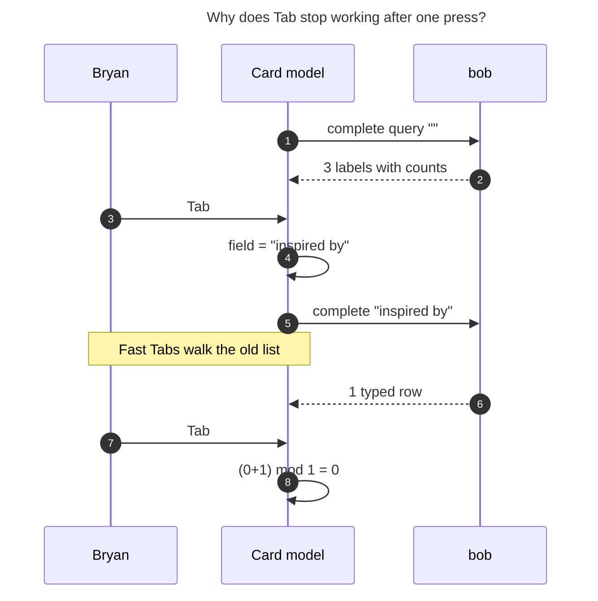
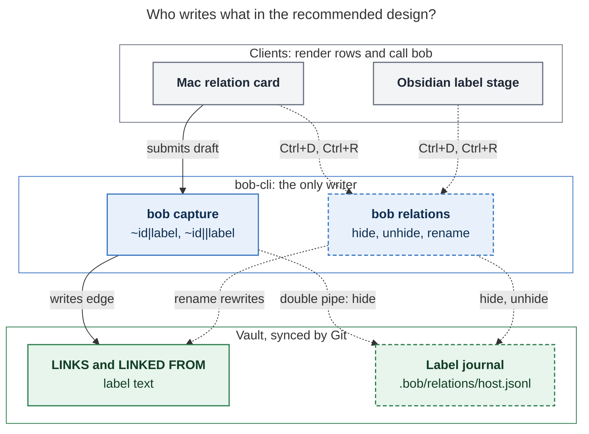

# Relation card: completion that works, hidden labels, and global rename

Consolidated research report, 2026-10-24. Lead synthesis of five independent reports
(`__cdx`, `__cld`, `__grk`, `__mus`, `__gem` in this directory), plus my own checks of
the disputed points. Code snapshots: bob-cli `8628ce2f`, bob-mac-capture `72cd721`,
bob-plugins `3a7368a`. The screenshot `~/tmp/screenshots/20261024_093115.png` was
inspected. All vault and `bob` probes were read-only. No Swift was compiled and the Mac
app was not run.

> **Request.** The Bob Mac Capture relation card's Tab completion fills in one relation
> and then stops responding. Fix that and improve the card:
>
> - Ctrl+N/P navigation.
> - A way to hide relation descriptions for one-off relationships (perhaps Ctrl+D).
> - A key that shows hidden descriptions, and a way to unhide them.
> - A reliable rename from the card, the CLI, and Obsidian.
> - A `~file:id||<desc>` capture syntax that creates the description already hidden,
>   with a warning when it would hide one that already exists.
>
> Critique the plan, adjust the requirements where justified, and recommend a solution.

## Bottom line

1. **The bug is structural, not a missing keymap.** The card stores a single string that
   is both the field text and bob's query. Each Tab writes the chosen label into that
   string and re-queries bob. Bob then returns only the typed row, so the list collapses
   to one entry and every later Tab computes `(0+1) mod 1 = 0`. Fast Tabs reach "the nth"
   label only because they walk the old list before bob replies. All five reports found
   this independently, and I re-verified it in the code and against the live vault (§1).
2. **The fix is to separate the query from the selection.** The field holds what you
   typed. A vertical list holds the existing labels.
   - Ctrl+N/P and ↓/↑ move a visible highlight. They never change the field and never
     call bob.
   - Tab accepts. With nothing selected, Tab completes to the top match, so "tab
     completion" finally means what it says.
   - This is Mac-only work, needs no bob change, and should ship first, on its own.
3. **The rest of the plan is sound. Build it from the Pomodoro theme machinery bob
   already has rather than a new design:**
   - a per-host preference journal;
   - "hide affects suggestions only";
   - bob as the only writer;
   - a `bob relations list|hide|unhide|rename` group shaped like `bob themes`;
   - the Ctrl+D "ghost row with undo" gesture already planned for theme menus.
4. **Adjustments that matter most** (§3):
   - Say **hide**, never "disable", because `disabled_reason` already means "cannot be
     inserted".
   - Tab **accepts** and does not cycle.
   - Ctrl+D is always the card's key:
     - on a selected row, it hides or unhides that label now;
     - on typed text, it toggles **one-off** (`||`).
   - `||` on an existing label **warns but does not block**.
   - Rename is a separate, previewed, one-commit rewrite. It includes `done/`, as an
     explicit, recorded exception to "no relation write touches `done/`".
5. **Size the work to usage.** The vault holds 8 LINKS lines with 6 labelled entries and
   3 labels: `inspired by` ×3, `implements` ×2, `duplicate of` ×1. Three days ago you
   cancelled epic `bob-cli-am` for "too little value… such low usage". Ship the fix now.
   Hide and `||` are cheap on the theme infrastructure and keep the list clean before
   one-offs pile up. Rename is the largest and least urgent piece, so build it last.

## 1. What is broken (verified)



*Figure 1. Navigation was built on top of editing. Each Tab edits the query, and the
edited query shrinks the list it is cycling through.*

| Defect | Evidence |
| --- | --- |
| **Tab rewrites the query.** `cycleRelationLabelSuggestion(by:)` copies the chosen row into `authoredLabel`, clears freshness, and calls `fetchRelationLabelSuggestions()`. | `CapturePanelModel.swift:6631–6649` |
| **bob returns a single typed row for a full label.** `relation_label_suggestions` ranks by the query, drops the matching catalog row, and inserts a `typed` row with no count. Probe: query `""` → `inspired by·3, implements·2, duplicate of·1`; query `inspired by` → one typed row. | `candidates.rs:1592–1654`; live `bob capture-complete` |
| **The selection index outlives the list.** `applyRelationLabelSuggestions` resets the index only when it is out of range, so the index can point at a different row than the field. | `CapturePanelModel.swift:6942–6975` |
| **Off by one.** The index starts at 0 and the first Tab adds 1, so an empty field skips the most-used label. | prompt init `selectedSuggestionIndex: 0` |
| **The selection is invisible.** Rows are identical `.bordered` chips in a horizontal `ScrollView`, and the index is never rendered. | `CapturePanelView.swift:1801–1823` |
| **Ctrl+N/P and ↑/↓ are swallowed.** The shared `isolatedPromptCommand` maps them to `.consumeKey`. Every other Mac list uses them to move a wrapping selection. | `CaptureKeyCommandRouter.swift:519–537, 654–685`; `docs/keyboard.md:103–120` |
| **The field is outside focus repair.** The card uses a SwiftUI `TextField` with `@FocusState`, but `repairPromptFieldFocusIfOrphaned` only knows the Block-ID and Pomodoro-name AppKit fields. The model comment claims the field is AppKit-owned, which it is not. | `CapturePanelView.swift:1789`; `CapturePanelController.swift:1923–1944`; `CapturePanelModel.swift:229` |
| **The test cannot catch the bug.** `testRelationCardTabCyclesSuggestions` uses a fixed array and no process client, so the collapsing refetch never runs. | `CaptureRelationPanelTests.swift:121–137` |
| **Every keystroke spawns a full scan.** `relation_label_suggestions` calls `capture_dependency_tasks::discover` over the whole vault and then re-reads notes. I measured 0.28–0.34 s warm on apollo today. cld measured 0.85 s warm and 2.5 s cold under other load. Mac latency is unmeasured. | `candidates.rs:1596`; timed probes |

The freshness protocol from `bob-cli-al` (`suggestionAuthoredLabel`, `pendingSubmit`,
generation guards) is correct and load-bearing. Keep it. Only navigation has to stop
going through it.

The Obsidian relation-label stage already works the way the card should: a filter field,
a vertical list with `used N×`, Ctrl+N/P movement, and Return committing the highlighted
row (`426-picker-relation-stage.js`). The Mac card is the outlier.

## 2. Is this a good idea?

**Yes, with the adjustments in §3.** Labels are the only free-text vocabulary in the
relations system with no curation tools: completion does not work, a one-off or a typo
cannot be retired, and nothing can be renamed. Working suggestions are what keep one
meaning to one spelling. Without them, `inspired by`, `inspired-by`, and `inspiration`
drift apart.

| Piece | Verdict | Why |
| --- | --- | --- |
| Navigation fix | **Now** | It is a bug, it is small, and it needs no contract change. |
| Hide, unhide, show hidden | **Next** | The theme journal, fold, lock, and allowlist already exist. Without hide, every one-off is suggested forever. |
| `\|\|` capture syntax | **Next** | Small and safe. `\|` is already forbidden in labels: `bob capture-parse 'Buy SSD ~sase:x\|\|oneoff'` reports `invalid_relation` (forbidden character) today, so claiming `\|\|` breaks nothing. |
| Global rename | **Last** | The largest piece: a vault-wide transaction with sync, verification, mirrors, and a commit. With 3 labels and 6 links, a hand edit followed by `bob task reconcile` covers today's needs. Build it on a shared rewrite transaction extracted from `bob themes rename`. |

**Alternatives considered and rejected** (by the reports, and confirmed by the theme
precedent):

| Alternative | Why not |
| --- | --- |
| Auto-hide labels used once, or older than N days | Silent state change. Bob's decisions prefer explicit gestures ("nothing decays silently"). It would also hide `duplicate of`, which is a real, built-in inverse pair. |
| A hide flag on the LINKS entry | Hiding belongs to the vocabulary, not to one edge. It would churn history for a suggestion preference and add grammar to lines meant to read as English. |
| `relations.hidden_labels` in `config.yml` | chezmoi manages that file, so writes from the Mac or Obsidian would be overwritten. |
| Machine-local state | A hide on the Mac would never reach Obsidian on apollo. |
| A label registry with UUIDs | Turns free text into schema, needs a Markdown migration, and does nothing for the reported bug. |
| Rename as a display alias in the journal | LINKS lines must read as English without plugins. Themes rejected aliases for the same reason. |
| Tab keeps completing into the field (shell style) | That is today's bug. |
| The field mirrors the highlighted row (gem) | Re-couples query and selection. The sentence pill previews the highlighted row instead. |

## 3. Requirement adjustments (called out)

| # | Your requirement | Adjusted to | Why |
| --- | --- | --- | --- |
| A1 | "Disable/hide" | **Hide from suggestions.** UI words are Hide, Unhide, Show hidden. | `disabled_reason` already means "cannot be inserted", and a hidden label can still be inserted. |
| A2 | "Relation description" | Contracts and CLI say **relation label**. The UI mostly says "relation". | In bob, "description" means task text. `docs/task-relations.md` already says *label*. |
| A3 | Hidden labels | **Hide changes suggestions only.** Chips, LINKED FROM mirrors, counts, and typed use are unchanged. Using a hidden label never unhides it. Typing its exact name still shows it, flagged *hidden*. | The twin of `decisions:theme-hide-is-recent-only`. |
| A4 | Tab completion plus Ctrl+N/P | Ctrl+N/P and ↓/↑ **navigate**. Tab **accepts**, never cycles. With no selection, Tab completes to the top match. | Mac completion already uses "Tab accepts the selected completion" (`docs/keyboard.md:51`). Cycling belongs to Ctrl+N/P. |
| A5 | Ctrl+D hides | Ctrl+D is **always** the card's hide key. On a selected row, it hides or unhides that label **now** (ghost row, Ctrl+D undo). With no selection, it toggles **one-off** (`\|\|`) for the typed label. | The planned theme gesture (PT9, theme-catalog ADJ-5). One rule: Ctrl+D hides what Return would insert. |
| A6 | Show all, re-enable | **Ctrl+H** toggles a *Hidden* section, plus a clickable `◌ N hidden` row. Unhide is Ctrl+D on a hidden row, so no second key is needed. | Mirrors `bob themes list -H`. Recovery is always visible without remembering a key. |
| A7 | Rename from card, CLI, Obsidian | One engine, `bob relations rename`, with a **distinct rename mode** (Ctrl+R): live dry-run, then an explicit "Rename everywhere". It is never a side effect of Insert. Merging into an existing label needs its own confirmation. | The theme work rejected rename in *inline* menus for blast-radius reasons. The relation card is a dedicated surface, so a separate mode with a preview satisfies both. |
| A8 | Rename "all tasks" | Includes `done/` history and the previous daily note, rewriting **label spans only**. This is a recorded exception to LR7. | The catalog counts `done/` labels. Skip them and OLD stays suggested forever (one of today's 8 LINKS lines is already in `done/`). |
| A9 | `~file:id\|\|<desc>` | The real spelling is `~note:block-id\|\|label` / `\|\|"multi word"`, in both directions. The hide happens **only after a successful capture**. `\|\|\|` is a teaching error. | The second pipe is an instruction, not label text. A preview or a failed capture must leave no trace. |
| A10 | Warn when `\|\|` hides an existing label | **Warn, never block.** Show the warning in the card, the live preview, dry-run JSON, CLI output, and the success feedback, with a one-key way out (Ctrl+D keeps it visible). | You asked for "supported but clear". A second confirmation would only slow the deliberate case. |
| A11 | "Temporary/one-off relationships" | One-off **wording** that is not suggested again, not expiring links. | Relations are history, and an expiry system would be a separate feature. |
| A12 | *(new)* Case drift | A typed label that equals an existing key ignoring case adopts the existing spelling. | Preventing variants is cheaper than renaming them later. |
| A13 | *(new)* Speed | Navigation is local and instant. The label scan stops calling `discover`. | 0.3–0.85 s per keystroke is too slow for a chooser. |

## 4. Design

### 4.1 Model and ownership



*Figure 2. Hide and unhide touch only the journal. Rename is the only operation that
rewrites label text. Every write goes through bob. Dashed boxes and edges are new.*

```text
catalog(key) = derived from every LINKS entry, done/ included: count, display spelling    ← bob scans
prefs(key)   = fold of .bob/relations/*.jsonl: hidden, renamed_to                           ← bob writes
rows         = catalog, ranked (prefix, then substring; count desc; name), hidden flagged
```

- **Key.** Collapse whitespace and lowercase. One backend function feeds the catalog,
  the typed-row dedupe, and the JS mirror through shared vectors. Today the catalog uses
  `to_lowercase` but the typed-row dedupe uses `eq_ignore_ascii_case`
  (`candidates.rs:1446, 1641`), so fix that mismatch. Do not quietly change existing
  equivalence classes, for example by adding NFC.
- **Display spelling.** The most-used spelling; ties go to the first seen.
- **Journal.** `.bob/relations/<host>.jsonl` with `v: 1` events `relation_label.hide`,
  `relation_label.unhide`, and `relation_label.rename` (`from`, `to`), plus a `via`
  client name. The fold copies PT4:
  - read every file and skip malformed lines with a bounded warning;
  - sort by `(ts, host, path, line)`; the last writer wins per key;
  - a rename moves the source key's state unless the target already has state.

  Writes are appended under `bob_sync.lock` (3 s, `lock_busy`). Allowlist with
  `!/.bob/relations/*.jsonl` and `merge=union`.
- **Engineering.** Turn `pomodoro_themes::journal` into a shared preference-journal
  module keyed by namespace (`themes`, `relations`) instead of copying it.
- **Hidden labels with zero uses** stay listable from journal metadata, so you can always
  find and unhide them.

### 4.2 The card: interaction

The state is `query` (field text), `selectedKey?` (a label **key**, never an array
index), `includeHidden`, `oneOff`, and `mode` (choose or rename). Navigation changes only
`selectedKey` and the sentence pill. It never edits `query`, launches a process, or
clears freshness. Typing clears the selection and refreshes. If a refresh drops the
selected key, the selection **clears**: a different row never inherits it.

| Key | Action |
| --- | --- |
| **Ctrl+N** / ↓ | Select the next label. From no selection, select the first. Past the last, return to the field (wrap, like every Mac list). |
| **Ctrl+P** / ↑ | Select the previous label. From no selection, select the last. |
| **Tab** | Accept the selected label. With no selection, accept the **top** match, marked `⇥` on its row. With no matches, insert nothing and show "No match — ↩ uses “…”". |
| **Return** | Accept the selected label. Otherwise use the typed text (bob-validated, existing `pendingSubmit` path). On an empty field, insert a plain link and drop the pipe (unchanged). |
| **Ctrl+D** | *Selected row:* hide or unhide now. The row stays in place as a ghost (`hidden everywhere · ⌃D undo`) until the next query. *No selection:* toggle one-off for the typed label. Always consumed in the card. Auto-repeat is ignored, so one press makes one change. |
| `\|` typed | Turns one-off on and never enters the field. Backspace on an empty field turns it off. So `~note:id\|\|` typed straight through does the expected thing. |
| **Ctrl+H** | Show or hide the *Hidden* section. Query and selection are kept. |
| **Ctrl+R** | Rename the selected label, or the typed label if it is an existing key, everywhere (§4.6). Disabled with a hint otherwise. |
| Escape / Ctrl+[ | Leave rename mode first. Otherwise go back to the picker or editor, as today. |
| Shift+Tab | Consumed, no-op. |
| Click | A row accepts it. The eye icon on a hovered or selected row hides or unhides it. The `◌ N hidden` row toggles the section. |

In a macOS text field, Ctrl+D (forward-delete) and Ctrl+H (backspace) are Emacs editing
keys. Claiming them inside this one-line card is acceptable:

- the caret almost always sits at the end of the label;
- fn-Delete and Backspace still work;
- the app already overrides Ctrl+A/E/T/U;
- Ctrl+R has no default text binding.

Do not claim Cmd+A/C/V/X/Z, IME composition keys, or Control+Option (VoiceOver).

Ctrl+D here and Ctrl+D on the Obsidian Task Card's *Links to* row ("remove every outgoing
relation") act on different objects: vocabulary versus edges. Document both in the
footers and in help.

Replace the SwiftUI `TextField` with an AppKit field built like `BlockIDField` and
`PomodoroNameField`, and register it in `repairPromptFieldFocusIfOrphaned`. Add
card-scoped key cases **before** the shared `isolatedPromptCommand` fallthrough. Do not
edit the helper, which also serves the task-ID and Pomodoro-name prompts.

### 4.3 The card: what it looks like

```text
A · Opened, empty field, nothing selected
╭─ 🪢 Relation ─────────────────────────────────────────── ◌ 1 hidden ⌃H ─╮
│  Buy new SDD for athena!  ──────────▶  What was athena doing at 07:57…  │
│ ┌─────────────────────────────────────────────────────────────────────┐ │
│ │ Search or name a relation                                           │ │
│ └─────────────────────────────────────────────────────────────────────┘ │
│    inspired by                                         3 links    ⇥     │
│    implements                                          2 links          │
│    duplicate of                      ⇄ duplicated by   1 link           │
│                                                                         │
│  ⇥ inspired by    ↩ plain link    ⌃N ⌃P move    ⌃D one-off    esc back  │
╰─────────────────────────────────────────────────────────────────────────╯

B · Ctrl+N twice: the highlight moves, the field stays, the pill follows
│  Buy new SDD for athena!  ── implements ──▶  What was athena doing…     │
│    inspired by                                         3 links          │
│ ▌  implements                                          2 links    👁    │
│  ↩ inserts |implements    ⌃D hide    ⌃R rename everywhere    esc back   │

C · A new label made one-off (Ctrl+D, or a second "|")
│ │ prompted the purchase of▏                         ◌ one-off · new   │ │
│  ↩ inserts ||"prompted the purchase of" · won't be suggested again      │

D · One-off on an existing visible label: the warning
│ │ inspired by▏                                   ◌ one-off · 3 links  │ │
│  ⚠ Capturing will also hide “inspired by” (3 links) from suggestions   │
│    everywhere. Existing links keep their label.     ⌃D keep visible     │
│  ↩ inserts ||"inspired by"                                              │

E · Ctrl+D on a selected row: a ghost row with undo
│ ▌◌ implements                            hidden everywhere · ⌃D undo    │

F · Ctrl+H: the Hidden section
│    inspired by                                         3 links          │
│    ── Hidden ─────────────────────────────────────────────────────────  │
│ ▌◌ duplicate of                                        1 link           │
│  ↩ inserts |"duplicate of" (stays hidden)    ⌃D unhide    ⌃H hide list  │

G · Ctrl+R: rename mode
│  Rename “inspired by” everywhere to                                     │
│ │ prompted by▏                                                        │ │
│    3 links in 3 notes · mirrors updated · hidden state moves · 1 commit │
│    (existing name: “Merges into implements (2) → 5 links · ↩ merge”)    │
│  ↩ rename everywhere    esc cancel                                      │
```

Visual rules:

- **One icon.** 🪢 in the mint `relationSigil` accent. Drop the extra
  `arrow.left.arrow.right` symbol.
- **The sentence is the hero.**
  - Owner and target appear in primary text, truncated in the middle.
  - The label sits on the arrow as a small pill and tracks whatever Return would insert.
  - A one-off label wears an eye-slash.
  - Make the direction unmistakable for `~~` too.
- **Rows look like picker rows.**
  - Same height and accent selection fill as the pickers. Selection uses a shape plus a
    fill, never color alone.
  - Matched text in bold.
  - Counts right-aligned in tertiary text, as "N links" (they count LINKS entries, not
    tasks).
  - Known inverse phrases in quaternary text.
  - The `⇥` keycap marks Tab's target when nothing is selected.
- **The field's trailing capsule** carries the typed label's status: `new`,
  `3 links`, `hidden`, `one-off`, or a red invalid-label reason. The list holds only
  existing labels, so known labels never mix with the "use new text" action.
- **Hidden rows** use `eye.slash` and secondary text. They are never red and never
  struck through, because the relationship itself is not deleted.
- **Colors.** Amber for warnings. Red only for invalid labels.
- **The footer** shows at most five context-sensitive keycaps, replacing "Tab cycles
  suggestions". Its `↩ inserts |…` text keeps teaching the grammar, including `||`.
  Keep Cancel and Insert for pointer users.
- **Stable layout.** Reserve a bounded list height of about six rows that scrolls, so
  replies never move the field or the capture controls. The highlight moves instantly.
  Only the ghost row fades.
- **Accessibility.** VoiceOver announces the selected label, its count, and its hidden
  state. Check light and dark mode, increased contrast, long titles, and long labels.

### 4.4 Capture grammar: `||`

```text
~note:id|label            relation with a label
~note:id||label           relation with a label; hide the label from suggestions on capture
~note:id||"multi word"    same, quoted
~~note:id||label          reverse direction, same meaning
~note:id||                incomplete: needs relation_label (one-off)
~note:id|||label          error: "use || to hide a label, | to name one"
```

The stored Markdown is identical for `|` and `||` (`inspired by [[…]]`). Glue
` ||` the way ` |` is glued today. Today's rewrite test explicitly excludes
`Fix ~tasks:target ||` (`tests/rewrite.rs:523`), so update it.

| Existing label state | `\|label` | `\|\|label` |
| --- | --- | --- |
| Unknown | Create; visible | Create; hidden after capture. Quiet `◌ one-off`. |
| Visible | Use; stays visible | Use, then hide everywhere. **Amber warning** with link count. |
| Hidden | Use; stays hidden | Use; stays hidden. Neutral "already hidden", no event. |

- **Parse.** `relations[]` gains `hidden: true`. The separator span covers both pipes.
  The incomplete `relation_label` need carries `hidden: true`.
- **Dry run.** Each item gains
  `relation_label_hides[] {label, key, existing_count, was_hidden, action}`. A visible
  existing label also adds a `warnings[]` entry with code
  `hides_existing_relation_label`, `count`, and a bob-authored message. The Mac renders
  that message and never computes the count itself.
- **Commit.** Append `relation_label.hide` only **after** the notes commit succeeds.
  - A failed append never fails the capture. It reports `relation_label_hide_failed` with
    the exact retry command.
  - A dry run writes nothing.
  - In a multi-item draft, repeated hides of one key collapse to one event. Mixing
    `|x` and `||x` leaves the label hidden whatever the order. Counts come from the
    pre-capture catalog.
- **Where the warning appears.**
  - The card (state D).
  - The live preview row: `· also hides “inspired by” (3 links)`.
  - Human CLI output, as a `🪢 hides "inspired by" from suggestions (3 links)` line.
  - The success feedback, which offers **Unhide**.

  Shell examples must quote the draft so the shell never sees `||`.
- **Version skew.** An older app with a newer bob still parses `||` typed in the editor,
  because bob owns the grammar. A newer app with an older bob shows a plain list with no
  Ctrl+D, Ctrl+H, or one-off controls (`decodeIfPresent`). The app never downgrades
  `||` to `|` on its own.

### 4.5 Contracts (additive, `schema_version` 1)

- **`capture-complete` `relation_label` rows** gain:
  - `key`;
  - `hidden`;
  - `hide_replacement` (for example `||"inspired by"`), so the app never builds the
    token;
  - `inverse` (a built-in inverse phrase).

  The typed row gains `existing`, `count`, and `hidden` when it matches a catalog key,
  and uses the catalog spelling (A12). The top level gains `hidden_count`. Hidden rows
  are always returned, after visible rows, so Ctrl+H answers instantly. The thin-client
  decision explicitly lets the app filter what bob returned. Shell completion still
  omits hidden rows.
- **The `bob relations` CLI** sits under *Tasks and projects*, alphabetically between
  `projects` and `task`.

  ```text
  bob relations [list] [-a/--all] [-f/--format human|json] [-H/--hidden] [-n/--limit N] [-q/--query Q]
  bob relations hide LABEL…   [-f/--format human|json]
  bob relations rename OLD NEW [-d/--dry-run] [-f/--format human|json] [-m/--merge] [-o/--offline]
  bob relations unhide LABEL… [-f/--format human|json]
  ```

  - **Membership rule:** "the relation-label vocabulary". This is the `bob themes`
    precedent, a catalog noun whose `rename` also rewrites notes. It keeps the CLI rules:
    - a bare group runs read-only `list`;
    - hide and unhide do not rewrite task lines, so they do not belong under `bob task`;
    - nothing goes under `bob capture`.
  - **Human list:** labels in the mint relation hue on a TTY, dim counts, and meaning
    that survives `NO_COLOR`:
    `RELATIONS  3 labels · 6 links · 1 hidden`.
  - **JSON:**
    `{schema_version, counts, labels:[{key, name, count, hidden, inverse, spellings}], renamed_reappeared, warnings}`.
    `spellings` makes case drift visible.
  - **Writer refusals** reuse theme codes: `unknown_label`, `invalid_label`, `unchanged`,
    `label_exists`, `malformed_links_line`, `lock_busy`, `dirty_paths`,
    `not_a_worktree`, `sync_failed`, `verify_failed`, `stale_note`. A hidden `--via`
    argument names the client.

### 4.6 The rename transaction

This follows `bob themes rename` (PT10) and `bob ref rename`.

1. **Lock and sync.** Take `bob_sync.lock`, pre-sync unless `--offline`, and plan from
   the synced files.
2. **Plan strictly.**
   - Find every LINKS entry whose key equals OLD across every scanned note: open,
     closed, `done/`, daily notes, nested projects, and references.
   - Skip fenced blocks, `_conflicts/`, `_templates/`, and dot-directories.
   - Relabel each entry in place with the existing per-edge planner (LW4), which
     preserves entry order.
   - Rewrite the matching LINKED FROM label spans of writable targets in the same batch.
   - **Refuse rather than under-cover:** a malformed LINKS line that mentions OLD, or an
     unreadable note, gives `malformed_links_line`. Completion may tolerate bad lines;
     "everywhere" may not.
3. **Rules.**
   - A case-only rename is allowed (same key, new spelling).
   - A normalized-identical rename is `unchanged`.
   - A different existing key is `label_exists` unless `--merge`.
   - Hidden state moves to NEW unless NEW already has explicit state.
4. **Write and verify.**
   - Snapshot every target and compare right before writing (`stale_note`).
   - Write atomically, then append `relation_label.rename`.
   - Rescan: OLD's key is gone, entry counts are unchanged, and only label spans differ.
     On failure, restore the before-images.
   - Make one commit, `bob relations rename: OLD → NEW`, then post-sync.
   - Report "renamed locally" and "sync pending" separately.
5. **Preview** (`-d`).
   - Files and entries, with before and after lines.
   - Link, note, and mirror counts, including how many are in `done/`.
   - Whether the hidden state moves.
   - Inverse-phrase changes. For example, renaming `follow-up of` makes chips lose the
     built-in "followed up by".
6. **Afterwards.**
   - `bob relations list` reports OLD in `renamed_reappeared` when an offline host writes
     it later. It reports only and never rewrites on its own.
   - Undo is `git revert` of the one commit, or a reverse rename when no merge happened.
   - If the current draft still holds `|OLD`, the card replaces it through a bob-provided
     rewrite. Parse should warn about other occurrences.
7. **Obsidian.** Save the active editor and refuse affected dirty editors before preview
   and apply. The live relation index overlays unsaved text, which a disk hash cannot
   protect.

**LR7 exception.** `done/` and the previous daily note are read-only for relation
writes today. Rename may change **label spans only** there: it never reopens tasks,
mints IDs, prunes edges, or reorders entries. Record this in the relation contract and a
decision record before shipping.

**Engineering.** `pomodoro_themes/rename.rs` is about 1,700 lines. Extract its lock,
sync, snapshot, atomic-write, verify, commit, and rollback steps into a shared
vault-rewrite transaction rather than writing a third copy.

### 4.7 Obsidian

- **Relation-label stage** (`426-picker-relation-stage.js`).
  - The same keys and copy as the Mac card. Ctrl+N/P already work. Add Tab
    (accept the top match), Ctrl+D, the `|` one-off toggle, Ctrl+H, and Ctrl+R.
  - Keep its row-0 typed/plain row: "Return on row 0" behaves exactly like the Mac's
    "Return with no selection".
- **Hidden filter.** Use a JS **read-only** fold of `.bob/relations/*.jsonl` for
  `api.relationIndex.labelSuggestions`, gated by vectors copied from bob-cli. This is the
  existing theme precedent (`279-plugin-pomodoro-theme-mirrors.js`). It works on mobile
  and alongside the unsaved-editor overlay.
- **Writes.** Desktop only, through bob, the way `api.themes` spawns
  `bob themes hide|unhide|rename … -f json`.
- **One ranker.** Align the JS ranking with Rust (prefix, then substring; same key fold).
  Two rankers would make the Mac and Obsidian disagree.
- **Optional later.** A "Bob: Relation labels" manager command, modeled on the planned
  themes manager.

### 4.8 Performance

- **Mac.**
  - Fetch the full catalog, hidden rows included, when the card opens and after any
    hide, unhide, or rename.
  - Filter and rank it locally with bob's documented rule.
  - Ask bob per keystroke only for the typed label's validation and canonical spelling.
    The list never waits on that call.
- **bob.** `relation_label_suggestions` should stop calling `discover`. Walk the notes,
  skip files without `**LINKS`, and parse the rest. cld measured about 0.17 s against
  0.85 s for the current path. A per-file fingerprint cache like the themes PT3 cache
  would bring a call close to the cost of starting `bob`.

## 5. Where the reports disagreed, and the resolution

| Question | Positions | Resolution |
| --- | --- | --- |
| What Tab does | Alias for next (cld, grk); accept (cdx, mus); either (gem) | **Accept, or complete to the top match with no selection.** This is the Mac's completion convention, it keeps "tab completion" honest, and only Ctrl+N/P cycle. |
| Field shows the highlighted row | Yes (gem); no (cdx, cld, grk) | **No.** The sentence pill previews instead, which keeps the query independent. |
| Ctrl+D scope | Always in card (cld, grk); only with a selection (cdx, mus, gem) | **Always consumed.** A row is hidden now; typed text toggles one-off. The theme ADJ-5 precedent: a key must not change meaning from one character to the next. |
| Show-hidden key | Ctrl+H (cld, gem); Ctrl+Shift+H (cdx); Ctrl+Shift+A (grk); a switch (mus) | **Ctrl+H plus a clickable row.** It mirrors `-H`. If you use Ctrl+H as backspace, fall back to Ctrl+Shift+H. |
| Wrap or clamp at list ends | Clamp (cdx); wrap (others) | **Wrap through the field.** Every Mac list wraps (`docs/keyboard.md`). |
| Selection after a refresh | Fall back to row 0 (cld); clear (cdx) | **Clear.** A different row must never inherit Return. |
| Confirm hiding a used label | Two Returns on card Ctrl+D (grk); none (others) | **None.** One press, with a ghost-row undo. The theme report rejected two-step arming for a reversible hide. |
| CLI noun | `bob relations` (cld, grk, gem); `bob relation-labels` (cdx); `bob task relabel` (mus) | **`bob relations`** with a stated membership rule. Hide and unhide cannot live under `bob task`, and two nouns for one vocabulary is worse. |
| Rename and `done/` | Include (cdx, cld); skip and report (grk); active notes only (gem) | **Include label spans** with a recorded LR7 exception. Otherwise OLD never leaves the catalog. |
| Atomicity of the `\|\|` hide | One transaction with crash recovery (cdx); append after commit (cld) | **Append after commit, warn on failure.** A preference must never fail a capture, and theme rename also appends after its writes. |
| Where rename runs on the Mac | Card calls bob (cdx, cld, grk, gem); hand off only (mus) | **The card calls `bob relations rename`.** One engine; the Swift side holds no logic. |
| How Obsidian learns hidden state | JS fold (cld, gem); `bob relations list` (grk) | **JS read-only fold with shared vectors**, the theme precedent. |
| Rename inside a menu | Every report adds Ctrl+R; the theme report rejected rename in inline menus | **Ctrl+R opens a separate mode with a dry-run.** The card is a dedicated surface, and you asked for it. |
| Journal path | `.bob/relations/` (cld, grk, gem, mus); `.bob/relation-labels/` (cdx) | **`.bob/relations/`**, the shorter path that matches the CLI noun. |

## 6. Risks and the test checklist

- **Mac regression test.** Use a fake process client that filters by query the way bob
  does, so a collapsing list fails the test.
  - Navigation sends zero fetches and leaves the field unchanged.
  - Slow and fast key sequences select the same rows.
  - Ctrl+N from an empty field selects the most-used label.
  - Selection survives a reorder by key, and clears when its key disappears.
- **Async.** An older reply arriving last; Return before validation; Ctrl+H or typing
  during a fetch; dismissal during a pending hide.
- **Ctrl+D.** Auto-repeat makes exactly one change. A failed hide restores the row and
  shows bob's message inline. Hide runs in its own process lane, so a completion
  re-query cannot cancel it.
- **Grammar vectors.** `~`/`~~` × `|`/`||`; quoted labels; ` ||` glue; empty `||`
  incomplete; `|||` error; Unicode byte ranges; unrelated pipes and fenced text
  untouched.
- **Warnings.** Visible existing, already hidden, unknown, case variant, and the same
  label repeated in a bulk draft.
- **Rename.** Case-only; collision; merge; malformed-line refusal; `done/` included;
  mirrors updated; `stale_note`; post-sync failure; reappearance; untouched prose; no
  status, ID, or freshness changes.
- **Cross-client.** Identical keys and counts in the Mac app, the CLI, and Obsidian
  (shared vectors for fold, key, and rank); an old app with a new bob; a new app with an
  old bob; the hidden journal syncing to a second host.
- **Visual.** Light and dark, increased contrast, long labels and titles, empty, loading,
  error, hidden, warning, and rename states.

## 7. Recommended solution

**Fix the card as a chooser, not a field that autocompletes itself.** Then give labels
the same small vocabulary toolkit themes already have: hide, unhide, a `||` way to create
a label hidden, and one previewed global rename, all owned by bob and rendered by thin
clients. This is intuitive (one list, keys Bryan already uses everywhere, and one Ctrl+D
rule), reliable (no race against a collapsing fetch, selection by key, focus repair, and
a strict rename transaction), and calm to look at (the live sentence stays the hero, the
list is vertical and bounded, and hidden, one-off, and warning states are quiet
capsules).

| # | Repo | Scope | Size |
| --- | --- | --- | --- |
| 1 | bob-mac-capture | Separate query and selection (selection by key); Ctrl+N/P and ↓/↑ navigate and wrap; Tab accepts or completes the top match; vertical list with a drawn selection; AppKit field registered for focus repair; catalog fetched once and filtered locally; a filtering fake-client regression test; `docs/keyboard.md` and `docs/relationship-pickers.md`. **No bob change. This fixes the reported bug.** | small |
| 2 | bob-cli | Fast label scan (no `discover`); shared preference-journal module; `bob relations list/hide/unhide`; `capture-complete` fields (`key`, `hidden`, `hide_replacement`, `existing`, `inverse`, `hidden_count`, catalog spelling); one key function; vault allowlist; `docs/task-relations.md` | medium |
| 3 | bob-cli | `\|\|` parse, rewrite, completion, dry-run fields, the warning, the after-commit journal append, shell completion, `docs/reference/capture-syntax.md` | small–medium |
| 4 | bob-mac-capture | Ctrl+D with the ghost row and undo, the one-off toggle (`\|` or Ctrl+D), the Ctrl+H section, warnings in the card, preview, and result, and the visual refresh in §4.3 | medium |
| 5 | bob-cli | `bob relations rename` on a vault-rewrite transaction extracted from theme rename; the LR7 exception in the contract | medium–large |
| 6 | bob-plugins + bob-mac-capture | Obsidian key parity, JS fold and ranking mirrors with vectors, and Ctrl+R rename mode in both apps | medium |

**Sequencing.**

1. Ship phase 1 now, on its own.
2. Run phases 2–4 as one small epic ("relation label vocabulary"), because hide and `||`
   share the journal and the card.
3. Do phases 5–6 last. If scope must shrink, cut rename's in-app UI before its CLI.

**Decision records to write once you accept this.** Use `/sase_memory_write` for these;
nothing was written here.

- "Hiding a relation label removes it from suggestions only." The twin of
  `theme-hide-is-recent-only`.
- "Relation-label preferences live in the per-host journal." Alternatively, widen
  `theme-prefs-live-in-per-host-journal` to cover all catalog preferences.
- "Relation-label rename rewrites history, including `done/`, in one commit." This
  records the LR7 exception.
- "In the relation card, Tab accepts, Ctrl+N/P navigate, and Ctrl+D hides what Return
  would insert."

## Sources

- **Reports:** `relation_card_label_vocabulary__{cdx,cld,grk,mus,gem}.md` (this
  directory).
- **Prior research:**
  `research:202610/pomodoro_theme_catalog/pomodoro_theme_catalog__final.md`
  (ADJ-5, ADJ-6, §4.4: the Ctrl+D ghost-row design and rejected alternatives).
- **bob-mac-capture `72cd721`:**
  - `Sources/BobMacCapture/CapturePanelModel.swift` (185–218, 229, 6608–6649,
    6846–6975);
  - `CapturePanelView.swift:1762–1860`;
  - `CaptureKeyCommandRouter.swift:519–537, 654–685`;
  - `CapturePanelController.swift:1923–1944`;
  - `Sources/CaptureCore/CaptureModels.swift` (`hidden`, `count`, `typed`);
  - `Tests/BobMacCaptureTests/CaptureRelationPanelTests.swift:121–137`;
  - `docs/keyboard.md` (lines 24, 51, 103–120).
- **bob-cli `8628ce2f`:**
  - `src/native/capture_complete/candidates.rs:1403–1495, 1592–1654`;
  - `src/native/capture_complete/model.rs:226`;
  - `src/native/capture_language/relations.rs:413–490`;
  - `src/native/capture_language/tests/rewrite.rs:523`;
  - `src/native/pomodoro_themes/` (`journal.rs`, `rename.rs`);
  - `docs/task-relations.md` (§13 LR7, LR vectors), `docs/pomodoro-themes.md` (PT4,
    PT9, PT10, CLI).
- **bob-plugins `3a7368a`:**
  - `plugins/bob-navigation-hotkeys/src/426-picker-relation-stage.js`;
  - `plugins/bob-ledger-tools/src/279-plugin-pomodoro-themes.js`,
    `279-plugin-pomodoro-theme-mirrors.js`, `145-relation-index-model.js`;
  - `docs/task-relations.md:67`, `docs/task-card.md:49`.
- **Memory:** `decisions:mac-capture-is-a-thin-client`,
  `decisions:theme-hide-is-recent-only`,
  `decisions:theme-prefs-live-in-per-host-journal`, `cli_rules.md`. Bead `bob-cli-am`
  (cancelled 2026-10-21, "too little value… such low usage").
- **Live checks (read-only, apollo, `bob 0.3.1`):**
  - `bob capture-complete` with queries `""`, `in`, and `inspired by`: 0.28–0.34 s
    warm;
  - `bob capture-parse` on `~sase:x||oneoff` (`invalid_relation`);
  - a grep of `**LINKS:**` across `~/bob`: 8 lines, 6 labelled entries, 3 labels, 1 line
    in `done/`.
